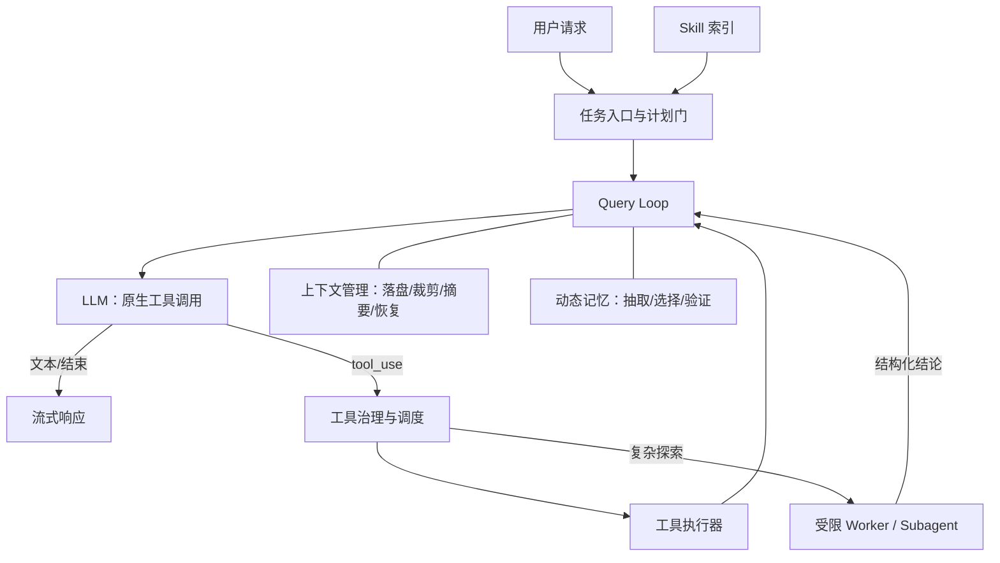

# Claude Code 源码拆解：面试重点与 Agent 实践

> 阅读对象：`01 Claude Code源码拆解.md`。本文将原文的「使用方法论」和「源码架构」分开，并把可复用结论落到 Agent 设计上。
>
> 注意：原文包含对特定版本源码/泄漏代码的解读。面试时应表述为“根据该版本实现/该文档的分析”，不要把具体常量、模型名或内部文件路径当成永久事实。

## 一页结论

Claude Code 最值得学习的不是某个 Prompt，而是一套**把模型能力、工具执行、上下文、权限和协作拆开治理**的工程体系：

1. 主循环保持极简：模型决定下一步，运行时负责安全地执行、回填、重试和退出。
2. 上下文管理的目标不是省 Token，而是按信息类型保住任务意图、进度和可恢复状态。
3. 在代码库场景优先使用“模型驱动的实时检索”（Glob/Grep/Read），而不是默认上一套向量 RAG。
4. 记忆是“有时效的历史快照”，需要结构、选择、验证和淘汰，而非无限堆积。
5. 多 Agent 的价值首先是**上下文隔离与并行**，不是“多几个模型一起聊天”。
6. Skill 的本质是知识/流程的**渐进式加载机制**，而非一份普通 Markdown。

## 文档脉络

### 第一部分：把 Claude Code 用对

- `CLAUDE.md`：项目级、用户级、目录级规则；只写稳定、可执行、能减少返工的约束，避免成为大而全的说明书。
- 大型代码库：简单定位走 `Glob → Grep → Read`；开放式调研交给 Explore 子 Agent；通过会话拆分、批处理降低主上下文压力。
- Skill：用短而准确的触发描述，让模型在需要时加载流程、参考资料和脚本。
- SDD（规约驱动开发）：`specify → plan → tasks → implement`，把需求、方案和实现分阶段对齐。
- `grill-me`：复杂需求先逐个澄清关键决策；能从代码库获得的答案不打扰用户。

### 第二部分：源码架构与工程机制

1. 四层架构：引擎层、工具层、服务层、安全与治理层。
2. Query Loop：流式模型调用、工具编排、跨轮状态、异常恢复。
3. 上下文压缩：从无损/低成本策略逐步升级到全量结构化摘要。
4. 代码检索：`Glob + Grep + Read` 的多轮、实时、可解释检索。
5. 记忆：静态项目规则 + 动态结构化记忆；索引常驻，内容按需加载。
6. 多 Agent：工具隔离、字段级上下文隔离、消息通信、Coordinator-Worker。
7. Skill：书脊（描述）常驻、正文按需注入、参考资料再按需读取。

## 面试重点（优先级从高到低）

### 1. Agent 主循环：不要把 ReAct 当成唯一答案

**核心观点**：现代 Tool Calling Agent 可以采用原生 `tool_use` 循环：模型返回工具调用就执行并回填；没有工具调用/返回终止信号就结束。显式 Thought-Action-Observation 并非必需。

```text
准备消息（必要时压缩）
  → 流式调用 LLM
  → 收集文本与 tool_use
  → 无工具调用：结束
  → 有工具调用：按安全策略执行、回填 tool_result
  → 下一轮
```

**为什么是面试重点**：能顺带回答工具调用、流式输出、终止条件、状态管理、最大轮数、取消、中断和错误恢复。

**推荐答法**：

> 我会把 Agent 的核心做成事件驱动的 Tool-Use Loop，而不是依赖解析自然语言格式的 ReAct。模型原生输出结构化工具调用，运行时负责校验参数、权限和并发，然后把结果作为下一轮上下文回填。正常路径很短，但生产级重点是异常路径：取消、工具失败、模型截断、超上下文、最大轮数和可观测退出原因。

**容易追问**：

- 为什么要用 `async generator`？——让 token、工具事件、进度事件持续向 UI/调用方流动，避免等待整个任务完成。
- 怎么决定继续还是结束？——协议层 `tool_use` / `end_turn` 或“是否存在工具调用块”；不要靠正则匹配 `Final Answer`。
- 怎么止损？——`max_turns`、超时、AbortSignal、递归/重试上限、结构化退出原因。

### 2. 工具模型与安全：工具不只是一个函数

原文强调工具定义应携带治理元数据，例如：只读/会写、是否破坏性、是否可并行、权限级别、输入 Schema、超时和审计信息。

**关键设计**：

- 只读工具可并行；修改外部状态的工具默认串行。
- 元数据缺失时 **fail closed**：按更危险的方式处理。
- 专用 `Grep`/`Read`/`Glob` 工具优于让模型随意通过 Shell 完成一切：权限、输出格式和 Token 预算更可控。
- Plan Mode 本质是缩小工具集：先只读探索与写计划，用户确认后才恢复写权限。

**推荐答法**：

> 权限不应只写在 Prompt 里，而要落在工具执行器。每个工具都声明副作用、并发性和审批策略；调度器据此决定并行、串行或要求确认。未知工具按有副作用处理，这样模型偶尔判断失误也不会越权。

### 3. 上下文管理：按信息半衰期分通道管理

原文归纳为五层压缩金字塔：

| 层级 | 策略 | 核心价值 |
| --- | --- | --- |
| 1 | 大工具结果落盘，仅保留预览与定位信息 | 内容可恢复，几乎无信息损失 |
| 2 | 丢弃明显过时的早期消息 | 零模型调用成本 |
| 3 | 清理老的、可重新获取的工具输出 | 保留不可重放的结果 |
| 4 | 读时生成压缩视图 | 尽量不破坏原会话状态 |
| 5 | 全量结构化摘要 + 状态附件恢复 | 最后的兜底 |

**最有含金量的细节**：

- 不能把所有东西都摘要：意图/决策/待办适合摘要；最近文件、运行中任务、计划、权限状态等应走原样“附件通道”。
- 压缩后要让 Agent 能接续：保留边界标记、结构化当前进度、最近活动文件与异步任务状态。
- 摘要器只生成文本，禁止调用工具；摘要结构至少要覆盖用户意图、涉及文件、错误与修复、待办、当前进度。
- 所有压缩/续写/重试必须有递归守卫与熔断阈值。

**推荐答法**：

> 上下文压缩不是简单保留最近 N 轮，而是信息分类。可重放的工具输出先裁剪，任务意图和当前进度转为结构化摘要，文件和任务状态等精确信息通过附件恢复，全局规则每轮重新构建。这样既降低 Token，又避免压缩后“失忆重做”。

### 4. 代码检索：为什么不能一概而论地上 RAG

**原文结论**：代码库更常需要符号、路径、报错、调用点等精确检索，且代码持续变化，因此默认用实时 `Glob → Grep → Read` 更轻、更准、可解释、无索引滞后。

**正确的边界表述**：不是“RAG 无用”。

- 适合实时搜索：代码符号、配置、调用链、错误栈、最新工作区内容。
- 适合 RAG：稳定的设计文档、历史 PR/工单、跨仓库知识、自然语言规范、大候选集语义发现。
- 适合混合：先用关键词/符号过滤，再对小候选集做语义排序。

**推荐答法**：

> 代码检索不是只比相似度。对于实时且需要精确定位的代码，我会让模型迭代使用文件名搜索、全文检索和按行读取；对于稳定的长文档或语义发现，再引入 RAG。选型依据是数据更新频率、精确性要求和可解释性，而不是“有没有向量库”。

### 5. 记忆：结构化写入比“存得多”更重要

原文的两层记忆：

- **静态层**：多层级 `CLAUDE.md`（用户/项目/目录/条件规则），记录稳定规则与硬约束。
- **动态层**：`user`、`feedback`、`project`、`reference` 四类记忆；每条是独立 Markdown，索引常驻、正文按需加载。

**完整闭环**：

```text
会话结束 → 后台抽取候选记忆 → 分类/去重/写入
新任务开始 → 读取索引 → 小模型选择 Top-K → 加载正文
→ 标注时效 → 关键事实主动验证 → 使用/更新/淘汰
```

**必须讲出的原则**：

- 不记代码路径、函数实现、Git 历史等“可从权威源重新获得”的事实。
- `feedback` / `project` 应保存 Why 与 How to apply，不只存一条孤立结论。
- 记忆有时效：过期记忆应提示验证，不能作为事实真源。
- 候选少（数百级）时，用廉价模型按描述做选择题往往比维护向量库更简单可控。

### 6. 多 Agent：先谈隔离，再谈并行

**常见误区**：把 Multi-Agent 等同于“把任务分成几个 Prompt 同时发”。真正难点是权限、状态、通信和恢复。

| 维度 | 可借鉴设计 |
| --- | --- |
| 工具隔离 | 按角色提供工具；子 Agent 禁止再派生、抢用户交互权、改主任务状态 |
| 上下文隔离 | 字段级决策：文件缓存克隆、取消信号共享、全局 UI 写入禁用、任务登记通道保留 |
| 通信 | 默认“派发—结果返回”；长任务转后台后以结构化事件通知主 Agent |
| 协作 | Coordinator 负责拆解/派发/聚合，Worker 专注执行，避免多人共享同一段上下文 |
| 成本 | 同上下文分支任务可 Fork 并复用前缀缓存；独立任务使用新 Worker |

**推荐答法**：

> 多 Agent 的收益主要来自上下文隔离和并发探索。我的主 Agent 保留用户意图和决策权，探索/检索/评审类任务交给权限收紧的 Worker，Worker 只回传结构化结论。状态不是全共享或全复制，而是按字段处理，避免子任务污染主会话并保留取消、追踪和回收能力。

### 7. Skill 与 SDD：把可靠工作流产品化

**Skill**：常驻的仅是 `name + description`；选中后注入完整 `SKILL.md`；更深的参考资料/脚本再按需读取。`description` 是模型自主触发的关键接口。

**SDD**：对复杂高返工任务，以 `需求规约 → 技术方案 → 可执行任务 → 实现/验证` 取代一口气生成。`grill-me` 适合作为 SDD 前的“单问题澄清器”。

**迁移原则**：

- 高价值流程（发布、迁移、代码评审、数据修复）固化为 Skill。
- 重复且确定的步骤固化为脚本，而非要求模型每次重新推理。
- 危险 Skill 禁止模型自主触发，只允许用户显式调用。
- 复杂任务先澄清决策树，再生成可审阅计划，再开放写权限。

## 可直接用于自己 Agent 项目的架构



### 建议的实现顺序

#### P0：先做一个可靠的单 Agent

1. 原生 Tool Calling Loop，明确 `completed`、`max_turns`、`aborted`、`tool_error` 等退出原因。
2. 工具统一 Schema：输入校验、超时、只读/写入、并发性、审批级别、审计日志。
3. 流式事件协议：文本增量、工具开始/结束、错误、任务进度统一上送。
4. Plan Gate：复杂/高风险任务先只读探索，产出计划后要求确认。

#### P1：解决“能做长任务”

1. 大结果落盘 + 预览；工具输出设置大小、条数和时间衰减预算。
2. 结构化 Compact：显式保存意图、约束、文件、决策、错误、待办、当前工作。
3. 压缩后恢复最近活动文件/计划/后台任务；加重试上限和熔断。
4. 面向代码库提供 `Glob/Grep/Read`，限制读取范围，并保留完整操作轨迹。

#### P2：再加可控记忆和 Skill

1. 先上静态项目规则，再上动态记忆；记忆条目必须有类型、描述、来源、创建时间、失效策略。
2. 小候选集先用 LLM selector，不急于部署向量数据库。
3. Skill 采用“索引常驻、正文按需、附件再按需”；为每个 Skill 编写明确的触发描述。

#### P3：最后做多 Agent

1. 优先实现 Explore/Review 这种只读、结果可汇总的 Worker。
2. Worker 输出固定为：结论、证据位置、未解决问题、置信度、建议下一步。
3. 再引入后台任务、取消传播、任务状态机和 Coordinator；不要一开始让 Agent 任意递归派生。

## 常见误区与修正

| 误区 | 更好的做法 |
| --- | --- |
| 每轮都做一次摘要 | 先裁剪可再获得信息；摘要只作高成本兜底 |
| 所有工具都并行 | 依据副作用和资源冲突调度；写操作默认串行 |
| 所有知识都向量化 | 先判断数据是否稳定、是否需要精确匹配、候选集是否很大 |
| 什么都写入记忆 | 只记不可从权威源轻易推导、且跨会话仍有价值的信息 |
| 子 Agent 全量继承父状态 | 按字段隔离，保留最少必要共享通道 |
| Skill 写得越长越好 | 正文只放主流程；细节进引用文件，确定步骤进脚本 |
| 复杂需求直接开始写代码 | 先澄清、规划、任务拆分，再进入写权限 |

## 面试前 10 分钟速记

1. **主循环**：LLM 决策，运行时执行；生产难点在异常路径。
2. **上下文**：不是滑窗而已，是“摘要 + 状态附件 + 重新注入”的信息分层。
3. **检索**：代码优先实时精确检索，RAG 用在稳定语义知识；二者可混合。
4. **记忆**：结构化、按需、带时效、使用前验证；记忆不是事实源。
5. **多 Agent**：隔离、权限、通信、取消、汇总优先于“并发”。
6. **Skill**：Prompt 内容 + 渐进式披露加载策略；`description` 决定能否被正确触发。
7. **SDD**：先澄清/规约，再计划/拆任务，最后编码；适合高复杂度高返工任务。

