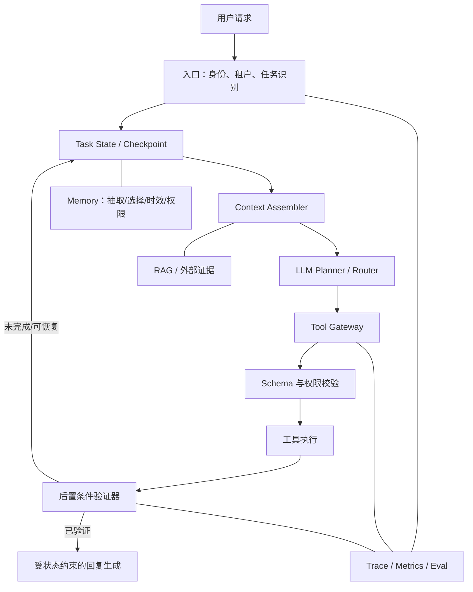

# 大模型 Agent 面试题：重点梳理与项目实践

> 阅读对象：`02 大模型-Agent面试题.md`。
>
> 当前工作区只有面试笔记，没有 Agent 项目源码，因此本文先给出技术栈无关的架构与落地顺序。后续拿到具体代码后，可再映射到模块、接口和任务清单。

## 一页结论

这份文档真正有区分度的，不是 Agent、ReAct、CoT 等概念定义，而是下面六个工程命题：

1. **确定性与灵活性怎么分工**：Workflow 控制主流程，LLM 只在不确定节点做决策。
2. **如何让长任务持续推进**：显式任务状态、意图锚点、Checkpoint 和可恢复执行。
3. **如何证明任务真的完成**：模型提出动作，工具执行，验证器核验外部状态；没有证据不能声称完成。
4. **如何约束工具和数据权限**：Schema、最小权限、副作用分级、审批、幂等、审计都应由代码保证，而不是只写在 Prompt 里。
5. **如何评价 Agent 是否可上线**：同时评工具、轨迹、端到端结果和线上业务；安全项使用硬门禁。
6. **什么时候才值得上 Multi-Agent**：当任务确实可分工、可隔离或可并行时再上；否则优先把单 Agent 做可靠。

如果面试只能重点准备几道题，优先准备 **3、6、17、18、19、20、21、23、24**，再补 **8/9/12、11/16/22**。这些题能组成一套完整的生产级 Agent 设计答案。

## 文档脉络

原文 24 道题可以重组为五条主线，而不是逐题孤立记忆。

### 第一层：先建立 Agent 的基本模型（1～4）

- Agent 与普通 LLM 的区别：Agent 不只生成文本，还在受控运行时里规划、调用工具、观察结果并继续执行。
- 四个基础组件：LLM、工具、记忆、规划。
- Tools、Agent、Workflow 的边界：工具负责执行，Agent 负责动态决策，Workflow 负责确定性编排。
- 工程常用形态：**Workflow 包住主流程，在少数节点嵌入 Agent**，而不是把所有控制权都交给模型。

### 第二层：让 Agent 会规划和纠错（5～7、14～15）

- ReAct：边执行边根据观察调整。
- Plan-and-Execute：先形成可审查计划，再逐步执行；执行中允许 Replan。
- Reflection：对关键产物做检查和修正，不应无差别地每步反思。
- 复杂任务拆成有依赖的子任务；独立步骤可并行，失败后按原因重试、改路或重规划。
- CoT、ToT、GoT 是推理组织方式；生产项目更常落地的是结构化计划、状态机和验证闭环。

### 第三层：让 Agent 记得住、接得上、不跑偏（8～9、12、17～18）

- 区分对话历史、业务状态、任务状态和长期记忆，它们生命周期和可信度不同。
- 上下文是每轮动态装配的工作台，不是聊天记录仓库。
- 记忆压缩可组合滑窗、摘要、重要性过滤和结构化抽取。
- 用 `core_intent`、当前步骤、待办、工具状态和证据引用维持任务连续性。
- 用 Checkpoint、状态版本和幂等键支持中断恢复。

### 第四层：从单 Agent 扩展到多 Agent（10～11、16、22）

- Single-Agent 默认更简单、便宜、易调试；Multi-Agent 的收益是专业分工、上下文隔离和安全并行。
- 常见拓扑包括流水线、中心化 Orchestrator、Handoff/协商。
- 实践上优先中心化调度：主流程静态路由，边缘情况再让 LLM 动态路由。
- 故障治理要同时处理两类问题：租约/心跳解决活性，幂等/版本/唯一 Integrator 解决一致性。

### 第五层：把 Demo 变成生产系统（13、19～24）

- 框架与手写不是二选一：稳定核心循环和治理层应可控，成熟的模型/工具适配可复用。
- 评测覆盖工具、轨迹、端到端任务和线上业务。
- 防死循环依赖状态进展检测和全局预算，而不只是最大步数。
- Trace 应覆盖排队、上下文、模型、检索、工具、重试和验证。
- 模型不能成为“是否完成”和“是否有权限”的最终裁判。
- 数据库安全需要可信身份、最小权限、受控业务工具、AST 校验、脱敏和审计。

## 面试重点：按优先级准备

### P0：必须能结合项目讲清楚

#### 1. Workflow、Agent、Tools 如何分工（第 3、4 题）

**必要回答**：

> Tool 是有明确输入输出的执行能力，本身不决策；Agent 使用模型根据当前状态动态选择下一步；Workflow 则由代码预先定义流程和合法流转。生产系统通常不是纯 Agent，而是用 Workflow 保证整体可控，在分类、规划、异常兜底等不确定节点引入 Agent。

**追问要点**：

- 高风险写操作、审批、权限校验、状态转换必须在 Workflow/执行器中确定性实现。
- 静态流程稳定、可测；Agent 灵活但成本和不可预测性更高。
- 选择标准是任务的不确定性和风险，不是哪个概念更“高级”。

#### 2. ReAct、Plan-and-Execute、Reflection 怎么选（第 5、6、15 题）

**必要回答**：

> 短而开放、需要观察环境再决定下一步的任务适合 ReAct；长任务先做结构化计划，再逐步执行并允许 Replan；Reflection 是关键节点的质量增强机制，适合代码审查、报告验收等高价值产物。选型要同时看任务长度、环境变化、失败成本、延迟和 Token 预算。

**有经验的表达**：不要承诺“加反思一定更好”。同一个模型可能重复原错误，因此反思要有明确 Rubric、外部证据或独立 Checker，并通过评测证明收益。

#### 3. 上下文工程与状态管理（第 17、18 题）

**必要回答**：

> 每次模型调用前，围绕当前子任务动态装配上下文。指令定义边界，结构化任务状态说明目标和进度，近期对话保留语义，长期记忆补充稳定背景，工具结果和 RAG 提供外部事实。执行后把状态增量写回外部存储，下一轮重新装配，而不是依赖模型从长聊天中猜进度。

建议能现场说出这组状态：

```yaml
task_id: task_123
intent_version: 3
core_intent: 修复登录接口偶发超时
success_criteria:
  - 指定压测通过
  - 现有测试无回归
current_step: run_regression_tests
todo:
  - id: T1
    status: done
    evidence_ref: trace_102
  - id: T2
    status: in_progress
pending_tools: []
artifacts: []
state_version: 12
```

关键区分：**对话历史是过程证据，结构化状态是当前结论，长期记忆是跨任务背景。**

#### 4. Agent 如何评测（第 19 题）

**必要回答**：

> 评测分四层：工具层看选择、参数和执行；单步/轨迹层看必需步骤、禁止步骤、顺序依赖和冗余；端到端层验证外部目标状态；线上层看成功率、用户接管率、延迟、Token、成本和安全事件。评测集来自真实请求、历史 Badcase、边界和对抗样本。能确定性判断的优先用代码，开放式质量再用人工或校准过的 LLM Judge。

发布门禁建议分两类：

- **硬门禁**：越权、敏感数据泄漏、错误完成声明、重复副作用、必需审批绕过。
- **优化指标**：成功率、步骤数、P95/P99 延迟、单成功任务成本、用户满意度。

硬门禁不能和流畅度、成本做加权平均后被“抵消”。

#### 5. 如何防止死循环和路径震荡（第 20 题）

**必要回答**：

> 记录标准化动作指纹、结果摘要和执行前后状态；综合判断重复动作、输出相似度和状态是否推进。临时错误做有界退避重试，参数/权限错误直接修正或询问，无进展时禁用失败路径并 Replan。系统还要设置步数、时间、Token、成本和 Handoff 次数预算，耗尽后安全停止。

真正关键的不是“调用重复”，而是**状态长期没有向成功标准推进**。

#### 6. Trace 如何定位延迟（第 21 题）

**必要回答**：

> 先区分 TTFT 和总时延，再按任务类型、模型、工具和版本切分 P50/P95/P99。一个 Trace ID 串起排队、上下文装配、检索、模型、工具、重试、编排和验证，每段记录耗时、状态、Token、输入输出规模和错误类型。用慢 Trace 与正常 Trace 对比关键路径，再按瓶颈分别治理。

优化后必须同时回归成功率、质量、安全和成本，不能只看平均耗时。

#### 7. 如何避免“没做却说做完了”（第 23 题）

**必要回答**：

> 模型只是决策者，不是事实裁判。模型提出工具意图，调度器真正执行并记录结构化回执，验证器再检查数据库、资源、文件或测试结果。只有进入 `verified` 状态，回复层才允许使用“已完成”。超时不能直接重试有副作用的动作，要复用幂等键查询原请求；无法确认时进入 `unknown`，诚实告诉用户结果待确认。

推荐状态机：

```text
PENDING -> PLANNED -> AUTHORIZED -> EXECUTING
        -> EXECUTED -> VERIFYING -> VERIFIED
                         |              |
                         v              v
                      UNKNOWN         FAILED
```

这个问题非常适合展示真实工程经验，因为它同时串起工具协议、状态机、幂等、验证、审计和回复约束。

#### 8. Agent 连接数据库的安全设计（第 24 题）

**必要回答**：

> Prompt 不是安全边界。身份和租户来自可信登录态，策略层逐次授权，数据库账号保持最小权限。高频场景优先封装成窄业务工具；必须 Text-to-SQL 时，用匹配方言的解析器检查 AST，对语句、表、列、函数和规模做 Allowlist，再以只读事务、参数绑定、超时和行数限制执行。结果进入模型前做字段裁剪和脱敏，数据库文本按不可信数据处理。

还要补一句：**查询安全不等于查询正确**。指标口径、时间范围、Join、租户过滤和结果合理性都要单独验证；写操作走独立工具、预览、审批、事务、幂等、影响行数限制和回读验证。

### P1：展示架构深度

#### 9. 记忆系统（第 8、9、12 题）

不要只回答“短期放上下文，长期放向量库”。更完整的答案是：

- 当前任务状态放结构化状态库；近期对话按相关性装配。
- 稳定偏好、历史决策和可复用经验才进入长期记忆。
- 结构化事实优先键值/关系存储；语义材料才适合向量检索；大原文放对象存储并保留引用。
- 写入前做价值判断、去重、来源和时效记录；召回后仍要校验新鲜度与权限。
- 压缩优先删除可重取内容，再做摘要和结构化抽取，不能把任务目标、约束和未决事项一起压没。

#### 10. Single-Agent 与 Multi-Agent（第 10、11、16、22 题）

**必要回答**：

> 默认先做 Single-Agent。只有出现明确的专业边界、上下文隔离需求、可并行任务或独立评审需求时，才引入 Multi-Agent。常用中心化 Orchestrator 管理任务 DAG、权限、预算和最终结果；主路径静态路由，边缘情况动态路由。Worker 使用最小上下文和最小工具集，输出结构化结果，由唯一 Integrator 汇总或提交。

故障恢复需说明：

- 心跳中断不等于 Worker 已停止；用 lease 和 execution epoch 防止旧执行者回写。
- 接管从 Checkpoint 继续，不盲目从头跑。
- 外部副作用使用稳定幂等键。
- 代码修改使用独立 branch/worktree、基线版本、乐观并发和唯一 Integrator。

### P2：理解即可，不宜喧宾夺主

- Agent/LLM 基础定义（第 1、2 题）。
- CoT、ToT、GoT 名词和演进（第 14 题）。
- “框架还是手写”的一般性争论（第 13 题）。

回答这些题时最好快速落回工程边界，不要把主要时间用在背概念或复述论文。

## 可以直接用于自己 Agent 项目的架构



### P0：先建立可靠执行闭环

1. **Task State**：保存目标、成功标准、当前步骤、状态版本、工具调用、证据引用和最终状态。
2. **Tool Contract**：每个工具声明输入/输出 Schema、读写属性、权限、超时、重试策略、幂等要求和敏感字段。
3. **状态机**：限制合法流转；模型可以建议动作，但不能自行把任务改成完成。
4. **Verifier**：为重要工具定义后置条件；代码任务跑测试，写数据后回读，异步任务查询终态。
5. **Trace**：统一记录模型、工具、状态变化、重试、验证和退出原因。

一个实用的工具元数据可以包含：

```yaml
name: send_email
side_effect: write
requires_confirmation: true
idempotency: required
timeout_ms: 10000
retry:
  max_attempts: 2
  retryable_errors: [rate_limited, unavailable]
input_schema: SendEmailRequest
output_schema: SendEmailReceipt
postcondition: receipt.status == accepted
redact_fields: [body, access_token]
```

### P1：让长任务可恢复、可控

1. 每次调用前动态装配上下文，并给指令、任务状态、证据、工具结果和输出分别分配 Token 预算。
2. 在步骤边界持久化 Checkpoint；工具先登记 `planned`，执行后写入 `succeeded/failed/unknown`。
3. 检测无进展循环；保存动作指纹和状态差异，支持有界重试、换路与 Replan。
4. 大工具结果放外部存储，只在状态中保存摘要、哈希和可追溯引用。
5. 回复层从结构化任务结果生成，避免把“已受理”“部分成功”润色成“全部完成”。

### P2：建立评测与发布门禁

1. 先给工具做单元测试和故障注入，再测模型的选择与参数。
2. 为核心任务定义必需步骤、禁止动作、顺序约束和目标外部状态。
3. 把线上 Badcase 自动沉淀成回归样本。
4. 按场景切片看成功率、错误完成声明率、重复副作用率、P95/P99、Token 和单成功任务成本。
5. 模型、Prompt、工具或编排版本升级前跑固定回归集，并做灰度发布。

### P3：满足条件后再加记忆和 Multi-Agent

1. 只保存跨任务仍有价值、不能轻易从权威源重取的信息。
2. 记忆条目带来源、时间、权限域、失效策略和使用反馈。
3. 第一批 Worker 选择只读、低耦合任务，例如搜索、分析、评审。
4. Worker 只返回：结论、证据、产物、未解决问题、置信度和建议下一步。
5. 只有 Orchestrator/Integrator 拥有推进全局状态或最终合并的权限。

## 原文中需要谨慎表述的地方

1. **Agent 不等于完全自主。**自主性是连续谱，生产系统通常只给模型有限决策权。
2. **ReAct 不要求把完整思维链展示或持久化。**更稳妥的是使用原生结构化 Tool Calling，记录可审计的动作与简短决策依据。
3. **长期记忆不等于向量数据库。**结构化事实、事件、文档和用户偏好适合不同存储与召回方式。
4. **反思不保证提升。**没有外部标准时，自我反思可能放大原错误，应通过评测决定启用位置。
5. **并行能降多少延迟没有固定比例。**收益取决于依赖图、最长关键路径、模型限流和工具瓶颈。
6. **共享状态不是所有 Agent 任意读写一个大对象。**应有字段所有权、增量更新、版本控制和最小可见范围。
7. **没有唯一标准轨迹。**评测重点是目标状态、必要约束和安全边界，不是机械匹配每一步。
8. **超时不等于失败。**对于有副作用的调用，超时可能处于结果未知状态，必须先查询或人工确认。

## 面试表达建议

一类高质量回答通常采用下面的顺序：

1. **先下定义并划边界**：它解决什么问题，不解决什么问题。
2. **给出主流程**：从输入、决策、执行、观察到验证。
3. **讲异常路径**：超时、重试、部分成功、重复副作用、状态未知。
4. **讲取舍**：质量、延迟、成本、可控性如何平衡。
5. **落到指标**：怎么证明方案有效，而不是只说“效果更好”。

建议少说“我一般会让 LLM 自己判断”，多说“LLM 产生候选决策，确定性系统负责校验、执行和验证”。这是从 Demo 思维走向生产工程的关键变化。

## 面试前 10 分钟速记

1. Tool 执行，Agent 动态决策，Workflow 确定性编排。
2. 主流程用 Workflow，局部不确定性再交给 Agent。
3. ReAct 边走边调；Plan-and-Execute 先规划再执行；Reflection 只放关键节点。
4. 对话历史是证据，结构化状态是当前结论，长期记忆是跨任务背景。
5. 上下文工程是每轮“选、排、隔离、分预算、再装配”。
6. 没有工具回执和外部验证，不能声称任务完成。
7. 有副作用的调用需要幂等键；超时后先查状态，不能盲目重试。
8. 评测分工具、轨迹、端到端和线上四层；安全项是硬门禁。
9. Multi-Agent 先解决隔离、权限、状态和合并，再谈并发收益。
10. Prompt 不是权限系统、数据库防火墙或事实裁判。
