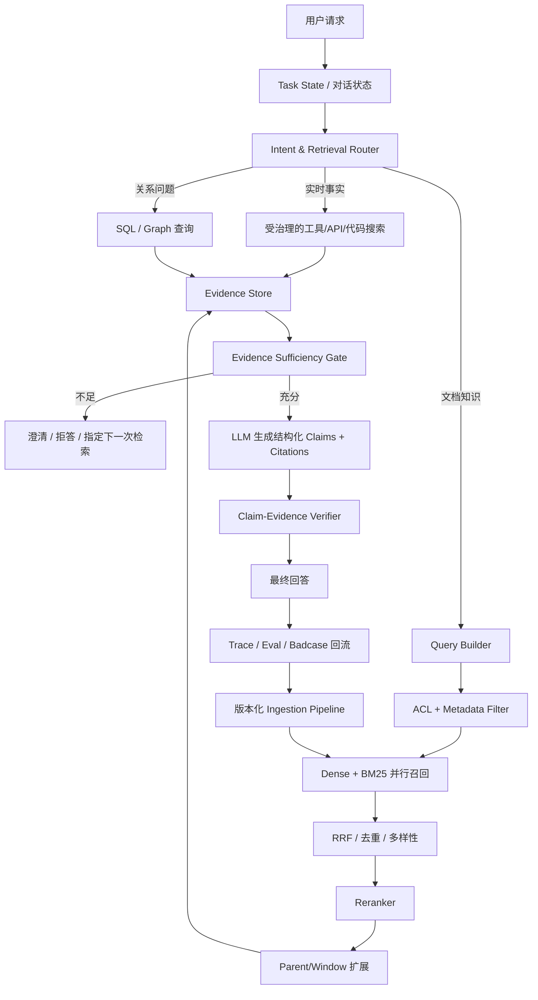

# 大模型 RAG 面试题：重点梳理与 Agent 项目实践

> 阅读对象：`03 大模型-RAG面试题.md`。
>
> 本文不重复原文 21 道题的全部答案，而是提炼知识主线、面试优先级、可迁移到 Agent 项目的设计，并修正文档中容易被追问或说得过满的表述。

## 一页结论

这份文档真正要掌握的不是模型名和数据库名，而是下面六条工程主线：

1. **RAG 是外部证据系统，不只是“向量库 + Prompt”**。完整系统包含数据解析、切块、索引、查询理解、召回、融合、重排、上下文装配、生成、引用校验、评测和持续更新。
2. **检索质量决定可回答上限，证据治理决定可信上限**。召回不到正确证据，模型无法可靠回答；召回了过期、越权或冲突证据，同样会稳定地产生错误答案。
3. **生产检索通常是混合系统**。稠密向量负责语义召回，BM25/全文检索负责型号、错误码、数字和专有名词，metadata filter 负责权限与适用范围，Reranker 负责候选精排。
4. **优化前必须先有评测集**。没有按查询类型切片的测试集，Chunking、Embedding、Top-K、改写、Rerank 和阈值都只能靠感觉调。
5. **RAG 只能降低幻觉，不能消灭幻觉**。必须增加证据充足性门控、拒答、逐条引用和 claim-evidence 校验；“输出了来源编号”不等于引用真实支持结论。
6. **用于 Agent 时，RAG 应是一个受治理的只读工具**。Agent 决定何时查、还缺什么证据；运行时负责权限过滤、查询预算、证据结构、循环上限和引用验证。

面试优先级最高的是：**完整链路、Chunking、混合召回 + Rerank、分层评测、幻觉与引用、增量更新和知识冲突**。Self-RAG、CRAG、GraphRAG 等高级名词只有在能讲清适用条件、成本和降级策略时才加分。

## 文档脉络

原文 21 道题可以整理成五层，而不是彼此独立地背诵。

| 层次 | 对应题目 | 核心问题 |
| --- | --- | --- |
| 价值与边界 | 1～3 | RAG 解决什么；和微调如何分工 |
| 数据与索引 | 4～9 | 文档怎样变成可检索的证据；Embedding 和向量索引怎么选 |
| 在线检索链路 | 10～14 | Query 如何处理；怎样召回、融合、精排并装配上下文 |
| 复杂检索与可信生成 | 15～17 | 何时做自适应检索、图检索；怎样减少无依据生成 |
| 生产治理闭环 | 18～21 | 怎样评测、更新、排障、处理版本与知识冲突 |

### 第一层：先讲清 RAG 为什么存在（1～3）

LLM 的参数知识不适合承载频繁变化、私有、需要权限控制和必须溯源的业务事实。RAG 把这些知识放到外部，在推理时检索并作为证据注入。

RAG 和微调不是替代关系：

- RAG 更适合回答“**依据什么说**”：动态事实、私有知识、可更新内容、可引用证据。
- 微调更适合约束“**怎样表现**”：任务行为、格式、语气、工具使用模式和特定能力分布。
- 微调不应被描述成可靠的知识数据库；RAG 也不会自动让模型获得更强的领域推理能力。

### 第二层：让知识可被找到（4～9）

原始文档经过解析、清洗、结构恢复、Chunking、Embedding 和索引后才成为可检索对象。每个 chunk 至少需要：

- `chunk_id`、`doc_id`、`version_id`、`parent_id`
- 正文与可定位的原文 span
- 标题路径、页码、来源 URI
- 租户、ACL、适用地区/产品/部门
- 生效时间、失效时间、状态与权威等级
- `content_hash`、解析器/切块器/Embedding 版本

Chunking 的关键不是背“500～1000 token”，而是处理两个相反目标：小块便于精准匹配，大块便于完整理解。常见解法是结构化切块、Parent-Child、句子窗口或摘要索引，也就是 **small-to-big：小块检索，大块阅读**。

### 第三层：在线检索不是单次向量搜索（10～14）

更完整的在线链路是：

```text
用户问题与任务状态
  → 意图识别 / 独立问题改写
  → ACL 与 metadata 过滤
  → 原始 Query + 可选改写 Query
  → Dense + BM25/全文检索并行召回
  → 去重 / RRF 融合
  → Rerank
  → Parent/Window 上下文扩展
  → 证据充足性判断
  → 带引用生成
  → claim-evidence 校验
```

Query Rewrite、HyDE、Multi-Query 和 Step-back 都是可选策略，不应对所有请求无条件启用。改写可能改变用户意图，所以生产系统通常保留原始 Query 一路，与改写结果共同召回。

### 第四层：复杂问题需要动态策略（15～17）

- **Self-RAG**：论文方法通过训练模型输出检索与批判 token，实现按需检索和自我评估；普通通用模型可用工作流近似其行为，但不等于复现论文方法。
- **CRAG**：先评估检索质量，再触发纠正动作。论文使用 Web 搜索作为补充源；企业系统更常切换到经过批准的搜索源、数据库或人工流程。
- **GraphRAG**：适合实体关系、跨文档关联和整个语料库的全局问题。微软 GraphRAG 的重点是实体/关系抽取、社区发现、社区报告以及 Local/Global Search，不等于“必须上图数据库”。
- **Agentic RAG**：模型根据当前证据缺口决定是否再次检索、检索什么；必须有查询预算、最大轮次、停止条件和无进展检测。

### 第五层：生产系统的难点是治理（18～21）

文档后四题最有生产含金量：评测决定能不能优化；版本化更新决定知识会不会短暂缺失或无法回滚；来源、时效、适用范围和权限决定系统能不能信任某段内容。

这里最重要的一句话是：

> 相似度只能说明“像不像”，不能说明“该不该信、能不能看、现在是否有效”。

## 面试重点：按优先级准备

### P0：必须能结合项目讲清楚

#### 1. 完整 RAG 链路（第 1、10 题）

推荐用“离线建库 + 在线问答 + 治理闭环”回答，而不是只说“检索再生成”。

**离线阶段**：数据源接入 → 解析与清洗 → 结构化切块 → metadata/ACL → Embedding 与关键词索引 → 质量检查 → 版本发布。

**在线阶段**：Query 理解 → 权限/适用范围过滤 → 多路召回 → 融合 → Rerank → 上下文扩展与预算 → 证据门控 → 生成与引用 → 答案校验。

**治理阶段**：离线评测、线上反馈、Badcase 回流、知识更新、灰度与回滚。

一个 60 秒回答可以这样组织：

> 我把 RAG 分成离线、在线和治理三部分。离线把原始文档解析成带版本、权限和来源的 chunk，同时建立稠密向量索引与关键词索引。在线先把多轮问题还原成独立查询，并在检索前做 ACL 和业务范围过滤；然后并行做 Dense 与 BM25 召回，经 RRF 融合、Cross-Encoder 重排，再用 Parent-Child 补足上下文。生成前检查证据是否足够，不足就澄清或拒答；生成后逐条校验引用。系统效果通过检索、生成、引用、拒答和业务指标分层评估，知识更新用新版本构建、验证、原子切换和可回滚发布。

#### 2. Chunking 与索引设计（第 4、5、14 题）

面试官重点不是问一个固定数字，而是看你是否理解信息结构。

需要讲清：

1. 为什么整篇做一个向量会语义稀释。
2. 为什么过小 chunk 会丢失定义、指代和上下文。
3. 为什么标题路径、表头、代码符号、页码需要进入 metadata 或 chunk 内容。
4. 怎样用 Parent-Child / Sentence Window 做小块检索、大块生成。
5. 怎样通过实验选择 chunk size、overlap，而不是照抄经验值。

文档类型要专项处理：

| 内容类型 | 更合适的处理 |
| --- | --- |
| Markdown/HTML | 按标题层级和段落切，保留标题路径 |
| 普通长文本 | 递归语义边界 + 受控 overlap |
| 代码 | AST/符号级切分，保留文件、类、函数与调用关系 |
| 表格 | 保留表头与单位；大表不能一律整表塞进一个 chunk，可按行组/实体拆分并重复表头 |
| 扫描 PDF | OCR + 版面恢复 + 页码/坐标；抽样验证解析正确率 |
| 图表/图片 | 多模态解析或生成可引用的结构化描述，同时保留原图定位 |

#### 3. 混合召回、融合和 Rerank（第 11、13、14 题）

三者职责不同：

- Dense Retrieval 找语义相近内容。
- BM25/全文检索找精确字面信息，如错误码、型号、数字、缩写、函数名。
- Metadata Filter 先排除无权限、已过期或不适用内容。
- RRF 等融合算法把不同量纲的候选排名合并。
- Reranker 对小候选集做 Query-Document 联合相关性判断。

高质量回答还要提两个细节：

1. Top-K 不是越大越好；它影响召回、延迟、Rerank 成本和最终上下文噪声。
2. Rerank 只看相关性仍不够；最终证据排序还可能需要权威度、时效、版本和多样性约束。

#### 4. 分层评测与 Badcase 定位（第 6、18、20 题）

不要先换模型，先建立固定评测集，并按查询类型切片：事实问答、精确标识符、跨文档、多跳、时效问题、无答案问题、冲突问题、权限问题和多轮指代。

| 层级 | 建议指标 | 能定位的问题 |
| --- | --- | --- |
| 解析/索引 | 解析成功率、表格/标题保真率、索引新鲜度 | 原料是否正确进入知识库 |
| 召回 | Hit@K、Recall@K、MRR、nDCG@K | 找没找到、找全没有、排名是否靠前 |
| 上下文 | Context Precision/Recall、重复率、覆盖率 | 送给模型的证据是否完整且少噪声 |
| 生成 | Answer Correctness/Relevance、Faithfulness | 是否答对、答题、忠于证据 |
| 引用 | Citation Correctness/Completeness | 引用是否真的支持 claim、是否漏引 |
| 拒答 | 无答案识别的 Precision/Recall | 该答时是否拒绝、不该答时是否乱答 |
| 安全 | ACL/租户泄漏率，目标必须为 0 | 是否跨权限检索或引用 |
| 系统 | P50/P95/P99、成本、缓存命中率 | 能否满足工程预算 |
| 业务 | 解决率、转人工率、点踩率、重复追问率 | 是否真正解决用户问题 |

几个容易被追问的点：

- Hit@K 只判断“至少一个相关结果是否出现”；有多个必需证据时更应看 Recall@K 或任务覆盖率。
- MRR 只关注第一个相关结果，低分不一定只怪 Reranker，也可能是候选召回阶段漏了。
- RAGAS/LLM-as-a-Judge 能扩展评测，但仍要用人工样本校准评委偏差，不能取代领域专家。
- `0.7`、`0.8` 等目标值不是行业标准，应由业务风险、数据分布和基线决定。

#### 5. 幻觉、拒答与引用（第 17 题）

RAG 的失败不只有“没检索到”一种：

- 检索遗漏正确证据；
- 检索到了不相关、过期、冲突或越权证据；
- 模型错误理解证据；
- 模型把外部常识或推断伪装成文档事实；
- 引用 ID 存在，但并不支持对应结论；
- 知识源本身错误。

因此可信回答至少需要四道门：

```text
检索前：ACL、租户、时间与业务范围过滤
检索后：相关性与证据覆盖门控
生成时：只陈述可支持内容，逐条绑定 evidence_id
生成后：验证 claim 是否被引用片段蕴含，失败则删改、降级或拒答
```

不要把 Reranker 的原始分数直接当“置信度”。不同模型的分数可能没有校准，阈值必须用“有答案/无答案”验证集和业务损失函数来选择。

#### 6. 动态更新、版本与回滚（第 19 题）

原文的 hash、文档—chunk 关联、轮询/Webhook/消息队列思路是正确的，但生产环境不宜简单执行“删旧 → 再写新”，否则失败窗口内知识会消失。

更稳妥的流程是：

```text
收到变更事件
  → 幂等去重
  → 内容规范化并计算 hash
  → 生成新的 doc_version
  → 解析、切块、向量化到影子版本
  → 完整性检查 + 回归评测
  → 原子切换检索 alias/version filter
  → 保留旧版本供回滚
  → 延迟清理旧 chunk / tombstone
```

需要版本化的不只是文档，还包括 `parser_version`、`chunker_version`、`embedding_model`、`embedding_dimension` 和索引参数。更换 Embedding 模型或切块策略时，应并行构建新索引，不能把新旧向量混在同一空间里比较。

“局部更新绝对不可做”也过于绝对。基于标题锚点、结构节点或内容定义切块，可以只重建受影响区段；是否值得做取决于文档规模、更新频率、一致性要求和实现复杂度。

#### 7. 知识冲突与权限治理（第 21 题）

裁决顺序应是：

```text
权限可见
  → 适用范围匹配
  → 当前处于生效期
  → 来源权威与审批状态
  → 版本覆盖关系
  → 相关性排序
```

同等权威、相同适用范围且同时有效的证据仍冲突时，不让模型暗中二选一；返回冲突状态、分别列出证据，并请求补充条件或转人工。

面试时补充“引用过哪些 `source_id/version_id` 要写入 trace”，会体现生产经验：未来发现某份知识有误时，可以反查受影响回答，而不仅仅是修复知识库。

### P1：体现架构深度

#### 8. Embedding 与向量索引选型（第 6～9 题）

Embedding 选型至少看：语言和领域、Query/Document 非对称训练方式、最大输入长度、向量维度、吞吐、延迟、部署与合规、版本稳定性和业务评测结果。

不要说“维度越高，精度一定越高”。维度只是容量和成本因素，模型训练质量与任务匹配通常更重要。距离度量也应服从模型推荐和是否归一化，不能笼统地认为所有文本向量都必须使用余弦距离。

数据库选型不是背答案，应该说明约束：

- 数据规模、向量维度和增长速度；
- QPS、P95/P99 与召回率要求；
- metadata filter、混合检索和事务需求；
- 更新/删除频率、多租户隔离；
- 备份、扩缩容、运维能力和总成本。

小规模数据可以精确扫描或用现有 PostgreSQL + pgvector；只有规模、延迟、过滤和可用性要求证明有必要时，才引入专用分布式向量库。

如果讲性能数字，必须同时给出：向量条数、维度、索引类型与参数、Top-K、过滤比例、硬件、并发、P50/P95/P99 和召回率。否则“20ms、100 QPS”没有比较意义。

#### 9. 高级 RAG 范式（第 15、16 题）

回答顺序应是“痛点 → 机制 → 代价 → 适用条件”，而不是罗列缩写。

| 范式 | 主要解决什么 | 主要成本/风险 |
| --- | --- | --- |
| Adaptive/Self-RAG | 不是每个问题都需要固定检索 | 路由误判；论文式 Self-RAG 需专门训练 |
| Corrective RAG | 初次检索不可靠时纠正 | 额外评估与外部源延迟；外部源也可能不可信 |
| GraphRAG | 实体关系与语料库全局问题 | 抽取误差、构建与更新成本高 |
| Agentic RAG | 多步骤问题需要动态补证据 | 循环、成本、延迟和不可预测路径 |

图不是多跳问题的唯一方案。Agent 可以把第一次检索得到的实体作为第二次查询，SQL 也能完成大量关系查询。只有当实体/关系是一等数据、路径查询频繁、关系需要治理和复用时，图结构才更有价值。

### P2：理解原理即可

#### 10. 算法演进与论文细节（第 7、8、15 题）

Word2Vec、GloVe、BERT、SBERT、SimCSE、HNSW、IVF 的演进可以用于解释“为什么今天的检索是两阶段架构”，但通常不是项目面最先追问的内容。

需要避免一个常见误述：BERT 并不是“比较任意两个句子都必须拼接”。更准确地说，原始 BERT 的 `[CLS]` 表示没有专门为高质量句向量检索训练；Cross-Encoder 会联合编码 Query 和 Document，精度高但无法预计算文档向量；SBERT 等 Bi-Encoder 让两边独立编码，适合大规模召回。

HNSW 常被描述为具有接近对数级的良好经验扩展性，但它是启发式 ANN 结构，不应把 `O(log N)` 当成对所有数据分布和召回目标都成立的严格保证。面试时更有价值的是讲 `M`、`efConstruction`、`efSearch` 对内存、构建时间、延迟和召回率的权衡。

## 可以直接用于自己 Agent 项目的设计

结合前两份 Agent 笔记，最值得做的不是把所有上下文都塞进向量库，而是先对信息分层。

### 1. 不同信息进入不同通道

| 信息 | 推荐通道 | 原因 |
| --- | --- | --- |
| 系统规则、权限、安全边界 | 静态配置/System Prompt + 执行器 | 必须稳定、不可被检索结果覆盖 |
| 当前目标、步骤、工具回执 | 结构化 Task State/Checkpoint | 要精确、可恢复，不能依赖语义召回 |
| 最新代码、文件、数据库状态 | `Glob/Grep/Read`、SQL/API 等实时工具 | 权威源实时变化，精确检索更重要 |
| 稳定长文档、历史设计、FAQ | RAG | 候选规模大，需要语义发现与引用 |
| 用户偏好和稳定事实 | 结构化记忆 + 来源/时效 | 便于更新、撤销、权限控制 |
| 实体关系、依赖与拓扑 | SQL/图存储 + 文本证据 | 关系查询应由确定性系统执行 |

这能避免“向量数据库 = Agent 长期记忆”的错误设计。RAG 是一种证据召回方式，不是所有状态和记忆的统一存储层。

### 2. 推荐架构



### 3. 把 RAG 封装成受治理工具

不要让模型直接操作向量数据库。给 Agent 暴露稳定的检索契约，例如：

```yaml
name: retrieve_evidence
side_effect: read
input:
  query: string
  tenant_id: string
  user_scope: object
  filters: object
  strategy: auto | hybrid | keyword | semantic
  top_k: integer
output:
  evidences:
    - evidence_id: string
      text: string
      source_uri: string
      doc_id: string
      version_id: string
      location: string
      authority: string
      valid_at: string
      retrieval_scores: object
  coverage: sufficient | partial | insufficient
  missing_aspects: [string]
  trace_id: string
```

运行时而不是 LLM 负责：

- 注入真实的 `tenant_id` 和权限范围；
- 限制 Top-K、查询次数、时间和 Token 预算；
- 过滤过期与无权证据；
- 保留原始查询、改写查询和每路召回结果；
- 返回稳定的 `evidence_id` 与可定位原文；
- 对无进展的重复检索熔断。

### 4. Agentic RAG 的受控循环

Agent 每轮只能基于“缺失证据”提出下一次查询，不能无目的地反复搜索：

```text
当前问题
  → 制定需要证明的子结论
  → 为每个子结论收集证据
  → 标记 supported / conflicting / missing
  → 只对 missing 或 conflicting 项再次检索
  → 达到证据标准，或触发预算/轮次上限
  → 生成或明确拒答
```

建议记录 `(query, filters, result_ids, state_delta)` 指纹。连续两轮结果高度重复且没有新增受支持结论时，应停止、改写策略或请求用户补充，而不是继续烧 Token。

### 5. 实现顺序

#### P0：先建立可评测的基线

1. 收集真实问题，建立包含答案证据 ID、无答案和权限样本的最小黄金集。
2. 实现结构化切块与 metadata；至少包含来源、版本、时间、租户和 ACL。
3. 先做 BM25 + Dense 基线，固定记录候选和指标。
4. 输出可点击到原文位置的引用，不只返回文件名。
5. 把每次检索与生成写入 trace，能够复现 Badcase。

#### P1：提高可靠性

1. 增加 RRF、Rerank、Parent-Child/Window 扩展。
2. 增加证据充足性门控与无答案拒答。
3. 增加 claim-level 引用正确性校验。
4. 增加版本化索引、影子评测、原子切换和回滚。
5. 把 ACL 泄漏、过期知识命中和冲突处理作为发布硬门禁。

#### P2：按 Badcase 增加自适应能力

1. 多轮指代问题多，再加 standalone query rewrite。
2. 用户表达和文档差距明显，再实验 Multi-Query/HyDE；始终与原始 Query 对照。
3. 跨文档复杂问题多，再加有界 Agentic Retrieval。
4. 实体关系和全局主题问题占比足够高，再评估 GraphRAG/图存储。
5. 每增加一个模块，都要证明它在目标切片上提升质量，且延迟和成本可接受。

## 原文中需要谨慎表述的地方

| 原文式表述 | 更稳妥的说法 |
| --- | --- |
| RAG 解决幻觉 | RAG 提供外部依据并降低部分事实幻觉，但仍可能检索错误、误读证据或引用错误 |
| 幻觉就是知识缺失的副产品 | 知识缺失是来源之一，冲突上下文、错误来源、解码和指令遵循失败也会产生幻觉 |
| 维度越高精度越好 | 维度影响容量、存储和计算，但精度不随维度单调提高，要以任务评测为准 |
| 500～1000 token 是标准粒度 | 只能作为起始实验范围；文档结构、问题粒度、模型与上下文预算共同决定 |
| Parent-Child 会让存储翻倍 | 不一定；常见实现只索引子块，把父块存普通文档库，具体看去重与存储结构 |
| HNSW 查询复杂度就是 `O(log N)` | 可说经验上扩展良好或接近对数级；其召回/延迟依赖数据和参数，不宜作无条件保证 |
| BM25 完全不懂同义词 | 原生 BM25 基于词项匹配；同义词词典、查询扩展和分析器可以弥补部分问题 |
| 多 Query 需要 N 次 LLM 调用 | 一次模型调用就可以生成 N 个 Query，但会产生 N 路检索及更大的候选成本 |
| Rerank 分数低于 0.3～0.6 就拒答 | 分数常未校准；阈值必须按具体模型、数据与错答/拒答成本标定 |
| JSON 中有 source ID 就完成溯源 | 只能证明格式正确，还要验证该来源片段是否蕴含对应 claim |
| 图数据库是多跳问题的唯一解 | 迭代检索、SQL 和规则也能多跳；图适合关系是一等数据且路径查询高频的场景 |
| 修改文档永远必须先删旧再新增 | 直接删旧有可用性风险；优先写新版本、验证后原子切换，局部重建也并非不可能 |
| 某个 Hit@5 / RAGAS 分数表示系统合格 | 没有通用及格线，必须结合业务风险、基线、人评和线上指标 |
| 示例 Milvus 数字可作为项目经验 | 只能当容量估算案例；没有真实做过就不要说“我们生产环境”，应明确是压测或设计值 |

另外，“Naive → Advanced → Modular RAG”更适合描述一种综述分类法，而不是全行业严格经历的三个版本阶段；Self-RAG、CRAG 也首先是特定论文方法，不要把所有相似工作流都直接冠以论文名。

## 面试表达建议

高质量回答按下面顺序展开：

1. **先说目标与边界**：它解决什么，不解决什么。
2. **说完整数据流**：输入、索引、召回、排序、生成、验证。
3. **说失败路径**：无答案、冲突、过期、越权、更新失败、模型改写漂移。
4. **说工程取舍**：质量、延迟、成本、复杂度和可维护性。
5. **最后给指标**：怎样通过离线实验和线上指标证明改动有效。

如果没有真实生产经验，应这样表达：

> 我做过本地原型/离线实验，规模是……；生产方案我会这样设计……；具体延迟和阈值需要在目标硬件与业务数据上压测标定。

不要把文档里的“150 万条、20ms、100 QPS、SQ8 后 3GB”等案例改成自己的经历。面试官通常会继续追问硬件、过滤比例、索引参数、召回率和故障细节，虚构数字很容易被识别。

## 面试前 10 分钟速记

1. RAG 是外部证据系统：离线建库、在线检索、可信生成、评测更新缺一不可。
2. RAG 负责“依据什么说”，微调更适合“怎样表现”；二者可以组合。
3. Chunking 没有固定最佳值；核心矛盾是小块检索准、大块阅读全。
4. 生产召回常用 Dense + BM25 + metadata filter，RRF 融合，Rerank 精排。
5. Query Rewrite 可能漂移；保留原始 Query，按查询类型选择改写策略。
6. 检索层看 Hit/Recall/MRR/nDCG，生成层看正确性、相关性、忠实度和引用。
7. 有来源编号不等于有证据；要做 claim-evidence entailment 校验。
8. 知识更新优先新版本构建、影子评测、原子切换和可回滚，不直接删旧裸奔。
9. 相似度不代表权威；先做权限、适用范围、有效期、版本和来源裁决。
10. Agentic RAG 必须有证据缺口、查询预算、最大轮次和无进展熔断。
11. 不是所有 Agent 信息都放向量库：任务状态、实时事实、规则和用户记忆各有存储通道。
12. 没有真实做过的性能与生产故障案例，不要包装成自己的经验。

## 进一步核对的权威资料

- [OpenAI Embeddings 指南](https://developers.openai.com/api/docs/guides/embeddings)：确认 `text-embedding-3-small/large` 的默认维度、可选维度与输入限制。
- [Qwen3-Embedding 官方仓库](https://github.com/QwenLM/Qwen3-Embedding)：模型尺寸、指令感知、多语言与灵活维度应以具体版本说明为准。
- [Cohere Embed 官方文档](https://docs.cohere.com/v2/docs/cohere-embed)：Embed v4 的多模态、维度和上下文信息。
- [Self-RAG 论文](https://arxiv.org/abs/2310.11511)：论文方法依赖按需检索与专门训练的 reflection tokens。
- [CRAG 论文](https://arxiv.org/abs/2401.15884)：检索评估、Correct/Incorrect/Ambiguous 路由以及纠正性外部检索。
- [Microsoft GraphRAG 官方文档](https://microsoft.github.io/graphrag/query/overview/)：Local、Global、DRIFT 与 Basic Search 的当前定义。
- [Ragas 指标文档](https://docs.ragas.io/en/latest/concepts/metrics/available_metrics/)：指标名称和计算依赖会随版本变化，项目中应锁定版本。
- [HNSW 原始论文](https://arxiv.org/abs/1603.09320)与 [Milvus 索引文档](https://milvus.io/docs/index.md)：区分算法经验扩展性、索引参数与具体产品实现。
