## 1. 什么是 RAG？详细描述一个完整 RAG 系统的详细工作流程？

### 💡 简要回答

RAG 全称是 Retrieval-Augmented Generation，就是检索增强生成。它解决的核心问题是，**LLM 的知识在训练完之后就固定了，遇到私有数据或者最新的信息它就答不上来。RAG 的做法是在生成答案之前，先去外部知识库里检索相关内容，然后把检索结果和用户的问题一起交给 LLM，让它基于这些上下文来回答**。本质上就是给 LLM 开了一个开卷考试的口子，不用再靠死记硬背了。

### 📝 详细解析

#### 1.1 LLM 的「知识冻结」困境

LLM 为什么需要 RAG？它的知识到底差在哪？

一个 LLM 训练完之后，它的知识就冻住了，训练数据截止日期之后发生的事情它一无所知，你们公司内部的文档它更不知道。就好比一个人高考之后再也不看新闻，你问他今天的股价，他怎么可能答得上来？

那能不能靠微调来更新知识呢？理论上可以，但微调成本高、耗时长，最关键的是，知识一旦写进模型参数，以后想更新就得重新训练一遍。这就好比你为了让一个人记住一条新闻，让他重新上了一遍大学，太不划算了。

RAG 走了一条完全不同的路：不把知识塞进模型参数里，而是**在用户提问的时候，实时去外部知识库检索，把找到的相关内容直接放进 prompt 给 LLM 读。LLM 本身有很强的阅读理解能力，就算它之前不「知道」这段内容，只要你把它放在上下文里，它就能基于这段内容来回答问题。**这就是 RAG 的核心思想：既然模型记不住，那就给它开卷考试。

一个完整的 RAG 系统分**离线**和**在线**两个阶段。

#### 1.2 离线阶段：提前把知识准备好

离线阶段的目标很明确：在用户提问之前，就把知识库建好。这一阶段只做一次，建好了后面反复用。

第一步是**文档加载**。把各种格式的原始数据读取进来，可以是 PDF、Word、Markdown、网页、数据库记录等。这一步通常用 LlamaIndex 或 LangChain 提供的 DocumentLoader 来做。

接下来是**文档切割（Chunking）**。为什么不把整篇文档直接存进去检索，非要切成一块一块的？原因有两个。一是**向量模型有输入长度限制**，一般最多几百到几千个 token，整篇文档根本塞不进去。二是，如果把一整篇文章压缩成一个向量，**细节信息会被「平均掉」**。这就好比你问「这道菜怎么样」，对方回答「中国菜整体偏咸」，具体哪道菜咸、咸到什么程度，全丢失了。

所以要把文档切成小片段（chunk），每个 chunk 代表一段聚焦的内容。那 chunk 大小怎么定？太大了，信息太杂，检索时容易召回来一堆不相关的东西；太小了，语义不完整，上下文被切断了。实践中通常 500～1000 token 一个 chunk，同时做一定的重叠（比如前后各重叠 100 token），避免把一段完整的语义从中间切断。

**最核心**的一步：**Embedding（向量化）**。Embedding 模型会把一段文字转成一个高维数字向量，可以把它理解成一个「**语义坐标系**」。什么意思呢？**语义相似的文本，它们在这个坐标系里的位置就靠近；语义不相关的，位置就离得远。**

Embedding 模型在训练时看了海量文本，学会了识别哪些句子表达的是同一个意思，然后用对比学习等方法不断调整权重，让「意思相近的文本」在输出空间里靠近、「不相关的文本」离远。所以不是模型天生懂语义，而是训练让模型「把相近的拉近、无关的推远」，这种空间结构一旦形成，查询时就能用距离计算来找语义相近的内容了。

比如「苹果手机怎么截图」和「iPhone 如何截屏」，这两句话用词不一样，但意思一样，所以它们的向量会非常接近。Embedding 做的事情，就是把「意思」编码成数学坐标，意思越相近，坐标越靠近。这就是语义检索的基础，它不是在匹配关键词，而是在比较「意思相不相近」。

最后一步是**入库**，把每个 chunk 的向量和原始文本一起存进向量数据库。向量数据库专门优化了高维向量的存储和相似度搜索，常见的有 Chroma、Milvus、Qdrant、Weaviate 等，支持在千万量级的向量里快速找到最相近的几条。

到这里，离线阶段就完成了。知识库已经建好，等着在线阶段来检索。

#### 1.3 在线阶段：用户提问时实时检索

在线阶段是每次用户提问时实时执行的，对响应速度有要求。

第一步是**Query 处理**。用户的提问往往是口语化的，或者比较模糊，直接拿去检索效果不一定好。比如用户问「上次说的那个方案怎么样」，这个问题离开对话上下文完全没法检索，因为检索系统根本不知道「上次」指的是什么、「那个方案」又是哪个。所以实际工程里会加一步 Query 改写，**让 LLM 把用户的问题改写成更适合检索的形式，或者从对话历史里补充必要的上下文。**

然后是**向量检索（粗排）**。把用户的问题也转成向量，然后**去向量库里做相似度搜索，找出向量距离最近的 Top-K 个 chunk。**这一步速度非常快，即使是百万量级的向量库，通常也能在几十毫秒内返回结果。但速度快是有代价的，向量检索本质上只是比较两个向量的距离，它没有深度理解查询和文档之间的语义关系，所以召回的结果里难免混入一些「看着近但其实不相关」的内容。

接下来是**Rerank（精排）**。这一步就是为了弥补粗排的不足。**Rerank 模型（通常是 Cross-Encoder 结构）会把用户问题和每个候选 chunk 拼在一起，深度理解它们之间的相关性，然后重新排序，把不相关的结果过滤掉。**打个比方，粗排就像你用肉眼在书架上快速扫了一遍，把看着可能相关的书都抽了出来；精排就是你一本一本翻开读目录，确认哪些书真正有用。精排更准但更慢，所以通常只对粗排返回的 Top-20 结果做精排，最终留下 Top-3 到 Top-5。

最后是**生成**，把用户问题 + 精排后的 chunk 拼成 prompt，交给 LLM 生成最终答案。Prompt 里通常会明确告诉 LLM「只根据提供的资料回答，资料里没有就说不知道」，这样能有效抑制 LLM 瞎编的倾向。

#### 1.4 串起来看完整流程

离线阶段把文档切割成 chunk，转成向量存进数据库，这一步只做一次；在线阶段每次用户提问时，先把问题向量化，再去数据库里检索，经过精排后拼进 prompt，最终由 LLM 生成答案。两个阶段分工明确，离线负责建库，在线负责检索和生成。

RAG 最核心的价值：一是**知识可以随时热更新**，往知识库里加新文档就行，不需要重新训练模型，成本极低。二是**答案有溯源**，每条回答都能追溯到来自哪个 chunk，可解释性比纯 LLM 生成强很多，遇到答错了也知道是哪条知识出了问题。这也是为什么企业落地 AI 问答系统，RAG 是首选方案。

### 🎯 面试总结

面试官问「什么是 RAG」，你不能只说「检索+生成」五个字就完了，得说清楚三件事。第一，RAG 解决的是什么问题？LLM 知识冻结、无法覆盖私有数据和最新信息，这是 RAG 存在的理由。第二，RAG 和微调的本质区别是什么？微调是把知识写进模型参数，RAG 是把知识放在外部实时检索，不动模型本身。这两点搞清楚了，面试官就知道你不是背定义的。

然后面试官一定会追问「完整工作流程」。这时候你要按离线和在线两个阶段来讲。离线阶段：文档加载 → 切割（Chunking）→ 向量化（Embedding）→ 入库，这一步只做一次。在线阶段：Query 改写 → 向量检索（粗排）→ Rerank（精排）→ 拼接 prompt → LLM 生成，每次用户提问都要跑一遍。每个环节干什么、为什么需要，都要能说清楚。

最后，如果能再补一句 RAG 的核心价值，知识可热更新、答案可溯源，面试官基本就没什么好追问的了。

## 2. 大模型的 RAG 主要用来解决什么问题？

### 💡 简要回答

RAG 主要解决三个问题。

第一是**知识时效性**，LLM 训练完知识就固定了，训练截止日期之后发生的事它一无所知；第二是**私有知识覆盖**，公司内部文档、行业专有数据根本没有机会进训练集，LLM 对这些内容是空白的；第三是**幻觉问题**，没有知识依据时 LLM 容易「自己发挥」编出一个听起来合理但实际错误的答案，给了它参考资料之后幻觉就少很多。

这三个问题的根源都是同一件事，知识被固化在了模型参数里。**RAG 的解法是把知识存到外部，用的时候实时检索注入，彻底绕开了参数里的知识限制。**

### 📝 详细解析

#### 2.1 LLM 的「知识冻结」问题

LLM 在预训练阶段，通过阅读海量的文本，把这些文本里包含的知识逐渐「编码」到模型的参数权重里。你可以把它想象成一本写死了内容的百科全书，书里的知识丰富，但一旦印刷完成就没法再改内容了。

训练数据收集到什么时候，模型就只知道那个时间点之前的事情。训练完成之后，不管外部世界发生了什么，模型的参数都不会自动更新，这就是「知识冻结」。

你可能会想，那就重新训练一遍呗？理论上可以，但训练一次 GPT 级别的模型，成本是千万美元级别的，你不可能每周都来一遍。那微调呢？微调确实能注入一些新知识，但成本也不低，而且微调出来的知识没法溯源，你不知道模型是从哪条知识推出来的答案，出错了也找不到原因。

所以「知识冻结」不是一个可以靠重新训练轻易解决的问题，它是 LLM 架构的固有特性。这个特性直接导致了三个问题，而且这三个问题是一环扣一环的。

#### 2.2 知识过期：训练数据有截止日期

你问 LLM「今年发布的某款产品有哪些新功能」，如果它的训练数据截止在发布日期之前，它不知道，但它不会说「我不知道」，而是会用自己见过的历史规律，「推测」出一个听起来合理的答案。这个答案可能是错的，但它说得很自信。

金融场景里用 LLM 来辅助分析，如果模型不知道某公司最近一季度的财报数据，它给出的分析就是基于过期信息的，参考价值大打折扣。这类问题在 LLM 刚发布时不那么明显，但随着时间推移，训练数据越来越陈旧，时效性问题会越来越严重。

但时效性只是一个维度，还有一类知识是「从一开始就没进过训练集」的。

#### 2.3 知识空白：私有数据根本没进过训练集

公开互联网上的知识，LLM 或多或少见过；但每家公司的内部文档，比如产品手册、客服知识库、合同模板、行业规范，这些东西根本不会出现在公开训练数据里。时效性说的是「旧了」，私有知识说的是「压根没有」。

你让 LLM 扮演一个客服机器人，回答「我们产品的退款政策是什么」，它不可能知道你们公司特定的退款规定，因为这条信息根本没有进过它的训练集。如果它回答了，那一定是在编。这在企业落地 AI 时是最普遍的痛点：**企业有大量的私有知识需要让 AI 来「理解」和「回答」，但靠重新训练是不现实的，成本高、周期长，而且数据天天在更新，没法每次更新都重新训练一遍。**

那知识过期和知识缺失加在一起，会导致什么后果呢？就是幻觉。

#### 2.4 知识缺失的副产品：幻觉

为什么会产生幻觉？因为 LLM 的核心机制是「预测下一个词」，它在训练时的目标就是「给定前面的文字，预测下一个最可能的 token」，这个机制天然倾向于一直生成下去，直到输出停止符。它没有内置「我不确定就停下来」的开关，也没办法「知道自己不知道」。当参数里的知识不够用的时候，它只能硬着头皮往下生成，把相关的、不相关的知识拼凑出一个「听起来合理」的答案，用户很难分辨哪句话是真实的、哪句话是编出来的。

很多人有个误区，以为幻觉是 LLM 的一个独立 bug，需要单独治理。其实不是，**幻觉是知识缺失的副产品，是模型在没有可靠依据时的「应急策略」**。知识过期会导致幻觉，知识缺失也会导致幻觉，根源都是同一件事：模型参数里没有对应的知识。

#### 2.5 RAG 是怎么解决这三个问题的

既然知识冻在参数里是一切问题的根源，那能不能不把知识放在参数里？

RAG 把知识存到外部知识库，用的时候实时检索注入，彻底绕开了参数里的知识限制。

具体来说，知识被整理成文档，预处理后存入向量数据库；用户提问时，先去数据库里检索最相关的内容片段，把这些片段和用户的问题一起塞进 prompt，让 LLM 基于这些「参考资料」来回答，而不是靠自己的记忆凭空作答。

知识过期：新内容随时入库，不需要重新训练模型，知识库更新了就立刻生效。
知识缺失：公司文档入库之后，LLM 就能「看到」这些内容，问私有问题就能给出准确答案。
幻觉：LLM 有了真实的参考依据，生成答案时是在「复述」检索到的内容，而不是凭记忆发挥，幻觉率会显著降低；每条答案都能追溯到来源，用户可以自己去原文核实，可信度大幅提升。

简单说，RAG 本质上是给 LLM 开了一个「开卷考试」的口子，知识存在外面，用的时候翻出来看，不需要全靠死记硬背。这个设计思路让知识管理和模型能力彻底解耦，更新知识不需要碰模型，扩充领域知识只需要扩充知识库，这也是它成为企业 AI 落地首选方案的根本原因。

### 🎯 面试总结

面试官问这个问题，想听到的是你对 **LLM 局限性**的系统理解。你需要讲清楚三个问题**：知识时效性（训练数据有截止日期）、私有知识缺失（企业内部数据没进过训练集）、幻觉（没有依据时模型会编答案）。**这三个问题的根源是同一件事：知识被冻在了模型参数里。

然后要说清楚 RAG 的解法思路：把知识从模型参数里搬到外部知识库，用的时候实时检索注入，不动模型本身。这个思路同时解决了三个问题，而且知识可以随时更新、答案可以溯源。

如果面试官追问「那幻觉是不是 RAG 专门解决的」，你要能回答：**幻觉只是知识缺失的副产品，RAG 解决的是根源，不是单独在治幻觉。**

## 3. 相比直接微调 LLM，RAG 解决了什么问题？微调和 RAG 各自的优劣势是什么？

### 💡 简要回答

我的理解是这两个东西解决的不是同一层面的问题，不是谁替代谁的关系。

**微调是把新知识直接烧进模型参数里，适合改变模型的行为风格或者培养深度的专业能力；RAG 是在推理的时候实时检索注入知识，适合知识需要频繁更新、或者需要有溯源的场景。**

如果非要让我选一个，知识库类的问答系统我会首选 RAG，成本低而且可以随时更新。如果是要让模型学会特定的输出格式或者行业语气，那微调更合适。

实际上这两个方案也可以组合用，先微调再套 RAG。

### 📝 详细解析

LLM 的「知识」是训练时通过海量文本学到的，最终以权重参数的形式固化在模型里。可以把它理解成「把知识烧进了 ROM」，训练完成之后，这些知识就不会自己更新，模型就不再「成长」了，它不知道新发生的事，也不知道你的私有数据。

理解了「LLM 的知识是固化在参数里的」，就能理解为什么需要微调和 RAG 这两种方案了，它们本质上都是在解决同一个问题：怎么把模型训练时没学到的知识给它补上。只不过思路完全不同，一个是直接改参数，一个是不改参数、推理时现查。

#### 3.1 微调（Fine-tuning）：把知识直接烧进模型

**微调是直接改模型参数的方案。用你自己的数据继续训练，让模型把这些新知识「记」进去。**微调的优势是效果非常彻底，模型会从内部改变，不管是专业词汇、输出格式、回答风格，都能深度定制。而且推理时不需要额外的检索步骤，响应延迟低。

缺陷：

- **成本**：需要准备标注数据、租用 GPU、跑训练，时间和金钱成本都不低。
- **知识更新**：业务数据每周都在变，你不可能每周都重新微调一次，每次微调都是几小时到几天的训练，成本根本扛不住。
- **不透明**：模型的回答来自参数里，你不知道它是从哪条知识推出来的，出错了也很难定位原因。很多人以为微调之后模型就「懂」了你的业务知识，其实模型只是记住了训练数据里的模式，它到底记住了什么、记错了什么，你根本无从得知。

#### 3.2 RAG：不改参数，推理时现查知识

RAG 绕开了这些问题，**它不改模型参数，而是在推理时临时把知识塞进 prompt。**知识库更新只是往向量库里加文档，不需要重新训练，加完就生效。回答可以附上来源 chunk，出错了马上知道是哪条知识有问题。成本也低得多，小团队用 OpenAI Embedding + Chroma 就能跑起来。

缺陷：

- 多了检索步骤，整体**响应延迟会增加**几百毫秒到一秒。

- 「**检索质量上限**」：如果相关的 chunk 没被检索回来，LLM 再强也答不出来。生成层（LLM）只是在复述和整理检索到的内容，它的上限被检索层死死卡住，你只能回答你检索到的知识，没检索到的东西，LLM 是变不出来的。所以 **RAG 系统调优的主战场永远是检索这一层，不是换更强的 LLM**。真正该优化的是检索质量。

- **对复杂推理能力提升有限**，RAG 只是给模型提供了「参考资料」，但如果你需要模型对某个领域有更深的推理能力，光靠检索资料是不够的，还是得微调。

#### 3.3 组合使用：微调解决「怎么说」，RAG 解决「说什么」

一个典型的组合是：先对基础模型做一轮微调，让它学会输出格式、语气风格、行业术语；再用 RAG 来提供具体的知识内容。微调解决「怎么说」，RAG 解决「说什么」，各司其职。

把两种方案的核心差异对比起来，选型的时候更好做判断：

| 维度       | 微调（Fine-tuning）        | RAG                           |
| ---------- | -------------------------- | ----------------------------- |
| 知识更新   | 需要重新训练，成本高       | 更新知识库即可，实时生效      |
| 推理延迟   | 低，无额外检索步骤         | 较高，多一次检索耗时          |
| 实现成本   | 高，需要 GPU 和标注数据    | 低，向量库 + Embedding 即可   |
| 答案可溯源 | 不支持，来自模型参数       | 支持，可追溯到具体 chunk      |
| 适合场景   | 定制输出风格、深度专业能力 | 私有知识问答、动态更新数据    |
| 知识上限   | 受限于训练数据质量和规模   | 受限于检索质量和 context 长度 |

### 🎯 面试总结

面试官问 RAG 和微调的区别，你要先说清本质：**微调是改模型参数，RAG 是不改参数、推理时注入知识。**然后各说优劣：微调擅长定制输出风格、培养深度专业能力，但成本高、更新慢、不可溯源；RAG 擅长知识频繁更新、答案可溯源的场景，但多了检索延迟、检索质量卡住上限。

最后一定要提到两者可以组合使用：微调解决「怎么说」，RAG 解决「说什么」。能把这个组合思路讲出来，面试官就知道你不只是背了定义，而是真正理解了怎么在工程里做选型。

## 4. RAG 中的文档是怎么存的？粒度是多大？详细说说文档切割策略？

### 💡 简要回答

**文档**不能直接存进向量库，必须**先切成小块也就是 chunk，每个 chunk 分别向量化之后存成一条记录。**

每条记录我理解有三个核心部分：**向量用于相似度检索，原始文本是检索命中之后塞给 LLM 读的内容，metadata 是来源文件、页码这些附加信息，用于过滤和溯源。**这两个东西缺一不可，向量负责找到，原文负责阅读。

切割粒度没有固定答案，通常 500 到 1000 个 token 是一个合理的起点，但更重要的是根据文档类型来选策略，普通文本用固定大小加重叠，有标题结构的文档按语义边界切，代码按函数切，如果既要检索精度又要上下文完整的话，用父子切割，也就是小块检索、大块返回

### 📝 详细解析

#### 4.1 文档是怎么存的？

：**原始文档不能直接存进向量库，必须先切成小块（chunk）再存。**

原因有两个：

- 向量模型有输入长度限制，一般最多几百到几千 token，一篇几千字的文档根本塞不进去。

- 就算模型支持超长输入，把整篇文章压缩成一个向量，细节信息会被「平均掉」，你想找「退款政策」，但向量里还混着「配送时效」「积分规则」等内容，最终检索到的就是这篇笼统的文档，而不是精确的那段话。


很多人以为向量模型无所不能，其实它和人类阅读一样，信息太密集就抓不住重点。

所以文档入库的完整流程是这样的：

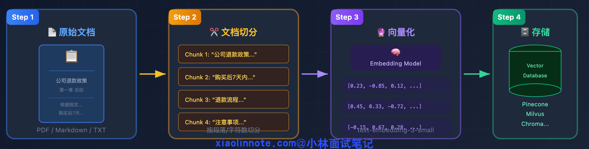

一篇文档会变成向量库里的多条记录，这是 RAG 存储的核心特点。一篇 5000 字的文档，切成 500 字一个 chunk，就是 10 条记录；100 篇文档就是 1000 条记录。

**每条 chunk 记录的结构**

向量库里每一条记录通常包含三个部分：

**向量是索引卡，原文是书页，metadata 是书签**。索引卡（向量）告诉你这段内容在语义空间里的位置，用于快速找到相关内容；书页（原文）才是 LLM 真正要阅读的内容，检索命中后原封不动地塞进 prompt；书签（metadata）记的是来源文件名、页码、章节这些附加信息，用于过滤（「只搜客服部门的文档」）和溯源（「这个答案来自哪个文件的第几页」）。

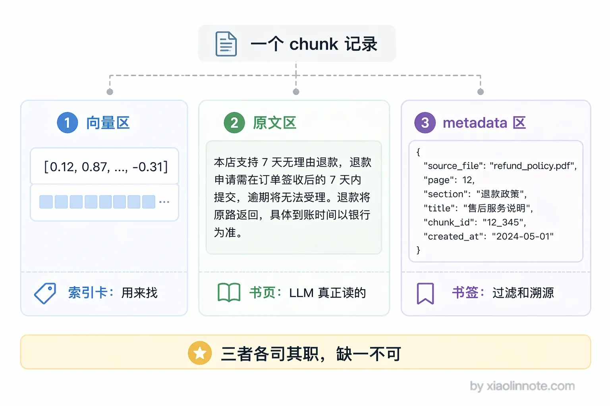

向量和原文为什么要同时存？因为它们承担的角色完全不同。向量是一串浮点数，LLM 看不懂，只有检索系统才会用到它；原文是纯文字，没有向量就没法做相似度检索。向量负责「找到」，原文负责「阅读」，两者缺一不可。

理解了存储结构，查询时的流程就很顺了：

用户问题 -> 向量化 -> 在向量库里找相似的 chunk -> 取出 chunk 的原文 -> 塞进 prompt -> LLM 生成答案。向量只在「找」的时候用，LLM 最终读的是原文。

#### 4.2 粒度怎么定?

既然要切，切成多大合适？粒度选择本质上是在两个方向上做取舍。chunk 太大，向量把太多语义压缩在一起，变得笼统，检索时容易召回和问题只有部分相关的内容，同时也更容易超出 Embedding 模型的输入长度限制。chunk 太小，单个 chunk 语义不完整，上下文丢失，LLM 拿到这段内容也看不懂，而且检索噪音更多。

通常 500～1000 token 是合理的起点，但更重要的是结合文档的内容结构来决定。那具体怎么结合呢？下面分策略详细讲。

#### 4.3 文档切割策略有哪些？

##### 策略一：固定大小切割（Fixed Size Chunking）

优点是实现简单、chunk 大小可控；缺点是可能在句子中间截断，破坏语义完整性。

纯固定大小几乎不单独使用，通常会加上**重叠（overlap）**来缓解边界截断问题。你可能觉得这种方式太粗暴了，确实如此。重叠就像扫描仪扫跨页内容时特意扫两遍边缘区域，前一个 chunk 的末尾和下一个 chunk 的开头有一段重叠内容，确保跨边界的语义能被至少一个 chunk 完整覆盖。

比如 chunk_size=500、overlap=100，后一个 chunk 的前 100 个字符和前一个 chunk 的后 100 个字符是相同的，即使边界切在了一句话中间，这句话也一定完整地出现在某一个 chunk 里。

这种策略适合纯文本、没有明显结构的文档，是最简单也是最保底的选择。但保底毕竟只是保底，如果你希望切割质量更高，就需要理解下面这种策略。

##### 策略二：语义边界切割（Semantic/Structure Based Chunking）

按文档的自然语义边界来切，比如段落、句子、标题层级。核心思想是：不要在语义中间截断，找到文字天然的「断点」再切。

为什么语义边界更好？因为一个句子是语言表达意思的最小完整单位，在句子中间截断就像切断一段话的呼吸，前半句和后半句单独拿出来都看不懂。按段落切则更进一步，每个 chunk 都是围绕同一个话题展开的完整段落，语义独立性最好。

实际操作时，常见的做法是维护一个分隔符优先级列表，先尝试按段落切，切出来太大再按句子切，还是太大再按标点切，以此类推，直到满足 chunk_size 限制。

对于有明确标题结构的 Markdown 或 HTML 文档，按标题层级切是更优的选择：每个 chunk 对应整篇文档中的一个完整章节，metadata 里自动带上所属标题（比如「产品手册 > 退款政策 > 申请流程」），既语义独立，又方便过滤和溯源。

##### 策略三：特殊内容专项处理

前面两种策略对普通文本够用了，但遇到代码文件和表格就会露馅，通用切割策略在这两种内容上效果很差，需要单独处理。

代码应该以函数或类为单位切割：一个函数是最小的语义完整单元，从函数中间截断就失去了逻辑意义。用语法解析工具（比如 Python 的 AST 模块）可以识别函数和类的边界，保证每个 chunk 都是完整可理解的代码逻辑单元。

表格则要整块保留，转成 Markdown 格式存储，不能按行截断。表格的每一行都依赖表头才有意义，「2 小时」单独来看完全不知道是什么的 2 小时，但配上列名「响应时间：2 小时」就清晰多了。把整张表格作为一个完整 chunk，才能保留列的含义和行间的对比关系。

##### 策略四：父子切割（Parent-Child Chunking）

理解了前面几种策略各自的局限——固定大小可能切断语义，语义边界切割质量好但粒度不好控制，有没有一种策略能同时兼顾检索精度和上下文完整？父子切割就是在回答这个问题。这是在实际工程里效果提升最显著的策略之一，核心思路可以用一句话概括：**检索时用放大镜（小块，精准定位），返回时用全景图（大块，上下文完整）**。

存储时，同一段内容存两份。一份是细粒度的小 chunk（比如 200 token），专门用于向量检索，因为小 chunk 语义聚焦，围绕一个小话题，检索精度高。另一份是包含这个小 chunk 前后上下文的大 chunk（比如 1000 token），通过 ID 与对应的小 chunk 关联。检索时用小 chunk 找到精准的命中点，然后根据关联 ID 取出对应的大 chunk，把完整的上下文交给 LLM 阅读，生成质量更好。

好比图书馆找书：用目录卡（小 chunk）快速定位，但拿出来读的是完整的那一章（大 chunk），不是只读目录卡上的那句简介。

这种策略的代价是**存储量翻倍，索引构建也更复杂**，但在对召回质量要求较高的场景下，这个成本是值得的。

另外一个比较新的思路叫 **Late Chunking**，它换了一个角度来解决切割丢失上下文的问题。

传统做法是先切块再编码，每个 chunk 独立过一遍 Embedding 模型，跨块的上下文信息在编码阶段就丢了。Late Chunking 反过来，先把整篇文档丢给一个支持长上下文的 Embedding 模型，让模型做一次完整的前向传播，输出文档里每个 token 的向量（这些 token 向量之间已经通过注意力机制彼此感知过了）；然后按照 chunk 的边界，把落在同一个 chunk 里的所有 token 向量做 mean pooling，得到这个 chunk 最终的向量。

关键在于「延迟」二字：先编码后切分，不是先切分后编码。这样每个 chunk 的向量里已经天然融入了全文的语境（因为每个 token 在注意力计算时都能看到全文），跨块的代词、背景、对比关系都能保留。代价是对 Embedding 模型要求高，必须支持足够长的上下文窗口，而且计算时要保留 token 级中间结果，比传统方式开销大一些。

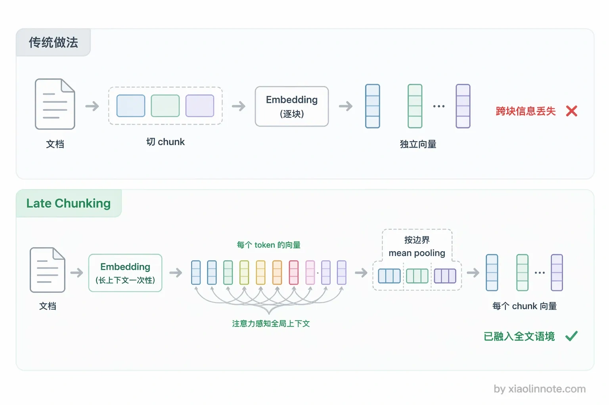

把几种策略的适用场景梳理成表，实际选型时可以对照来看：

| 策略            | 适用文档类型           | 优点                          | 缺点                       |
| --------------- | ---------------------- | ----------------------------- | -------------------------- |
| 固定大小 + 重叠 | 纯文本、无明显结构     | 实现简单、chunk 大小可控      | 可能在语义中间截断         |
| 语义边界切割    | 段落分明的文章         | 语义完整，召回质量好          | 实现稍复杂，chunk 大小不均 |
| 标题层级切割    | Markdown、HTML 文档    | 天然语义独立，带结构 metadata | 依赖文档有清晰的标题结构   |
| 代码按函数切割  | 代码文件               | 保留代码逻辑完整性            | 需要 AST 解析，限定语言    |
| 父子切割        | 各类文档（追求高质量） | 检索精准 + 上下文完整两全     | 存储量翻倍，索引构建复杂   |
| Late Chunking   | 各类文档               | chunk 向量保留全文上下文      | 需要模型支持长输入         |

### 🎯 面试总结

Chunking 这个问题考察的是你对 RAG 存储层的理解深度。

回答这个问题，先说清楚为什么文档不能直接存：一是向量模型有输入长度限制，二是整篇文档压缩成一个向量会丢失细节。然后说清楚怎么切：固定大小加重叠是最基础的，语义边界切割更智能，代码和表格要特殊处理，父子切割可以兼顾检索精度和上下文完整。

粒度选择没有银弹，500～1000 token 是起点，关键是根据文档类型选策略。如果面试官追问「你实际用的什么策略」，你就说「固定大小加重叠做兜底，对结构化文档用语义边界切割，对高质量要求的场景用父子切割」，这个回答就很扎实了。

## 5. 怎么规避语义被切割掉的问题？

### 💡 简要回答

- 切的时候就不要在语义中间截断，用重叠切割和语义边界切割来保证每个 chunk 内容是完整的，也就是按句子、段落这些自然的边界来切。

- 切完之后用检索策略把上下文补回来，核心方案是句子窗口检索，命中一个句子就把周围几句一起返回给 LLM；另外还有父子切割，小块检索命中、大块内容输出。


还有一个我觉得比较有价值的方案，是 Anthropic 提出的 Contextual Retrieval，在做 Embedding 之前先让大模型看着整篇文档为每个 chunk 生成一段背景说明，把这段背景和 chunk 拼在一起再向量化，从根本上解决孤立 chunk 没头没尾的问题。

### 📝 详细解析

#### 5.1 语义被切割是什么问题?

假设文档里有这样一段内容：

```
...前三条款适用于个人用户。
第四条：企业用户享有优先客服通道，响应时间不超过 2 小时，
并可申请专属技术顾问服务。此条款自 2024 年起生效。...
```

如果 chunk 的边界恰好切在「响应时间不超过 2 小时，」这里，那「企业用户享有优先客服通道」和「并可申请专属技术顾问服务」就被分到了两个 chunk。

你可能会想，两个 chunk 里都有部分答案，搜到其中一个不就行了？问题是，两个 chunk 单独来看相关度都不高，极可能都不会被召回，答案就断了。

这就是语义截断的核心问题：不是信息丢了，而是信息被拆散之后，每一半都不够强，检索时全军覆没。

#### 方案一：重叠切割（Overlap）

让相邻 chunk 之间有一段内容重叠，这样就算边界切在语义中间，跨边界的内容也一定会完整地出现在其中一个 chunk 里。

重叠量通常设为 chunk_size 的 10%～20%，比如 chunk_size=800，overlap=150。太小了（比如 5%）重叠区域覆盖不了完整的跨边界语义，保护效果弱；太大了（比如 40%）重复内容太多，存储和检索成本上升，而且大量重复内容还会干扰 LLM 的阅读和理解。

重叠切割是所有方案的基础，几乎每个 RAG 系统都应该开启，但它只是兜底，不能彻底解决语义截断问题。很多人以为加了 overlap 就万事大吉了，其实它只能保证跨边界的文字不丢失，解决不了「一个完整语义被拆散」的根本问题。

#### 方案二：按语义边界切割

找到文本中自然的语义边界再切。为什么要识别句子边界？

因为句子是语言表达意思的最小完整单位，一个完整的句子包含了主语、谓语、宾语，能独立表达一个意思。把句子从中间截断，前半截和后半截单独来看都是残缺的，向量化后的语义也是扭曲的。

实际操作时，可以用 NLP 工具（比如 `spacy` 或 `nltk`）识别句子结束位置，然后以句子为单位填充 chunk：把句子一条条往当前 chunk 里加，加满了就封存这个 chunk 开启新的，不会在句子中间截断。对于段落分明的文档，还可以在句子边界的基础上优先在段落边界处切，效果更好。

#### 方案三：句子窗口检索（Sentence Window Retrieval）

前面两种方案都是在「怎么切」上做文章，到了这一步，思路就变了——切归切，检索的时候再把上下文补回来。它不是在「切」上做文章，而是在「检索后如何返回上下文」上做文章。类比一下：就像你在图书馆里用关键词找到了某本书里的一句话，但你实际阅读的是这句话所在的整个段落，而不是只拿走那一行文字。

具体做法是：存储时把文档切成单个句子，每个句子单独做向量，用于精准检索；检索命中一个句子后，并不只返回这一个句子，而是把这个句子前后各 N 个句子一起返回，形成一个上下文窗口，交给 LLM 阅读。

这样的好处是两全其美：检索粒度细（单句），定位准确，相关性高；但给 LLM 的内容是完整的上下文窗口，不会因为检索粒度太细而导致 LLM 拿到的信息不完整。缺点是存储量较大，每个句子都需要单独向量化，库里的记录数等于文档的句子总数。

#### 方案四：父子切割（Parent-Child Chunking）

理解了句子窗口检索的「检索命中后动态扩展上下文」思路，父子切割就很好懂了，它是一种更结构化的实现方式。

父子切割的思路是「用小 chunk 检索，用大 chunk 生成」：存储时同一段内容存两份，一份是细粒度的小 chunk（比如 200 token），一份是包含这个小 chunk 上下文的大 chunk（比如 1000 token），两者通过 ID 关联。检索时用小 chunk，语义聚焦，召回精度高；命中后把对应的大 chunk 返回给 LLM，上下文更完整，生成质量更好。

句子窗口是检索命中后动态扩展上下文，父子切割是提前把父子关系存好。两者思路相近，父子切割更灵活（父 chunk 大小可以精确控制），句子窗口实现更简单（不需要维护父子 ID 关系）。

#### 方案五：命题化切割（Propositions-based Chunking）

前面几种方案都是在「怎么切」或「切完怎么补上下文」上想办法，那有没有一种方案能从根本上让每个 chunk 天然就是完整独立的？命题化切割就是冲着这个目标来的。这是质量最高但成本也最高的方案，**思路不按文本位置切割，而是用 LLM 把文档分解成一条条独立的「命题」（**Proposition）。每个命题是一个完整、自包含的陈述句，包含了表达这个事实所需的全部上下文，单独拿出来就能看懂，不依赖上下文，只包含一个核心事实。

举个例子来感受一下。原文是「企业用户享有优先客服通道，响应时间不超过 2 小时，并可申请专属技术顾问服务。」分解成命题后变成三条独立陈述：「企业用户享有优先客服通道。」「企业用户的客服响应时间不超过 2 小时。」「企业用户可以申请专属技术顾问服务。」这三条单独拿出来都能看懂，不需要任何上下文辅助，向量化后的语义密度极高。

## 6. RAG 中 Embedding 究竟是什么？如何选择和评估一个 Embedding 模型

### 💡 简要回答

Embedding 我理解就是把**一段文本转成一串数字向量的过程**。它有一个很关键的特性，就**是语义相近的文本，转出来的向量在数学空间里的距离也近**。RAG 里的语义检索就是靠这个实现的，不是关键词匹配，而是看两段内容的意思相不相近。

选模型看三个维度：第一是中文支持，中文场景我会优先选 BGE 系列，效果其实比 OpenAI 的模型还要好；第二是向量维度，维度越高精度越好，但存储成本也越大；第三是最大输入长度，这个决定了能处理多长的 chunk。

评估一定要在自己的业务数据上跑召回测

### 📝 详细解析

#### 6.1 Embedding 是什么?

Embedding 模型做的事情本质上是「**语义压缩**」，把一段自然语言文本映射成一个固定长度的浮点数向量。比如一个 1024 维的 Embedding 模型，不管输入的文本是 10 个字还是 500 个字，输出都是一个长度为 1024 的数字列表。

这个映射最关键的性质是：**语义相近的文本，向量的余弦相似度高**。

为什么衡量相似度要用「余弦」而不是直接算两个向量的直线距离？因为在高维空间里，两段文本的向量长度（模长）会受文本长度、表达强度等非语义因素影响，**直接比距离会把「长短」和「语义」混在一起。**而余弦只看两个向量的方向（也就是夹角），方向越一致余弦值越接近 1，正好把「意思相近」从「文本长短」里剥离出来。你可以把它理解成：**两段话如果「指向同一个意思」，它们的向量箭头就朝着同一个方向**，至于箭头多长无所谓。

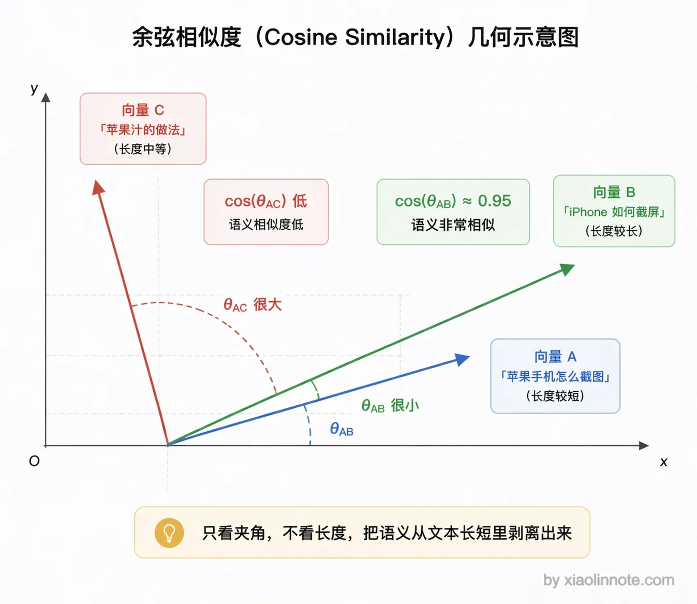

比如「苹果手机怎么截图」和「iPhone 如何截屏」，这两句话一个字都不一样，关键词搜索根本匹配不上，但经过 Embedding 之后，两个向量的余弦相似度可能高达 0.95；而「苹果手机」和「苹果汁」虽然都有「苹果」，但语义相差很远，向量距离也会拉开。

这就是语义检索比关键词匹配强的核心原因，它能处理同义词、近义词和不同的表达方式。很多人以为向量检索就是高级的关键词匹配，其实完全不是一回事，它是从「意思」层面在做匹配。

#### 6.2 常见 Embedding 模型对比

-  **OpenAI 的 text-embedding 系列**，`text-embedding-3-small` 是性价比最高的，1536 维，支持降维到 256 维来节省存储，调用方便，英文效果非常好；缺点是 API 调用有费用，而且数据要发到 OpenAI 服务器，有些企业有数据出境合规问题。
-  **BGE 系列（北京智源研究院出品）**，`bge-large-zh-v1.5` 是经典的中文开源模型，1024 维，可以本地部署，数据不出境。不过要注意的是，BGE 虽然仍然是很好的选择，但已经不是中文场景的唯一首选了。`bge-m3` 是 BGE 的多语言版本，同时支持中英日等多种语言，1024 维，而且支持三种检索模式（稠密向量、稀疏向量、ColBERT 式多向量），适合中英文混排的场景。
- **新一代高性能模型**，这两年涌现了一批在 MTEB 排行榜上超过 BGE 的模型。`Qwen3-Embedding`（阿里通义出品）在多语言基准上表现突出，中文效果很强；`Voyage-3-large` 在英文检索上精度超过 OpenAI 的模型；`Cohere embed-v4` 支持 128K 超长上下文，适合长文档场景；`Gemini Embedding`（Google 出品）在多个评测中表现均衡。如果你在 2025-2026 年做新项目，建议关注这些新模型，在自己的数据上做测评后再选型。

#### 6.3 如何选择 Embedding 模型？

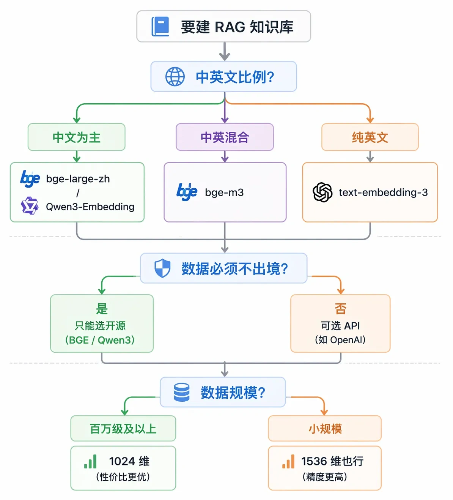

#### 6.4 如何评估 Embedding 模型？

正确的评估方法是在自己的业务数据上测：准备几百条业务相关的「问题 + 正确答案 chunk」对，分别用候选模型做检索，看正确的 chunk 有没有出现在前 K 条结果里。这个指标叫 Hit@K，Hit@5 = 0.8 的意思就是，80% 的问题，它对应的答案都出现在了检索结果的前 5 条里。通常 Hit@5 低于 0.7 就要考虑换模型或者改进 Chunking 策略了。这种贴近真实场景的评估，比排行榜分数更有参考价值。

把常见的选型维度汇总对比一下：

| 模型                   | 维度           | 中文效果 | 是否开源  | 适用场景                     |
| ---------------------- | -------------- | -------- | --------- | ---------------------------- |
| text-embedding-3-small | 1536（可降维） | 一般     | 否（API） | 英文为主、快速上手           |
| text-embedding-3-large | 3072（可降维） | 一般     | 否（API） | 英文为主、精度要求高         |
| bge-large-zh-v1.5      | 1024           | 很好     | 是        | 中文知识库经典选择           |
| bge-m3                 | 1024           | 好       | 是        | 中英混合、多语言、多模式检索 |
| Qwen3-Embedding        | 多种可选       | 很好     | 是        | 中文场景新一代强力选择       |
| Voyage-3-large         | 1024           | 一般     | 否（API） | 英文高精度检索               |

### 🎯 面试总结

Embedding 这个问题考察的是你对 RAG 检索层基础的理解。

回答要讲清三点。

- Embedding 不只是「文本变向量」，关键是语义相近的文本向量距离近，这才是语义检索的基础。

- 选模型要看场景：中文场景 BGE 和 Qwen3-Embedding 都是很好的开源选择，中英混合用 bge-m3，有数据合规要求就用开源模型本地部署。

- 评估模型不要只看 MTEB 排行榜，要在自己的业务数据上跑 Hit@K 测试，这才是真正有参考价值的。


如果面试官追问「你用的什么模型，为什么选它」，你可以说「中文场景用 bge-large-zh-v1.5 或 Qwen3-Embedding，在自己的业务数据上 Hit@5 达到 0.8 以上，最终根据测评结果选的」，这个回答有理有据。

## 7. Embedding 有哪几种算法你了解过吗？

### 💡 简要回答

Embedding 算法大致经历了三代演进。

- 静态词向量，以 Word2Vec 和 GloVe 为代表，把每个词映射成固定向量，但同一个词不管上下文是什么，向量永远不变，处理不了多义词。

- 以 BERT 为代表的上下文相关向量，同一个词在不同语境下有不同的向量，表达能力大幅提升，但 BERT 本身输出的是 token 级别的向量，两个句子要比较相似度就必须拼在一起跑，百万条文档就要跑百万次，检索速度完全不可接受。

- 以 SBERT、SimCSE、BGE 为代表的句子级对比学习 Embedding，专门为「两段文本有多相似」这个任务优化，能提前把所有文档向量算好存起来，查询时只需算一次，是 RAG 场景的标配。


### 📝 详细解析

#### 7.1 第一代：静态词向量（Word2Vec / GloVe / FastText）

它们的核心思路非常朴素：用一个词周围的词来预测这个词，或者反过来用这个词来预测周围的词。通过大量文本训练，语义相近的词自然就会在向量空间里被推到一起。

**Word2Vec** 有两种训练方式：CBOW（用周围词预测中心词）和 Skip-gram（用中心词预测周围词）。 Skip-gram 更常用，它从一个词能产生多个训练样本（用这个词预测周围每一个词），样本利用率更高，对低频词尤其友好；CBOW 在大数据集上收敛更快，但两者最终效果通常比较接近，细节上 Skip-gram 对生僻词表现更好，所以更常作为默认选项。训练完之后，每个词对应一个固定的向量，「国王 - 男人 + 女人 ≈ 女王」这个著名的类比就是用 Word2Vec 向量做到的。

**GloVe**（Global Vectors for Word Representation）思路和 Word2Vec 类似但更系统，直接对整个语料库的词共现矩阵做分解，对全局统计信息的利用更充分。实际效果和 Word2Vec 差不多，很多场景两者可以互换。

**FastText** 解决了一个很实际的问题：Word2Vec 处理不了训练集里从没见过的词。在真实业务里，新词、专有名词、网络流行语不断冒出来，处理不了新词就意味着检索直接断链。FastText 把词拆成字符级别的 n-gram 子词，比如「苹果」会被拆成「苹」「果」「苹果」等子片段，每个子片段有自己的向量，一个词的向量是其子片段向量的平均。这样遇到没见过的新词，只要子片段见过，就还能估算出一个合理的向量。

这一代算法的共同局限性是：**静态**。每个词只有一个固定向量，不管上下文如何。「我吃了苹果」里的「苹果」和「苹果手机发布了」里的「苹果」，向量完全相同。很多人以为 Word2Vec 已经理解了语义，其实它只是记住了「哪些词经常一起出现」，真正的语义理解还差得远。这个致命缺陷直接催生了第二代算法。

#### 7.2 第二代：上下文相关向量（ELMo / BERT）

理解了第一代「一个词永远只有一个向量」的局限，第二代算法的改进方向就很明确了：让词的向量随上下文动态变化，同一个词在不同句子里有不同的向量表示。

**ELMo**用双向 LSTM 来建模，同时从左往右和从右往左扫描句子，把两个方向的隐藏状态拼起来作为词的上下文向量。ELMo 是第一个实用的上下文 Embedding，当时在多个 NLP 任务上大幅刷新了成绩。

**BERT**用 Transformer 替代 LSTM，引入了 Masked Language Model 预训练任务，效果全面超越 ELMo，成为 NLP 领域最重要的里程碑之一。BERT 用 [CLS] token 来表示整个句子，同时看到前后文（双向），表达能力远超单向模型。

BERT 有一个在检索场景下极其致命的缺陷：要比较两个句子的相似度，必须把两个句子拼在一起喂给 BERT，让 [CLS] 来做判断。这意味着每次检索都要把查询和每一个候选 chunk 拼在一起跑 BERT，百万条文档的知识库就要跑百万次。

用户根本等不起。这个问题直接导致了第三代的诞生。

#### 7.3 第三代：句子级对比学习 Embedding（SBERT / SimCSE / BGE）

第二代 BERT 虽然语义理解能力强，但「必须两两拼接」这个限制让它在检索场景下完全没法用，这就引出了第三代的核心理念：能不能让每个句子独立生成一个向量，然后直接用余弦相似度来比较？

第三代专门针对「句子相似度」和「语义检索」这个任务优化，是 RAG 系统的标配。

**SBERT**（Sentence-BERT）就是用这个思路解决了 BERT 在检索场景下用不了的问题。它用 bi-encoder 结构：两个句子分别独立过 BERT，各自得到一个句子级向量，然后只用余弦相似度来衡量两个向量的距离。

你可能会问，这样精度不会下降吗？确实会一点，因为两个句子是分开编码的，模型在编码阶段看不到两句话 token 之间的交叉关系（Cross-Encoder 那种「每个 token 都能和另一句的每个 token 互相注意到」的深度交互就被牺牲掉了），所以在特别微妙的匹配上会不如 Cross-Encoder。

但换来的是速度提升了几个数量级，知识库里所有文档的向量可以提前算好存起来，每次检索时只需要算一次查询向量，然后做余弦相似度就行，毫秒级返回。在 RAG 这种「速度优先」的场景里，这个取舍完全值得。

```python
from sentence_transformers import SentenceTransformer

model = SentenceTransformer('all-MiniLM-L6-v2')

# 查询和文档分别独立编码，不需要拼在一起
query = "苹果手机怎么截图"
doc   = "iPhone 截屏方法"

query_vec = model.encode(query)   # 检索时实时算
doc_vec   = model.encode(doc)     # 提前算好，存向量库

# 余弦相似度衡量语义距离
from sklearn.metrics.pairwise import cosine_similarity
score = cosine_similarity([query_vec], [doc_vec])
```

**SimCSE**进一步提升了句子 Embedding 的质量。核心思路是对比学习：把同一句话做两次 dropout 得到两个不同的向量，把这两个向量作为正样本对，让模型学会把它们拉近；同时把同一个 batch 里其他句子的向量作为负样本，把它们推远。这个方法训练非常简单，不需要人工标注，但效果很好。

它解决了一个很多人不知道的问题：BERT 原生的句子向量存在「各向异性」，也就是说向量分布是扭曲的，都挤在一个窄小的锥形区域里，没有充分利用向量空间。SimCSE 通过对比学习把向量「撑开」了，让语义空间变得更均匀。

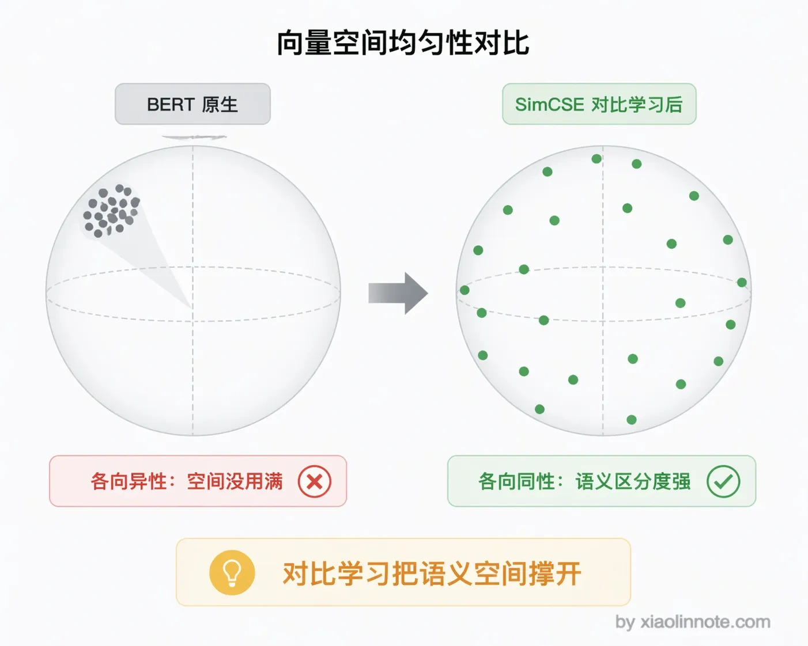

**BGE**（BAAI General Embedding）是中文 RAG 场景非常流行的开源模型，基于对比学习在大规模中英文数据上训练，同时支持 bi-encoder 和 reranker 两种形态，专门为检索场景优化。E5（微软）是另一个常用的英文对比学习 Embedding，效果同样优秀。

第三代模型还在持续进化。2025-2026 年出现了几个重要的新趋势。

**指令感知 Embedding**（比如 Qwen3-Embedding），模型能根据检索指令动态调整向量表示，同一段文本在「找相似问题」和「找答案」两种意图下会产生不同的向量。

**Matryoshka 表示学习**（MRL），模型训练时让向量的前 N 维就能表达有意义的语义，这样你可以灵活地截断维度来平衡精度和存储成本。

**多模态 Embedding**，同一个模型既能编码文本也能编码图片，让 RAG 可以做到文本和图片的跨模态检索。

这些新趋势不是独立的第四代，而是在第三代对比学习的基础上做的增强，但面试时如果能提到，会显示你对最新进展有关注。

| 世代   | 代表模型                  | 核心特点                    | 主要局限                     | RAG 适用性               |
| ------ | ------------------------- | --------------------------- | ---------------------------- | ------------------------ |
| 第一代 | Word2Vec、GloVe、FastText | 词级静态向量                | 无法处理多义词，词级非句子级 | 不适用                   |
| 第二代 | ELMo、BERT                | 上下文动态向量              | 检索时需两两拼接，速度极慢   | 不适用于实时检索         |
| 第三代 | SBERT、SimCSE、BGE、E5    | 句子级 bi-encoder，对比学习 | 精度低于 cross-encoder       | 标配，性能和精度平衡最优 |

RAG 场景下基本只考虑第三代模型，中文场景 BGE 和 Qwen3-Embedding 都是很好的开源选择，英文场景 E5 或 text-embedding-3-small 都不错。新趋势方面，指令感知 Embedding、Matryoshka 降维、多模态 Embedding 是值得关注的方向。

### 🎯 面试总结

Embedding 算法这个问题考察的是你对检索层技术的理解深度。

回答时要按三代演进的逻辑来讲。

第一代静态词向量（Word2Vec/GloVe）：解决了「词变向量」的问题，但处理不了多义词。

第二代上下文向量（BERT）：解决了多义词的问题，但检索时要两两拼接，百万级知识库完全没法用。

第三代句子级 Embedding（SBERT/SimCSE/BGE）：用 bi-encoder 独立编码，提前算好向量存起来，检索时只算余弦相似度，是 RAG 的标配。

面试官如果追问「你们项目用的什么模型」，你就说中文场景用 BGE，在自己的业务数据上做评估选型，能讲出这个就有说服力了。

## 8. 什么是向量数据库？有没有做过向量数据库的对比选型？

### 💡 简要回答

向量数据库是专门**用来存储和检索高维向量的数据库**，核心能力是**近似最近邻搜索**，也叫 ANN，能在百万甚至亿级的向量里快速找出最相似的几条。

普通关系型数据库的索引结构对高维向量基本上是失效的，所以需要专门的数据库来处理这个场景。

我自己做过一些选型，本地开发阶段我用 Chroma，零配置上手极快；生产环境的中小规模我推荐 Qdrant，性能不错、API 也比较简洁；如果到了超大规模就要考虑 Milvus 了，字节和小米都在用；不想自己运维的话 Pinecone 是一个云托管的选项；如果项目里已经有 PostgreSQL，也可以直接用 pgvector 插件，不用引入新组件。

### 📝 详细解析

#### 8.1 什么是向量数据库？

向量数据库就是专门用来存储和检索「向量」的数据库。

这里的向量，指的是嵌入模型（Embedding Model）把文本、图片、音频这些内容转换成的一串浮点数，比如一句话可能被转换成 [0.12, -0.87, 0.34, ... ] 这样一个 768 维或 1024 维的数组。每一个向量代表了这段内容的「语义含义」，语义越相近的内容，它们的向量在高维空间里的距离就越近。

核心操作叫做 **近似最近邻搜索（ANN，Approximate Nearest Neighbor）**：给你一个查询向量，在库里找出和它最相似的 K 个向量，返回对应的原始内容。这正是 RAG 里「检索」那一步的底层支撑——用户问了一个问题，先把问题转成向量，再去向量数据库里找最相关的文档片段，最后喂给大模型生成回答。

很多人会把向量数据库和「MySQL 加个向量字段」混为一谈，其实这两者有本质区别：**MySQL 擅长精确匹配（`WHERE id = 123`），向量数据库擅长语义相似（「找和这个意思最接近的内容」）**。两者解决的是完全不同的问题，不是互相替代的关系。

#### 8.2 为什么需要专门的向量数据库？

普通的关系型数据库（MySQL、PostgreSQL）在存储结构化数据时靠 B-tree 索引，查询 `WHERE id = 123` 这种精确匹配效率极高。但**向量检索要做的不是找「等于」的，而是找「最相近」的**，没有精确匹配，只有相似度排序。

高维向量（比如 1024 维）的相似度搜索如果暴力遍历，把查询向量和库里每一条向量都算一遍余弦相似度，百万条数据就要算一百万次，延迟完全不可接受。

那为什么不用 B-tree 加速？因为 **B-tree 只能处理一维的有序索引，对高维向量这种「多个维度同时要考虑距离」的场景基本是失效的。**你不可能对一个 1024 维的向量建一个 B-tree，然后说「帮我找和它最近的」，因为「近」本身是一个高维空间的综合判断，不是某一个维度上的排序。

向量数据库的价值就在于用专门的索引结构把这个搜索加速，在可接受的精度损失下把延迟降到毫秒级。理解了这个核心价值，接下来我们看它是怎么做到的。

#### 8.3 核心索引算法：HNSW 和 IVF

 **HNSW（Hierarchical Navigable Small World）**，这是目前召回率最高的 ANN 算法之一。它构建的是一个多层图结构，查询时从最上层的稀疏图开始导航，逐层收窄范围，最终在底层找到最近邻。你可以把它想象成在地图上找最近的餐厅：不是把全国所有餐厅都遍历一遍，而是先在全国层面找到大致方向，再锁定到省、市、区，一层一层缩小，效率极高。HNSW 的优点是**召回率高、查询速度快**；缺点是**建索引时内存消耗大，不适合内存极度受限的场景**。

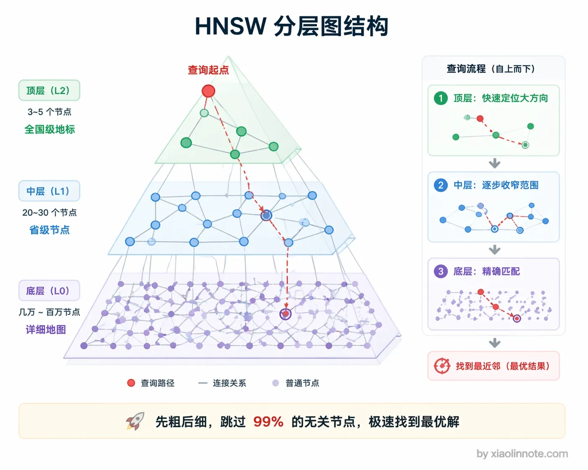

**IVF（Inverted File Index）** 先对向量做聚类，把相似的向量分进同一个「桶」里，查询时只搜最相关的几个桶，而不是全量遍历。这就像图书馆的分类体系：找一本编程书，不需要把整个图书馆翻一遍，先找到「计算机科学」那个区域，再在里面找，范围大幅缩小。IVF 的优点是**内存占用小、适合超大规模**；缺点是**精度比 HNSW 略低，需要调参**

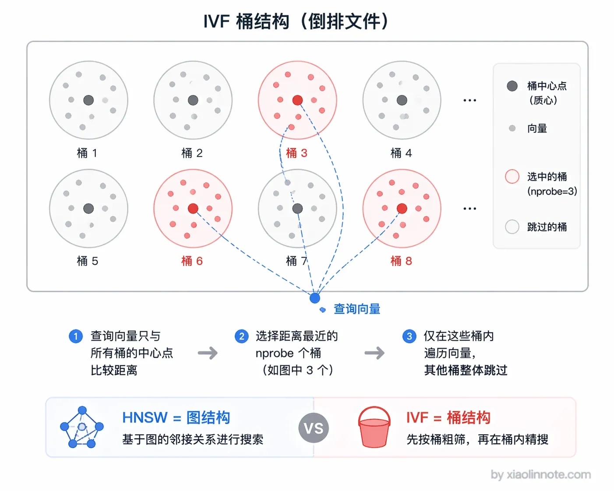

HNSW 精度高、速度快，为什么还需要 IVF？原因很简单：HNSW 的内存消耗和向量数量成正比，到了亿级规模内存可能扛不住。IVF 用聚类换内存，牺牲一点精度就能处理超大规模数据，两者各有适用场景。

#### 8.4 向量数据库的核心能力

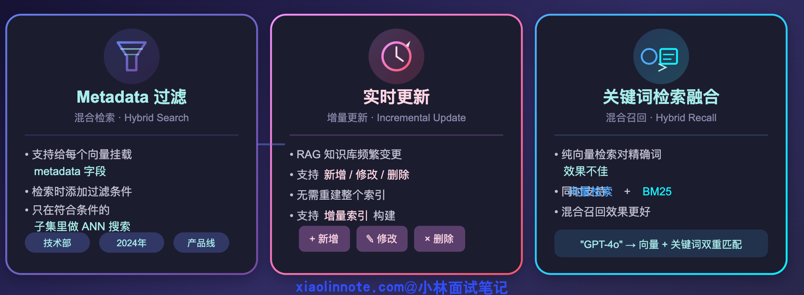

 **Metadata 过滤**，也叫混合检索。实际业务里，知识库往往有多个部门、多个产品线的文档，用户查的时候只想搜「技术部的文档」或者「2024 年更新的内容」。向量数据库支持给每个向量挂上 metadata 字段，检索时加过滤条件，只在符合条件的子集里做 ANN 搜索。你可能会想，为什么不先 ANN 搜完再过滤？因为那样可能搜出来的 Top-K 结果大部分都不满足条件，白白浪费了检索名额。先过滤再 ANN 搜索，能保证召回的每一条都是真正想要的。

**实时更新**。RAG 的知识库经常需要新增、修改、删除文档，向量数据库需要支持增量更新。很多人以为向量索引建好就不能动了，其实主流的向量数据库都支持在线写入，新数据进来后增量构建索引，不需要停服重建。

**与关键词检索融合**。纯向量检索对一些精确词语（比如产品型号「GPT-4o」、专有名词）的效果不好，有些向量数据库同时支持向量检索 + BM25 关键词检索，做混合召回效果更好。

#### 8.4 选型建议

主要看三个维度：数据规模、部署方式、是否需要混合检索。

中小到大规模、团队小、快速上线，首选 **Qdrant**，性能好、API 设计简洁、文档完善，Docker 一条命令就能部署，Rust 写的性能很稳。Qdrant 现在也支持分布式模式（分片 + 副本），实际已经有亿级规模的生产案例，覆盖面比较广。很多团队一开始用 Chroma 做原型，后来上生产就切到 Qdrant，这个路径很常见。

说到 **Chroma**，它确实是上手最快的选项，Python 直接 `pip install`，本地内存运行，零配置，配合 LangChain/LlamaIndex 原生集成非常方便。Chroma 现在也支持了 Client-Server 模式和 Chroma Cloud 托管服务，不再只是本地嵌入式了，而且在 2025 年还加入了 BM25/SPLADE 稀疏向量的混合检索支持。不过要注意的是，Chroma 的分布式能力还在成熟中，对于超大规模（千万级以上）的生产场景，它的稳定性和性能还不如 Milvus 和 Qdrant 这些专门为大规模设计的方案。总结来说，Chroma 适合快速原型验证和中小规模的生产使用，超大规模就要考虑其他选项了。

数据规模在千万到亿级，需要分布式，选 **Milvus**，国内大厂用得最多，支持多种索引类型，有完整的集群方案，但部署运维复杂度也高，团队需要有足够的人力来维护。

不想运维，数据在云上，用 **Pinecone**，全托管 SaaS，按用量付费，适合快速验证商业化产品。不过要注意数据出境的问题，如果业务数据有合规要求，Pinecone 就不合适了。

已经在用 PostgreSQL，数据量不是特别大，可以直接用 **pgvector** 插件，不用引入新组件，查询可以和业务数据做 SQL JOIN，运维成本为零。

| 数据库   | 部署方式                | 适合规模         | 混合检索               | 主要优势                      | 主要劣势             |
| -------- | ----------------------- | ---------------- | ---------------------- | ----------------------------- | -------------------- |
| Chroma   | 本地/Client-Server/云   | 中小规模         | 是（支持 BM25/SPLADE） | 零配置上手极快，生态集成好    | 超大规模稳定性待验证 |
| Qdrant   | 自托管/云（支持分布式） | 中大规模（亿级） | 是                     | 性能好，API 简洁，Rust 高性能 | 超大规模需调优       |
| Milvus   | 自托管（分布式）        | 大规模（亿级）   | 是                     | 可水平扩展                    | 部署运维复杂         |
| Pinecone | 全托管云服务            | 中大规模         | 是                     | 无需运维                      | 费用高，数据出境     |
| pgvector | PostgreSQL 插件         | 中小规模         | 是（配合全文检索）     | 无需新组件，可 JOIN 业务数据  | 性能弱于专用向量库   |

### 🎯 面试总结

面试官问「什么是向量数据库」，你不能把它理解成「普通数据库加个向量字段」，这完全搞反了。向量数据库是专门为高维向量的相似度搜索设计的，核心能力是 ANN（近似最近邻搜索），普通关系型数据库的 B-tree 索引对高维向量检索基本是失效的，这不是加个字段就能解决的问题。

面试官追问选型标准的时候，你要从数据规模、部署方式、是否需要混合检索三个维度来回答。

快速原型验证用 Chroma，中小到大规模生产环境推荐 Qdrant，超大规模选 Milvus 做分布式，不想运维就上 Pinecone，已有 PostgreSQL 的项目直接用 pgvector 插件就够了。

每个选项的适用场景和优劣势都要说清楚，千万别拿 GitHub Star 数量当选型依据。另外，索引算法至少要能讲清楚 HNSW 和 IVF 的区别和适用场景，这是向量数据库的核心技术，面试官一定会问。

## 9. 讲讲你用的向量数据库？数据量级是多大？性能如何？遇到过性能瓶颈吗？

### 💡 简要回答

我们生产环境用的是 Milvus，数据量级在百万条向量左右，每条是 1024 维，用 HNSW 索引，单次查询的延迟在 20 到 50 毫秒。选 Milvus 主要是因为它支持分布式部署和读写分离，适合数据量大、并发高的场景。

我遇到过两个比较典型的瓶颈。

- 内存压力，百万级的 1024 维向量光原始数据就要好几个 GB，后来我们开启了标量量化 SQ8，把 float32 压成 int8，内存直接降到原来的四分之一。

- 大批量写入的时候会触发后台 Segment 合并，影响查询延迟，我们的解法是把批量写入改到业务低峰期，分批小批次写入。


### 📝 详细解析

#### 9.1 先搞清楚：向量数据库是干什么的？

普通数据库（比如 MySQL）存的是结构化数据，查询方式是精确匹配，「找名字等于张三的记录」。但在 RAG 里，我们存的是文本的「语义向量」，查询方式是相似度搜索，「找和这段描述语义最接近的文档」。

这两件事的底层机制完全不同。语义向量是一个几百上千维的浮点数数组，你没办法用 `WHERE embedding = xxx` 来查，只能计算两个向量之间的距离（余弦相似度或欧氏距离），找出最近的 K 个。

那问题来了：如果向量库里有 100 万条记录，每次查询都和 100 万条逐一算距离，时间复杂度是 O(N)，太慢了。向量数据库的核心价值就是：通过 **索引**（最常用的是 HNSW），把查询时间压缩到接近 O(log N)，用少量精度损失换来极大的速度提升。理解了这一点，后面 Milvus 的各种设计就都有根可循了。

#### 9.2 为什么选 Milvus？

**Chroma** 上手最简单，一行 pip 装好就能用，数据存本地文件，非常适合做实验和跑 Demo，但它没有分布式能力，不适合生产。

**Qdrant** 用 Rust 写的，单机性能很好，部署也简单（Docker 一条命令），适合中小规模、团队运维资源有限的场景。

**Weaviate** 功能较全，支持多种搜索模式，适合需要向量搜索与结构化查询结合的场景。

**Milvus** 是功能最全、扩展性最强的开源选项，支持分布式部署，读写节点分离，能横向扩容，适合数据量在百万到十亿级别、并发查询量大的生产场景。

我们选 Milvus 主要是数据量级上去了，单机已经撑不住，需要分布式部署；同时知识库每天都有增量更新，读写分离能让写入不影响查询服务的稳定性。

#### 9.3 Milvus 的核心概念

**Collection（集合）** 类似关系数据库里的「表」，存储一类向量数据。我们的知识库就是一个 Collection，每条记录包含：文本 chunk 的 ID、向量（embedding）、原文内容、来源文档等 metadata。

**Segment（段）** 是 Milvus 内部管理数据的基本单位。新写入的数据先进「增量段」，像一个临时的接收缓冲区；积累到一定量后触发合并，变成「封存段」。封存段会建好索引，查询时走索引检索速度很快。但合并这个动作本身会消耗 CPU 和磁盘，就像磁盘碎片整理，把一堆小文件合并成大文件，期间会抢资源。记住这个 Segment 合并机制，后面讲性能瓶颈的时候会用到。

**Index（索引）** 是向量检索的关键加速结构。最常用的是 **HNSW**（Hierarchical Navigable Small World，分层可导航小世界图），一种图结构索引。它的核心思想是：把向量组织成多层图，查询时从稀疏的顶层开始，快速定位到大致区域，再逐层细化找到最近邻，整体复杂度接近 O(log N)。

HNSW 有两个关键参数：

- `M` 是「每个节点最多认识几个邻居」，M 越大，图越密，找到最近邻的精度越高，但建索引的内存和时间都越多，通常设 16～32 就够了。`ef_construction` 是「建图时每个节点考察多少候选」，越大越精确，但建索引越慢，通常设 100～200。
- 查询时还有一个参数 `ef`（也叫 `search_ef`）：查询时搜索的候选集大小，越大召回越准，延迟也越高，按实际需求在 50～200 之间调。可以理解为「查询时多看几个候选再决定最终答案」，ef 小查得快但可能漏掉真正最近的那个，ef 大查得慢但结果更准。

#### 9.4 数据规模和实测性能

我们知识库大概有 **150 万条 chunk**，每条用 BGE-large-zh 模型生成 1024 维的向量，索引用 HNSW（M=16，ef_construction=128）。

先算一下原始数据的内存占用：150 万 × 1024 维 × 4 字节（float32）≈ **6GB**，这是纯向量部分。实际 Milvus 进程完整跑起来大概要 10～12GB 内存，多出来的 4～6GB 不是"索引翻倍"的神秘开销，而是 HNSW 图结构本身、metadata、Collection 管理开销、操作系统缓存这些合起来的占用。你可能会想，12GB 内存而已，现在随便一台服务器都有 32GB，有什么好担心的？但别忘了这只是向量数据本身，同一台机器上还跑着应用服务、Redis、日志收集等各种组件，内存是要抢着用的。

开启 **标量量化（SQ8）** 之后，把每个 float32 压缩成 int8（用 1 字节代替 4 字节）。直觉上理解：就像把精确到小数点后 7 位的数字保留到小数点后 2 位，大部分语义信息其实在高位，截掉低位精度损失极小，但数据量直接缩到 1/4。内存从 10GB 降到约 3GB，召回率基本无损（通常只下降 1 个百分点以内），是最划算的一个优化，几乎没有代价。

实测查询性能（单机 16 核 32G、本地千兆网、HNSW 在内存、ef=100）：单次 top-5 查询 P50 延迟约 20ms，P99 约 60ms，并发 100 QPS 时延迟基本稳定。这里报数字一定要带上硬件和参数背景，同样是 Milvus，跑在 8 核机上、跨机房调用、或者 ef 设到 200，数字能差一个量级。这些数字才是面试官想听到的，不是「感觉挺快的」。

#### 9.5 遇到的性能瓶颈

前面算完内存占用就应该意识到了，150 万条 1024 维向量光原始数据就要好几 GB，这在实际生产中必然会遇到内存压力。我确实踩了两个典型的坑。

**瓶颈一：内存不足，查询延迟飙升**

最开始没有开量化，机器只有 8GB 内存，Milvus 把向量索引加载进内存之后，留给操作系统的空间已经很小了，稍微有点内存压力就开始频繁 swap（把内存数据换到磁盘），查询延迟直接从 20ms 飙到 2s+。很多人以为查询慢是索引算法的问题，其实根本不是，是内存不够被操作系统强行 swap 了。就像你开一个很大的 Excel 文件，内存不够就开始疯狂读硬盘，卡得怀疑人生。

解法就是上面提到的 SQ8 量化，内存从 10GB 降到 3GB 左右，彻底解决了 swap 问题。还有一个辅助手段：Milvus 支持把原始向量存在磁盘上（`mmap`），只把索引放内存，进一步节省内存。原始向量只在需要精排时才读，对查询延迟影响不大。

**瓶颈二：批量写入触发 Segment 合并，查询抖动**

每天知识库有增量更新，一次性写入几十万条新数据时，Milvus 后台会触发 Segment 合并操作，把多个小的增量 Segment 合并成大的封存 Segment 并建好索引。还记得前面说的 Segment 合并机制吗？这个过程很耗 CPU 和磁盘 IO，期间查询的 P99 延迟会有明显抖动，从正常的 60ms 涨到 300ms+。

解法有两个思路。一是时间上错峰，把批量写入改到业务低峰期（比如凌晨），避开查询高峰，让 Segment 合并在用户不活跃时静默完成。二是量上化整为零，把每批写入量控制在 500～1000 条以内，分成多批写，每批之间间隔几秒。这样 Segment 合并的冲击变成多次小冲击，而不是一次大冲击，每次合并规模小、耗时短，查询服务基本感知不到抖动。

### 🎯 面试总结

面试官问「你用的什么向量数据库、数据量级多大」，你不能只说「Chroma，几万条，感觉挺快」。生产环境和玩具项目是完全不同的两个世界。

正确回答应该是这样的：先说清楚技术选型，我们用 Milvus，原因是数据量到了百万级需要分布式部署和读写分离。

然后给出具体的数据量级和性能指标，150 万条 1024 维向量，HNSW 索引，P50 延迟 20ms，P99 延迟 60ms，100 QPS 并发稳定。这些数字要有，不能说「感觉挺快的」。

最后讲一个你真实遇到过的性能瓶颈以及解决思路，比如内存不够开了 SQ8 量化，或者批量写入导致查询抖动做了错峰和分批处理。

这样面试官就知道你是真的在生产环境踩过坑，而不是跑了个 Demo 就来面试了。

## 10. 你使用 RAG 给大模型一个输入，系统是怎样的工作流程？

### 💡 简要回答

当你把一个问题输入给 RAG 系统，它不会直接丢给大模型，而是先经历一套「检索 -> 整理 -> 生成」的流水线。

具体来说：系统先对问题做预处理（改写成更适合检索的形式），然后把问题向量化，去向量库里找最相关的文档片段，再经过精排筛掉噪音，最后把筛选出来的片段和问题一起拼成 Prompt 交给大模型，大模型基于这些「参考资料」生成最终答案。

整个流程的核心目标只有一个：让大模型在回答时有真实的知识作为依据，而不是凭空发挥。

### 📝 详细解析

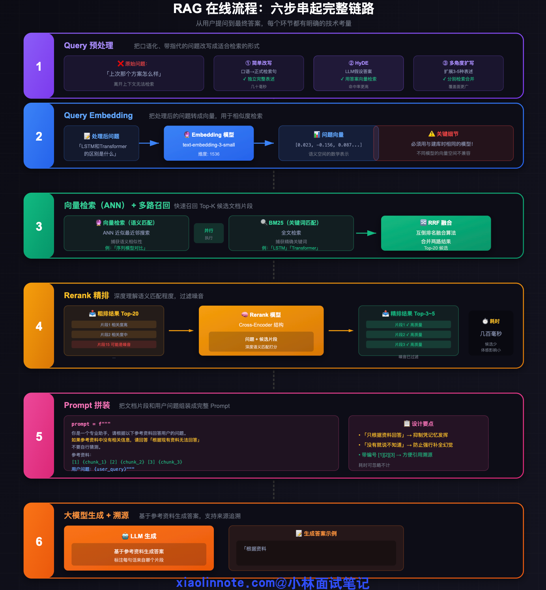

#### 第一步：Query 预处理（Query Rewrite）

为什么要把 Query 预处理放在第一步？因为**用户原始提问的质量决定了后续所有环节的天花板**。如果输入就差，后面再怎么精排、再怎么拼 Prompt 都是白搭。

用户的提问往往是口语化的，甚至带着指代，比如「上次那个方案怎么样」，这种问题离开对话上下文完全没法检索。另外，就算问题表达清楚，用词和知识库里文档的用词可能完全不一样，直接拿去检索命中率会很低。

这一步通常让一个小模型对原始问题做改写。

- 简单改写，把口语化问题改写成更正式、独立完整的检索句。

- HyDE（Hypothetical Document Embeddings），让 LLM 先「假设」一个可能的答案，用这个假设答案的向量去检索：问题和答案的用词往往差异很大，但假设答案和真实答案的用词更接近，它们的语义空间天然更匹配，命中率往往更高。

- 多角度扩写，把同一个问题扩展成 3-5 种不同表述，分别检索后合并结果，覆盖面更广。


#### 第二步：Query Embedding（问题向量化）

把处理后的问题用 Embedding 模型转成向量，很多人以为随便选一个 Embedding 模型就行了，其实不然，**必须用和离线建库时完全相同的 Embedding 模型**。

因为不同 Embedding 模型在训练时见过的数据、目标函数、输出维度、向量空间的"形状"都不一样，模型 A 让「苹果手机」和「iPhone」的向量落在空间里的某个方向，模型 B 完全有可能让它们落在另一个方向，甚至连维度数都对不上（A 是 1024 维，B 是 1536 维，根本没法算距离）。用 A 模型建的库，如果用 B 模型来检索，两边的向量就像在不同坐标系里，距离计算完全没有意义

这就像你用经纬度定位，但一个系统用的是北京坐标系，另一个用的是 WGS84 坐标系，数值看起来差不多但实际位置差了十万八千里。这也是为什么一旦换 Embedding 模型，整个知识库必须重建——老向量和新查询不在同一套坐标系里，没法兼容。

#### 第三步：向量检索（ANN 搜索）+ 多路召回

拿着问题向量，去向量数据库里做近似最近邻搜索（ANN），找出余弦相似度最高的 Top-K 个文档片段。这一步速度非常快，即使百万量级的向量库，通常几十毫秒就能返回结果。

但工程实践中，只用向量检索这一路往往不够。所以这一步通常同时进行多路召回：向量检索负责捕获语义相似性，BM25/全文检索负责捕获关键词精确匹配，两路各有所长。

**向量检索对精确词语（比如产品型号、专有名词、错误拼写）的识别能力比较弱，而 BM25 对这些精确匹配反而更在行。**

比如用户问「LSTM 和 Transformer 的区别」，向量检索能找到「序列模型对比」相关的语义内容，BM25 能精准命中包含「LSTM」「Transformer」这两个词的文档。多路结果通过 RRF（互倒排名融合）算法合并，最终召回的结果比单路覆盖面更广、质量更高。

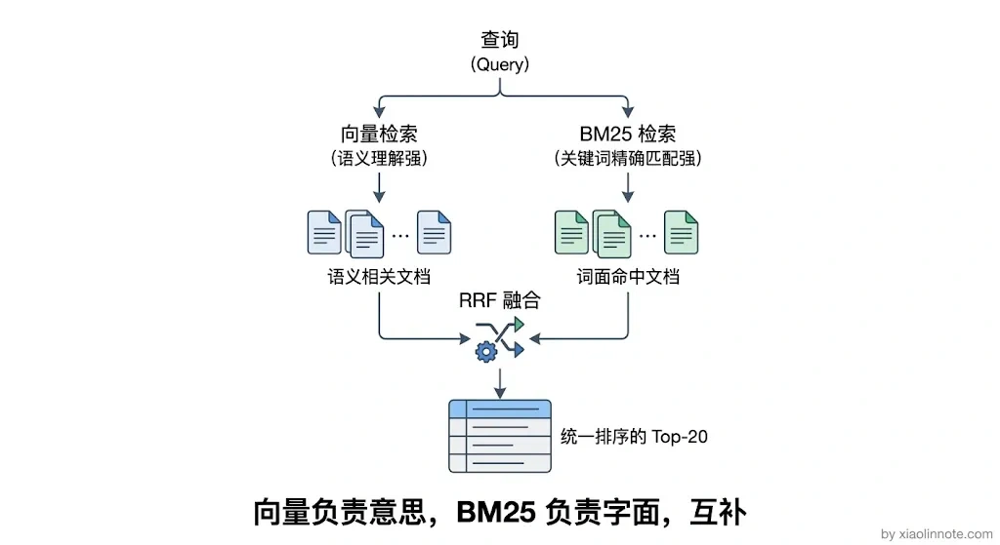

#### 第四步：Rerank 精排

向量检索是「粗排」，召回的 Top-K（比如 20 条）里可能混入相关度不高的干扰片段。Rerank 模型（Cross-Encoder 结构）会把用户问题和每个候选片段拼在一起输入，深度理解它们之间的语义匹配程度，重新打分排序。最终只保留 Top-3 到 Top-5 的高质量片段，把噪音过滤掉。

为什么不直接用 Rerank 模型来检索，还要先粗排再精排？因为 Rerank 是 Cross-Encoder 结构，需要把查询和每个候选拼在一起过模型，计算量比向量检索大得多。如果拿它对百万条数据逐一算分，延迟完全不可接受。所以工程上采用「**粗排筛到几十条，精排再从几十条里挑最好的几条**」这种两阶段策略，**兼顾速度和质量**。Rerank 整体耗时通常在几百毫秒以内，对用户体感影响不大，但检索质量的提升非常明显。

#### 第五步：Prompt 拼装

精排后的高质量片段拿到了，接下来要把它们和用户的原始问题组装成 Prompt 交给大模型。典型模板大概是这样：

```python
prompt = f"""
你是一个专业助手，请根据以下参考资料回答用户的问题。
如果参考资料中没有相关信息，请回答「根据现有资料无法回答」，不要自行猜测。

参考资料：
[1] {chunk_1}
[2] {chunk_2}
[3] {chunk_3}

用户问题：{user_query}
"""
```

**这里面每一条指令都有明确的工程意图。很多人以为只要把检索结果丢给大模型就行了，其实 Prompt 拼得不好，大模型一样会乱回答。**

「只根据资料回答」是为了抑制大模型凭记忆发挥的倾向，大模型天生喜欢「帮忙」，你问什么它都想着要回答，哪怕资料里没有相关信息它也会自己编一个出来。

「资料没有就说不知道」是防止它在信息不足时强行补全出幻觉内容。参考资料带编号是为了方便后续做引用溯源，让用户知道每句话的依据是什么。

#### 第六步：大模型生成 + 溯源

大模型拿到 Prompt 之后，基于参考资料生成答案。到这一步，整个 RAG 在线流程的核心工作就完成了。

工程实践中通常还会要求大模型在答案里标注每句话来自哪个片段（比如「根据资料[1]...」），这样用户可以追溯到原始文档，验证答案是否准确，可信度大幅提升。很多人以为 RAG 生成的答案就是最终答案，不需要再验证了，其实溯源这一步非常关键。大模型即使在有参考资料的情况下，依然可能过度发挥或者误读资料，溯源让用户有能力判断哪些内容是可靠的、哪些需要再确认。

整个链路串起来，在线阶段的耗时分布大概是：Query 改写几十毫秒，向量检索几十毫秒，Rerank 几百毫秒，Prompt 组装可忽略不计，大模型生成根据输出长度在 1-10 秒不等。工程上常见的优化手段是缓存高频 Query 的检索结果，以及把向量检索和 BM25 检索并行执行，把两路召回的延迟从串行叠加变成取最大值。

### 🎯 面试总结

面试官问「RAG 在线流程是怎样的」，你不能只说「检索 + 生成」四个字就完事了。这就像别人问「一顿饭怎么做」，你回答「买菜和做饭」，中间的洗菜、切菜、调味、火候一个都没提。

正确回答要按顺序把六个步骤讲清楚。

- 第一步 Query 预处理（改写、HyDE、多角度扩写），把口语化的问题转成适合检索的形式；
- 第二步 Query Embedding，注意必须用和建库时相同的模型；
- 第三步向量检索 + 多路召回，向量检索和 BM25 各有所长，通过 RRF 融合结果。
- 第四步 Rerank 精排，用 Cross-Encoder 深度理解语义，把粗排的噪音过滤掉；
- 第五步 Prompt 拼装，明确约束 LLM 只根据资料回答、不知道就说不知道；
- 第六步生成 + 溯源，标注引用来源提升可信度。

每个环节干什么、为什么需要、有什么工程细节，都要能说清楚

## 11. 请你介绍一下向量检索和关键词检索的区别？

### 💡 简要回答

关键词检索（BM25 这类）靠的是词频统计，看查询词在文档里出现了多少次，擅长精确命中；向量检索靠的是语义空间里的距离，能理解「换了种表达方式的同一个意思」，擅长模糊语义匹配。两者各有盲区：BM25 遇到同义词就没辙，向量检索遇到专有名词、产品型号这类精确词就容易漏。所以 RAG 系统里通常两路都跑，向量检索捕获语义相关的内容，BM25 精准命中关键词，再用 RRF 算法把两路结果合并，这样覆盖面比单路宽很多。

### 📝 详细解析

#### 11.1 关键词检索：字面匹配，靠统计

先从最直观的方式说起。关键词检索的代表是 BM25（Best Match 25），这是 Elasticsearch、Lucene 等传统搜索引擎的核心算法。

它的基本思路可以用一个类比来理解：想象一个巨大的图书管理员，他给每本书建了一张「词汇卡片」，记录这本书里每个词出现了几次。用户来查「手机 截图」，管理员就把包含「手机」的书挑出来，再把包含「截图」的书挑出来，然后看哪些书同时被挑中、被挑中的词出现频率高，这些书就排前面。这个「词汇卡片」系统就是**倒排索引**，它记录的不是「每篇文档里有哪些词」，而是反过来，记录「每个词出现在哪些文档里」。

打分的时候核心看两个因素。

- 第一个是**词频（TF）**：这个词在这篇文档里出现了几次，出现越多说明越相关。
- 第二个是**稀缺度（IDF）**：这个词在所有文档里有多罕见。

你可能会想，直接数词频不就行了，为什么还要看稀缺度？

原因：「的」「是」「在」这些词在哪篇文章里都高频出现，如果只看词频，每篇文档都会因为包含这些常用词而拿到高分，根本区分不出哪篇真正相关。所以 **IDF 的作用就是给常见词降权、给罕见词加权，让真正有区分力的词决定排序结果**。

BM25 在 TF-IDF 基础上又加了饱和度限制，防止某个词重复出现太多次后权重无限叠加。

```python
# 用 rank_bm25 库做关键词检索的例子
from rank_bm25 import BM25Okapi

# 文档库（实际使用时是分词后的 token 列表）
corpus = [
    ["苹果", "手机", "截图", "方法"],
    ["iPhone", "截屏", "教程"],
    ["安卓", "手机", "拍照"],
]
bm25 = BM25Okapi(corpus)

# 查询也要分词
query = ["苹果", "手机", "截图"]
scores = bm25.get_scores(query)  # 每个文档的 BM25 分数
```

BM25 的优势是对**精确词汇命中率极高**，产品型号「iPhone 15 Pro Max」、专有名词「LSTM」、缩写「RAG」，只要文档里有这个词，BM25 就能精准找到。

但它的劣势同样明显，而且刚好是向量检索的优势所在：**遇到同义词就束手无策**。

用户查「手机截图」，文档里写的是「iPhone 截屏教程」，BM25 看到没有任何词汇重叠，分数为零，直接忽略这篇文档，哪怕它正好是最相关的答案。这个致命的盲区，直接催生了向量检索的出现。

#### 11.2 向量检索：语义匹配，靠 Embedding

它的思路是这样的：先用一个 Embedding 模型把每段文本转成一个高维数字向量（比如 1024 维的浮点数列表），这个向量可以理解成这段文本在「语义空间」里的坐标。语义相近的文本，坐标就靠近；语义不相关的，坐标就离得远。好比给每段文字在地图上钉了个钉子，意思越相近的钉子挨得越近。用户查询来了，也转成向量，然后去找最近的几个钉子。

这样就好理解了：「苹果手机怎么截图」和「iPhone 如何截屏」这两句话，虽然一个字都不一样，但经过 Embedding 之后，向量的余弦相似度可以高达 0.95。向量检索通过近似最近邻算法（ANN）在向量库里找和查询向量最近的 Top-K 条，速度极快，百万量级的向量库通常几十毫秒就能返回结果。

那向量检索是不是万能的？很多人以为向量检索比关键词检索「高级」，所以所有场景都该用向量检索，其实不是。

向量检索的优势是**语义理解能力强**，能跨越同义词、近义词、不同表达方式的障碍；但它的劣势是**对精确词汇不敏感**，产品型号「Pro Max 256GB」、人名、版本号这类词，在 Embedding 空间里可能彼此距离并不近，向量检索容易把它们混淆在一起，反而不如 BM25 直接命中准确。

#### 11.3 两者的核心区别对比

| 维度       | 关键词检索（BM25）       | 向量检索           |
| ---------- | ------------------------ | ------------------ |
| 匹配方式   | 词汇重叠统计             | 语义空间距离       |
| 索引结构   | 倒排索引（稀疏）         | 向量库（稠密）     |
| 同义词处理 | 无法处理                 | 天然支持           |
| 精确词命中 | 极好                     | 容易漏             |
| 计算方式   | 基于统计，可解释         | 黑盒，向量距离     |
| 适合场景   | 专有名词、代码、精确查询 | 语义问答、模糊表达 |

#### 11.4 混合检索：两路都跑，合并取长补短

工程实践中的标准做法叫**混合检索（Hybrid Search）**：同时跑向量检索和 BM25，各自召回一批候选，然后用 RRF（Reciprocal Rank Fusion，互倒排名融合）算法把两路结果合并排序。

RRF 的思路很巧妙：它不看各路的原始分数，只看排名。你可能会问，为什么不直接把两路的分数加权平均呢？原因是向量相似度（0 到 1 的余弦值）和 BM25 分数（可能是任意正数）的量纲完全不同，就像拿摄氏度和华氏度直接加在一起没有意义。RRF 用排名的倒数来打分，排名越靠前倒数越大，最终按总分降序排列。这样，两路都认为相关的文档会排在最前面，只有一路认为相关的文档也不会被完全丢掉。

```python
def reciprocal_rank_fusion(results_list, k=60):
    """
    results_list: 多路检索结果，每路是一个 [doc_id, ...] 的有序列表
    k: 平滑参数，防止排名第 1 的文档权重过大，通常取 60
    """
    scores = {}
    for results in results_list:
        for rank, doc_id in enumerate(results):
            if doc_id not in scores:
                scores[doc_id] = 0
            # 排名越靠前（rank 越小），倒数越大
            scores[doc_id] += 1 / (rank + k)
    # 按总分降序排列，取 Top-K
    return sorted(scores.items(), key=lambda x: x[1], reverse=True)

# 使用示例
vector_results = ["doc_a", "doc_b", "doc_c"]   # 向量检索的排序结果
bm25_results   = ["doc_b", "doc_d", "doc_a"]   # BM25 的排序结果

merged = reciprocal_rank_fusion([vector_results, bm25_results])
# doc_b 两路都高排，doc_a 也两路命中，会排在前面
```

这个方案还有一个工程上的好处：两路检索可以**并行执行**，总延迟取两路中的最大值而不是两者相加，几乎没有额外的时间代价，但召回质量比单路明显更好。这也是为什么生产环境的 RAG 系统很少只用纯向量检索，混合检索已经成为行业默认做法。

### 🎯 面试总结

回到开头的问题：向量检索并不是「什么都比关键词检索好」，两者是互补关系。

关键词检索（BM25）靠词频统计，精确匹配强但同义词没辙；向量检索靠语义空间距离，语义理解强但精确词容易漏。

正确的做法不是二选一，而是混合检索，两路并行召回，用 RRF 融合排序，取长补短。

面试中回答这道题，关键是把两种检索方式的原理、各自的盲区、以及为什么需要混合检索这条主线讲清楚，而不是简单地说「向量检索更好」。

## 12. 如何润色用户的 Query（Query Rewrite）？目的是什么？

### 💡 简要回答

我用 Query Rewrite 主要是为了弥补用户提问方式和知识库文档表述之间的语义鸿沟。用户的问题往往口语化、模糊、带缩写，而文档写的是正式书面语，向量相似度天然偏低，导致该召回的内容没被召回。

我接触过的方法主要有四种：第一是直接改写，让 LLM 把口语化的问题转成更精准的表述；第二是 Query 扩展，补充相关关键词；第三是 HyDE，让 LLM 先生成一个假设答案，然后用答案的向量去检索；第四是 Step-back Prompting，把具体问题往上抽象一层，检索更通用的背景知识。

### 📝 详细解析

#### 12.1 为什么需要 Query Rewrite

用户和文档写作者之间有一道天然的表述鸿沟。

用户可能这样问：「这东西坏了咋整」，而文档里写的是「产品故障排查与维修指南」。你可能会想，这两句话意思差不多，向量检索应该能匹配上吧？遗憾的是，实际效果往往不如预期——即便语义相关，向量相似度也可能低到召回不了正确文档，因为口语和书面语在向量空间里的「坐标」差距不小。

Query Rewrite 就是在检索之前，先对用户的问题做加工，让它在向量空间里离正确文档更近。这相当于在出发前先校准导航，目的地不变，但路线更准。

#### 方法一：直接改写（Query Rewriting）

把口语化、模糊的问题改写成更精准、更书面化的检索表述。改写的本质是消除口语化表达和书面知识库表述之间的向量距离，「这东西咋退」和「申请退款的操作流程」在向量空间里不是同一个邻居，改写就是把前者的向量拉近到后者。同时还可以补全上下文，处理代词指代（「这个功能」改写成具体功能名称），让多轮对话中的模糊引用变成检索可识别的具体词汇。

发给 LLM 的 Prompt 模板如下：

```
请将用户的问题改写成更适合知识库检索的表述。
要求：去掉口语化表达、补全缩写和指代、使用更正式的书面语、保留核心意图。

对话历史：{最近几轮对话}
用户问题：{原始问题}

只输出改写后的问题，不要解释：
```

示例效果：原始「上次说的那个退款的事，流程是啥」-> 改写后「申请商品退款的完整操作流程是什么」。

直接改写能解决口语化和指代不清的问题，但还有另一种鸿沟是改写搞不定的，问题和文档本来就是不同的文体，一个是疑问句，一个是陈述句，就算你把问题改写得再规范，它在向量空间里还是「问句」的坐标，而文档是「陈述句」的坐标，两类文体之间天然有距离。

这个问题催生了 HyDE 的出现。

#### 方法二：HyDE（Hypothetical Document Embeddings）

理解了「问句和陈述句在向量空间里有距离」这个问题，HyDE 的思路就非常巧妙了。

HyDE 的直觉可以这样理解：**正常你用问题的影子去找答案的样子，HyDE 先描绘出答案可能长什么样子，再去找长得像它的文档**。先让 LLM 根据用户问题生成一段「假设性的答案」，再用这段假设答案的向量去检索文档。假设答案不需要准确，只需要「风格像文档」就够了，它的作用是充当一个向量上更好的「检索代理」。

在向量空间里，答案到答案的距离，比问题到答案的距离要近得多。假设答案的作用不是「回答问题」，而是「扮演文档的角色」，用它当检索代理比用原始问题更高效。

生成假设答案用的 Prompt 模板：

```
请根据以下问题，生成一段可能的答案。
注意：不需要完全准确，只需要用于辅助检索，风格尽量像知识库文档。

问题：{用户问题}
假设答案：
```

示例效果：问题向量「退款政策是什么」和文档「申请售后退款须知」距离较远；而假设答案向量「用户可在购买后 14 天内申请退款...」和文档距离很近，能被正确召回。

HyDE 解决的是「文体差异」的问题，但还有一类情况是 HyDE 和直接改写都处理不好的——用户的问题太具体了，知识库里压根没有直接对应的答案，但有相关的背景原理文档。这种情况下，不管你怎么改写、怎么假设，都很难从具体问题直接跳到背景知识。于是就有了 Step-back Prompting。

#### 方法三：Step-back Prompting（后退提问）

对于涉及具体细节的问题，有时候知识库里没有直接对应的答案，但有背景原理。Step-back Prompting 把具体问题「后退一步」，提升到更抽象的层次，先检索背景知识，再结合背景知识回答具体问题。

类比一下就很直观：就像你做一道数学题，不是一上来就硬套公式，而是先想想「这道题用的是哪种定理」，再用定理解题。知识库里可能没有「ef 参数设 100 是否合适」的直接答案，但一定有「HNSW 参数调优原则」这样的背景文档，把具体问题后退成背景问题，才能找到真正有用的参考资料。

生成「后退版本」问题的 Prompt 模板：

```
请将以下具体问题转化为一个更通用的背景问题，用于检索相关背景知识。

具体问题：{原始问题}
背景问题：
```

示例效果：具体问题「Qdrant 的 HNSW ef 参数设多少合适」-> 后退问题「HNSW 索引的参数调优原则是什么」。后退后的问题能命中更多通用背景文档，让 LLM 生成有原理支撑的答案。

前面三种方法都是在「一个问题」上做文章——要么改写它、要么给它配一个假设答案、要么把它抽象化。但有时候问题的角度本身就比较窄，用一个角度去检索，覆盖面不够。这时候就需要换个思路：不求一个问题改得更好，而是多生成几个不同角度的问题。

#### 方法四：多 Query 扩展

用 LLM 把用户原始问题改写成 3～5 个不同角度的版本，分别去检索，然后把所有结果合并去重。核心思路是：只要有一个改写版本和文档的表述对上了，就能把正确的内容召回来，就像拦截网越宽，捕到鱼的概率越高。适合用户提问风格多变、和文档表述差异大的场景，代价是多几次 LLM 调用。

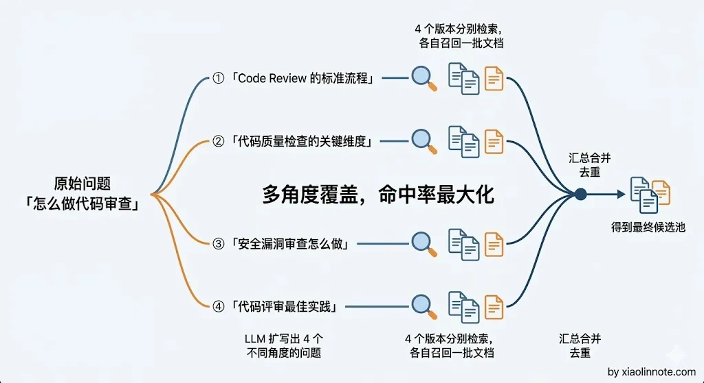

| 方法          | 解决的核心问题               | 额外开销      | 适合场景                     |
| ------------- | ---------------------------- | ------------- | ---------------------------- |
| 直接改写      | 口语化、指代不清、上下文丢失 | 1 次 LLM 调用 | 多轮对话场景                 |
| HyDE          | 问题和文档文体风格差异大     | 1 次 LLM 调用 | 专业知识库、文体差异明显     |
| Step-back     | 具体问题需要背景知识辅助     | 1 次 LLM 调用 | 技术文档、需要原理支撑的场景 |
| 多 Query 扩展 | 单一角度覆盖不全             | N 次 LLM 调用 | 答案涉及多个维度的复杂问题   |

### 🎯 面试总结

Query Rewrite 的核心目的是弥合用户提问和文档表述之间的语义鸿沟，而这个鸿沟有多种不同的形态。

口语化表达用直接改写，文体差异用 HyDE，问题太具体用 Step-back，角度单一用多 Query 扩展。

面试中回答这道题，关键是把「为什么要做 Query Rewrite」和「四种方法各自解决什么问题」讲清楚，让面试官看到你不是只会一种改写方式，而是理解了不同场景需要不同策略。

## 13. 什么是多路召回？具体怎么做？

### 💡 简要回答

多路召回就是同时**用多种不同的检索方式去捞候选内容，然后合并排序**，而不是只靠单一的向量检索。我理解核心出发点是**向量检索和关键词检索各有盲区**，向量检索擅长语义相似，但对精确词语比如产品型号、缩写、数字效果比较差；BM25 关键词检索正好相反，精确匹配强，但不理解语义。我在项目里常用的组合是向量检索加 BM25 混合检索，再加上多 Query 扩展，也就是把用户问题改写成多个版本分别检索。多路的结果用 RRF 算法融合，最后送进 Rerank 精排。

### 📝 详细解析

#### 13.1 什么是多路召回？

同时用多种不同的检索方式去捞候选内容，最后再把各路结果合并、排序，交给 LLM 生成答案。

和它对应的是「单路召回」，也就是只用一种检索方式，最典型的就是只用向量检索：用户问题转成向量，去向量库里找相似度最高的 Top-K 个 chunk，然后直接喂给 LLM。这套流程在很多场景下能跑起来，但有明显的天花板。

你可能会问，既然向量检索有语义理解能力，为什么还不够用？原因很简单，没有任何一种检索方式是全能的，向量检索有它的盲区，BM25 也有它的盲区，把它们组合起来互相补盲区，总召回质量才会比单路高。

常见的组合是三路：

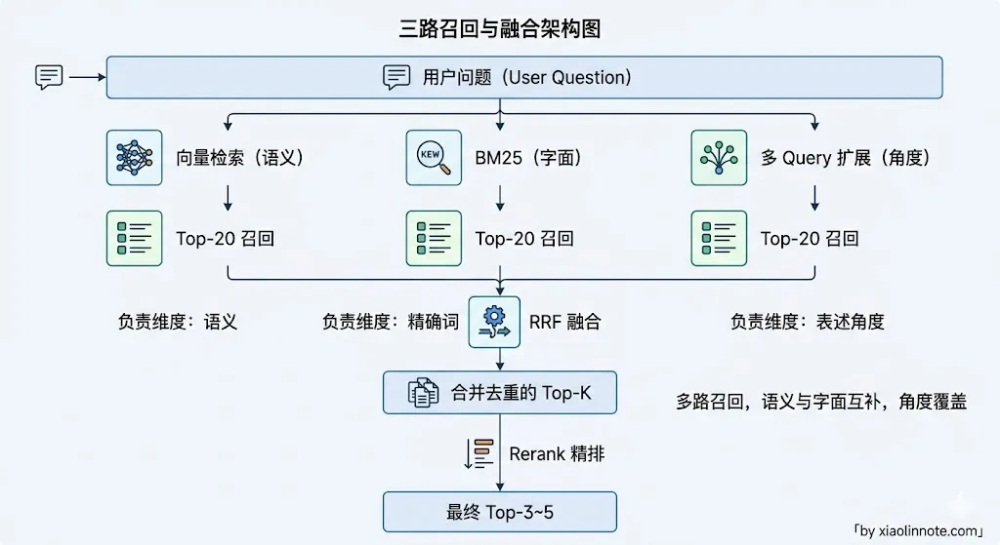

第一路是**向量检索**，负责语义层面的覆盖，处理同义词、近义词、不同表达方式，「退货」和「申请售后」在向量空间里是邻居，能互相命中。第二路是**BM25 关键词检索**，负责精确词匹配，专门处理产品型号、专有名词、数字这类向量检索搞不定的场景。第三路是**多 Query 扩展**，把用户问题改写成多个不同角度的版本，覆盖更多表述差异，相当于撒了一张更宽的网。

三路各自召回一批候选，再用 RRF 算法把排名融合成一个统一的结果列表，最后送进 Rerank 精排，才把最终上下文交给 LLM。

#### 13.2 为什么单路召回不够用?

单纯依赖向量检索是大多数 RAG 系统早期的做法，但它有一个明显的短板：**对精确词语的召回效果差**。

比如用户问「M4 Pro 芯片的性能参数」，这里的「M4 Pro」是一个专有名词，向量模型可能把它和「苹果最新处理器」的向量拉得很近，但如果知识库里这个词本来就是「M4 Pro」，向量检索不如直接关键词匹配来得准。很多人以为换个更好的 Embedding 模型就能解决，其实不行——这是向量检索「只看语义、不看字面」的固有局限，不管用哪个模型都存在这个问题。

反过来，关键词检索（BM25）对同义词和不同表达方式无能为力。用户问「怎么退货」，文档里写的是「申请售后」，词没重叠，BM25 完全召回不到。

两种检索方式的盲区恰好互补，这就是「多路召回」的出发点。理解了这个互补关系，后面每一路的作用就非常清晰了。

#### 第一路：向量检索（Dense Retrieval）

向量检索是多路召回的基础一路。核心做法是：**把文档和用户问题都用 Embedding 模型转成向量，然后用余弦相似度在向量库里找最近的 top-K 个 chunk。**

它擅长**语义匹配**，同义词、不同表达方式都能覆盖，但对精确词语（产品型号、缩写）效果不佳——而这恰好是第二路 BM25 的强项。

#### 第二路：BM25 关键词检索（Sparse Retrieval）

BM25 是 TF-IDF 的改进版本，。它的核心逻辑是：一个词在这篇文档里出现多（词频高），但在整个知识库里出现少（区分度高），说明这个词对这篇文档很具代表性，权重就高。本质上是在问：「**这个词有没有『代表』这篇文档？**」

中文场景下用 BM25 需要先做分词（比如用 jieba 切词），再对分词后的词列表建索引和检索。实现上就是对每个 chunk 先切词建索引，查询时同样切词后计算 BM25 分数排序。纯文本匹配，速度极快，对精确词语、数字、专有名词的召回效果非常好。

前两路解决了「语义匹配」和「精确词匹配」的问题，但还有一个场景它们都覆盖不到——用户提问的角度和文档表述的角度压根不一样，不是同义词的问题，而是整个视角的差异。这就需要第三路出场了。

#### 第三路：多 Query 扩展召回

用 LLM 把用户的原始问题改写成 3～5 个不同角度的版本，分别去检索，然后把所有结果合并去重。这样只要有一个改写版本和文档的表述对上了，就能把正确的内容召回来，就像拦截网越宽，捕到鱼的概率越高。

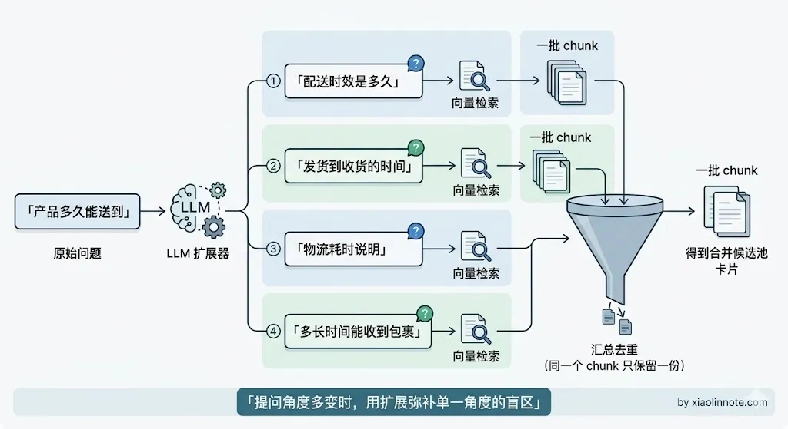

实现上，先调 LLM 生成多个问题变体，每个变体分别跑向量检索，最后把所有结果汇总并去重（同一个 chunk 被多个变体召回时只保留一份）。代价是多了几次 LLM 调用，但在用户提问风格多变的场景下，召回覆盖率能提升 10%～20%。

#### 13.3 结果融合：RRF 算法

三路召回各自拿回了一批候选，接下来的问题就是：怎么把三路结果合成一份？每一路都有自己的排序结果，分数单位不一样（向量检索是余弦相似度，BM25 是 TF-IDF 分数），没法直接加权平均。你可能会想，能不能归一化之后再加权？理论上可以，但实际上各路分数的分布差异很大，归一化效果不稳定，工程上也更复杂。

RRF（Reciprocal Rank Fusion，倒数排名融合）是目前最常用的融合方法，它只用排名而不用原始分数，巧妙地绕开了分数不可比的问题：
$$
\text{RRF\_score}(d) = \sum_{r \in R} \frac{1}{k + \text{rank}_r(d)}
$$
其中 k 是平滑参数（通常取 60），rank 是文档在某一路结果里的排名。

RRF 的直觉很好理解：不管各路分数怎么算（因为向量相似度和 BM25 分数本来就没有可比性），只看排名。一个文档在多路检索里都排名靠前，它的 RRF 综合分就高，就像多位评委都给高分的选手，最后的综合排名就高。这个方法不需要训练、计算量极小，工程落地成本很低。

值得注意的是，RRF 本质上还是粗排，适合在 Rerank 之前做候选集合并。如果对最终召回精度要求很高，还是要在 RRF 融合之后接一个 Cross-Encoder 结构的精排模型（比如 `bge-reranker-v2-m3`）做深度打分，把真正相关的内容筛到最前。

#### 13.4 实战建议

不是每个场景都需要三路全上，按业务特点来选：

知识库里有大量专有名词、产品型号、数字的场景（比如电商、IT 文档），向量 + BM25 双路是标配，收益很明显。

用户提问方式多变、和文档表述差异大的场景（比如客服问答），加上多 Query 扩展，召回覆盖率能提升 10%～20%。

对召回质量要求极高的场景，三路全上，最后接 Rerank，把融合结果精排一遍再给 LLM，把质量做到天花板。

| 召回方式      | 擅长                       | 短板                       | 适合场景               |
| ------------- | -------------------------- | -------------------------- | ---------------------- |
| 向量检索      | 语义相似、同义词、不同表达 | 精确词语、数字、专有名词   | 通用语义检索           |
| BM25 关键词   | 精确词匹配、专有名词       | 同义词、语义相关但词不重叠 | 有大量精确词语的知识库 |
| 多 Query 扩展 | 覆盖不同表述角度           | 增加 LLM 调用开销          | 用户提问风格多变的场景 |

### 🎯 面试总结

用户搜「RTX 4090 显卡功耗」，向量检索召不回来，调大 top-K 或者换模型都不是治本之策。问题的根源是向量检索对精确词天然不敏感，这不是模型能力的问题，而是检索方式本身的局限。

多路召回的思路很简单：既然没有任何一种检索方式是全能的，那就同时走多条路，向量检索管语义，BM25 管精确词，多 Query 扩展管表述差异，三路结果用 RRF 融合，互为补充，覆盖面远比单路广。

面试时把「为什么单路不够」和「多路怎么组合、怎么融合」这两条线讲清楚，就到位了。

## 14. RAG 检索优化策略有哪些？

### 💡 简要回答

我理解 RAG 的检索优化可以从四个层次来看：**索引层决定知识怎么存，查询层决定问题怎么转换，召回层决定从哪些路径去找，重排序层决定最终哪些内容进入 prompt**。

每一层都有对应的优化手段，我的经验是单独优化一个层次往往效果有限，线上系统我会组合来用，先靠索引优化和多路召回来保证覆盖率，再用 Rerank 保证精度，如果用户提问质量比较差，再额外加上查询优化。

### 📝 详细解析

#### 14.1 检索是 RAG 的命脉

要理解为什么检索优化这么重要，先想清楚一件事：LLM 只能根据送进去的 context 来回答，检索召回的内容就是整个系统的天花板。

生成层做得再好，如果检索没把相关内容找回来，LLM 也是巧妇难为无米之炊。反过来，只要检索能稳定地召回准确、相关的 chunk，生成质量自然差不到哪里去。

你可能会问，那优化生成层没用吗？当然有用，但投入产出比完全不同。生成层的优化（比如调 prompt、换模型）是锦上添花，而检索层的优化是从根本上提升系统的能力上限。所以在 RAG 系统里，检索优化是投入产出比最高的环节，没有之一。

#### 14.2 四层优化全貌

RAG 检索优化可以从四个层次来理解，每一层解决的问题不同，优化手段也不同：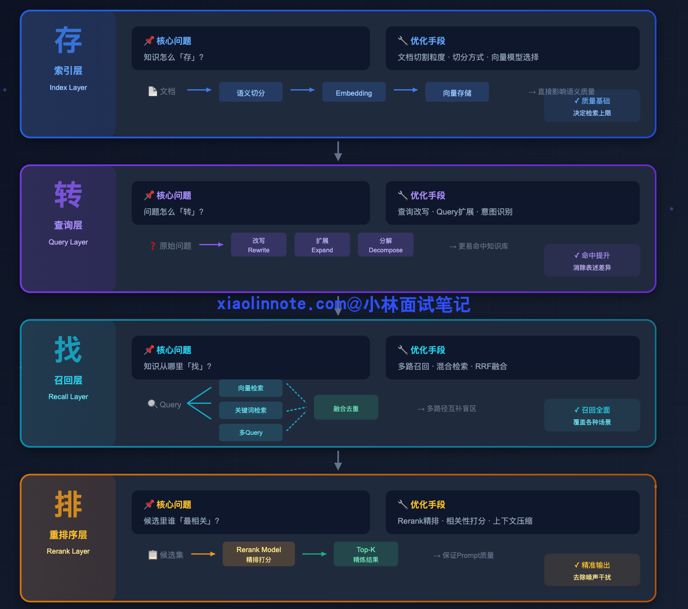

- **索引层**决定知识怎么「存」，也就是文档切割的粒度和方式，直接影响向量的语义质量；
- **查询层**决定问题怎么「转」，在检索之前对用户的 query 做加工，让它更容易命中知识库；
- **召回层**决定知识从哪里「找」，用多条不同的检索路径并行捞取候选，互补各自的盲区；
- **重排序层**决定候选里谁「最相关」，对粗召的候选集做精排，保证进入 prompt 的都是真正有用的内容。

这四层是递进关系，可以用一个比喻来理解：索引层决定「仓库里放了什么」，查询层决定「用什么钥匙开门」，召回层决定「从哪几扇门进去找」，重排序层决定「把找到的东西里最好的几件带出来」。下面依次展开说。

#### 第一层：索引优化

索引是所有后续优化的基础，如果知识存的方式就有问题，后面再怎么优化查询和检索都是白搭。

索引优化是 Chunking 策略的延伸，但它聚焦于一个更核心的矛盾：**检索用的粒度和 LLM 读的粒度天然是矛盾的**。

理解这个矛盾，要从 chunk 承担的两个角色说起。一个 chunk 需要同时完成两个任务。

- 「检索时被找到」，这要求向量语义尽量聚焦。把一篇文章压成一个向量，这个向量里混合了太多不相关的语义，用户问细节问题时，这个笼统的向量很可能和问题向量距离较远，就检索不到了，所以检索需要小粒度的 chunk，每个 chunk 语义聚焦。

- 「被 LLM 读懂」，这要求有完整的上下文。断章取义的几句话 LLM 往往答不好，如果文档里前一段定义了术语、后一段才是真正的解释，只给 LLM 后一段它可能看不明白，所以 LLM 需要大粒度的 chunk，上下文完整。


很多人以为直接把 chunk 切小就好了，检索会变准，但切小之后 LLM 拿到的是碎片化的信息，回答质量反而下降。这就是两难困境：小 chunk 检索准但内容太碎，大 chunk 内容完整但检索时语义稀释。

解决这个矛盾的核心思路叫 Small-to-Big，也就是**小块检索、大块使用**。具体有三种实现方式：

- **Parent-Child Chunking** ：把文档切成两个版本：一份是细粒度的子 chunk（比如 150 token 一个），一份是粗粒度的父 chunk（比如 500 token 一个），每个子 chunk 通过 parent_id 关联到对应的父 chunk。入库时只给子 chunk 建向量索引；检索时用子 chunk 的向量来匹配，精度高；命中之后，根据 parent_id 取出对应的父 chunk，把父 chunk 塞给 LLM 阅读，上下文完整。这样就做到了「检索用小的，阅读用大的」，两全其美。
- **摘要索引**（Summary Index）：不是切割文档，而是让 LLM 为每一段内容生成一段摘要，用摘要来建向量索引。为什么这样做？因为文档原文有时候表述很散，而摘要是对核心意思的提炼，语义更聚焦，在向量空间里和用户的问题会更接近，命中率更高。检索时用摘要的向量匹配，命中后把原始段落塞给 LLM 阅读。
- **多粒度分层索引**则更激进，同时建章节级、段落级、句子级三层索引。不同类型的问题适合不同粒度：「什么是 RAG」这种宽泛的概念性问题，用章节级就够了；「退款申请需要几个工作日」这种细节性问题，用句子级更精准。系统根据问题类型自动选择合适的粒度去检索，能覆盖更多类型的用户需求。

#### 第二层：查询优化

索引优化解决的是「**知识怎么存**」的问题，但即使索引建得再好，用户的提问方式和知识库里的表述方式之间还是会存在鸿沟，这不是存储端的问题，而是查询端的问题。

来看一个具体的例子：用户问「苹果手机咋截图」，知识库里写的是「iPhone 截图操作方法」。两句话意思一样，但向量相似度可能不高，前者是口语中文，后者是正式书面语，表达风格的差异会拉开向量距离，检索就容易漏。

你可能会想，不是已经用向量检索了吗，语义理解应该能处理这种差异吧？实际上向量检索虽然比关键词检索好很多，但口语和书面语的 Embedding 距离依然比人们直觉上以为的要远，尤其是在短文本场景下，信息量本来就少，表达差异对相似度的影响被放大了。

查询优化就是在检索之前，先对用户的 query 做加工，让它在向量空间里离正确文档更近。主要有四种方法。

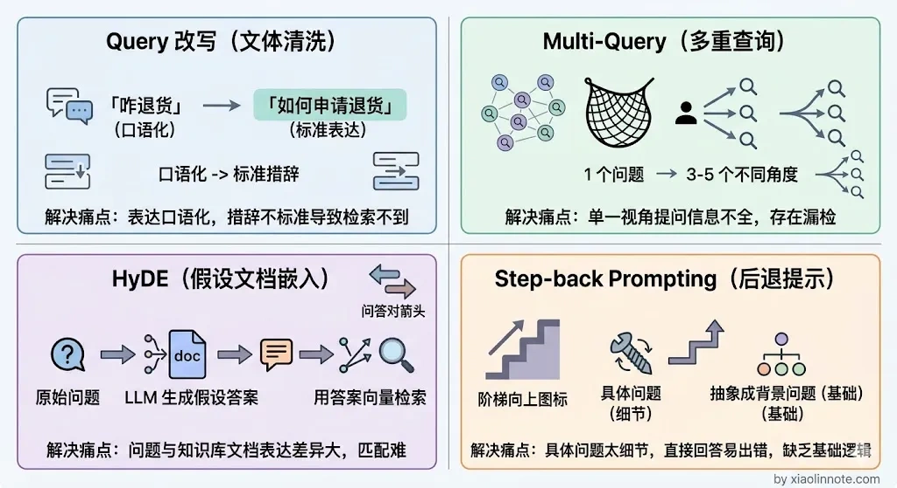

#### 第三层：召回优化

查询优化是从「问题」这边想办法，召回优化则是从「检索路径」这边想办法。

即使 query 已经改写得很好了，如果只走一条检索路径，还是会漏掉一些内容。

单一的向量检索有一个根本局限：它只擅长语义相似，对精确词语匹配效果差。比如用户问「M4 Pro 芯片的性能跑分」，这里的「M4 Pro」是一个精确的产品型号，如果知识库里就是这么写的，向量检索反而不如直接关键词匹配来得准，因为向量模型可能把「M4 Pro」和「苹果最新处理器」的向量拉近，但就是找不到包含字符「M4 Pro」的那条记录。

反过来，关键词检索（BM25）也有自己的盲区：它只会数词频，不理解语义。用户问「怎么退货」，文档里写「申请售后」，词不重叠，BM25 完全召不到，但向量检索能处理这种同义表达。

两种检索方式的盲区恰好互补，这就是多路召回的出发点。不只走一条路，同时打开多扇门，把各路结果汇总起来，覆盖更多的可能性。

典型的三路并行是这样的：

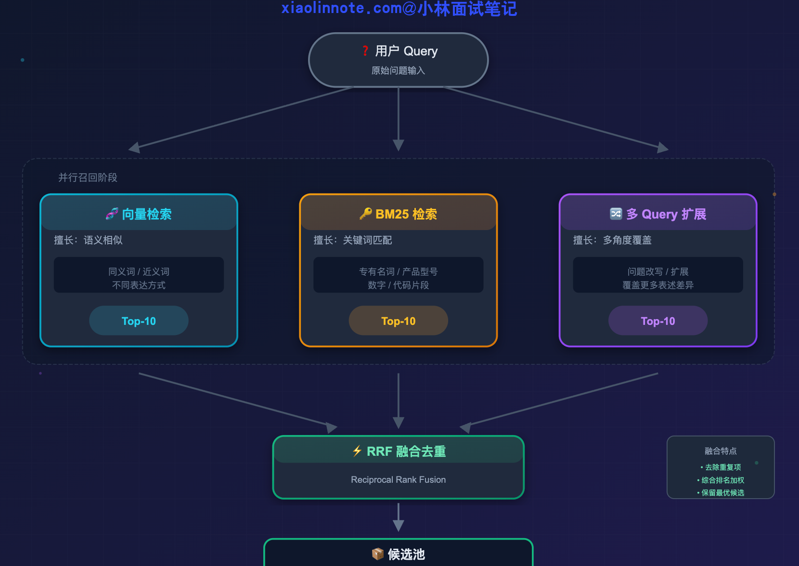

三路各自捞出一批候选，但它们的分数没法直接比较，向量相似度是 0~1 的余弦值，BM25 是 TF-IDF 分数，量纲完全不同。你可能会想，那归一化之后加权不就行了？实际上各路分数的分布差异很大，归一化效果不稳定，工程上也更复杂。

这时候需要一个统一0的融合算法，RRF（Reciprocal Rank Fusion，倒数排名融合）是目前最常用的方案。

**RRF 的思路很简单**：不看原始分数，只看排名。

对每一路结果，排名第 1 的 chunk 贡献的分数最高，排名越靠后贡献越低。把同一个 chunk 在所有路径里的得分加起来，就是它的综合分。

这样，在多路检索里都排名靠前的 chunk，最终综合分就高。各路检索的分数没法直接比，就像百米赛跑和游泳比赛的成绩单位不同、没有可比性，但排名是通用的语言，综合各路排名来打分才公平。

公式是 `score(chunk) = 求和(1 / (k + rank))`，其中 k 是平滑参数，通常取 60。

这个 k 的作用是加一个「保底分」，不让排名靠后的候选因为偶尔失误就完全被淘汰，数值选 60 是实践中发现效果最稳定的经验值。

RRF 最大的优点是实现简单、不需要训练、计算量极小，工程落地成本几乎为零，但融合效果在大多数场景下都很好，是多路召回的标配融合方案。

#### 第四层：重排序

多路召回之后，候选 chunk 可能有 20~30 个，这些 chunk 里难免混入一些不太相关的内容，直接全塞给 LLM 会出问题：一是 token 消耗暴涨，成本直线上升；二是上下文太长，LLM 在处理长文本时容易出现「Lost in the Middle」的现象，也就是只关注开头和结尾，中间的内容容易被忽略。

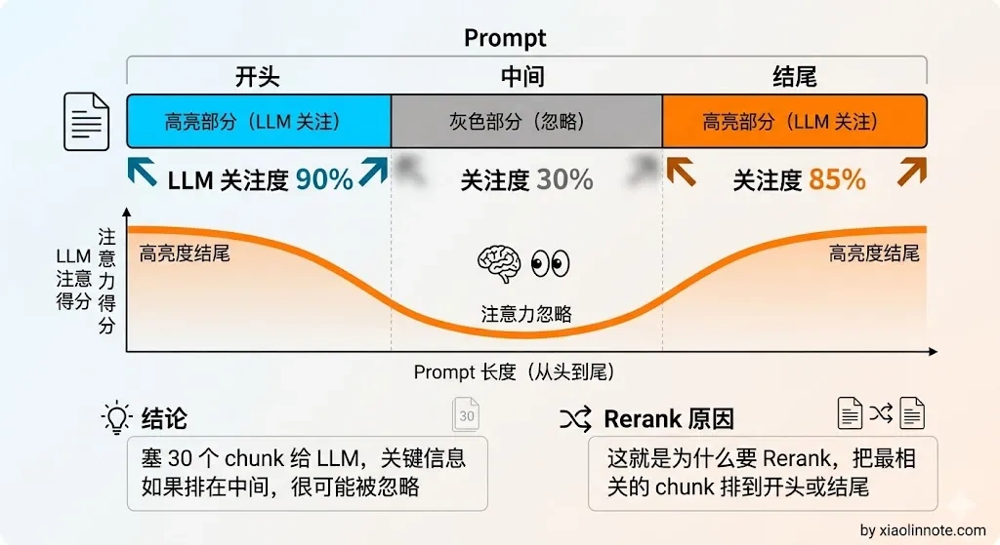

所以需要一个精排步骤，从 20~30 个候选里挑出最相关的 3~5 个，这就是 Rerank 的作用。

你可能会问，向量检索不是已经排过序了吗，为什么还需要再排一次？要理解 Rerank 为什么比向量检索更准，需要先理解两种不同的模型结构。

向量检索用的是 Bi-encoder 结构：query 和 chunk 各自独立编码成向量，再算余弦相似度。这个结构的优点是速度极快，因为 chunk 的向量可以提前计算好存库，检索时只要算一次 query 的向量然后做距离比较就行；缺点是 query 和 chunk 是分开编码的，模型没办法看到两段文字之间的具体词语关联，相关性判断不够精准。

Rerank 用的是 Cross-encoder 结构，把「query + chunk」拼成一对输入，让模型整体看这一对的相关性。Cross-encoder 能看到 query 中每个词对 chunk 的影响、chunk 里哪些词最能回答 query，相关性判断精度远高于 Bi-encoder。代价是每一个候选 chunk 都要单独跑一次 Cross-encoder，速度慢，所以只适合对小规模候选集做精排，不适合大规模召回阶段。

打个比方来理解两者的区别：Bi-encoder 像是只看了两个人的简历就判断他们合不合适合作，而 Cross-encoder 是把两个人放在一个房间里，观察他们怎么交流、怎么配合，判断当然更准确，但代价是需要花更多时间观察每一个人。

Rerank 的流程很清晰：多路召回得到 20~30 个候选 chunk，Cross-encoder Rerank 模型逐一给每个「(query, chunk)」对打相关度分，按分数降序排列后，取 top-3 到 top-5 拼入 prompt。

常用的开源 Rerank 模型有 BGE-Reranker-v2（BAAI 出品，中英双语效果都很好）、BCE-Reranker；不想自己部署的话，也可以用 Cohere Rerank 或 Jina Reranker 的 API。在实际效果上，加了 Rerank 之后最终答案质量通常有明显提升，是成本效益最高的优化手段之一。

#### 14.3 四层优化怎么组合

| 层次                           | 解决的核心问题                 | 推荐程度                       |
| ------------------------------ | ------------------------------ | ------------------------------ |
| 索引优化（Parent-Child）       | 检索粒度 vs 上下文完整性的矛盾 | 推荐，效果稳定                 |
| 查询优化（Multi-Query / HyDE） | 用户提问和知识库表达不对齐     | 视场景，提问质量差时必做       |
| 多路召回（向量 + BM25）        | 单路检索漏召                   | 推荐，低成本高收益             |
| Rerank 精排                    | 粗召精度不足                   | 强烈推荐，提升精度最直接的手段 |

一个典型的生产级搭配：**Parent-Child 索引 + 向量 BM25 多路召回 + Rerank 精排**。这三层组合基本能覆盖大多数场景的检索质量问题。如果用户提问质量比较差（口语化、指代不清），再额外加上 Query 改写。

从另一个角度来记这四层：**索引层保证「存进去的知识可以被找到」，查询层保证「搜索的姿势是对的」，召回层保证「不漏掉该找到的内容」，Rerank 层保证「送进 LLM 的是真正有用的内容」**。每一层各司其职，组合起来才能把检索质量做到高水准。

### 🎯 面试总结

检索优化不是「换个模型、调调参数」这么简单的事，需要一个系统性的四层框架：索引层解决「知识怎么存」的粒度矛盾，查询层解决「问题怎么转」的表述鸿沟，召回层解决「从哪些路径找」的盲区互补，重排序层解决「最终谁最相关」的精度问题。

面试时不要只罗列优化手段，而是要把这四层的逻辑关系讲清楚：每一层解决什么问题、为什么需要它、怎么和其他层配合。

最后给出一套典型组合方案（Parent-Child 索引 + 多路召回 + Rerank），面试官就能看到你是有实战经验的。

## 15. 了解哪些更复杂的 RAG 范式？

### 💡 简要回答

在我的了解里，RAG 的发展经历了三代演进：Naive RAG 是基础的检索加生成；Advanced RAG 在检索前后都加了优化，比如 Query 改写、Rerank、混合检索这些；Modular RAG 是把各个环节做成模块可以任意组合。

在这之上还有几个我觉得值得关注的高级范式。

Self-RAG 是让 LLM 自己来决定要不要检索，以及评估检索质量；CRAG 是检索质量差的时候自动降级到网络搜索；GraphRAG 是微软推的方案，用知识图谱的社区发现和层次摘要来增强全局理解能力；Agentic RAG 是把 RAG 做成 Agent，支持多轮的动态检索。

### 📝 详细解析

#### 15.1 什么是 RAG 范式？

「范式」就是「一套固定的处理流程和设计思路」。RAG 范式，就是指从「用户提问」到「生成答案」这整条链路上，各个环节的组织方式和工作逻辑。

不同的 RAG 范式，本质上是在回答同一个问题：**在「检索」和「生成」之间，系统应该怎么协调、怎么决策、怎么处理中间的各种异常情况？**

最朴素的 RAG 范式是这样的：用户提问 -> 向量检索 -> 拼 prompt -> LLM 生成答案。这套流程一两天就能跑起来，大多数教程演示的都是这个形态。但一旦到了真实业务场景，问题就来了。

#### 15.2 为什么需要不同的 RAG 范式？

朴素 RAG 的问题，随着使用场景复杂度的增加会越来越明显。

- **检索质量参差不齐**。用户的提问方式千变万化，有些问题一次检索就能找到正确答案，有些问题向量检索完全召不到相关内容，但系统不会区分，一律把检索结果喂给 LLM。然后呢？LLM 就会在低质量上下文上胡说八道，而用户完全不知道答案有没有依据。
- 所有问题都走**同一套流程，太死板**。有些问题根本不需要检索，比如「你好」「今天天气怎么样」，强行去知识库里找毫无意义；有些复杂问题需要多轮检索才能拼出完整答案，而朴素 RAG 一律只检索一次。

- **知识库覆盖有盲区**。找不到相关内容时，朴素 RAG 要么让 LLM 编造答案，要么返回一个风马牛不相及的回答。

你可能会想，这些问题用前面讲的 Advanced RAG 手段（Query 改写、Rerank、混合检索）不就能解决了吗？确实能缓解，但它们有一个共同的假设：流程是固定的，只是每个环节做得更好。

而真正复杂的场景需要的是「流程本身能根据情况调整」，什么时候该检索、检索结果不行怎么办、需不需要再检索一次，这些决策需要系统自己做，而不是靠人预先写死。这就是高级范式要解决的问题。

这三个问题，催生了不同思路的 RAG 范式：有的在「如何检索」上做文章，有的在「要不要检索」上加判断，有的在「检索不到时怎么兜底」上下功夫。理解这些范式，本质上是理解面对不同场景约束时，系统设计者各自找到的解法。

#### 15.3 三代 RAG 的演进

RAG 的发展经历了三代，每一代都是在上一代的痛点上演进，但演进的方式越来越系统化。

最早的形态叫 **Naive RAG**，逻辑非常直白：**用户提问 -> 向量检索 -> 拼 prompt -> LLM 生成**。这套流程像搭积木的第一步，把各个环节拼在一起就能跑，两天就能上线一个 Demo。但它什么都没优化：**检索召回什么就送什么，用户提问写得差就找得差，找到的内容有没有用也不管，全部一股脑塞给 LLM，幻觉和偏差就是这样来的。**

意识到问题之后，**Advanced RAG** 出现了，核心思路是在「检索前」和「检索后」各加一道工序。**检索前加 Query 改写和扩展，把用户口语化的提问打磨成更容易命中知识库的形式；检索后加 Rerank 精排和内容压缩，把召回内容里最相关的几条筛出来，不相关的过滤掉，减少喂给 LLM 的噪音。**这套方案不用改框架，只需在原有流程上插入几个步骤，工程改动小，效果提升明显。目前大多数生产系统用的都是这个形态。

Advanced RAG 有一个隐含的假设——流程是固定的「检索前优化 -> 检索 -> 检索后优化 -> 生成」，不管用户问什么，都走这套流程。但真实场景中，不同问题需要不同的处理策略，这就是 Modular RAG 要解决的。

再往后发展就是 **Modular RAG**，不再是在固定流程上打补丁，而是**把 RAG 的各个环节拆成可以独立替换的模块，像乐高一样按需组合：**检索模块可以选向量检索、BM25 或图检索；改写模块可以选 HyDE、Step-back 或多 Query 扩展；生成模块可以是普通输出，也可以是带引用的结构化输出。不同业务场景挑不同模块组合，灵活性大幅提升。LlamaIndex 的 Workflow 和 LangGraph 都是这个设计思路的具体实现。

#### 15.4 高级范式

在这之上还有几个值得关注的高级范式，每一种都对应了朴素 RAG 的一个特定痛点：

##### Self-RAG：LLM 自己决定要不要检索

前面提到朴素 RAG 的第二个痛点是「所有问题都走同一套流程，太死板」。Self-RAG 就是专门解决这个问题的。

普通 RAG 不管用户问什么都去检索，但有些问题根本不需要检索（比如「1+1等于几」），有些检索结果根本不相关。Self-RAG 训练了一个特殊的 LLM，它会自主决定：

1. 当前问题需不需要检索？（Retrieval token）
2. 检索回来的内容和问题相不相关？（Relevance token）
3. 生成的答案有没有幻觉？（Support token）
4. 最终答案质量够不够好？（Utility token）

Self-RAG 的执行流程如下：

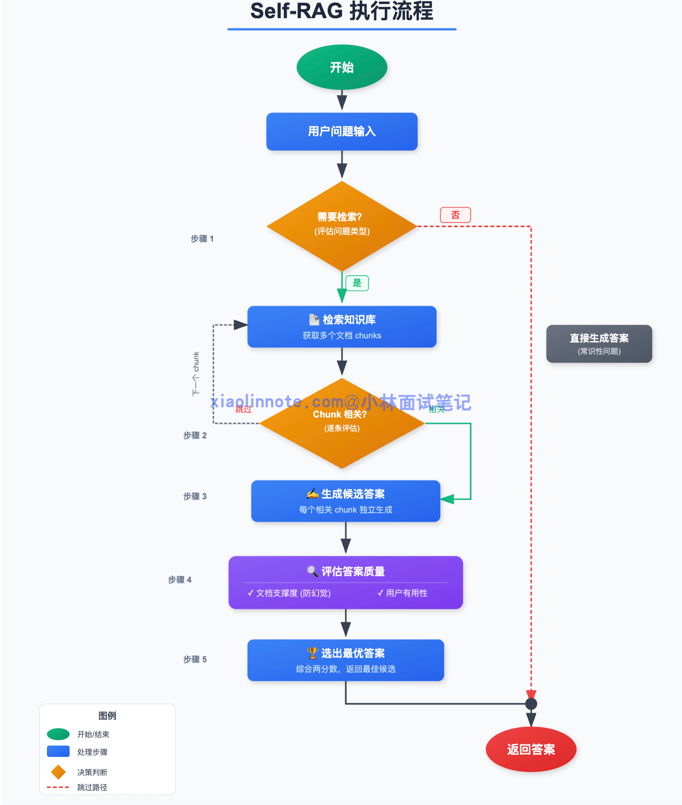

1. **判断是否需要检索**：LLM 先评估这个问题要不要查知识库。如果是常识性问题或者不需要外部信息，直接生成答案。
2. **检索并逐条评估相关性**：对每一个召回的 chunk，LLM 独立判断「这段内容和问题相关吗」，不相关的直接跳过。
3. **基于相关 chunk 生成候选答案**：每个相关 chunk 各自生成一个候选答案。
4. **评估答案质量**：对每个候选答案，LLM 打两个分，有没有文档支撑（防幻觉）、答案对用户有没有用。
5. **选出最优答案返回**：综合两个分数，选出最好的那个候选答案。

这套机制有一个很容易被忽略的前提：那四种 reflection token 不是现成 LLM 自带的，需要在一个专门构造的数据集上，对基础 LLM 进行监督微调，把这些特殊 token 作为新词表的一部分训练进去。

换句话说，Self-RAG 不能拿一个普通的 GPT-4 直接「套用」，要么你拿 Self-RAG 论文开源的微调版本（基于 Llama2-7B/13B），要么自己按论文的流程造数据做微调。这是它和 CRAG、Agentic RAG 很不一样的地方，后者都可以在通用 LLM 上直接跑。

好处也很明显：不需要检索的问题直接回答，省了检索开销；检索结果不相关时能识别出来，避免了基于错误上下文生成的幻觉。

##### CRAG（Corrective RAG）：检索质量差时自动纠错

Self-RAG 解决的是「要不要检索」的问题，那如果检索了但结果质量很差怎么办？

朴素 RAG 的第三个痛点：知识库覆盖有盲区。就会导致这种情况。CRAG 就是专门解决这个问题的。

CRAG 在检索完之后加了一个质量评估环节：如果检索到的内容质量高，正常走 RAG 流程；如果质量低，自动切换到网络搜索，用搜索结果代替知识库内容来回答问题；如果质量居中，把知识库结果和网络搜索结果都用上。

CRAG 的执行流程如下：

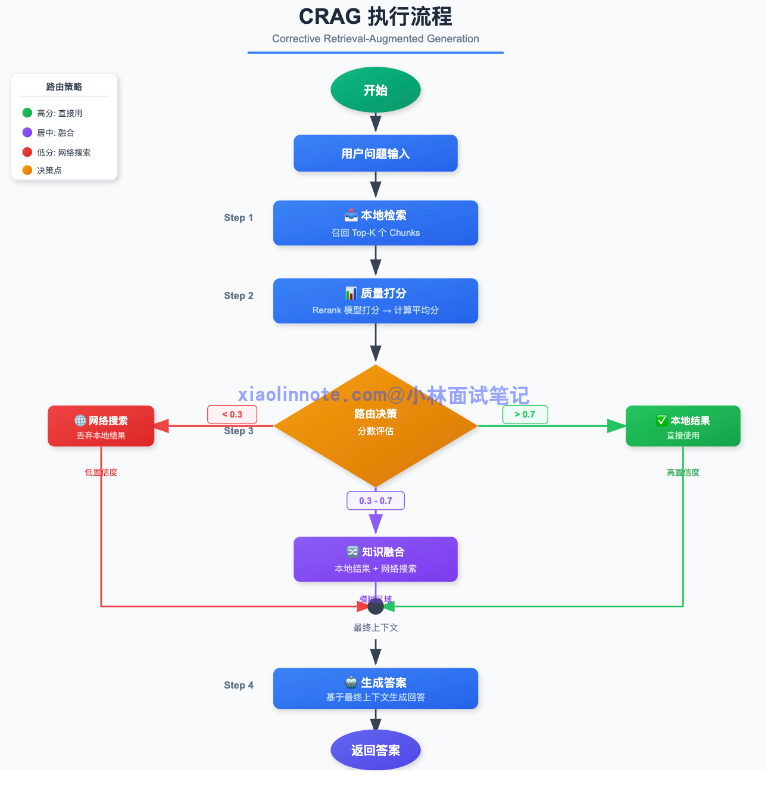

1. **本地检索**：先从知识库里召回 top-K 个 chunk。
2. **质量评估**：用一个轻量级的检索评估器（可以是专门训练的分类模型，也可以用 Rerank 模型的分数来近似）来判断检索结果和问题的相关程度。
3. **三级路由决策**：根据评估结果分成三档。评估为「相关」，直接用本地结果生成答案；评估为「不相关」，说明知识库没有覆盖这个问题，丢弃本地结果，降级走网络搜索；评估为「模糊」，把本地结果和网络搜索结果合并一起用，两者互补。具体的判断阈值需要根据业务场景来调，没有固定数值，核心思路是让系统能自动识别「检索结果靠不靠谱」并做出相应的降级决策。
4. **生成答案**：基于最终上下文生成回答。

这个方案的核心价值在于「兜底」：知识库覆盖不到的问题不会直接乱答，而是自动去网上找答案，大幅提升了系统的健壮性。很多人以为 RAG 系统只能用本地知识库回答问题，**CRAG 打破了这个限制，它把知识库当主力，把网络搜索当备胎**，两者配合使用。

##### GraphRAG：用知识图谱增强全局理解

Self-RAG 和 CRAG 解决的都是「检索策略」层面的问题，但还有一种瓶颈是检索方式本身的局限。

普通向量检索只能召回「和问题直接相关的文档片段」，对于需要全局理解的问题（比如「这批文档的核心主题是什么」「A 公司和 B 公司之间有什么关联」），单纯的向量检索只能找到局部信息，无法把散落在多处的知识串联起来。GraphRAG 就是微软在 2024 年 7 月发布论文的一套方案，它把知识图谱、社区发现和层次摘要这几样现成工具组合起来解决这个问题，核心价值是「系统化组合」而不是单点发明。

GraphRAG 的核心做法分两步。预处理阶段，先用 LLM 从文档里抽取实体和关系，建成知识图谱，然后用 Leiden 等社区发现算法对图谱中的实体做聚类，把紧密关联的实体分成一个个「社区」，再对每个社区生成一份 LLM 摘要，描述这个社区里的实体之间是什么关系、整体在讲什么。这些社区摘要会形成多层的层次结构，从细粒度到粗粒度都有覆盖。

检索阶段，GraphRAG 支持两种查询模式。对于局部问题（比如「A 公司的 CEO 是谁」），可以直接在知识图谱中做实体查找和关系遍历；对于全局问题（比如「这些文档的主要主题有哪些」），则用 Map-Reduce 的方式，先让 LLM 分别阅读各社区的摘要提取相关信息，再汇总生成最终答案。这种「社区摘要 + Map-Reduce」的设计，是 GraphRAG 区别于普通知识图谱方案的核心创新。

你可能会问，为什么向量检索搞不定全局性问题？因为向量检索本质上是在做「一对一匹配」，用一个 query 向量去和一个 chunk 向量比较距离，它擅长找到和问题直接相关的局部片段，但无法理解整个知识库的宏观结构和跨文档的关联关系。

GraphRAG 通过预先构建社区摘要，把全局信息提前「蒸馏」好了，查询时不需要遍历所有文档就能回答全局性问题。

适合知识之间关联性强、需要全局视角的场景，比如金融领域的企业关系分析、医疗领域的药物-疾病-症状关联查询、大规模文档集的主题归纳。代价是构建知识图谱和社区摘要需要大量 LLM 调用，预处理成本较高。

##### Agentic RAG：把 RAG 做成 Agent

前面几种范式虽然各有创新，但都有一个共同点：流程的步骤是预先定义好的，最多是根据条件做分支选择。但有些问题复杂到连「需要检索几次」「每次检索什么」都无法预先定义，需要 LLM 根据中间结果动态决定下一步怎么做。这就引出了 Agentic RAG。

普通 RAG 是固定的「检索一次 -> 生成」的流程，但有些问题需要多轮检索：第一次检索发现信息不够，需要追加检索；检索结果互相矛盾，需要再检索来验证；问题本身是多步骤的，每一步都需要检索不同的内容。

Agentic RAG 把 RAG 嵌入 Agent 循环，LLM 可以自主决定：要不要再检索一次、用什么关键词检索、检索结果是否足够、什么时候可以生成最终答案。

Agentic RAG 的执行流程如下：

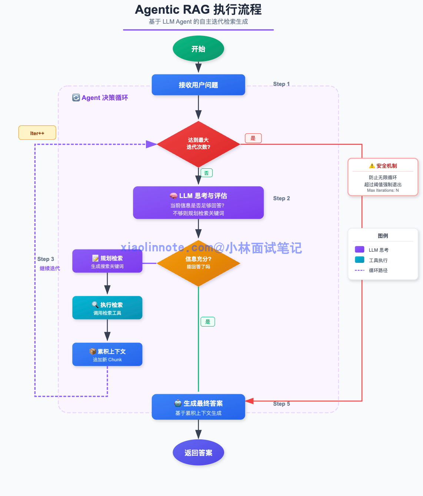

1. **接收问题，进入循环**：LLM 拿到用户问题，开始 Agent 决策循环。
2. **LLM 决定下一步动作**：根据当前已收集到的上下文，LLM 判断，信息够了吗？如果不够，下一步该搜什么关键词？
3. **执行检索，累积上下文**：按 LLM 指定的关键词检索，把新召回的 chunk 追加到已有上下文里。
4. **重复判断，直到信息充分**：LLM 每轮都重新评估「现在能回答了吗」，不够就继续检索，够了就生成答案。
5. **生成最终答案**：信息充分后退出循环，基于所有累积的上下文生成回答。为防止死循环，设置最大迭代次数兜底。

这套机制特别适合需要多步骤推理的复杂问题，比如「帮我分析 A 公司最近三年的财报，找出营收增速放缓的根本原因」，这类问题需要多次、有针对性地检索不同维度的内容，一次检索完全不够。

和前面几种范式相比，Agentic RAG 最大的区别在于「流程不是写死的，而是 LLM 在运行时自己决定」。如果说 Self-RAG 是给 RAG 加了一个「要不要检索」的开关，CRAG 是加了一个「检索不好怎么办」的兜底，那 Agentic RAG 是把整个检索流程变成了一个可以不断循环、不断调整的智能体。

| 范式         | 核心创新                          | 适合场景                         | 工程复杂度                |
| ------------ | --------------------------------- | -------------------------------- | ------------------------- |
| Advanced RAG | Query 改写 + Rerank               | 大多数生产场景                   | 低                        |
| Self-RAG     | LLM 自主决策检索                  | 问题类型多样、部分不需要检索     | 高（需特殊训练模型）      |
| CRAG         | 检索质量差时降级网络搜索          | 知识库覆盖不全的场景             | 中                        |
| GraphRAG     | 社区发现 + 层次摘要，支持全局查询 | 实体关系复杂、需要全局理解的场景 | 高（图构建 + 摘要成本大） |
| Agentic RAG  | 多轮动态检索                      | 复杂多步骤问题                   | 中（Agent 框架）          |

### 🎯 面试总结

回到面试官的问题，Advanced RAG 远不是终点，它只是在固定流程上做了检索前后的优化。真正的高级范式是针对朴素 RAG 的三大痛点分别给出了系统性的解法。

Self-RAG 解决「不是所有问题都需要检索」的问题，让 LLM 自主决策；CRAG 解决「检索质量差时怎么办」的问题，自动降级到网络搜索兜底。

GraphRAG 解决「全局理解和跨文档关联」的问题，用社区发现和层次化摘要补上向量检索只能做局部匹配的短板；Agentic RAG 解决「复杂问题需要多轮动态检索」的问题，把 RAG 做成 Agent 循环。

回答时不要只罗列名字，要讲清楚每种范式解决了什么痛点、核心机制是什么、适合什么场景，这才是面试官想听到的。

## 16. 在什么场景下，你会选择使用图数据库来增强传统的向量检索？

### 💡 简要回答

我的判断是，当**业务问题涉及多个实体之间的关联推理**的时候，就需要考虑引入图数据库来增强。

向量检索有一个根本的局限，它只能做单跳检索，找和问题直接相关的文档，没办法沿着实体之间的关系链做推理。比如你问公司 A 的投资方和公司 B 有什么交集，单纯向量检索就很难处理了，因为答案不在某一段文档里，而是藏在多个节点之间的关系上。

这时候图数据库就能发挥作用，沿着关系边一跳一跳地把关联信息收集回来。我接触过的典型场景有企业关系分析、医疗知识图谱、代码依赖关系查询、供应链溯源这些。

#### 📝 详细解析

#### 16.1 向量检索能做什么，做不到什么

向量检索做的事情是：把用户的问题转成一个向量，然后在知识库里找「向量最接近」的文档片段，把它们拼到 prompt 里给 LLM 用。

这套逻辑在很多场景下效果很好，比如「什么是 Transformer」「Python 的 GIL 是什么」这类问题，答案往往就在某一段文档里，向量检索一跳就找到了。

但是，向量检索有一个根本限制：它是「单跳」的，也就是每次只能找和问题直接相关的内容，没办法沿着实体之间的关系链往下追。

你可能会想，那我多检索几次不就行了？

遗憾的是，不行。

原因很简单：多检索几次的前提是你知道「下一步该搜什么」，但向量检索根本没有「关系」这个概念，它不知道实体 A 和实体 B 之间有一条边，更不知道该沿着哪条边继续走。就像你在一个陌生城市里问路，别人只告诉你「附近有家店」，但不会告诉你「从这家店出发往东走 200 米还有一家」，你没法靠反复问「附近有什么」来拼出一条完整的路线。

来看几个向量检索真的答不上来的问题。

「小米的主要竞争对手的 CEO 是谁」，这个问题需要先找到「小米的竞争对手是谁」，再拿着这些名字去找「谁是他们的 CEO」，两步之间有实体跳转，向量检索每次只能走一步，第二跳就断了。

「治 A 疾病的药和治 B 疾病的药有没有药物相互作用」，答案藏在「药物 -> 作用靶点 -> 相互作用」这条多节点路径上，没有一篇文档会把这个结论直接写出来。

「这个函数直接和间接依赖的所有第三方库有哪些安全漏洞」，需要沿代码依赖链一层层展开,每一跳都是新的查询。

这些问题的共同特征是：**答案不在某一个文档里，而是藏在多个节点之间的「关系」上**，要沿着边一跳一跳地走才能拼出完整答案。理解了这个局限，图数据库存在的意义就很好懂了。

#### 16.2 图数据库是干什么的，为什么能解决这个问题

向量检索做不到多跳遍历，这个能力缺口恰恰是图数据库的强项。图数据库专门用来存「实体和关系」，它把世界表示成一张网：每个节点是一个实体（比如公司、人、疾病、药物），每条边是一种关系（比如「投资」「竞争」「治疗」「副作用」）。

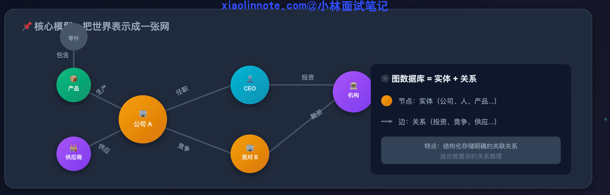

有了这张网之后，就可以做「图遍历」：从一个节点出发，沿着关系边一跳一跳地走，把路径上所有相关节点的信息都收集回来。这正好补了向量检索的短板。

很多人以为图数据库是向量检索的「升级版」，上了图就可以替代向量检索了，其实不是这样。图数据库也有自己的局限：传统的图查询语言（比如 Cypher）擅长的是精确关系查询，「从 A 出发沿着这条边走到 B」，对「语义相似」这种模糊匹配不擅长（现代图数据库如 Neo4j 虽然也在加向量索引能力，但那本质上是把向量检索嫁接进图里，不是图遍历本身在做）。

比如用户问「手机充电慢怎么办」，这种问题没有明确的实体关系可以遍历，图数据库帮不上忙，但向量检索可以从知识库里找到语义相近的故障排查文档。所以实际系统里，这两种技术是互补的，不是替代关系。

#### 16.3 向量检索 + 图数据库的组合用法

两者组合起来的工作流是这样的：向量检索先作为「入口」，用户问「小米的竞争对手 CEO 是谁」，先用向量检索找到和「小米」相关的文档片段，从中识别出关键实体，定位到「小米」这个节点。

接下来，图数据库接力做「关系遍历」，拿到入口实体之后，在图里沿着关系边一路走：「小米」-> 竞争关系 ->「OPPO、vivo、荣耀」-> CEO 关系 -> 对应人名，把沿途经过的节点信息都收集回来。

最终，把向量检索结果和图遍历结果合并，一起塞给 LLM 生成回答。

打个比方，向量检索像是「导航定位」，帮你找到出发点在哪；图遍历像是「沿着路线一站一站走」，帮你把沿途经过的所有站点信息都收集起来。前者解决「在哪」的问题，后者解决「能到哪」的问题，合在一起才能给出完整答案。

这样，LLM 拿到的上下文既有语义相关的文档片段，也有沿关系链追出来的关联信息，两者互补，回答就完整了。

#### 16.4 哪些场景真的需要图数据库

企业关系分析：金融、投资领域的知识库里，企业之间的股权关系、人员之间的任职关系错综复杂。问「X 基金投资的公司里有哪些跟 Y 集团存在竞争」在图里，这一趟遍历几秒钟就出来了。

医疗知识图谱：疾病、症状、药物、基因之间有大量关联，「某个基因突变会导致哪些疾病，这些疾病又有哪些共同的治疗方案」

代码知识库：函数调用关系、模块依赖关系可以建成图，「这个接口被哪些上游服务直接和间接调用」在图里走一遍就出来了。靠文本检索的话，你得一个个文件翻，几乎不可能做到。供应链溯源也类似，原材料 -> 供应商 -> 成品 -> 分销商，这种层级关系天然适合图结构存储和查询，追溯某批次产品的所有上下游环节，图遍历是最自然的解法。

#### 16.5 什么时候不值得上图数据库

图数据库的代价不小：你需要用 LLM 做「实体抽取」和「关系抽取」来把非结构化文档转成图结构，这个过程成本高、容易出错，而且后续维护图结构比维护向量库复杂得多。

如果用户的问题大多数是「找某个概念的解释」「某个功能怎么用」，向量检索加上 Rerank 已经够用了，强行上图数据库是过度设计。

判断要不要用图数据库的简单原则：**问题里是否同时出现多个具体实体名，并且在问这些实体之间「有什么关系」或「通过关系能找到什么」**。如果是，就值得考虑图增强；如果问题主要是找某段描述性的内容，向量检索就够了。

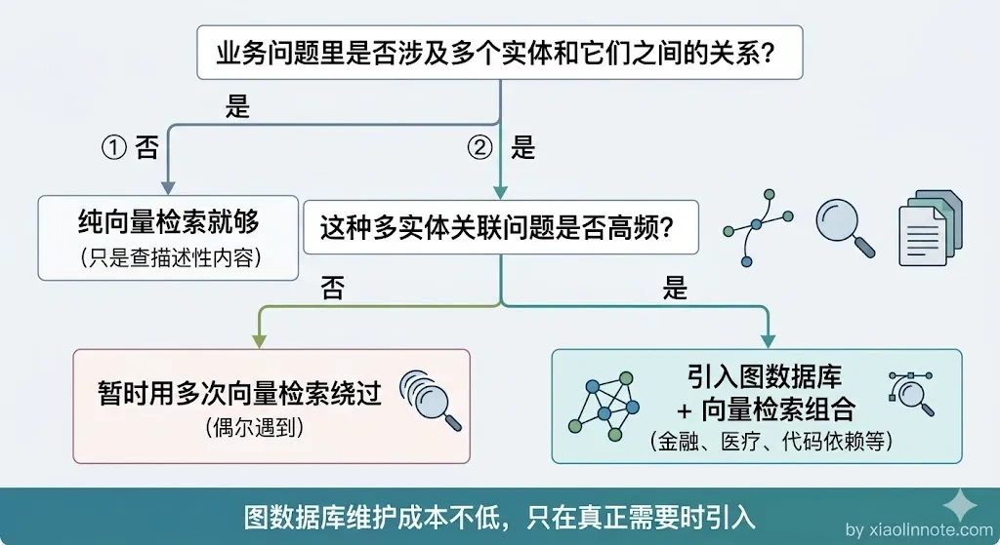

### 🎯 面试总结

回到面试官追问的「多检索几次能不能拼出答案」，答案是不能。

向量检索是「单跳」的，每次只能找和问题直接相关的内容，它没有实体和关系的概念，根本不知道该往哪个方向跳。图数据库的核心价值就在于它能沿着关系边做多跳遍历，把向量检索够不到的关联信息收集回来。

两者的组合方式是向量检索做入口定位实体，图数据库接力做关系遍历，最终合并上下文给 LLM。

选择图数据库的判断标准很简单：问题里是否涉及多个实体之间的关联推理，如果涉及就值得考虑，如果只是查某段描述性内容，向量检索就够了。

## 17. 如何规避 RAG 系统中大模型的幻觉？

### 💡 简要回答

我遇到过的 RAG 幻觉主要有两类。第一类是检索没有召回到相关内容，LLM 没有可用的上下文，靠自身知识在编造答案。第二类是检索内容召回了但 LLM 没有严格遵循，在文档内容的基础上加了自己的推断。

我用来规避幻觉的策略主要有四个方向：第一是 Prompt 强约束，明确告知 LLM 只能根据提供的资料回答，资料里没有的就说不知道；第二是检索质量门控，Rerank 分数低于阈值就直接拒答，不让 LLM 在低质量上下文上硬撑；第三是生成后引用核查，每个关键的声明都要在 chunk 里找到来源依据；第四是结构化输出强制溯源，让 LLM 输出 JSON，每条结论必须附上来源编号。其中 Prompt 强约束加检索质量门控是我觉得成本最低、收效最快的组合，生产系统上线前这两个必须做。

#### 📝 详细解析

#### 17.1 幻觉是什么，为什么 RAG 里会有幻觉？

LLM 的幻觉，就是模型一本正经地说了一件压根不存在的事。它不是在撒谎，它只是在「预测下一个词」，当它没有可靠依据时，就会拼凑出一个「听起来合理」的答案，但内容可能是错的。

你可能会想：RAG 不是已经把知识库的内容塞进 prompt 了吗，LLM 为什么还会编造？塞进去不等于 LLM 一定会「老老实实照着说」。LLM 有自己的「知识储备」（来自预训练），当 prompt 里的资料和它平时「学到的」不一致，或者 prompt 里根本就没召回到相关内容，它就可能绕开资料、自己发挥。

 RAG 里的幻觉有两个完全不同的来源，要分开理解：

**第一种：检索层没找到，LLM 靠「猜」回答。**

RAG 的前提是「检索到了相关内容再生成」，但如果检索这一步失败了，向量没找到相关的 chunk，prompt 里就是空的或者全是不相关的内容，LLM 会怎么做？它不会说「我不知道」，它会用自己训练时见过的知识编一个看起来像答案的东西。这个答案可能和你知识库里的内容完全相反，而且 LLM 说得很自信，用户根本看不出来。

举个具体例子：你的知识库里记录的退款政策是「7 天无理由退款」，但某次检索没召回到这个 chunk，LLM 用自己的「知识」给出了「30 天退款」的答案，用户按这个信息去操作，结果退款失败，这就是检索层幻觉造成的实际损失。

**第二种：检索到了，但 LLM 没有严格照着说。**

那检索到了就安全了吗？也不是。相关的 chunk 确实被召回了，塞进 prompt 里了，但 LLM 在生成答案时「超发挥」了，它把资料里的内容作为基础，然后加了自己的推断、补充了原文没有的细节、甚至把两段不相关的信息混在一起拼出一个「更完整」的答案。读者很难分辨哪句话来自文档、哪句是 LLM 加的。

这两种幻觉的根源不同，解法也不一样。下面四个方案，是从「成本最低」到「机制最严格」依次递进的思路。

#### 方案一：用 Prompt 告诉 LLM「只准照着资料说」

在 system prompt 里明确立规矩，只能用资料里的内容、资料里没有就说不知道、不准推断和补充：

> 回答规则：
>
> 1. 只能使用【参考资料】中的信息来回答，不得引入资料之外的知识
> 2. 如果参考资料中没有足够信息，必须明确回答：「根据现有资料，无法回答该问题」
> 3. 回答时标注信息来源（来自哪条参考资料）
> 4. 不要推断、不要猜测、不要补充资料中没有明确说明的内容

第一条的作用是让 LLM「知道自己的边界」，明确告诉它，你只是个传话人，不是百科全书，只能照资料说话。第二条给了 LLM 一个「合法的逃生出口」，当资料里没有答案时，说「不知道」比编一个看起来合理的答案要好得多，这条规则允许 LLM 优雅地认怂。第三条让 LLM 在回答时主动对照原文，相当于给它加了一个自检动作，哪句话来自哪条资料必须说清楚。

这个方案能压制「生成层幻觉」，但对「检索层幻觉」帮助有限，如果 prompt 里根本就没有相关内容，再强的约束也顶不住 LLM 瞎编。所以还需要下面这个方案配合。

#### 方案二：检索质量差时，直接拒绝回答

整个流程很直接：检索召回 top-K 个候选 chunk，Rerank 模型对每个候选打一个 0 到 1 的相关度分数，然后看最高分的值。如果最高分低于阈值，说明这次检索根本没找到有用的内容，直接返回「知识库无相关信息，建议联系人工」，不让 LLM 强行回答；如果最高分达标，就把所有达标的 chunk 筛出来喂给 LLM。

这个阈值到底设多少？没有通用数字，得按你自己的业务数据调。调法是拿一批「已知答案在知识库里」和「已知答案不在知识库里」的测试集跑一遍，看 Rerank 分数分布，找那个能把两类分开的切点。一般经验值在 0.3 到 0.6 之间：对精度要求高（金融、医疗）偏高，对召回率宽松（闲聊型问答）偏低。先从中间值开始，根据线上误判的样例往上或往下调。

结合方案一和方案二，就能同时压制两类幻觉：方案二负责「检索质量差时不让 LLM 胡说」，方案一负责「检索质量还行但 LLM 容易超发挥时把它框住」。这两个是 RAG 系统上线前的基础配置，成本也最低。

#### 方案三：答案生成后，逐条核查有没有「凭空捏造」

LLM 生成完答案，再用另一个 LLM（或者同一个 LLM）回头检查，答案里的每一条关键信息，在 chunk 里有没有对应的依据。没有依据的内容，标注「无法核实」或者直接删掉。实现方式是发起「第二次 LLM 调用」，把原始答案和 chunk 一起送给 LLM，让它充当编辑角色，逐条核查每个声明有没有来源支撑。就像文章写完还要请编辑审阅一遍，方案一是事前约束作者的行为，方案三是事后审稿。

这个方案的代价是多一次 LLM 调用，响应延迟会增加，成本也会翻倍。所以一般只在对准确性要求极高的场景使用，比如医疗问诊、法律咨询，答错了代价很大的地方。普通的企业知识库问答，方案一 + 方案二组合通常已经够用。

#### 方案四：强制 LLM 输出时带上来源编号

如果说方案三是在内容层面做校验，那方案四就是在格式层面做约束，和方案一的「Prompt 约束」配合使用效果更好。让 LLM 输出结构化的 JSON，每个结论都必须填写来自哪条参考资料的编号。这样一来，用户看到答案的同时就能看到来源，系统也可以自动验证每条结论的来源 ID 是不是真实存在。LLM 输出的格式大致是这样：

> ```json
> {
>     "answer": "完整回答",
>     "statements": [
>         {"claim": "具体结论1", "source_ids": [1, 2]},
>         {"claim": "具体结论2", "source_ids": [3]}
>     ],
>     "confidence": "high/medium/low"
> }
> ```

这个方案为什么有效？

原因有两个：一是 LLM 在构建 JSON 时必须主动想「这条结论我从哪条资料里找到的」，这个过程本身就会减少瞎编的概率，就好比你让学生写论文必须标注参考文献，他自然就不敢随便编了；二是系统拿到 JSON 后可以做程序化验证，`source_ids` 里的编号如果对应的 chunk 和 `claim` 明显不相关，就可以自动过滤掉这条结论。

#### 17.2 四个方案怎么组合？

从易到难，按场景递进来看：普通的企业知识库和客服问答，方案一加方案二是必须做的基础配置，成本极低，幻觉问题能解决大半；
对可信度要求高的场景，比如金融分析、法律文档，再加上方案四，让每条答案都带上来源编号，用户可以自己去原文核实；
对准确性要求极高、容错率极低的场景，比如医疗问诊、合规审核，答错了代价很大，这时候四个方案全上，在延迟和成本上付出代价，换取最高级别的准确性保证。

说到底，规避幻觉没有一劳永逸的银弹。最重要的认知是：**检索质量是幻觉的最大来源**，检索到了正确的内容，Prompt 再稍微约束一下，幻觉就已经少很多了；如果检索这一步就烂，再多的生成层约束也填不了这个坑。所以治幻觉，先治检索。

### 🎯 面试总结

回到面试官的追问，「检索做好了就不会幻觉」这个想法是错的。RAG 里的幻觉有两个来源：检索层没召回到内容，LLM 靠自身知识编造；以及检索到了但 LLM 超发挥，在资料基础上加了自己的推断。

「在 prompt 里加一句请根据资料回答」也远远不够，你需要一整套系统的防控策略：Prompt 强约束压制生成层幻觉，检索质量门控在检索失败时直接拒答，生成后引用核查做二次校验，结构化输出强制溯源让每条结论都有据可查。成本最低、收效最快的是 Prompt 约束加检索门控的组合，生产系统上线前这两个必须做。记住核心原则：治幻觉，先治检索。

## 18. 怎么量化你的 RAG 效果？

### 💡 简要回答

检索层看该召回的有没有召回到，我用 Hit@K 和 MRR 来衡量。生成层看答案对不对、有没有幻觉、和问题相不相关，我主要用 RAGAs 框架，里面的 Faithfulness、Answer Relevancy 和 Context Recall 这三个指标是最核心的。

我的建议是一定要在自己的业务数据上跑，不能只看通用排行榜，那个不能代表你的场景。

另外线上指标，就是用户的点踩率、追问率、转人工率这些，才是最终的衡量标准，离线指标只是辅助。

### 📝 详细解析

#### 18.1 什么是 RAG 评估？

用一套可量化的指标体系，持续测量 RAG 系统「回答得好不好」，把「好不好」这个笼统的感受，拆解成具体是哪个环节出了问题。

为什么非得强调「持续」？

因为 RAG 系统不是搭完就一劳永逸的。知识库在更新，用户的提问方式在变化，Embedding 模型可能要换，Chunking 策略可能要调，每一次改动都可能让效果变好或者变坏。没有评估体系，你就是在盲飞，不知道自己的优化到底有没有用，甚至不知道改完之后系统是变好了还是变差了。

#### 18.2 为什么需要 RAG 评估？

很多团队早期不做系统性评估，靠「人工抽查几条觉得还行」就上线了。

这种方式的问题很明显。

首先，靠感觉调优没有方向。改了 Chunking 策略、换了 Embedding 模型，系统效果有没有提升？抽查几条根本说明不了问题，样本太少，结论不可靠。

其次，出了问题不知道该查哪里。用户反馈「AI 回答错了」，你不知道是检索没召回到正确内容，还是召回了但 LLM 编造了额外信息，还是 Prompt 设计有问题。没有分层指标，排查就靠猜。

再者，优化后无法验证收益。你花了时间调优，但到底优了多少？没有数字说话，技术决策缺乏说服力，也无法判断下一步该在哪里继续投入。

RAG 评估的本质，是把「这套系统好不好用」这个主观感受，转化成一组可以追踪、可以对比、可以指导决策的客观数字。

#### 18.3 为什么 RAG 评估很难

答案是自然语言，没有唯一标准答案；出了问题不知道是检索层的锅还是生成层的锅；人工标注成本高，难以大规模持续做。

正确的做法是把评估拆成两层，分别衡量检索质量和生成质量，定位问题更精准。先看检索层。

#### 第一层：检索层评估

不管 LLM 生成什么，先单独评估检索有没有把正确的 chunk 召回来。需要准备一批「问题 + 对应的正确 chunk ID」的测评数据（可以从历史问答里标注，也可以让领域专家整理）。

这一层主要有两个指标。

**Hit@K** 的直觉是：我把 Top-K 的检索结果摆在你面前，你要找的那个在里面吗？如果在，这次就算命中（Hit）。Hit@5 就是说，把前 5 个结果给你，能不能命中，最终统计命中率。

这个指标回答的是「找到没」的问题，不关心找到的是第几名。一般 Hit@5 低于 0.7 就说明检索层有问题，需要考虑换 Embedding 模型或者优化 Chunking 策略；高于 0.8 说明检索层 OK，如果答案还不好，问题在生成层。

**MRR**（Mean Reciprocal Rank，平均倒数排名）更进一步，关心的是「你要找的东西排在第几名」。计算公式也很直观，就是对每个问题算 `1 / 排名`，然后对所有问题求平均。所以第一名找到得 1 分，第二名找到得 0.5 分，第三名得 0.33 分，第五名得 0.2 分，排名越靠后得分越低。MRR 越高，说明正确内容排名越靠前，用户越早看到它。这个指标回答的是「多快找到的」。MRR 低于 0.5 通常说明 Rerank 效果不够好，正确内容召回了但没排到前面。

简单来说：**Hit@K 是「找到没」，MRR 是「多快找到的」**。Hit@5 等于 0.9，说明 90% 的问题都能在前 5 个结果里找到相关内容；但 MRR 只有 0.3，说明相关内容虽然找到了，但排得很靠后，可能第 4、第 5 才出现。配合起来用能精确定位检索层的问题出在哪一步。

#### 第二层：生成层评估（RAGAs 框架）

检索层评估回答了「找没找到」的问题，但找到之后 LLM 有没有好好利用这些内容？这就需要生成层评估。RAGAs（Retrieval Augmented Generation Assessment）是目前使用很广泛的 RAG 端到端评估框架，它的核心思路叫做「LLM-as-a-Judge」，意思是用 LLM 来当裁判，自动给答案打分，不需要人工标注每一条，大幅降低评估成本。

它有四个核心指标:

**Faithfulness（忠实度）**：答案里说的每件事，在检索到的 chunk 里有没有出处？这个指标衡量的是幻觉程度。你可以把它理解为「LLM 裁判」在逐句问：「这句话你从哪条资料里找到的依据？」没有依据的句子越多，分越低。目标值是 > 0.8。

**Answer Relevancy（答案相关性）**：答案有没有回答用户问的那个问题？注意这个指标和 Faithfulness 是两回事，很多人会把它们搞混。Faithfulness 是问「说的是不是真的」，Answer Relevancy 是问「说的是不是用户想要的」。一个答案可以字字有据、但完全跑题，Faithfulness 高、Answer Relevancy 低。

打个比方，你问「北京天气怎么样」，AI 回答了一篇关于北京历史的资料，内容全是对的，但和天气没有半毛钱关系，这就是 Faithfulness 高、Answer Relevancy 低。目标值是 > 0.8。

**Context Recall（上下文召回率）**：要回答这个问题，所需要的信息有多少比例在检索结果里覆盖到了？这个指标需要有「标准答案」作为参照，衡量的是检索层有没有「漏掉该找到的内容」。目标值是 > 0.7。

**Context Precision（上下文精确率）**：这个指标和 Context Recall 配对出现，衡量的是检索结果里「有用的内容」排名是否靠前。也就是说，如果你召回了 10 个 chunk，相关的那几个有没有被排在前面，而不是混在无关内容的后面。它同样需要 ground_truth 作为参照计算。Context Recall 关注「该找的有没有找全」，Context Precision 关注「找到的里面相关的是不是排在前面」，两个配合能完整刻画检索质量。

需要注意的是，RAGAs 本质上是「LLM-as-a-Judge」，每次评估都要调用 LLM 来打分。如果测试集有几千条，全量跑一遍的 token 消耗和时间成本相当可观。工程上通常有两种缓解方式：一是对核心测试集抽样评估，只跑最有代表性的 200～500 条；二是把评判者模型从 GPT-4o 降级到 GPT-4o-mini，成本降低 10 倍，精度损失在可接受范围内。

#### 18.4 通过指标定位问题

Context Recall 低，你可以把它理解为「检索结果里缺少了答好这道题必要的信息」，说明检索层没召回到正确内容，优化方向是换更强的 Embedding 模型、调整 Chunking 策略、或者加多路召回来补充覆盖面。

Context Precision 低，说明检索召回了太多噪音，相关内容是找到了，但不相关的内容也混进来了，把 LLM 的注意力稀释掉了，优化方向是加强 Rerank 模型、调低最终送给 LLM 的 chunk 数量。

Faithfulness 低，说明 LLM 在编造，幻觉问题多，你回答里说的东西在参考资料里找不到依据，优化方向是加强 Prompt 约束、引入引用核查、或者做检索质量门控，防止低质量上下文进入生成阶段。

Answer Relevancy 低，说明答案跑题了，没有聚焦在用户问的问题上，通常是 Prompt 的指令不够明确，告诉 LLM「请严格回答问题本身，不要展开无关内容」往往就能改善。

#### 18.5 线上指标：最终衡量标准

踩率是最直接的信号，用户主动点踩，说明这次回答让他不满意，是最真实的负反馈。

追问率反映的是「答非所问」的程度，用户说「你没回答我的问题」或者追问同一个问题，通常意味着上一次回答没用。

转人工率衡量的是「RAG 放弃回答」的频率，这个比例太高说明知识库覆盖不足；但如果这个比例因为加了质量门控而上升，不一定是坏事，宁可转人工也不要给用户错误答案。

空回答率就是系统主动说「我不知道」的比例，过高说明知识库亟需扩充。

会话解决率是最综合的指标，衡量「一次对话能不能解决用户的问题」，是最贴近用户体验的衡量维度。

离线评估（Hit@K + RAGAs）用来快速迭代和定位问题，线上指标（踩率、转人工率）是最终验收标准。两者结合，形成「离线测评 -> 上线 -> 线上观测 -> 发现问题 -> 离线复现 -> 修复 -> 再上线」的完整评估闭环。

这里还要提醒一点：离线指标好不代表线上一定好，反过来也一样。常见的情况是离线测试集不能完整代表真实用户分布，或者离线指标优化过头反而损害了线上体验（比如为了 Faithfulness 把 Prompt 收得太死，结果模型回答过于保守、用户觉得不好用）。所以两者要定期交叉对照，发现偏差时往往是测试集需要更新或者指标权重需要调整。

| 指标              | 属于哪层   | 衡量什么                   | 低了说明什么                 |
| ----------------- | ---------- | -------------------------- | ---------------------------- |
| Hit@K             | 检索层     | 正确 chunk 是否被召回      | Embedding 或 Chunking 有问题 |
| MRR               | 检索层     | 正确 chunk 的排名是否靠前  | Rerank 效果差                |
| Context Recall    | 生成层输入 | 检索内容覆盖了多少正确信息 | 多路召回不足                 |
| Context Precision | 生成层输入 | 检索内容里噪音多不多       | Rerank 没过滤掉无关内容      |
| Faithfulness      | 生成层     | 答案有没有幻觉             | Prompt 约束不足或检索质量差  |
| Answer Relevancy  | 生成层     | 答案和问题相不相关         | Prompt 写法问题              |
| 踩率 / 转人工率   | 线上       | 用户实际满意度             | 整体系统效果，综合反映       |

### 🎯 面试总结

RAG 效果评估不能靠「用户投诉」或「人工抽查」这种事后手段，而是要建立一套分层的量化指标体系。

检索层用 Hit@K 和 MRR 衡量召回质量，生成层用 RAGAs 框架的 Faithfulness、Answer Relevancy、Context Recall 来衡量答案质量，线上再用点踩率、转人工率等业务指标做最终验收。

通过不同指标的组合，可以精确定位问题是出在检索层还是生成层，让优化有方向、有数据支撑，而不是凭感觉瞎调。

## 19. RAG 知识库如何实现动态与持续更新？

### 💡 简要回答

我理解知识库更新的核心挑战是，**文档变了，对应的 chunk 和向量都要跟着变，而且要做到增量处理，不能每次全量重建。**我们的通用方案是给每个文档算一个内容 hash，通过轮询或者监听数据源变更，检测到文档新增、修改、删除的时候，先清掉旧的向量，再重新切割入库。对于实时性要求比较高的场景，我会用消息队列比如 Kafka 做变更事件驱动，实现秒级的入库。

### 📝 详细解析

知识库更新这个问题，很多同学做 RAG Demo 时不会碰到，一旦上生产就必须面对。文档本身是会变的，产品手册改版、政策文件更新、FAQ 内容迭代，如果知识库不及时跟进，RAG 就会一直给用户返回过期信息。所以动态更新能力是 RAG 系统投入生产的必备条件，而不是锦上添花的功能。

#### 19.1 为什么更新 RAG 知识库比更新普通数据库麻烦？

原因在于，普通数据库更新一条记录，直接 UPDATE 就行，数据是独立的，改一条不影响别的。但 RAG 知识库的麻烦在于：原始文档和向量库之间不是一对一的关系，而是一对多的关系。

一篇文档会被切割成几十甚至上百个 chunk，每个 chunk 分别 Embedding 后存入向量库。当文档内容发生变化时，你不能简单地「更新一条记录」，因为文档结构变了，切割结果可能完全不同，chunk 的数量、边界、内容都会变。

所以 RAG 知识库在工程上最可靠的更新逻辑是**先删掉旧文档对应的所有 chunk，再重新切割入库**，即「先删后增」，而不是在原来的 chunk 上做局部更新。理论上如果 Chunking 策略完全稳定（比如按固定 token 窗口切），某些场景可以做局部更新，但生产环境里 chunk 边界一变就全乱套，与其在这种不确定性上博弈，不如直接走「先删后增」简单可靠。

抽象来看，知识库的变更只有三种操作类型。新增是最简单的，文档以前不存在，走一遍完整的「切割 -> Embedding -> 写入」流程就行，没有任何历史包袱。

修改是最容易踩坑的操作，值得多说几句。很多同学第一次做这个功能，直觉上认为「只改了一段文字，更新那一个 chunk 就好了」，这个思路在实际中行不通。

原因很简单：文档内容一改，切割边界就变了，原来第 3 个 chunk 的内容可能现在分散在第 3 和第 4 个 chunk 里，你根本没法把旧 chunk 和新 chunk 一一对应起来做「局部打补丁」。就像装修时把一堵墙拆了重建，不能指望原来的插座位置还能对上，整面墙的电路要重新布。所以修改的正确做法是推倒重来：把这篇文档之前入库的所有 chunk 全部删掉，然后重新按新内容切割入库。操作虽然暴力，但是可靠，也是唯一不会出 bug 的做法。

删除最直接，文档下线了，把它对应的所有 chunk 从向量库中清除，不能留着「僵尸 chunk」，否则用户还是会检索到这些已经失效的内容。

#### 19.2 如何知道文档是否发生了变化？

**内容 hash**。每次文档入库时，计算文档内容的 MD5 或 SHA256 摘要，把这个 hash 值和文档 ID、对应的 chunk ID 列表一起存下来（存在 Redis、数据库都行）。下次检测到这篇文档时，重新计算 hash 和存储的值对比：相同说明内容没变，跳过；不同说明内容有更新，触发重处理流程。

hash 运算非常快，哪怕只改了文档里的一个标点符号，hash 值就会完全不同，不会漏掉任何变更，计算成本极低。

实际工程里还有一个进一步优化：先用「最后修改时间」这个轻量字段做粗筛，只对时间戳发生变化的文档才计算 hash。比如数据源每晚同步一次，上百万篇文档里真正改过的可能只有几千篇，这样能把 99% 的文档过滤掉，hash 只对小部分计算，开销再降一个量级。

#### 19.3 文档 ID 和 chunk ID 的设计

**chunk ID 的命名规范**。这个东西一开始不设计好，后面做更新的时候会非常痛苦。

为什么？因为删除一篇文档的所有 chunk 时，你需要能快速找出「这篇文档对应了哪些 chunk」。

常见的做法是让 chunk ID 带上文档 ID 作为前缀，比如 `product_manual_v3_chunk_001`、`product_manual_v3_chunk_002`，这样按前缀就能批量查找和删除对应的所有 chunk。

另一种做法是在每个 chunk 的 metadata 里存上文档 ID 字段（比如 `source_doc_id: "product_manual_v3"`），向量库一般都支持按 metadata 字段过滤批量删除，效果是一样的。无论选哪种方式，关键是**从一开始就把文档和 chunk 的关联关系设计好**，等到需要更新时再临时想办法，会很狼狈。

#### 19.4 两种主流的变更感知方式

前面说了怎么检测变更（hash）和怎么处理变更（先删后增），那系统怎么在第一时间感知到文档需要更新？有两种主流方案

**定时轮询（Polling）**。系统按固定时间间隔（比如每天凌晨两点、每小时一次）扫描所有文档，对比 hash 值，把有变化的文档重新处理。这种方案实现简单，不依赖任何外部系统，适合文档更新频率低、对实时性要求不高的场景，比如内部知识库、产品文档这类一周才改几次的内容。缺点是有延迟，文档改完之后要等到下一个轮询周期才会生效；而且如果文档数量很多，全量扫描本身也是一笔开销，大多数文档根本没变，却每次都要算一遍 hash。

**事件驱动（Event-Driven）**。数据源有变更时，主动发出一条消息（通过 Kafka、RabbitMQ、或者 Webhook），知识库更新服务订阅这些消息，收到事件立刻处理。这种方案延迟低，文档变更后几秒内就能在知识库里生效，适合实时性要求高的场景，比如客服知识库（运营刚更新了退款政策，要求立刻在客服机器人里生效）、新闻资讯类应用（新文章发布就要入库）。代价是需要数据源支持发消息的能力，系统架构也更复杂一些。

不少现代化的内容管理工具（Confluence、Notion、语雀等）都支持 Webhook，文档保存时会自动向你配置的地址推送一条 HTTP 请求，天然适合做事件驱动更新，不需要引入消息队列这么重的组件。

#### 19.5 全量重建是最后的手段

除了增量更新，还有一种「核弹级」方案：定期把整个知识库推倒重建。把所有文档重新切割、Embedding、写入，相当于从零开始建一遍。

这个方案的优点恰恰在于逻辑最简单，不需要维护文档和 chunk 的对应关系，不需要 hash 检测，也不用担心有旧 chunk 漏删的问题。缺点也很明显：如果知识库文档量大，重建一次要消耗大量时间和 Embedding API 费用；重建过程中知识库不可用（或者用旧数据），会影响线上服务。

实际场景里，全量重建一般在两种情况下用：知识库规模很小（几十篇文档，重建几分钟搞定）；或者做了重大架构调整（比如换了 Embedding 模型、改了 Chunking 策略），新旧向量不兼容，必须全量重建。平时不推荐依赖这个方案。

#### 19.6 灰度更新：稳妥地切换新版本

对于核心的生产知识库，直接删旧数据、写新数据风险还是太大了。万一新切割的内容有问题，想回滚都来不及。那怎么办？更稳妥的做法是**不直接删旧数据，而是先并行写入新版本，验证没问题再切换**。

具体操作是：把新版本的 chunk 写入时打上 `version=new` 的标签，旧版本保留 `version=old`。在验证阶段，用一批测试问题同时跑新旧两个版本，对比答案质量，确认新版本没有引入退化。验证通过后，把检索时的版本过滤条件从 `old` 切换到 `new`，最后再清理掉旧版本的 chunk。

这个方案有点类似软件发布里的蓝绿部署，好处是：出了问题可以立刻回滚（把版本过滤条件切回去），切换是秒级的，不需要重新入库。对于知识库质量要求很高的场景，比如金融、医疗领域的问答系统，这种谨慎的更新策略是很有必要的。

| 方案         | 延迟          | 实现复杂度 | 适用场景                                  |
| ------------ | ------------- | ---------- | ----------------------------------------- |
| 定时轮询     | 分钟 - 小时级 | 低         | 文档更新频率低，实时性要求不高            |
| Webhook 触发 | 秒级          | 中         | 数据源支持 Webhook，如 Confluence、Notion |
| 消息队列     | 秒级          | 中高       | 大规模、高并发更新，生产环境首选          |
| 全量重建     | 分钟 - 小时级 | 低         | 文档量小，或知识库结构大改，不推荐常用    |

总结一下：生产环境推荐「事件驱动 + hash 变更检测 + 先删后增」的组合方案，兼顾实时性和数据一致性。新增和删除操作相对简单，修改操作记住一个原则，永远先删掉旧的所有 chunk，再重新入库，不要尝试「局部更新」，这是最可靠也最不容易出 bug 的做法。

### 🎯 面试总结

回到开头对话的问题，知识库更新绝对不能尝试「只更新变了的那个 chunk」，因为文档内容一变，chunk 的切割边界就完全不同了，没法做局部更新。

正确的做法是给每个文档算内容 hash 来检测变更，检测到变化后先把旧文档对应的所有 chunk 删掉，再重新切割入库，也就是「先删后增」。变更感知方面，低频场景用定时轮询就够了，高频场景用 Kafka 或 Webhook 做事件驱动，实现秒级入库。生产环境推荐「事件驱动 + hash 检测 + 先删后增」的组合方案，同时要做好 chunk ID 与文档 ID 的关联设计，这样删除和更新才有据可查。

## 20. 在实际落地中，你觉得 RAG 最难的地方是哪里？

### 💡 简要回答

我觉得 RAG 最难的不是把它跑起来，一个基础的 Demo 一两天就能搭起来，难的是把它调好。工程上最让我头疼的有三块。

第一是**文档预处理**，原始数据的格式五花八门，PDF 里面的表格、图片、嵌套的格式，处理不好就是一堆乱码进了知识库，进去的是垃圾出来的也是垃圾。

第二是**检索质量的调优**，向量召回不准是整个系统效果的天花板，但问题来源很多，Chunking、Embedding、Query 改写，任何一个环节出问题都会影响结果，排查起来很费劲。

第三是**效果评估**，答案对不对很难系统性地衡量，不知道是哪个环节出了问题，优化就变成了瞎猜。

### 📝 详细解析

#### 第一难：文档预处理

RAG 系统的效果受多个环节影响，文档预处理是最前面的一环，这一环做不好，后面所有的 Chunking、Embedding、检索、生成优化再牛也难救回来，因为你给系统喂的原料本身就是烂的。换句话说，文档预处理不是唯一的瓶颈，但它是一个「地基型」的瓶颈——地基歪了，上面盖得再漂亮的楼也容易塌。这一步看起来简单，实际做起来是最脏最累的工程活。

最常见的问题是 PDF 解析。pypdf 这类通用 PDF 操作库主要做的是文本流提取，它的定位就不是为复杂排版设计的，所以遇到带表格、双栏、嵌套的 PDF 会把内容顺序搞乱，表格里的数据会被解析成一行乱序文字，双栏排版的内容会混在一起。这不是 pypdf「不行」，而是它的工具属性，表格和复杂版面应该交给 pdfplumber、unstructured 这类专门优化过结构化提取的库。

举个具体例子，一个产品规格表的 PDF，原本是整齐的三列：型号、内存、价格，每行一个产品；被 pypdf 解析出来之后，可能变成一串没有分隔的乱码文字「型号内存价格iPhone 158GB5999」，行列关系全没了。

这样的内容存进向量库，不管 Embedding 模型多好，检索出来也是废的。进去的是垃圾，出来的也是垃圾。

处理方案是用更强的解析工具，比如 `pdfplumber` 专门处理表格、`unstructured` 库对不同格式做专项处理，或者对高价值文档直接用多模态模型（比如 GPT-4o Vision）来理解 PDF 截图。用 Vision 模型的代价通常比普通 Embedding 高几十到上百倍（按 token 单价），所以这条路只适合单价高、内容复杂、且数量可控的文档，比如合同、财报、专利，不适合海量普通文档。

除了 PDF，还有扫描版文档（需要 OCR）、包含大量图片的文档（图片里的关键信息文本提取不到）、代码文档（代码块切割不当会破坏逻辑完整性）。每种格式都是一个坑，真正的生产系统文档预处理的代码量往往比 RAG 核心逻辑还多。

#### 第二难：检索质量调优

检索质量是整个 RAG 系统效果的天花板，检索召回不到相关内容，后面的 LLM 再强也没用。但检索质量差的原因可能来自好几个地方，定位起来特别麻烦。

**Chunking 策略**：chunk 切得不好，用户问的问题和知识库里的相关内容语义对不上。比如用户问「退款流程是什么」，但知识库里的文档是按产品分类组织的，退款相关的内容被切散在十几个不同的 chunk 里，每个 chunk 单独来看相关度都不高，导致召回的都是些边缘内容。

**Query 和文档的语义鸿沟**：用户的提问往往是口语化的，而知识库里的文档是正式的技术或业务语言。解法是 Query 改写，或者在存文档时也为每个 chunk 生成几个可能的提问形式一起存进去（假设性问题增强）。

**向量检索对精确词语效果差**。产品型号「Pro Max 256GB」、专有名词、缩写等，纯向量检索往往不如 BM25 关键词检索。生产环境里通常要做混合检索，向量检索和关键词检索各召回一批，再合并去重，效果比单独用任何一种都好。

#### 第三难：效果评估困难

单条答案的对错人工判断成本高，而且不同人的标准不一样。端到端的指标（用户满意度、解决率）反馈周期太长，出了问题不知道是 Chunking 的锅还是检索的锅还是 LLM 生成的锅。

工程上比较实用的做法是把评估拆成两层。

第一层是检索层评估，不管 LLM 的输出，只看「该召回的文档有没有被召回到」。具体用的指标叫 Hit@K：正确答案有没有出现在检索结果的前 K 条里。比如 Hit@5 = 0.8，意思是 80% 的问题，它对应的答案都出现在了前 5 条检索结果里。这个指标可以自动化批量跑，快速定位检索是否是系统瓶颈。

第二层是端到端评估，用 RAGAs 这类框架自动打分。RAGAs 主要评估三个维度。

- Faithfulness（忠实度）衡量 LLM 的答案有没有编造知识库里没有的内容，高 Faithfulness 说明模型老老实实在复述检索到的内容，没有瞎编。
- Answer Relevancy（答案相关性）看答案和问题是否对应，防止模型「答非所问」。
- Context Recall（上下文召回率）看检索出来的内容是否覆盖了回答问题所需的全部知识，这个指标低说明检索层遗漏了关键信息。

三个指标结合起来，基本能定位是检索层的问题还是生成层的问题。

总结来看，RAG 落地最大的感受是：**原型 Demo 一两天能跑起来，但把它调到生产可用的质量水平，往往需要几周甚至几个月的迭代**。每个环节都可以是瓶颈，文档预处理、Chunking 策略、Embedding 选型、检索方式、Rerank、Prompt 设计，任何一个做得差都会拖累整体效果，而且各环节之间还相互影响，没有捷径。

### 🎯 面试总结

回到面试官的问题，RAG 落地最难的不是单点技术选型，而是整个链路上每个环节都可能成为瓶颈，而且环环相扣。

系统来说有三大难点。第一是文档预处理，PDF 表格、扫描件、复杂排版解析不好，进去的是垃圾出来的也是垃圾。

第二是检索质量调优，Chunking 策略、语义鸿沟、精确词召回这三个问题交织在一起，排查起来非常费劲。

第三是效果评估，没有量化指标体系就不知道该优化哪里，优化变成了瞎猜。

面试中回答这类问题，关键是要能分层、有体系地说明难点在哪，而不是东一榔头西一棒槌地罗列问题。

## 21. 不同来源的文档发生知识冲突时，RAG 应该信谁？

### 💡 简要回答

遇到知识冲突时，我不会直接选择向量相似度最高的文档，因为相似度只能说明内容和问题相关，不能证明它更权威、更及时，也不能证明它适用于当前用户。

我的处理顺序是**先看适用范围，再看来源权威度、版本状态和生效时间。**入库时要保存来源、负责人、发布时间、生效区间、版本、地区、产品和状态等元数据；检索时先按用户、地区、产品和时间做过滤，再在适用的文档中召回和排序。

如果两份同等权威且同时有效的材料仍然矛盾，系统不应该偷偷二选一，而要**明确告诉用户存在冲突**，分别引用两边的依据，必要时转人工审核。工程上还要有冲突检测、灰度发布、版本回滚和专项评测，保证错误知识不会悄悄进入生产答案。

### 📝 详细解析

#### 21.1 为什么不能选择「相似度最高」的文档？

先来看一个很真实的场景。用户问：「今年婚假有多少天？」知识库检索出了三段内容。

第一段来自员工群聊，内容写着「听说婚假改成 15 天了」；第二段来自公司正式制度，写着「婚假为 10 天」；第三段来自上海地区补充规则，写着「上海员工按 15 天执行」。

如果用户问题里刚好出现「15 天」，群聊消息很可能得到更高的向量相似度。但它只是传闻，不是能执行的正式依据。即使公司制度更权威，如果提问者是上海员工，地区细则又可能比总部通用规则更适用。

这说明检索分数只回答「像不像」，没有回答「该不该信」。知识冲突至少要看四个维度：内容是否适用于当前场景，来源是否权威，版本是否有效，时间是否仍在生效区间。

#### 21.2 入库时不只存正文，还要存「身份证」

每个文档和 chunk 除了正文、向量之外，还应该带上能支持裁决的元数据。比如 `source_id` 表示从哪个系统同步，`owner` 表示谁负责，`version` 表示版本号，`status` 区分草稿、已生效、已废止，`published_at` 和 `effective_from`、`effective_to` 分别记录发布时间与生效区间。

为什么**发布时间和生效时间要分开**？因为下个月才生效的新制度，发布时间虽然最新，今天却不能执行；一份去年发布但有效期仍未结束的地区细则，也不能被今天刚发布的通用通知随便覆盖。

适用范围同样重要。地区、产品版本、客户等级、部门、租户、语言和权限范围，都可能决定一段知识对谁有效。没有这些字段，系统只能看到两段互相矛盾的文字，却不知道它们可能各自在不同场景下成立。

此外，还要保存原文链接、文档 hash 和审批记录。这样生成答案时能引用原文，发现问题时也能追到是谁、在什么时候、通过什么流程把它发布进来的。

#### 21.3 先判断适用范围，再比较谁更权威

有了元数据，系统还需要一套明确的裁决顺序。我更倾向于先做**适用性判断**，因为一份再权威的文档，如果不适用于当前用户，也不能拿来回答。

系统可以先根据用户身份和问题上下文确定地区、产品、时间、部门等条件，把明显不适用、已经过期或尚未生效的文档过滤掉。接着再比较来源权威度，例如经过审批的正式制度通常高于内部知识文章，内部知识文章高于群聊和个人笔记。

同一权威层级内，再看版本状态和生效时间。明确标记为「已废止」的旧版本不能因为文字更相似就返回；同一制度的多个有效修订版，则按组织事先定义的版本规则处理。

需要注意，权威顺序不能由开发人员拍脑袋写成全公司的统一常量。财务、法务、产品和售后可能各有自己的知识负责人和效力层级。更稳妥的做法是维护一个来源注册表，由业务负责人定义各领域的来源等级、覆盖关系和审批流程。

#### 21.4 冲突应该怎样被发现？

知识库不能等用户指出答案矛盾以后才发现问题。离线入库和在线检索两个阶段，都应该设置冲突检测。

离线入库时，可以先按实体、主题和适用范围把内容聚在一起。例如把所有「婚假天数」「退款期限」「接口超时时间」相关的片段归成一组，再抽取其中的关键事实。若同一适用范围、同一有效期内出现「10 天」和「15 天」这类不同取值，就标记为待审核，不要直接让新文档进入正式索引。

对于结构化程度高的知识，规则比大模型更可靠。数字、日期、状态和版本号可以先用字段解析与数据库约束比较。自然语言表述比较复杂时，可以用模型做矛盾候选识别，但模型输出只能作为告警线索，不能自动决定谁胜出。

在线阶段也要留一道保险。如果一次检索返回了多个高分片段，它们针对同一个事实给出互斥结论，系统要把「存在冲突」作为一种正式状态传给生成层，而不是把这些片段混在 Prompt 里，赌模型恰好选对。

#### 21.5 检索阶段和生成阶段分别做什么？

冲突治理不能只靠一层完成。检索阶段的任务，是尽量把「适用而且可信」的候选证据交给模型。

具体来说，先用 metadata filter 排除权限不匹配、地区不匹配、已经过期的内容，再做向量和关键词召回。排序时除了相关性分数，还要考虑权威度、时效、版本状态和适用性。这里不一定要强行压成一个万能公式，很多业务规则用硬过滤和分层排序反而更容易解释。

生成阶段的任务，是忠实地使用这些证据。Prompt 要求每个关键结论带上来源与版本，不允许用模型自身常识覆盖正式材料；如果证据只支持部分结论，就只回答能被支持的部分。

如果高权威资料已经给出唯一有效结论，模型应明确引用它，并在必要时说明旧资料已废止。如果两份证据权威性相当、适用范围相同，而且系统确实无法裁决，就要诚实呈现：「当前知识库存在两个不同版本，A 文档在某日规定为 10 天，B 文档在某日规定为 15 天，暂时无法确认哪一个有效。」随后给出原文链接，询问用户补充地区或版本，或者转交知识负责人审核。

这类回答看起来没有直接替用户下结论，却比模型随机选一个答案安全得多。尤其是医疗、金融、法务和内部制度场景，「不知道」是一种必要能力。

#### 21.6 如何让错误知识可以灰度、可以回滚？

即使有审核流程，新版本也可能带来新的冲突。核心知识库不能直接覆盖旧版本，更稳妥的是给新文档单独的版本标签，先进入待发布索引或影子索引。

发布前，用历史问题和专门设计的冲突问题同时跑新旧版本，比较答案、引用来源和错误率。确认新版本正常以后，再把一小部分流量切过去观察。如果错误答案或用户投诉增加，就把检索别名和版本过滤条件切回旧版本，而不是临时重新解析和向量化所有文档。

回滚之后，错误版本也不能直接消失。系统要保留变更记录、审批人、受影响问题和修复原因，方便复盘以及确认哪些答案曾受到影响。知识治理做得好不好，很大程度上就看系统能不能回答：「这条知识从哪里来，什么时候生效，谁批准的，出错后能不能撤回。」

#### 21.7 评测时要专门考「会不会选错依据」

普通 RAG 测试集往往只有一个问题和一个标准答案，测不出系统处理冲突的能力。要验证这套机制，测试集中必须主动加入冲突样本。

例如给系统同时放入正式制度和群聊传闻、已废止版本和现行版本、总部规则和地区细则，再改变用户的地区、身份和提问时间。这样才能看出系统是否真的理解适用范围，而不是碰巧选中了某个答案。

评测至少关注几类结果：该回答是否选择了正确来源，是否误用过期文档，关键结论的引用是否准确，无法裁决时有没有明确暴露冲突，以及本该拒答时是否胡乱给出结论。

线上还要记录答案引用过哪些 `source_id` 和版本。当某份文档被判定有误时，可以快速找出受影响的历史答案和用户请求，而不是只修知识库，却不知道错误已经传播到了哪里。

### 🎯 面试总结

RAG 遇到知识冲突时，绝对不能简单选择向量相似度最高的文档。相似度只表示内容相关，不能代表权威、有效和适用。

面试时我会先给出裁决顺序：先根据用户身份、地区、产品和时间判断适用范围，再比较来源权威度、版本状态与生效区间，最后才在合格的候选中使用相关性分数排序。这个顺序能避免新文档无条件覆盖地区细则，也能避免群聊传闻因为措辞相似盖过正式制度。

接着补上完整的工程闭环。入库时保存来源、负责人、版本、状态、生效时间和适用范围；离线与在线阶段都检测冲突；生成答案时逐条引用证据；无法裁决时诚实呈现分歧并转人工审核；发布时采用灰度索引和可回滚版本。

最后用包含旧版本、地区规则和低权威干扰文档的测试集，评估正确来源选择、过期答案率、引用准确率、冲突披露率和拒答表现。能从「选哪段文本」讲到「知识如何被治理」，这道题才算答到了生产落地层面。