# 1. 什么是 Function Calling ？原理是什么？

## 💡 简要回答

开发者用 JSON schema 把工具描述好传给模型，模型判断需要调工具的时候不输出自然语言，而是直接输出一段结构化的 tool_calls JSON，告诉你「我要调哪个函数、参数是什么」，代码拿到这段 JSON 去真正执行，把结果塞回对话，模型再生成最终答案。

整个流程本质上是两轮对话：第一轮模型说「我需要调这个工具」，你去执行，第二轮模型拿到执行结果说「答案是这个」。

我觉得最核心的设计是，模型全程只做决策，执行的事情一律由宿主代码完成，职责分得很清楚。

## 📝 详细解析

### 1.1 背景，Function Calling 解决了什么问题

LLM 在没有 Function Calling 之前，想让模型帮你调工具，完全靠解析自然语言。模型输出「我需要查一下北京的天气」，你再写 if/else 判断它「说」的是要查天气，然后手动去调 API。这个做法极其脆弱，模型换个说法，你的 if/else 就失配了，也根本没办法标准化。

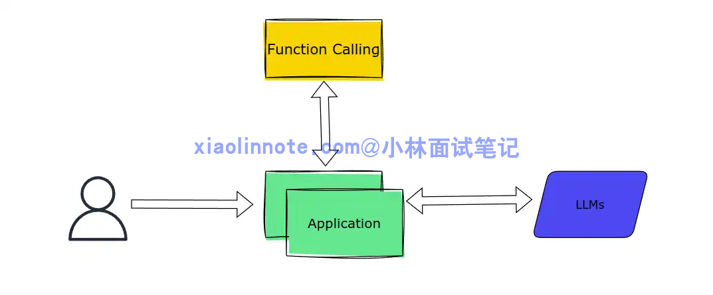

Function Calling 的出现把这件事固定下来了：模型不再「说」要调工具，而是直接输出一段结构化的 JSON，开发者按格式解析就行，准确率大幅提升，也有了统一标准可以对接。

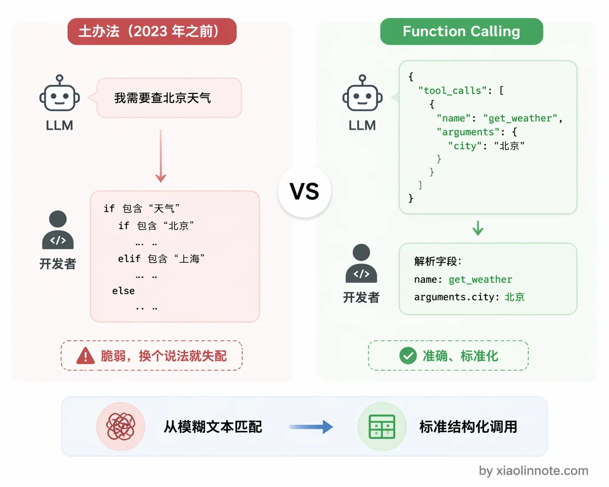

### 1.2 三个角色，把 Function Calling 理解成一场任务委托

理解 Function Calling 的关键是搞清楚谁做什么。可以把这套流程理解成一场「任务委托」：

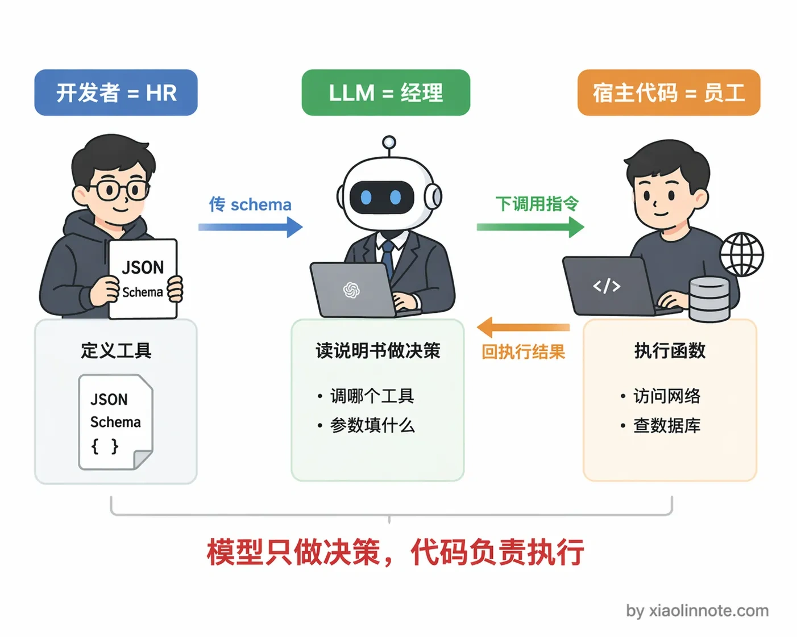

开发者是 HR，负责给每个工具写「职位说明书」，就是 JSON schema，告诉模型「我们有哪些工具、每个工具能做什么、需要哪些参数」。模型是经理，读完说明书之后决定「这个任务需要调哪个工具、参数填什么」，然后把指令下达出来。代码是员工，真正去跑函数、访问网络、查数据库，把结果汇报回来。

关键点：模型全程只是在「下指令」，它不亲自执行任何代码，也没有直接访问网络的权限。执行的事一律由宿主程序代码完成，这个分工要想清楚。

### 1.3 工具定义，schema 的每个字段都有含义

工具 schema 就是一份结构化的「工具说明书」，用 JSON 格式写，告诉模型这个工具叫什么、能做什么、需要哪些参数。

```python
tools = [
    {
        "type": "function",
        "function": {
            "name": "get_weather",          # 工具的唯一标识，模型输出 tool_calls 时会用这个名字
            "description": "查询指定城市的实时天气，包含气温、天气状况、风向风速，仅支持中国大陆城市",
            "parameters": {
                "type": "object",
                "properties": {
                    "city": {
                        "type": "string",
                        "description": "城市名称，如「北京」「上海」，不要带省份前缀"
                    },
                    "unit": {
                        "type": "string",
                        "enum": ["celsius", "fahrenheit"],
                        "description": "温度单位，默认用摄氏度"
                    }
                },
                "required": ["city"]
            }
        }
    }
]
```

其中最关键的字段是 `description`。这里停一下，你想一个问题：如果 description 写得含糊，模型会怎么表现？答案是它会「瞎猜」，比如你只写「获取天气」，模型可能拿到一个带英文名的城市也照样调，拿到「这周天气如何」这种时间跨度不对的问题也硬往里塞，调完之后发现返回的数据根本对不上。模型在决定「要不要调这个工具、参数怎么填」的时候，能依赖的唯一依据就是这段描述。

你可以对比一下：「获取天气」和「查询指定城市的实时天气，包含气温、天气状况、风向风速，仅支持中国大陆城市」，对模型判断准确率的影响差距是很明显的。写得越清晰，模型的选择越准确。参数的 `description` 同理，格式要求、示例值、限制条件都要写进去，模型才能正确填写参数。

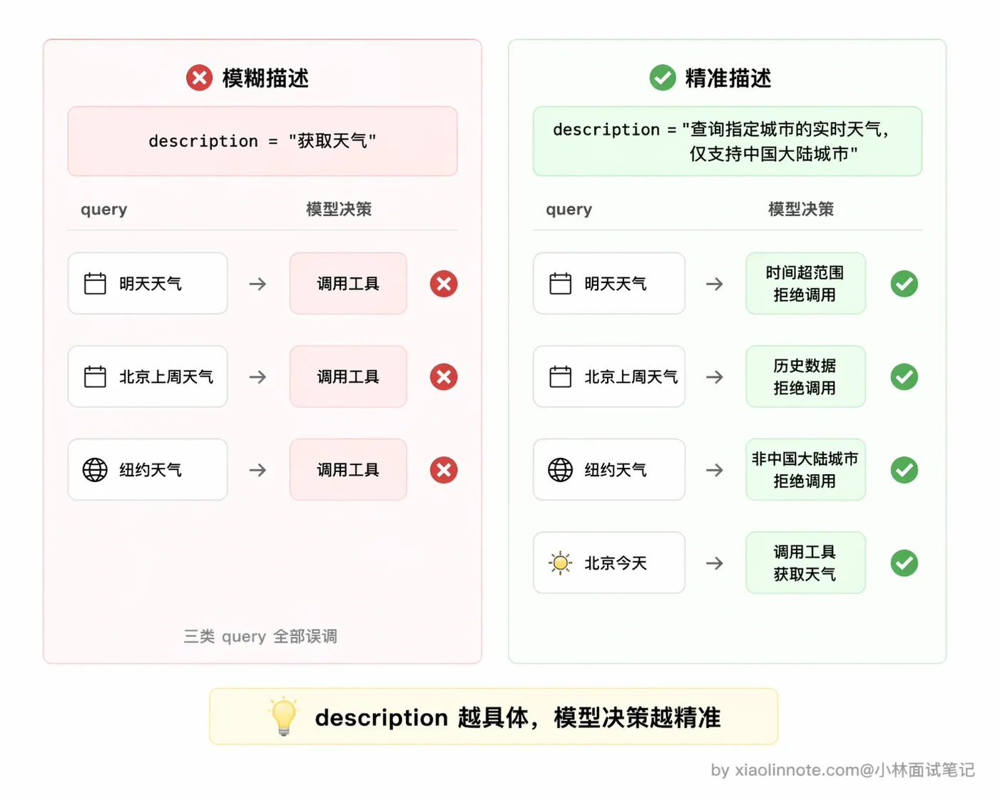

### 1.4 完整的调用流程，两轮对话加中间执行

Function Calling 的运行时本质上是「两轮对话 + 中间执行」的闭环。

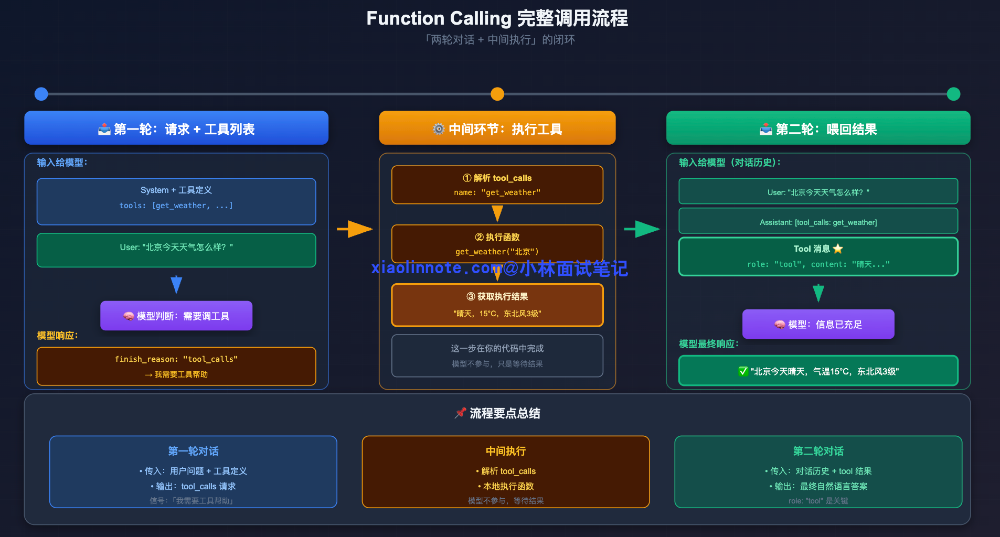

第一轮，你把工具列表和用户的问题一起传给模型。模型读完之后，如果判断需要调工具，就不直接输出最终答案，而是输出一个 `finish_reason` 为 `"tool_calls"` 的响应，里面包含要调用的工具名和参数，这是个明确信号，告诉你「我需要工具帮助，还没准备好给答案」。

拿到这个信号之后，中间环节就交给你的代码了。你的代码解析 tool_calls 拿到函数名和参数，找到对应的函数跑一下，拿到执行结果。

第二轮，把工具执行结果以 `role: "tool"` 的消息塞回对话历史，再次调用模型。这次模型有了工具结果，有了充分信息，才给出最终的自然语言答案。

```python
import openai, json

client = openai.OpenAI()
messages = [{"role": "user", "content": "北京今天天气怎么样？"}]

# 第一轮：把工具定义和问题一起传给模型
response = client.chat.completions.create(
    model="gpt-4o",
    messages=messages,
    tools=tools,
    tool_choice="auto"  # auto 让模型自己判断要不要调，也可以设 required 强制调
)
msg = response.choices[0].message

if msg.finish_reason == "tool_calls":  # 模型要调工具，还没给最终答案
    tool_call = msg.tool_calls[0]
    func_args = json.loads(tool_call.function.arguments)  # {"city": "北京"}

    # 中间执行：你的代码真正去跑函数
    result = f"{func_args['city']}今天晴，15°C，东北风 3 级"

    # 第二轮：把工具结果塞回对话，再问一次模型
    messages.append(msg)
    messages.append({
        "role": "tool",
        "tool_call_id": tool_call.id,  # 和 tool_calls 里的 id 对应
        "content": result
    })
    final = client.chat.completions.create(model="gpt-4o", messages=messages, tools=tools)
    print(final.choices[0].message.content)
    # 输出：北京今天天气晴朗，气温 15°C，东北风 3 级，适合外出。
```

### 1.5 并行工具调用

当用户的问题需要多个工具才能回答时，模型可以在一次响应里同时输出多个 `tool_calls`，`tool_calls` 是个列表，不只有一条。比如用户问「帮我查北京和上海的天气」，模型会一次返回两个调用请求，分别对应两个城市。

为什么要这么设计？如果没有并行调用，模型先说「我要查北京天气」，你执行完喂回去，模型再说「我要查上海天气」，又一轮对话，这样两个工具串行要跑两轮，每一轮都有一次模型推理和一次工具执行的延迟，总耗时很长。有了并行调用，模型一次把两个调用请求都输出来，你的代码可以同时执行这两个工具（比如用 Python 的 `asyncio.gather` 或者多线程），拿到所有结果后一次性塞回对话，再调一次模型就拿到综合了多个工具结果的最终答案。整个过程从「两轮对话」压缩成了「一轮对话 + 并行执行」，总耗时大幅降低。

**注意一点，并行调用的前提是这几个工具之间没有依赖关系。**

查北京天气和查上海天气互不影响，可以并行；但如果是「先查用户的订单号，再用订单号去查物流」，第二个调用依赖第一个的结果，这种就只能串行，模型也会正确地分两轮来输出。

## 🎯 面试总结

误区：

- 以为模型能「自己」去访问网络、执行代码，这是对 Function Calling 最常见的误解。面试时一定要强调：模型全程只负责决策，输出结构化的 JSON 调用请求，真正执行工具的是你的宿主程序代码，这个职责分工是整个机制的核心设计。
- 把 Function Calling 和之前靠解析自然语言调工具的「土办法」搞混了，Function Calling 的关键改进就是模型直接输出结构化 JSON 而非自然语言，让工具调用有了统一标准。


面试回答这道题，有几个点必须说到：工具定义用 JSON schema 描述，description 字段是模型判断是否调用的核心依据；运行时是「两轮对话 + 中间执行」的闭环流程；模型通过 finish_reason 为 tool_calls 来明确告知需要工具帮助；以及模型支持一次返回多个 tool_calls 实现并行调用。

把这几个点讲清楚，再强调「模型决策、代码执行」的分工原则，这道题就稳了。

# 2. LLM 是如何学会调用外部工具的？

## 💡 简要回答

这道题我分两块来讲：模型怎么被训练出工具调用能力，以及训练好之后运行时是怎么工作的。

训练层面靠两个阶段：

- **SFT（监督微调，Supervised Fine-Tuning）**：给模型喂大量「工具调用示范对话」，让它通过模仿学会「看到工具描述 -> 判断要不要调 -> 输出结构化 JSON 请求」这整套流程；
- **RLHF（基于人类反馈的强化学习，Reinforcement Learning from Human Feedback）**：收集人类对「哪种回答更好」的判断，训练一个打分器，再用这个分数反复调整模型，让它学会什么时候不应该调工具。

运行层面，每次请求时，你的应用代码把工具描述（叫 schema，可以理解为工具的说明书）传给模型，模型如果判断需要工具，就输出一段结构化的 `tool_calls` JSON；你的代码拿到这段 JSON 去真正执行，把结果塞回对话，模型再给出最终答案。

有一点非常关键：模型全程只是在「下指令」，真正执行工具的是你的代码，不是模型本身。这套「模型决策、代码执行」的运行时机制，就是我们常说的 **Function Calling**。

## 📝 详细解析

### 2.1 原始 LLM 的世界，为什么不会调工具

想象一个人从出生到成年，只生活在文字的世界里，读过几乎所有的书，却从没接触过任何工具，没用过锤子、没开过车、也没见过 API 是什么。你突然跟他说「去帮我查一下天气 API」，他最多只会用语言描述「我需要查天气 API 来获取数据……」，绝对不会真的去操作工具。

大语言模型在预训练阶段经历的就是这样一个过程，学的是给定前面的文字预测下一个 token，整个训练过程完全是在文本空间里进行的，模型从未见过「工具调用」这件事。所以哪怕你在 prompt 里写「你可以调用天气 API」，没经过专门训练的模型也只会生成一段自然语言描述，比如「我需要调用天气 API 来回答你」，而不是输出一段可以被程序解析的 JSON 调用请求。

工具调用能力不是天生的，是后天「教」出来的。怎么教？靠两个阶段：**SFT 教会怎么调，RLHF 教会什么时候调**。

### 2.2 第一阶段：SFT，让模型「见过」工具调用

SFT 核心思路：给模型看大量正确的示例，让它学会模仿。就像培养一名新员工，前期让他看几百份填好的工单，他自然就学会了「遇到这类问题该怎么写工单、该走哪个流程」。

要让模型学会工具调用，就要构造专门的训练数据。一条完整的训练样本长这样：

首先是 **System 消息**，也就是工具说明书，列出模型现在有哪些工具可用，每个工具叫什么名、能做什么事、需要什么参数，模型从这里「认识」工具。接着是 **User 消息**，就是用户的提问，比如「北京今天天气怎么样？」。

然后到了最关键的部分：**Assistant 的调用请求**。注意，这里的「正确答案」不是自然语言回答，而是结构化 JSON，类似 `{"tool_calls": [{"name": "get_weather", "arguments": {"city": "北京"}}]}`。这就是模型需要学会输出的东西。为什么是 JSON 而不是自然语言？因为 JSON 格式固定、机器好解析，你的代码才能准确读到「调哪个工具、参数是什么」。

再往后是 **Tool 消息**，模拟工具返回的数据，比如「晴，15°C，东北风3级」。最后是 **Assistant 的最终回答**，模型看到工具结果后，给出自然语言答案：「北京今天天气晴朗，气温15°C……」。

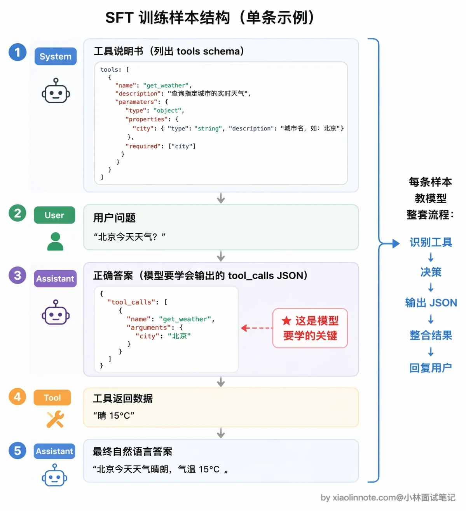

模型在几十万甚至上百万条这样的样本上反复训练，就学会了整套流程：识别工具定义、判断要不要调、输出格式规范的 JSON 请求。

训练数据的来源通常有两种：人工标注，成本高但质量好，一般用于构造核心的种子数据；用更强的模型（比如 GPT-4）自动批量生成，再人工抽查，成本低、量大，是业界现在的主流做法。

### 2.3 SFT 的短板，会了，但不知道「该不该调」

SFT 让模型学会了「调工具」这个动作，但它不知道什么时候该调、什么时候不该调。你可以想象一个刚培训完的新员工，过于热情，每件事都想走流程，有人问他「1+1 等于几」，他也要去查手册，这明显多此一举，直接回答就行。

为什么会这样？因为 SFT 的训练样本里，「该调的场景」占了绝大多数（毕竟我们就是要教它调工具），模型在模仿的过程中会过拟合这种「积极调用」的倾向，没看过足够多的「不该调」反例。再加上训练信号只告诉它「这是正确答案」，没有告诉它「为什么不该调也是一种正确」，所以它的边界感天然就弱。

SFT 之后的模型也有类似的毛病：可能对简单问题也尝试调工具，或者遇到工具调用失败时不知道该怎么处理，行为边界感很弱。

这个问题，需要第二阶段的 RLHF 来解决。

### 2.4 第二阶段：RLHF，用反馈建立边界感

RLHF 是 Reinforcement Learning from Human Feedback（人类反馈强化学习）的缩写。如果说 SFT 是让新员工看示例学规范，那 RLHF 就是老板持续给他的工作表现打分，帮他建立判断力。

它的流程分四步：

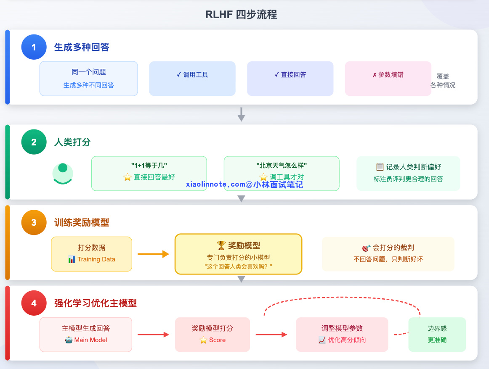

- 对同一个问题，让模型生成几种不同的处理方式，有的调了工具，有的直接回答，有的参数填错了，故意覆盖各种情况。

- 标注员评判哪种回答更合理，比如「1+1 等于几」直接回答，「北京天气怎么样」调工具。这批打分数据就记录了人类的判断偏好。

- 用这批打分数据，单独训练一个小模型，专门负责打分，它不回答问题，只判断「这个回答人类会喜欢吗」。你可以把它理解成一个「会打分的裁判」。


这一步很关键，也容易被忽略：奖励模型的打分能力本身就是从人类标注员的偏好数据里学出来的，换句话说，人类的判断被「蒸馏」进了这个裁判。所以如果人类标注员自己水平不稳定、标准不一致，奖励模型就会学到一个歪的打分标准，后面主模型再怎么被它优化，方向也是歪的。

- 拿奖励模型的打分不断调整主模型的参数，让主模型越来越倾向于产出「高分回答」，也就是边界感更准确的工具调用行为。


经过这个过程，模型逐渐学会了更微妙的判断：能直接回答的就直接回答，不要多此一举调工具；需要实时数据、需要执行操作的，才去调。这个边界感是 SFT 给不了的，必须靠反馈信号来塑造。

RLAIF（AI Feedback）是 RLHF 的变体，用另一个 AI 代替人类标注员打分，成本更低、速度更快，现在业界也很常用，效果和人工反馈相差不大。

### 2.5 运行时，训练好之后怎么用

训练阶段结束，模型上线了。每次你的应用调用模型时，流程是这样的：

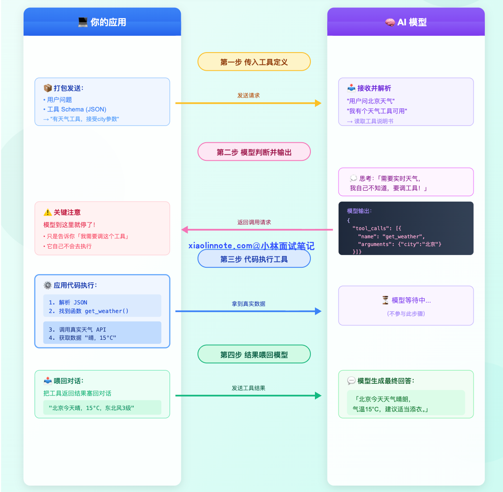

首先，你的应用代码把「有哪些工具可用」打包成 JSON 格式（叫做 schema，也就是工具的说明书），连同用户的问题一起发给模型。比如告诉模型：「你现在有一个天气查询工具，接受 city 参数，返回该城市的实时天气。」

模型读完工具定义和用户问题后，做了一个判断：这个问题需要查实时天气，我自己不知道，需要工具帮忙。于是它不直接回答，而是输出一段结构化的 JSON：

```python
{
    "tool_calls": [{
        "name": "get_weather",
        "arguments": {"city": "北京"}
    }]
}
```

注意，**模型到这里就停了**，它只是告诉你「我需要调这个工具，参数是这个」，它自己不会去执行。

你的应用代码解析这段 JSON，找到对应的函数，真正去调天气 API，拿到实际数据。

拿到结果之后，你把工具返回的结果（比如「北京今天晴，15°C，东北风3级」）塞回对话历史，再次调用模型，模型这才组织成一句话回答用户。

这套「模型输出结构化调用请求 -> 代码执行 -> 结果喂回」的机制，有一个专有名词：**Function Calling**。换句话说，Function Calling 就是大模型工具调用能力在运行时的具体实现形式。

### 2.6 一个关键认知：模型只负责「决策」，不负责「执行」

模型在整个过程中只做了一件事：判断要调哪个工具、参数填什么，然后把这个决策用 JSON 格式输出出来。真正去跑函数、访问网络、查数据库的，是你写的宿主程序代码。

这个分工设计得很合理：LLM 擅长理解意图和推理，但不应该有直接操作系统资源的权限；宿主程序负责执行，可以做权限控制、参数校验、执行沙箱等安全措施。这样的设计让工具调用既灵活又安全，是目前主流工具调用框架的核心设计原则。

## 🎯 面试总结

第一个雷是以为模型参数量够大就自然会调工具，这是把「语言涌现能力」和「工具调用能力」搞混了。工具调用需要输出结构化 JSON，这不是预训练能学到的，必须经过专项训练。

第二个雷是只知道 SFT 而忽略了 RLHF，SFT 解决「会不会调」，RLHF 解决「该不该调」，两个阶段缺一不可。

面试回答这道题，核心要讲清楚两个阶段各自的作用。

SFT 通过大量包含完整工具调用流程的对话样本，让模型学会识别工具定义、判断要不要调、输出规范 JSON 的整套流程；RLHF 通过人类打分训练奖励模型，再用强化学习调整主模型，让它建立「能直接回答就不调工具」的边界感。

另外要提到运行时的 Function Calling 机制，模型只负责决策输出 JSON，代码负责执行，这个分工设计是关键认知。

如果能再补充 RLAIF 作为 RLHF 的低成本替代方案，就更完整了。

# 3. 大模型的 Function Call 能力是怎么训练出来的？

## 💡 简要回答

- SFT，就是给模型喂大量「包含工具调用的完整对话样本」，每条样本覆盖工具定义、用户问题、模型应该输出的结构化 JSON 调用、工具执行结果、最终答案，让模型通过模仿学会整套流程。但光有 SFT 不够，模型可能学得过激，遇到什么问题都想调工具。

-  RLHF，通过人类标注「哪种回答更好」来训练奖励模型，再用强化学习调整主模型，让它学会「能直接回答的就直接回答，需要实时数据才去调工具」这个边界感。


一句话总结：SFT 教会怎么调，RLHF 教会什么时候调。

## 📝 详细解析

很多人以为 Function Call 是大模型「聪明」之后自然就会的东西，其实不是。就算是 GPT-4，如果没有经过工具调用的专项训练，它遇到「北京今天天气怎么样」这个问题，顶多也就输出一句「我需要查询天气数据」，这是在**描述**一个意图，而不是在**输出**可以被程序解析和执行的结构化 JSON。这两件事之间有本质的差距。

为什么预训练学不会这件事？关键原因是预训练语料里压根没有「标准工具调用 JSON」这种模式。预训练喂给模型的是互联网上的海量文本，里面有代码、有文档、有对话，但几乎没有「给定一组工具 schema，该在什么场景输出什么 JSON」这样的成对样本。

模型在预训练期间的所有权重更新，都是基于「预测下一个最可能的 token」这个目标，它记住的是人类文字里的统计规律，而「遇到天气问题就输出一段固定格式的 tool_calls JSON」不是人类文字里自然存在的模式，权重里根本没有相关经验可以调用。所以这件事必须靠专项微调来补。

Function Call 的核心训练分两个阶段，每个阶段解决不同的问题，缺一不可。

### 3.1 阶段一：SFT，让模型「学会怎么调」

SFT（Supervised Fine-Tuning，监督微调）的核心动作很简单：给模型喂大量正确示例，让它通过模仿来学习。对 Function Call 能力来说，就是构造「包含完整工具调用流程的对话样本」，一条样本里包含所有角色的消息。

一条完整的训练样本大概是这样的结构：首先是 system 消息，里面注入了工具的定义，工具叫什么名字、是干什么用的、接受哪些参数。模型是从这里「认识」工具的，就像你给新员工一份工具手册，告诉他公司有哪些系统可以用。接着是 user 消息，就是用户的提问，比如「北京今天天气怎么样」。

然后是关键的一步：assistant 的消息不是自然语言，而是结构化的 JSON 调用请求，类似 `{"tool_calls": [{"name": "get_weather", "arguments": {"city": "北京"}}]}`，这是「正确答案」，是模型通过训练需要学会输出的内容。之后是 tool 角色的消息，是工具执行后返回的结果，比如「晴天，15°C，东北风 3 级」。最后 assistant 再出现一次，根据工具结果给出最终的自然语言答案。

这套完整的对话结构覆盖了整个调用链路。模型通过反向传播（backpropagation）来学习：给定样本里的正确 JSON 调用，当模型输出的内容偏离这个正确答案时，损失函数就会产生惩罚信号，梯度往回传，一点点调整模型内部的参数权重，让下次输出更接近正确格式。

大量样本反复训练，模型就把这套「看到工具定义 + 看到用户问题 -> 输出规范 JSON」的模式「记住」了。就像背单词，看一遍不够，反复遇到、反复纠错，最终形成了肌肉记忆。

#### 训练数据需要覆盖哪些场景

训练数据的多样性直接决定了 Function Call 能力的上限，不能只有「正常调一个工具」这一种情况。

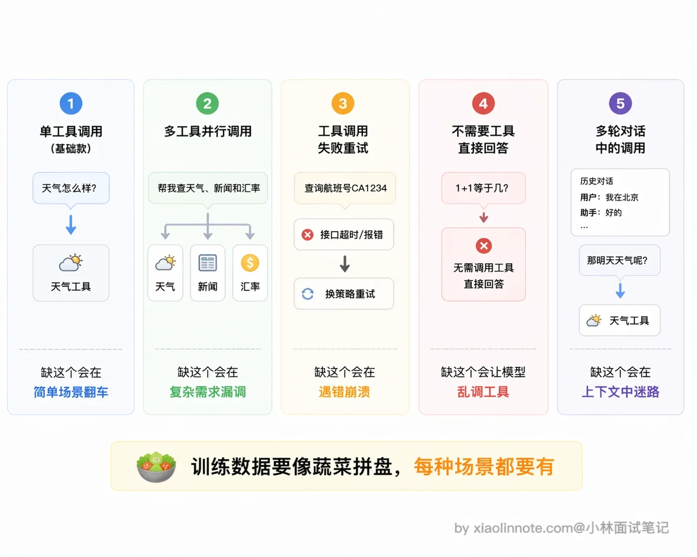

- **单工具调用**，一个问题对应一个工具。但光有这个远远不够，还需要**多工具并行调用**的样本，比如用户问「帮我查北京和上海的天气」，模型应该一次性输出两个调用请求而不是傻乎乎地一个一个来，如果训练数据里没见过这种场景，模型就不知道可以并行。
- **工具调用失败后的处理**。现实中工具不可能百分百成功，API 超时、参数格式不对、权限不足，各种错误都有可能出现，模型要能识别错误信息并换个方式处理，而不是直接崩掉或者傻傻地重复同样的调用。
- **不需要调工具、直接回答**。「1+1 等于几」「帮我总结这段话」这类问题不需要工具，模型得学会判断「我能自己解决，不用调」。如果训练数据里全是「调用工具」的正例，模型就会形成「遇到问题就调工具」的惯性，该直接回答的时候也去调，画蛇添足。
- **多轮对话中的工具调用**，上下文里已经有过工具结果，模型要能正确理解和引用之前的结果，而不是无视历史重新调用。这些场景的覆盖程度，直接影响模型在实际使用中的表现，缺哪个就会在哪个场景下翻车。

#### 训练数据从哪来

- **人工标注**，雇标注员，给定用户问题和工具定义，让他们写出正确的调用示例。这种方式质量好，因为人写的样本准确度有保障，但成本极高，通常只用于核心种子数据的构造，没法大规模扩展。
- **模型自动生成**，业界也叫 Self-Instruct 或 Distillation（蒸馏）。核心思路是用一个已经具备 Function Call 能力的强模型批量生成训练样本，再人工抽查质量。这是现在业界的主流做法，成本低、量大，但有一个隐患：如果上游模型本身生成了错误的样本，下游模型就会把这个错误一起学进去，业界叫做「模型蒸馏的幻觉传递」。所以抽查质量这一步不能省，不然相当于在教模型学错误答案。

### 3.2 阶段二：RLHF，对齐「该不该调」的边界感

SFT 之后，模型已经学会了「怎么调工具」，但还有一个问题没解决：**什么时候应该调工具，什么时候直接回答**。

SFT 的训练样本都是「正确调用」的例子，模型看多了，可能学得有点偏激，遇到什么问题都想调工具，不管有没有必要。

「1+1 等于几」不应该调计算器，直接回答 2 就行；「帮我总结这段文字」完全不需要任何工具，直接做就行；只有「北京今天天气」这类需要实时数据的问题才应该调。

这种「能直接回答就直接回答，需要外部数据才去调」的边界感，SFT 很难教好，因为光靠固定的正确样本没法覆盖所有边界情况。RLHF 就是来解决这个问题的。

RLHF（Reinforcement Learning from Human Feedback，人类反馈强化学习）的流程分四步。

- 对同一个问题，让模型生成多种回答，有直接回答的，有调了工具的，有调了工具但参数填错的，故意覆盖各种情况。
- 标注员对这些回答进行排序，比如「北京今天天气怎么样」这道题，调了天气工具的回答排第一，因为不调工具就没法给出准确的实时数据；「1+1 等于几」这道题，直接回答 2 的排第一，调计算器工具的反而是画蛇添足，排末尾。
- 用这批打分排序的数据，单独训练一个神经网络，叫做「奖励模型」（Reward Model，RM）。奖励模型学会了一件事：给定一个问题和一种回答，预测人类会给这个回答多少分。它不直接回答用户，只负责打分，相当于一个专门评判「哪种回答更好」的裁判。
- 拿奖励模型的打分信号，通过 PPO（Proximal Policy Optimization，近端策略优化）等强化学习算法持续调整主模型的参数，让主模型越来越倾向于输出「奖励模型打高分」的回答。

强化学习算法那么多，选 PPO 有两个很务实的理由：一是它相对稳定，训练过程不容易崩（传统策略梯度算法很容易因为单步更新太大把模型直接调废）；二是它内置了一个 KL 散度约束，强迫新模型和旧模型的输出分布不要差得太远，这样就不会出现「为了讨好奖励模型，模型把自己训成只会重复几句套话的怪胎」这种退化情况。RLHF 本质上要让模型在「追求高奖励」和「保持语言能力」之间走钢丝，PPO 在这个平衡上是目前公认好用的工具。

经过足够多的迭代，模型就学会了那种边界感：该调工具时调，能直接回答时不折腾。

#### RLAIF：用 AI 代替人工打分

RLHF 最大的痛点是人工标注成本极高，标注员需要专业背景，打分慢、价格贵，很难大规模扩展。

RLAIF（Reinforcement Learning from AI Feedback）是它的改进版。你可以这么理解：RLHF 是请一群专业的人类评委来给模型的回答打分，质量很高但请评委的成本也很高；RLAIF 就是换成了一个「AI 评委」，用更强的 AI 模型来代替人类标注员做这个打分的活儿，成本能低 10-100 倍，速度也快得多。

不过代价也很明显：「AI 的偏见会传递」。如果打分的 AI 本身对某些场景的判断有偏差或者盲区，这些偏差也会被学进去。打个比方，如果 AI 评委觉得「遇到数学题都应该调计算器工具」，那被它训练的模型也会学到这个倾向，哪怕有些简单算术不用调工具。所以打分 AI 的质量很关键，选什么模型来当评委、怎么设计评分标准，都需要仔细考虑。现在业界很多模型训练都在混用 RLHF 和 RLAIF，在关键数据上用人工保质量，量大的地方用 AI 提效率，两者互补。

### 3.3 两个阶段各司其职

SFT 解决的是「会不会」的问题，RLHF 解决的是「该不该」的问题。

只有 SFT 而没有 RLHF 的模型，可能遇到什么问题都冲动地调工具；反过来，只有 RLHF 而没有 SFT，模型连工具调用的格式都输不出来，奖励信号根本没地方发力。

两个阶段配合起来，才能训练出「知道怎么调、也知道什么时候该调」的工具使用能力。

## 🎯 面试总结

第一个误区是以为预训练就能学会 Function Call，实际上预训练只学了「预测下一个 token」，模型最多会描述意图，不会输出结构化 JSON，这必须靠 SFT 专项训练。第二个误区是以为训练数据只覆盖单工具调用就够了，实际上多工具并行、调用失败重试、不需要工具直接回答、多轮对话中的调用，这些场景都必须覆盖，缺哪个就在哪个场景翻车。

面试回答这道题，要把两个训练阶段讲清楚。

SFT 阶段通过「system 工具定义 + user 问题 + assistant JSON 调用 + tool 执行结果 + assistant 最终回答」这样的完整对话样本来训练，让模型通过反向传播学会整套流程。

RLHF 阶段通过人类对多种回答的偏好排序训练奖励模型，再用 PPO 等强化学习算法调整主模型，建立「该不该调」的边界感。

训练数据来源也要提到：人工标注质量高但成本高用于种子数据，模型自动生成（Self-Instruct / Distillation）成本低量大但要注意幻觉传递的风险。

一句话总结：SFT 教会怎么调，RLHF 教会什么时候调。

# 4. 什么是 MCP（模型上下文协议）？讲讲它的核心内容？

## 💡 简要回答

MCP 是 Anthropic 在 2024 年底推出的开放协议，我理解它主要解决的是「模型接工具太碎片化」的问题。

在 MCP 出现之前，每接一个新工具都要单独写集成代码、处理认证、适配格式，而且这套代码和具体模型强绑定，换个模型就得重写，非常繁琐。

MCP 的思路是把这件事标准化：工具提供方按协议实现一个 Server，任何支持 MCP 的 AI 客户端就能直接接进来，一次实现到处复用。

协议定义了三类能力：Tools 用于执行有副作用的操作，Resources 是只读数据，Prompts 是提示词模板，底层通信用 JSON-RPC 2.0。

我把它理解成给「AI 接工具」这件事定了一套行业标准。

## 📝 详细解析

### 4.1 MCP 的核心思路，定一套行业标准接口

MCP（Model Context Protocol，模型上下文协议）的设计思路，可以用 USB 接口来类比。在 USB 标准出现之前，鼠标用这个接口、键盘用那个接口、打印机又是另一个，换台电脑就要愁接口不兼容。USB 出现之后，所有外设统一接口，任何设备插到任何电脑都能工作，设备厂商只需要做一次适配，全球所有 USB 电脑都能用。

MCP 做的是同一件事：为「AI 接工具」这件事定了一套统一的协议标准。工具提供方（比如 GitHub 官方）按 MCP 规范实现一个 MCP Server，里面封装好各种操作。任何支持 MCP 的 AI 客户端，Claude Desktop、Cursor、各种 Agent 框架，都能直接连上这个 Server，自动发现里面的工具并使用，不需要写任何定制化对接代码。工具只需要实现一次，到处复用。

### 4.2 MCP 的 Client-Server 架构

Server 是工具的实现方。比如 GitHub 官方维护一个 GitHub MCP Server，里面封装了「列出 PR」「创建 Issue」「搜索仓库」「查看 Diff」等操作；Client 是 AI 应用那一侧，比如 Claude Desktop 或 Cursor，连上 Server 之后就自动获得了这些工具能力。

一个 Client 可以同时连接多个 Server。你把文件系统 Server + GitHub Server + PostgreSQL Server 都接上，模型就同时拥有了操作本地文件、读写代码仓库、查询数据库这三套工具能力，而你不需要写任何对接代码，只需要在配置文件里加几行 JSON，重启后 Claude 自动发现并使用这些工具。

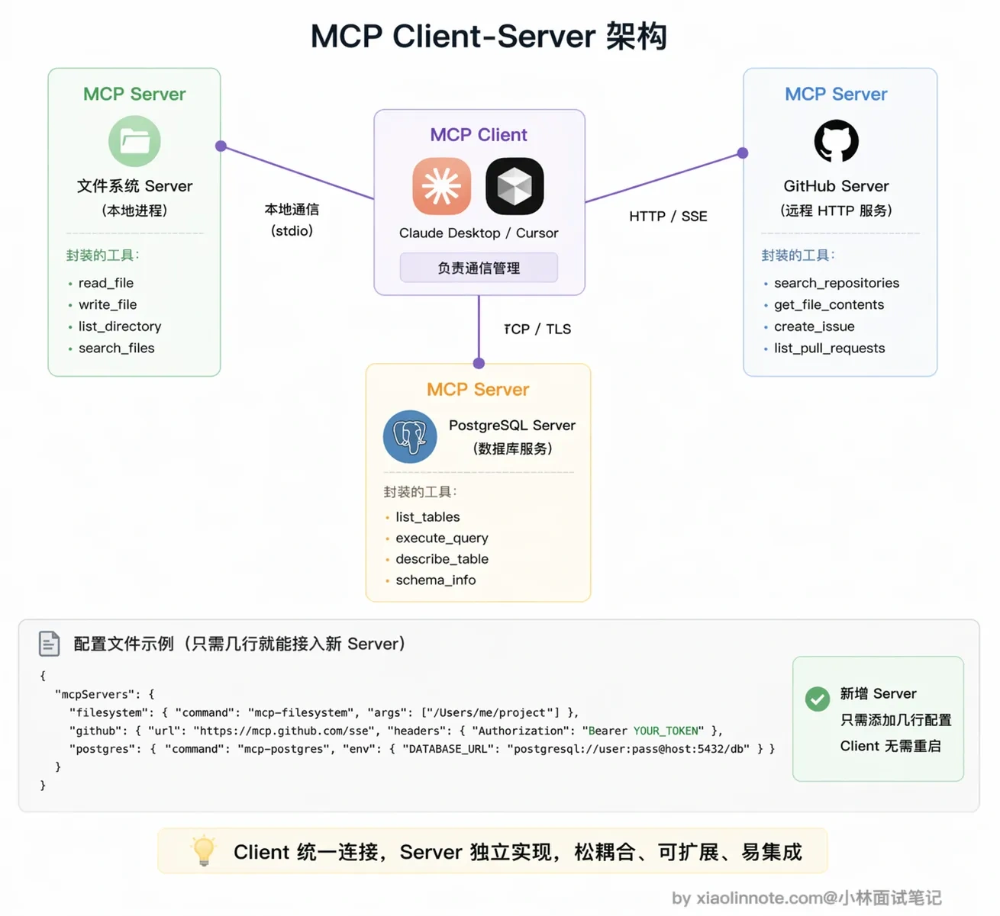

### 4.3 三类核心能力，Tools、Resources、Prompts

MCP Server 可以向 Client 暴露三类能力，各有各的定位。

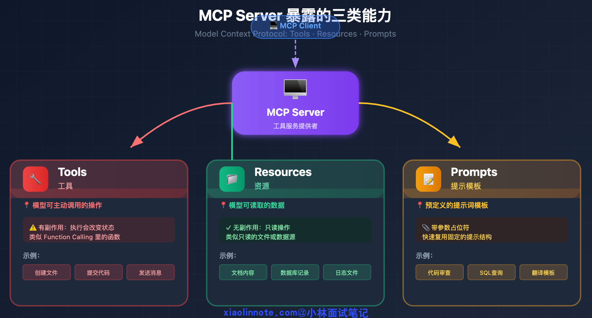

-  **Tools（工具）**，这是最核心的能力，对应 Function Calling 里的「函数」。Tools 的本质是「有副作用的操作」，什么叫有副作用？就是执行之后会改变外部世界的状态。创建文件、提交代码、发送 Slack 消息、调用第三方 API，这些都属于 Tools，因为执行完之后环境发生了变化，而且往往不可逆。正因为如此，Tools 通常需要用户授权确认才能执行，不能让模型想调就调。

-  **Resources（资源）**，它和 Tools 最本质的区别就一个字：只「读」。Resources 不会改变任何东西，只是把数据提供给模型看。读取日志文件、查询数据库记录、获取文档内容，都属于 Resources 的范畴。你可以把 Resources 理解成「工具的资料室」，模型可以进去查资料，但不能修改里面的东西。正因为只读、无副作用，Resources 可以更宽松地暴露给模型，不需要像 Tools 那样谨慎授权。

-  **Prompts（提示模板）**，Prompts 就是预定义的提示词模板，带参数占位符，解决的是「每次都要手写重复 prompt」的问题。举个例子，你的团队有一套固定的代码审查标准 prompt，接受「编程语言」和「代码内容」两个参数，调用时只需传入参数值，就能自动展开成完整的提示词，不用每次从头写。把公司积累的优质 prompt 封装成 MCP Prompts，所有人都能复用，统一标准，这在实际工程中很实用。


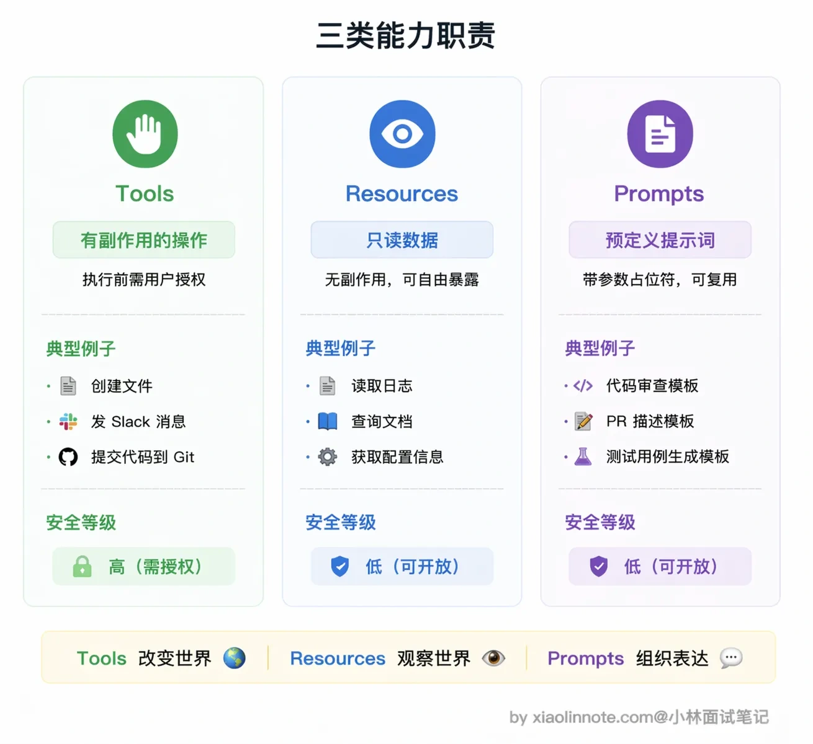

### 4.4 底层通信，JSON-RPC 2.0 是什么

JSON-RPC 是一种轻量级的远程函数调用协议，用 JSON 格式来表达「调用」这件事。核心：**客户端发一个 JSON 请求，里面说清楚「调哪个方法、参数是什么、这次请求的 ID 是多少」；服务端执行完，返回一个 JSON 响应，里面是执行结果或者错误信息。**用 JSON 而不是二进制格式，好处是易读、易调试、语言无关，任何编程语言都能轻松实现。MCP 用的是它的 2.0 版本，相比 1.0 加了批量请求、通知消息等功能。

在传输层，MCP 支持两种方式。

- **stdio（标准输入输出）**，Server 作为本地子进程运行，Client 通过管道和它通信，Server 从 stdin 读消息，把结果写到 stdout。这种方式适合本地工具，不需要网络，启动快、延迟低，Claude Desktop 接本地 MCP Server 用的就是这种方式。
-  **Streamable HTTP**，Server 作为 HTTP 服务部署在远程，Client 通过 HTTP 连接和它通信。这种方式适合远程部署的工具服务，或者需要多个 Client 共享同一个 Server 的场景，比如团队共用一个部署在服务器上的数据库 MCP Server，所有人的 AI 客户端都连同一个地址就行。


这里有个演进要说清楚：MCP 早期版本（2024-11-05 规范）用的是「HTTP + SSE」双端点方案，一个 GET 端点开 SSE 长连接接收推送，一个 POST 端点发请求，两个端点绑在一起工作。2025 年 3 月的规范更新里，这套方案被改成了 Streamable HTTP（老的 HTTP+SSE 被标记为 deprecated，但仍保留向后兼容）。

Streamable HTTP 并不是「抛弃 SSE」，而是把原来的两个端点合并成一个 `/mcp` 端点。Client 用 POST 发请求，Server 根据情况灵活返回：短请求直接回一个普通 JSON 响应，长请求则把这个 HTTP 响应升级为 SSE 流，持续推送中间结果。架构更简洁，部署也更友好（一个端点就够，serverless 环境也能跑），本质还是 HTTP 加 SSE，只是用法变了。

### 4.5 MCP 生态发展这么快，背后的原因是什么

- **极低的实现门槛**。Anthropic 开源了协议规范和多语言 SDK（Python、TypeScript 都有），写一个最简单的 MCP Server 不到 30 行代码，任何有基础编程经验的人都能上手。协议文档也写得清晰，社区很快就爆发出大量贡献。
- **头部工具第一时间跟进**。GitHub、Slack、PostgreSQL、Puppeteer（浏览器自动化）、Google Maps 等高频工具都有了官方或社区维护的 MCP Server，开发者不需要自己写，直接用现成的就行。接一个新工具，在 Claude Desktop 的配置文件里加几行 JSON，重启后 Claude 自动发现并使用，整个过程零代码。当生态里可用的工具足够多，开发者就更愿意采用这套协议，形成了正向循环。

目前 Claude Desktop、Cursor、Windsurf 等主流 AI 工具都内置了 MCP 支持。对开发者来说，MCP 把「给 AI 接工具」这件事的门槛从「写一堆对接代码」降到了「改一行配置」，这才是它被快速采用的核心原因。

## 🎯 面试总结

最典型的误区就是把 MCP 和 Function Calling 搞混了。Function Calling 解决的是「模型怎么输出结构化的工具调用请求」，而 MCP 解决的是「工具怎么标准化接入、一次实现到处复用」，两者是不同层面的东西。另一个常见错误是以为 MCP 是 Anthropic 专属的，实际上它是开放协议，任何支持 MCP 的客户端都能接入。

面试回答这道题，首先要说清楚 MCP 解决的核心问题：工具接入碎片化，每接一个新工具都要单独写对接代码，换个客户端又得重写。

然后讲 Client-Server 架构，Server 是工具实现方，Client 是 AI 应用侧，一个 Client 可以连多个 Server。

重点要区分三类核心能力：Tools 是有副作用的操作（需要授权），Resources 是只读数据（无副作用），Prompts 是可复用的提示词模板。

底层通信用 JSON-RPC 2.0，传输层支持 stdio（本地）和 Streamable HTTP（远程）两种方式，早期的 HTTP+SSE 双端点方案在 2025 年 3 月的规范更新里被标记为 deprecated，推荐用单端点的 Streamable HTTP。

最后可以提一下 MCP 生态发展快的原因：实现门槛极低加上头部工具第一时间跟进。

# 5. MCP 由哪几部分组成？

## 💡 简要回答

MCP 由三层组成，可以从角色、能力、协议三个维度来理解。

角色层有三个：Host 是 AI 应用本身（比如 Claude Desktop），Client 是 Host 里负责和 Server 通信的模块，Server 是工具提供方实现的独立进程，一个 Host 可以同时连多个 Server。

能力层定义了 Server 能暴露三类东西：Tools 是有副作用的操作（比如创建文件、调 API），Resources 是只读数据（比如读取文档内容），Prompts 是预定义的提示词模板。

协议层是底层通信：消息格式统一用 JSON-RPC 2.0，传输方式支持 stdio（本地子进程通信）和 Streamable HTTP（远程 HTTP 连接）两种，早期的 HTTP+SSE 双端点方案在 2025 年 3 月的规范更新里被标记为 deprecated。

这三层合在一起，就是 MCP 的完整组成。

## 📝 详细解析

### 5.1 先建立整体感：三层来看就清楚了

第一层是角色架构，搞清楚谁和谁在通信；第二层是能力类型，搞清楚 Server 能暴露什么东西给模型用；第三层是传输协议，搞清楚消息是怎么传的。

这三层各自独立、互不耦合，合在一起就是 MCP 的完整骨架。下面我一层一层拆开来讲。

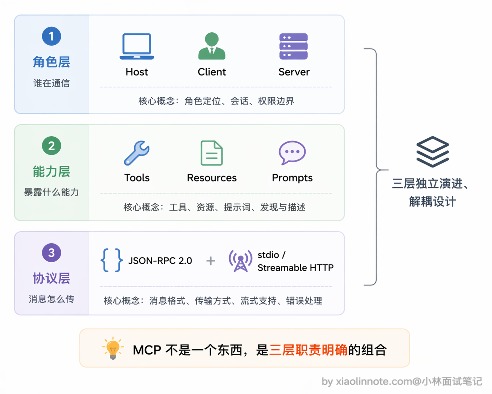

### 第一层：角色架构，Host / Client / Server

MCP 定义了三个角色，弄清楚每个角色负责什么是理解整个系统的关键。

- Host 是整个系统的宿主，也就是你在用的 AI 应用本身，比如 Claude Desktop、Cursor、Windsurf。Host 负责启动和管理所有 MCP Client，控制连哪些 Server、什么时候断开连接，是整个 MCP 系统的调度中心。你可以把 Host 理解成一家公司，它决定要和哪些外部供应商（Server）合作，并派出自己的联络员（Client）去对接。

- Client 是 Host 内部的连接模块，一个 Client 对应一个 Server 连接。它负责三件事：初始化和 Server 的连接、向 Server 查询「你有哪些工具/资源/模板」（能力发现）、把模型的调用请求转发给 Server 并把结果带回来。Client 是 Host 派出的「驻场联络员」，专门负责和某一个 Server 打交道，Host 本身不直接和 Server 说话。

- Server 是工具提供方实现的独立进程，对外暴露自己的工具、资源和提示词模板。Server 完全不关心上面是哪个 Host 在用它，只需要按 MCP 协议响应 Client 的请求就行。这也是 MCP 的核心价值所在：Server 写一次，任何支持 MCP 的 Host 都能直接用，GitHub 的官方 MCP Server 不需要分别为 Claude Desktop 和 Cursor 各写一份。


三者的关系用图来看是这样的：

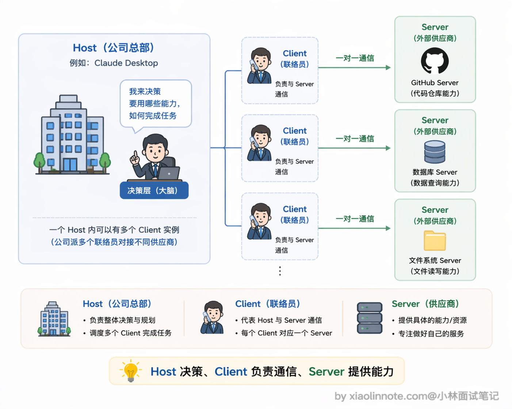

一个 Host 同时连多个 Server，模型就同时拥有了所有这些工具能力，而应用代码完全不需要为此多写一行。

### 第二层：能力类型，Tools / Resources / Prompts

理解了角色分工，接下来看 Server 到底能暴露什么给 Client。很多人以为 Server 就只提供「工具」，其实不止，MCP 定义了三类能力，每类解决不同的需求，设计上有明确的职责分工。

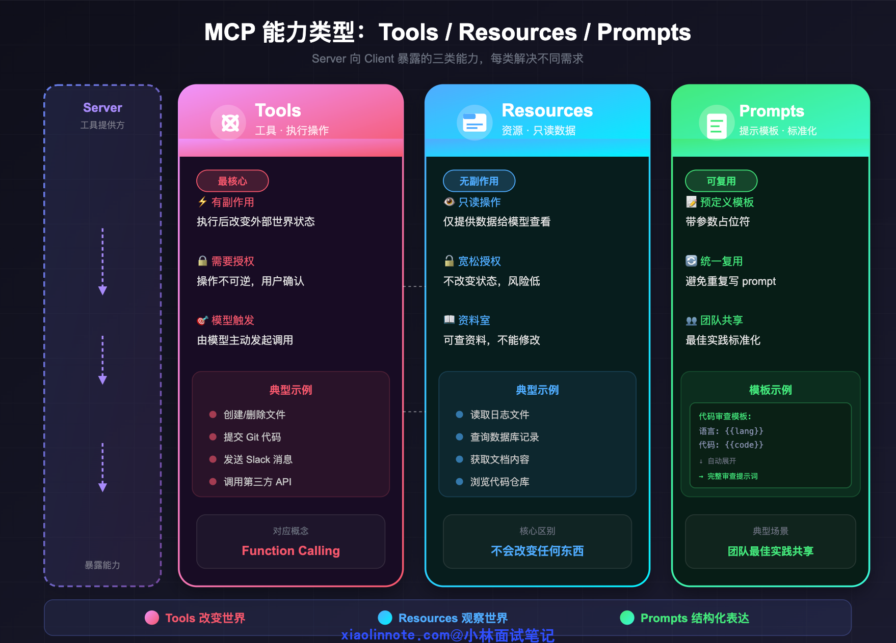

- Tools（工具），这是最核心、使用最频繁的能力，对应的是有副作用的操作，执行之后会改变外部世界的状态。创建文件、提交代码、发送 Slack 消息、调用第三方 API，都属于 Tools。由模型主动触发，执行有不可逆性，所以通常需要用户授权确认。Tools 对应 Function Calling 里「函数」的概念，只是在 MCP 框架下被标准化打包了。

- Resources（资源），这是只读数据，没有任何副作用，只是把数据提供给模型看。读取日志文件、查询数据库记录、获取文档内容，都是 Resources。和 Tools 最本质的区别是什么呢？Resources 不会改变任何东西，可以更宽松地暴露，不需要像 Tools 那样谨慎授权。你可以把 Resources 理解成「工具的资料室」，可以进去查资料，但不能修改里面的东西。

- Prompts（提示模板），这是预定义的提示词模板，带参数占位符。它解决的是「每次都要手写重复 prompt」的问题。比如把团队固定的代码审查标准封装成模板，接受「编程语言」和「代码内容」两个参数，调用时只需传参，自动展开成完整提示词，不用每次从头写。这个能力特别适合团队内部的最佳实践共享，把积累的优质 prompt 模板化，所有人统一复用，标准也更一致。


三者的本质区别可以这样记：Tools 改变世界，Resources 观察世界，Prompts 结构化表达。

### 第三层：传输协议，JSON-RPC 2.0 + 传输方式

Client 和 Server 之间的通信由两部分组成：消息格式和传输方式，这两层是解耦的。

**消息格式**统一用 JSON-RPC 2.0。每条消息是一个 JSON 对象，格式固定：Client 发请求时说清楚「调哪个方法、参数是什么、这次请求的 ID 是多少」，Server 返回响应时带上执行结果或错误信息，通过 ID 匹配请求和响应。用 JSON 格式的好处是易读、易调试、任何编程语言都能实现，不管 Server 是 Python 写的还是 TypeScript 写的，消息格式是一样的。

```json
// Client 向 Server 查询工具列表
{"jsonrpc": "2.0", "id": 1, "method": "tools/list", "params": {}}

// Server 返回工具列表
{"jsonrpc": "2.0", "id": 1, "result": {"tools": [{"name": "read_file", ...}]}}

// Client 请求调用某个工具
{"jsonrpc": "2.0", "id": 2, "method": "tools/call", "params": {"name": "read_file", "arguments": {"path": "/tmp/log.txt"}}}
```

那消息格式定了，怎么传呢？MCP 支持两种传输方式，适合不同的部署场景。

- stdio（标准输入输出），Server 作为本地子进程运行，Host 通过操作系统的管道和它通信，Server 从 stdin 读请求、把结果写到 stdout。适合本地工具，不需要网络，延迟极低，也没有端口占用和网络安全问题，Claude Desktop 接本地 MCP Server 走的就是这种方式。

- **Streamable HTTP**，Server 作为 HTTP 服务独立部署，Client 通过 HTTP 连接和它通信。适合远程部署的场景，支持多个 Client 共享同一个 Server，比如团队共用一个部署在服务器上的数据库 MCP Server，所有人连同一个服务，不需要各自本地跑一份。

这里有个演进要说清楚：MCP 早期的远程传输方案叫「HTTP + SSE」，是双端点结构，一个 GET 端点开 SSE 接收 Server 推送，一个 POST 端点用来发请求。这套方案在 2025 年 3 月的规范更新里被改成了单端点的 Streamable HTTP（老的 HTTP+SSE 被标记为 deprecated，但保留向后兼容）。

Streamable HTTP 并不是抛弃 SSE，而是把双端点合并成一个 `/mcp`。Client 用 POST 发请求，Server 根据情况灵活返回：短请求直接回普通 JSON，长请求则把 HTTP 响应升级为 SSE 流持续推送中间结果。这样一个端点就能干完所有事，对负载均衡器和 serverless 环境都更友好。

这里有一个很重要的设计点：消息格式（JSON-RPC 2.0）和传输方式（stdio / Streamable HTTP）是解耦的，同一套 JSON-RPC 消息可以跑在任意传输层上，切换传输方式不影响上层的工具调用逻辑。这个设计让 **MCP Server 既可以轻量地作为本地进程运行，也可以作为正式的微服务部署，实现方式灵活但协议层始终一致。**

## 🎯 面试总结

最大的问题是把 MCP 简单理解成「Client + Server」的二元结构，忽略了 Host 这个角色。

面试回答这道题，第一个要点是三层结构要说清楚：角色层（Host / Client / Server）、能力层（Tools / Resources / Prompts）、协议层（JSON-RPC 2.0 + stdio / Streamable HTTP）。

特别是 Host 和 Client 的区别，Host 是宿主应用本身，Client 是 Host 内部负责和 Server 通信的模块，一个 Host 可以同时连多个 Server，这个一对多的关系是 MCP 的核心设计。

第二个容易踩的雷是把 Server 暴露的能力全归为「工具」。Tools、Resources、Prompts 三者职责分明，Tools 有副作用、改变外部状态，Resources 是只读数据、没有副作用，Prompts 是提示词模板。面试时说清楚三者的区别，尤其是 Tools 和 Resources 的本质差异（有无副作用），会让面试官觉得你真正理解了 MCP 的设计意图，而不是只停留在表面。

第三个要提到的是协议层的解耦设计：消息格式和传输方式是独立的，JSON-RPC 2.0 定义了消息长什么样，stdio 和 Streamable HTTP 定义了消息怎么传，两者互不耦合，这也是 MCP 灵活性的来源。

# 6. MCP 和 Function Calling 有什么区别？有没有实际跑过 MCP？

## 💡 简要回答

我理解这两者解决的不是同一层面的问题。

Function Calling 是「调用语言」，定义的是模型怎么表达「我要调哪个函数、参数是什么」；MCP 是「工具生态协议」，定义的是工具怎么标准化打包、注册和被 AI 客户端发现。

MCP 底层其实还是用 Function Calling 来触发工具调用，只是在它之上加了一套工具管理框架，让工具实现一次、到处复用。

打个比方：Function Calling 像 HTTP 请求格式，MCP 像 REST API 的设计规范加服务注册发现机制，两者是不同层次的东西。

关于实际跑过的经验，我用 Claude Desktop 配过文件系统和 GitHub 的 MCP Server，在配置文件里加几行就能用，Claude 会自动发现工具，完全不用写对接代码。

## 📝 详细解析

### 6.1 Function Calling 有了，为什么还需要 MCP？

很多人第一次看到 MCP 会有一个直觉困惑：Function Calling 不是已经能调工具了吗，模型想用工具直接定义 schema 就行，为什么还要再搞一个协议出来？

这个困惑的根源，是把「能调工具」和「管好工具」混在一起了。这两件事完全是不同层次的问题。

有一个很好的类比可以帮你理解：HTTP 协议出来之后，我们已经能在网络上传数据了，为什么还需要 REST API 规范？

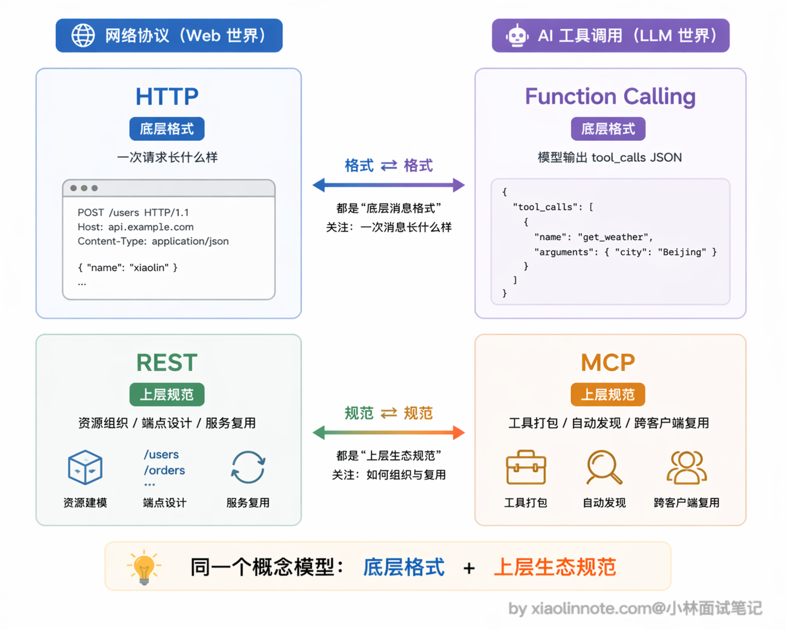

因为 HTTP 解决的是「怎么传」（一次请求长什么样、用什么方法、怎么编码），REST 解决的是「怎么组织和管理」（资源怎么命名、端点怎么设计、状态怎么表达、多个服务之间怎么复用同一套约定），两者是不同层次的事。

Function Calling 和 MCP 也是同样的关系：Function Calling 管「一次函数调用请求长什么样」，MCP 管「一堆工具怎么被组织、发现、跨项目复用」。前者是格式，后者是规范+生态约定，少了谁这套机制都运转不起来。

### 6.2 Function Calling 解决的是「一次调用」的格式问题

从开发者视角看，Function Calling 回答的是这几个问题：工具定义用什么格式传给模型？模型想调工具时怎么表达「我要调哪个函数、参数是什么」？工具执行结果怎么喂回对话？

它定义的是单次调用的消息格式，仅此而已。每次使用，开发者都要手动写工具的 schema 定义，手动写调用逻辑，手动处理结果。Function Calling 本身没有任何工具管理、工具发现、跨项目复用的概念。

### 6.3 Function Calling 的痛点，每次都是一次性的

那「每次手动」到底有多痛？你可能觉得复制一份 schema 也没多大工作量，但工具一多、项目一多，问题就暴露出来了。

假设你在 A 项目里定义了 10 个工具的 schema 和对接逻辑。现在 B 项目也要用这些工具，怎么办？把那 10 个 schema 定义复制过来，把对接逻辑重写一遍。好，写完了。但 A 项目用的是 Claude API，B 项目换成了 GPT-4，两边的 Function Calling 格式不完全一样，又得各自维护一套适配代码。这还没完，如果某个工具的接口改了呢？你得去每个用到它的项目里逐一更新，漏改一处就是 bug。

假设你团队里有 5 个应用，每个应用要接 8 个工具，也就是 40 份工具对接代码在维护。某天 GitHub API 的某个字段变了，你要在 5 个地方同步改，只要其中一个忘了，那个应用在凌晨报警；再假设你要从 Claude 迁到 GPT-4，这 40 份代码里的 Function Calling 格式全要重新适配一遍，整个组的季度就这么交代了。

有没有发现问题？同一个工具，换个项目就要重新对接一遍，每次都是一次性的手工活。这就是 Function Calling 解决不了的核心问题：**工具的管理、复用和跨平台兼容**。

### 6.4 MCP 解决的是「工具生态」的问题

既然痛点是「每个应用各自维护一套工具定义」，那解决思路也就很自然了：把工具做成独立的标准化服务，谁要用就来连，不用每次都重写一遍。这就是 MCP 的核心思路。

工具提供方实现一个 MCP Server，这个 Server 是一个独立运行的进程，对外暴露标准接口，告诉外界「我有哪些工具、每个工具怎么调用」。任何支持 MCP 的 AI 客户端连上来，就能自动发现和使用里面的工具，完全不需要手写任何对接代码。

这带来的改变是质的：工具只需要实现一次，所有 AI 客户端都能用。GitHub 的官方 MCP Server 写好之后，不管你用 Claude Desktop、Cursor 还是自己写的 Agent，连上去就能用，不需要各自维护一份 GitHub API 的调用代码。这才是 MCP 的真正价值。

### 6.5 最关键的联系，MCP 底层依然靠 Function Calling 驱动

MCP 不是 Function Calling 的替代品，而是建立在 Function Calling 之上的。

当 MCP Client 连上一个 Server 之后，会自动向 Server 拉取所有工具的定义（调用 `list_tools` 接口），然后把这些定义**转换成模型原生的 Function Calling 格式**传给模型。模型依然通过输出 `tool_calls` 来表达「我要调哪个工具」，MCP Client 再把这个请求路由到对应的 Server 去执行，拿到结果后以 tool 消息的形式喂回对话。

从**模型的视角**来看，它完全感知不到 MCP 的存在，它以为自己只是在做普通的 Function Calling，根本不知道背后有一套 Server 在运行。MCP 的所有「魔法」都发生在宿主程序层：工具的自动发现、schema 的格式转换、调用请求的路由、执行结果的返回，全都在这一层默默完成。

这也意味着一件事：如果模型本身不支持 Function Calling，MCP 就完全没办法用，因为这个「翻译层」失效了。

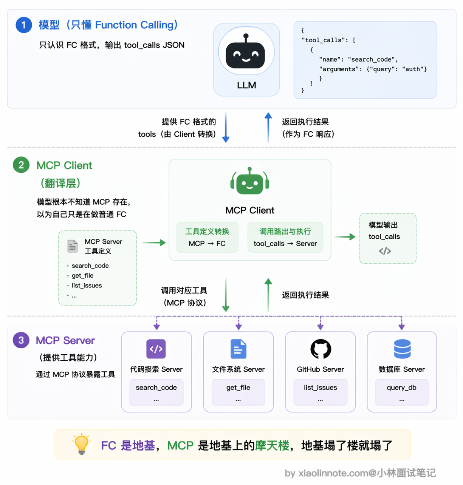

### 6.6 实际体验，接入一个 MCP Server

以 Claude Desktop 接入文件系统 MCP 为例。只需要编辑 `claude_desktop_config.json`，加入如下配置：

```json
{
  "mcpServers": {
    "filesystem": {
      "command": "npx",
      "args": [
        "-y",
        "@modelcontextprotocol/server-filesystem",
        "/Users/yourname/Documents"
      ]
    }
  }
}
```

这几行配置告诉 MCP Client：用 `npx` 这个命令启动文件系统 Server，把 `/Users/yourname/Documents` 目录作为允许访问的范围。`command` 和 `args` 组合起来就是启动 Server 进程的命令行，MCP Client 会把它作为子进程启动，通过标准输入输出和它通信。

配好之后重启 Claude Desktop，它会自动启动这个 Server 进程，自动发现里面提供的工具。然后你直接问 Claude「帮我读一下 Documents 里的 `report.md`」，Claude 会自动调用文件系统工具完成任务，全程你没写一行对接代码。

如果想自己写一个 MCP Server，其实也很简单。核心就三步：首先用 `@app.list_tools()` 装饰器告诉 Client 这个 Server 提供哪些工具及其参数格式，然后用 `@app.call_tool()` 装饰器实现每个工具的真实执行逻辑，最后用 stdio 方式运行，让 Client 能通过管道和它通信。

完整的代码如下：

```python
import asyncio
from mcp.server import Server
from mcp.server.stdio import stdio_server
from mcp.types import Tool, TextContent

# 1. 创建一个 Server 实例，名字叫 "calculator"
app = Server("calculator")

# 2. 定义工具列表 (告诉 Client 我有什么功能)
@app.list_tools()
async def list_tools() -> list[Tool]:
    return [
        Tool(
            name="add_numbers",
            description="计算两个数字的和",
            inputSchema={
                "type": "object",
                "properties": {
                    "a": {"type": "number", "description": "第一个数字"},
                    "b": {"type": "number", "description": "第二个数字"}
                },
                "required": ["a", "b"]
            }
        )
    ]

# 3. 实现工具的具体逻辑
@app.call_tool()
async def call_tool(name: str, arguments: dict) -> list[TextContent]:
    if name == "add_numbers":
        a = arguments.get("a", 0)
        b = arguments.get("b", 0)
        result = a + b
        
        # 返回结果，必须是 TextContent 格式
        return [
            TextContent(
                type="text",
                text=f"计算结果: {result}"
            )
        ]
    
    # 如果工具名不认识，返回错误
    return [TextContent(type="text", text=f"未知工具: {name}")]

# 4. 启动 Server (使用标准输入输出模式)
async def main():
    async with stdio_server() as (read_stream, write_stream):
        await app.run(
            read_stream,
            write_stream,
            app.create_initialization_options()
        )

if __name__ == "__main__":
    asyncio.run(main())
```

整个 Server 加起来不超过 30 行代码，Anthropic 开源的 MCP SDK 把底层通信都封装好了。

然后编辑你的 `claude_desktop_config.json`，添加这个 Python 服务：

```json
{
  "mcpServers": {
    "calculator": {
      "command": "python",
      "args": [
        "/path/to/your/calculator_server.py"
      ]
    }
  }
}
```

注意这里的路径要改成你自己实际存放文件的绝对路径，如果你的系统中 Python 命令是 `python3`，也要把 `command` 对应改过来。

配好之后重启 Claude Desktop，直接输入「帮我算一下 25 加 17 等于多少」，Claude 就会自动调用你写的 `add_numbers` 工具并返回结果。整个过程你只写了工具逻辑本身，所有的通信、发现、调用路由都由 MCP 框架搞定了。

### 6.7 什么时候选哪个

如果只是临时给自己的应用接一两个工具，Function Calling 就够用了，简单直接，不需要引入额外的进程和协议。

但如果工具多了、需要跨项目复用、或者想直接用社区里已有的成熟 Server（GitHub、数据库、浏览器自动化都有现成的），MCP 就值得上了。接一个新工具就是在配置文件里加几行，重启后自动生效，比手写对接代码省事很多。

做 Agent 系统的话更应该考虑 MCP。工具来源杂、数量多，如果全靠手写 Function Calling 来维护，工具定义代码会散落在各处，很难管理。MCP 的自动发现和统一管理能让架构干净很多，新增工具不需要改主程序逻辑，接上 Server 就行。

## 🎯 面试总结

最大的雷就是把 MCP 当成 Function Calling 的「替代品」或「升级版」，这是很多人的第一反应，但完全搞反了两者的关系。

面试回答这道题，第一个必须说清楚的点是：Function Calling 解决的是单次调用的消息格式问题，MCP 解决的是工具生态的标准化管理和复用问题，两者是不同抽象层次的东西。

第二个关键点是：MCP 底层依然靠 Function Calling 驱动，模型根本感知不到 MCP 的存在，所有的工具发现、schema 转换、调用路由都发生在宿主程序层。

如果能再补充实际跑过 MCP 的经验就更好了，比如在 Claude Desktop 里配置过哪些 MCP Server、接入流程是什么样的，这些实操细节能让面试官看到你不是只背概念。要避免的误区是：不要说 MCP 就是「换了个写法的 Function Calling」，也不要说两者是竞争关系，它们是上下层的配合关系。

# 7. Function Calling 也属于工具调用，请问什么场景下使用 Function Calling，什么场景下使用 MCP？

## 💡 简要回答

如果只是给单个应用接一两个工具、场景临时、不需要复用，Function Calling 就够了，简单直接，不需要引入额外的进程和配置。

但只要工具需要跨项目或跨团队复用、或者数量多了管理麻烦、或者社区已经有现成的 MCP Server 可以直接配置，MCP 就值得上了。

判断的核心问题只有一个：这个工具会不会在这个应用之外被用到？会的话，把它封装成 MCP Server 是更长远的选择。

此外，做 Agent 系统的话更应该选 MCP，工具来源多、数量大，手写 Function Calling 的维护成本会让代码变得难以管理。

## 📝 详细解析

### 7.1 先建立一个直觉：内嵌 vs 独立

Function Calling 的工具是「内嵌」在应用代码里的，工具定义（schema）和调用逻辑都直接写在你的项目代码中，工具和应用绑在一起，应用换了就要重写一遍。

MCP 的工具是「独立」的，封装成一个独立运行的进程，对外暴露标准接口，任何支持 MCP 的 AI 客户端都能连上来直接用。工具的生命周期和应用解耦，可以独立部署、独立维护、一次实现到处复用。

这个「内嵌 vs 独立」的本质区别，直接决定了两者各自适合的场景。

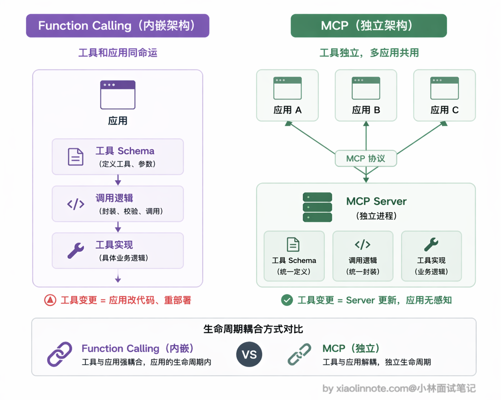

### 7.2 Function Calling 的适用场景

什么时候用 Function Calling 就够了？简单来说，就是「轻量、临时、不需要复用」的场景。

**做快速原型和 Demo**。目标是跑通一个想法或做演示，直接在代码里定义 schema 和调用逻辑就行，不需要启动任何额外进程，也不需要额外配置。这种场景下搞 MCP 完全没必要，你花在搭 Server 上的时间可能会超过原型本身的价值。

**工具只为这一个应用服务**的情况。假设你在做一个内部工具，里面有一个查本公司私有数据库的接口，这个接口绝不会被任何其他地方用到，那用 Function Calling 把逻辑直接写在项目里反而更清晰，何必额外维护一个独立的 MCP Server 进程呢？

**需要对工具的执行逻辑做精细控制**。Function Calling 的调用逻辑完全在你的代码里，想加权限校验、参数二次处理、特殊错误处理、调用链路追踪，都可以直接嵌进去。MCP Server 是独立进程，这类定制逻辑要额外传递或约定，不如直接写在调用代码里方便。

**部署环境的限制**。某些受限的云环境或 Serverless 平台不允许启动子进程，stdio 模式的 MCP Server 就没法用了。这种情况只能退回 Function Calling，工具逻辑都写在主进程里，反而是最稳妥的选择。

### 7.3 MCP 的适用场景

那什么时候该上 MCP 呢？一句话概括：只要工具不是「自己用、用一次就扔」，MCP 基本都值得考虑。

**工具需要跨项目或跨团队复用**。同一套 GitHub 操作工具，你自己的 Claude Desktop 要用、同事的 Cursor 要用、团队的 CI/CD Agent 也要用。如果用 Function Calling，意味着三处各维护一份 schema 和调用代码，工具接口一变就要同步改三处，漏改一个就出 bug。MCP 的做法就优雅多了：工具封装成独立 Server，任何人在配置文件里加几行就能接进来用，维护的责任在 Server 那一侧，所有客户端自动受益。

**社区已经有现成的 MCP Server 了**。GitHub、Slack、PostgreSQL、Puppeteer、Google Maps 这类高频工具，都有经过测试、文档完整的官方或社区 MCP Server。你不需要自己写一遍，直接配置就能用：

```json
// 在 claude_desktop_config.json 里加几行，一行工具代码都不用写
{
  "mcpServers": {
    "github": {
      "command": "npx",
      "args": ["-y", "@modelcontextprotocol/server-github"]
    }
  }
}
```

这种情况下还用 Function Calling 手写 GitHub API 的调用代码，那就是重复造轮子了，完全没必要。

另外，当工具规模起来、MCP 的管理优势就很明显了。这里不想给一个绝对的数字门槛（比如「超过 3 个就要上 MCP」），因为实际判断要看几个维度综合：工具的复杂度（每个工具的 schema 和调用逻辑是几行还是几十行）、团队规模（是一个人维护还是多人协作）、变更频率（工具接口经常改还是基本稳定）。如果你的工具平均复杂度不低、团队里好几个人都在碰这些代码、接口还时不时调整，那就算只有 5 个工具也会很快把你拖进维护泥潭。反过来，两个极其简单、几乎不动的工具，没必要为它们引入一套独立 Server。

为什么工具多了 Function Calling 就会难维护？因为工具的 schema 定义和调用逻辑会散落在代码各处，新加一个工具要改应用代码，工具有 bug 也要进应用代码改，出问题时定位链路很长。MCP 的自动发现机制正好解决这个问题，主程序不感知具体工具，只连 Server，新增工具只需要在 Server 里加实现，主程序完全不需要改动。

最后，如果你在构建 Agent 系统，MCP 几乎是必选项。Agent 系统的工具需求往往多样、来源复杂，可能同时需要代码执行、文件系统、数据库、外部 API 等各类工具。全靠 Function Calling 的话，工具 schema 会成为 Agent 代码里最难维护的部分。MCP 让 Agent 可以按需连不同的 Server，工具来源模块化，Agent 的核心逻辑和工具管理完全解耦，架构干净很多。

### 7.4 一个实用的判断方法

碰到「用 Function Calling 还是 MCP」这个选择题，其实不需要纠结太久，按几个问题依次过一遍就清楚了。

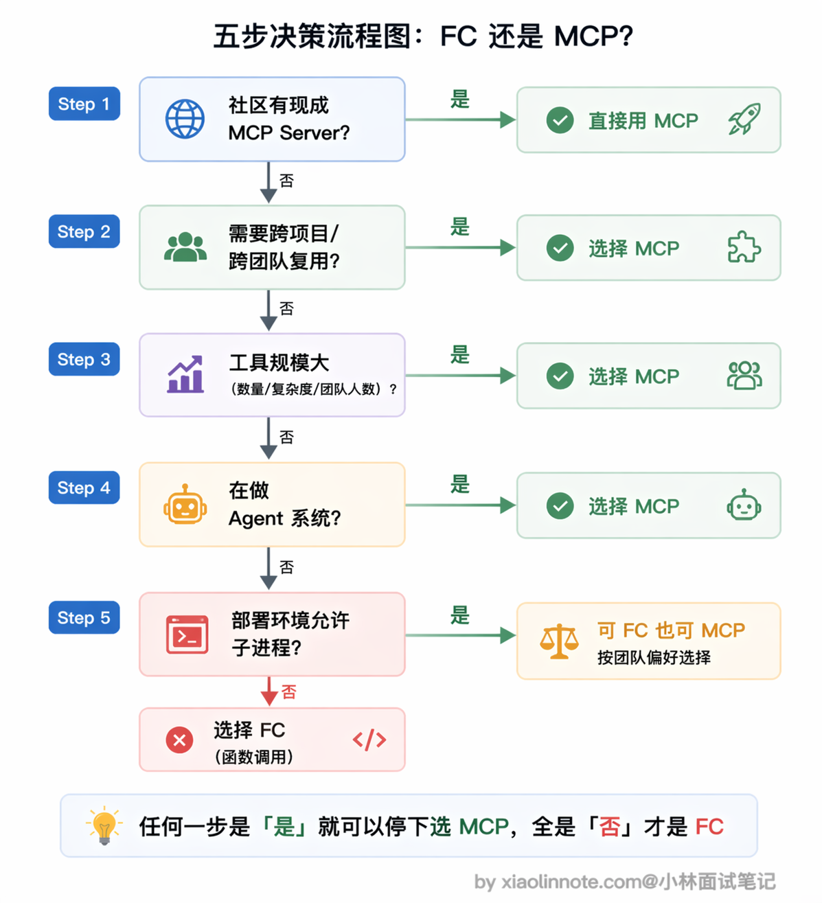

首先看社区有没有现成的 MCP Server，有的话直接用，不要重复造轮子。

如果没有现成的，那就看这个工具需不需要在多个项目或多人之间复用，需要复用就选 MCP，一次封装到处用。

接着综合看工具数量、复杂度、团队规模和变更频率，只要规模一上来（不一定是数字门槛，而是「感觉到散乱」的那个拐点），用 MCP 统一管理会比散落在代码各处的 Function Calling 清爽很多。

然后考虑你是在做正式的 Agent 系统还是 Demo 原型，正式系统选 MCP 更利于长期维护，Demo 的话 Function Calling 上手更快。

最后别忘了检查部署环境，如果平台不允许启动子进程，那 Function Calling 就是更稳妥的选择。

总结成一句话：「只用自己、只用一次、不需要复用」才适合 Function Calling，其他情况优先考虑 MCP。两者不是竞争关系，MCP 底层本来就是靠 Function Calling 驱动的，选哪个取决于你的工程需求，而不是技术层面的优劣。

## 🎯 面试总结

最典型的误区就是用单一维度来做选型判断，比如只看项目规模或只看工具数量。

面试回答这道题，核心是展示你有多维度的判断框架：首先看社区有没有现成的 MCP Server，有就直接用，不要重复造轮子；其次看工具有没有跨项目复用的需求，有就选 MCP；再看工具规模（数量、复杂度、团队规模、变更频率综合判断），规模起来了就考虑 MCP 统一管理；最后还要考虑部署环境限制和是否在做 Agent 系统。

另一个容易踩的雷是只说「什么时候用 MCP」而忽略了 Function Calling 的适用场景。快速原型、工具只为单一应用服务、需要精细控制执行逻辑、部署环境受限这四种场景，Function Calling 反而是更好的选择。面试官想听到的是你能根据具体场景做出合理取舍，而不是一刀切地倾向某一个方案。

# 8. 为什么有些特定的推理模型不支持 MCP 协议？

## 💡 简要回答

我理解根本原因是两者的生成范式有冲突。

推理模型在给出答案之前，会先跑一段完整的「思维链」，这个 thinking 过程是一次性连续生成的，不能中途打断。但工具调用天然是多轮交互：模型输出调用请求、暂停等工具执行、拿到结果再继续生成，这两种模式没法兼容。你没法在思考链跑到一半的时候暂停去等工具结果，否则之前的推理上下文全断了。

而 MCP 底层就是靠 Function Calling 驱动的，推理模型连 Function Calling 都支持不好，MCP 自然也用不了。

当然这个问题不是无解的，后来 o3 和 Claude Extended Thinking 都找到了折中方案，比如让工具调用发生在思考阶段结束之后，保证思考过程还是一次性完整生成的。

## 📝 详细解析

### 8.1 先弄清楚推理模型是什么

普通模型的工作方式很直接：问题进来，答案出去，收到输入就开始生成 token，一路生成到结束。

推理模型（Reasoning Model）在给出最终答案之前，会先生成一大段「内部思考」（thinking tokens），在思考里自言自语地推演、验证、反驳，甚至推翻自己前面的结论重来，直到把问题想清楚了，再输出面向用户的最终答案。

这套「先思考再回答」的机制，正是推理模型在复杂推理、数学、代码问题上比普通模型强的根本原因。但也正是这个机制，和工具调用产生了根本冲突。

### 8.2 工具调用的本质是「中途暂停」

工具调用不是一次性生成完成的，它天然是多轮交互：第一步，模型生成调用请求，表达「我要查北京天气，调 `get_weather` 工具，参数是 city=北京」；第二步，**停下来等宿主程序去执行这个工具**；第三步，拿到工具返回的结果；第四步，继续生成，把工具结果纳入后续推理，最终给出答案。

整个流程的核心是第二步，模型生成到一半，**强制暂停**，等外部执行完毕，再恢复生成。对普通模型来说，这没有问题，因为它的状态很轻量，随时可以截断再重新启动。

### 8.3 直觉类比，写推理过程中途被打断

想象你正在心无旁骛地写一篇复杂的推理论文，脑子里已经建立了一整套逻辑框架，各个论点之间的关系都串起来了，正处于思维最活跃的时刻。

突然电话来了，你放下笔去接了 20 分钟电话，再回来坐下，很多细节想不起来了，之前好不容易建立的推理脉络断了，只能重新梳理。

推理模型的思考链就是这种东西。它是一个依赖完整上下文的连续生成过程，每一步推理都建立在前面所有推理内容的基础上，整条链是一个有机整体。

中途强行打断，之前建立的推理状态会断掉，模型没办法从中间接着想，只能整个重来。

### 8.4 那保存状态再恢复不就行了？

听起来好像可行，但实际代价很大。你可以把模型推理时的中间状态想象成一本「思考草稿本」，上面记满了到目前为止每一步推理积累下来的脉络（技术上叫 KV Cache，是模型缓存注意力计算结果的结构，体积非常庞大）。一旦暂停，这本草稿本就得原封不动占着一块 GPU 显存，工具执行要几秒、几十秒，这块显存就一直被占着不能给别的请求用。工具执行完再接着想，显存占用翻倍、吞吐量直接腰斩，整体延迟也大幅上升。对一个需要同时服务成千上万请求的在线推理系统来说，这个代价是完全承受不了的。

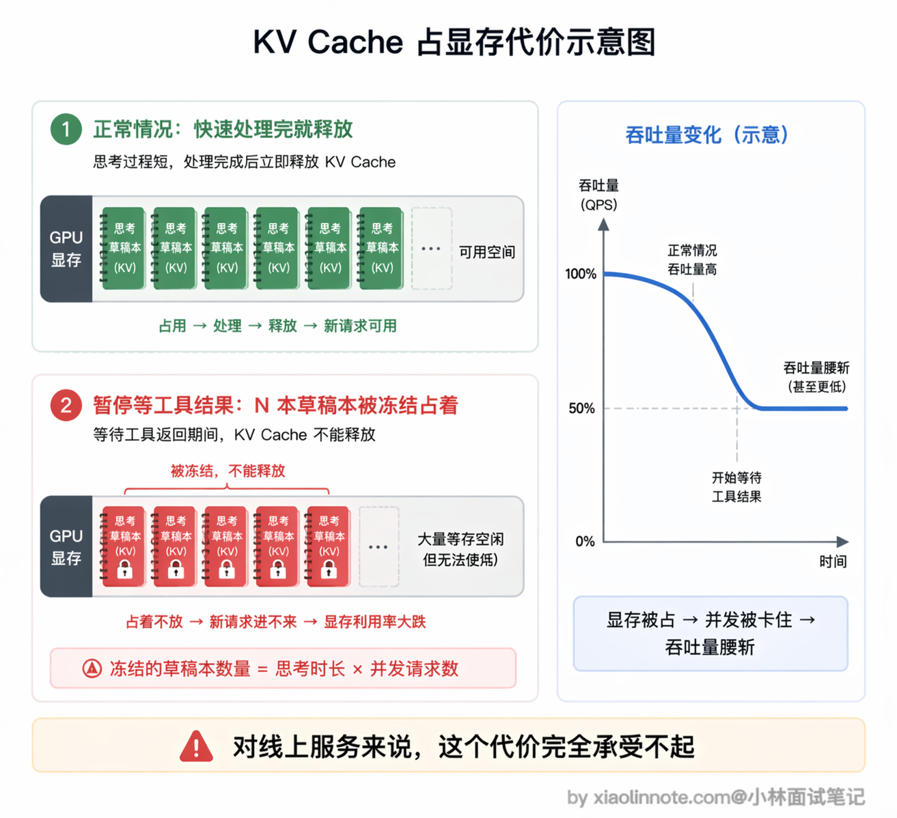

更难解决的是一致性问题。思考过程中途接入工具结果，等于在模型「想到一半」时改变了输入。模型之前的思路是基于「我还不知道工具结果」建立的，突然工具结果来了，模型需要重新校准，之前的推理链和新来的工具结果可能是矛盾的，怎么融合？这个「思考状态一致性」的问题没有简单的解法。

### 8.5 训练目标上的冲突

推理模型的训练核心是：用强化学习（RL，通过奖励反馈让模型学会更好的行为）大量奖励「思考链完整且结论正确」的输出。模型接受了大量这类训练之后，会越来越倾向于「一直想、想到底」，把推理过程跑完整，这是它推理能力强的根本来源。

而 Function Calling 的训练恰好相反，需要模型学会**在合适时机打断自己**，从推理状态切换出来，输出一段结构化的 JSON 调用请求。这个行为和「持续深入推理」是相反的，要同时学好这两件事，训练数据的分布就要两边都兼顾。

如果强行把两种训练数据混在一起喂，实际会看到什么现象？常见的失败模式有三种：一是模型在思考到一半突然跳出来输出一段奇怪的 JSON，结果 JSON 格式还错了，两边都没干好；二是模型彻底偏向一边，要么思考链缩水变浅（变成普通模型），要么干脆不会输出工具调用；三是融合处的推理断裂，工具结果回来之后模型的后续推理和之前的思考链对不上，答非所问。所以早期推理模型宁可先放弃工具调用，也要先把推理能力做扎实。

### 8.6 后来是怎么解决的，折中方案

**让工具调用发生在思考阶段结束之后**。

具体做法是：模型先把整个推理链完整跑完，进入「输出最终答案」阶段时，才触发 Function Calling 流程。这样思考过程仍然是一次性完整生成的，完全不被打断，推理质量得以保住。

代价是：思考阶段完全感知不到工具结果，模型只能基于自己的已有知识来推理，工具数据只有在「答案生成阶段」才能引入。

对于那种「需要先查到某个数据，再基于这个数据做复杂推理」的任务，这个方案是有局限的，模型没办法带着工具结果去深度推理。但对大多数场景来说，先想清楚再调工具已经够用。

o3 和 Claude Extended Thinking 走的都是这条路，所以它们现在已经支持工具调用了。而且 Claude 还进一步推出了 interleaved thinking（交错思考）模式，允许模型在多次工具调用之间穿插思考，而不是只能在所有思考结束后才调用工具，这在一定程度上缓解了「思考阶段感知不到工具结果」的局限。

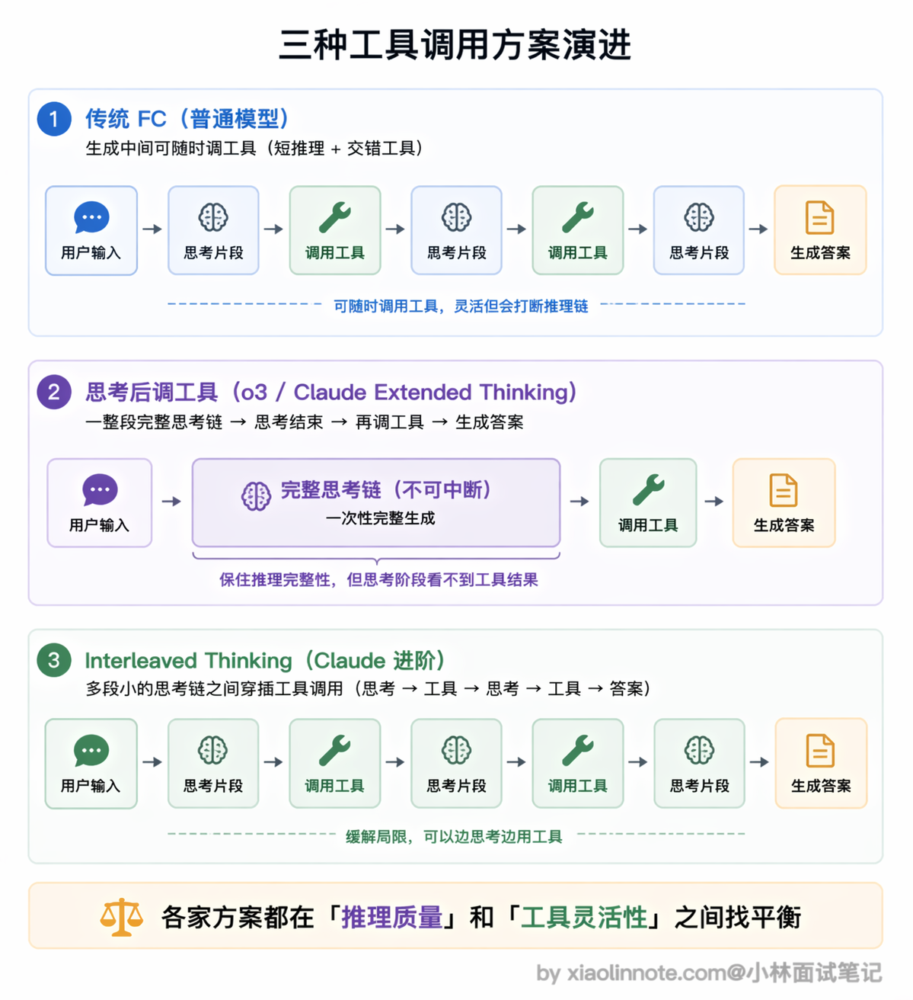

但你要知道这个内在限制的本质仍然存在，各家的解法都是在「保证推理质量」和「支持工具调用」之间做权衡。

### 8.7 为什么不支持 Function Calling 就不支持 MCP？

MCP 协议在底层完全依赖 Function Calling。整个调用链是这样的：MCP Client 先连上 Server，拉取工具定义，然后把这些定义**转换成模型原生的 Function Calling 格式**传给模型。接下来等模型输出 `tool_calls`，Client 再把调用请求路由到对应的 Server 执行，最后把执行结果喂回对话。

这个「工具定义 -> Function Calling 格式转换」就是 MCP 的翻译层，是整个链路的关键环节。

那如果推理模型不支持 Function Calling 呢？这个翻译层就完全失效了。工具信息没办法让模型理解，调用请求也无法被模型生成，整条链路从中间直接断掉了。

所以「推理模型不支持 Function Calling -> 不支持 MCP」是一个很自然的传导关系，不是 MCP 本身有什么问题，是底层能力缺失导致的连锁反应。

## 🎯 面试总结

最常见的误区有两个：一是以为不支持 MCP 只是「还没适配」，把结构性的技术冲突当成了工程进度问题；二是把原因归结为上下文窗口不够大，没有抓到真正的矛盾点。

面试回答这道题，必须讲清楚三个层次：第一，推理模型的思考链是一次性连续生成的，不能中途打断；第二，工具调用天然需要在生成过程中暂停等待外部执行，这和连续生成的范式冲突；第三，MCP 底层依赖 Function Calling，推理模型连 Function Calling 都支持不好，MCP 自然也用不了，这是一个传导关系。

如果能再补充后续的解决方案就更加分了：o3 和 Claude Extended Thinking 采用的折中方案是让工具调用发生在思考阶段结束之后，保证思考过程仍然完整连续。Claude 还进一步推出了 interleaved thinking 模式，允许在多次工具调用之间穿插思考，部分缓解了这个局限。

同时也要点出折中方案的本质权衡：各家的解法都是在「保证推理质量」和「支持工具调用」之间找平衡点。

# 9. Skill 是什么？

## 💡 简要回答

Agent Skill 是把「指令、脚本、模板」一体化打包成可复用能力包的机制，关键在于三件事：Agent 能自动发现它、按需加载它、在需要时调用里面的脚本和资源。它不只是「存 prompt」，而是一份 Agent 能自己翻阅的「操作手册 + 工具箱」。每个 Skill 是一个文件夹，里面有一份 `SKILL.md` 指令文件，还可以带上脚本、模板、参考文档这些资源。

它和普通 prompt 最大的区别是：Skill 能被 Agent 自动发现和按需加载，不用你每次手动输入；和 MCP 工具的区别是：MCP 给 Agent 提供外部工具和数据的访问能力，而 Skill 教 Agent 拿到这些工具和数据之后该怎么用。

Anthropic 在 2025 年 10 月推出了 Agent Skills，同年 12 月把规范作为开放标准发布出来，允许其他 Agent 平台按照这套格式来兼容 Skills 生态。

## 📝 详细解析

### 9.1 为什么需要 Skill？从「重复贴 prompt」的痛点说起

你一定遇到过这种情况：每次让 AI 帮你做代码审查，你都要贴一大段指令，告诉它「检查这几类问题、用这种格式输出、重点关注安全漏洞」。每次新对话都要从头贴一遍，漏掉某个细节就会导致输出质量不稳定。

如果是团队协作呢？每个人贴的 prompt 都不一样，有的人关注安全，有的人关注性能，审查标准完全没法统一。

你可能想到把 prompt 写到一个共享文档里让大家复制，但这本质上还是靠人工去维护和执行，版本一多就容易乱，更新了文档但有人还在用旧版的 prompt，质量把控根本做不到。

Skill 要解决的就是这个问题：把那些你反复在用的指令、流程、模板，打包成一个标准化的模块，Agent 自己知道什么时候该用它、怎么用它，不再依赖你手动复制粘贴。

### 9.2 Skill 的结构长什么样

一个 Skill 说白了就是一个文件夹，里面最核心的是一份叫 `SKILL.md` 的文件，再加上一些可选的辅助资源。结构很直观：

```
code-review/                  # Skill 文件夹，名字就是这个 Skill 的标识
├── SKILL.md                  # 核心指令文件（必须有）
├── scripts/                  # 可选：可执行的脚本
│   └── check_security.py     # 比如一个安全检查脚本
├── references/               # 可选：参考文档
│   └── review_standards.md   # 比如团队的审查标准文档
└── assets/                   # 可选：模板、资源文件
    └── report_template.md    # 比如审查报告的输出模板
```

`SKILL.md` 的内容分两部分。顶部是一段 YAML 格式的元数据，叫 frontmatter，声明这个 Skill 的名字和一句话描述；下面是正文，用 Markdown 写具体的指令和步骤。来看一个实际的例子：

```yaml
---
name: code-review
description: "对代码进行全面审查，检查 bug、安全漏洞和性能问题，输出结构化审查报告"
---

# 代码审查 Skill

## 指令

### 第一步：理解代码上下文
阅读提交的代码，理解它的功能和所属模块，确认修改范围。

### 第二步：逐项检查
按以下维度逐一检查：
1. 功能正确性：逻辑是否有 bug，边界条件是否处理了
2. 安全性：是否有注入、XSS、权限绕过等漏洞
3. 性能：是否有 N+1 查询、不必要的循环、内存泄漏风险
4. 可读性：命名是否清晰，关键逻辑是否有注释

### 第三步：输出报告
使用 assets/report_template.md 的模板格式，输出结构化的审查报告。
```

你会发现，这和普通 prompt 的区别就很明显了。普通 prompt 只是一段文字，用完就没了；而 Skill 是一个完整的文件夹，里面的指令、脚本、模板可以持续维护、版本管理，团队里所有人用的都是同一份。

### 9.3 渐进式加载：Skill 最聪明的设计

- 「只看简历」。Agent 启动的时候，只加载每个 Skill 的 name 和 description 这两个字段，大概每个 Skill 只占 30 到 50 个 token。这就像你面前摆了 20 份简历，每份只看名字和一句话介绍，几秒钟就能扫完，心里有数「我手上有哪些能力可以用」。
- 「翻开详细资料」。当用户提了一个任务，Agent 判断「这个任务跟 code-review 这个 Skill 相关」，这时候才会把 code-review 的 `SKILL.md` 正文完整加载进来，读取里面的详细指令。不相关的 Skill 始终不会被加载，不浪费一个 token。
- 「需要时再取」。执行过程中，如果指令里提到了「使用 assets/report_template.md 的模板」，Agent 才会在那个时刻去读取这个模板文件。参考文档、脚本这些辅助资源也是一样，用到的时候才加载。

为什么这个设计这么重要？因为 context window 是 Agent 最宝贵的资源。如果把所有 Skill 的全部内容一股脑塞进去，真正有用的用户任务信息反而会被淹没，Agent 的注意力被分散，输出质量反而下降。渐进式加载的本质就是「让 Agent 只在需要的时候获取需要的知识」，这和人类的工作方式其实是一样的。

### 9.4 Skill 和 Tool、Prompt 分别是什么关系

这三个概念经常被混淆，但它们处于完全不同的层次，用一个类比就能讲清楚。

可以把 **Tool（包括 MCP 工具）**想象成公司给员工配的**电脑、软件和数据库访问权限**。有了 Tool，Agent 就能「做事」，比如查数据库、调 API、读写文件。但光有工具不够，你给一个新人配了一台电脑和所有系统权限，他也不知道该按什么流程做代码审查，不知道先查什么、后查什么、用什么格式输出报告。

**Skill** 就是那份**「操作手册」和「SOP 流程**」。它教 Agent 拿到这些工具之后，该按什么步骤、什么标准、什么格式来完成一个具体的工作流。所以 Tool 和 Skill 的关系是互补的：Tool 提供能力，Skill 提供知识和流程。

**Prompt** 就像你口头跟员工说的一句话指令，比如「帮我看看这段代码有没有问题」。这句话说完就没了，下次你还得再说一遍。Prompt 是一次性的、临时的，而 Skill 是持久化的、可复用的。

 **Slash Command**（斜杠命令） 也是把指令保存下来复用，但它必须由你手动触发，比如你得输入 `/code-review` 才能调用。而 Skill 可以被 Agent 自动发现和调用，Agent 看到你的任务后，自己判断「这个任务需要用 code-review Skill」，然后主动去加载和执行，不需要你告诉它该用哪个 Skill。这个自动发现的能力，就是 Skill 比 Slash Command 更进一步的地方。

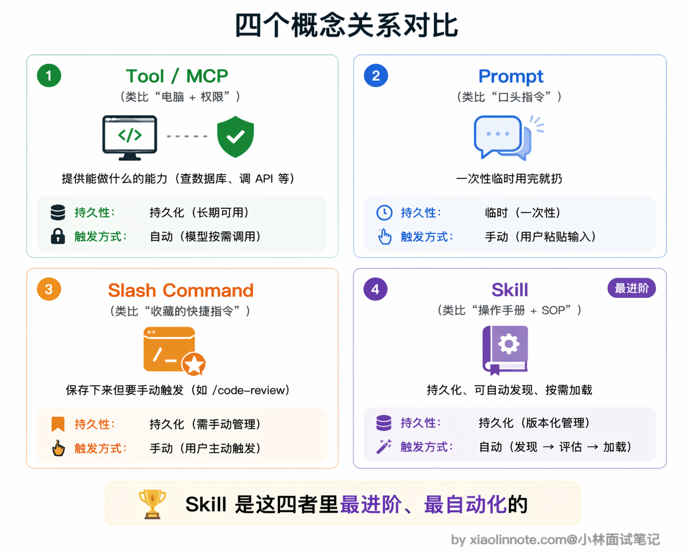

### Skill 从 Anthropic 走向开放标准

Agent Skills 最早是 Anthropic 在 2025 年 10 月推出的，一开始只在 Claude 自家的生态里用，覆盖了 Claude Code、Claude API 和 [claude.ai](http://claude.ai/) 这三个入口。推出两个月后，Anthropic 做了一个很聪明的决定：在 2025 年 12 月把 Agent Skills 的规范作为开放标准发布出来，任何想做 Agent 平台的团队都可以按这个规范来实现自己的 Skills 支持。

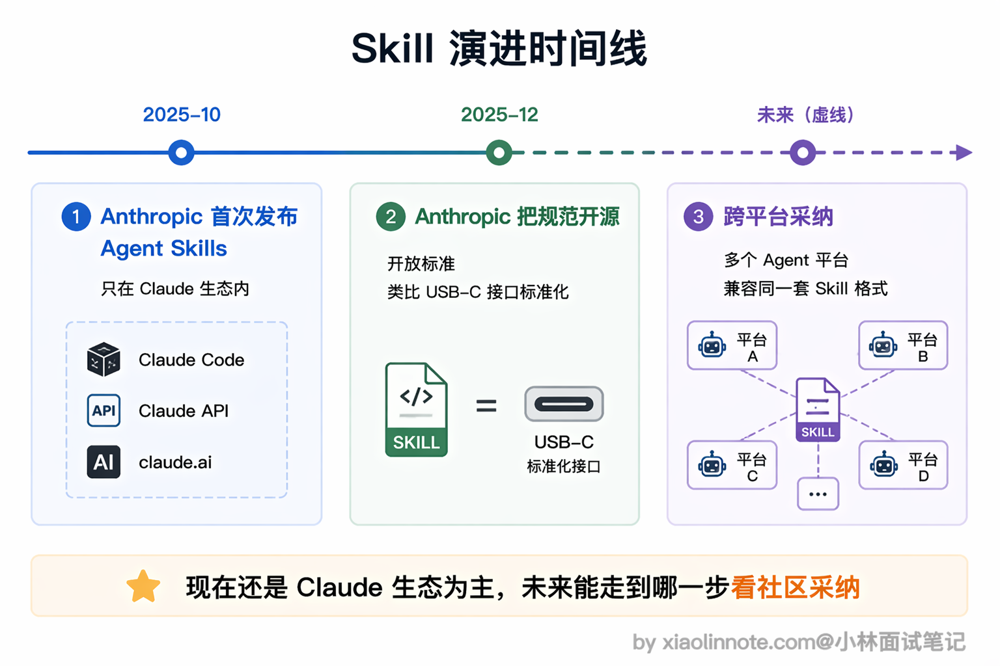

为什么要把规范开放？核心原因是 Skills 的设计足够简单。一个 Skill 就是一个文件夹加一份 Markdown 文件，不需要安装特殊的运行时，不需要学新的编程语言，任何支持文件系统的 Agent 平台理论上都能实现这套格式。这种「零门槛」的设计让它有希望成为跨平台的通用约定。

开放成标准有什么好处？好处是你写一份 Skill，未来有机会在不同的 Agent 平台之间复用，而不是被某一家产品绑死。这就像 USB 接口一样，你买一根 USB-C 数据线，手机能用、电脑也能用，不用每个设备买一根专用线。

## 🎯 面试总结

最常见的误区就是把 Skill 等同于「保存好的 prompt」。面试回答这道题，

- **Skill 的本质**：它不是一段 prompt，而是一个包含指令、脚本、模板的可复用能力模块，Agent 可以自动发现和按需加载。
- **渐进式加载的设计**。三层加载机制（只读元数据 -> 按需加载指令 -> 用到时才取资源）让 Skill 既能提供丰富的能力，又不会浪费宝贵的 context window 空间。这个设计思想在面试里说出来会很加分，因为它体现了你对「context 工程」的理解。
-  **Skill 和其他概念的关系**：MCP/Tool 提供外部工具和数据访问，Skill 提供用这些工具完成任务的知识和流程，两者互补；Prompt 是一次性的临时指令，Skill 是持久化的可复用模块；Slash Command 需要手动触发，Skill 可以被 Agent 自动发现。

- Agent Skills 已经从 Anthropic 的产品功能发展成了**开放标准**（2025 年 12 月开源），目前主要在 Claude Code、Claude API、[claude.ai] 这三个入口上使用，社区也在探索把这个格式带到其他 Agent 平台，未来有望成为跨平台的能力模块约定。


# 10. MCP 和 Agent Skill 的区别是什么？

## 💡 简要回答

MCP 和 Agent Skill 不是同类概念，不是竞争关系，而是互补的。

MCP 解决的是「Agent 怎么获得外部能力」，它把数据库、API、文件系统这些外部工具标准化封装成服务，Agent 通过 MCP 就能查数据、调接口、读写文件。

Skill 解决的是「Agent 拿到这些能力之后，该按什么步骤、什么标准来完成任务」，它把完成某类工作的知识和流程打包成可复用的模块。

简单记：MCP 是给 Agent 配的电脑和软件，Skill 是给 Agent 发的操作手册和 SOP。在实际系统里，两者经常同时工作，Skill 定义流程，流程中调用 MCP 提供的工具。

## 📝 详细解析

### 10.1 MCP：让 Agent 有「手」

MCP Server 暴露的 Tools、Resources、Prompts 就是 Agent 操作外部世界的手段。模型通过 Function Calling 触发这些工具，工具执行完把结果喂回对话。MCP 的粒度是「原子操作」，`read_file(path)` 是一个 Tool，`query_database(sql)` 是一个 Tool，每次调用做一件明确完整的事，执行结果立刻返回。模型能看到每个 Tool 的完整 schema，包括它叫什么名字、接受什么参数、返回什么格式。这种精确的可见性正是模型能准确判断「这个问题该调哪个工具」的基础。

简单说，MCP 让 Agent 从「只会聊天」进化成了「能真正干活」，这是一切上层能力的前提。

### 10.2 Skill：给 Agent 一份「操作手册」

有了 MCP 之后，Agent 确实能查数据、调 API 了，但面对一个复杂任务，它怎么知道该按什么顺序用这些工具？该关注哪些维度？该用什么标准判断质量？这就是 Skill 要解决的问题。

Agent Skill 是 Anthropic 在 2025 年 10 月推出的概念，同年 12 月把规范作为开放标准发布，目标是让这套能力模块格式能在不同 Agent 平台之间通用。每个 Skill 是一个文件夹，核心是一份 `SKILL.md` 文件，用 YAML frontmatter 声明名字和描述，正文写具体的执行指令和步骤。除了指令文件，Skill 还可以带上脚本（比如一个安全检查的 Python 脚本）、参考文档（比如团队的审查标准）、模板（比如报告的输出格式）。这些东西打包在一起，就构成了一个完整的「操作手册」。

Skill 和普通 prompt 最大的区别在于两点。

- **Skill 能被 Agent 自动发现**。Agent 启动的时候会扫描可用的 Skill 列表，当用户提了一个任务，Agent 自己判断哪个 Skill 和这个任务相关，主动去加载，不需要你手动告诉它「用 code-review 这个 Skill」。
- Skill 用了一套「**渐进式加载**」的机制来节省 context window。启动时只加载每个 Skill 的名字和一句话描述，大概每个 Skill 只占 30 到 50 个 token；只有当 Agent 判断某个 Skill 和当前任务相关时，才会加载完整的指令正文；执行过程中需要用到模板或参考文档时，才会进一步加载这些资源文件。这样就避免了把所有 Skill 的内容一股脑塞进上下文，浪费宝贵的 context window 空间。

所以 Skill 的粒度比 MCP 工具粗得多。**MCP 的粒度是单个函数调用**，比如 `read_file`、`query_database`；**Skill 的粒度**是一个完整的工作流程，比如「代码审查」「数据分析报告」，**内部可能涉及好几个步骤、调用好几个工具**。

### 10.3 两者怎么配合工作

用户对 Agent 说「帮我审查一下这次提交的代码」。Agent 收到任务后，先扫描自己可用的 Skill 列表，发现有一个叫 code-review 的 Skill 和这个任务匹配度很高。于是 Agent 加载它的 `SKILL.md` 正文，读取里面的执行流程。这份 `SKILL.md` 长这个样子：

```yaml
---
name: code-review
description: "对代码进行全面审查，识别 bug、安全漏洞和性能问题"
---

# 代码审查

## 第一步：读取待审查的代码文件
读取用户指定的代码文件，理解功能和修改范围。

## 第二步：执行安全检查
运行 scripts/check_security.py 对代码做自动化安全扫描。

## 第三步：输出审查报告
使用 assets/report_template.md 的模板格式，输出结构化审查报告。
```

`SKILL.md` 的作用就是告诉 Agent「做什么、按什么顺序做」，它就是一份操作手册。

但 Skill 只定义了流程，真正「动手」的时候还是得靠 MCP。Agent 执行第一步「读取代码文件」，需要调用文件系统 MCP Server 提供的工具：

```python
# Skill 第一步说：读取待审查的代码文件
# Agent 发现 MCP 有 read_file 工具，于是调用它
code = mcp_client.call_tool("read_file", {
    "path": "src/auth.py"    # 要审查的文件路径
})
```

执行第二步「安全检查」时，Agent 加载 Skill 自带的脚本 `scripts/check_security.py` 并执行。这就是 Skill 比普通 prompt 强的地方，它不只有文字指令，还能带可执行的脚本。

执行第三步「输出报告」时，Agent 加载 Skill 的 `assets/report_template.md` 模板，按照里面定义的格式把审查结果整理成结构化报告返回给用户。

整个流程的分工非常清晰：Skill 扮演「编排者」，定义了做什么、按什么顺序做、用什么标准做；MCP 扮演「执行者」，提供了每一步需要调用的具体工具。两者配合起来，Agent 才能既知道「该怎么做」，又有能力「真正去做」。

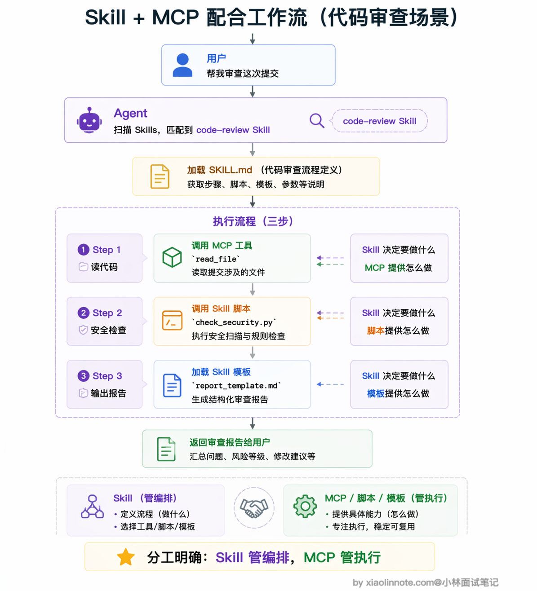

再看一个稍复杂的场景，你就能感觉到这种分工的威力。假设 Skill 定义的流程里有一步「如果改动涉及数据库表结构，额外执行权限合规检查」，这就是条件分支。

Agent 读到这条指令时，会先调用一个 MCP Tool 去扫描这次提交有没有改数据库 schema，拿到结果（布尔值）之后再决定要不要走那条分支；如果要走，就再调另一个 MCP Tool（比如 `query_permission_policy`）去查合规规则，最后根据结果决定审查报告里是否要加一条严重级警告。

整个过程里，Skill 就像项目经理，拿着流程图和判断标准指挥执行；MCP 提供的每个 Tool 就像专业工人，各自只管做好一件小事。

缺了 Skill，Agent 拿着一堆工具不知道该什么时候用；缺了 MCP，Skill 再详细的流程也只是纸上谈兵。

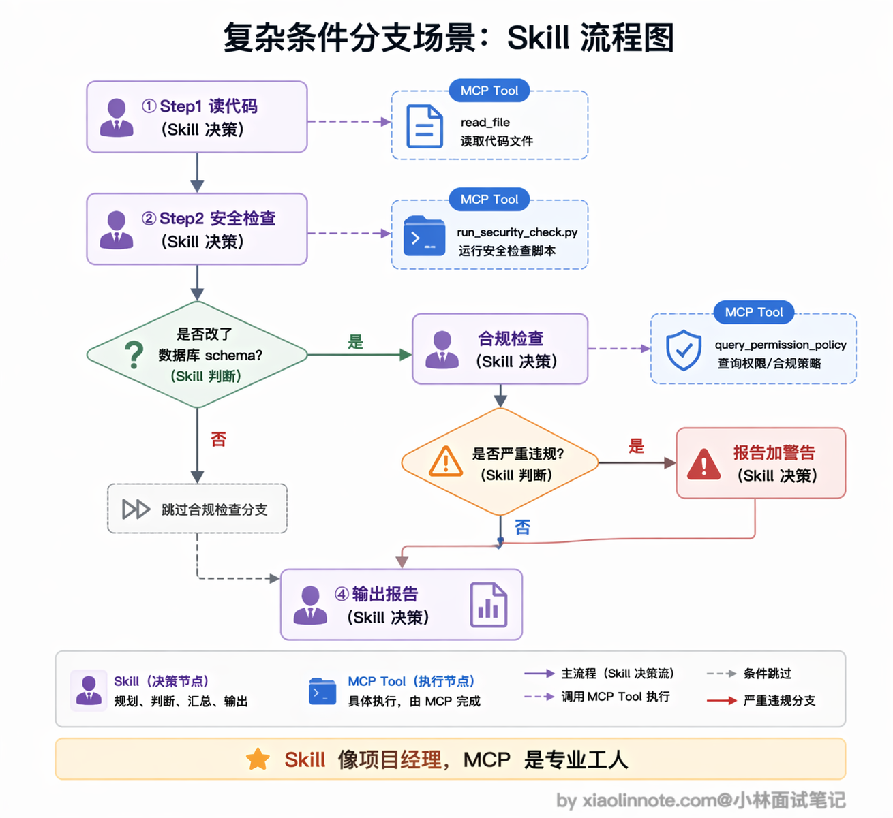

## 🎯 面试总结

最大的误区就是把 MCP 和 Skill 当成同类概念来对比。

- **两者的定位差异**：MCP 提供工具和数据的访问能力，解决的是「Agent 怎么做事」；Skill 提供完成任务的知识和流程，解决的是「Agent 该怎么做事」。一个是能力，一个是知识。
- **粒度差异**。MCP 的粒度是原子操作，每次调用做一件明确的事，schema 对模型完全可见；Skill 的粒度是工作流程，定义的是完成某类任务的完整步骤和标准，还可以附带脚本、模板等资源，通过渐进式加载按需使用。
- **两者的配合方式**。Skill 编排流程，MCP 提供工具，Skill 指令里经常会调用 MCP 的工具来完成具体操作。如果能用代码审查这样的完整场景把两者的配合串起来，面试官能看出你不只是背了概念，而是真正理解了它们在系统里怎么协作的。

# 11. Function Calling、Skill、MCP 这三个有什么区别？

## 💡 简要回答

Function Calling 是最底层的调用协议，解决的是「模型怎么调函数」，模型输出结构化 JSON 告诉程序该调哪个函数、传什么参数。

MCP 在 Function Calling 之上做工具标准化，解决的是「工具怎么暴露给模型」，把数据库、API 这些外部能力封装成标准化服务，一次实现到处复用。

Agent Skill 在最上层做知识和流程的封装，解决的是「拿到工具之后按什么流程完成任务」，把执行步骤、标准、脚本、模板打包成可复用模块。

简单记就是：Function Calling 是语言，MCP 是工具箱，Skill 是操作手册。

## 📝 详细解析

### 11.1 从「谁和谁通信」来看三者位置

**Function Calling** 发生在**模型和函数**之间，是单次调用的格式规范。模型生成 `tool_calls` JSON 告诉宿主程序「调这个函数、参数是这个」，宿主程序执行完把结果以 tool 消息形式喂回去。这一切发生在单个 Agent 内部，是**最底层的「调用语言」**，整个系统靠这个让模型触发实际动作。

 **MCP**发生在 AI **客户端（MCP Client）和工具服务（MCP Server）**之间，是**工具的标准化封装协议**。Client 连上 Server 后自动发现工具列表，把工具定义转换成 Function Calling 格式喂给模型。所以 MCP 本质上是对 Function Calling 的封装和管理，它让工具从「应用内的代码片段」变成「独立的标准化服务」，一次实现到处复用。

**Skill**发生在 **Agent 和知识模块**之间。Agent 启动的时候会扫描可用的 Skill 列表，当用户提了一个任务，Agent 自己判断哪个 Skill 和这个任务相关，主动去加载 `SKILL.md` 里的执行指令、脚本和模板。Skill 的粒度比 MCP 工具粗得多，「代码审查」是一个 Skill，「数据分析报告」是一个 Skill，每个 Skill 内部可能涉及好几个步骤、调用好几个 MCP 工具。

### 11.2 三者的层级依赖关系

为什么 Function Calling 在最底层？因为它是模型触发工具调用的「语言」，没有这套语言，模型就没办法告诉外部「我要调哪个函数、传什么参数」，一切上层能力都无从谈起。

MCP 为什么在它之上？因为 MCP 做的是工具管理和标准化封装，但归根到底，MCP Server 暴露的工具最终还是要通过 Function Calling 的格式传给模型、让模型来触发，所以 MCP 天然依赖 Function Calling。

那 Skill 为什么在最上面？因为 Skill 定义的是使用工具完成任务的流程和标准，Agent 按照 Skill 里的指令去执行，每一步需要调工具的时候，还是得靠 MCP 发现工具、靠 Function Calling 触发调用。

所以完整的链条是：**Skill（定义流程）-> MCP（提供工具）-> Function Calling（模型触发调用）**，从上到下三层，每一层都建立在下一层的基础之上，各司其职。

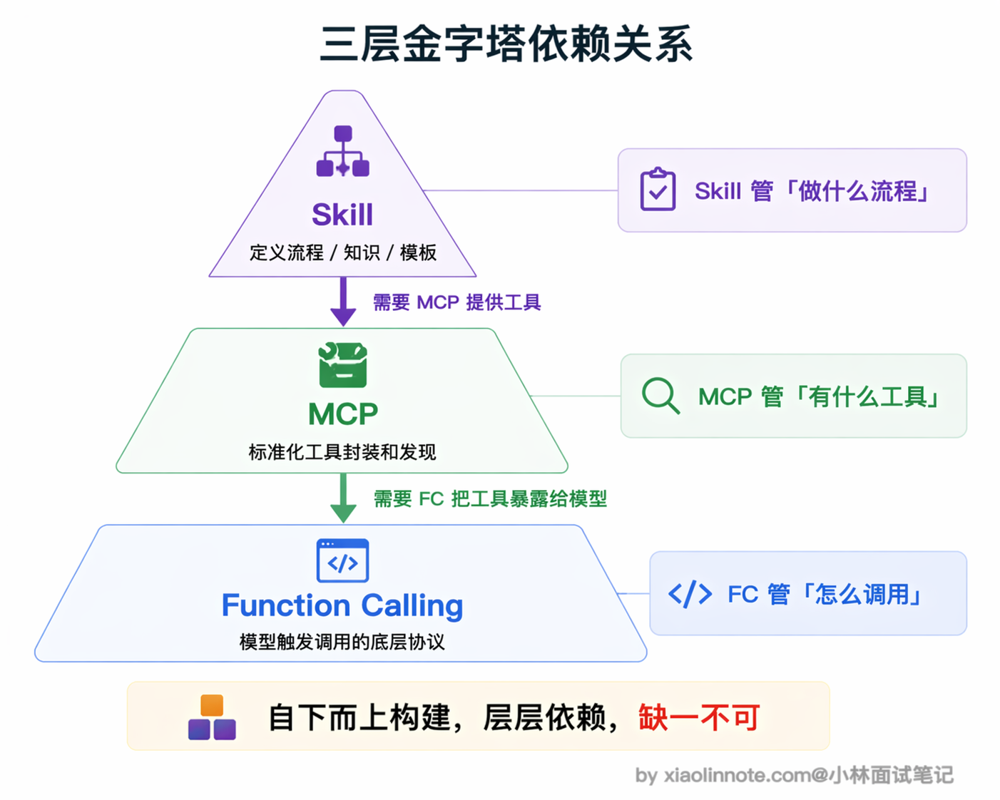

Function Calling 是你的「手」，能拿刀、能点火、能翻锅，这是最基础的操作能力。MCP 是你的「厨房」，里面有各种厨具和食材，刀在抽屉里、调料在架子上、食材在冰箱里，你走进厨房就知道有哪些东西可以用。Skill 是那份「菜谱」，告诉你先热锅凉油、再放姜蒜爆香、然后下主料翻炒、最后调味出锅。

没有手（Function Calling），你站在厨房里、拿着菜谱，什么都做不了，因为你连刀都拿不起来；没有厨房（MCP），就算你有手、有菜谱，家里什么厨具都没有，也只能空着两只手对着菜谱发呆；没有菜谱（Skill），你有手、也有满厨房的厨具，但面对一桌食材不知道该先切什么、后炒什么，只能瞎折腾。三者缺一不可，各管各的层次。

### 11.3 用一个完整故事串联三者

用户对 Agent 说「帮我分析最近三个月的销售数据，找出下滑的产品线，给改进建议」。

**Skill 层**。Agent 收到任务后，扫描自己可用的 Skill 列表，发现有一个叫「数据分析报告」的 Skill 和这个任务高度匹配。于是 Agent 加载这个 Skill 的 `SKILL.md` 正文，读取里面定义的分析流程：第一步从数据库取数据，第二步用 Python 做趋势分析，第三步按模板写分析报告。Skill 就像一份菜谱，把整个任务的步骤和标准安排得明明白白。

**MCP 层**。执行第一步「从数据库取数据」的时候，Agent 的 MCP Client 已经连着数据库 MCP Server 和 Python 执行器 MCP Server，自动知道有 `query_database` 和 `run_python` 这些工具可用。MCP 就像厨房，里面的厨具和食材随时可以取用，不需要任何手动配置。

 **Function Calling** 。模型判断需要查数据库，输出 `tool_calls: query_database(sql="SELECT product, revenue FROM sales WHERE date >= '2026-01-01'")`，MCP Client 把这个请求路由到数据库 Server 执行，拿到结果后模型继续处理。接着模型输出调用 Python 执行器的 Function Calling，对数据做趋势分析。最后 Agent 按 Skill 定义的报告模板把结果整理成结构化的分析报告返回给用户

整个流程里 Skill 做流程编排、MCP 做工具管理、Function Calling 做模型和工具的通信，三层分工明确，缺哪层都不完整。

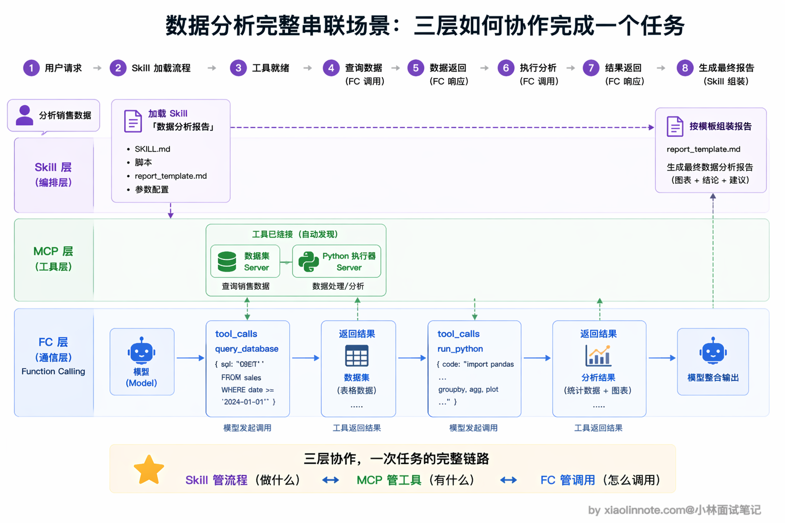

## 🎯 面试总结

最大的误区就是把 Function Calling、MCP、Skill 当成三个平行的竞争方案。面试回答这道题，

- **三者的层级关系**：Function Calling 是最底层的调用协议，解决的是「模型怎么触发函数调用」；MCP 在 Function Calling 之上，解决的是「工具怎么标准化封装和发现」；Skill 在最上层，解决的是「拿到工具后按什么流程完成任务」。三层从下到上，各司其职。
- 用类比帮面试官快速理解。Function Calling 是「语言」，让模型能说出要调什么函数；MCP 是「工具箱」，把工具标准化打包，随时插拔；Skill 是「操作手册」，教 Agent 用工具箱里的工具按什么流程完成工作。

- 用一个完整场景**把三层串起来**就更好了：Agent 按 Skill 定义的流程分步执行，每一步需要调工具时通过 MCP 发现可用工具，模型通过 Function Calling 触发具体的工具调用。这样面试官能看出你不只是背了概念，而是真正理解了三者在系统里怎么协作的。


# 12. 什么是 A2A 协议？它和 MCP 协议的区别是什么？

## 💡 简要回答

A2A 是 Google 发布的开放协议，专门解决多个 AI Agent 之间怎么互相通信协作的问题。

我理解它和 MCP 的区别是这样的：MCP 解决的是「单个 Agent 怎么连工具和数据」，A2A 解决的是「多个 Agent 之间怎么分工协作」。

一个 Agent 通过 A2A 可以把子任务委托给另一个专业 Agent，接收方按自己的 Skill 声明承接，支持异步长任务和流式推送结果。

两者是互补的，不冲突：MCP 向下连工具，A2A 向上连 Agent，在复杂的多 Agent 系统里这两个通常都要用到。

## 📝 详细解析

### 12.1 为什么单个 Agent 不够用，上下文和专业边界

一个 Agent 的本质是：一个 LLM + 一组工具 + 一段上下文窗口。这三个维度都有自己的天花板。

- **工具数量的限制**，你不可能给一个 Agent 装 100 个工具，模型处理起来效率极低，容易混乱。
- **上下文窗口的限制**，128K tokens 听起来很多，但复杂任务积累的中间产物，搜索结果、草稿、反思记录，会很快把窗口塞满，后面的生成根本顾不上前面写了什么。
- **专业能力的限制**，同一个 Agent 既做代码审查又做市场分析，不如专门为各自任务配置或微调的 Agent 效果好。

### 12.2 多 Agent 的基础问题，Agent 之间怎么互相认识？

多 Agent 系统有一个绕不开的基础问题：Agent A 要把任务委托给 Agent B，它得先知道 B 能做什么。但怎么知道呢？

让 B 主动「发名片」，声明自己能做什么，A 来查。这就是 A2A 里 **Agent Card** 的设计思路。

每个 A2A Agent 都在一个约定位置发布一张 JSON 格式的名片（A2A 规范推荐的路径是 `/.well-known/agent-card.json`，早期版本叫 `agent.json`，两种路径在社区里都能看到），里面写清楚自己叫什么、能做哪类任务（Skill 列表）、支不支持流式返回、支不支持异步回调（push notification，任务完成后主动通知调用方）。任何想和它协作的 Agent，先去拿这张名片，再决定要不要把任务委托给它。

Agent Card 里最关键的是 **Skill 列表**，每个 Skill 描述一类能力，比如「竞品分析」「行业趋势分析」，并带有示例输入。调度 Agent 用这些 Skill 描述来做任务路由决策，「这个任务和哪个 Agent 的哪个 Skill 最匹配？」。

这套机制让整个多 Agent 系统变得可插拔：新加一个 Agent，发布它的 Agent Card，调度 Agent 就能自动发现和利用它，完全不需要改调度 Agent 的代码。

### 12.3 Task，A2A 里的一等公民

A2A 里任务协作的基本单位是 **Task**。

调度 Agent 把一段任务委托给另一个 Agent，就是创建一个 Task；接收方执行这个 Task；完成后把结果作为 Task 的产出（artifacts，可以是文本、文件等）返回。

Task 有完整的生命周期状态管理。一个 Task 刚被创建时是 submitted 状态，表示已提交、等待处理。接收方开始执行后变为 working 状态，最终根据执行结果进入 completed（成功）或 failed（失败）状态。

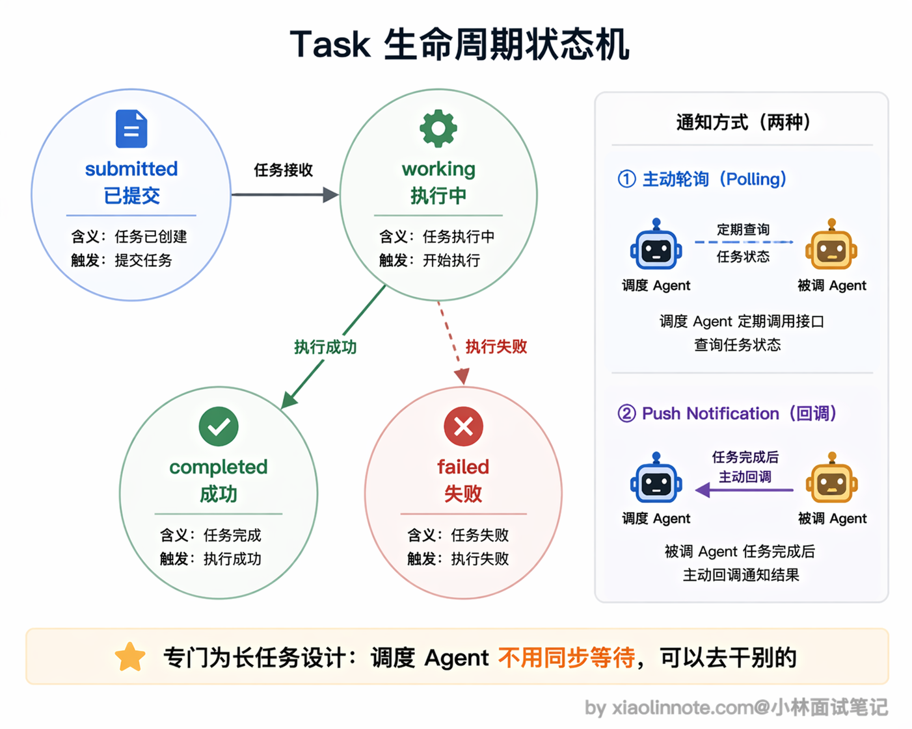

为什么需要这么完整的状态机？因为 A2A 专门为**长时间任务**设计。

一个「竞品分析」任务可能要跑几分钟，先搜索、再整理、再写报告，不可能让调度 Agent 同步等着。

所以调度 Agent 提交任务后可以去处理其他事情，通过轮询状态或者 push notification（任务完成时接收方主动回调通知）来得知任务完成了。这套状态管理机制，正是为了支持这种异步长任务协作的。

调度 Agent 的视角很干净：给 Agent B 提交一个 Task，定期查一下状态，等到 `completed` 了去取 artifacts。整个过程不需要知道 B 内部用了什么工具、调了几次 LLM，完全黑盒。每个专业 Agent 自己的实现对外不可见，这正是解耦的意义所在。

### 12.4 A2A 的架构本质，Agent 的微服务化

在微服务架构里，每个服务是独立部署的 HTTP 服务，有自己的 API 文档，服务之间通过 HTTP 互相调用，支持异步消息队列处理耗时任务。A2A 的设计几乎照搬了这套思路，只不过把「服务」换成了「Agent」。

怎么理解这个对应关系呢？Agent Card 就像 API 文档，告诉别人「我能做什么、怎么调用我」。Task 状态机就像异步消息队列，支持提交任务后去做别的事、完成了再来取结果。而 `.well-known` 下的 Agent Card 就像微服务注册中心里的一条记录，让其他 Agent 能自动发现你。

所以每个 A2A Agent 对外其实就是一个 HTTP 服务，任何支持 A2A 的系统都可以发现它、向它发任务、接收结果，不绑定特定的 AI 框架，也不依赖特定的编程语言。这个设计理念和 MCP 是一脉相承的：MCP 让工具成为独立标准化服务，A2A 让 Agent 成为独立标准化服务。

### 12.5 A2A 和 MCP 的关系，一纵一横，各管一层

理清两者关系最简单的方式是看方向：MCP 是 Agent 向下连工具，A2A 是 Agent 向外连其他 Agent。

具体来说，一个专业 Agent 内部，用 MCP 连各种工具，比如数据库、浏览器、代码执行器，用 Function Calling 让 LLM 触发这些工具调用，这是「纵向」的连接。而多个 Agent 之间需要分工协作的时候，就用 A2A 来互相通信、委派任务、接收结果，这是「横向」的连接。两个协议解决的是完全不同维度的问题，不存在谁替代谁。

打个比方，MCP 就像公司里每个员工的「工具箱」，决定了这个人能用什么工具干活。A2A 就像公司里的「协作流程」，决定了不同岗位的人怎么分工、怎么交接任务。工具箱和协作流程是两回事，缺了哪个都不行。

在一个复杂的多 Agent 系统里，这两者通常同时在用：MCP 负责每个 Agent 和工具之间的纵向连接，A2A 负责 Agent 之间的横向协作通信。两层协议各管一个维度，合在一起才能支撑起真正复杂的 Agent 系统。

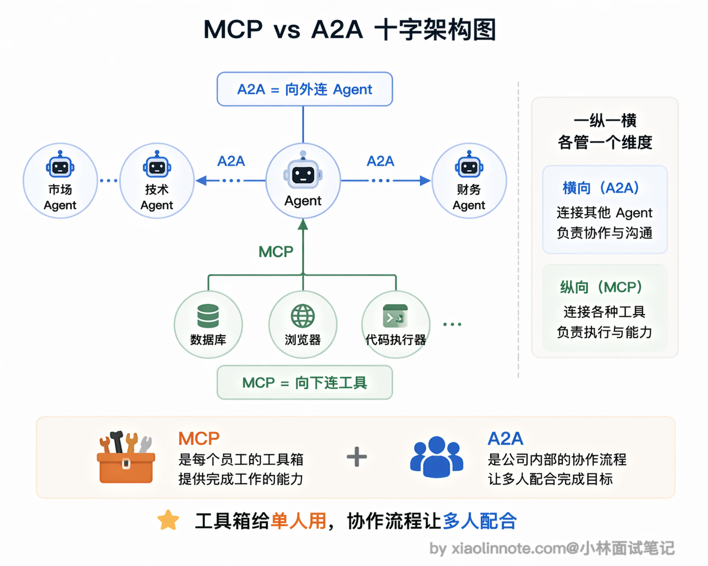

## 🎯 面试总结

最大的雷是把 A2A 当成 MCP 的「竞品」或「替代方案」，这说明没搞清楚两者面向的对象完全不同。面试回答这道题，

- **定位差异**：MCP 是 Agent 向下连工具和数据源，A2A 是多个 Agent 之间向外互相通信协作，一纵一横，各管一层。
-  **A2A 的核心机制**：Agent Card 实现能力声明和自动发现，Task 状态机支持异步长任务协作，本质上就是 Agent 世界的微服务架构。

- 「**为什么需要 A2A**」，也就是单 Agent 的天花板问题：工具数量有限、上下文窗口有限、专业能力有限，复杂任务需要拆分给不同的专业 Agent 并行处理。

- **两者是互补关系**而非竞争关系，在复杂的多 Agent 系统里通常同时在用，缺一不可。

# 13. MCP 协议通常采用什么通信方式？

## 💡 简要回答

本地场景用 stdio，Client 把 Server 作为子进程启动，通过标准输入输出通信，延迟极低，不用开端口，也没有网络安全问题，我用 Claude Desktop 接本地工具走的就是这种方式。

远程场景现在推荐用 Streamable HTTP，Server 作为独立的 HTTP 服务部署，多个 Client 可以共享同一个 Server，适合团队统一管理工具服务。

MCP 早期版本（2024-11-05 规范）的远程传输是「HTTP + SSE」双端点方案，2025 年 3 月的规范更新里被标记为 deprecated（保留向后兼容但不推荐新项目使用），Streamable HTTP 成为了推荐的远程传输方式。

不管哪种传输方式，底层消息格式都统一用 JSON-RPC 2.0，传输方式只影响「怎么传」，消息协议本身不变。

## 📝 详细解析

### 13.1 MCP 的消息格式：JSON-RPC 2.0

在说传输方式之前，先说消息格式，因为不管用哪种传输方式，消息格式都是同一套。

那为什么 MCP 选了 JSON-RPC 2.0 呢？

原因：MCP 需要一种「Client 调用 Server 的方法，Server 返回结果」的通信模式，这本质上就是远程过程调用（RPC）。

而 JSON-RPC 2.0 是现成的、足够轻量的 RPC 规范，用 JSON 格式易读易调试，任何编程语言都能实现，不管 Server 是 Python 写的还是 TypeScript 写的，消息格式都一样，不需要额外的序列化工具。

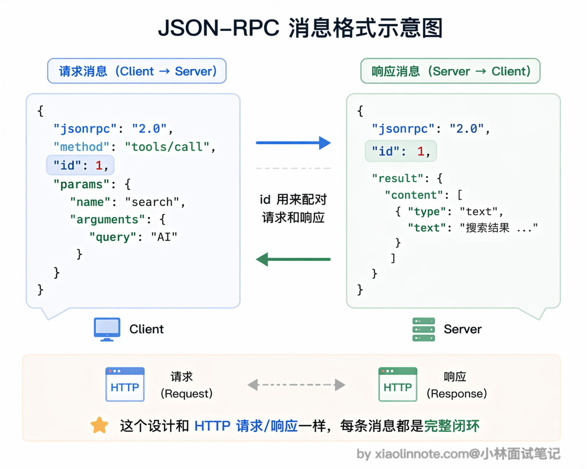

每条消息就是一个 JSON 对象，格式固定：

```json
// 请求消息（Client -> Server）
{
  "jsonrpc": "2.0",
  "id": 1,                        // 请求 ID，用于匹配响应
  "method": "tools/call",         // 调用的方法名
  "params": {
    "name": "take_screenshot",    // 工具名
    "arguments": {"url": "https://example.com"}
  }
}

// 响应消息（Server -> Client）
{
  "jsonrpc": "2.0",
  "id": 1,                        // 对应请求的 ID
  "result": {
    "content": [{"type": "image", "data": "...base64..."}]
  }
}
```

JSON-RPC 本身只定义消息格式，不关心底层怎么传输，MCP 在此基础上定义了两种传输层实现。

### 13.2 传输方式一：stdio（标准输入输出）

工作原理：MCP Client 在启动时，把 MCP Server 当作一个**子进程**启动，然后通过进程的标准输入（stdin）发送请求、从标准输出（stdout）读取响应。两个进程在同一台机器上运行，通过操作系统的管道通信。

这里的「管道」到底是什么？

你可以把它理解成操作系统在内存里给这两个进程分配的一段先进先出的小缓冲区：Client 往里塞一行 JSON，Server 从缓冲区的另一头读出来处理；Server 处理完再往另一条管道里塞一行 JSON，Client 从那头读。

整个过程不经过网卡、不经过 TCP/IP 协议栈，数据在 RAM 里走了一趟就到了，所以延迟天然比网络请求低得多，也不需要序列化成网络可传输的字节流。

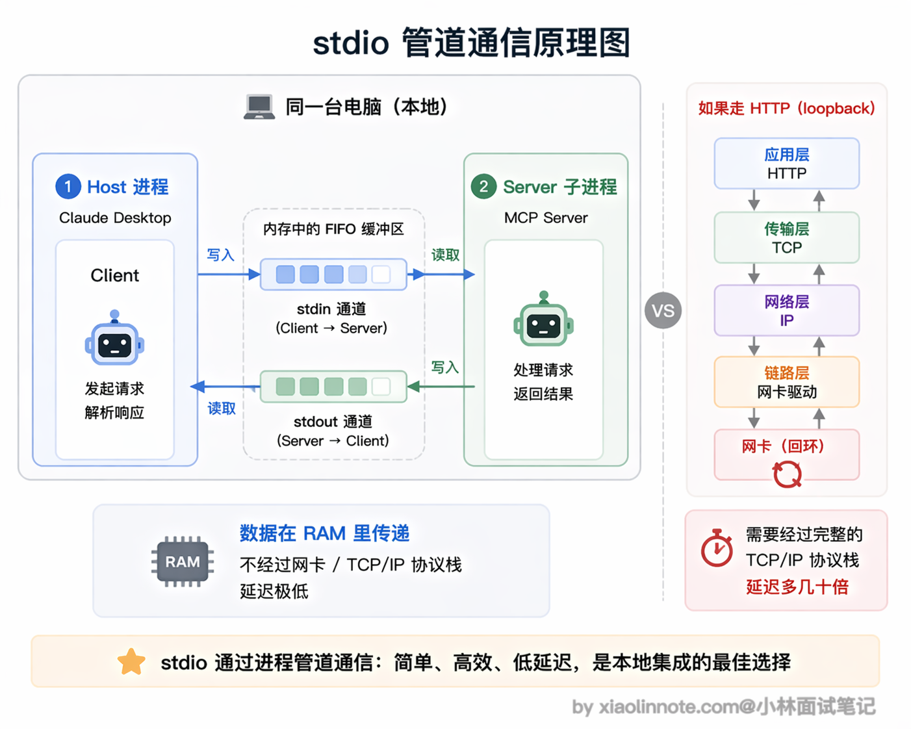

stdio 方式有几个很明显的优点。

- 延迟极低，进程间通信比走网络快得多，数据直接在操作系统管道里流转，几乎没有开销。
- 不需要开端口，也就没有网络安全问题，不用担心外部访问。另外 Server 的生命周期是自动管理的，随 Client 启动而启动、随 Client 关闭而关闭，不需要你手动去管进程。

在实际使用中，你只需要在配置文件里告诉 Client「用什么命令启动 Server」就行了，比如在 Claude Desktop 的 `claude_desktop_config.json` 里这样配置：

```json
{
  "mcpServers": {
    "filesystem": {
      "command": "npx",               // 启动命令
      "args": ["-y", "@modelcontextprotocol/server-filesystem", "/tmp"],
      "env": {}                       // 环境变量（可选）
    }
  }
}
```

### 13.3 传输方式二：Streamable HTTP（当前标准的远程传输）

远程场景下，Server 作为独立的 HTTP 服务运行，Client 通过网络连接访问。MCP 当前推荐的远程传输方式是 **Streamable HTTP**。

Streamable HTTP 的核心设计是用单个 HTTP 端点（通常是 `/mcp`）同时处理请求和响应。Client 通过 POST 请求发送 JSON-RPC 消息，Server 可以选择两种方式返回：如果是简单的同步操作，直接返回一个普通的 JSON 响应就行；如果是需要流式输出的操作，Server 返回一个 SSE 流，持续推送数据。这种「按需选择」的设计非常灵活，不需要强制建立长连接。

Streamable HTTP 的优点很明确。Server 可以部署在云端，多个 Client 共享同一个 Server，这对团队来说特别实用，比如团队共用一个部署在服务器上的数据库 MCP Server，所有人连同一个服务就行，不需要各自在本地跑一份。而且支持跨机器访问，不局限于本地环境，适合需要统一管理工具服务的团队或平台。

当然，相比 stdio 多了网络开销，延迟会略高一些，而且你还需要处理认证、网络中断重连等在本地场景下完全不用操心的问题。

### 13.4 为什么 SSE 被弃用了

HTTP + SSE 双端点方案是 MCP 早期版本（2024-11-05 规范）采用的远程传输方案，**在 2025 年 3 月的规范更新里被标记为 deprecated**，仍然保留向后兼容，但新项目应该直接用 Streamable HTTP。

为什么要替换？原因是架构上有一个小尴尬：Client 向 Server 发请求要走 POST 端点，Server 向 Client 推数据要走另一条 SSE 长连接端点，同一个对话被拆成了两条通道。这带来的具体问题是状态管理复杂，比如 Client POST 了一条消息之后网络突然断了，那条消息到底被处理了没、SSE 流会不会推回结果，Client 没有一个简单的办法判断，出问题时排查链路很长。

Streamable HTTP 的做法是把这两条通道合并成一个端点：Client 照样 POST 发请求，Server 根据情况决定返回「一个普通 JSON」还是「一条 SSE 流」，不需要 Client 提前开另一条连接。

注意这里的关键：Streamable HTTP 并没有抛弃 SSE，流式推送的部分底层还是 SSE（`Content-Type: text/event-stream`），只是把端点从两个合成一个。架构更简洁、对负载均衡和 serverless 环境都更友好。目前主流的 MCP 客户端和 SDK 都已经迁移到了 Streamable HTTP。

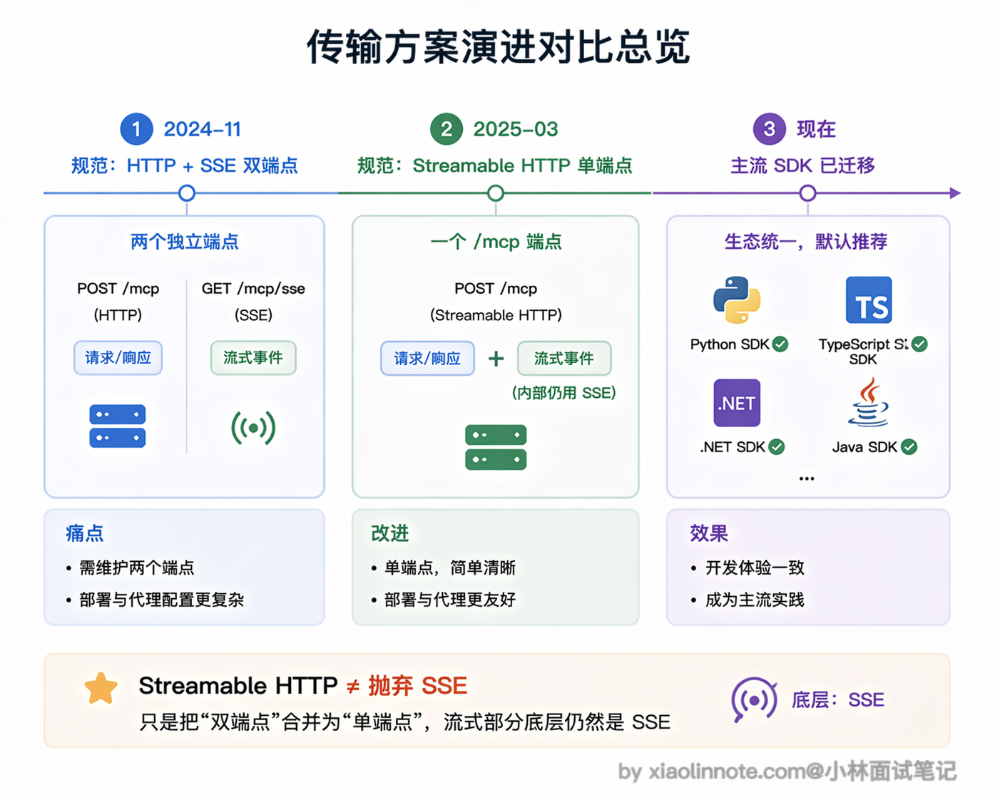

## 🎯 面试总结

最常见的误区就是想当然地以为 MCP 用 WebSocket 或者 HTTP REST 接口。

面试回答这道题，

-  **MCP 支持两种传输方式**：本地场景用 stdio（标准输入输出，Server 作为子进程运行，通过管道通信），远程场景用 Streamable HTTP（Server 作为 HTTP 服务部署，单个端点同时处理请求和响应）。stdio 不走网络、延迟极低、生命周期自动管理；Streamable HTTP 支持多 Client 共享一个 Server，适合团队统一部署。
- **消息格式和传输方式的解耦**。不管用 stdio 还是 Streamable HTTP，底层消息格式都统一用 JSON-RPC 2.0，切换传输方式不影响上层调用逻辑。这个解耦设计说明你理解了 MCP 的分层架构，而不是把「消息格式」和「传输方式」混为一谈。
- **传输方案的演进历史**：MCP 早期（2024-11-05 规范）的远程传输是「HTTP + SSE」双端点方案，因为两条通道状态管理复杂，2025 年 3 月的规范更新里被 Streamable HTTP 取代（单端点，内部流式仍然走 SSE）。能把 SSE 和 Streamable HTTP 的区别说清楚是这题的关键，历史背景是加分项。

# 14. 说说 WebSocket 和 SSE 通信的区别及局限性？

## 💡 简要回答

我觉得最核心的区别是通信方向：**SSE 是服务端单向推，客户端只能接收，想发消息只能另起一个 HTTP 请求；WebSocket 是全双工，双方都可以随时主动发消息。**

对于 LLM 流式输出这种「模型一直在推 token、用户只是看」的场景，SSE 完全够用，而且轻量、HTTP 原生支持、运维简单，OpenAI 和 Anthropic 的 API 用的都是 SSE。

WebSocket 的复杂性只有在真正需要双向实时交互的时候才值得引入，比如用户要在模型说话过程中随时打断。

两者各有局限：SSE 在 HTTP/1.1 下有连接数上限，只支持文本传输；WebSocket 有状态、横向扩展麻烦，还容易被企业代理或防火墙拦掉。大多数 LLM 文字对话产品用 SSE 就够了。

## 📝 详细解析

### 14.1 先从 HTTP 的本质说起

标准的 HTTP 请求是「一问一答」模型：客户端发请求，服务端返回响应，连接关闭（或者进连接池等待下次复用）。

服务端在任何时候都不能主动「推」数据给客户端，它只能被动等客户端来问。你可以把它想象成打电话：你说一句「你好」，对方回一句「你好」，然后挂电话，这条线就断了。这套机制在传统 Web 里够用，但 AI 对话场景不行。

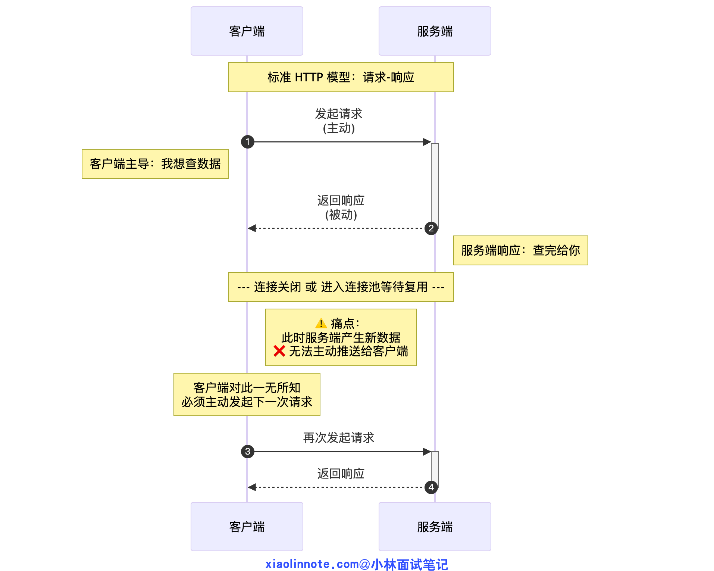

模型生成一个完整回答需要几秒甚至十几秒，如果等全部生成完再一次性返回，用户只能干瞪着空白屏幕等待，体验极差。我们需要的效果是：模型生成一个词就推一个词，用户实时看到文字逐渐出现，就像 ChatGPT 那样一个字一个字「打」出来。这就需要连接保持打开、服务端能主动持续往外推数据，HTTP 的「问一答一然后断」做不到这件事。

### 14.2 SSE：用普通 HTTP「撑开」一条单向水管

SSE（Server-Sent Events，服务器推送事件）本质上是对 HTTP 的一种「巧用」，不是新协议，而是 HTTP/1.1 里本来就有的特性，只不过以前很少用。

它的做法是：客户端发一个普通 HTTP GET 请求，但在请求头里声明 `Accept: text/event-stream`，告诉服务端「我想收流式数据」。服务端收到后，不关闭连接，而是保持连接持续打开，不停往里写数据。

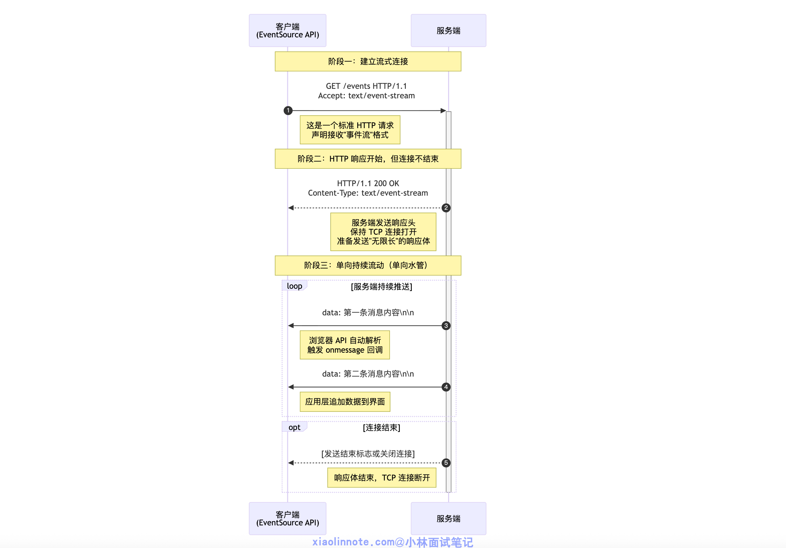

这条连接在技术上仍然是一个 HTTP 响应，只不过响应体是「无限长」的，服务端在不断往里追加内容，直到模型生成完毕才发送结束标志。可以把它理解为「一根从服务端流向客户端的单向水管」，水（数据）只能从服务端流向客户端，客户端没法往管子里倒水。

SSE 的数据不是 JSON，而是一种非常简单的纯文本格式，每条消息以 `data:` 开头，后面跟数据内容，结尾是两个换行符。

如果你现在打开 ChatGPT，按 F12 打开开发者工具，切到 Network 面板，找到流式响应请求，就能看到一行一行类似 `data: {"token": "你"}` 这样的文本在不断追加进来，每出现一行浏览器就触发一次事件。

浏览器专门有一个叫 `EventSource` 的内置 API 来处理这种格式，你只需要打开这个连接，注册一个 `onmessage` 回调函数，每收到一条消息就自动触发，完全不用自己解析底层数据流，用起来非常方便。

SSE 之所以成为 LLM 流式输出的行业标准，还有一个很关键但容易被忽视的原因：文字传输天然适合 TCP 的可靠有序传输。模型输出是一个个 token 组成的连续文本，如果中间某个 token 丢了，整段话的意思可能完全变了，顺序乱了更是无法阅读。

所以你希望每个 token 都准确到达、不乱序，这恰恰是 TCP 的强项。你愿意等网络重传，因为等来的是正确的内容。这和语音场景（WebRTC）完全相反，那里 TCP 的重传机制会造成不可接受的延迟，所以语音要换 UDP；但文字场景里 TCP 反而是你的朋友，你需要它。

### 14.3 WebSocket：从 HTTP 升级成真正的双向信道

理解了 SSE 是怎么回事，WebSocket 就很好对比了。WebSocket 是一个独立的协议，建立在 TCP 之上，但不是 HTTP 的特性。它的建立过程有一个特殊的「握手仪式」：客户端先发一个看起来像普通 HTTP 请求的东西，但请求头里带了一句话「我想升级成 WebSocket」。

服务端如果同意，回一个 `101 Switching Protocols` 的响应，从这一刻起，这条 TCP 连接就「变性」了，不再遵循 HTTP 的一问一答规则，变成了一条双方都可以随时说话的全双工信道。你可以把这个转变想象成：原来是对讲机（你说完按按钮让对方说），升级成了电话（双方都可以随时开口，谁都不用等谁）。

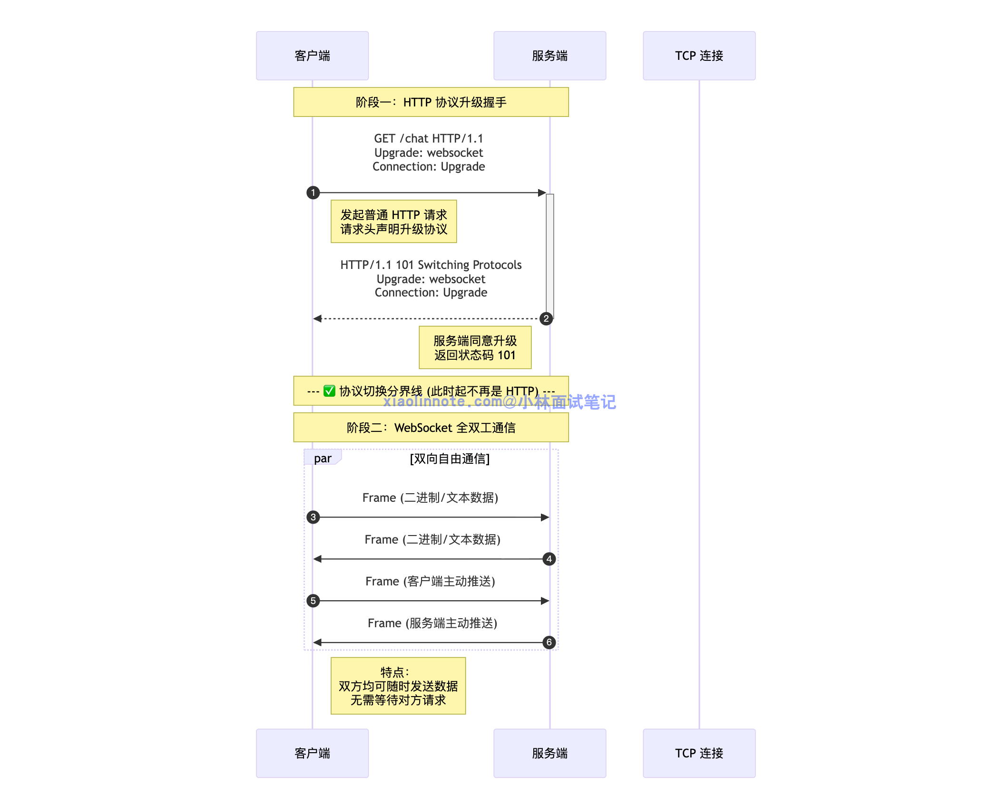

和 SSE 最本质的区别是通信方向。SSE 只有服务端能主动推，客户端想发消息必须另起一个 HTTP 请求，两个方向用了两套机制；WebSocket 是真正的双向，客户端和服务端都可以随时主动发消息，对方立刻就能收到，没有任何「谁先说话」的限制，一条连接搞定两个方向。

用「用户要在模型说话中途打断」这个场景来感受两者的差别：用 SSE 时，用户想打断，只能先关掉当前 SSE 流（第一个请求结束），再发一个新的 POST 请求（第二个请求开始），这两个动作之间有一个明显的断-重连过程，操作上有割裂感；用 WebSocket 时，用户直接在同一条连接里发送「停止」指令，服务端立刻收到，立刻停止生成，整个过程流畅、无缝，真正的实时双向交互。

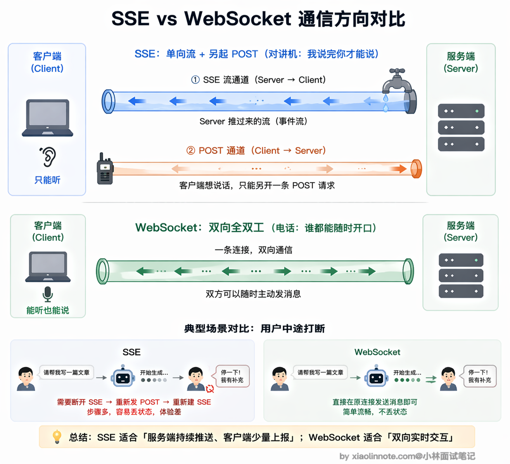

### 14.4 SSE 的局限：不只是「单向」那么简单

SSE 的单向性带来的第一个麻烦，是架构上的「双通道尴尬」。

SSE 只能从服务端推向客户端，用户发消息必须走一个独立的 POST 请求，这意味着同一个对话用了两条通道，用户发消息走 POST，模型回复走 SSE，两者之间要靠一个 conversation ID 关联起来。

服务端收到 POST 请求后，找到对应的 SSE 长连接，把模型输出推过去。对于简单场景这套机制够用，但状态管理比 WebSocket 的单一通道复杂，出问题时排查链路也更长。

第二个是 HTTP/1.1 的连接数限制。

浏览器对同一个域名的 HTTP/1.1 连接有 6 条的上限，SSE 占一条长连接，如果用户同时开了多个标签页，第 7 个标签页的 SSE 请求会被浏览器排队等待，导致某些标签页没有响应，看上去就是「页面卡死了」。HTTP/2 通过多路复用解决了这个问题，一条 TCP 连接上可以跑无数条逻辑流，所以现代部署一般要求 HTTP/2，这个问题也就消失了。但如果你的用户环境里有老浏览器或者不支持 HTTP/2 的代理，这就是一个真实的坑。

第三个是 SSE 只能传文本。

传语音或者图片时，必须先做 Base64 编码才能用 SSE 传输，数据量会膨胀约 33%，接收端还要额外解码，延迟和 CPU 开销都不小。实时语音场景下这个代价完全不可接受，所以实时语音要用 WebRTC 而不是 SSE。

还有一个实现细节是断线重连。SSE 有内置的重连机制，断线后会自动尝试重连，这是优点。但要做到「断了接着上次继续」而不丢消息，服务端必须支持 `Last-Event-ID`，客户端重连时带上上次收到的最后一条消息 ID，服务端从那条之后重放。很多实现省略了这块，结果断线后用户会丢失中间的内容，重连看到的是截断的回答。

### 14.5 WebSocket 的局限：有状态带来的扩展麻烦

每条 WebSocket 连接在建立时被负载均衡器路由到某一台后端服务器，之后这个用户的所有消息都必须发到同一台服务器，因为连接状态就保存在那里。

当你想横向扩容、加新的机器时，新机器接不到老连接，老连接的用户无法迁移到新机器，扩容的效果大打折扣。

常见的解决办法是把连接状态外移到 Redis 等共享存储，通过发布订阅机制把消息中转到正确的服务器，但这让架构明显变复杂，多了一跳，延迟也增加了。

相比之下，SSE 的每次请求都是普通 HTTP，负载均衡器可以把任意请求路由到任意后端，横向扩展非常简单，这是 SSE 在大规模部署场景的一个明显优势。

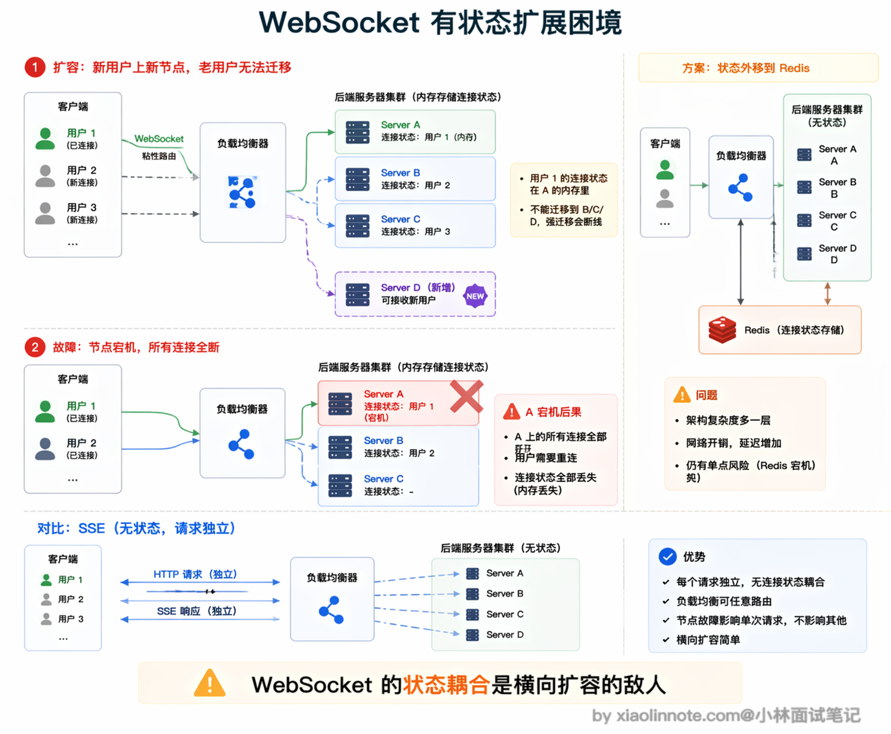

第二个实际部署中频繁踩的坑是代理和防火墙穿透。

很多企业的 HTTP 代理（比如 Squid）、老版本 CDN、某些安全网关不支持 WebSocket 的 `Upgrade` 握手，直接把这个请求当成异常 HTTP 请求拒掉，导致 WebSocket 连接建立失败。

SSE 就不会有这个问题，它始终是普通 HTTP 请求，任何代理都能透传，不需要任何特殊配置。

这也是为什么早期 MCP 协议的远程传输选择了 SSE 而不是 WebSocket，MCP Server 需要在各种复杂的网络环境下都能工作，SSE 对这些环境的兼容性好得多（MCP 在 2025 年 3 月的规范更新里进一步升级到了 Streamable HTTP，本质上还是走 HTTP + SSE 流，详见 13 题）。

第三个是 WebSocket 没有内置的请求-响应配对机制。HTTP 里每个请求有自己的响应，天然一一对应。WebSocket 里消息就是消息，服务端发来一条消息，你不知道它对应哪个请求，需要自己在消息里加请求 ID，在客户端维护请求 ID 到等待回调的映射表，才能实现「发出一条消息，等待特定响应」的语义。

### 在 AI 场景下怎么选？

大原则是「单向推就用 SSE，真正需要双向才上 WebSocket」。文字对话天然是单向推：模型在说话，你在看，你想回复直接发一个新的 POST 就行，SSE 完全够。只有当你需要客户端在任意时刻主动说话，比如实时打断、多人协同编辑、游戏类实时同步，才值得引入 WebSocket 的复杂度。

| 场景                                 | 推荐方案                               | 原因                                                         |
| ------------------------------------ | -------------------------------------- | ------------------------------------------------------------ |
| LLM 流式文字输出（ChatGPT 风格）     | SSE                                    | 单向推送够用，轻量，HTTP 原生支持，运维简单                  |
| 多轮对话（用户发消息 + 模型回复）    | SSE + 普通 POST                        | 用户发消息走 POST，模型回复走 SSE，解耦简单                  |
| 需要用户中途打断模型输出             | WebSocket                              | 需要客户端在流式输出中途主动发消息                           |
| 多人协同（多用户同时编辑、实时同步） | WebSocket                              | 频繁双向消息，SSE + POST 的双通道架构太繁琐                  |
| 实时语音对话                         | WebRTC                                 | 音频流需要 UDP + 低延迟，WebSocket 的 TCP 重传是瓶颈         |
| MCP 远程 Server                      | Streamable HTTP（内部仍用 SSE 做流式） | MCP 2025-03-26 规范从早期的 HTTP+SSE 双端点升级为单端点的 Streamable HTTP，保留了代理穿透友好的特性 |

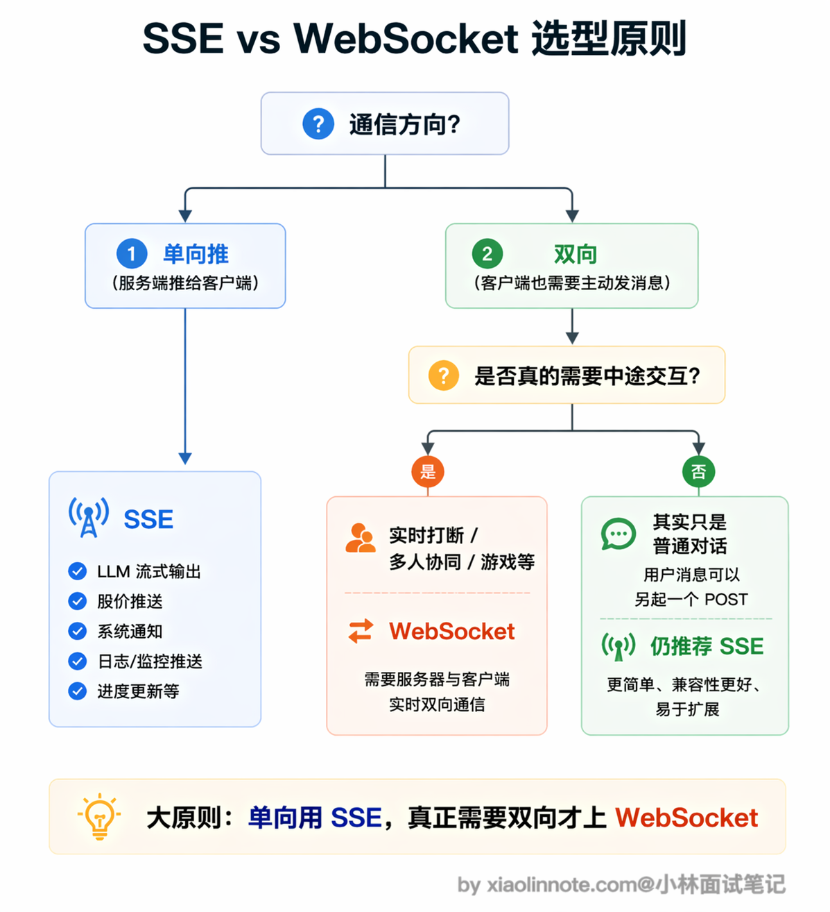

## 🎯 面试总结

最大的误区是觉得「WebSocket 功能更强大所以更好」，或者把 SSE 当成 WebSocket 的简化版。

面试回答这道题，

**通信方向**的区别：SSE 是服务端单向推送，客户端想发消息要另起 HTTP 请求；WebSocket 是全双工，双方都可以随时主动发消息。这是两者最本质的差异，不是「简单 vs 复杂」的关系。

**各自的局限性**，这往往是面试官追问的重点。

SSE 的三个坑要记住：HTTP/1.1 下同域名连接数上限（6 条）、只支持文本格式（传二进制要 Base64 编码膨胀 33%）、单向性导致的双通道架构复杂度。

WebSocket 的三个坑也要说到：有状态导致横向扩展麻烦（需要 Redis 等共享存储做连接状态外移）、容易被企业代理和防火墙拦截（Upgrade 握手被当异常请求拒掉）、没有内置的请求-响应配对机制（需要自己维护请求 ID 映射）。

**选型原则**：单向推用 SSE，真正需要双向才上 WebSocket。LLM 文字对话场景绝大多数用 SSE 就够了，这也是 OpenAI 和 Anthropic 的选择。能说出这个判断依据，比单纯罗列功能差异更有说服力。

# 15. 为什么要用 WebRTC 协议？它和 WebSocket（WS）在 AI 对话流中的核心差异是什么？

## 💡 简要回答

我理解核心原因是 WebSocket 基于 TCP，而 TCP 的可靠性设计在实时语音场景里反而是负担。

**语音可以容忍丢包，但绝对不容忍延迟；**一旦网络抖动丢了包，TCP 强制等重传，后续所有音频都得跟着等，延迟一堆积通话就卡。

WebRTC 走的是 UDP，丢包了不等重传，直接用插值算法填补，用一点点音质损失换来稳定的低延迟，延迟能控制在 50 到 150 毫秒。

另外 WebRTC 还内置了回声消除、噪声抑制、自适应码率这些语音处理能力，这些用 WebSocket 都得自己实现。

所以 OpenAI Realtime API 这类实时语音产品选 WebRTC，就是因为 TCP 根本撑不住语音场景的延迟要求。

## 📝 详细解析

要理解为什么语音场景需要 WebRTC，得先想清楚一个问题：传输文字和传输语音，对网络的要求本质上是不同的。

传输文字时，你希望每个字符都能准确到达，顺序不能乱，丢一个字母整段话可能就不对了。所以 TCP 的可靠有序传输对文字来说是刚需，你愿意等网络重传，因为等来的是完整正确的内容。

传输语音时，情况完全反过来。人类大脑对语音时序极其敏感，当两个人对话时，超过 200ms 的延迟就会让人明显感觉到「卡顿」，超过 400ms 就会开始出现「说话串线」的尴尬：你以为对方说完了开口说话，结果对方话还没说完。

在这个场景里，丢掉一个 20ms 的音频小片段不是什么大事，人耳感知不到一小段静音；但为了等这 20ms 的片段重传，把后续所有音频都堵住，延迟积累到几百毫秒，体验就彻底崩了。**语音容忍丢包，绝不容忍延迟**，TCP 的设计哲学正好和这个需求相反。

WebSocket 底层是 TCP，所以它天然带着 TCP 的这个问题。用 WebSocket 传语音，每次网络轻微抖动导致丢包，TCP 就会触发重传等待，整条流的延迟都会随之堆积，不可避免。

### 15.1 WebRTC 的根本：选择 UDP，主动放弃可靠性

WebRTC 核心的设计决策是把底层从 TCP 换成 UDP。UDP 完全不管可靠性，发出去的包丢了就丢了，没有重传，也没有等待。

这听起来很不可靠，但对语音来说恰恰是正确的选择。WebRTC 在 UDP 之上自己实现了一套对语音友好的丢包处理策略：当一个音频帧丢失时，不是等待重传，而是用「丢包隐藏（Packet Loss Concealment）」技术自动填补，用前后帧插值生成一段听起来合理的音频来替代，整体播放不中断，只是极短暂的音质轻微下降，人耳感知不到。

这是一个典型的工程权衡：用偶尔轻微的音质损失，换取稳定的低延迟。对语音通话而言，这是正确的取舍。

### 15.2 WebRTC 不是单一协议，而是一套协议组合

你可能以为 WebRTC 就是一个协议，跟 WebSocket 一样，换个名字而已。其实不是，WebRTC 更像是一套「协议全家桶」，在 UDP 之上叠加了好几层协议，每层各管一件事，组合在一起才能完成实时音视频通信。

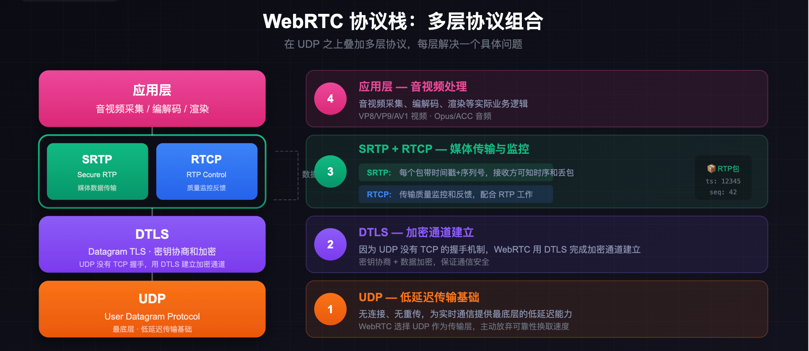

最底层是 UDP，负责低延迟传输，这是整个 WebRTC 的地基。

UDP 上面跑的是 DTLS，负责密钥协商和加密。为什么需要单独搞一层加密呢？因为 UDP 不像 TCP 有现成的 TLS 握手机制，所以 WebRTC 用 DTLS（可以理解为「UDP 版的 TLS」）来完成加密通道的建立，保证音视频数据在传输过程中不会被窃听。

加密通道建好之后，媒体数据用 SRTP（Secure RTP）传输。

RTP 是专门为实时媒体设计的协议，每个包都带时间戳和序列号，接收方可以知道包的时序和是否有丢失，配合 RTCP 做传输质量的监控和反馈。你可以把 RTP 理解成「给每个音频包贴了标签」，接收方根据标签知道这个包应该排在哪里、前面有没有包丢了。

在连接建立阶段，WebRTC 使用 ICE（Interactive Connectivity Establishment）框架来处理 NAT 穿透，这是实际部署中最复杂的部分，后面单独解释。

### 15.3 SDP 信令：WebRTC 握手的「协商书」

WebRTC 建立连接前，双方需要互相告知对方自己的能力：支持哪些音视频编解码格式、网络地址是什么、加密参数是什么。这个协商过程通过 SDP（Session Description Protocol）来完成。

SDP 本身只是一种格式，不规定如何传输。双方需要通过一个「信令通道」来交换 SDP，这个信令通道可以是 WebSocket、HTTP 或者任何能双向传输的方式，WebRTC 不关心。这就是为什么用 WebRTC 做 AI 语音时，还是需要一个 WebSocket 连接：WebSocket 负责信令交换（告诉对方「我的网络地址是 xxx，我支持 Opus 编解码」），真正的音频流走 WebRTC 的 UDP 通道。两者各司其职，不是替代关系。

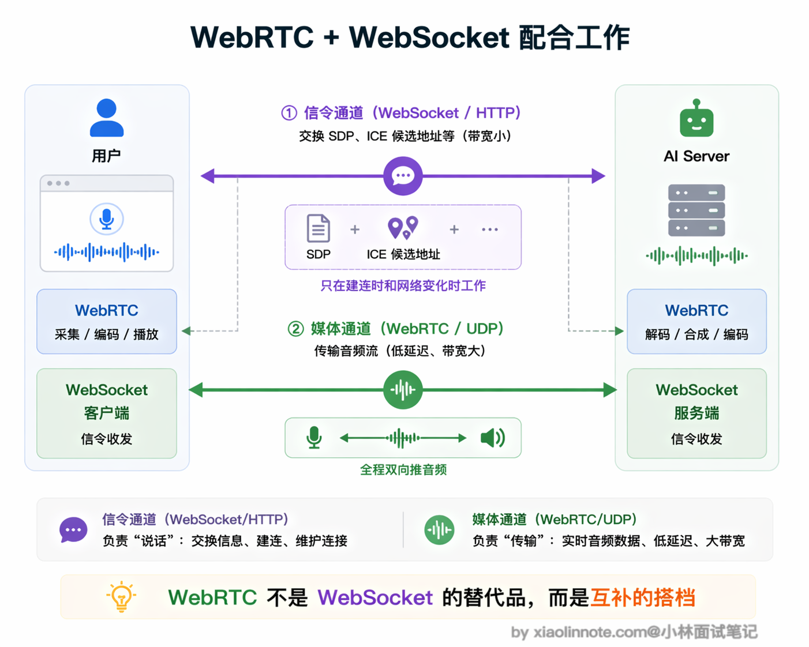

### 15.4 NAT 穿透：ICE/STUN/TURN 解决的问题

现实中大多数用户都在路由器后面，没有公网 IP，直接用内网地址互相连接是行不通的。WebRTC 用 ICE 框架来解决这个问题，ICE 会按优先级依次尝试三种连接方式：

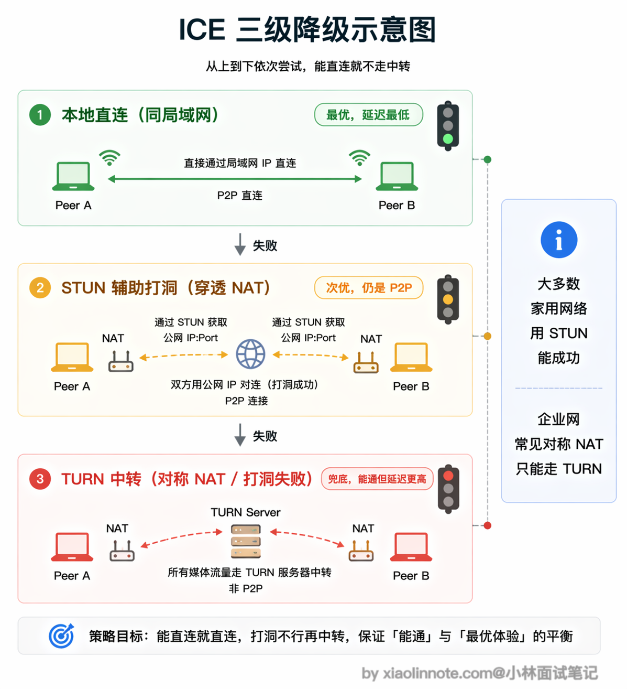

第一优先级是本地直连，如果两个用户在同一个局域网里，直接用内网地址连，延迟最低。第二优先级是 STUN 辅助的 NAT 穿透，STUN 服务器帮助客户端发现自己的公网 IP 和端口，然后双方尝试「打洞」建立 P2P 连接，大多数家用路由器环境下这个方式能成功，延迟仍然很低。第三优先级是 TURN 中转，当 NAT 打洞失败时，流量通过 TURN 服务器中转，失去了 P2P 直连的延迟优势，但至少能通。

你可能会问，为什么有些情况下打洞会失败、非得走 TURN？

最常见的原因是「对称 NAT」：这类 NAT（常见于企业防火墙、某些运营商级 NAT）对每个目标地址都会分配一个不同的出口端口号，STUN 探测到的那个端口在对端尝试连进来时已经换了，打洞自然打不通。这时候只能退一步找一台双方都能访问到的中转服务器（TURN），把流量从一方送到服务器、再从服务器送到另一方。

这三层降级保证了 WebRTC 在各种网络环境下都能建立连接，只是在最差情况下退化成类似 WebSocket 经过服务器中转的模式。

### 15.5 WebRTC 内置的音频处理能力

WebRTC 不只是一个传输协议，它把多年来实时语音通信领域积累的工程经验都内置进去了，这是用 WebSocket 传语音最难补齐的部分。

**回声消除**（AEC）。当你用扬声器外放 AI 的声音时，麦克风会同时把这段声音采集进去，如果不做处理，AI 就会听到自己说话的回声，形成反馈循环。WebRTC 内置了多年优化的回声消除算法，能实时识别并消除这部分回声，让对话不产生干扰。

**噪声抑制**（NS），比如用户在嘈杂的咖啡厅说话，WebRTC 会自动把背景噪声过滤掉，只传人声。自动增益控制（AGC）解决音量不稳定的问题，说话声音太小时自动放大，太大时自动降低，保证对方听到稳定的音量。

**自适应码率控制**（ABR）：WebRTC 通过 RTCP 持续监测网络状况，动态调整音频比特率。网络好时用高码率保证音质，网络差时降低码率优先保证流畅，不会因为网络波动就直接卡死。

### 15.6 OpenAI Realtime API 选择 WebRTC 的决策逻辑

Realtime API，用于实现实时语音对话：用户说话，AI 实时听，AI 说话，用户实时听，双方可以随时打断对方。

首先，端到端延迟必须低于 300ms 才有自然的对话感，超过这个阈值用户就会明显感觉到「卡」。其次，语音必须双向同时流动，不能等一方说完再切换，这样才能实现自然的你一言我一语。再者，用户说话时必须能随时打断 AI 正在说的内容，不能让用户干等。最后还有回声消除的问题，麦克风采集的声音不能把 AI 正在播放的声音再传回去，否则会形成回声循环。

把这些要求综合起来看，TCP 系的方案（WebSocket）在网络抖动时达不到延迟要求，而且没有内置的音频处理能力，需要大量额外工程。WebRTC 天然满足所有这些要求，所以 Realtime API 选择了 WebRTC 作为媒体传输层。

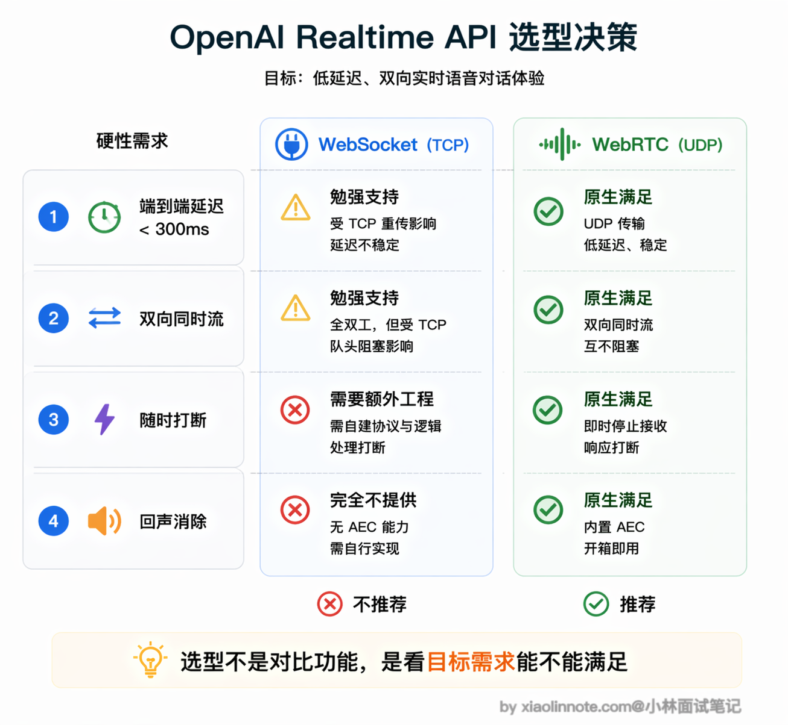

### 15.7 WebSocket 和 WebRTC 的核心差异总结

| 维度       | WebSocket                   | WebRTC                                                 |
| ---------- | --------------------------- | ------------------------------------------------------ |
| 底层协议   | TCP                         | UDP                                                    |
| 连接模式   | 客户端 <-> 服务器           | P2P 直连（可降级为 TURN 中转）                         |
| 延迟       | 50-500ms（受 TCP 重传影响） | 50-150ms（UDP 不重传）                                 |
| 丢包处理   | 强制重传，后续数据等待      | 丢包隐藏，插值填补，不阻塞                             |
| 音视频支持 | 无，需自行实现全套处理链路  | 原生支持（编解码、AEC、NS、AGC、ABR）                  |
| 连接建立   | 简单，HTTP Upgrade 即可     | 复杂，需要信令交换 + ICE NAT 穿透                      |
| 适合场景   | 文字/数据实时双向通信       | 实时音视频通话                                         |
| 实现复杂度 | 低                          | 高（信令服务器、STUN/TURN 服务器都要自建或使用云服务） |

文字对话用 SSE 或 WebSocket，实时语音用 WebRTC。WebRTC 的复杂度是真实存在的，信令服务器、STUN/TURN 服务器的部署和运维都需要成本，但这些复杂度换来的是无可替代的低延迟和音频质量，在 AI 语音助手这类产品里是值得付出的代价。

## 🎯 面试总结

最大的误区是觉得 WebSocket 和 WebRTC「都能传语音，差别不大」。

面试回答这道题，

**底层协议的区别**：WebSocket 基于 TCP，WebRTC 基于 UDP。TCP 丢包强制重传，后续数据全部等待，延迟不可控；UDP 不重传，WebRTC 用丢包隐藏技术（插值填补）处理丢失的音频帧，用微小的音质损失换取稳定的低延迟。语音场景的铁律是「容忍丢包，绝不容忍延迟」，TCP 的设计哲学和这个需求正好相反。

 **WebRTC 内置的音频处理能力**。回声消除（AEC）、噪声抑制（NS）、自动增益控制（AGC）、自适应码率（ABR）这些都是 WebRTC 原生支持的，用 WebSocket 做语音这些全得自己造轮子，工程量巨大。这不只是传输协议的差异，而是一整套音视频工程能力的差异。

 **WebRTC 的连接建立机制**：SDP 信令交换 + ICE/STUN/TURN NAT 穿透。特别是能说清楚「WebRTC 建连时仍然需要 WebSocket 做信令通道，两者是配合关系而不是替代关系」，会让面试官觉得你对整个架构有完整的理解。

# 16. 有没有用过大模型的网关框架？网关层解决了什么问题？

## 💡 简要回答

我用过 LiteLLM，它是目前最活跃的开源 LLM 网关。我理解网关本质上是架在应用和模型 API 之间的中间层，主要解决几个实际问题。

- 多模型统一接口，业务代码只调一个地方，想换模型只改网关配置，不用动应用代码；
- API Key 集中管理，不用每个服务都存一份，降低泄漏风险。
- 限流和配额，可以给不同团队分别设 token 预算，防止某个团队把整个公司的额度用光；
- 成本追踪，所有请求的 token 用量都在网关记录，方便统计哪个服务最烧钱。
- 语义缓存，两个用户问了语义相近的问题，直接命中缓存返回上次的结果，根本不打底层模型，省钱还降延迟。


## 📝 详细解析

### 16.1 先建立直觉：网关是什么，放在哪

没有网关时，你的应用直接对接各个模型 API：应用 -> OpenAI API、应用 -> Anthropic API、应用 -> 其他 API。

有了网关之后，调用链变成：应用 -> 网关 -> OpenAI/Anthropic/其他 API。

网关就是一个**中间人**，坐在你的应用和各个模型 API 之间。你的应用只认识网关，不需要直接对接多个 API。这个「中间人」的定位是理解网关所有功能的基础，它集中拦截和处理了所有出入流量，所以能在这个位置统一做很多事情。

### 16.2 没有网关时的痛点

一个稍微大一点的 AI 产品，同时用多个模型是常态：主流程用 GPT-4o，成本敏感的任务用 GPT-4o-mini 或 Claude Haiku，代码任务用 Claude Sonnet，向量化用 text-embedding-3-small。每家厂商的 SDK 不一样，鉴权方式不一样，参数格式也有细微差异。如果不做网关，这些差异会渗透到每个业务服务里。

这会带来一连串的麻烦。

- **安全问题**，API Key 散落在各个服务的配置文件里，任何一处泄露都是安全事故。想象一下：某个工程师离职，他存在本地开发机或者内部文档里的 OpenAI Key 没有及时清理，过两周被扫到，黑客拿去跑批量请求，几千美元的账单是一个晚上就能烧出来的。
- **重复劳动**，每个服务都要自己写重试和限流逻辑，出了 bug 很难排查。更糟的是，不同服务的同一个逻辑（比如「429 了要指数退避重试」）很容易各写各的，A 服务对了、B 服务错了，出问题时先要花半小时搞清楚是哪个服务的重试逻辑在作怪。
- **成本黑箱**，你想知道整个系统这个月花了多少钱、哪个团队用得最多，根本没法统计，因为各服务各记各的。月底财务来问「这笔 3 万美元的 OpenAI 账单分摊给哪个业务线」，你只能两手一摊。
- **灵活性问题**，想给某个团队限制每天的调用量？得改代码。想把某个任务从 GPT-4o 换成 Claude？还是得改代码。典型的场景是：周五下班前某个工程师无意中跑了一个死循环脚本，一晚上把下一周的 token 预算吃光，周一用户打开产品全是 429 报错，这种事一年只要发生一次，你就会意识到配额管理不能指望各服务自觉。

这些问题看起来五花八门，但其实都源自同一个根本原因：**没有一个集中的地方来统一管理这些「横切关注点」**。

有了网关之后就完全不一样了。API Key 只存在网关这一个地方，业务服务拿到的是网关分配的虚拟 Key，根本接触不到真实密钥。想换模型？改网关的路由配置就行，业务代码一行都不用动。重试、限流、超时这些逻辑也只需要在网关实现一次，所有服务自动享受，不用各自重复造轮子。

### 16.3 多模型统一接口：换模型对业务代码隐形

大多数 LLM 网关（比如 LiteLLM）对外暴露一个 OpenAI 兼容的接口，你的业务代码就像调 OpenAI 一样调它，只需要把请求地址改成网关的地址，API Key 改成网关分配的虚拟 Key。

举个具体例子，假设你的业务代码原来是 `openai.chat.completions.create(model="gpt-4o", ...)`，接入网关后只需要改两个地方：把 `base_url` 指向网关地址，把 `api_key` 换成网关分配的虚拟 Key，其他代码一行不动。

网关收到请求后，根据路由配置决定把这个请求发到哪个实际模型。业务代码完全不知道底层是哪个模型在工作，「换模型」这件事对业务层彻底隐形了。这意味着你可以在不触碰任何业务代码的情况下做 A/B 测试、成本优化、模型迭代。

### 16.4 负载均衡和故障转移：可靠性兜底

模型 API 并不是 100% 可靠，OpenAI 会偶发 503，某个地区的节点会超时，高峰期会被限流。单独对接时，业务层需要自己处理这些异常，而且往往处理不完整。

有了网关，你可以**给同一个「模型名」配置多条路由规则**，主路由指向 OpenAI，备用路由指向 Azure OpenAI 或 Anthropic。**当主路由连续失败达到设定的阈值时，网关自动把后续请求切换到备用路由**，整个过程业务层完全无感知，用户也不会感受到任何异常。这种「多活」策略在生产环境里是保障可用性的重要手段。

### 16.5 限流和配额：防止一个团队把额度用光

没有配额管理时很容易出现这样的情况：研发团队为了测试跑了一个批量脚本，一个小时内消耗了当天绝大部分 token 额度，导致产品团队的用户反馈系统整个下午都在报错。

有了网关的配额管理，可以给每个团队的虚拟 Key 设置独立的 token 日预算，比如研发团队每天 100 万 token、产品团队每天 50 万 token。一旦某个团队的虚拟 Key 超出配额，该 Key 的请求直接返回 429 错误，其他团队完全不受影响，API 额度不会被「误伤」。

### 16.6 成本追踪和可观测性：知道钱花在哪

网关集中记录了每次调用的 token 用量、响应时间、错误率等数据，这让你可以回答「哪个接口最烧钱」「研发团队和产品团队各用了多少」「GPT-4o 和 Claude Sonnet 的 P95 响应时间分别是多少」这类问题。

有了这些数据，成本优化才有依据，比如发现某个接口消耗了 40% 的 token，但实际上可以用便宜得多的模型替代。网关通常可以直接对接 Langfuse、Prometheus 等监控系统，不需要在业务代码里手动埋点，数据天然集中。

### 16.7 Prompt 安全和内容过滤：统一的安全防线

在网关层可以统一做输入输出的安全校验，包括检测 prompt 注入攻击（用户试图通过特殊指令劫持模型行为）、过滤个人隐私信息（比如身份证号、手机号不应该被发送到外部 API）、内容安全审核等。

集中在网关做的好处是：不需要每个业务服务各自实现，安全策略统一更新，任何一个接入点都自动获得保护。有一个服务漏了检测这种事情不会再发生。

### 16.8 语义缓存：省钱的同时降延迟

普通 HTTP 缓存是精确匹配，请求内容一字不差才能命中缓存。但 LLM 的问题往往有大量语义相近的变体：「北京今天热吗」「北京现在天气怎样」「今天北京气温多少」，三个问题本质上是同一个需求，但精确匹配全部 miss，每次都要打底层模型，就是三次完整的 LLM 调用费用。

语义缓存解决的正是这个问题：把用户问题先转换成一个向量（embedding，你可以把它理解成这句话的「数字指纹」。

意思相近的句子，指纹在向量空间里的位置也接近），然后在向量数据库里做相似度搜索，如果找到一个指纹很接近的历史问题（相似度超过设定阈值），就直接把那次的答案返回，**完全跳过 LLM 调用**。

完整流程是：收到新问题 -> 把问题向量化 -> 在向量数据库里做相似度搜索 -> 命中则直接返回历史答案，未命中则调 LLM 并把「问题向量 + 回答」存入缓存。整个过程对业务层透明，它就像一个智能的「语义感知」缓存层。

不过语义缓存要用好，有两个工程细节需要注意。首先是**相似度阈值怎么设**，这是最关键的调参点。阈值设太高（比如 0.99），基本上只有一模一样的问题才能命中，缓存形同虚设。阈值设太低（比如 0.7），就可能出现「北京今天热吗」命中了「上海今天热吗」的历史答案，答非所问就尴尬了。通常在 0.85 到 0.95 之间调试，具体要看你的场景和用户提问的多样性。

另一个要注意的是**缓存有效期**，不同类型的内容差别很大。天气、股价这类实时信息，缓存几分钟就够了，过期必须重新查；产品 FAQ、技术文档这类比较稳定的知识，缓存几天甚至更长都没问题。

**语义缓存最适合的场景是高频重复的问答**，比如客服机器人，用户总是问差不多的产品问题，命中率可以非常高，省下的调用费用很可观。但对于需要个性化或者强实时性的问答，就要在网关层识别出来，直接绕过缓存走 LLM。

### 16.9 常见网关框架对比

| 框架             | 类型              | 特点                                                         |
| ---------------- | ----------------- | ------------------------------------------------------------ |
| LiteLLM          | 开源，Python      | 支持 100+ 模型，OpenAI 兼容接口，社区最活跃（注意关注安全公告） |
| Bifrost          | 开源，Rust        | 高性能低延迟，2026 年新兴，适合对性能要求高的场景            |
| PortKey          | 商业+开源         | 功能完整，有托管版，适合不想自运维的团队                     |
| Kong AI Gateway  | 商业（Kong 扩展） | 基于成熟的 Kong 网关扩展 AI 能力，适合已有 Kong 的团队       |
| One API          | 开源，Go          | 国内社区活跃，支持国产模型，部署简单                         |
| Nginx/Envoy 自研 | 自研              | 灵活但工作量大，适合有特殊需求的大厂                         |

## 🎯 面试总结

最常见的误区就是把 LLM 网关等同于普通的负载均衡器或反向代理。面试回答这道题，首先要说清楚**网关的定位**：它是架在应用和模型 API 之间的中间层，集中拦截和处理所有出入流量，所以能在这个位置统一做很多事情。

核心功能方面，必须提到的几个点：**多模型统一接口（业务代码只调网关，换模型只改配置）、API Key 集中管理（不散落在各服务里，降低泄漏风险）、按团队做 token 配额（防止某个团队把整个公司的额度用光）、成本追踪（知道哪个服务最烧钱）**。

**语义缓存**，这是 LLM 网关区别于普通 API 网关的一个亮点功能：用向量相似度匹配语义相近的问题，命中缓存直接返回历史答案，跳过 LLM 调用，省钱还降延迟。

要避免的误区：不要只说负载均衡和统一接口，这两个普通 API 网关也能做。面试官想听的是你对 LLM 场景特有问题的理解，比如 token 配额管理、语义缓存、prompt 安全过滤这些只有 LLM 网关才需要的能力。如果用过具体框架（比如 LiteLLM、One API），能结合实际使用经验来说会更有说服力。

# 17. 工具很多时，Agent 如何做 Tool Routing，减少 Token 并避免选错工具？

## 💡 简要回答

工具很多时，我不会把全部 Schema 都塞给模型，而是做分层 Tool Routing。

首先维护统一的工具注册表，给工具补齐命名空间、标签、适用场景、参数 Schema、权限、风险等级和可用状态。每次请求先用产品范围、租户、用户角色、环境和当前任务状态做硬过滤，把无权调用或当前不可用的工具直接隐藏。

接着做两级召回。一级用规则或轻量分类模型判断工具类别，比如检索类、订单类、支付类；二级在相关类别内，用关键词、BM25、Embedding 或混合检索召回少量候选工具。最后只把候选工具的完整描述和 Schema 动态绑定给 LLM，让它判断是否调用、选哪个工具以及怎样填参数。

Tool Routing 路由的是「工具候选集」，Multi-Agent Routing 路由的是「任务由哪个 Agent 接手」，这两个层次可以配合，但不能混为一谈。

上线后我会同时看候选工具的 Recall@K、最终工具选择准确率、无工具场景的拒选准确率、参数合法率、任务成功率、工具 Schema Token、端到端延迟和越权暴露率。低置信度时优先澄清或扩大召回，不能让模型猜一个高风险工具直接执行。

## 📝 详细解析

### 17.1 为什么不能把全部工具都塞进 Prompt？

假设一个企业 Agent 同时接了客户、订单、支付、审批、知识库和运维系统，每个系统又暴露十几个工具。模型每轮调用前如果都要读完整的工具名称、描述和参数 Schema，会出现四类问题。

-  Token 问题。工具定义本身属于模型输入，会和系统提示、聊天历史、检索资料一起占用上下文。工具越多，留给当前任务和证据的空间越少，输入成本也会增加。Prompt Cache 可以降低重复输入的费用和部分处理开销，但它没有让模型当前可见的工具变少，也不能从根本上解决候选混乱。

- 选择混淆。比如同时存在 `order_get`、`order_search`、`order_detail` 和 `after_sale_query`，它们的描述又都写着「查询订单信息」，模型很容易在相似选项之间选错。问题往往不是模型完全不懂，而是工具边界根本没有讲清楚。

- 权限风险。如果普通客服没有退款权限，却仍然把 `payment_refund` 暴露给模型，就等于让模型先看到了不该看的能力。即使最终执行层会拒绝，这种设计也扩大了误调用和提示词注入的攻击面。

- 延迟问题。更长的输入需要更多传输和模型预处理，模型还要在更大的候选空间里做判断。不过这里不要说成「路由一定更快」，因为额外的分类或检索也有耗时。工程目标是比较端到端延迟，在减少大模型输入与增加一次轻量路由之间找到平衡。


### 17.2 先分清 Tool Routing 和 Multi-Agent Routing

Tool Routing 回答的是：「当前这个 Agent 为完成这一步，应该看到哪些工具，最终调用哪个工具？」它的**输入是用户请求、当前任务步骤、权限和工具元数据，输出是一个候选工具集合，或者在候选集合中选出的具体工具**。

Multi-Agent Routing 回答的是：「**当前任务或子任务应该交给哪个 Agent？**」它路由的是研究 Agent、编码 Agent、审核 Agent这类角色，输出是下一位执行者或一次 Handoff。

举个例子，用户说「查询订单 A100，确认未发货后帮我取消」。Orchestrator 把任务交给订单 Agent，这是 Multi-Agent Routing；订单 Agent 当前先看到 `order_get`，确认状态后再看到 `order_cancel`，这是 Tool Routing。

两层路由可以同时存在。先选 Agent 能缩小业务边界，Agent 内部再选工具能缩小能力边界。但不能为了规避工具过多，就无原则地拆出几十个 Agent，否则只是把工具目录变成了 Agent 目录，任务切换、状态同步和调试成本反而会上升。

#### 第一步，建立可路由的工具注册表

工具路由不能只依赖一个含糊的 `description`。先把每个工具整理成一张结构化的「工具卡片」，后面的规则过滤、检索和评测才有依据。

一张实用的工具卡片通常会包含这些信息：

| 信息               | 作用                     | 示例                                 |
| ------------------ | ------------------------ | ------------------------------------ |
| 唯一名称与命名空间 | 避免同名，支持按业务分组 | `orders.get_detail`                  |
| 能做什么           | 帮助理解工具能力         | 查询单个订单的实时详情               |
| 什么时候用         | 给出正向边界             | 已知订单号且需要状态、金额或商品明细 |
| 什么时候不用       | 区分相似工具             | 批量模糊查找订单时不要使用           |
| 输入输出 Schema    | 约束参数与返回结构       | `order_id` 为必填字符串              |
| 标签               | 支持规则和检索           | 订单、查询、只读                     |
| 权限与风险         | 决定能否暴露、是否审批   | `order:read`、低风险                 |
| 状态与环境         | 排除不可用工具           | 仅生产环境、当前健康                 |
| 版本与成本         | 灰度和调度参考           | v2、预估高延迟                       |

命名最好体现「业务域 + 动作」，例如 `orders.search`、`orders.get_detail`、`orders.cancel`。描述里不仅要写功能，还要写适用条件和排除条件。参数 Schema 要有清楚的类型、必填项、枚举、格式和字段说明。

为什么这些细节很重要？因为路由器和最终的 LLM 都不是在读工具实现代码，它们主要依靠工具卡片来判断。如果两个工具的描述高度重叠，后面换再强的模型也只是在猜。

命名空间和标签还能提供稳定的一级索引。用户提到「退款」，可以先命中 `payments` 和 `orders` 两个命名空间，再在里面精确选择，而不是扫描整个企业工具库。

#### 第二步，先做确定性过滤

分层路由的第一步不是相似度搜索，而是先把「绝对不能选」的工具排除掉。

**静态过滤**处理**长期不变的边界**。比如客服 Agent 只允许使用客户、订单和知识库工具，开发环境禁止挂真实支付工具，某个产品版本只启用 v2 接口。这类规则可以在 Agent 初始化或工具注册时用 Allowlist、Blocklist 固定下来。

**动态过滤**则跟每次运行的**上下文**有关。常见条件包括当前租户、用户身份与角色、功能开关、地区、会话阶段、任务状态、工具健康状态，以及是否已经收集到关键参数。OpenAI Agents SDK 的官方文档也提供了按运行上下文动态启停工具，以及对 MCP 工具做静态或动态过滤的机制。

安全原则：**先鉴权，再做相关性召回。**检索器只能在「当前请求有权看到的工具集合」里搜索，不能先从全库召回，再指望 Prompt 告诉模型「这个不能用」。而且隐藏工具只是减少暴露，执行工具时仍要在服务端重新鉴权，因为权限还可能取决于具体参数和资源归属。

例如同一个 `orders.get_detail` 工具，用户可能有权查询自己的订单，却无权查询另一个租户的订单。路由阶段只能判断这个工具是否大体可见，执行阶段还必须根据 `order_id` 再校验资源级权限。

#### 第三步，用粗分类缩小业务域

经过权限过滤后，候选仍然可能很多，这时可以先做一级粗分类。

**边界很清楚的请求优先用规则。**例如明确出现订单号并询问物流，就把请求路由到「订单 + 物流」类别；当前工作流已经进入付款确认节点，就只开放支付查询类工具。规则速度快、可解释，也方便审计。

**表达方式比较多、规则难以覆盖时，可以使用轻量分类模型或小参数 LLM**，把请求分到检索类、查询类、生成类、执行类，或者订单、支付、审批等业务域。小模型只负责粗分，不直接决定高风险动作，所以输出空间小，成本也更容易控制。

**粗分类要偏向高召回。**如果一句话同时涉及「查订单」和「取消订单」，应该保留订单查询和订单操作两个类别，而不是只给一个标签。分类器不确定时，也可以跳过这一层，直接进入范围更大的工具检索。

#### 第四步，在候选域里检索工具

工具达到几十个甚至更多时，可以把允许召回的工具卡片建成索引，根据当前请求或任务步骤检索 Top-K 候选。

**关键词或 BM25** 适合**匹配产品名、接口名、字段名和缩写**，比如用户明确提到「Jira」「SKU」或 `order_id`。Embedding 更擅长语义匹配，比如用户说「包裹还在路上吗」，也能召回描述为「查询物流轨迹」的工具。实际项目可以做**混合检索**，再用**分数融合或轻量 Reranker 排序。**

**检索内容**也不应只有一句工具描述。**名称、业务标签、适用场景、排除条件、参数名和少量调用示例**都可以进入索引。大规模工具选择可以先检索少量相关工具，再交给 LLM 做最终选择；对于复杂请求，还可以先把用户表达改写成更适合检索工具说明的查询。

**工具检索追求的是「别漏掉正确工具」，不是「排第一就直接执行」。**Embedding 相似度只表达语义接近，不代表用户有权限、参数满足，也不代表这个工具一定能完成任务。检索结果应该进入下一层精选和校验。

#### 第五步，只把候选工具动态绑定给 LLM

前面几层筛完之后，才轮到大模型做自己擅长的精细语义判断。系统把当前任务上下文，以及少量候选工具的完整描述和 Schema 绑定给模型，让它完成三件事：判断是否真的需要工具、选择一个或多个工具、填写结构化参数。

这种「先召回，后精选」的设计，把 LLM 从上百个相似选项中盲选，变成在一个小候选集里做判断。OpenAI 和 Anthropic 的官方工具搜索能力都支持延迟加载工具，也就是工具先留在目录中，需要时再把相关定义加载进模型上下文。OpenAI 还建议用命名空间组织相关工具，Anthropic 的工具搜索则可以根据名称、描述、参数名和参数说明发现工具。

少数高频、低风险工具可以常驻，比如只读搜索和帮助工具；长尾工具按需加载。这样能减少一次额外检索的概率，也不会让大批低频 Schema 长期占着上下文。

动态绑定只是决定「模型此刻看见什么」，执行前仍要经过参数 Schema 校验、权限校验、风险策略和必要的人工审批。Tool Routing 不能替代执行层安全。

```python
def route_tools(query, context, registry):
    # 先执行硬过滤，未经授权的工具不能进入检索范围
    allowed = registry.filter(
        product=context.product,
        tenant=context.tenant,
        role=context.role,
        environment=context.environment,
        healthy_only=True,
    )

    # 用规则或轻量分类器召回一个或多个业务类别
    domains, confidence = classify_domains(query, context.task_state)
    if confidence >= 0.7:
        allowed = allowed.in_domains(domains)

    # 混合检索只负责召回，不直接触发工具执行
    candidates = hybrid_retrieve(
        query=query,
        tool_cards=allowed,
        top_k=6,
    )

    # 返回少量完整 Schema，交给主模型做最终选择和参数生成
    return bind_full_schemas(candidates)
```

示例里的阈值和 Top-K 只是说明控制点，不是通用最优值。真实项目要根据评测集中的召回率、Token、延迟和误选情况调参。

### 17.3 Skill 渐进加载怎样参与 Tool Routing？

Skill 和 Tool 可以一起解决上下文膨胀，但分工不一样。

Skill 更像任务操作手册。Agent 启动时先看 Skill 的名称和简短描述，匹配到当前任务后再加载详细步骤，需要模板或脚本时继续按需读取。这种渐进式加载避免把所有工作流程一次性塞进上下文。

Tool 是可执行能力，Tool Routing 决定当前步骤要暴露哪些能力。一个 Skill 被选中后，可以进一步告诉 Agent「这项任务先使用 `orders.get_detail`，满足条件后再使用 `orders.cancel`」，也可以把检索范围缩小到某个工具命名空间。

所以常见链路是「**用户请求 -> 匹配 Skill -> 加载任务流程 -> 根据当前步骤路由 Tool**」**。Skill 能帮助缩小工具候选，但它不能替代权限过滤和执行鉴权，更不能因为 Skill 里写了某个工具名，就绕过用户当前的权限。**

### 17.4 工具描述和 Schema 质量决定路由上限

路由链路再复杂，也救不了一组互相说不清边界的工具。

**工具名称要具体**，避免 `query_data`、`process` 这类泛化命名。描述应该同时回答「做什么」「何时用」「何时不用」「返回什么」。相似工具之间要直接写出差异，例如「已知唯一订单号时使用详情查询，按手机号或时间范围查找时使用订单搜索」。

**参数 Schema 要尽量收紧**。能用**枚举**就不要放任任意字符串，**必填项要明确，日期、ID 和数值范围要写清楚**。少量高质量的正例和反例，也能帮助模型理解调用边界。Schema 约束解决的是格式合法性，业务合法性仍要在工具内部校验。

**如果两个工具总是被混淆，不要只修改 Prompt。先检查它们是不是职责重叠，能否合并，或者把一个大而全的工具拆成边界清楚的查询与执行工具。**工具设计本身，就是 Tool Routing 的一部分。

### 17.5 怎么评估 Tool Routing？

只看最终回答对不对，很难知道问题出在召回、精选、参数还是执行。评测时要把链路拆开看。

- **候选召回**。单工具任务可以看 Recall@K，也就是**正确工具是否进入 Top-K**；多工具任务还要看**所需工具是否召回完整**，避免只找到了其中一个。与此同时记录候选集大小和工具 Schema Token，防止为了提高召回把候选集无限放大。
- **模型精选**。关注最终工具选择准确率、相似工具误选率、该直接回答时是否错误调用工具，以及应该调用工具时是否漏调。参数层再看 Schema 合法率、必填参数完整率和参数事实正确率。
- **业务结果**。包括任务成功率、工具执行失败率、端到端延迟、模型调用成本、澄清率和人工接管率。安全上还要单独观察未授权工具暴露率、越权调用拦截情况和高风险操作审批覆盖率。

评测集不要只收集「一句话明确命中一个工具」的简单题，还要加入相似工具形成的 Hard Negative、多意图请求、不需要工具的请求、缺少参数的请求、无权限请求和历史 Badcase。上线后保留每层路由的候选、分数、过滤原因和最终调用 Trace，出错时才能判断是召回漏了，还是模型选错了。

### 17.6 路由失败怎么兜底？

Tool Routing 一定会有不确定的时候，系统必须让这些不确定和失败保持可控。

- 没有候选或召回置信度太低，可以改写查询后扩大类别和 Top-K 再检索一次。仍然不确定时，让用户补充缺失信息，比随便猜一个工具更可靠。

- 多个相似工具分数接近，低风险只读场景可以让 LLM 根据更完整的描述精选；涉及付款、删除、发信等高风险动作时，应进入确定性规则或人工审批，不能靠相似度直接执行。

- 首选工具不可用，可以切换到同能力的备用工具，或者降级为只读查询和人工处理。模型输出了候选集之外的工具名时，运行时必须拒绝，不能尝试「将错就错」地映射执行。

- 正确工具根本没进入 Top-K。这时让同一个 LLM 在错误候选里反思没有意义，应该回到召回层，放宽类别、改写查询，或者走默认的工具搜索入口。


## 🎯 面试总结

回到开头，把上百个工具全部塞给模型，会同时带来 Token 占用、相似工具混淆、权限暴露和延迟压力。只用 Embedding 取第一名直接执行也不稳，因为相关性不是可调用性，更不是授权。

面试时我会先说清楚 Tool Routing 和 Multi-Agent Routing 的边界。前者决定当前 Agent 能看到和调用哪些工具，后者决定任务交给哪个 Agent。它们可以上下分层配合，但解决的不是同一个问题。

然后讲完整方案：先建设包含命名空间、标签、适用边界、Schema、权限和状态的工具注册表；再按产品、租户、角色和任务状态做确定性过滤；接着用规则或轻量模型粗分业务域，用 BM25、Embedding 或混合检索召回 Top-K；最后只把少量完整 Schema 动态绑定给 LLM 做精选和参数生成，执行前再做服务端鉴权与风险控制。

最后补上工程闭环。用 Recall@K 保证候选不漏，用最终选择准确率、参数合法率和任务成功率检查模型，用 Token、延迟和成本衡量收益，用无工具拒选、越权暴露和审批覆盖率守住安全边界。低置信度时扩大召回或向用户澄清，高风险动作宁可不执行，也不能让模型猜。

# 18. 工具调用格式非法、参数错误、超时或失败时，Agent 如何容错？

## 💡 简要回答

我会把工具调用拆成「决策 -> 校验 -> 执行 -> 确认 -> 恢复」五个阶段，每个阶段使用不同的处理方式。

模型选错工具、JSON 不合法或缺少参数时，先用结构化输出和 Schema 拦截，再把明确的校验错误交给模型重生成。参数满足 Schema 后，服务端还要检查业务约束、用户身份、工具权限和风险级别，不能信任模型自己判断权限。

进入执行阶段后，我只对限流、连接失败和部分 5xx 这类瞬时故障做有界重试，并同时满足三个条件：调用可以安全重放、总时间预算还有余量、重试次数没有超限。退避要加抖动，遇到 `Retry-After` 就尊重服务端建议。参数错误、权限不足和明确的业务失败应该修参数、重新规划或询问用户，不能原样重试。

付款、发邮件、创建订单这类工具还要处理「结果未知」。我会在第一次调用前生成幂等键并写入 Checkpoint，重试和恢复时复用同一个键；超时后先按幂等键查询状态，确认没有执行再决定是否重试。查不清时暂停任务并转人工，避免重复副作用。

系统还需要熔断、降级、故障转移和统一的结构化错误。Trace 里记录每次调用的工具版本、参数摘要、耗时、重试决策、幂等键摘要和最终状态，敏感参数要脱敏，方便告警、复盘和审计。

## 📝 详细解析

### 18.1 先分清故障，重试策略才不会用错

| 故障类别           | 常见例子                           | 推荐动作                                               |
| ------------------ | ---------------------------------- | ------------------------------------------------------ |
| 模型决策或格式错误 | 工具名不存在、JSON 非法、缺少字段  | 返回结构化校验反馈，让模型有界重生成                   |
| 参数或业务校验失败 | 日期范围错误、订单不存在、余额不足 | 修正可确定的格式，缺信息则询问用户，业务失败则重新规划 |
| 鉴权与权限失败     | 凭证失效、用户无权执行             | 由鉴权组件刷新可刷新的凭证，越权请求直接拒绝并审计     |
| 瞬时基础设施故障   | 连接失败、429 限流、部分 5xx       | 在安全重放和预算允许时做有界重试                       |
| 明确执行失败       | 下游确认事务已回滚                 | 根据业务规则降级、换工具或结束任务                     |
| 副作用结果未知     | 写请求超时、连接在响应前断开       | 使用幂等键查状态或对账，不能盲目重试                   |

工具也可能正常返回一个业务失败，比如订单不存在、库存不足。最麻烦的是调用方没有收到响应，下游却可能已经完成操作，此时结果应标记为 `unknown`，不能擅自当成失败。

这张表也解释了一个常见误区：HTTP 状态码只能提供线索，重试决策还要结合工具语义和执行阶段。比如连接建立前失败，服务端通常没有收到请求；读取响应时超时，服务端可能已经执行完了。

### 18.2 调用前要过三道门

- **结构校验**。能使用模型原生的结构化输出或受约束解码时，先约束输出；宿主程序仍要按 JSON Schema 校验工具名、字段类型、必填项、枚举和取值范围。系统可以做少量没有歧义的规范化，比如去掉首尾空格，但不能靠正则猜出收件人、金额或文件路径。
- **业务校验**。`amount` 是数字，只能说明格式正确，不能说明金额可退；`date` 符合格式，也不能说明会议时间在允许范围内。工具适配层要查询当前业务状态，检查资源是否存在、版本是否冲突、前置条件是否满足。
- **权限与风险校验**。宿主程序依据已经认证的用户身份计算权限，并在服务端执行最小权限控制。删除数据、付款、群发消息等高风险动作还要进入审批。模型看到的 Prompt 可以解释规则，却不能充当安全边界。

### 18.3 错误结果也要有统一协议

不少 Agent 遇到工具异常时，直接把堆栈或一句「调用失败」塞回模型。前者可能泄露内部路径和密钥，后者又缺少下一步决策需要的信息。

工具适配层应该返回统一的错误信封，例如：

```yaml
ok: false
call_id: tc_8f21
tool: send_email
error:
  category: rate_limit
  code: UPSTREAM_429
  retryable: true
  outcome: not_started
  retry_after_ms: 1200
  safe_message: 服务暂时限流
```

`category` 供策略引擎分类，`retryable` 表示当前故障是否可能恢复，`outcome` 则说明副作用状态是 `not_started`、`failed`、`succeeded` 还是 `unknown`。模型只接收经过脱敏的 `safe_message` 和必要字段，原始异常留在受控日志中。

`retryable: true` 只是一个条件。工具本身无法安全重放、任务总时限已经耗尽，或者用户已经取消任务时，调度器都不应该继续重试。

### 18.4 重试要同时受到次数和时间约束

可靠的重试策略会同时看「错误类型、调用语义、尝试次数、剩余时间」四项信息。

连接失败、429、503 等瞬时故障可以进入重试候选。调度器为每次尝试设置超时，也为整段任务设置总 Deadline；每次准备重试前，都要确认退避等待和下一次调用不会超过剩余预算。下游返回 `Retry-After` 时优先遵守它，否则使用有上限的指数退避，并加入随机抖动，让大量实例不要在同一时刻再次冲击下游。

系统还应把重试放在一个明确的层级。SDK、工具适配层、Agent 调度层如果各重试三次，请求次数会成倍放大。通常让最了解幂等性和任务预算的一层负责重试，其他层关闭自动重试或把尝试次数纳入同一个预算。

取消也要向下传播。用户停止任务或总 Deadline 到期后，调度器应取消尚未开始的调用，并通知正在执行的工具停止可中断工作。客户端结束等待，不代表服务端代码会自动停止，工具实现仍要检查取消信号并释放连接、线程和临时文件。

### 18.5 熔断、降级和故障转移各解决什么问题

短暂抖动适合重试，持续故障则要熔断。熔断器在连续失败或错误率达到配置条件后进入 Open 状态，让后续调用快速失败；等待冷却时间后放少量探测请求进入 Half-Open，探测成功再回到 Closed。这样可以减少无效请求占用线程和连接，也给下游留出恢复空间。

熔断后，Agent 可以返回缓存数据、切换只读模式，或者调用语义等价的备用服务。降级结果要明确告诉模型数据是否陈旧、缺少哪些字段，避免模型把残缺结果包装成完整答案。

故障转移也有边界。两个搜索服务可以通过统一结果协议互相替换；两个付款渠道如果不共享交易状态和幂等范围，贸然切换可能产生两笔扣款。备用工具必须满足相同的权限、数据一致性和副作用约束，调度器才能自动切换。

### 18.6 幂等键有明确的生效边界

有副作用的调用要在第一次执行前生成稳定的幂等键，例如由 `run_id + step_id` 组成。后续重试、进程重启和人工恢复都复用这个键，不能每次尝试都生成新键。

服务端收到请求后，要把「幂等键、请求参数摘要、处理状态、最终结果」写入持久化存储。同一个键和相同参数再次到来时，服务端返回已有结果；同一个键却带着不同参数时，服务端应该拒绝，防止调用方误用。业务写入与幂等记录还要放在同一个事务边界内，或者使用事务消息、Outbox 和对账补偿保证状态能收敛。

「Exactly-once」很容易被说得过头。幂等键只有在服务端识别它、保留记录并覆盖完整副作用边界时才有效。下游系统不支持去重、记录已经过期、一次工具调用跨越多个系统，都可能留下部分成功。工程上更准确的目标是允许请求至少一次到达，再用幂等、去重、状态查询和补偿，让业务效果在约定范围内只发生一次。

### 18.7 Checkpoint 决定故障后从哪里继续

长任务不能只保存聊天记录。调度器在副作用调用前写入 Checkpoint，记录当前步骤、工具名、参数摘要、幂等键和 `pending` 状态；拿到确定结果后，再把该步骤更新为 `succeeded` 或 `failed`。

进程重启后，恢复器先读取 Checkpoint。已经成功的步骤直接跳过；明确失败且满足策略的步骤可以重新规划；状态为 `pending` 或 `unknown` 的步骤先向下游查询，不能重新跑完整计划。把模型推理节点和副作用执行节点分开，也能避免恢复时让模型重新生成一次付款或发送动作。

状态查询仍无法确认结果时，系统应该暂停运行，保存现场并交给人工。人工可以批准重试、修改参数、执行补偿或终止任务。高风险操作也可以在首次执行前主动暂停，让用户确认收件人、金额和影响范围。

### 18.8 监控与审计要能还原一次调用

线上告警只有一句「工具失败」没有排查价值。一次 Trace 至少要串起 `run_id`、`step_id` 和 `tool_call_id`，并记录工具及 Schema 版本、模型与 Prompt 版本、参数脱敏摘要、调用方身份、开始结束时间、每次尝试、错误类别、重试或降级决策、Checkpoint 状态和最终结果。

指标可以关注各工具成功率、延迟分位数、重试率、熔断状态、`unknown` 结果数量、幂等去重次数和人工接管量。审计日志还要记录谁批准了高风险动作、批准了哪些参数，以及系统执行了什么。参数和工具结果可能含有个人信息或密钥，日志要做脱敏、访问控制和保留期限管理。

把调用链记录完整后，你才能回答三个生产问题：失败发生在哪一层，系统为什么选择重试或停止，这次副作用最终有没有发生。

## 🎯 面试总结

回答这道题，我会先强调「**先分类，再处理**」。模型格式错误、业务参数错误、鉴权失败、瞬时故障和副作用结果未知，处理方式不同，统一重试会放大故障，还可能造成重复扣款或重复发送。

调用前用结构化输出与 Schema **检查格式**，再由服务端完成**业务校验、权限控制和高风险审批**。执行时只对满足安全重放条件的瞬时故障做有界重试，结合总 Deadline、单次超时、指数退避、抖动和取消传播。持续故障进入熔断，再根据工具语义选择降级或故障转移。

有副作用的调用要在首次执行前**保存 Checkpoint 和稳定幂等键。**超时后先查询状态，无法确认就转人工。幂等机制需要服务端与下游共同支持，它无法提供没有边界条件的 exactly-once 保证。

最后用结构化错误、Trace、指标和审计把整条链路串起来。面试官继续追问时，可以拿「发邮件后响应丢失」举例，按「校验 -> Checkpoint -> 携带幂等键执行 -> 超时查状态 -> 确认后恢复或转人工」讲完整闭环。

# 19. MoE 混合专家模型是什么？DeepSeek V3、Qwen 为什么用 MoE？

## 💡 简要回答

我理解 MoE（Mixture of Experts，混合专家模型）的核心思想是把**传统 Transformer 中的 FFN（前馈网络）层替换成 N 个并行的「专家网络」，再加一个 Router 来决定每个 token 进哪个专家。**

核心设计哲学是「**总参数大，但激活参数小**」。比如 DeepSeek V3 总参数 671B，但每个 token 推理时只激活 37B（约 1/18）。这样能用「总参数 671B 的知识量」+「激活参数 37B 的推理成本」，达到 Dense 模型做不到的「学得多 + 跑得快」。

具体看 MoE 三个核心组件。

**1. 多个专家（Experts）**：把 Transformer 每层的 FFN 复制 N 份（典型 N=8、64、256），每份就是一个独立的「专家」，在训练中各自学到不同的「擅长方向」（语言、代码、数学、知识等）

**2. Router（路由器）**：每个 token 进到 MoE 层时，Router 算一个「专家偏好分数」，决定这个 token 该去哪个专家。最常见的是 Top-K 路由（K=1 或 K=2），DeepSeek V3 是 Top-8 + 1 个共享专家

**3. 负载均衡**：训练时要加辅助损失防止「专家不平衡」（Router 偏爱某几个专家，其他专家没被训过），保证所有专家都在学

为什么 DeepSeek V3、Mixtral、部分 Qwen 模型都在用 MoE？

- **训练性价比高**：同样算力下训出来的 MoE 模型，效果接近一个大 Dense 模型，但参数总量是 Dense 的 5-20 倍
- **推理成本可控**：每个 token 只用一小部分参数，推理速度和小 Dense 模型相当
- **可扩展性强**：要增加模型容量，加专家数比加层数容易

但 MoE 也有挑战：训练难度高（专家不平衡、Router 训不稳、并行化复杂）；显存占用高（虽然激活只用 37B，但所有专家的参数都要加载到显存，671B 全量）；推理时通信开销（分布式部署时专家分散在多张 GPU，token 路由有跨卡通信）。

MoE 是 2024-2026 年大模型最重要的架构方向之一，DeepSeek V3、DeepSeek R1、Mixtral、Grok、部分 Qwen MoE 模型都用了这条路线。但它不是唯一答案，很多主力 Dense 模型依然在生产里很常见，尤其是中小规模和部署稳定性优先的场景。

## 📝 详细解析

### 19.1 MoE 是什么？为什么 Dense 模型不够用了

Dense 模型（标准 Transformer）的特点是：**每个 token 推理时，都要走一遍模型的全部参数**。一个 175B 的 GPT-3，每生成一个 token 都要让 175B 个参数全部参与计算。

这就带来一个棘手的权衡：

- 想提升模型能力，得加参数（更多知识、更强推理）
- 但参数加倍，推理成本（计算量 + 显存 + 延迟）也加倍
- 一台 8 卡 H100 服务器，能跑动 70B Dense 模型，但跑不动 175B

MoE 的核心创新是**打破「知识量」和「推理成本」的绑定**。它的思路是：

- 模型有 N 个专家，每个专家是一份独立的 FFN
- 每个 token 进来时，Router 只挑 K 个专家来处理（K 远小于 N）
- 总参数量 = N × 单专家参数量，知识量很大
- 激活参数量 = K × 单专家参数量，推理成本只有总参数的 K/N

直观的类比：Dense 像一本厚厚的百科全书，你查一个词要把整本书过一遍；MoE 像一个图书馆，前台咨询员（Router）听到你的问题，告诉你去 3 楼的「数学专家区」就好，不用整个图书馆都搜索。

这个设计让 MoE 在「**同样推理成本下，参数量可以做到 Dense 的几倍甚至几十倍**」。这就是 MoE 现在大火的根本原因。

### 19.2 MoE 的三个核心组件

**1. 多个专家（Experts）**

MoE 把 Transformer 每一层的 FFN 替换成 N 个并行的 FFN。每个 FFN 结构完全一样，但参数独立，在训练中各自学会不同的「擅长方向」。

具体专家数 N 的选择是个工程权衡：

- N 太小（比如 N=4）：专家不够细分，效果接近 Dense
- N 太大（比如 N=512）：每个专家太小、太专门，难以学到通用能力
- 业界主流：N=8（Mixtral）、N=64（早期 GShard）、N=256（DeepSeek V3）

每个专家学到的「擅长方向」**不是预先指定的**，而是在训练中自然涌现的。研究者发现训练后的专家会自发分化：有的专家偏向数学符号、有的偏向代码语法、有的偏向常用语言、有的偏向稀有词汇等等。

**2. Router（路由器）**

Router 是 MoE 最关键的组件，决定每个 token 该去哪个专家。结构通常是一个简单的线性层：

```python
# Router 的核心计算（简化版）
gate_logits = token_embedding @ W_router   # 算每个专家的偏好分数
expert_weights = softmax(gate_logits)      # 归一化成概率
top_k_experts = topk(expert_weights, k=2)  # 选 Top-K 个专家
```

每个 token 进来时，Router 看它的 embedding 算出 N 个分数，挑分数最高的 K 个专家来处理这个 token。最常见的 K 值：

- **K=1（Switch Transformer 风格）**：每个 token 只去 1 个专家，最稀疏，效率最高
- **K=2（Mixtral 风格）**：每个 token 去 2 个专家，效果和效率折中
- **K=8（DeepSeek V3）**：用更多专家，配合 256 个细粒度专家

**3. 负载均衡损失**

朴素的 Router 训练有个著名问题：**专家不平衡（Expert Imbalance）**。

什么意思？训练初期 Router 是随机的，可能偶然几个专家分数高、被选中、得到训练；其他专家分数低、不被选中、不更新参数；下一轮还是那几个高分专家被选中、继续被训；恶性循环之后，整个模型只用 1-2 个专家在工作，其他专家躺平。

为了解决这个问题，MoE 训练时要加一个**负载均衡损失（Load Balancing Loss）**：

```python
# 负载均衡损失（直觉版）
expert_load = mean(expert_probability_distribution)  # 每个专家的平均使用率
balance_loss = variance(expert_load)                  # 使用率的方差（越大越不平衡）

total_loss = main_loss + α × balance_loss             # 加到主损失里
```

这个损失项把「专家使用率不均」的方差作为惩罚加进总损失，迫使 Router 把任务均匀分配给所有专家。α 是个超参，平衡主任务和均衡性。

DeepSeek V3 在这个基础上还提出了 **Auxiliary-Loss-Free Load Balancing** 策略，不用额外的辅助损失，而是动态调整每个专家的「偏置项」让负载自然均衡，进一步降低了对主任务的干扰。

### 19.3 总参数 vs 激活参数：MoE 的设计哲学

来看一个具体计算：

```
Dense 模型 70B：
  推理一个 token 要算 70B 参数
  显存（FP16）：140GB
  推理速度：以 70B 参数的延迟为基准

MoE 模型 671B / 37B（DeepSeek V3）：
  推理一个 token 只算 37B 参数（包括 attention + 激活的专家 FFN）
  显存（FP16）：1.3TB（所有专家都要加载）
  推理速度：接近 37B Dense 的延迟（!!!）
```

注意三个反差：

**第一**，总参数 671B vs 激活参数 37B。模型「**学过的东西**」按 671B 算（专家分化、覆盖各种领域），但「**每个 token 实际算的**」只有 37B。

**第二**，显存占用按总参数走（1.3TB FP16，量化后约 350GB INT4）。所有专家都要常驻显存，不然 Router 路到没加载的专家就没法算。

**第三**，推理速度按激活参数走。每个 token 只算 37B，所以 latency 接近 37B Dense 模型，**而不是 671B**。

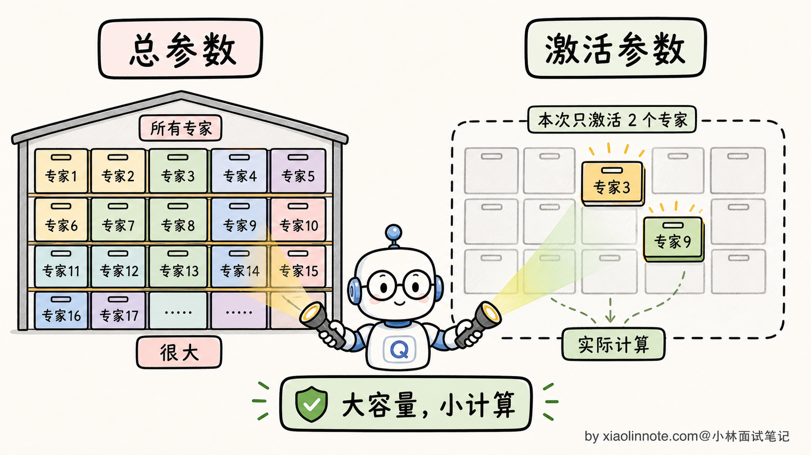

这种「学得多 + 跑得快」的甜蜜组合，是 MoE 在 LLM 时代爆发的根本原因。Dense 模型走到 70B 量级已经是推理成本的极限，再往上 175B、500B、1T，推理几乎跑不起来；MoE 通过把激活参数控制在 37B-100B 这个区间，可以把总参数推到 600B、1T、甚至更多。

### 19.4 主流 MoE 模型对比：DeepSeek V3、Mixtral、Qwen 各自的设计

**DeepSeek V3 / R1（256 专家细粒度路由）**

- 总参数 671B / 激活 37B（5.5% 激活率）
- 每层 256 个 routed experts + 1 个 shared expert
- 每个 token 选 Top-8 routed + 1 shared = 9 个专家激活
- 设计哲学：**专家越多越细分，激活更细粒度**
- 创新点：MLA（Multi-head Latent Attention）+ Auxiliary-Loss-Free 负载均衡

**Mixtral 8x7B（早期主流配置）**

- 总参数约 47B / 激活约 13B（28% 激活率）
- 每层 8 个 experts，每个 token 选 Top-2 激活
- 设计哲学：**专家少而精，激活率较高保证质量**
- 是 2023 年开源 MoE 的标杆

**Qwen 系列**

- Qwen MoE 30B-A3B：30B 总参数 / 3B 激活（10% 激活率）
- 类似 DeepSeek 的细粒度专家路线
- 注重小激活参数下的性能

**Grok 1（314B / 78.5B）**

- xAI 早期开源的 MoE，激活率较高（25%）
- 设计相对保守，没有 DeepSeek 那么激进

观察这些模型，能看出 MoE 设计的几个趋势：

- **专家数越来越多**：8 -> 64 -> 256
- **激活率越来越低**：28% -> 10% -> 5.5%
- **共享专家越来越普及**：DeepSeek V3 引入 1 个 shared expert，避免常见知识被反复学

这个趋势的内在逻辑是「**更细粒度的稀疏化 = 更高的算力性价比**」。256 个专家、激活 5%，相当于一个总参数极大但每次只用一小撮的智能图书馆。

### 19.5 MoE 的三大训练挑战

**挑战 1：专家不平衡**

Router 容易陷入「只用几个专家」的恶性循环。除了负载均衡损失，业界还发展出几种应对：

- **Expert Choice Routing**：反过来让专家挑 token，每个专家固定吃 N 个 token，自然平衡
- **Auxiliary-Loss-Free**：DeepSeek V3 用，动态调整专家偏置项，不引入额外损失
- **温度退火**：训练初期 Router 用高温采样（更随机），让所有专家都有机会被探索

**挑战 2：Router 训练不稳定**

Router 是个分类网络（要选 Top-K 专家），梯度通过 softmax + topk 这两个不可微操作传播，本身就不稳定。常见的稳定化技巧：

- **Noisy Top-K Gating**：训练时给 Router 输出加噪声，鼓励探索
- **Z-loss**：限制 Router logits 的范数，防止极端化
- **Soft 路由 + Hard 路由切换**：训练时用 soft（加权所有专家），推理时用 hard（只激活 Top-K）

**挑战 3：分布式并行复杂**

MoE 模型的并行方式比 Dense 复杂得多。Dense 只用 Tensor Parallel + Pipeline Parallel 就够了，MoE 还要考虑：

- **Expert Parallel**：不同专家分配到不同 GPU，token 在 GPU 之间路由
- **All-to-All 通信**：每个 token 选了几个专家后，要把 token 发送到对应专家所在的 GPU，处理完再发回来。这是 MoE 训练通信开销最大的环节

通信开销让 MoE 在多机训练时效率打折扣。DeepSeek V3 的工程优化里有大量篇幅讲怎么把 All-to-All 通信和计算重叠（DualPipe 算法），是工程实力的体现。

### 19.6 MoE 的部署挑战

**挑战 1：显存占用按总参数走**

虽然每个 token 只激活 37B，但所有 671B 参数都要加载到显存里（不然 Router 路由到没加载的专家就没法算）。这意味着 DeepSeek V3 部署需要至少 1.3TB FP16 显存（量化后约 350GB INT4），最少 8 卡 H100。这对很多企业来说是不小的硬件投入。

**挑战 2：批量推理时通信开销大**

单 token 推理 MoE 还行，但批量推理（一次处理几十个用户请求）时，不同 token 选不同专家，导致大量跨卡通信。这就是为什么 MoE 模型的「**吞吐量**」往往不如同等激活参数的 Dense 模型。

**挑战 3：专家不均衡导致负载不均**

部署时，如果某个专家热门（被很多 token 路由到），它所在的 GPU 就会过载，其他 GPU 空闲。需要动态负载均衡机制（专家迁移、复制热门专家等），这又是一个工程坑。

应对这些挑战，业界有一系列工具和优化（vLLM 的 MoE 并行支持、SGLang 的专家亲和性调度、TensorRT-LLM 的 MoE 优化），但整体来说，**MoE 部署的技术成熟度还在快速演进**。很多公司虽然喜欢 MoE 的训练性价比，但部署时还是选 Dense 模型

### 19.7 为什么 2024 年后 MoE 才在 LLM 领域火起来

MoE 不是新东西，1991 年就有人提出，2017 Google 的 GShard 就用过 MoE 训过 600B 模型。为什么直到 2024 年 DeepSeek V3 才让整个圈子开始用 MoE？

**1. 训练经验积累到位了**

早期 MoE 训练极其不稳定（专家不平衡、Router 崩溃、loss 震荡），需要大量工程经验才能调好。2017-2023 年这几年里，Google、Meta、DeepSeek 等团队累积了一整套 MoE 训练 know-how（负载均衡、噪声路由、专家容量等），这些技术在 2024 年成熟到「开源社区也能复现」的程度。

**2. 推理框架支持完善了**

2023 年之前，主流推理框架对 MoE 的支持很差，部署困难。2024 年 vLLM、SGLang、TensorRT-LLM 都加入了 MoE 优化（专家并行、All-to-All 通信优化），让 MoE 模型能在生产环境跑起来。

**3. DeepSeek V3 把成本打下来了**

最关键的一击是 DeepSeek V3 在 2024 年底公开了一个 671B 总参数、37B 激活参数的 MoE 模型，并报告了非常低的训练成本和很强的效果。这让大家看到：MoE 不只是论文里的好方法，是真的能用更高的训练和推理性价比做出顶级模型。整个开源社区被点燃，2025 年之后越来越多大模型开始认真评估 MoE 路线。

到 2026 年，MoE 已经成为大模型架构的主流方向之一，但还不能说「几乎所有新模型都用 MoE」。Dense 模型依然有很强生命力，尤其在 1B-70B 这类部署稳定、延迟敏感、工程复杂度要低的场景。更稳的说法是：**MoE 适合把总容量做大、把激活成本压低；Dense 适合部署简单、负载稳定、延迟可控**。

## 🎯 面试总结

回到开头那段对话，问到 MoE，最重要的是先把**核心思想**讲清楚。MoE 把 Transformer 中的 FFN 复制成 N 份「专家」，加一个 Router 选 Top-K 个来处理每个 token。最关键的设计哲学是**总参数 vs 激活参数解耦**：训练时学 N 倍知识，推理时只用 K/N 的算力。这一句先点出来，就抓到了 MoE 的本质。

接下来把**三个核心组件**讲清。多个专家（学到不同擅长方向，比如代码、数学、中文等）、Router（一个简单的线性层算分 + Top-K 选取）、负载均衡损失（防止 Router 偏爱某几个专家让其他专家躺平）。其中**专家不平衡**是 MoE 训练最著名的难题，DeepSeek V3 用 Auxiliary-Loss-Free 策略（动态调专家偏置项不引入额外损失）进一步优化，是 2024 年的工程亮点。

然后举具体的**主流模型对比**。DeepSeek V3 用 256 个专家、激活 9 个（Top-8 routed + 1 shared），671B / 37B、激活率 5.5%；Mixtral 8x7B 用 8 专家激活 2 个，47B / 13B、激活率 28%。趋势是「专家越来越多、激活率越来越低」，更细粒度的稀疏化带来更好的算力性价比。能背出 DeepSeek V3 的具体配置数字，会让面试官知道你真的看过论文。

最关键的一句话是讲清 MoE 的训练 + 部署挑战。训练上有专家不平衡、Router 不稳、All-to-All 通信复杂这些坑；部署上显存按总参数走、批量推理通信开销大、热门专家负载不均。能讲出「**显存按总参数走，但推理速度按激活参数走**」这一句反直觉但精确的话，面试官就知道你真的理解 MoE 在工程上的取舍。

如果还想再加分，可以指出 MoE 是 1991 年就有的老想法，2024 年之后因为「训练经验成熟 + 推理框架完善 + DeepSeek 把成本打下来」才在 LLM 领域真正爆发。它是主流方向，但不是唯一方向，这种「知道趋势，也知道边界」的表达会更像真实工程师。

# 20. 大模型部署有哪些主流方案？vLLM、TGI、llama.cpp、SGLang 实际项目里怎么选？

## 💡 简要回答

我理解大模型部署框架的本质问题是：**怎么在固定的硬件上跑得更快、更省显存、支持更多并发用户？**

主流框架按定位分四类。

**1. vLLM**：当前生产部署里很常见的框架，心创新是 **PagedAttention**，把 KV Cache 像操作系统虚拟内存一样分页管理，大幅减少碎片，显存利用率能明显提高。配合 Continuous Batching 实现很高的吞吐量，是很多团队部署 LLM API 时会优先评估的方案。

**2. SGLang**：vLLM 之后的**新一代推理框架**，核心创新是 **RadixAttention**，把多请求的共享前缀（如 System Prompt、Few-shot 示例、对话历史）组织成树结构，相同前缀只存一份 KV Cache。在 Agent、多轮对话、批量 Prompt 场景下比 vLLM 显存更省、首 token 延迟更低。

**3. TGI（Text Generation Inference）**：HuggingFace 出品，与整个 HF 生态**深度集成**。优点是开箱即用、支持各种 HF Hub 上的模型、企业级 API 接口（鉴权、metrics、健康检查）。但要注意它近两年的增长势头不如 vLLM / SGLang，选它更多是看中 HF 生态和既有系统集成，而不是追求极致性能。

**4. llama.cpp**：**CPU / 边缘设备**部署的事实标准。用 C++ 重写整个推理栈，配合 GGUF 量化文件格式，可以让 7B 模型在 MacBook Pro 上跑、在树莓派上跑、在手机上跑。是个人开发者和边缘部署的首选。

**怎么选**：

- **生产高吞吐 LLM API**：vLLM 默认
- **Agent / 多轮对话 / Few-shot**：SGLang 更省
- **拥抱 HuggingFace 生态、企业级**：TGI
- **本地 / Mac / 边缘 / 无 GPU**：llama.cpp
- **极致性能、自家定制**：TensorRT-LLM（NVIDIA 官方）

## 📝 详细解析

### 20.1 部署框架解决的核心问题

要理解为什么需要 vLLM、SGLang 这些专门的部署框架，得先看看「直接用 transformers 库跑模型」会有什么问题。

最朴素的部署方式是写个 Python 脚本，加载 HF transformers 的 AutoModelForCausalLM，调 `model.generate()`。能跑起来，但效率会很糟糕，三个核心痛点：

**1. KV Cache 显存碎片严重**

每来一个请求，朴素实现会预分配「最大可能长度」（比如 4096 tokens）的 KV Cache 显存。但实际上大多数请求只用 200-500 tokens，剩下的 3500+ tokens 显存就空着浪费了。一台 80GB H100 理论能跑 100 个并发请求，实际只能跑 30 个，显存白白浪费 60-70%。

**2. 批量推理调度低效**

朴素批量处理（static batching）是「凑齐 N 个请求一起跑、所有请求一起结束」。但每个请求生成长度不同（有的 50 tokens 就完了、有的要 1000 tokens），短的请求等长的请求，GPU 大量时间在「跑了一半在等」。吞吐率上不去。

**3. 重复计算**

如果每个用户都用同一段 System Prompt（比如 1000 tokens 的产品知识库），朴素实现每次都要重新算这 1000 tokens 的 KV Cache，浪费极大。

部署框架就是为了解决这三个痛点。三大优化方向：**内存高效（显存碎片）+ 批量调度（吞吐率）+ 缓存复用（重复计算）**。每个主流框架在这三个方向上都有自己的创新。

### 20.2 vLLM 与 PagedAttention：操作系统虚拟内存的灵感

vLLM 是 UC Berkeley 在 2023 年开源的推理框架，核心创新是 **PagedAttention**。

PagedAttention 的灵感来自操作系统的**虚拟内存（Virtual Memory）**。

操作系统怎么管理内存？不是给每个进程预分配大块连续物理内存（这样会有大量碎片），而是把物理内存切成固定大小的「页（Page）」，每个进程拿到的是「逻辑地址」，通过页表（Page Table）映射到真实的物理页。这样物理内存可以充分利用，不浪费。

PagedAttention 把这个思路搬到 KV Cache 上：

- 把 GPU 显存切成固定大小的「Block」（典型大小 16 个 token 的 KV）
- 每个请求拿到的是「逻辑 KV 序列」，由一张 Block Table 映射到具体的物理 Block
- 一个请求实际用了 200 tokens 就只占 13 个 Block（200/16），用完即释放
- 没有「预分配 4096 但只用 200」的浪费

实测下来 PagedAttention 把显存利用率从 30-40% 拉到 90%+，同样硬件下能跑 2-4 倍并发请求。

vLLM 还有第二个杀手锏：**Continuous Batching（连续批处理）**。

朴素 static batching 是「凑齐 N 个请求一起跑、跑完一起结束」。Continuous Batching 是「请求异步加入和退出，每个 token 步骤动态组 batch」。比如：

- 时刻 t1：请求 A、B、C 同时在跑
- 时刻 t5：A 生成完了退出，立刻有新请求 D 加入
- 时刻 t8：B 也生成完了退出，新请求 E 加入
- 这样 GPU 一刻不闲，吞吐率比 static batching 高 3-5 倍

vLLM = PagedAttention（显存高效）+ Continuous Batching（吞吐高效），是当前生产环境部署 LLM API 的事实标准。OpenAI、Anthropic 等厂商虽然没开源他们的内部推理栈，但据传也用了类似的优化思路。

### 20.3 SGLang 与 RadixAttention：共享前缀的杀手锏

SGLang 是 LMSYS 在 2024 年推出的新一代推理框架。它**不是要替代 vLLM**，而是针对 vLLM 没解决好的特定场景：**多请求共享前缀**。

什么场景下「共享前缀」很常见？

- **System Prompt 共享**：所有用户调用同一个 API，System Prompt 完全一样（几千 tokens）
- **Few-shot Examples 共享**：Prompt 里有 5-10 个固定示例，每个用户的查询前面都附带这些示例
- **多轮对话历史**：同一用户的多轮对话，每轮都包含前 N 轮的完整历史
- **Agent 工作流**：Agent 调用 LLM 多次，每次的上下文都从同一个 System Prompt 开始

vLLM 的 PagedAttention 虽然显存高效，但**不同请求的 KV Cache 仍然各存各的**。10 个用户都用同样的 1000 tokens System Prompt，vLLM 要存 10 份相同的 KV Cache。

SGLang 的核心创新 **RadixAttention** 把这个问题解决了。

RadixAttention 用的是计算机科学里的经典数据结构 **Radix Tree（基数树）**：

- 把 KV Cache 组织成一棵树
- 树的根节点是空（无 token）
- 每个请求的 token 序列从根节点开始往下走
- 多个请求如果开头 N 个 tokens 一样，就共享根节点到第 N 层的同一条路径
- 第 N+1 层开始分叉，各自存独立部分

这样 KV Cache 显存按「**所有请求的并集**」算，而不是「**所有请求各自的并集和**」。在前缀重复率高的场景下，显存能省下 50-80%。

更妙的是，RadixAttention 还能**自动复用历史请求**的 KV Cache。如果 1 小时前有用户问过相同 System Prompt 的问题，那段 KV Cache 还在 GPU 显存里（按 LRU 淘汰），新用户直接复用，省去重新计算的几百 ms 延迟。

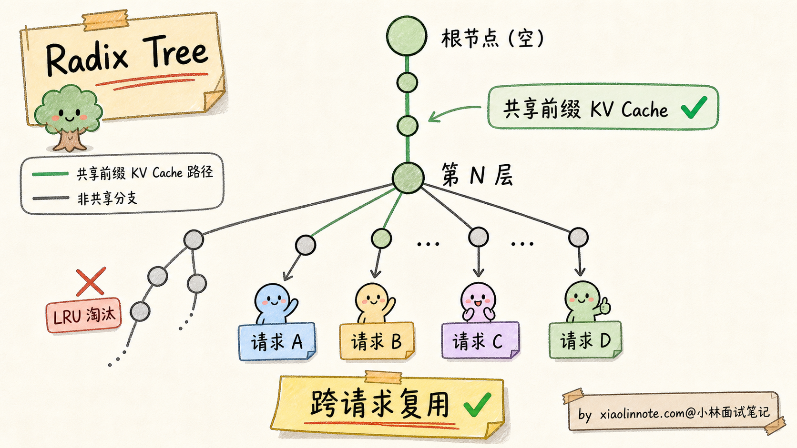

实测在 Agent 场景（多次调用同一个 System Prompt）下，SGLang 比 vLLM 首 token 延迟降低 2-3 倍、吞吐量提升 30-50%。所以现在 Agent 框架（LangGraph、AutoGen 等）都开始把 SGLang 作为推荐推理后端。

但要注意：**纯单请求、无前缀共享场景下，SGLang 相对 vLLM 优势不明显**。两者目前是互补关系不是替代关系。

### 20.4 TGI：HuggingFace 生态集成方案

TGI（Text Generation Inference）是 HuggingFace 在 2022 年推出的推理服务，专门为「让 HF Hub 上的模型一键部署成生产 API」设计。它的核心卖点不是绝对性能，而是**生态集成 + 企业级特性**：

**生态集成**：

- 直接读 HF Hub 的模型 ID，自动下载部署，不用手动转格式
- 支持 HF 各种格式（safetensors、quantization 配置）
- 兼容 HF transformers 的 tokenizer 和 chat template

**企业级特性**：

- HTTP / gRPC 双协议
- 鉴权（API Key、JWT）
- Prometheus metrics
- 健康检查、优雅重启
- 流式响应（SSE）

**性能层面**：

- 也支持连续批处理、量化、流式输出等生产服务常用能力
- 但在很多公开对比和工程实践里，极致吞吐通常不如 vLLM / SGLang
- 胜在 HuggingFace 生态集成、服务接口和已有企业流程迁移成本低

适合用 TGI 的场景：

- 公司本来就用 HuggingFace 全套（数据集 / Transformers / Hub）
- 需要快速 POC，不想折腾推理框架
- 要部署的模型在 HF Hub 上有现成的，不想自己转格式
- 需要企业级特性（鉴权、metrics、可观测性）

### 20.5 llama.cpp：CPU / 边缘设备的事实标准

llama.cpp 是 Georgi Gerganov 在 2023 年初个人项目开始的，现在已经是「**让大模型在非 GPU 设备上跑**」的事实标准。

它的核心思路和 vLLM/TGI 完全不同：**用纯 C++ 重写整个推理栈，零依赖，最大化 CPU 性能**。

为什么要这样做？因为**绝大多数个人设备没有 GPU**：

- MacBook Pro（M1/M2/M3 芯片，统一内存架构）
- Windows 笔记本（集成显卡）
- 树莓派、Jetson 等嵌入式设备
- 手机（iPhone、Android）

llama.cpp 的几个关键技术：

**1. GGUF 文件格式**

llama.cpp 自定义的模型存储格式，把模型权重 + 量化方案 + 元数据打包到一个文件。常见的 GGUF 量化档位：

- **Q8_0**：8-bit 量化，几乎无损
- **Q5_K_M**：5-bit 量化，精度和体积平衡
- **Q4_K_M**：4-bit 量化，最常用，体积压到 1/4
- **Q3_K_S**：3-bit 量化，极端压缩，精度有损失

**2. SIMD 优化**

针对各种 CPU 指令集（AVX2、AVX512、ARM NEON）做手工优化的矩阵乘法 kernel，CPU 推理速度能跑到 GPU 的 30-50%（虽然不如 GPU，但对个人使用足够）。

**3. Metal 后端（Apple Silicon）**

苹果 M 系列芯片的统一内存架构特别适合 llama.cpp。M3 Max（128GB 统一内存）能跑 70B 模型，速度可观。这让 llama.cpp 在 Mac 用户中极其流行。

适合用 llama.cpp 的场景：

- 个人开发者本地玩模型
- Mac 用户想充分利用 M 系列芯片
- 边缘 / 嵌入式部署
- 离线场景（没网也能用）
- 隐私敏感场景（数据不出设备）

不适合的场景：

- 高并发生产 API（CPU 吞吐量上不去）
- 需要 batch 处理（llama.cpp 的批量支持较弱）
- 多卡 GPU 集群（不是它的设计目标）

### 20.6 TensorRT-LLM：NVIDIA 官方极致优化

最后简单提一下 NVIDIA 自家的 **TensorRT-LLM**。它的定位很特殊：**针对 NVIDIA GPU 做极致优化，不考虑跨平台**。

核心特点：

- 对每个具体 GPU 型号（A100 / H100 / H200）做硬件级别 fine-tuning
- 集成 NVIDIA 自家的内核库（cuBLAS、cuDNN、TensorRT）
- 支持 FP8、INT4 等所有 NVIDIA 硬件支持的精度
- 性能通常比 vLLM 再高 10-30%

代价：

- 开源但工程门槛高，部署相对复杂（需要先编译 engine）
- 只支持 NVIDIA GPU，AMD / Apple Silicon 不行
- 文档生态不如开源框架活跃

适合：

- 有 NVIDIA 大集群的大厂（字节、腾讯、阿里等）
- 追求极致 GPU 利用率
- 愿意承担额外的工程复杂度

### 20.7 怎么选部署方案：决策矩阵

| 框架             | 核心创新                             | 最佳场景                | 性能                    | 生态            |
| ---------------- | ------------------------------------ | ----------------------- | ----------------------- | --------------- |
| **vLLM**         | PagedAttention + Continuous Batching | 高吞吐 LLM API          | 极高                    | 开源活跃        |
| **SGLang**       | RadixAttention（共享前缀）           | Agent / 多轮 / Few-shot | 极高（特定场景超 vLLM） | 较新但快速增长  |
| **TGI**          | HF 生态集成                          | 企业级 + HF 生态        | 高                      | HF 全家桶       |
| **llama.cpp**    | C++ 重写 + GGUF                      | CPU / Mac / 边缘        | CPU 上极强              | 个人 / 边缘     |
| **TensorRT-LLM** | NVIDIA 硬件极致优化                  | 大厂 NVIDIA 集群        | 极高（特定硬件上很强）  | NVIDIA 官方开源 |

实战中常见的几个**误用陷阱**：

**误用 1：用 vLLM 跑 Agent 多轮对话**

Agent 场景前缀重复率高，vLLM 没有 RadixAttention 优化，每次重新算 KV Cache 浪费大量算力。改用 SGLang 后首 token 延迟降 2-3 倍。

**误用 2：用 llama.cpp 做高并发服务**

llama.cpp 的批量调度比 vLLM 弱很多，并发上去后吞吐率瓶颈。生产 API 服务还是要用 GPU + vLLM。

**误用 3：用 TGI 追求绝对性能**

如果你的瓶颈是 GPU 吞吐量，TGI 通常不是第一选择，应该优先评估 vLLM、SGLang 或 TensorRT-LLM。具体差距会随模型、硬件、量化方式和 batch 策略变化，不要死记一个固定百分比。

**误用 4：用 TensorRT-LLM 做快速 POC**

TensorRT-LLM 部署需要先编译 engine（每个模型 / GPU 组合都要编译），不适合「快速试验、模型经常换」的场景。

### 20.8 部署的三大隐藏陷阱

**陷阱 1：显存碎片在长上下文场景下还是会出现**

PagedAttention 大幅缓解了显存碎片，但不是完全消除。当请求长度极不均匀（有的 100 tokens、有的 100K tokens），仍然会有 5-10% 的碎片。应对：监控 GPU 显存利用率，如果跌破 70% 考虑加 swap 或调整 max-model-len。

**陷阱 2：KV Cache 量化的支持差异大**

权重量化（FP16 -> INT4）很多框架都支持，但 KV Cache 量化（FP16 -> INT8 / FP8 / INT4）的支持差异很大，而且版本迭代很快。vLLM、SGLang、TensorRT-LLM 都在持续增强这块能力，TGI 和 llama.cpp 的支持方式也要看具体版本。如果你的瓶颈是长上下文 KV Cache 显存，选型前一定要查当前版本文档，别只听别人说「支持」。

**陷阱 3：MoE 模型的部署支持差异**

MoE 模型（DeepSeek V3、Mixtral）部署比 Dense 复杂得多（需要专家并行、All-to-All 通信优化）。vLLM 和 SGLang 都支持但配置复杂；llama.cpp 通过 GGUF 支持但性能一般；TensorRT-LLM 支持最好但工程门槛高。如果要部署 MoE 模型，建议先在测试环境跑通再上生产。

## 🎯 面试总结

问到部署方案，最重要的是先讲清楚**部署框架解决什么问题**。直接用 transformers 库部署有三大痛点：显存碎片严重、批量调度低效、共享前缀重复计算。每个主流框架的核心创新都是攻击这些痛点的某个维度。这一层铺垫先讲到，面试官就知道你不是在背工具，是真的理解部署框架的设计动机。

把**四个主流框架的核心创新**讲明白。vLLM 的杀手锏是 PagedAttention（模仿操作系统虚拟内存的分页 KV Cache，把显存利用率从 30% 拉到 90%+），加上 Continuous Batching 让请求动态进出，是当前生产 API 的常见选择。SGLang 走的是另一条路，核心创新是 RadixAttention（共享前缀的 KV Cache 树），在 Agent 和多轮对话场景下经常能降低首 token 延迟。TGI 的特点是和 HuggingFace 生态深度集成，适合已有 HF 流程的团队。llama.cpp 是另一种风格，纯 C++ 重写 + GGUF 量化，是 CPU / Mac / 边缘部署的事实标准。

然后给清晰的**选型决策**。生产 API 高吞吐选 vLLM；Agent / 多轮对话场景选 SGLang；HuggingFace 生态深用户选 TGI；本地 / Mac / 边缘部署选 llama.cpp；NVIDIA 集群追求极致性能选 TensorRT-LLM。能把「**SGLang 在前缀共享场景比 vLLM 强**」这一点说清楚，是面试加分项，因为这是 2024 年之后才出现的工程认知。

最关键的是讲清**部署陷阱**：显存碎片在长上下文场景还会出现、KV Cache 量化各框架支持差异大、MoE 模型部署比 Dense 复杂得多。能讲到这一层，面试官就知道你真的踩过部署的坑。

如果还想再加分，可以提一句 vLLM 和 SGLang 是「**互补不替代**」的关系，业内已经有公司开始混用（高吞吐路由用 vLLM，Agent 路由用 SGLang）。这种「一线工程视角」会让面试官印象深刻。

# 21. 大模型能力评测指标有哪些？

## 💡 简要回答

我对这块的理解是，学术 Benchmark 只能作为参考，真正重要的是在自己业务数据上的表现。MMLU / MMLU-Pro 测综合知识，HumanEval / SWE-bench Verified 测代码，GSM8K / MATH / GPQA 测数学和科学推理，LiveBench、Humanity’s Last Exam 这类更新型评测用来缓解数据污染。这些指标看一眼能大概判断模型能力区间，但不能直接等价成业务效果。我们实际项目里的做法是，从真实用户请求里采样、人工标注期望输出，建一个 50-200 条的测试集，每次改 Prompt 或换模型都在上面跑一遍，加上线上的用户满意率来形成闭环，这才是可靠的评测体系。

## 📝 详细解析

### 21.1 主流学术 Benchmark 逐一介绍

- **MMLU / MMLU-Pro** 是最广泛引用的综合能力测试。MMLU 涵盖 57 个学科领域，从高中数学、历史、法律到医学和计算机科学，全部是四选一的单项选择题。MMLU-Pro 难度更高、选项更多，也更强调推理。可以把它理解成一套超全面的「文化水平考试」，考的是模型的知识广度和推理基础。
- **HumanEval、MBPP 和 SWE-bench Verified** 是代码能力的基准测试。HumanEval 由 OpenAI 设计，包含 164 道编程题，每道题给出函数签名和 docstring，要求生成完整的函数实现，然后用隐藏的测试用例验证正确性。SWE-bench Verified 更接近真实软件工程，让模型修真实 GitHub issue，能更好评估代码理解、修改和测试能力。Pass@k 是常见指标，表示生成 k 个候选代码，至少 1 个能通过所有测试的比例。
- **GSM8K、MATH、GPQA** 测试数学和科学推理能力。GSM8K 是小学数学应用题，考基础的四则运算和逻辑推理；MATH 是竞赛数学，包含代数、几何、组合数学等；GPQA 更偏研究生级别的科学问答，很多题需要物理、化学、生物等专业知识和多步推理。
- **MT-Bench、Arena、τ-bench** 更偏对话和 Agent / Tool Use 能力。MT-Bench 设计了一系列需要多轮交互的场景，用「LLM-as-Judge」方式给回答打分；Chatbot Arena 更像用户真实偏好投票；τ-bench 这类评测会看模型在工具调用、多轮状态管理、业务流程里的表现，更贴近 Agent 应用。
- **HELM、LiveBench、Humanity’s Last Exam** 是更综合或更新型的评测。HELM 覆盖准确率、鲁棒性、公平性、有害性等多个维度；LiveBench 会持续更新题目，降低数据污染；Humanity’s Last Exam 则主打更难、更广的综合知识和推理。它们比单一指标更全面，但也更复杂。然而，这些看起来很权威的指标，有一个很难回避的系统性缺陷。

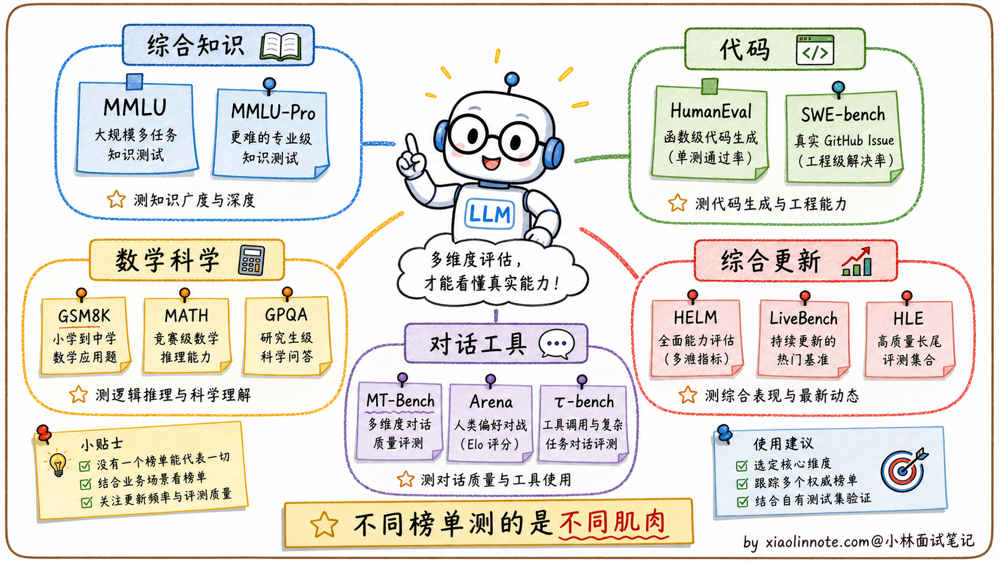

### 21.2 Benchmark 的局限性：数据污染问题

现在的大模型训练数据规模极大，覆盖了互联网大部分公开内容，而 MMLU、GSM8K 这些 Benchmark 的题目也在互联网上公开流传。模型在预训练时可能已经「见过」这些题目的答案，导致测试成绩虚高，并不真正反映泛化能力。

这也是为什么有些模型在学术排行榜上名列前茅，实际用起来却不如名次更低的竞品，因为它们可能是「背过题」的，而不是真的更聪明。

### 21.3 如何建自己的业务评估集

做法通常是：从真实用户请求里采样，人工标注期望答案，形成 50-200 条有代表性的「黄金测试集」；然后每次迭代模型或 Prompt 时，在这个测试集上跑一遍，计算通过率或质量分。

评分方式上，客观任务（信息提取、分类、代码）可以用程序自动验证；主观任务（摘要、问答质量）可以用 LLM-as-Judge，让一个更强的模型（如 GPT-4o）对输出按照给定标准打分。人工抽查 10-20% 的样本可以校准 LLM-Judge 是否可信。

### 21.4 离线评估 + 线上指标的闭环

业务测试集解决了离线评估的问题，但只有离线测试集还不够，生产环境里还需要监控实际的用户体验指标：用户对回答是否满意（明确的点赞/踩、隐式的追问行为）、任务完成率（用户是否实现了目标）、会话放弃率（用户中途退出说明体验差）。

离线评估帮你找问题、快速迭代；线上指标告诉你优化是否真正改善了用户体验。两者结合才是完整的评估体系。

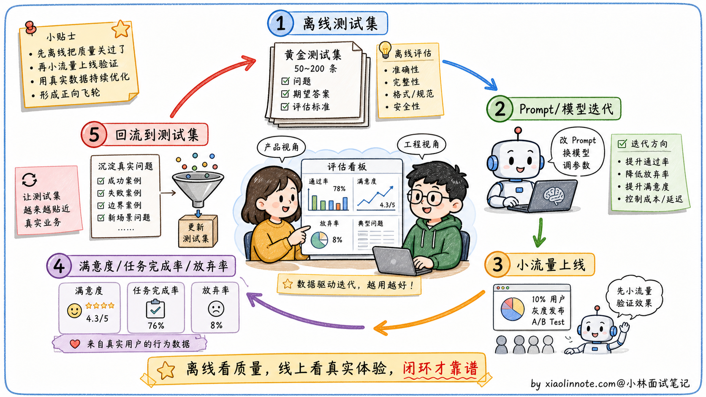

## 🎯 面试总结

问到大模型评测指标，最重要的是先把**学术 Benchmark 和业务评测的关系**讲清楚。学术 Benchmark（MMLU、HumanEval、GSM8K、MT-Bench、HELM 等）适合横向对比模型的综合能力，但**不能完全相信**，因为存在严重的「数据污染」问题（模型在预训练时可能见过测试题）。

接下来讲清主流 Benchmark 各自测什么。MMLU / MMLU-Pro 测综合知识广度和推理，HumanEval / MBPP / SWE-bench Verified 测代码能力，GSM8K / MATH / GPQA 测数学和科学推理，MT-Bench / Arena / τ-bench 测对话、偏好和工具调用，HELM / LiveBench / Humanity’s Last Exam 则是更综合或更新型的评测。能用一两句话说清每个 Benchmark 的设计目标，比单纯报名字深刻得多。

最关键的是讲**业务测试集**的构建方法。从真实用户请求里采样 50-200 条，人工标注期望答案，形成「黄金测试集」，每次改 Prompt 或换模型都在上面跑一遍。评分方式上客观任务（分类、抽取、代码）用程序自动验证；主观任务（摘要、问答）用 LLM-as-Judge 让强模型代评分，人工抽查 10-20% 样本校准。这套方法是工业界做 LLM 项目的标配，能讲出来证明你真的做过项目。

最后提一句**离线评估 + 线上指标**的闭环。离线评估帮你快速迭代找问题，线上指标（满意度、任务完成率、会话放弃率）告诉你优化是不是真的改善了用户体验。两者结合才是完整的评估体系。

如果还想再加分，可以提一句**数据污染**问题的应对方向：避免用公开 Benchmark 直接当训练集、用 LiveBench 这种「持续更新题库」的评测、用业务真实数据做评测。这种「不被 Benchmark 蒙蔽」的工程视角是面试里很难追问的水平。

# 22. 对比使用过哪些主流大模型？你们项目中最终选用了哪个模型？为什么？

## 💡 简要回答

在项目选型阶段，我会先把模型分成两类：一类是国内可落地的生产候选，比如 DeepSeek、Qwen、豆包这类模型；另一类是海外能力标杆，比如 GPT-5.5 / o 系列、Claude Sonnet / Opus 系列，用来做能力上限参照。

如果是面向国内企业用户的 Agentic RAG 系统，我倾向于把国内模型作为主链路候选，海外模型只做离线评测或非敏感场景兜底。原因不是海外模型不好，而是企业项目里合规、网络稳定性、成本预算、售后支持这些约束会直接决定方案能不能上线。

最终落地时，我不会死磕一个模型，而是用 **Model Routing（模型路由）**：格式要求严格、Tool Use 多的节点优先选指令遵循和结构化输出稳定的模型；高频推理、数据清洗、摘要归纳这类节点优先选性价比高的模型；特别难的问题再路由给能力更强但更贵的模型。选模型从来不是看谁跑分最高，而是看谁最契合业务的**合规、成本、延迟与能力特征**。

## 📝 详细解析

### 22.1 为什么不能盯着「排行榜」无脑选？

跑分高，不代表在你的特定业务里表现好。比如海外标杆模型在多模态、代码、复杂推理上通常很强，但它的 API 成本、数据出境、网络访问、企业合同支持，都可能卡住国内 ToB 项目；有些模型榜单漂亮，但在你的财报格式、行业黑话、内部接口调用上不一定稳定；如果系统存在大量高频的 Agent 内部循环调用，硬上最贵的标杆模型，可能一个月就把项目预算烧穿。

### 22.2 主流大模型横向盘点（2026 年视角）

在因为 2026 年模型版本迭代很快，面试时更重要的是讲清选型逻辑。

**国内生产候选（实际落地优先看）**

- **DeepSeek 系列**：特点是推理和性价比突出，适合放在高频分析、代码辅助、长链路推理这类成本敏感的节点上。但具体选 V 系列还是 R 系列，要看任务是偏通用生成还是偏推理。
- **Qwen 系列（通义千问）**：中文语境、工具调用、结构化输出、长上下文这些能力比较适合企业级应用，尤其适合做主调度、文档理解、RAG 汇总这类要求稳定性的节点。
- **豆包 / 火山引擎系列**：工程生态、并发能力、中文产品化体验是它的优势，适合高频文本处理、客服、内容生成、批量分类这类吞吐优先的场景。

**海外能力标杆（评测与非敏感兜底）**

- **GPT-5.5 / o 系列**：适合作为复杂推理、代码、多模态能力的标杆模型。国内企业项目里通常要谨慎放到核心链路，重点评估数据出境、合规审批、网络稳定性和成本。
- **Claude Sonnet / Opus 系列**：长文本、代码、Agent 调度能力很强，也常被用来做评测基准或兜底模型。但它同样要先过合规、成本和可用性这几关。

### 22.3 我们最终选型落地的思考逻辑

我们的项目是一个**企业级多智能体 RAG 问答系统**，业务链路涉及：解析长篇企业财报 -> 多个 Agent 规划拆解任务 -> 频繁调用公司内部的数据库与搜索引擎 -> 汇总生成中文报告。

基于这个真实场景，我们没有死磕单一模型，而是设计了**「大模型路由分配（Model Routing）」**策略：

主调度节点（Orchestrator）和格式要求严格的节点，优先选结构化输出稳定、Tool Use 准确率高、长上下文指令遵循好的模型。在这个环节，Agent 需要频繁调用内部 API，JSON、函数参数、字段名都不能乱，所以「稳定」比「榜单第一」更重要。

逻辑推理与高频数据清洗节点，优先选推理能力和 token 单价更均衡的模型。在对财报数据做归纳、比对、异常解释时，很多调用不是面向用户的最终回答，而是 Agent 内部中间步骤，这类节点最怕成本失控，所以要把便宜且够用的模型用起来。

最重要的合规底线是：敏感商业数据尽量留在合规可控的链路里。**国内 ToB 项目里，海外模型不是绝对不能用，但必须先看数据分类分级、客户合同、监管要求和企业审批。**只要这几关过不了，再强的模型也只能做离线评测，不能进核心生产链路。

## 🎯 面试总结

问到大模型选型，最重要的是先把**选型不是看排行榜**讲清楚。模型选型从来不是看跑分最高，是看「**合规、成本、延迟、能力特征**」四个维度匹配业务需求。这一句先讲到，面试官就知道你不是会背榜单的新人，是真的想过工程问题。

接下来讲清**主流大模型的定位**。国内候选重点看 DeepSeek 的推理和性价比、Qwen 的中文和工具调用、豆包的工程生态和并发能力；海外标杆重点看 GPT-5.5 / o 系列、Claude Sonnet / Opus 系列在复杂推理、代码、长文本上的能力。能讲出每家模型的「特长」而不只是「排名」，会让面试官知道你真的用过对比过。

最关键的是讲**选型落地的思考逻辑**。不是死磕单一模型，而是设计「**模型路由（Model Routing）**」策略，按节点特性分配模型。比如格式要求严格的调度节点用结构化输出稳定的模型，高频推理任务用性价比高的模型，敏感数据链路优先走合规可控的模型。这种「根据任务特性混合用多个模型」的工程思路，是 2026 年 AI 应用里很常见的做法。

如果还想再加分，可以提一句**合规约束的现实意义**：国内 ToB 项目里，数据出境合规是死线，再强的海外模型也不能用。这种「业务约束优先于技术先进性」的判断，会让面试官知道你真的在国内企业项目里跑过流程。能讲到这一层，这道题就答得很完整了。

# 23. 为什么长上下文会出现 Lost in the Middle？上下文窗口越大越好吗？

## 💡 简要回答

我不会把长上下文能力简单理解成「模型最多能接收多少 token」。最大上下文窗口只是输入上限，真正有用的是模型在不同长度、不同位置和不同干扰强度下，能不能稳定找到证据并完成推理，也就是它的有效上下文能力。

Lost in the Middle 指的是关键信息放在长文本中间时，模型的利用效果往往比放在开头或结尾更差。它不只是位置编码造成的，还和训练时见过的长度分布、注意力的位置偏置、无关内容对注意力的稀释，以及任务需要跨段整合多少信息有关。

所以窗口不是越大越好。输入越长，稠密 Self-Attention 的计算量增长很快，KV Cache、首 token 延迟和调用成本也会增加。工程上我会先做检索和重排，只保留真正相关的片段，再配合结构化摘要、清晰分区和关键约束布局，最后用不同长度、不同证据位置的测试集验证，而不是把所有资料一次性塞给模型。

## 📝 详细解析

### 23.1 先分清「训练长度」「窗口上限」和「有效长度」

**训练时见过的长度**。如果模型在预训练或长上下文继续训练时，大部分样本都比较短，那么它即使通过位置编码扩展接受了更长输入，也不代表它已经学会在超长文本中稳定检索和推理。

**接口允许的最大窗口**。它表示输入 token 加输出 token 不能超过某个上限，回答的是「能不能装进去」。窗口扩展可以通过长文本继续训练、位置插值、YaRN 等办法完成，但扩到更长并不等于所有任务都能无损外推。

**有效上下文长度**。它回答的是「装进去以后能不能用好」。同样一段证据，放在 8K 输入里能答对，放进 100K 的大量干扰内容中就可能答错。对真实业务来说，第三个数字往往比模型标称的窗口大小更重要。

### 23.2 Lost in the Middle 到底是什么现象？

假设我们把一条能直接回答问题的证据，分别放在长文档的开头、中间和结尾，再让模型回答同一个问题。很多模型会呈现一种类似 U 形的表现：证据在开头和结尾时更容易答对，放在中间时正确率更容易下降。

这就是 Lost in the Middle，直译过来是「迷失在中间」。它不是说模型完全看不见中间的 token，而是说在长输入和大量干扰下，模型没有稳定地把中间那段信息选出来，并用于最后的回答。

为什么开头和结尾会占便宜？**开头通常放系统指令、任务背景和核心定义，模型在训练中见过大量这种结构；结尾离当前要生成的答案最近，用户问题也经常出现在这里。久而久之，模型可能形成对开头和近邻内容更强的利用倾向。**

中间内容则很容易夹在大量相似段落里。如果关键信息只出现一次，周围又有几十段看似相关的文字，它虽然在窗口内，却未必能赢得足够的注意力。

### 23.3 为什么不能只怪位置编码？

位置编码确实会影响长上下文。模型如果推理时使用了训练阶段从没见过的位置范围，位置表示可能失真，近距离和远距离的关系也可能判断不准。但把 Lost in the Middle 全部归因于 RoPE 或其他位置编码，是把问题想简单了。

更完整地看，至少还有三股力量一起在起作用。

- **训练分布**。模型训练时接触到的文本长度、关键信息所在位置、长文本任务类型，会影响它学会怎样使用上下文。如果训练样本里的答案经常在开头或结尾，中间位置自然练得少。
- **注意力稀释和干扰**。输入从 10 段扩到 1000 段以后，需要竞争注意力的 token 多了很多。此时真正相关的证据可能被重复信息、相似表述和错误版本包围。模型不是没有读到，而是没有把它选成回答依据。
- **任务难度**。从长文中找一个唯一编号，和先找到三个分散证据、再判断它们的时间和因果关系，完全不是一个难度。窗口长度相同，后者更容易失败。因此长上下文评测不能只做简单的「大海捞针」。

### 23.4 上下文窗口越大，代价也越大

对于标准的稠密 Self-Attention，序列长度从 `n` 增长后，注意力计算量大致按 `n²` 增长。Flash Attention 能明显降低中间结果的显存读写和显存占用，但它不会把稠密注意力的计算关系直接变成线性。

推理时，已有 token 的 K、V 还要放进 KV Cache。序列越长，KV Cache 通常越大，长输入的 Prefill 时间也越久。对 API 调用来说，更多输入 token 还意味着更高成本。即使模型最终回答只用了其中两段证据，前面的海量文本也已经参与了处理。

还有一种更隐蔽的代价叫**质量退化**。塞入更多资料，看起来是在增加信息，实际上也可能引入旧版本、重复片段、无关内容和彼此矛盾的描述。模型要先从噪声里找信息，再进行推理，任务反而更难。

### 23.5 工程上怎么让长上下文真正好用？

面对一大堆资料，第一反应不应该是「全部塞进去」，而应该先问：「完成当前任务，模型到底需要哪些信息？」

如果是在文档问答场景，我会先把问题送入检索链路，通过关键词检索和向量检索召回候选片段，再用 Rerank 把真正相关的内容排到前面。这样走完的是「**全量文档 -> 候选片段 -> 高相关证据 -> 模型回答**」，模型面对的不是一整座仓库，而是当前问题真正需要的几页资料。

如果任务确实需要**全局信息**，比如总结一本书或分析一整份代码库，就不能只取几个 chunk。这时可以采用**分层摘要，先对章节、模块分别生成有出处的结构化摘要，再由上层汇总**；对于数字、约束、待办和接口定义这类不能模糊压缩的信息，则单独抽取成结构化字段，不要混在自然语言摘要里。

**提示词布局**也很重要。系统指令、用户目标、不可违反的约束要分区清楚，证据要带标题、来源和段落编号，问题可以在证据之后再次明确。对最关键的限制条件，可以放进独立的任务规格区，而不是埋在几十页聊天历史中等模型自己发现。

另外，压缩不是越狠越好。**摘要之后必须保留回查原文的引用或 chunk ID，一旦回答涉及数字、合同条款等高风险信息，就回到原文核验。**这样既减少上下文，又不会让摘要变成新的信息瓶颈。

### 23.6 长上下文应该怎么评测？

比较可靠的做法，是让测试集同时改变几个条件：输入长度从 8K、32K 增长到目标长度；关键证据分别放在开头、中间和结尾；干扰文档从少到多；任务同时包含单点检索、多证据汇总、时间排序和冲突判断。

指标也不能只看答案准确率。还要看证据引用是否正确、遗漏了多少关键事实、是否引用了干扰内容，以及长度增长以后首 token 延迟、总耗时和单次调用成本增加了多少。

最终要得到的不是一句「这个模型支持 128K」，而是一条更有用的结论：「在我们的合同审核任务里，输入不超过 40K、证据分布在任意位置时，准确率和延迟都能达到要求。」这才是项目真正能使用的有效长度。

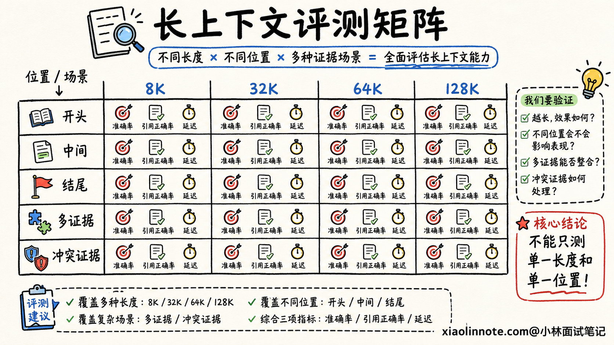

## 🎯 面试总结

面试时我会先把一句话说清楚：**最大上下文窗口表示「装得下多少」，不代表模型「稳定用得好多少」**。训练时见过的长度、接口支持的长度和业务里的有效长度，是三个不同概念。

Lost in the Middle 表现为关键信息放在长文本中间时，比放在开头或结尾更容易被忽略。它与位置编码有关，但不能只怪位置编码，还要考虑训练分布、位置偏置、注意力稀释、干扰内容和任务本身的推理难度。

窗口越大，稠密注意力的计算量、KV Cache、Prefill 延迟和输入成本通常也越高，噪声与冲突信息还可能让答案质量下降。所以工程上更合理的做法是先检索和重排，再通过分层摘要、结构化抽取、清晰布局和引用回查，把真正有用的信息交给模型。

最后要用不同长度、不同证据位置和不同任务难度做评测，找出当前业务的有效上下文长度。能把「容量、质量、成本、评测」这四层都讲清楚，这道题就不只是背过概念，而是真正理解了长上下文如何落地。