# 1. 什么是大语言模型？和传统 NLP 模型有什么区别？

👔面试官：来，讲讲什么是大语言模型？它和我们以前用的传统 NLP 模型有什么区别？

🙋‍♂️我：大语言模型嘛，就是 ChatGPT 那种，参数特别多、能聊天的那个。

👔面试官：……能聊天的就叫大语言模型？那 Siri 也能聊天，它也是大语言模型？「参数多」具体多到什么量级才算「大」？为什么参数多了就能聊天？

🙋‍♂️我：哦哦，那大语言模型就是参数到亿级别以上、训练数据特别多、能完成各种 NLP 任务的模型。

👔面试官：你说的还是结果，没说本质。BERT 也有几亿参数，那 BERT 是不是大语言模型？传统 NLP 是先分词、再词性标注、再命名实体识别，最后做下游任务，那 LLM 是怎么做的？你能说出本质区别吗？

🙋‍♂️我：呃……LLM 不分这些步骤，是一个端到端的模型对吧？

👔面试官：「端到端」我们 2015 年就在说了，那时候的 LSTM 也是端到端的，BERT 接个分类头也是端到端的，你这回答放在十年前都不算新东西。讲讲为什么 LLM 能做到「一个模型干所有 NLP 任务」？为什么之前的模型做不到？回去搞清楚再来。

这道开场题答了几轮都没踩到点，看来「LLM 大在哪」「为什么大到一定程度就有质变」这两件事得正儿八经讲一下，要不然后面所有题都没有底座。

## [💡 简要回答](https://xiaolinnote.com/ai/llm/what_is_llm.html#💡-简要回答)

我理解大语言模型的本质，是一个用海量语料预训练、参数到百亿千亿规模、自回归生成文本的统一模型。

它和传统 NLP 模型最根本的区别有三点。

第一，传统 NLP 是「一任务一模型」，分词、命名实体识别、情感分析、问答各训各的，每个模型只会干自己那点事；LLM 是「一个模型干所有事」，因为它在预训练阶段学的是「预测下一个 token」这件最通用的事，下游任务用 Prompt 表达就行，不用再分别训练。

第二，传统 NLP 模型是判别式的，吃一段文本输出一个标签或概率；LLM 是生成式的，吃一段文本输出更多文本，理解和生成在同一个模型里完成。

第三，也是最神奇的一点，规模到了一定程度，LLM 会「涌现」出训练目标里没有显式教过的能力，比如多步推理、上下文学习、跨语言迁移，这种「量变到质变」的现象在传统 NLP 模型上是看不到的。

## [📝 详细解析](https://xiaolinnote.com/ai/llm/what_is_llm.html#📝-详细解析)

### [传统 NLP 是怎么干活的？](https://xiaolinnote.com/ai/llm/what_is_llm.html#传统-nlp-是怎么干活的)

要理解 LLM 厉害在哪，得先看看在它之前，业界是怎么处理自然语言任务的。

传统 NLP 的工作方式是「流水线」式的，一个完整任务要拆成好几个独立步骤，每一步用一个专门的模型来完成。这不是大家想这么干，而是当时的小模型能力有限，必须把复杂问题拆解成一个个简单的子问题，每个子问题单独训练一个模型才搞得定。

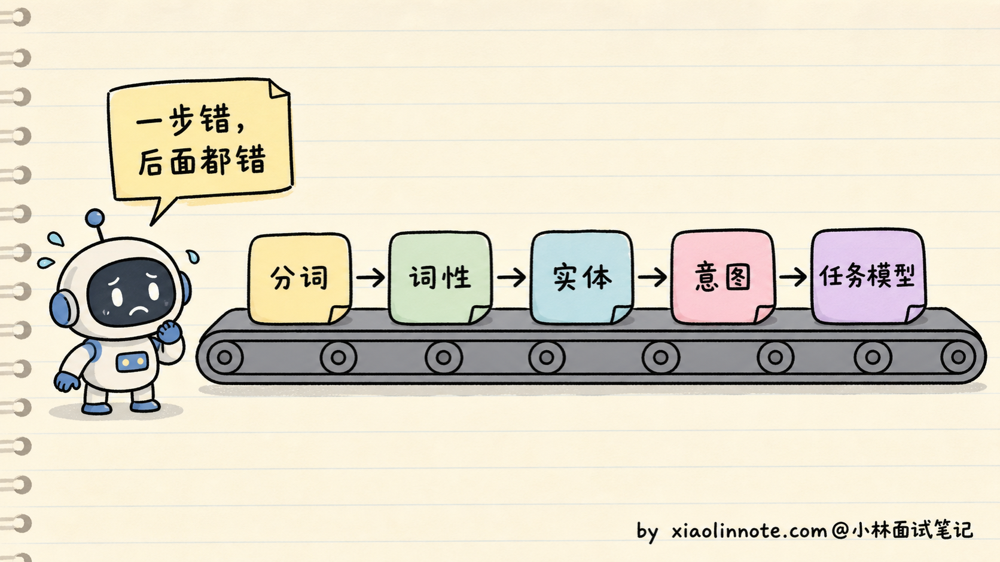

举个例子，假如你要做一个智能客服。流程大概是：第一步分词，把用户的「我想退货」拆成「我 / 想 / 退货」；第二步词性标注，标出「我」是代词、「退货」是动词；第三步命名实体识别，找出有没有商品名、订单号；第四步意图分类，判断这是「咨询」还是「投诉」；第五步去知识库匹配预设答案。

光是「分词」这一步，里面就有一堆坑。中文不像英文有空格天然分隔，「南京市长江大桥」到底是「南京市/长江大桥」还是「南京/市长/江大桥」？这种歧义靠规则解决不了，必须有一个专门的分词模型来判断。而分词模型本身又依赖大量的人工标注语料，遇到训练时没见过的新词（比如「奥利给」「绝绝子」），它就懵了，这就是著名的 **OOV（Out-of-Vocabulary，未登录词）** 问题。

每一步都有这种独立的痛点，每一步都得有自己的模型、自己的训练数据、自己的标注规范。整个 pipeline 又长又脆，前面一步错了，后面全错。分词错了，词性标注就错；词性错了，命名实体识别就错；最终的意图分类也跟着错。这种错误是会**累积传导**的，而且没法事后补救。

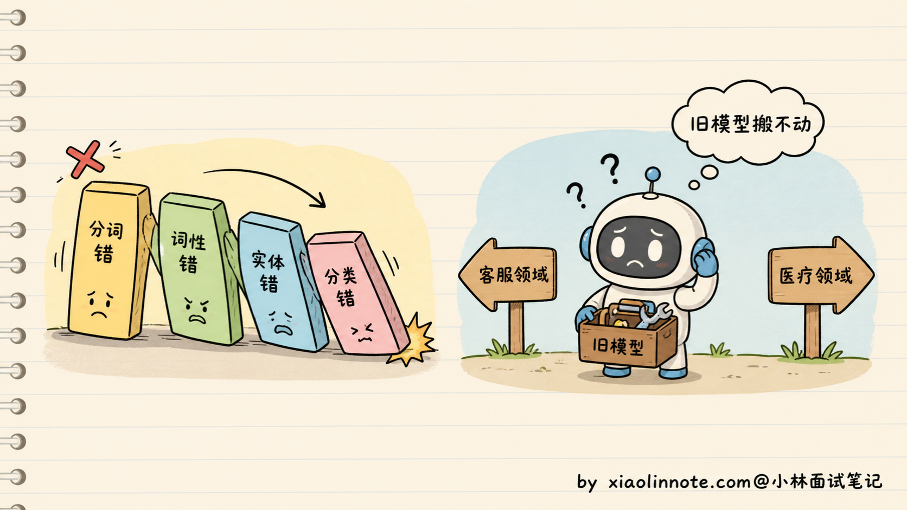

更糟糕的是迁移成本。换个领域（比如从客服换成医疗问答），所有模型基本都得重新训练。因为医疗领域的「实体」（药名、症状、检查项目）和电商领域的「实体」（商品、订单、品牌）完全不是一回事，原来训好的模型用不上。一个公司想做几个不同领域的 NLP 应用，等于要养几套独立的模型团队，成本极高。

这就是 LLM 出现之前的世界，**任务越细分，模型越多；模型越多，标注成本越高；标注越贵，迁移越难**。整个 NLP 行业都被困在这个死循环里走不出来。

### [BERT 时代：预训练通了一半](https://xiaolinnote.com/ai/llm/what_is_llm.html#bert-时代-预训练通了一半)

到了 2018 年，Google 推出 BERT，整个领域出现了第一次大的转折。BERT 的核心创新是**预训练 + 微调**两阶段范式。

预训练阶段，BERT 在海量无标注文本（维基百科 + 图书数据，约 33 亿词）上做两件事：第一是 **MLM（Masked Language Model，掩码语言模型）**，随机遮掉句子里 15% 的词，让模型根据上下文猜被遮的词是什么；第二是 **NSP（Next Sentence Prediction，下一句预测）**，给两个句子，让模型判断它们是不是连续的。这两个任务都不需要人工标注，纯靠原始文本就能训练，所以可以用海量数据。

经过预训练，BERT 学到了通用的语言表示能力，简单说就是「看懂文字」的能力。然后到了下游任务，只需要在 BERT 上面接一个小的「任务头」，用少量标注数据微调一下，就能在各种 NLP 任务上拿到很好的效果。这一招直接把 NLP 各项任务的 SOTA（state-of-the-art，最佳表现）刷了个遍，整个领域为之一振。

但 BERT 走到一半就停了。它解决了「**特征通用**」（一个 BERT 可以服务多个下游任务），但没解决「**任务统一**」（不同任务还是要不同的微调副本）。原因有两个。

第一，BERT 的输出是「**表示**」，不是「**文本**」。它每一层输出的是每个 token 的向量表示，要想拿来做分类，得在最后接一个分类头（全连接 + softmax）；要做命名实体识别，得接一个序列标注头；要做问答，得接一个抽取式 QA 头。每一种任务都需要单独设计的「头」、单独标注的数据、单独训练的过程。一个 BERT 在公司里被用起来，可能要派生出十几个微调副本，每个负责一个具体任务。

第二，BERT 不擅长生成。它的预训练目标 MLM 是「填空题」，每次只猜一个被遮的词，没学过怎么连续生成长文本。所以 BERT 几乎不被用来做翻译、写作、对话这类生成任务。这一块还得交给当时另一条技术路线，比如 GPT-2、T5。换句话说，BERT 把「理解」做到极致，但「生成」是它的短板。

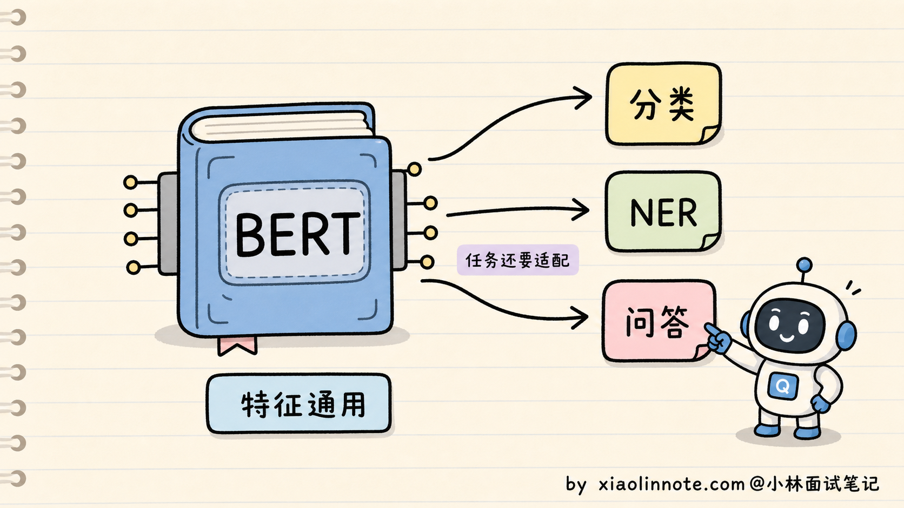

所以 BERT 时代是个很关键的过渡。它证明了「预训练 + 大规模无标注数据」这条路是对的，但还没把所有 NLP 任务收归到同一个接口下。真正完成这一步的，是后来的 GPT 系列。

### [LLM 的本质：把所有任务收编成「预测下一个 token」](https://xiaolinnote.com/ai/llm/what_is_llm.html#llm-的本质-把所有任务收编成「预测下一个-token」)

LLM 最根本的转变，是把所有 NLP 任务统一成了一件事，**预测下一个 token**。

这个训练目标叫 **CLM（Causal Language Modeling，因果语言模型）**。它的训练数据格式特别简单：给一段文本，模型从左到右一个字一个字地往后猜，每一步都要预测「下一个 token 是什么」。比如训练数据是「我喜欢吃苹果」，模型要学会：看到「我」预测「喜」，看到「我喜」预测「欢」，看到「我喜欢」预测「吃」，依此类推。

这种训练方式叫**自回归（Autoregressive）**，意思是「下一步的预测依赖上一步的输出」。GPT、Claude、Qwen、DeepSeek 这些主流大模型，本质都是「自回归 + 因果掩码」的语言模型。

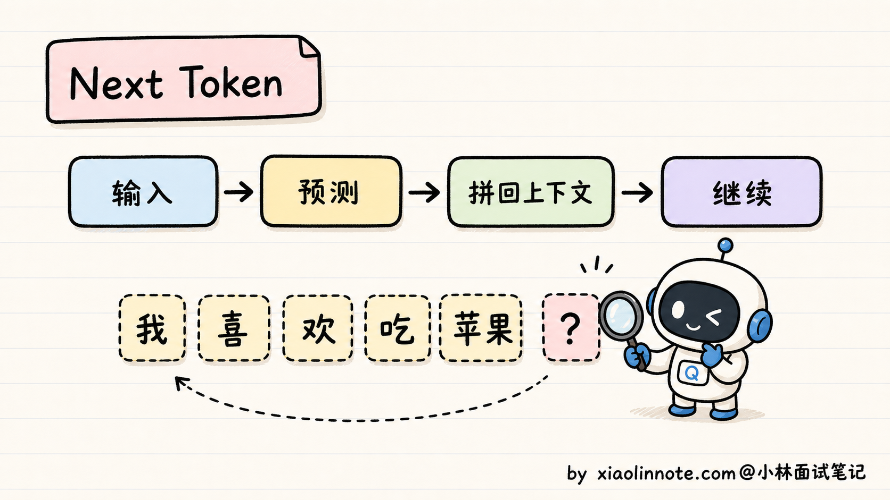

听起来太简单了对吧？但威力极大。看几个例子就明白了：

- **翻译**：Prompt 写「把下面这句翻译成英文：我喜欢你 ->」，LLM 接着预测下一个 token，就会输出「I like you」
- **分类**：Prompt 写「下面这条评论是正面还是负面？『这家店太黑了』 -> 答：」，LLM 预测下一个 token 就会输出「负面」
- **总结**：Prompt 写「请用一句话总结：xxxxxx -> 总结：」，LLM 接着写下去就是总结
- **写代码**：Prompt 写「写一个 Python 函数，返回斐波那契数列前 N 项 -> def」，LLM 接着续写就是完整代码

所有任务都被「Prompt + 续写」这个统一接口收编了。你不需要为每个任务训不同的模型，只需要在 Prompt 里换个说法，一个模型就能切换到不同的工作模式。

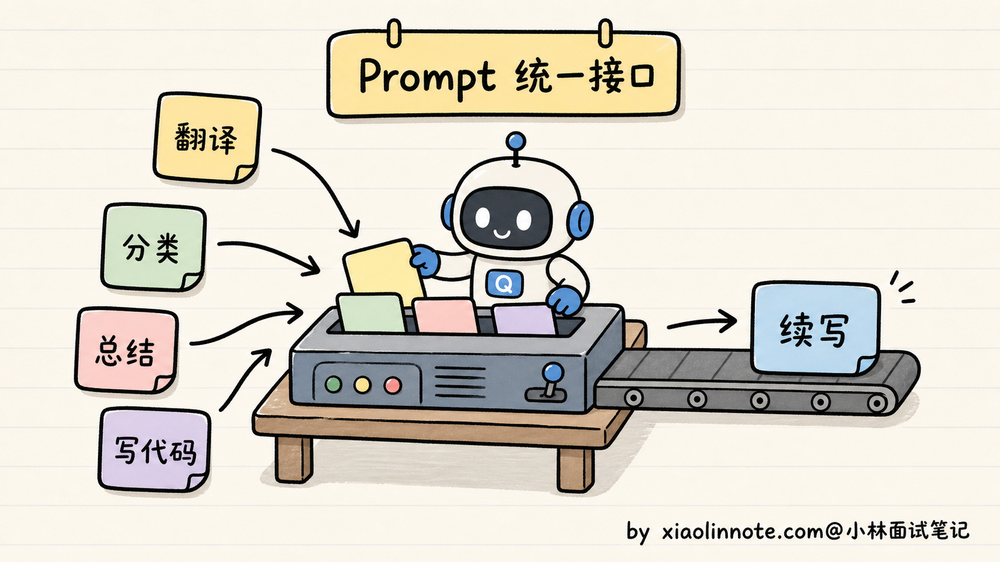

那为什么这个简单目标能学到这么多东西？关键是**规模 + 数据**两个杠杆。

数据的杠杆是：CLM 不需要任何人工标注，互联网上所有文本天然都是合格的训练数据。GPT-3 用了 3000 亿 token，Llama 3 用了 15 万亿 token，这种规模在 BERT 那个时代是不可想象的。BERT 当年的训练数据是几十亿词，现在 LLM 的训练数据规模翻了几千倍。

模型的杠杆是：参数量从 BERT 的 0.3B 一路堆到 GPT-3 的 175B，再到后来更大、更复杂的闭源模型。像 GPT-4 这类模型的具体参数量官方没有公开，外界只能估计，所以面试里最好别把「万亿级」当成确定事实来讲。更稳的说法是：模型规模、训练数据和算力一起放大后，「预测下一个 token」这件事被推向了新的境界。

模型要在不同上下文里准确预测，就必须学到语法、事实和推理模式。比如要预测「北京是中国的____」的下一个词，模型必须知道「北京是首都」这个事实；要预测「如果 x=2，那么 x²=____」，模型必须会算数；要预测一段代码的下一行，模型必须理解编程逻辑。

所有这些能力，都被「预测下一个 token」这个看似简单的目标**逼着学会了**。这就是为什么 LLM 能用一个统一的训练目标，覆盖几乎所有 NLP 任务。

还有一个让人惊讶的副产物，叫 **In-Context Learning（上下文学习）**。在 Prompt 里给模型几个例子，模型就能学会新的任务模式，不需要更新参数。比如：


```
苹果 -> apple
香蕉 -> banana
草莓 -> strawberry
橘子 ->
```

模型看到这个 Prompt，不需要任何额外训练，就能输出「orange」。它从 Prompt 里几个例子里推出了「中译英水果名」这个模式，然后应用到新的输入上。这种能力是 GPT-3 之后才被业界发现的，也是 Prompt Engineering 这门工程学科诞生的基础。

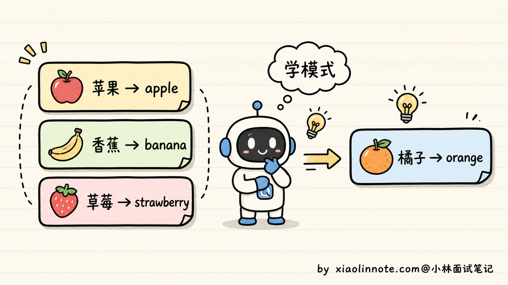

### [「涌现能力」：量变到质变的关键](https://xiaolinnote.com/ai/llm/what_is_llm.html#「涌现能力」-量变到质变的关键)

LLM 还有一个让传统 NLP 模型望尘莫及的特点，叫**涌现能力（Emergent Abilities）**。

涌现的常见定义是：「**某项能力在小模型上几乎看不到，规模到了某个临界点之后突然表现出来**」。不过这里要留一个 caveat：有研究认为，一部分「突然出现」可能来自评测指标的离散性，比如 exact match 这种非黑即白的指标会把连续提升看成突变。所以面试里可以说「涌现是工程上能观察到的能力跃迁，但学术上对它是不是测量假象还有争议」。

来看几个真实数据。

第一个例子是**多步算术**。Google 在 2022 年的论文里测试，让模型做需要 5 步计算的应用题。参数量在 8B 以下的模型，准确率几乎是 0；到了 62B 的量级，准确率还是只有 5%；但到了 540B（PaLM）的量级，准确率突然跳到 60%。用 exact match 这类指标看，中间像是没有任何渐进过程，就是从「完全不会」直接到「会一大半」。如果换成更细的部分得分指标，曲线可能会平滑一些，这就是涌现争议的来源。


第二个例子是 **In-Context Learning**。GPT-3（175B）出现之前，业界的共识是「想让模型学新任务，必须在新任务上微调」。GPT-3 出来之后，OpenAI 发现只要在 Prompt 里给几个例子，模型就能学会新任务，准确率甚至能接近专门微调的小模型。这种能力在 1.5B 的 GPT-2 上完全看不到，在 175B 的 GPT-3 上突然就有了，临界点出现在 100B 左右。

第三个例子是**跨语言迁移**。GPT-3 主要训练数据是英文（占比 92%），但训练完之后，它能直接处理中文、日文、阿拉伯语，甚至小语种比如冰岛语。模型从来没被显式教过「中文怎么说」，它通过大规模多语言混合语料的预训练，自己学会了不同语言之间的对应关系。

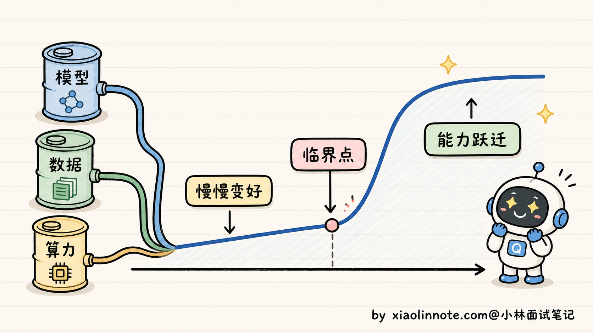

为什么会涌现？业界给出的工程经验叫 **Scaling Law（缩放定律）**。简单说就是模型规模、训练数据量、训练算力这三者之间存在一种可预测的关系：你把这三个量按一定比例同时放大，模型的损失值（预测错误率）会沿着一条幂律曲线下降。这条经验律 OpenAI 在 2020 年的论文里提出，DeepMind 后来在 Chinchilla 论文里给出了更精细的比例（参数和数据要按 1:20 配，比如 70B 参数最好配 1.4T token）。

涌现的玄妙之处在于，你没有专门教过模型怎么做这些任务，它自己「学会」了。这是「量变到质变」的真正含义，也是为什么这两年所有家底厚的公司都在拼命扩大模型规模。

但要注意的是，涌现不是「越大越好」。最近几年的研究发现，超过某个规模之后，单纯堆参数的边际收益在递减。所以现在的趋势是，**参数堆得不一定要最大，但数据要够多、算力要够花**。Llama 3 的 8B 模型用 15 万亿 token 训出来，效果反而比早期的 GPT-3 175B 还好，这就是数据规模超过参数规模带来的回报。

### [三个本质区别总结](https://xiaolinnote.com/ai/llm/what_is_llm.html#三个本质区别总结)

到这里，可以把 LLM 和传统 NLP 模型的区别归到一张表：

| 维度     | 传统 NLP                     | LLM                                     |
| -------- | ---------------------------- | --------------------------------------- |
| 任务方式 | 一任务一模型，pipeline 串联  | 一个模型干所有事，Prompt 统一接口       |
| 输出范式 | 判别式（输出标签/概率）      | 生成式（输出文本）                      |
| 能力来源 | 显式监督训练（喂什么学什么） | 大规模预训练 + 涌现（学到没教过的能力） |

这张表的三行，分别从「**工程层面**」「**范式层面**」「**能力层面**」三个角度刻画了同一个变化的不同侧面。

工程层面的区别是「拼装积木」变成了「统一系统」。这个变化对工程团队的影响特别直观：团队结构不再是「N 个小模型组各管一摊」，而是变成「一个大模型组统一服务全公司」；部署成本也不再是「N 个模型同时上线各自占资源」，而是「一个模型挂上线多个场景复用」；维护方式更不一样了，过去每个小模型各自迭代各自的版本，现在所有应用统一跟着 base model 升级走。

范式层面的变化更深一层，是从「分类器思维」彻底切换到「生成器思维」。在工程实践上的体现是：用户交互方式从「在屏幕上点选项」变成「打字跟模型聊」；产品经理的核心思考问题从「如何穷举所有用户意图」变成「如何写好 Prompt」；评估指标也从过去的「准确率 / 召回率」这种判别式指标，变成「LLM-as-Judge 评分 / 用户满意度」这种生成式指标。这是整个 NLP 行业的工作方式都在被重写。

能力层面的突破最关键，是模型可以做「人没明确教过」的任务。过去想让模型多一项能力，必须为这项能力标注新数据；现在只需要在 Prompt 里描述新需求，模型就有概率能直接做。模型的能力上限不再被人工标注规模锁死，这在整个 NLP 历史上是前所未有的事，也是 LLM 真正颠覆性的地方。

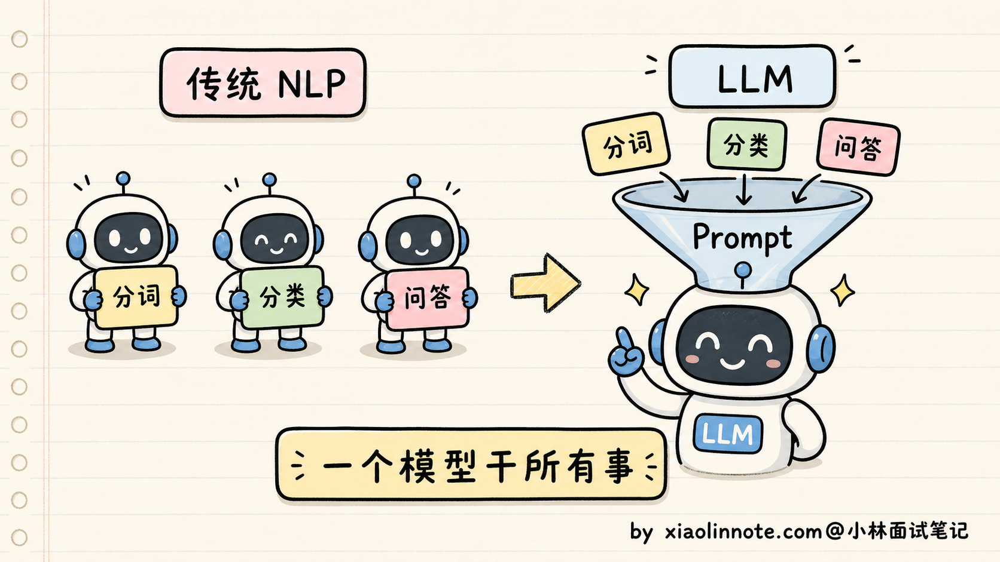

### [这场转变对工程团队意味着什么](https://xiaolinnote.com/ai/llm/what_is_llm.html#这场转变对工程团队意味着什么)

理解了上面三点，就能理解一个现实：这一两年所有 NLP 团队都在拥抱大模型，**这不是「又出了一个新模型」，而是整个 NLP 领域的工作方式被重写了**。

具体来说，过去做一个 NLP 项目，第一件事是「数据怎么标」，第二件事是「模型选哪个 BERT 变体」，第三件事是「微调怎么调超参」。现在做一个 LLM 项目，第一件事是「Prompt 怎么写」，第二件事是「需不需要 RAG 加外部知识」，第三件事是「要不要做 LoRA 微调」。工程的着力点完全变了，先想 Prompt，再想数据，最后才考虑微调。

过去 NLP 工程师的核心技能是词法分析、句法分析、特征工程、模型调参；现在 LLM 工程师的核心技能是 Prompt Engineering、RAG 系统设计、Agent 编排、对齐微调。听起来像是两个完全不同的工种，事实上也确实是。这也是为什么市面上招聘 JD 里「大模型应用工程师」这个新岗位会冒出来，工资比传统 NLP 工程师高出一截，因为底层的工作方式变了，老技能不够用了。

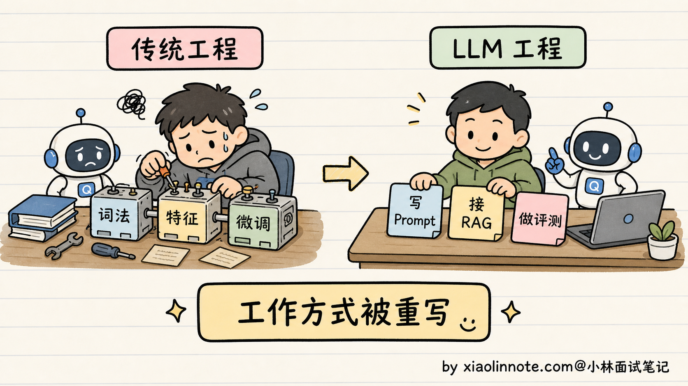

理解了 LLM 和传统 NLP 的本质区别，再看后续 RAG、Agent、Prompt Engineering 这些话题，会发现它们都不是凭空出现的，而是「一个模型干所有事 + 生成式 + 涌现」这三个特征延伸出来的工程实践。底层范式变了，上面的工具链当然也要跟着重写一遍。

## [🎯 面试总结](https://xiaolinnote.com/ai/llm/what_is_llm.html#🎯-面试总结)

回到开头那段面试，问到「什么是 LLM」，硬背定义肯定不行。最重要的是把它和传统 NLP 的对照讲清楚，因为这是整道题的地基。

回答时可以这样组织：传统 NLP 是流水线，每个任务训一个模型；BERT 时代实现了「预训练 + 微调」但任务还得单独适配；LLM 把所有任务统一成「预测下一个 token」，靠 Prompt 来表达任务，一个模型搞定所有 NLP 工作。这种对照说出来，面试官就知道你不是死记硬背的。

讲完对照之后，记得带一句生成式和判别式的根本不同。判别式是输入文本输出标签，理解和生成是分开的；LLM 是输入文本输出更多文本，理解和生成在同一个模型里完成。这是范式上的根本变化，也是面试官最容易追问的点。

最关键的加分点是「**涌现能力**」。规模到了一定程度，模型会冒出训练目标里没显式教过的能力（多步推理、上下文学习、跨语言迁移），这是「量变到质变」的真正含义，也是 LLM 区别于传统 NLP 模型的最核心特征。能讲到这里，已经超过大多数候选人了。

如果还想再往上拔一层，可以延伸到工程视角：现在做 NLP 项目，工作方式从「先拆任务再选模型」变成了「先想 Prompt 怎么写」。这种「站在产业视角看技术变化」的回答，会让面试官印象很深。

# 2. 讲讲 Transformer 架构基本原理？Encoder 和 Decoder 是什么？

👔面试官：来讲讲 Transformer 架构的基本原理？Encoder 和 Decoder 是什么？

🙋‍♂️我：Transformer 是 Google 提的一个新架构，核心是 Attention，效果比 RNN 好很多。Encoder 是编码器，Decoder 是解码器。

👔面试官：……「编码器」「解码器」是中文翻译，我问的是它们具体在做什么，不是字面意思。再说，Attention 凭什么比 RNN 好？RNN 到底有什么致命缺陷？

🙋‍♂️我：哦哦，应该是 RNN 太慢了，Attention 能并行计算？

👔面试官：方向对了一半。但你只说了「快」，没说「准」。RNN 还有一个更致命的问题，长距离信息会衰减，第 1 个词的信息传到第 800 个词基本就没了。Attention 怎么解决这个问题的，能讲清楚吗？

🙋‍♂️我：呃……Attention 让每个词都能看到所有其他词？

👔面试官：勉强能说出来。那再问一个：BERT 用的是 Encoder-only，GPT 用的是 Decoder-only。为什么现在主流大模型（GPT、Claude、Qwen）全部选择了 Decoder-only？这种架构选型背后的原因，你能讲清楚吗？

🙋‍♂️我：呃……

👔面试官：典型的「知道有但讲不清」。Decoder-only 赢的根本原因是「预测下一个 token」这个训练目标极其统一，所有 NLP 任务都能用它表达。这种「为什么 X 赢了 Y」的演进逻辑搞不清楚，去面试就是被怼。回去补一下。

这几个反问串起来其实就是一条主线，Transformer 这道题想听的不是「Attention is all you need」这种口号，而是 RNN 卡在哪两点、Attention 怎么把这两点都破了、三种架构变体打了一圈为什么是 Decoder-only 赢到现在。

## [💡 简要回答](https://xiaolinnote.com/ai/llm/transformer_architecture.html#💡-简要回答)

我理解 Transformer 最核心的创新是 Self-Attention，让每个 token 都能直接和序列里任意其他位置建立联系，一次性并行计算，彻底解决了 RNN 顺序计算慢、长距离信息衰减的两个老问题。理解 Encoder 和 Decoder 的区别时我用这个角度：Encoder 是双向的，每个词能同时看前后文，适合做「理解」类任务；Decoder 是单向的，只能看前面的词，天然适合「生成」任务。至于为什么现代大模型（GPT、Claude、Qwen）都选 Decoder-only，核心原因是「预测下一个 token」这个训练目标极其统一、可以直接在海量无标注文本上做自监督学习，规模越大涌现出的能力越强。

## [📝 详细解析](https://xiaolinnote.com/ai/llm/transformer_architecture.html#📝-详细解析)

### [Transformer 之前：RNN 的致命缺陷](https://xiaolinnote.com/ai/llm/transformer_architecture.html#transformer-之前-rnn-的致命缺陷)

在 Transformer 出现之前，处理序列数据的主流方法是 RNN（循环神经网络）及其变体（LSTM、GRU）。RNN 的问题有两个，而且都是致命的。

第一个是**顺序计算，无法并行**。RNN 处理序列的方式是从左到右逐个处理每个词，第 N 步必须等第 N-1 步计算完才能开始，无法利用 GPU 的并行计算能力。这导致训练大型 RNN 极慢。

第二个是**长距离梯度消失**。当序列很长时（比如 1000 个词），RNN 理论上能记住早期的信息，但实践中梯度在反向传播时会指数级衰减，网络很难学习到「第 1 个词和第 800 个词之间的关系」。LSTM 通过门控机制有所缓解，但根本问题没解决。

2017 年 Google 在论文《Attention is All You Need》里提出了 Transformer，用一个全新的架构一举解决了这两个问题。

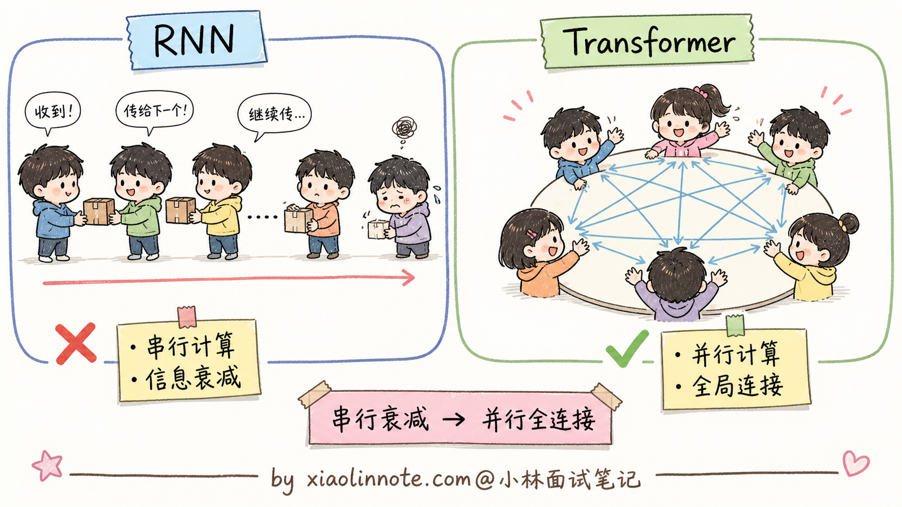

### [Self-Attention 的核心直觉](https://xiaolinnote.com/ai/llm/transformer_architecture.html#self-attention-的核心直觉)

Self-Attention（自注意力）的核心思路是：让序列中的每个 token 都能**直接关注**序列中任意其他位置的 token，计算出「我和其他位置的相关程度」，然后根据相关程度加权聚合其他位置的信息。

这里有三个关键向量：Q（Query，查询）代表「我想找什么」，K（Key，键）代表「我有什么标签」，V（Value，值）代表「我的实际内容」。

可以用图书馆检索来类比：你有一个搜索关键词（Q），图书馆里每本书都有标签（K）和内容（V）。注意力机制就是用你的关键词（Q）去匹配每本书的标签（K），计算出相似度分数，然后按照分数的权重把书的内容（V）加权求和，得到你的搜索结果。

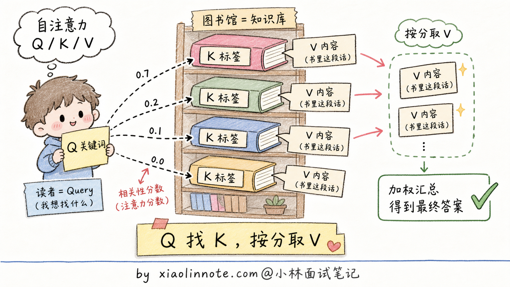

### [Q/K/V 是怎么从输入变换得到的](https://xiaolinnote.com/ai/llm/transformer_architecture.html#q-k-v-是怎么从输入变换得到的)

很多人讲 Self-Attention 容易卡在「Q/K/V 是从哪儿冒出来的」这一步。其实 Q/K/V 不是模型「凭空生成」的，而是把输入 embedding 通过**三个独立的线性投影矩阵** W_Q、W_K、W_V 算出来的：


```python
# 假设输入 X 是 (序列长度 N, embedding 维度 d_model)
# W_Q, W_K, W_V 都是可训练参数矩阵，形状 (d_model, d_k)

Q = X @ W_Q     # 形状 (N, d_k)，每个 token 都有自己的 Query 向量
K = X @ W_K     # 形状 (N, d_k)，每个 token 都有自己的 Key 向量
V = X @ W_V     # 形状 (N, d_v)，每个 token 都有自己的 Value 向量
```

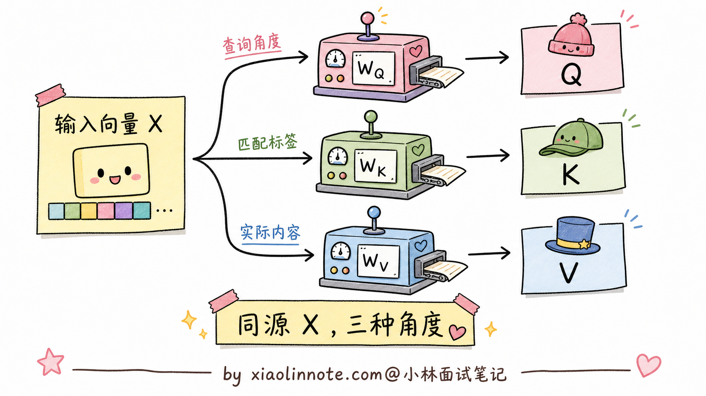

这一步就是面试里常被追问的「**Q/K/V 是怎么得到的**」。理解的时候有几个关键点要抓住。

最关键的一点是 Q/K/V 都是**从同一个输入 X 算出来**的。也就是说，输入既要扮演「提问者」（Q），也要扮演「被查者」（K + V），这就是「**自**注意力」里那个「自」字的含义，区别于 Encoder-Decoder 架构里 Cross-Attention 那种「Q 来自一边、K/V 来自另一边」的形式。

然后 W_Q、W_K、W_V 是三个**独立学习**的矩阵。这是个容易被忽略的细节，但很重要。如果让 Q/K/V 都直接等于 X 不做变换，模型就没法学到「该从什么角度提问」「该用什么标签匹配」「该返回什么内容」这种细致的差异。三个独立投影让模型有 3 倍的自由度去学习这种角度上的差异，模型容量大幅提升。

还有一个工程细节是投影维度 d_k 通常等于 d_model / H（H 是头数）。比如 d_model=512、H=8 时，d_k=64。这样做的目的是让多头总参数量和单头版本基本一致，不增加额外的计算开销。

到这里，Q/K/V 三个向量就准备好了，可以代入注意力公式：


```
Attention(Q, K, V) = softmax(Q · K^T / √d_k) · V
```

### [为什么要除以 √d_k：缩放点积的数学直觉](https://xiaolinnote.com/ai/llm/transformer_architecture.html#为什么要除以-√d-k-缩放点积的数学直觉)

公式里的 `/√d_k` 这一步常被叫做 **Scaled Dot-Product Attention（缩放点积注意力）**。这个 √d_k 不是随便加的，背后有具体的数学动机。

直觉上的问题是这样的：当 d_k 很大时（比如 d_k=128），Q 和 K 都是 128 维的向量，它们的点积是 128 个数相加。假设 Q 和 K 的每一维都是均值 0、方差 1 的随机数，那么点积 Q·K 的方差就是 d_k=128，标准差是 √128 ≈ 11.3。

这意味着点积的数值会**散布在 -30 到 +30 这种很大的范围**。然后这些数过 softmax 会发生什么？softmax 对极端大的输入特别敏感，最大的那个数对应的概率会接近 1，其他数的概率会接近 0，**输出几乎变成 one-hot 分布**。

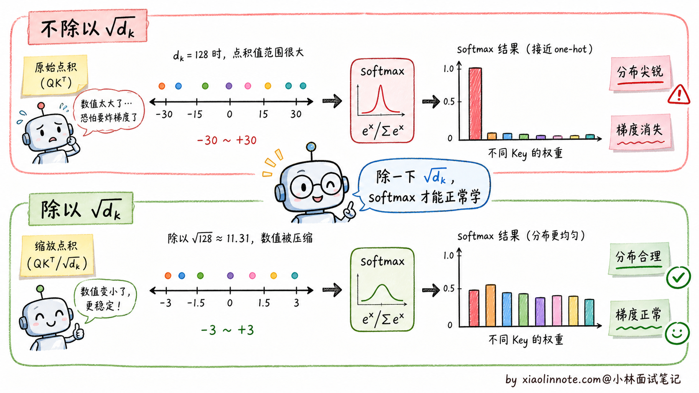

one-hot 分布的问题是**梯度消失**。softmax 的梯度公式里有 `p · (1-p)` 项，p 接近 0 或 1 时梯度都接近 0。整个 Attention 层的反向传播信号被压扁，模型训不起来。

除以 √d_k 之后，点积的方差被压回 1，softmax 输出分布合理，梯度能正常传播。

那能不能用其他方案替代 √d_k？**理论上可以，但 √d_k 是数学上最自然的选择**。

业界确实尝试过几种替代方案。一种是用 Layer Norm 来归一化，比如某些 Attention 变体（Pre-LN Transformer）会在 Attention 之前先把输入归一化到固定范围，这样后续的点积值天然就不会爆炸。但严格来说这是「在 Attention 之前做归一化」，不是真的替换 √d_k 本身。另一种是让模型自己学一个 scaling 参数，用一个可学习的标量代替 √d_k。实测效果和 √d_k 差不多，但增加了可学习参数，反而不如固定常数简洁。还有一种早期方案是直接限制 d_k 很小（比如 d_k=8），让点积自然不会爆炸，但这等于直接限制了模型的容量，不划算。

实践中所有主流 Transformer 实现（GPT、LLaMA、Qwen 等）都用 √d_k，没有改。这是一个被 8 年实践验证的「**简单且数学上合理**」的选择。

回到主线：除以 √d_k 之后，softmax 的输出就是稳定的注意力权重，再用这些权重对 V 做加权求和，就得到了 Self-Attention 的最终输出。整个过程对序列中所有位置的计算是可以并行的，完美解决了 RNN 的并行问题；而且每对位置之间都有直接连接（通过注意力分数），不存在长距离信息衰减的问题。

### [Multi-Head Attention：多角度观察](https://xiaolinnote.com/ai/llm/transformer_architecture.html#multi-head-attention-多角度观察)

单组 Q/K/V 只能学习到一种「关联关系」，但语言中的关联是多维度的：「我」和「吃」是主谓关系，「苹果」和「吃」是宾动关系，「苹果」和前文的「苹果树」是指代关系，这些不同类型的关联需要不同的「注意力头」来捕捉。

Multi-Head Attention 就是把 Q/K/V 投影到多个不同的子空间（比如 8 个或 32 个头），每组独立计算注意力，最后把所有头的输出拼接起来。每个头可以专注于捕捉不同类型的语言关联，整体上表达能力更强。

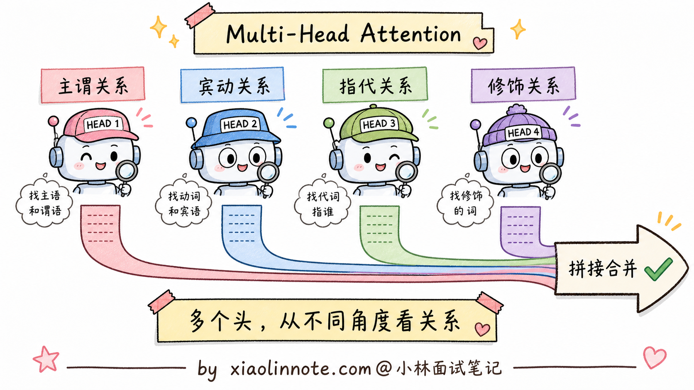

### [位置编码：注入顺序信息](https://xiaolinnote.com/ai/llm/transformer_architecture.html#位置编码-注入顺序信息)

Self-Attention 有一个天然的缺陷：它的计算是对称的，不考虑词的顺序。「我打你」和「你打我」对 Attention 来说可能得到一样的结果，因为它只看哪些词相关，不看谁在前谁在后。

所以需要显式地给每个 token 注入位置信息，这就是位置编码。具体的位置编码方案有 sin/cos、RoPE、ALiBi 等多种选择，每种各有不同的设计哲学和长上下文外推能力，是一个独立的研究方向。本节只需要知道 Transformer 是通过加上位置编码来让模型感知词序的就够了。

### [前馈网络（FFN）的作用](https://xiaolinnote.com/ai/llm/transformer_architecture.html#前馈网络-ffn-的作用)

除了注意力层，每个 Transformer 块里还有一个前馈网络（Feed-Forward Network），结构是两层全连接加一个激活函数。

FFN 对每个位置独立地做非线性变换，补充注意力层学不到的信息（注意力层本质上是线性加权，FFN 引入非线性）。研究表明 FFN 层储存了大量的「事实知识」，可以理解为模型的「记忆仓库」。

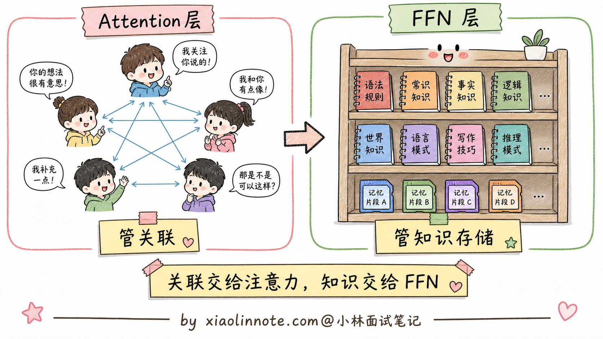

### [Encoder-only、Decoder-only 和 Encoder-Decoder 三种架构](https://xiaolinnote.com/ai/llm/transformer_architecture.html#encoder-only、decoder-only-和-encoder-decoder-三种架构)

理解了 Attention 的基本机制，可以解释这三种架构的区别。

- **Encoder-only（以 BERT 为代表）**：每个 token 可以双向关注序列中所有其他 token（没有遮蔽）。这种双向理解能力让 Encoder 非常擅长「理解任务」，比如文本分类、命名实体识别、语义相似度计算。预训练目标是 MLM（掩码语言模型），随机遮住一些词让模型预测。
- **Decoder-only（以 GPT/Claude/Qwen 为代表）**：使用因果掩码（Causal Mask），每个 token 只能关注它前面的 token，不能「提前看到」后面的内容。这种单向设计天然适合文本生成，预训练目标是「预测下一个 token」（CLM），目标统一而强大。现在几乎所有大语言模型都是这个架构。
- **Encoder-Decoder（以 T5、BART 为代表）**：Encoder 双向理解输入，Decoder 单向生成输出，Decoder 通过 Cross-Attention 读取 Encoder 的输出。这种架构适合「输入和输出是不同的文本」的任务，比如翻译、摘要、问答。但预训练目标相对复杂，超大规模训练不如 Decoder-only 简洁。

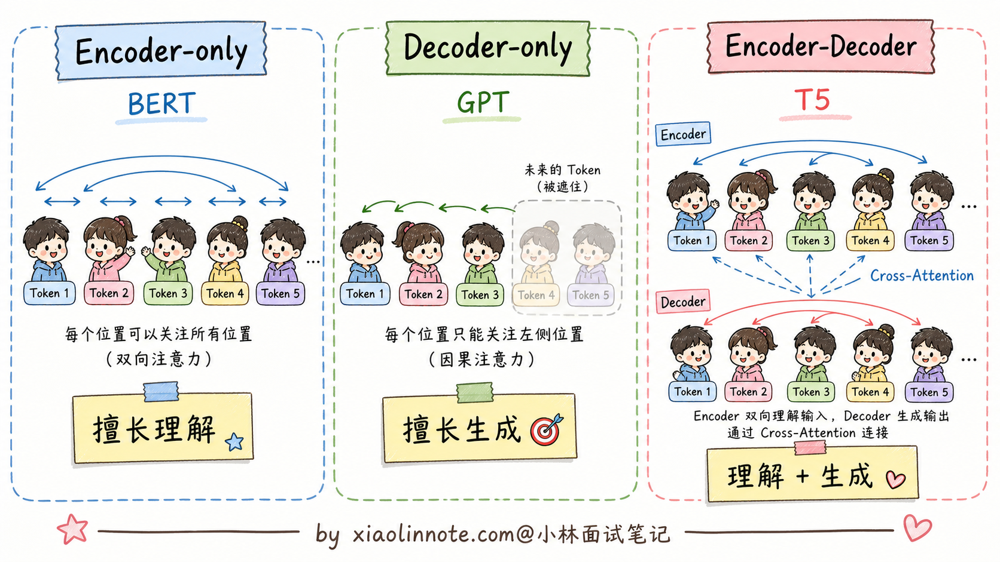

### [为什么 Decoder-only 赢了](https://xiaolinnote.com/ai/llm/transformer_architecture.html#为什么-decoder-only-赢了)

现代通用生成式大模型为什么大多选择 Decoder-only 架构？这是面试里最容易被追问的点。

根本原因是「**预测下一个 token**」这个目标极其统一。所有类型的任务（问答、写作、推理、代码生成、翻译）都可以统一表达成「续写」这一件事，不需要区分「这是理解任务」还是「那是生成任务」，一套训练目标搞定一切。

更关键的是，这个目标可以直接在海量无标注文本上做自监督训练。互联网上的大量公开文本天然可以构造成训练样本，不需要像传统监督任务那样逐条人工标注。这一点是 BERT 那种 MLM 目标做不到的（MLM 也是无标注，但训练效率不如 CLM 适合 scale up）。

最厉害的是，随着模型规模增大，这个简单目标下涌现出的能力越来越强。模型从「会续写文本」开始，逐渐学会数学、推理、代码、跨语言迁移……这些能力都是「预测下一个 token」这个目标在足够大规模下自然涌现的。

所有这些特性加在一起，使得 Decoder-only 架构在大规模生成式预训练时代取得了压倒性的优势。Encoder-only 和 Encoder-Decoder 这两种架构并没有消失，它们在检索、分类、嵌入、翻译、摘要等场景仍然有价值；只是如果目标是做一个通用对话和生成模型，Decoder-only 更容易 scale up，也更符合「一个模型续写所有任务」的统一接口。

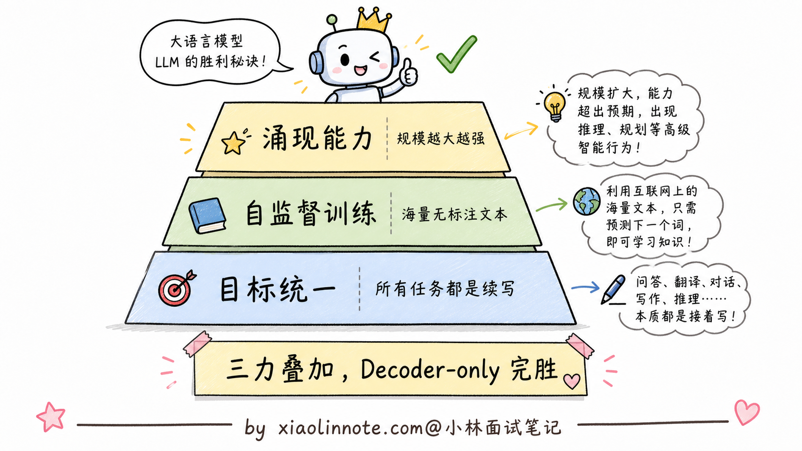

## [🎯 面试总结](https://xiaolinnote.com/ai/llm/transformer_architecture.html#🎯-面试总结)

回到开头那段对话，问到 Transformer 架构，最重要的是先把 **RNN 的两个致命缺陷**讲清楚，因为这是 Transformer 出现的动机。RNN 顺序计算无法并行（训练慢）+ 长距离梯度消失（看不到远处），这两个问题在序列稍长就会致命。

接下来讲 Self-Attention 怎么解决的。每个 token 通过 Q、K、V 三个独立的线性投影变换得到查询、键、值向量，然后用 Q 去和所有 K 做点积算注意力分数，按分数加权聚合所有 V。这一段能讲到「Q/K/V 是从同一个 X 通过三个独立矩阵投影得到的」「除以 √d_k 是为了防止点积过大让 softmax 变 one-hot 导致梯度消失」这两个细节，就比一般候选人深刻一层了。

最关键的一句话是讲清**为什么 Decoder-only 赢了**。「预测下一个 token」这个目标极其统一，所有 NLP 任务都能用它表达；可以直接在海量无标注文本上做自监督训练；规模越大涌现的能力越强。这种「目标统一 + 数据规模 + 涌现」的组合让 Decoder-only 在大模型时代完胜。

如果还想再加分，可以提一句「FFN 层储存了大量事实知识，可以理解为模型的『记忆仓库』」这种从可解释性角度看 Transformer 的视角。能讲到这一层，面试官就知道你不是只在背架构图，是真的理解了 Transformer 的设计哲学。

# 3. 多头注意力（MHA）有哪些局限？MQA、GQA、Flash Attention 怎么解决？

👔面试官：来讲讲多头注意力（MHA）有哪些局限？工业界怎么优化？

🙋‍♂️我：MHA 局限我知道，就是计算复杂度是 O(N²)，长序列特别慢。Flash Attention 用了一些数学技巧让它变快。

👔面试官：……「数学技巧」是什么技巧？说具体一点。再说，O(N²) 是「计算复杂度」还是「显存复杂度」？这俩是一回事吗？还有，MHA 的真正瓶颈在训练还是推理？训练慢和推理慢是一个原因吗？

🙋‍♂️我：哦哦，MHA 主要是显存占用大，因为每个 token 都要保存 K 和 V。MQA 是所有头共享一份 K 和 V 来减少显存。

👔面试官：你说 MQA「所有头共享一份 K 和 V」，那它是只在推理时共享，还是训练时也共享？共享之后效果会不会下降？为什么 Llama 2 不用 MQA 而用 GQA？这两个有什么关系？

🙋‍♂️我：呃……GQA 是 MQA 的改进版？把头分成几组共享？

👔面试官：你这是在猜词。「分成几组」具体怎么分？分组数对效果和显存的影响是什么？为什么 Llama 系列、Qwen 系列都默认用 GQA？还有最关键的：MQA 和 GQA 是从「显存」角度优化的，Flash Attention 是从「显存 + 计算」两个角度同时优化的，这两类优化是替代关系还是叠加关系？回去搞清楚再来。

这道题问下来才发现，光说出 MQA、GQA、Flash Attention 几个名字完全不够。MHA 的瓶颈到底卡在「显存」还是「带宽」、每种方案分别在哪一层动刀、它们之间是替代关系还是可以叠加，这一整套逻辑必须捋顺。

## [💡 简要回答](https://xiaolinnote.com/ai/llm/mha_mqa_gqa_flash_attention.html#💡-简要回答)

我理解 MHA 有三个核心痛点。

第一是「**显存爆炸**」。推理时每个 head 都要为序列里所有 token 保存自己的 K 和 V 矩阵，这就是 KV Cache。头数越多、序列越长，显存占用越夸张。一个 7B 模型跑 32K 上下文，光 KV Cache 就能吃掉十几 GB。

第二是「**访存慢**」。Attention 计算里 softmax 那步要把整个 N×N 的注意力矩阵搬来搬去，频繁读写 GPU 显存，瓶颈不在算力而在「内存带宽」。

第三是「**N² 复杂度**」。注意力分数矩阵是 N×N 的，序列翻倍计算量翻 4 倍，长上下文极其昂贵。

工业界对应了三类优化。MQA 让所有 head 共享一份 K/V，显存压到 1/H，但表达力损失明显。GQA 是折中方案：把 H 个 head 分成 G 组，每组共享一份 K/V，效果接近 MHA 但显存接近 MQA，Llama 2 70B、Llama 3、Qwen 2/3 的不少主力模型都用这个思路。Flash Attention 是另一条思路，不改变 MHA 的结构，而是从计算实现层面把 N×N 的注意力矩阵切成小块、用 GPU 片上缓存做在线 softmax，避免反复读写大矩阵，显存从 O(N²) 降到 O(N)，速度还更快。

最关键的认知是：MQA/GQA 是「结构层」的优化，Flash Attention 是「实现层」的优化，两者是叠加关系不冲突，现在的主流模型基本上都是 GQA + Flash Attention 一起用。

## [📝 详细解析](https://xiaolinnote.com/ai/llm/mha_mqa_gqa_flash_attention.html#📝-详细解析)

### [先理清 MHA 的瓶颈到底卡在哪](https://xiaolinnote.com/ai/llm/mha_mqa_gqa_flash_attention.html#先理清-mha-的瓶颈到底卡在哪)

要讲清楚 MHA 的局限，得先把「训练」和「推理」两个阶段分开看。很多人在面试里只笼统说「O(N²) 慢」，被一追问就答不下去，根源就是把这两个阶段混在一起讲。其实它们的痛点完全不一样，得分别说。

先看训练阶段。训练时一个长度为 N 的序列，每一层 Attention 都要算一个 N×N 的注意力分数矩阵 `softmax(QK^T/√d) · V`。这个 N×N 矩阵在显存上要存下来给反向传播用，N=4K 时已经是 1600 万个数，N=32K 时膨胀到 10 亿个数（FP16 大约 2GB）；在计算上也是 O(N²) 的复杂度，N 翻倍计算量直接翻 4 倍。听起来很吓人，但好消息是训练时这个 N×N 矩阵是「一次性算完的」，不需要在多个时间步之间持续保留。

推理阶段就是另一个故事了。LLM 是自回归生成，每次生成一个新 token，都要重新对前面所有 token 算注意力。如果每次都从头算，成本会飞快累加成 O(N³)，根本不可接受。聪明的做法是 **KV Cache**：把前面所有 token 的 K 和 V 矩阵存下来，每次新 token 只需要算自己的 Q，然后和缓存的 K/V 做注意力。这就是推理优化的标配。

但 KV Cache 这个救星本身就是个显存大户。粗略算一下，KV Cache 显存大小是：


```
2（K和V各一份）× B（batch）× N（序列长）× L（层数）× H（头数）× d_k（每头维度）× 2 字节（FP16）
```

对一个 7B 模型（L=32、H=32、d_k=128），跑 batch=1、N=32K：


```
2 × 1 × 32000 × 32 × 32 × 128 × 2 ≈ 17 GB
```

光 KV Cache 就要 17GB，加上模型权重 14GB，加起来 31GB，一张 4090（24GB）根本放不下。这就是长上下文场景下的头号问题，也是面试里常被追问「KV Cache 怎么省」的根源。

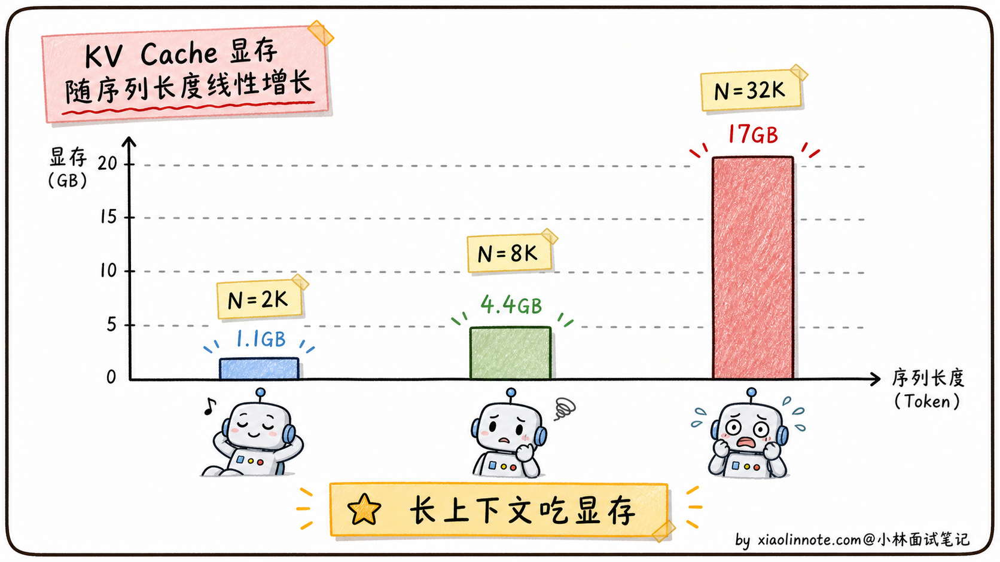

显存挤爆只是一面，更隐蔽的痛点是「**速度也快不起来**」。原因是 GPU 计算单元（CUDA Core / Tensor Core）的算力很猛，但显存带宽跟不上。Attention 计算里大量时间花在「等数据从显存搬到计算单元」，计算单元很多时候在「等米下锅」。这就是著名的 **memory-bound（访存受限）** 问题。哪怕你的 GPU 算力是另一台的两倍，跑 Attention 时速度可能只快 20%，因为瓶颈根本不在算力。

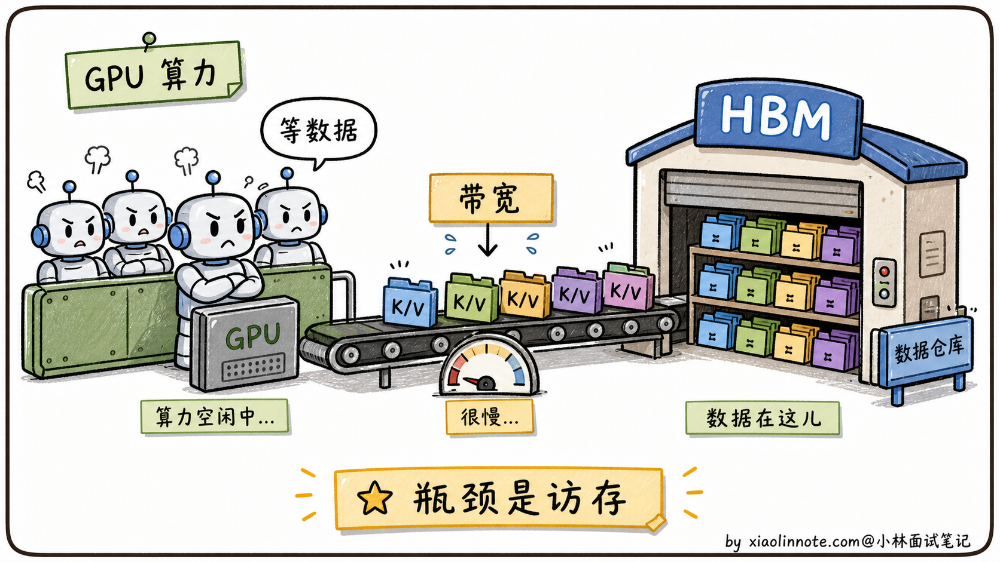

到这里，MHA 的三个痛点就连成一条线了。**N² 复杂度让序列稍微长一点，计算量就按平方级膨胀；KV Cache 让长上下文显存爆掉；访存带宽让 GPU 算力发挥不出来**。这三个痛点互相加剧，长上下文场景下尤其明显。后面的所有优化方案，都是在攻击这三个痛点中的一个或多个。

### [MQA：暴力共享 K/V，显存直接压到 1/H](https://xiaolinnote.com/ai/llm/mha_mqa_gqa_flash_attention.html#mqa-暴力共享-k-v-显存直接压到-1-h)

MQA（Multi-Query Attention，多查询注意力）的思路非常暴力：**所有 head 共享同一份 K 和 V，只有 Q 是每个 head 独立的**。

举个例子。原本 MHA 有 32 个 head，每个 head 都有自己的 W_Q、W_K、W_V 投影矩阵，输出 32 套独立的 Q、K、V。MQA 只保留 32 套 Q（每个 head 自己的 Query），但 K 和 V 全 32 个 head 共享同一套。

这样做的直接后果：

**KV Cache 立刻变成 1/H**：原本要存 H=32 套 K/V，现在只存 1 套，显存占用直接降到原来的 1/32。前面那个 7B 模型 32K 上下文 17GB 的 KV Cache，用 MQA 之后只剩 0.5GB 多一点。

**注意力公式不变**：每个 head 还是各算各的注意力分数 `softmax(Q_h · K^T)`，只不过所有 head 用同一份 K，最后输出还是 H 个 head 的拼接。模型结构基本保持，训练流程几乎不用改。

但 MQA 的代价也很明显，**表达能力下降**。

直觉上理解：原本 32 个 head 各自有 32 套不同的「视角」（K 表示「我有什么标签」、V 表示「我的内容」），可以从 32 个角度去理解上下文；MQA 强行让 32 个 head 共用一套 K/V，等于 32 个视角变成「都看同样的标签和内容，只是用不同的 Query 去问」，多视角的能力被压缩成单视角。

实测效果上，MQA 在大模型上效果会下降 2-5%，对简单任务可能差不多，但对推理类任务（数学、代码）会有明显损失。所以 MQA 在工业界不如它的折中版本受欢迎。

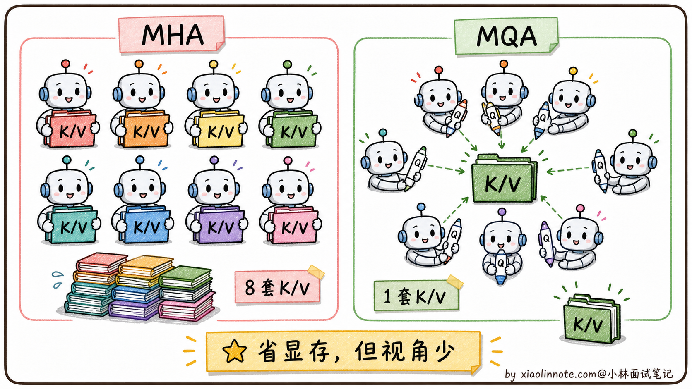

### [GQA：折中方案，效果与显存的甜蜜点](https://xiaolinnote.com/ai/llm/mha_mqa_gqa_flash_attention.html#gqa-折中方案-效果与显存的甜蜜点)

GQA（Grouped-Query Attention，分组查询注意力）是 MHA 和 MQA 的折中。

它的思路是：**把 H 个 head 分成 G 组，每组内部共享一份 K/V，组之间各自独立**。

数学上很直观：

- MHA：H 个 head，H 套 K/V
- MQA：H 个 head，1 套 K/V
- GQA：H 个 head，G 套 K/V（1 ≤ G ≤ H）

GQA 是个连续光谱，G=H 退化成 MHA，G=1 退化成 MQA，中间任意取值都行。

为什么 GQA 是个好折中？

**显存上**：KV Cache 从原本的 H 套压到 G 套，显存占用是 G/H 比例。比如 H=32、G=8 时，显存压到 1/4，比 MQA 的 1/32 略大但也很省。

**表达力上**：每组内部共享 K/V，组间独立，等于每组都有自己的「视角」。组数越多视角越丰富，G=8 通常已经足够保持模型效果。

**实测效果**：Meta 的 GQA 论文里，G=8 配置下，模型效果几乎和 MHA 持平（差距 < 0.5%），但 KV Cache 压到 1/4。这种「显存大幅下降、效果几乎不损失」的甜蜜点，让 GQA 成为现代大模型的标配。

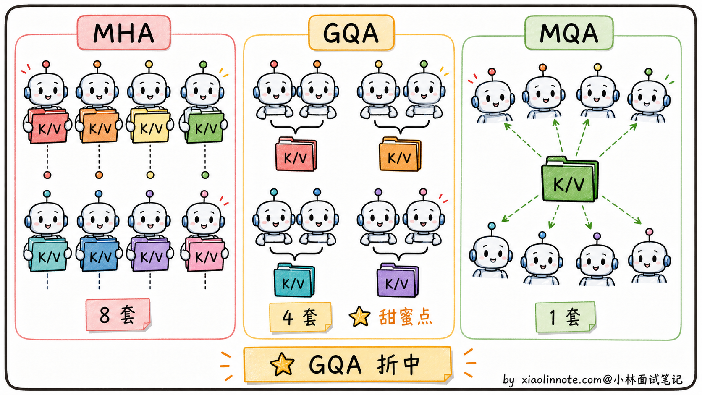

哪些主流模型用 GQA：

- **Llama 2** 70B 开始用 GQA（H=64，G=8）
- **Llama 3** 全系都用 GQA
- **Qwen 2/3** 主力模型用 GQA
- **DeepSeek V2/V3** 用了另一条更激进的路线 MLA（Multi-head Latent Attention，多头潜在注意力），把 K/V 压缩到一个低秩潜在空间存储，目标同样是压低 KV Cache，但它不是简单的 GQA 变体

MLA 的思路是：不直接共享 K/V，而是把每个 token 的 K/V 通过降维投影压缩到低维 latent 向量里存起来，需要时再配合额外投影参与注意力计算。这样存的不是「H 套或 G 套高维 K/V」，而是「低维压缩后的 K/V 表示」，显存比传统 MHA / GQA 更省。它和 GQA 的目标相似，都是省 KV Cache，但实现机制不同，别简单说成「GQA 的升级版」。

### [Flash Attention：换条赛道，从计算实现优化](https://xiaolinnote.com/ai/llm/mha_mqa_gqa_flash_attention.html#flash-attention-换条赛道-从计算实现优化)

MQA 和 GQA 都是改 Attention 结构，从「需要存几套 K/V」这个角度切入。Flash Attention 完全是另一条赛道，**不改 Attention 的数学公式，从底层实现优化**。

要理解 Flash Attention 厉害在哪，得先回到上面提到的「访存瓶颈」。

**问题的根源：显存层级差距巨大**

GPU 的存储分两层：

- **HBM（High Bandwidth Memory，高带宽显存）**：容量大（A100 是 40GB/80GB），但带宽相对慢（1.5 TB/s）。这就是平时说的「显存」
- **SRAM（Static RAM，片上缓存）**：容量小（A100 每个 SM 只有 192KB），但带宽极快（19 TB/s，是 HBM 的 13 倍）

标准 Attention 的实现是这样的：


```python
# 标准实现，每一步都把大矩阵搬到 HBM 上存一次
S = Q @ K.T              # 算出 N×N 注意力分数矩阵，写回 HBM
P = softmax(S)           # 从 HBM 读 S，算 softmax，再写回 HBM
O = P @ V                # 从 HBM 读 P，算最终输出 O，再写回 HBM
```

整个过程在 HBM 上反复读写 N×N 这种大矩阵，访存时间远超实际计算时间。这就是为什么 N=4K 的注意力比 N=2K 慢 4 倍以上（理论应该是 4 倍，实际更糟），瓶颈在于 HBM 来回搬运 N² 大小的中间结果。

**Flash Attention 的核心思路：分块 + 在线 softmax**

Flash Attention 提出：既然 SRAM 带宽快但容量小，那就把 Q、K、V 切成小块（比如 128×128），每次只在 SRAM 里算一小块的注意力，算完就直接和最终输出 O 累加，不把 N×N 的中间矩阵写回 HBM。

听起来简单，但有个数学难题：softmax 操作要看「整行」才能算出来，不能局部独立计算。Flash Attention 用了一个叫「**在线 softmax（online softmax）**」的算法，分块计算的同时维护一个「当前最大值 + 累积和」的状态，每来一块就做增量更新，最终结果和一次性算 softmax 完全一样。

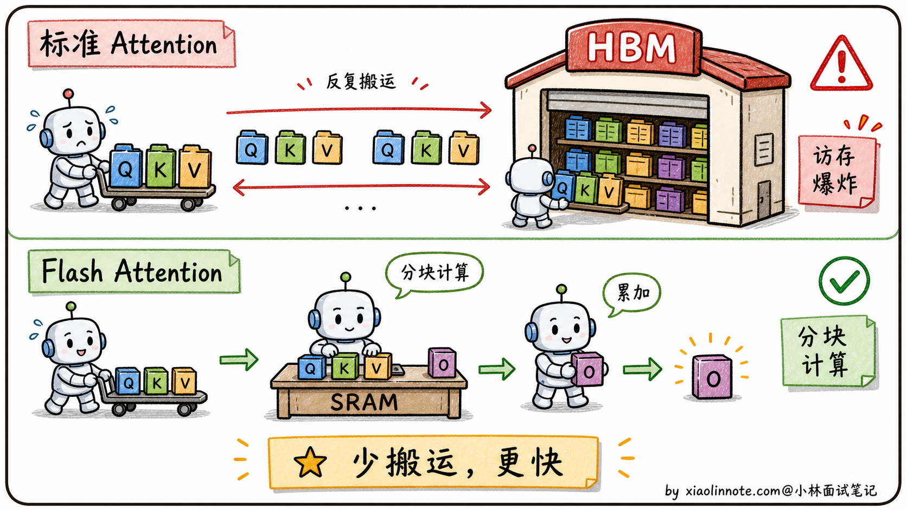

这样做的好处是：

**显存从 O(N²) 降到 O(N)**：再也不需要把 N×N 的中间矩阵存 HBM，只存最终输出 O 就够了。

**速度提升 2-4 倍**：HBM 读写次数从 O(N²) 降到 O(N²/M)（M 是块大小），实际速度比标准 Attention 快 2-4 倍。

**结果在数学上等价**：Flash Attention 算的是同一个 Attention 公式，不是稀疏近似或低秩近似。实际浮点实现里，因为分块顺序和数值精度不同，最后几位可能有微小差异，但不会像近似注意力那样引入模型精度损失。

Flash Attention 现在已经迭代到 v3 版本，针对 H100 等新一代 GPU 做了进一步优化，基本已经成为大模型推理框架（vLLM、SGLang、TGI）的默认实现。

### [三类优化的关系：是叠加不是替代](https://xiaolinnote.com/ai/llm/mha_mqa_gqa_flash_attention.html#三类优化的关系-是叠加不是替代)

讲到这里，可以把三类优化总结成一张表：

| 优化方案            | 改的是什么                                | 攻击的痛点               | 效果损失                             |
| ------------------- | ----------------------------------------- | ------------------------ | ------------------------------------ |
| **MQA**             | Attention 结构（K/V 压成 1 份）           | 显存大                   | 中等（2-5%）                         |
| **GQA**             | Attention 结构（K/V 压成 G 份）           | 显存大                   | 几乎无（< 0.5%）                     |
| **Flash Attention** | Attention 实现（计算分块 + 在线 softmax） | 显存大 + 访存慢 + 速度慢 | 基本无（数学等价，浮点细节略有差异） |

关键的认知：**这三类优化是叠加关系，不是替代关系**。

MQA/GQA 是「**结构层**」的优化，改的是 Attention 公式里有几套 K/V，让 KV Cache 占用降下来。Flash Attention 是「**实现层**」的优化，改的是 Attention 计算的具体执行方式，让计算和访存都加速。

它们攻击的是不同维度的问题，可以同时使用。现在主流大模型的标配是：


```
GQA 结构 + Flash Attention 实现
```

比如 Llama 3、Qwen 2、DeepSeek V3 都是这个组合。GQA 把 KV Cache 显存压到 1/4，Flash Attention 让 Attention 计算速度提升 2-4 倍。两者叠加后，一个 7B 模型能在消费级显卡（4090 24GB）上跑 32K 长上下文，搁 5 年前是不敢想的事情。

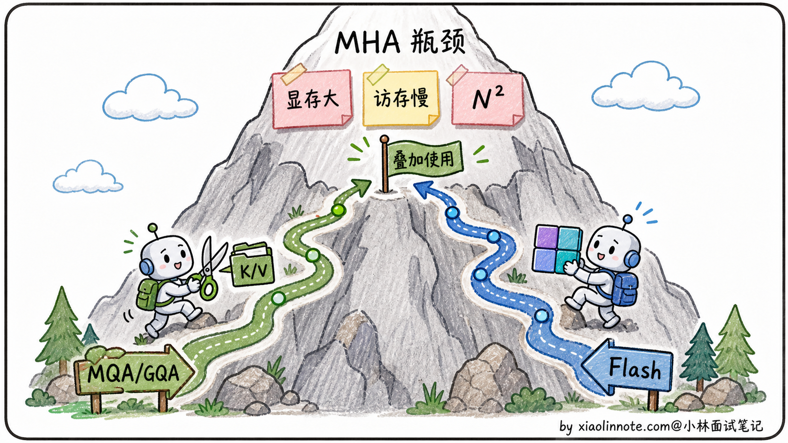

这个「叠加」的认知很重要。面试官如果追问「MQA、GQA、Flash Attention 你只能选一个用，选哪个」，你应该指出这是个伪命题：**真实工程里它们一定是组合用的，因为它们攻击的是不同维度的瓶颈**。能说出这一句，面试官就知道你不是在背单点优化，而是真的理解了整套优化体系的层次结构。

### [拓展：长上下文时代还有哪些新方向](https://xiaolinnote.com/ai/llm/mha_mqa_gqa_flash_attention.html#拓展-长上下文时代还有哪些新方向)

最近一两年，长上下文（100K+ token）成为各家大模型的标配，MHA 的优化也在继续往前推。简单提几个进阶方向，作为补充：

- **MLA（Multi-head Latent Attention）**：DeepSeek V2/V3 用的方案，前面提过。把 K/V 压缩到低维潜在空间，KV Cache 比 GQA 还小，效果反而更好
- **Sliding Window Attention（滑动窗口注意力）**：每个 token 只关注最近 N 个 token（比如 N=4096），不再做全局注意力。Mistral 系列用了这个思路。代价是丢失远距离信息，所以通常和全局注意力混合用
- **Linear Attention（线性注意力）**：用核函数近似 softmax，把 Attention 复杂度从 O(N²) 降到 O(N)。代表是 Performer、Linformer，但效果离 MHA 还是差一截，没成为主流
- **Mamba / 状态空间模型（SSM）**：完全抛弃 Attention，用状态空间方程替代。理论上可以处理无限长上下文，但实际效果还有争议，目前是研究热点而不是工程主流

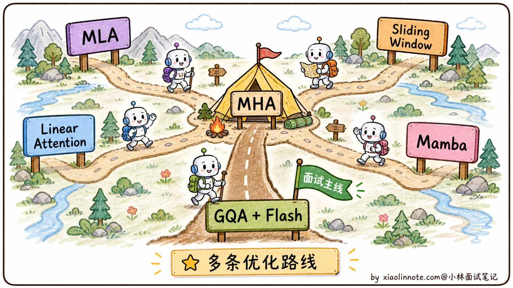

需要强调的是，这些方向大多还在演进，大厂面试问到 MHA 优化，把 MQA、GQA、Flash Attention 这三个讲清楚就足够拿高分了。MLA 作为加分项可以提一句，再深的就不用展开。

## [🎯 面试总结](https://xiaolinnote.com/ai/llm/mha_mqa_gqa_flash_attention.html#🎯-面试总结)

回到开头那段对话，被怼三次后再回答这个问题，最重要的是先把 MHA 的三个痛点讲清楚，因为这是整道题的地基。

讲三个痛点的时候可以这样组织：显存上 KV Cache 随头数和序列线性增长，长上下文场景一下就吃光显存；访存上 Attention 计算反复读写 HBM 大矩阵，瓶颈不在算力在带宽；复杂度上注意力矩阵是 N×N，序列翻倍计算量翻 4 倍。这三个痛点是连在一起的，长上下文场景下尤其明显，也是后面所有优化的出发点。

讲完痛点之后，把三类优化方案各自的位置讲清。MQA 是暴力共享 K/V，显存压到 1/H 但表达力有损失；GQA 是分组折中（Llama 2 70B、Llama 3、Qwen 2/3 的不少主力模型都用），显存接近 MQA 但效果接近 MHA，是甜蜜点；Flash Attention 走另一条赛道，不改 Attention 结构，从计算实现层面用「分块 + 在线 softmax」把显存从 O(N²) 降到 O(N)，速度还快 2-4 倍。

最关键的一句话是：**这三类优化是叠加不是替代**。结构层（GQA）和实现层（Flash Attention）攻击的痛点不同，主流大模型都是 GQA + Flash Attention 同时用。能说出这句话，面试官就知道你不是在背单点，而是真的理解了这套优化体系的层次结构。

如果还想再加分，可以提一句 MLA（DeepSeek 用的低秩潜在注意力）作为更前沿的方向，让面试官知道你跟得上技术节奏。

# 4. 大模型的位置编码是干什么用的？sin/cos、RoPE、ALiBi 有什么区别？

👔面试官：来讲讲大模型为什么需要位置编码？sin/cos、RoPE、ALiBi 这几种各有什么区别？

🙋‍♂️我：位置编码就是让模型知道每个词在第几个位置，用 sin 和 cos 函数算一下加到 token embedding 上就行。

👔面试官：……「加到 embedding 上」是怎么加？是直接做加法还是别的什么操作？为什么要用 sin 和 cos 而不是 1, 2, 3, 4 这种简单序号？再说，RoPE 你也是「加到 embedding 上」吗？那它不就和 sin/cos 一样了？

🙋‍♂️我：哦哦，RoPE 是相对位置编码，跟 sin/cos 不一样，是给 Q 和 K 做旋转。

👔面试官：「做旋转」？怎么旋转？为什么旋转能表达位置？为什么相对位置编码比绝对位置编码强？还有 ALiBi 是什么思路？为什么 Llama 选 RoPE 不选 ALiBi？

🙋‍♂️我：呃……ALiBi 我有点忘了……反正都是位置编码嘛，效果应该差不多吧？

👔面试官：「效果差不多」？那为什么主流模型都换成 RoPE 了？为什么长上下文外推 RoPE 比 sin/cos 强？为什么 ALiBi 有它的支持者但没成主流？这些问题没搞清楚，面试就是被怼。回去补一下。

从这几个反问里能听出，位置编码这道题真正想问的是「为什么 LLM 不用 sin/cos 而都跑去用 RoPE 了」。三种方案的设计思路、各自的外推上限、对长上下文的影响，把这条主线讲透，分高低自然就出来了。

## [💡 简要回答](https://xiaolinnote.com/ai/llm/position_encoding.html#💡-简要回答)

我理解位置编码要解决的问题，本质上是 Self-Attention 的「位置盲」缺陷。Attention 的计算是对称的，不管词序怎么变，注意力分数都一样。「我打你」和「你打我」对模型来说是一回事，所以必须显式注入位置信息。

三种主流位置编码各有不同的设计哲学。

第一种是 **sin/cos 绝对位置编码**（原始 Transformer 用的）。给每个位置算一组固定的 sin/cos 值，加到 token embedding 上。优点是简单、不需要训练参数；缺点是「绝对位置」太死板，模型实际关心的是「相对距离」，而且训练时见过的最长位置之外的位置（比如训练 2K，推理时上 4K），效果会断崖下跌。

第二种是 **RoPE（旋转位置编码）**。它不是把位置信息「加」到 embedding 上，而是「旋转」Q 和 K 向量。每个位置对应一个旋转角度，位置越靠后旋转的角度越大。两个 token 做注意力时，它们 Q/K 的点积自然带上了「相对距离」的信息。优点是相对位置直接编进了点积里、长上下文外推能力强，配合 NTK、YaRN 等扩展技巧，以及必要的继续训练或长上下文校准，可以把上下文推到更长。所以 Llama、Qwen、DeepSeek 等主流开源模型大量使用 RoPE。

第三种是 **ALiBi（Attention with Linear Biases）**。最简单粗暴，直接在注意力分数里加一个「距离惩罚」，离得越远扣分越多，斜率随 head 不同。优点是不引入任何可学习参数、长上下文外推天然就好；缺点是表达力弱一些，对位置的精细建模不如 RoPE。MosaicML 的 MPT、BLOOM 用过 ALiBi，但没成主流。

最关键的一句话是，**主流大模型几乎全部选择了 RoPE**，因为它在「相对位置编码 + 长上下文外推 + 兼容现代推理优化」三个维度上都最均衡。

## [📝 详细解析](https://xiaolinnote.com/ai/llm/position_encoding.html#📝-详细解析)

### [为什么 Attention 必须有位置编码](https://xiaolinnote.com/ai/llm/position_encoding.html#为什么-attention-必须有位置编码)

要理解位置编码，得先搞清楚 Attention 本身有什么毛病。

Self-Attention 的核心计算是 `softmax(QK^T/√d) · V`，每个 token 通过 Q 去和所有 token 的 K 做点积、算注意力权重，然后按权重加权聚合所有 token 的 V。这个过程有一个致命特点：**它是对位置不敏感的**，也就是俗称的「位置盲」。

什么意思呢？看个例子。

假如输入是「我打你」，每个字都被转成 embedding 向量。Attention 计算时，「我」会去看「打」和「你」，「打」会去看「我」和「你」，「你」会去看「我」和「打」。这个过程里，模型只知道「这三个字之间互相算了注意力」，但**完全不知道谁在前谁在后**。

如果把输入换成「你打我」，这三个 embedding 一模一样（只是位置变了），Attention 算出来的结果和「我打你」**几乎完全相同**。但这两句话语义是反的。模型如果分不清位置，就分不清主语和宾语，根本没法理解语言。

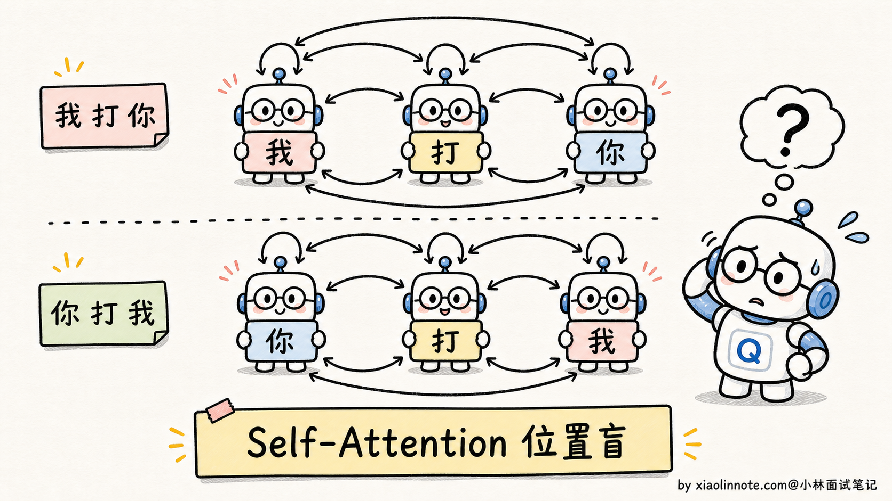

那为什么不能直接用「1, 2, 3, 4」这种位置序号？

因为序号是离散的整数，加到连续的 embedding 向量上会很别扭：第 1000 位的「1000」会把原本的 embedding 数值整个拉爆（embedding 通常是 -1 到 1 之间的小数）；而且整数序号对长序列没法泛化，训练时见过 1-2048，推理时来了 4096，这个数字模型从来没见过，效果一定崩。

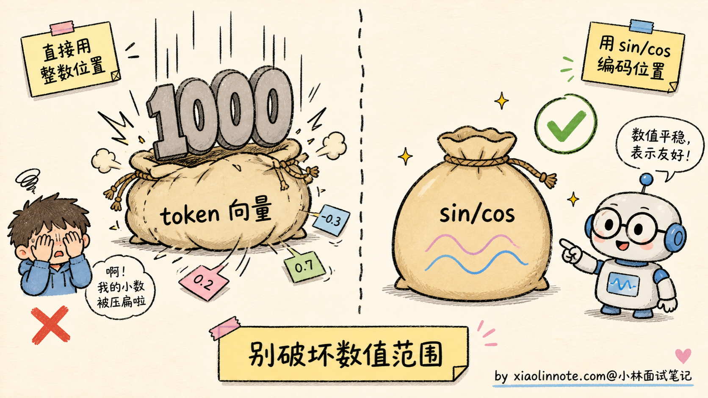

所以位置编码必须满足三个要求：

- **数值范围合理**，不能把 token embedding 给覆盖掉
- **能区分不同位置**，每个位置都有独特的「指纹」
- **能泛化到长序列**，最好支持外推到训练时没见过的长度

带着这三个要求，再来看三种主流方案就好理解了。

### [sin/cos 绝对位置编码：原始 Transformer 的方案](https://xiaolinnote.com/ai/llm/position_encoding.html#sin-cos-绝对位置编码-原始-transformer-的方案)

2017 年的 Transformer 论文用的就是 sin/cos 位置编码，简称 **Sinusoidal PE**。它的核心思路是用一组不同频率的 sin/cos 函数，给每个位置生成一个独特的「指纹向量」。

公式不展开背，直觉上这样理解。模型 embedding 维度有 d 维（比如 d=512），把这 d 维分成 d/2 对，每对用一组 sin/cos：

- 第 1 对的频率最快（高频），相邻位置之间区别明显，适合区分近距离的位置
- 第 d/2 对的频率最慢（低频），相邻位置几乎一样，但跨越很远的位置才能区分开

类比一下：就像几个不同频率的振子叠加，高频振子记录「精细位置」，低频振子记录「粗略位置」。每个位置在 d 维空间里都有一个独特的 sin/cos 组合，就是它的「身份证」。

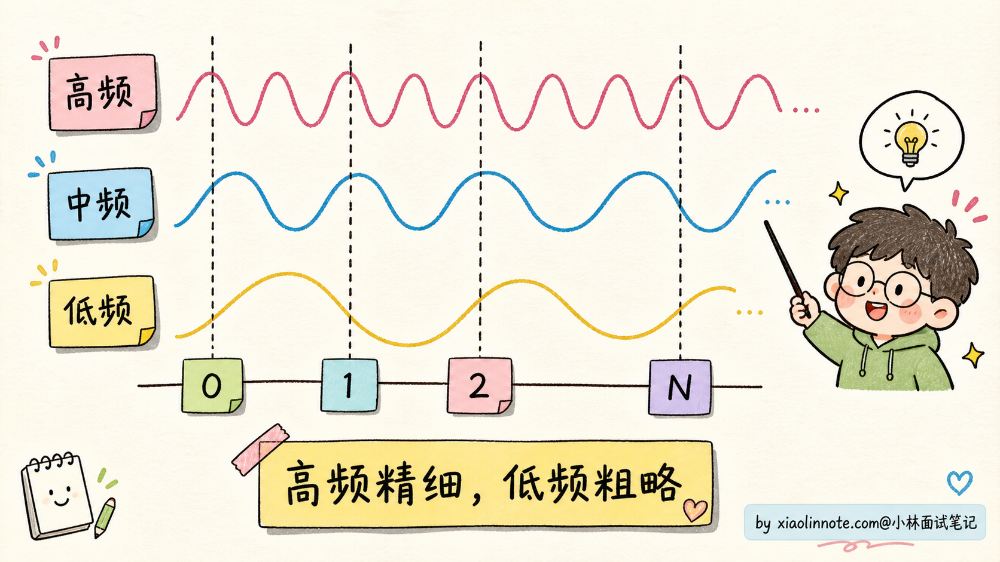

这个方案怎么用？把每个位置的 sin/cos 指纹向量直接**加到对应 token 的 embedding 上**。即「最终输入向量 = token embedding + position embedding」。

为什么是「加」而不是「拼接」？因为加法不增加维度，结构上更省事。神经网络强大到可以从相加的结果里把这两部分信息「自动解开」。

sin/cos 编码的优点是显而易见的：

- **零参数**：完全是数学公式算出来的，不占模型参数
- **泛化性看起来不错**：理论上 sin/cos 可以算到任意位置的指纹

但它的致命问题是**长上下文外推能力差**。

虽然理论上 sin/cos 可以算任意长度，但实际效果会在训练时见过的最长位置之外迅速恶化。如果模型只在 2K 长度上训练过，推理时给它 4K 输入，模型表现会断崖下跌。原因是模型在训练时只学过「2K 以内的相对位置关系」，超出 2K 的相对距离它从来没见过，注意力权重的分布会乱掉。

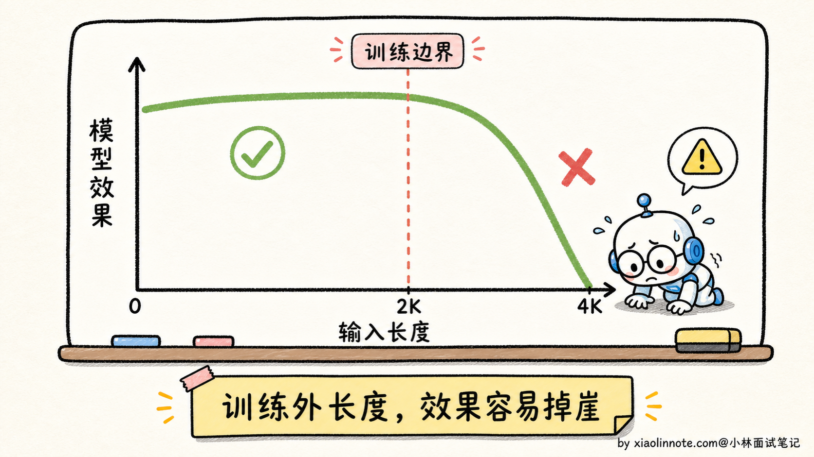

所以 sin/cos 编码在小模型时代还行，到了大模型时代（要支持几十 K 甚至上百 K 长上下文）就明显不够用了。

### [绝对位置 vs 相对位置：模型真正想要什么](https://xiaolinnote.com/ai/llm/position_encoding.html#绝对位置-vs-相对位置-模型真正想要什么)

在讨论 RoPE 之前，先想一个特别生活化的问题：**你跟别人介绍你坐在哪儿，是说「我坐在前排第 3 个座位」，还是说「我坐在 XX 旁边」？**

大部分时候你会选第二种，因为「相对位置」比「绝对位置」更有信息量。同样在 NLP 里，模型理解语言时关心的也是相对位置，不是绝对位置。

举个例子。中文里「主语动词宾语」这种句法关系，关键的不是「主语在第 3 位、动词在第 5 位」这种绝对编号，而是「主语和动词之间隔了 2 个词」这种相对距离。一句话不管前面加了多少修饰语、语气词，主语和动词的相对关系是稳定的。同样的「我吃饭」，不管你前面加「今天」「中午」「饿了所以」，主谓宾的相对距离都没变。

绝对位置编码（比如 sin/cos）的问题就在这里。它给每个位置发一个独立的「身份证」，要让模型自己从「位置 3 的身份证」和「位置 5 的身份证」推断出「相对距离是 2」。这个推断完全靠模型在训练里慢慢碰运气学到，没有显式的归纳偏置。

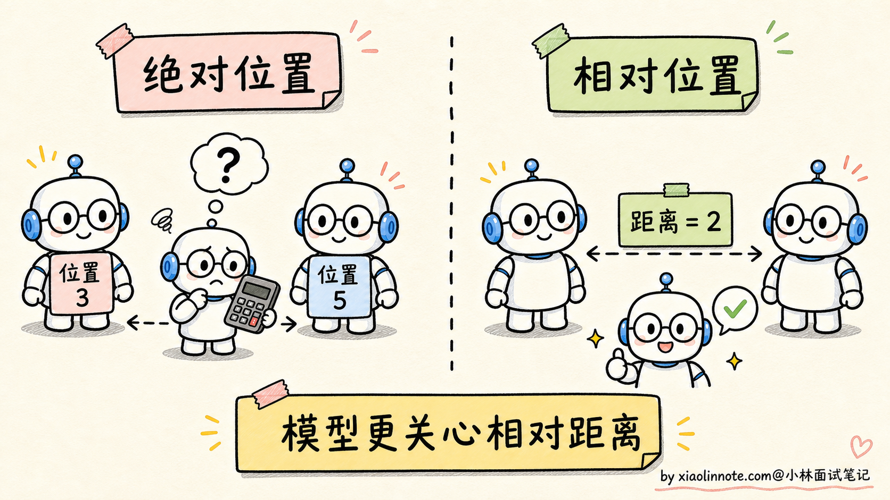

相对位置编码的思路就是把「相对距离」这个信息显式地编进注意力计算里，让模型不用自己算。具体做法是让两个 token 的位置编码只取决于它们的差值 m-n，跟 m 和 n 各自的绝对值无关。这就是 RoPE 和 ALiBi 共同的出发点，它们走的是不同的实现路线，但目标一致。

### [RoPE：用旋转把相对位置编进点积](https://xiaolinnote.com/ai/llm/position_encoding.html#rope-用旋转把相对位置编进点积)

RoPE（Rotary Position Embedding，旋转位置编码）是 2021 年中国学者苏剑林（@bojone）提出的，现在已经是大模型的标配。核心思路一句话：**不把位置信息加到 embedding 上，而是旋转 Q 和 K 向量**。

什么意思？

在 Attention 计算里，每个 token 都会被投影成 Q（Query）和 K（Key）。RoPE 在这一步动手脚：每个 token 的 Q/K 向量根据它的位置 m，被旋转一个对应角度 mθ（θ 是预设常数）。位置 0 的 token 不旋转，位置 1 的旋转 θ，位置 2 的旋转 2θ，依此类推。

类比一下：把 Q/K 向量想象成钟表的指针，每个位置对应一个不同时刻的指针朝向。位置越靠后，指针转得越多。

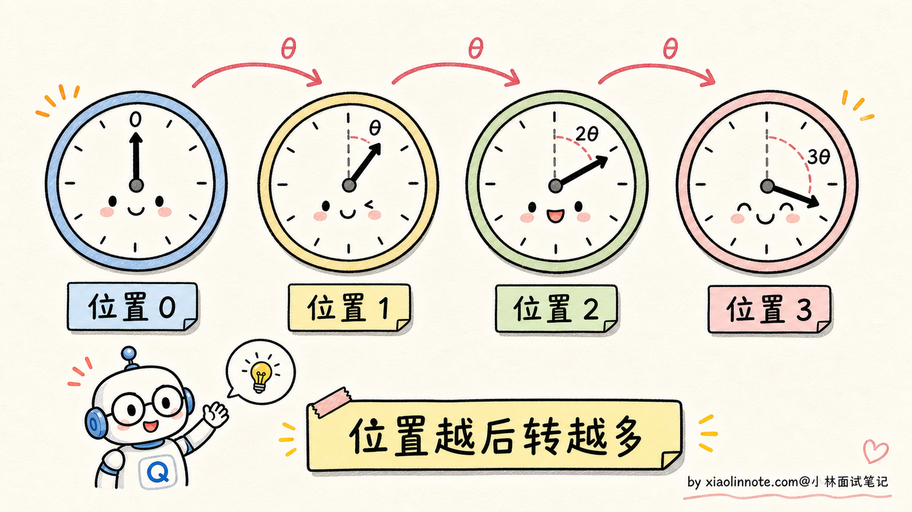

为什么旋转能表达位置？关键的数学性质是：**两个旋转后的向量做点积，结果只依赖于它们的「旋转角度差」**。

具体说，位置 m 的 Q 和位置 n 的 K 做点积，旋转之后的点积结果只跟 (m-n) 这个相对距离有关，跟 m 和 n 各自的绝对值无关。这就把「相对位置」信息天然地编进了 Attention 计算里，模型不用自己学。

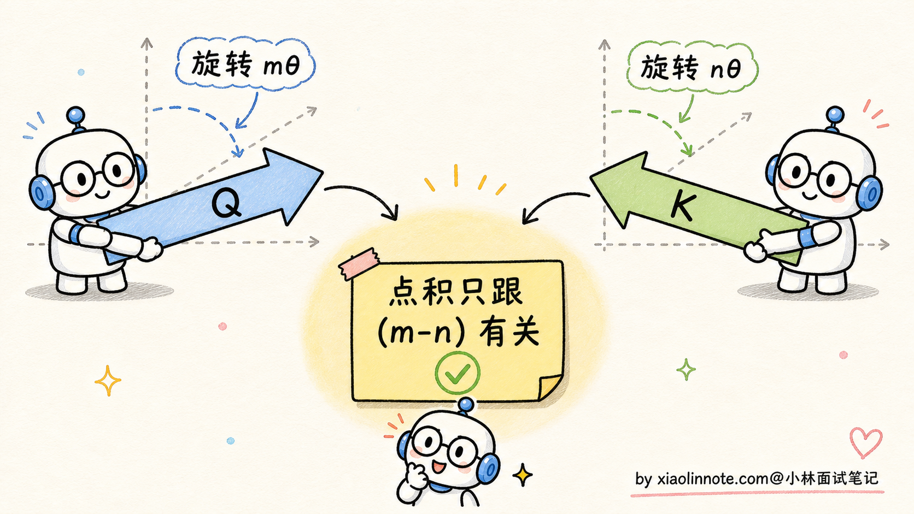

RoPE 的优点非常突出，几个层面叠加起来才让它成为现在的标配。

最直观的优点是**天然的相对位置编码**，不用模型自己学相对关系，直接编进点积。这是 RoPE 区别于 sin/cos 的核心。然后是**零参数**，整个操作就是数学上的旋转，不引入任何可学习参数，对模型容量没有额外开销。还有一个被忽视的细节是**保留 token 向量的长度**，旋转操作不改变向量的模长只改变方向，所以不会破坏原本 embedding 的数值范围，训练稳定性更好。最后是**和现代推理优化的兼容性**，RoPE 是在 Q/K 上做的旋转，跟 KV Cache、Flash Attention、MQA/GQA 这些主流推理优化都能无缝叠加，不会产生冲突。

更关键的是 RoPE 的**长上下文外推能力**远好于 sin/cos。原因是 RoPE 的旋转是连续的角度变化，本身没有「训练截止」这个概念。即使训练时只见过 2K，推理时来了 4K，多出来的位置也只是更大的旋转角度而已，模型不会「彻底懵」，效果衰减比 sin/cos 平缓很多。

再加上后来发明的 NTK Scaling、YaRN、Position Interpolation 等扩展技巧（核心都是调整 RoPE 的频率参数），可以把训练时的 2K 推到 32K、100K 甚至更长。但这里别说成「几乎无损」的银弹，外推效果取决于模型、任务、长度倍率和是否做过继续训练。推得越远，越需要专门评测长文检索、多跳推理和位置敏感任务。

谁在用 RoPE？基本上 2023 年之后所有主流开源大模型都用：

- **Llama 1/2/3** 全系
- **Qwen 1/2/3** 全系
- **DeepSeek V1/V2/V3/R1** 全系
- **Mistral / Mixtral** 全系
- **GLM 系列**

可以说 RoPE 已经是大模型架构的事实标准。

### [ALiBi：直接给注意力加距离惩罚](https://xiaolinnote.com/ai/llm/position_encoding.html#alibi-直接给注意力加距离惩罚)

ALiBi（Attention with Linear Biases）是另一种相对位置编码方案，2022 年提出，思路比 RoPE 更暴力：**根本不动 Q、K、V，直接在注意力分数里加一个「距离惩罚项」**。

具体做法：在 `softmax(QK^T)` 这一步之前，给每对 token 的注意力分数加上一个偏置项，偏置值是 `-m × |i-j|`，其中 |i-j| 是两个 token 之间的距离，m 是一个固定的斜率（每个 head 不同）。

直观理解：离得越远，注意力分数被扣得越多，模型越倾向于关注近邻的 token。每个 head 用不同的斜率，等于让不同的 head 关注不同范围的距离（有的 head 关注近邻，有的 head 关注远处）。

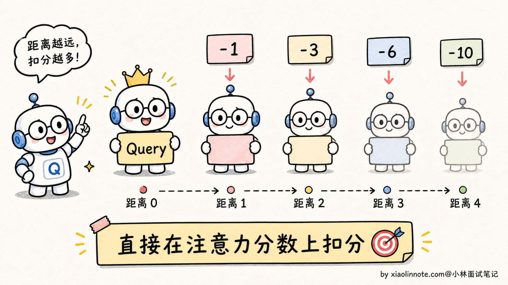

ALiBi 的优点：

- **零参数**：和 RoPE 一样不引入可学习参数
- **极简实现**：就是加一个偏置矩阵，比 RoPE 还简单
- **天然支持长上下文外推**：因为距离惩罚是线性的，不存在训练截止，理论上多长都行

但 ALiBi 也有明显短板：

- **表达力弱**：所有位置信息都靠「距离惩罚」这一个机制传递，对精细的位置关系（比如「主语动词宾语的语序」）建模不如 RoPE 灵活
- **过强的局部偏置**：线性距离惩罚会让模型过度关注近邻，对需要捕捉长距离依赖的任务不利

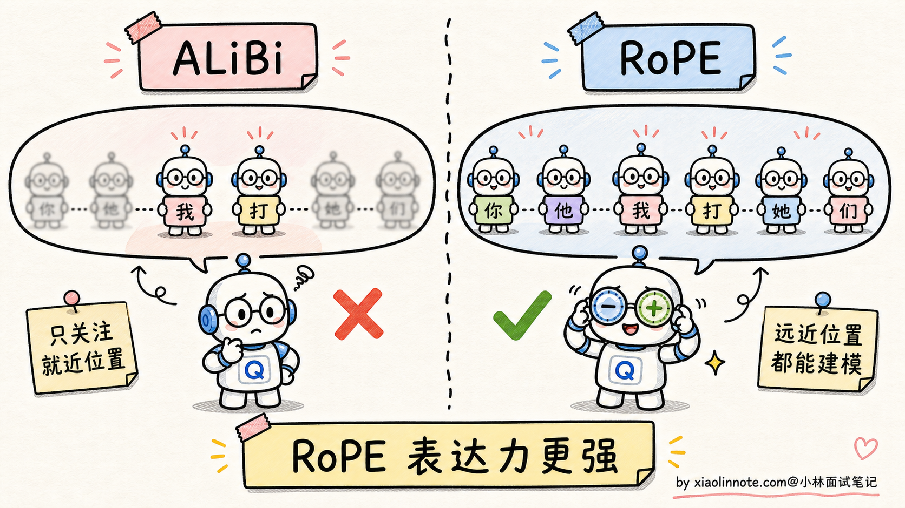

谁用过 ALiBi？

- **MosaicML 的 MPT 系列**
- **BLOOM 的某些版本**

但这些模型都不是主流大模型，ALiBi 没能在大厂主力模型上推广开。

### [三种方案对比：为什么 RoPE 赢了](https://xiaolinnote.com/ai/llm/position_encoding.html#三种方案对比-为什么-rope-赢了)

把三种方案放到一起比较：

| 维度           | sin/cos              | ALiBi                | RoPE                                      |
| -------------- | -------------------- | -------------------- | ----------------------------------------- |
| 编码类型       | 绝对位置             | 相对位置（距离惩罚） | 相对位置（旋转）                          |
| 是否可学习参数 | 否                   | 否                   | 否                                        |
| 注入方式       | 加到 token embedding | 加到注意力分数       | 旋转 Q/K 向量                             |
| 长上下文外推   | 较差（容易断崖）     | 好（线性外推）       | 很强（配合 NTK/YaRN，常需校准或继续训练） |
| 表达力         | 中等                 | 弱（过强局部偏置）   | 强                                        |
| 主流采用       | 原始 Transformer     | MPT、BLOOM           | Llama / Qwen / DeepSeek 全系              |

为什么 RoPE 最终赢了？三个理由。

**第一，长上下文外推能力**。这是 2023 年之后最重要的需求之一。RoPE 配合 NTK/YaRN 这套生态，外推能力很强，但真正上线前还要看长上下文评测，不是把参数一改就天然无损。

**第二，相对位置 + 表达力的平衡**。ALiBi 虽然外推也好，但表达力不够；sin/cos 表达力够，但外推差。RoPE 是唯一兼顾两者的方案。

**第三，工程兼容性**。RoPE 只在 Q/K 上做旋转，不改变其他计算，和 KV Cache、Flash Attention、MQA/GQA 都能无缝叠加。这一点对工业界部署至关重要。

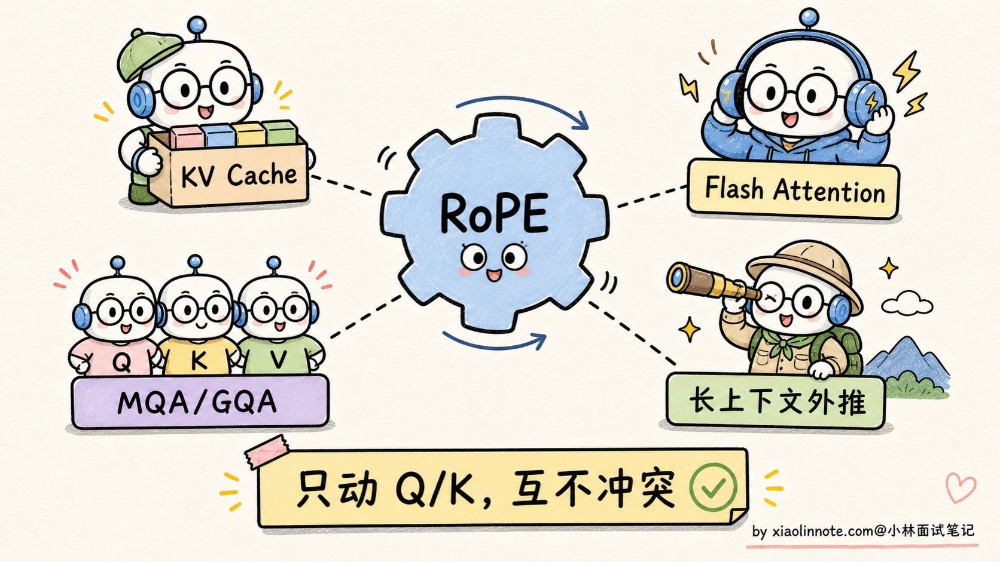

### [拓展：长上下文外推（NTK / YaRN 简介）](https://xiaolinnote.com/ai/llm/position_encoding.html#拓展-长上下文外推-ntk-yarn-简介)

最后简单提一下 RoPE 的外推扩展技巧，因为这一块面试时容易被追问。

RoPE 训练时见过 2K，怎么推到 100K？直接喂 100K 输入是不行的，因为旋转角度超过 2K 之外，模型从来没见过那么大的角度，效果还是会衰减。所以业界搞出了几个「调整 RoPE 频率参数」的技巧：

- **Position Interpolation（PI）**：把 100K 的位置「等比例缩小」到 2K 范围，比如位置 50000 当作位置 1000 处理。简单粗暴但有效，代价是「精细距离信息被压缩」
- **NTK-aware Scaling**：调整 RoPE 不同维度的频率，让高频维度（精细位置）几乎不动，低频维度（粗略位置）按比例缩小。比 PI 更精细
- **YaRN（Yet another RoPE extensioN）**：在 NTK 基础上做了进一步精细化，引入温度参数和分段策略，目前是大厂用得最多的方案

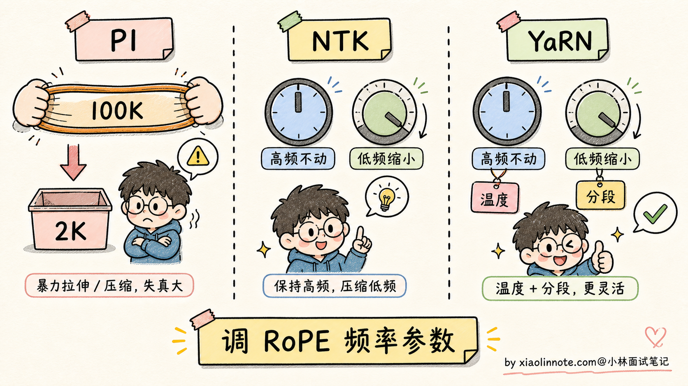

需要强调的是，这些外推技巧有些可以在推理时直接改 RoPE 参数就看到收益，但要做到稳定的 100K+ 长上下文，很多模型还会配合长上下文继续训练、校准数据或专门的评测筛选。RoPE 在长上下文时代地位稳固，不是因为它能无成本无限外推，而是因为它给了社区一个很好调、很好扩展的基础。

## [🎯 面试总结](https://xiaolinnote.com/ai/llm/position_encoding.html#🎯-面试总结)

回到开头那段对话，问到位置编码，最重要的是先讲清楚为什么需要它。Self-Attention 是「位置盲」的，「我打你」和「你打我」算出来的注意力是一样的，所以必须显式注入位置信息。而且不能直接用 1, 2, 3, 4 这种序号，因为数值范围会破坏 embedding，长序列还没法泛化。这一句铺垫先讲到，面试官就知道你理解为什么需要位置编码这件事。

讲完铺垫之后，再把三种主流方案的设计哲学讲明白。sin/cos 是绝对位置编码，加到 token embedding 上，简单但长上下文外推差；RoPE 是相对位置编码，通过旋转 Q/K 向量把相对距离编进点积，外推能力强，是当前主流；ALiBi 是另一种相对位置编码，直接在注意力分数上加距离惩罚，零参数极简，但表达力弱、局部偏置过强，没成主流。三种方案的设计哲学和工业界采用情况都点出来，体现你对这条技术路线有完整的视角。

最关键的一句话是：**RoPE 赢在「相对位置 + 长上下文扩展 + 工程兼容性」三个维度的均衡**。配合 NTK Scaling、YaRN 等扩展技巧，再加上必要的长上下文训练或校准，能把上下文扩到很长，所以 Llama、Qwen、DeepSeek、Mistral 等主流开源模型大量使用 RoPE。

如果还想再加分，可以提一句长上下文外推的具体方案（PI / NTK / YaRN），或者点出 RoPE 兼容 KV Cache、Flash Attention、MQA/GQA 等现代推理优化，这才是它能在工业界站稳脚跟的关键。能讲到这一层，面试官基本就没什么追问的了。

# 5. 什么是大模型项目的分词器？原理是什么？

👔面试官：来讲讲什么是大模型项目的分词器？原理是什么？

🙋‍♂️我：分词器就是把文本切成一个个词，让模型能处理。

👔面试官：……「切成词」是表面理解。模型为什么需要分词？直接用文本不行吗？再说，「词」具体是什么？是汉语里的一个字、一个词、还是别的什么？

🙋‍♂️我：哦哦，应该是因为模型只能处理数字，分词器把文字转成数字 ID 序列？

👔面试官：方向对了。那再问你：分词的粒度怎么选？按字符切（每个字一个 token）行不行？按单词切呢？为什么主流大模型都用 BPE 这种「子词级别」？

🙋‍♂️我：呃，按字符切应该会让序列太长，按单词切又会有 OOV 问题？

👔面试官：终于说到点子上。但 BPE 具体怎么工作的，你能说清楚吗？为什么中文 1000 字对应 1000-1500 个 token，而不是 1000 个或者 500 个？这种「实际工程数字」要心里有数，不然估算成本都估不准。回去搞清楚再来。

问到这里分词器这道题的全貌就出来了，它解决的远不止「切词」一件事：文本到整数的转换、字符级和词级之间的折中、新词怎么处理、特殊 token 怎么放，每一层背后都有具体的工程动机。

## [💡 简要回答](https://xiaolinnote.com/ai/llm/tokenizer.html#💡-简要回答)

我觉得面试被问到 Tokenizer，最重要的是先说清楚「为什么需要它」，模型只能处理整数，不认识字符串，Tokenizer 就是把文字转成数字 ID 序列的桥梁。至于原理，主流路线都是子词分词，常见实现有 BPE、SentencePiece / Unigram、WordPiece 等。BPE 的直觉是从小单元出发，反复把出现频率最高的相邻片段合并成新 token，最终形成一个几万到十几万规模的词汇表，既能控制大小又能处理新词。实际开发里要注意的是：API 按 token 计费而不是按字数，1000 个汉字大概对应 1000-1500 个 token，但具体比例和模型 tokenizer 强相关，估算成本和上下文窗口用量都要用真实 tokenizer 来算。

## [📝 详细解析](https://xiaolinnote.com/ai/llm/tokenizer.html#📝-详细解析)

### [为什么需要 Tokenizer](https://xiaolinnote.com/ai/llm/tokenizer.html#为什么需要-tokenizer)

大语言模型的本质是一个函数：输入一串整数（token ID 序列），输出下一个整数的概率分布，然后把输出的整数再查表得到对应的文字。

整个过程里模型看到的全是整数，完全不认识字符串。Tokenizer 就是连接人类文字和模型整数世界的桥梁，做两件事：编码（文本 -> token ID 序列）和解码（token ID 序列 -> 文本）。

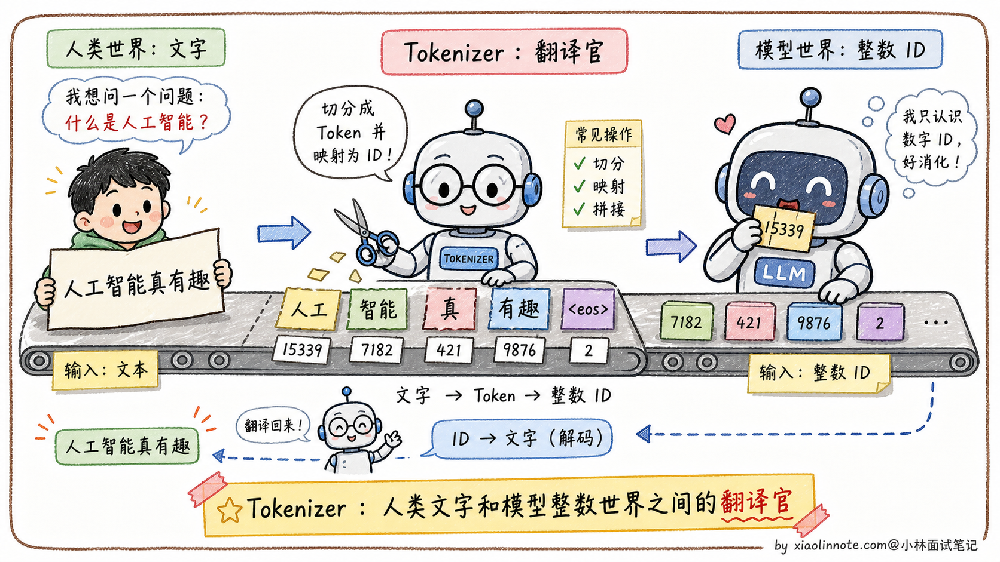

### [朴素方案的问题](https://xiaolinnote.com/ai/llm/tokenizer.html#朴素方案的问题)

要做分词，最直接能想到的两种方案都有致命缺陷。

第一种是**字符级分词**，每个字母或汉字算一个 token。这种方案词汇表很小（英文才 26 个字母加标点），但序列会变得非常长。一个简单的「hello」就变成 5 个 token，正常一篇文章能膨胀到几千上万个 token，让 Attention 机制的计算量（O(N²)）大幅飙升。而且字符本身携带的语义信息太少，模型要从一堆离散字符里重新学出「单词」的概念，效率极低。

第二种是**词级分词**，每个完整单词算一个 token。这种方式对英文这种有空格分隔的语言可以做到，但词汇表会膨胀到几十万甚至几百万，因为英文里光是「cat / cats / catting / catty」这种变形就要分别存。更严重的问题是 **OOV（Out-of-Vocabulary，未登录词）**：遇到训练时没见过的新词（专有名词、网络用语、拼写错误）就直接无法处理，模型只能输出一个「未知词」标记，相当于这个词的语义完全丢失。中文情况更糟，词级分词意味着要先做中文分词（哪些字组成一个词），分词错了下游全错。

字符级太碎，词级太散，**子词分词就是这两者中间的甜蜜点**。它做的是「subword（子词）」级别的分词，既控制了词汇表大小，又能处理新词，同时保留了比字符更多的语义信息。BPE 是最常见的一类，但不是唯一方案，很多模型也会用 SentencePiece / Unigram 或 WordPiece。

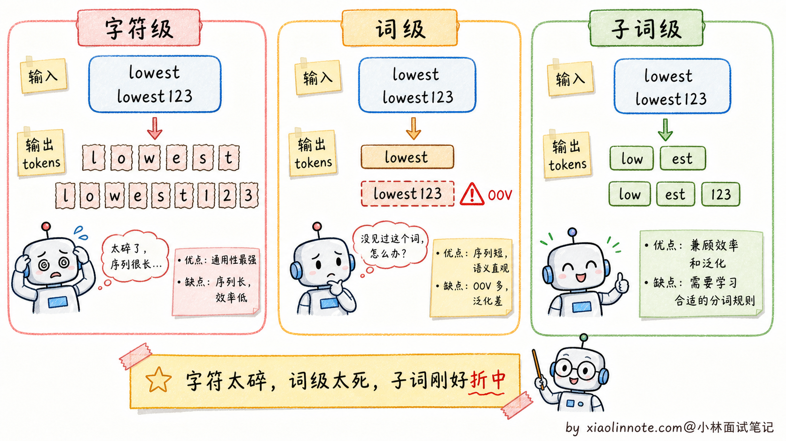

### [BPE 算法：从合并规则开始](https://xiaolinnote.com/ai/llm/tokenizer.html#bpe-算法-从合并规则开始)

BPE（Byte Pair Encoding，字节对编码）的原理其实很简单，分三步。

- 第一步，初始化：把训练语料里所有文本拆成最小单元（通常是单个字节或字符），每个字符就是一个基础 token，形成初始词汇表。
- 第二步，反复合并：统计语料中所有相邻 token pair 的出现频率，找到频率最高的那对，比如 「t」和「h」经常在一起，就把它们合并成新 token「th」，加入词汇表，同时更新语料中的所有「t」「h」相邻位置为「th」。然后继续找下一个最高频的 pair，比如「th」和「e」合并成「the」。每轮合并产生一条合并规则，同时词汇表增加一个新 token。
- 第三步，重复直到词汇表达到预设大小（比如 GPT-2 用了 50257，Llama 3 用了 128000）。

以「lowest」这个词为例，BPE 可能会把它分成「low」+「est」，因为「low」和「est」都是高频子词。遇到新词「lowest123」，BPE 会分成「low」+「est」+「1」+「2」+「3」，不会出现 OOV，每个部分都是有意义的 token。

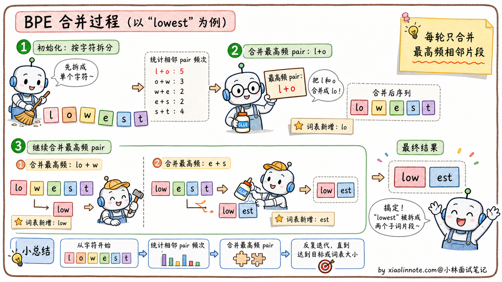

### [中文分词的特点](https://xiaolinnote.com/ai/llm/tokenizer.html#中文分词的特点)

中文没有空格分隔词语，BPE 面对中文的处理方式和英文不同。

在大多数主流模型的词汇表里，常用汉字会直接作为独立 token 存在（因为每个汉字出现频率足够高，不需要拆分）。常见的中文词语（比如「人工智能」）可能会被合并成单个 token，也可能是「人工」+「智能」两个 token，具体取决于训练数据里的频率。

实践中估算的经验规则是：1000 个汉字大约对应 1000-1500 个 token（汉字 token 化效率略低于英文，因为英文合并词会覆盖更多字符）。但这只是粗估，Qwen、Llama、OpenAI、Claude 的 tokenizer 都不一样，中文、英文、代码、表格混在一起时比例会明显变化，正式算成本前一定要用目标模型的 tokenizer 跑一遍。

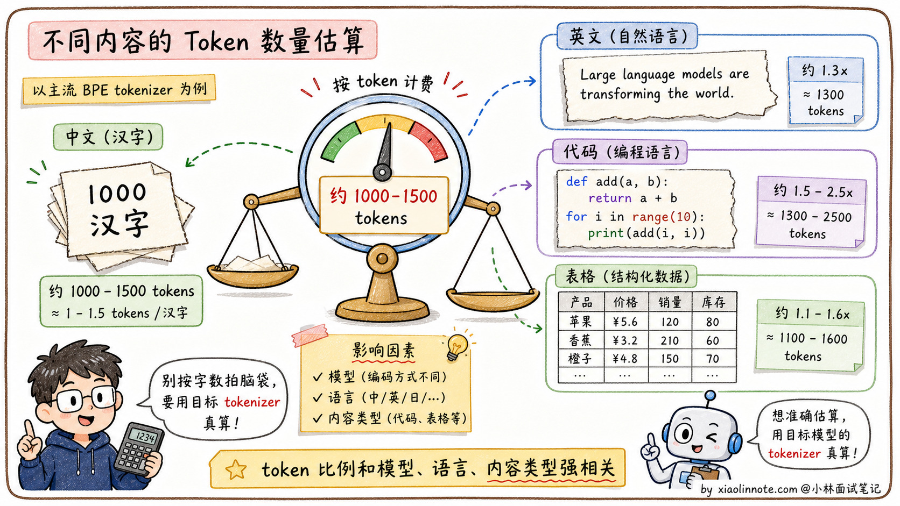

### [特殊 Token 的作用](https://xiaolinnote.com/ai/llm/tokenizer.html#特殊-token-的作用)

Tokenizer 里还有一些特殊 token，它们不是来自文本，而是用来给模型传递结构信息的。

BOS（Beginning of Sequence）标记序列开始；EOS（End of Sequence）标记序列结束，模型生成到 EOS 时停止输出；PAD（Padding）用于批量处理时对齐不同长度的序列；SEP（Separator）用于分隔不同部分（比如对话里区分系统消息和用户消息）；在 ChatML 格式里，`<|im_start|>` 和 `<|im_end|>` 这类特殊 token 用来区分对话轮次和角色。

模型对这些特殊 token 有特殊的「意识」，它们的 embedding 在训练中被专门优化，所以模型能根据这些信号理解对话的结构。了解了 Tokenizer 的原理，来看它在实际工程里会带来哪些具体影响。

### [为什么 Tokenizer 对实际工程很重要](https://xiaolinnote.com/ai/llm/tokenizer.html#为什么-tokenizer-对实际工程很重要)

理解 Tokenizer 不只是理论知识，对实际工程有几个特别直接的影响，搞不清楚就容易踩坑。

最直接的是**API 成本估算**。主流 LLM API 都是按 token 计费的，不是按字数。1000 汉字大约对应 1000-1500 tokens，1000 个英文单词大约 1300 tokens，代码的话效率更低（一些标点、缩进会单独成 token）。但这些都只是经验值，要预估费用，必须用目标模型的 tokenizer 数出来，不能只用字数拍脑袋。

第二个是**上下文窗口管理**。每个模型有最大 token 限制（比如 Claude 200K、Qwen 128K），你需要确保输入不超限。但字数和 token 数的比例取决于语言和内容类型，中文 + 代码混合内容很容易让你以为「才 5 万字应该不超」，实际算成 token 已经 8 万了。这种「直觉和实际不符」是新人的常见踩坑。

第三个是**避免截断重要信息**。如果你的文档恰好卡在上下文限制边缘，Tokenizer 可能会把一个词从中间硬切开（比如「人工智能」可能被截断成「人工」+ 半个「智」字），导致下游解析或检索失败。这种边界情况一定要在工程上处理，比如保留几百 token 的安全 buffer。

## [🎯 面试总结](https://xiaolinnote.com/ai/llm/tokenizer.html#🎯-面试总结)

回到开头那段对话，问到 Tokenizer，最重要的是先讲清楚「**为什么需要它**」。模型只能处理整数，不认识字符串，Tokenizer 就是连接人类文字和模型整数世界的桥梁。这一句铺垫先讲到，面试官就知道你抓到了本质。

接下来讲清三种分词粒度的取舍。字符级太碎（序列太长、语义信息少），词级太散（OOV 严重、词汇表爆炸），BPE 取了中间的子词级折中，既控制词汇表又能处理新词。这是子词分词的核心动机。

讲 BPE 原理时，把「初始化基础词汇表 → 反复合并最高频 pair → 直到词汇表达到预设大小」这个三步流程讲清楚就行。同时补一句：BPE 只是子词分词的一种，SentencePiece / Unigram、WordPiece 也很常见。能举一个「lowest123 被切成 low + est + 1 + 2 + 3，没有 OOV」的例子，比纯讲算法生动得多。

最关键的是带出**实际工程影响**：API 按 token 计费、1000 汉字 ≈ 1000-1500 tokens、上下文窗口管理、避免截断。这些都是面试官最爱听的「真的做过项目」的工程细节。

如果还想再加分，可以提一句**特殊 token**的作用（BOS、EOS、PAD、SEP，以及 ChatML 格式里的 `<|im_start|>`），让面试官知道你不只懂分词算法，还懂模型对话格式背后的工程细节。能讲到这一层，这道题就答得很完整了。

# 6. 大模型是怎么训练出来的？

👔面试官：来讲讲大模型是怎么训练出来的？

🙋‍♂️我：训练就是给模型喂大量数据让它学习，最后能回答各种问题。

👔面试官：……「喂大量数据」具体喂什么？数据从哪来？训练目标是什么？为什么训完一次就能回答问题？

🙋‍♂️我：哦哦，应该是给它 prompt 和答案对，让它学会回答？

👔面试官：你说的是 SFT 阶段，但 SFT 之前还有更基础的预训练阶段，没有预训练 SFT 啥都干不成。再说，SFT 之后还有对齐阶段，三个阶段缺一不可。这三件事你能讲清楚分别在做什么、为什么需要、为什么缺一不可吗？

🙋‍♂️我：呃……三个阶段我大概知道有，但具体差别讲不清楚。

👔面试官：典型的「知道有但讲不清」。预训练是「让模型读万卷书」，SFT 是「让它学会问答」，对齐是「让它好好说话」。这三件事的训练目标完全不同，数据格式完全不同，缺少任何一个模型都用不起来。回去搞清楚再来。

到这里我才老实了，训练大模型真不是「喂数据」三个字。它是「预训练 → SFT → 对齐」三段流水线，每一段解决的问题不同，顺序还动不得。把这三段各自的角色拆开讲，整条主线才立得起来。

## [💡 简要回答](https://xiaolinnote.com/ai/llm/llm_training.html#💡-简要回答)

大模型训练我理解是分三个阶段，每个阶段解决不同层次的问题。我用一个类比来记忆：预训练就像一个人从小到大读了海量的书，积累了语言能力和世界知识，训练目标就是「预测下一个词」，简单但威力巨大；SFT 是给这个博学的人做面试培训，让他学会把知识转化成有问有答的对话形式，而不是一直续写文章；对齐阶段是给他做职业素养培训，用 RLHF 或 DPO 让他的回答方式更符合人类偏好、更安全。三个阶段缺一不可，预训练决定能力天花板，SFT 给格式，对齐给价值观，这是目前所有主流大模型训练的基本框架。

## [📝 详细解析](https://xiaolinnote.com/ai/llm/llm_training.html#📝-详细解析)

### [先理一个直觉：训练大模型为什么要分阶段？](https://xiaolinnote.com/ai/llm/llm_training.html#先理一个直觉-训练大模型为什么要分阶段)

很多人第一次听说「大模型训练分三个阶段」会很困惑，为什么不能一次性训完？为什么要分这么麻烦？

要回答这个问题，先做个类比。培养一个能在公司独当一面的员工，至少要经过三件事。

他得先**有基础知识**，从小学读到大学，掌握语言、数学、逻辑、各种学科常识。没有这个基础，进了公司啥也干不了。然后他得**会公司的流程**，哪怕他知识再渊博，进了公司也不知道「怎么写汇报邮件、怎么和客户对话、怎么提交工单」。这些不是知识问题，是「适配工作场景」的问题。最后他得**懂职业素养**，知道该说什么、不该说什么、什么时候要谦虚、什么时候要拒绝不合理要求。这些不是技能问题，是「价值观和分寸感」的问题。

大模型的三个训练阶段对应的就是这三件事。预训练让它读万卷书，SFT 让它学会问答格式，对齐让它学会好好说话。每个阶段解决一个完全不同层面的问题，所以缺一不可。

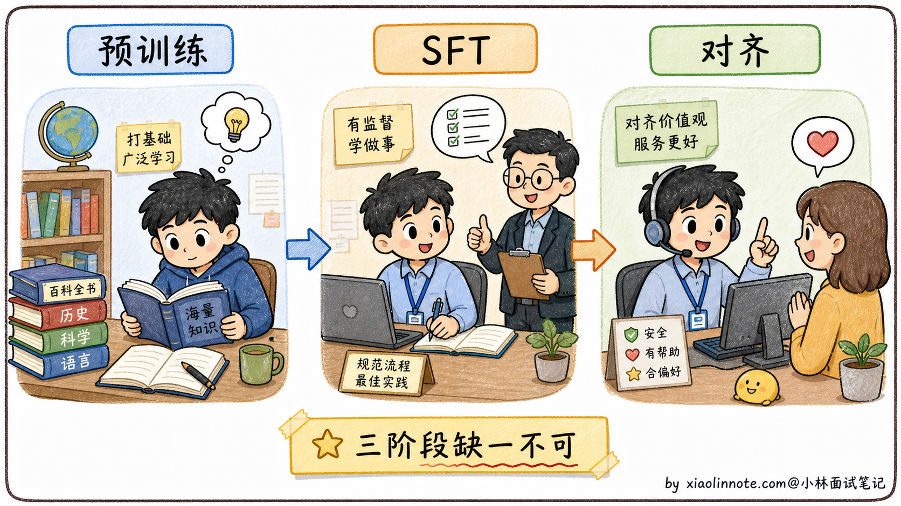

有了这个类比打底，下面分别看每个阶段具体在做什么。

### [第一阶段：预训练，读万卷书](https://xiaolinnote.com/ai/llm/llm_training.html#第一阶段-预训练-读万卷书)

预训练是大模型能力的根基，所有上层能力都从这里来。

**数据从哪来？**

预训练用的数据规模大到夸张。GPT-3 用了 3000 亿 token，Llama 3 用了 15 万亿 token，相当于把整个互联网的公开文本资源差不多都吞了一遍。

具体数据来源你可以理解成「能爬到的所有公开文本」，互联网网页（Common Crawl 项目专门干这事）、GitHub 上的所有代码、维基百科全部条目、扫描过的图书、学术论文、新闻报道，几乎所有形式的人类知识都在里面。

但原始爬到的数据是不能直接用的，里面充满垃圾，包括重复内容、机器生成的乱码、低质量论坛灌水、广告页面这些。预训练前要做大量清洗工作，去重、过滤低质量内容、识别语言、剔除有害信息。一个高质量训练集的清洗成本可能比模型训练本身还贵，这是大模型公司之间的核心竞争力之一。

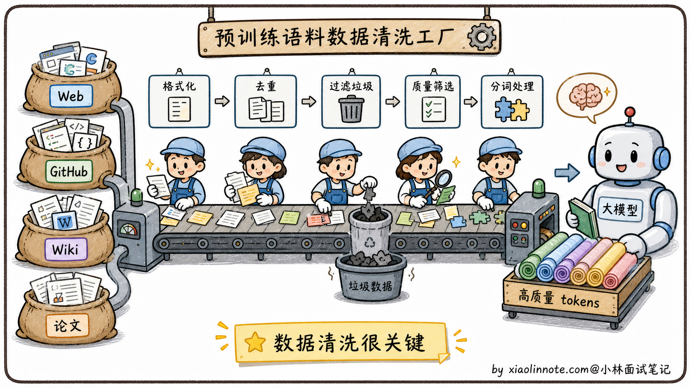

**训练目标长什么样？**

这一点其实很反直觉。你猜大模型的训练目标是什么？是「回答正确率」？还是「写得通不通顺」？都不是，是一个看起来简单到让人怀疑的任务，**预测下一个 token**。

学术上叫 CLM（Causal Language Modeling，因果语言模型）。每条训练样本就是「给前 N 个 token，预测第 N+1 个 token」，对整个语料库做这件事，反复调整模型参数让它的预测越来越准。

「预测下一个词」就这么简单？没错，就是这么简单。但威力大到吓人。为什么呢？因为想要在不同上下文里准确预测下一个词，模型必须真的理解语法、记住事实、推理逻辑。

举几个例子你就明白了。要预测「北京是中国的____」，模型必须知道「北京是首都」这个事实；要预测「如果 x=2，那么 x²=____」，模型必须会算数；要预测一段代码的下一行，模型必须理解编程逻辑；要预测一首诗的下一句，模型必须懂韵律和意境。所有这些能力都被「预测下一个词」这一个目标**逼着学会了**。


这就是为什么「预测下一个词」这个看起来简单的目标，能造就一个能写代码、能解数学题、能创作诗歌的通用智能模型。简单的目标 + 海量数据 = 涌现的智能。

**计算开销有多大？**

惊人的离谱。训练 GPT-3 据估算花了约 3.14×10²³ 次浮点运算（FLOPs）。这是什么概念？用一张 A100 GPU 算需要 36 万年。OpenAI 实际是用了几百到几千张 GPU 并行训练了几个月才搞定。算力成本上千万美元，这就是为什么早期只有少数巨头能玩得起预训练。

预训练完之后，模型有了一个「大脑」，里面塞满了语言能力和世界知识。但这个大脑还有个问题，**它不会回答问题，只会续写**。

### [第二阶段：SFT，从「续写机器」变「对话机器」](https://xiaolinnote.com/ai/llm/llm_training.html#第二阶段-sft-从「续写机器」变「对话机器」)

预训练后的模型本质上是一个「文本续写机器」。

什么意思？你给它一段文字，它会继续往下写，但**不真的理解你在「问问题」**。打个比方，你问它「天空为什么是蓝色的？」，它可能续写成「天空为什么是蓝色的？这是个有趣的科学问题。今天天气不错，让我们看看……」一直发散下去，根本没在回答你。

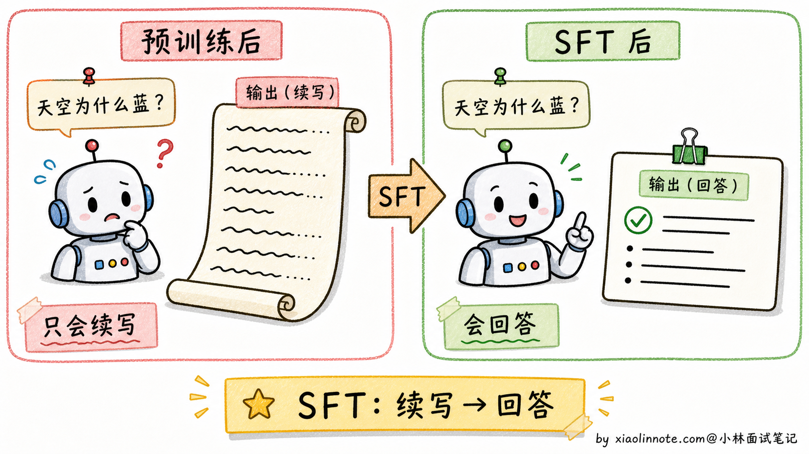

SFT 的目的就是把这个「续写机器」改造成「对话机器」。

它怎么做？训练数据格式变了，从「连续文本」变成「(指令，期望回答) 对」，比如这种格式：


```
指令：请用简单易懂的语言解释为什么天空是蓝色的
回答：天空呈现蓝色是因为大气中的散射现象。太阳光包含所有颜色，
当光进入大气层时，氮气和氧气分子会将短波长的蓝光散射到各个方向，
而长波长的红光穿透能力更强，散射较少。所以我们从任何方向看天空，
都能看到散射来的蓝光。
```

模型在这种数据上继续训练，慢慢学会「啊，看到这种格式我就该给一个完整答案，不要无限续写下去」。这就是从「续写模式」切换到「对话模式」的关键。

数据质量比数量更重要。Llama 2 用了大约 100 万条 SFT 数据，但每条都是精心标注的。AlpacaFarm 的研究还发现一个反直觉的结论，**几千条高质量数据训出来的效果，比几十万条低质量数据要好**。所以工业界做 SFT 不会盲目堆数量，而是花大量人力打磨数据质量。

数据多样性也很关键，不能只覆盖一种任务。一份合格的 SFT 数据集会涵盖问答、写作、代码、角色扮演、数学推理、翻译等各种场景。覆盖面不够的话，模型在没见过的任务上就会表现拉胯。

SFT 之后，模型已经会按指令回答问题了。但它的回答方式不一定是你喜欢的，可能太啰嗦、太简洁、或者偶尔说出一些不该说的话。这就需要第三阶段。

### [第三阶段：对齐，学会「好好说话」](https://xiaolinnote.com/ai/llm/llm_training.html#第三阶段-对齐-学会「好好说话」)

对齐（Alignment）的目标是让模型的行为更符合人类的价值观和偏好。

举个例子。同一个问题「怎么学好 Python」，可以有很多种「合格」的回答。有的简洁、有的详细、有的带代码示例、有的纯文字、有的承认「我不熟悉这块」、有的硬装专家胡说。SFT 只教会了模型「这种格式叫合格回答」，但没告诉它「哪种回答用户更喜欢」。对齐就是补这一课。

对齐的主流方法是 **RLHF**（Reinforcement Learning from Human Feedback，基于人类反馈的强化学习），OpenAI 在 InstructGPT 里首次引入。

它的流程是这样的。先让人类标注员对同一个问题的多个回答做排序（A 比 B 好、B 比 C 好），收集大量这种「偏好排序」数据。然后用这些数据训一个独立的「奖励模型」，让它学会自动给回答打分（代替人类，因为人类标注太慢太贵）。最后用强化学习算法（PPO）调整大模型的参数，让它生成的回答尽量得高分。

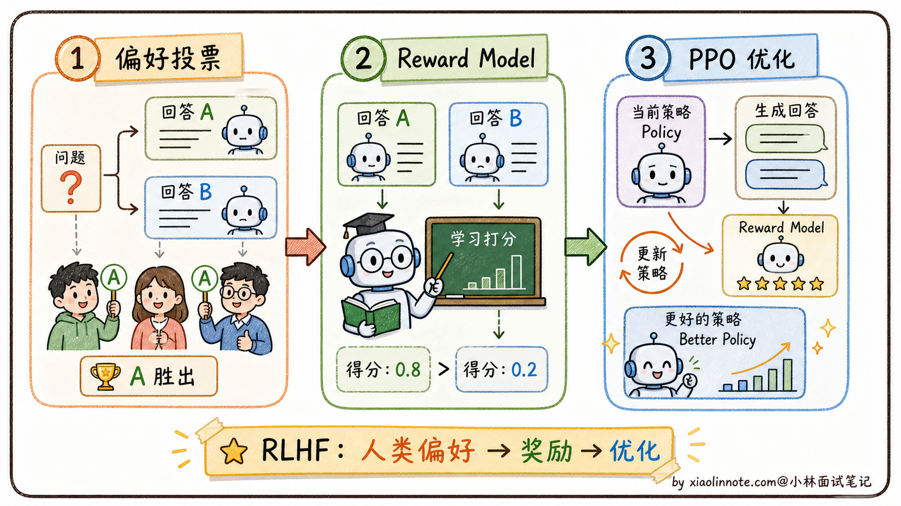

RLHF 听起来挺合理，但工程上很难。流程长、要同时维护好几个模型、训练不稳定。一不小心模型会学会「钻空子」，讨好奖励模型而不是真的变好，业内叫「奖励 Hacking」。能驾驭 RLHF 的团队在业界凤毛麟角。

后来斯坦福提出了 **DPO**（Direct Preference Optimization，直接偏好优化），把对齐流程大幅简化。它发现 RLHF 的优化目标可以用数学等价的方式改写成纯监督学习，**不需要奖励模型，也不需要 PPO**。直接拿（问题，好回答，差回答）三元组训练，让模型学会「好回答的概率要比差回答提升得多」就行。

DPO 训练简单、稳定、容易实现，很多开源 Instruct 模型会把它作为偏好对齐方案之一。但这里要注意别把所有模型都说成 DPO 训出来的。比如 Llama 2-Chat 公开论文里的主线是 SFT、拒绝采样和 PPO/RLHF，并不是 DPO；Llama 3 系列则使用了更复杂的多阶段 post-training。面试里说「DPO 是开源社区常见方案」可以，说「Llama 2 都是 DPO」就不严谨了。

到这里，三个阶段都讲完了。最后回头看一遍，理解为什么这三件事缺一不可。

### [三阶段为什么缺一不可](https://xiaolinnote.com/ai/llm/llm_training.html#三阶段为什么缺一不可)

如果只做预训练，不做 SFT，模型只会续写文本，根本不会以对话方式回答问题。你问它问题，它给你接下去写一篇文章。这种模型只能当「智能补全工具」用，做不了对话产品。

如果只做预训练加 SFT，不做对齐，模型会以对话方式回答了，但回答质量参差不齐。它可能生成有害内容、歧视性言论，或者回答方式让用户不爽（过于啰嗦、过于简洁、自信地胡说）。这种模型上线之后用户体验不好，公司可能还会被监管找麻烦。

如果只做 SFT 和对齐，跳过预训练，那就是在「空壳」上优化。模型没有底层知识，给它再多对话数据也学不出真正的智能。这也是为什么所有大模型公司都在拼预训练，**预训练决定了模型能力的天花板**，SFT 和对齐只是在这个天花板内做优化，决定能不能把天花板的潜力发挥出来。

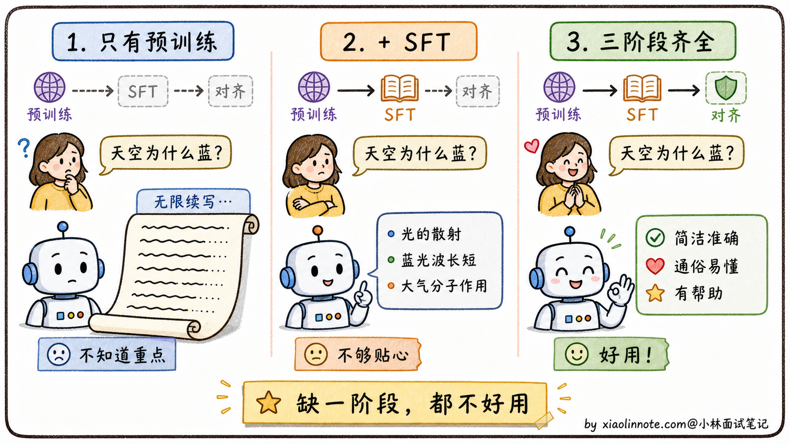

理解了这一点，再看大模型公司之间的竞争就清楚了。OpenAI、Anthropic、DeepSeek 这些公司之所以能领先，最大的护城河不是 SFT 或对齐技巧（这些公开材料都有），而是预训练阶段的「数据 + 算力 + 工程经验」。这些东西要么靠时间积累，要么靠真金白银，是后来者难以追赶的。

## [🎯 面试总结](https://xiaolinnote.com/ai/llm/llm_training.html#🎯-面试总结)

回到开头那段对话，问到「大模型是怎么训练出来的」，最关键的是把「分三个阶段」这件事的逻辑讲清楚，而不是只会说三个阶段的名字。

预训练是地基，让模型学会语言和世界知识，训练目标是「预测下一个 token」，看起来简单但威力极大。这一步是最贵的，几百到几千张 GPU 训几个月，烧的是真金白银。

SFT 是格式适配，把「续写机器」改造成「对话机器」。数据格式从连续文本变成（指令，期望回答）对，质量比数量重要，几千条精心标注的数据能赢几十万条粗糙数据。

对齐是价值观训练，让模型「好好说话」。经典路线是 RLHF（奖励模型 + PPO），开源社区也大量使用 DPO、ORPO、KTO 这类更容易落地的偏好优化方法。不同模型会把这些方法组合起来用，这一阶段决定模型上线后用户体验好不好。

最关键的一句话是，**这三个阶段缺一不可，预训练定天花板，SFT 给格式，对齐给价值观**。能讲清楚「为什么缺一不可」，比单纯背三个阶段名字深刻得多。

如果还想加分，可以提一句大模型公司之间真正的护城河在预训练阶段（数据 + 算力 + 工程经验），SFT 和对齐相对来说技巧已经透明化了。这种「站在产业视角」的回答会让面试官印象深刻。

# 7. 什么是 Scaling Law？大模型的「涌现能力」是怎么回事？

👔面试官：来讲讲什么是 Scaling Law？大模型的「涌现能力」是怎么回事？

🙋‍♂️我：Scaling Law 就是模型越大越好嘛，参数越多效果越强。涌现能力就是大模型突然变强了。

👔面试官：……「越大越好」是错的。Chinchilla 论文你看过吗？为什么 GPT-3 175B 后来被一个 70B 的小模型超过？「越大越好」忽略了什么变量？

🙋‍♂️我：哦哦，可能还要看数据量？

👔面试官：对了一半。那具体的最优配比是什么？为什么是这个比例？再说，「涌现」具体是指什么？是不是越涌现越好？为什么有人说涌现可能是「测量假象」？

🙋‍♂️我：呃……测量假象我没听过。

👔面试官：2023 年斯坦福一篇论文 *Are Emergent Abilities of Large Language Models a Mirage* 提出了挑战，认为很多涌现现象只是评估指标设置带来的错觉，换个连续指标曲线就平滑了。这种学术争议都不知道，去面试就是被怼。回去补一下。

这几下追问其实在敲两件事，Scaling Law 不是一句「越大越好」，涌现也不是「玄学闪现」。背后有具体的数学规律（Chinchilla 1:20 配比）和工程含义（什么时候该堆算力、什么时候该补数据），得逐条拎清楚。

## [💡 简要回答](https://xiaolinnote.com/ai/llm/scaling_law_emergence.html#💡-简要回答)

我理解 Scaling Law（缩放定律）讲的是大模型的损失值如何随**模型规模、训练数据量、训练算力**这三个量变化的可预测关系。OpenAI 在 2020 年提出，DeepMind 在 2022 年的 Chinchilla 论文里精修。

核心发现是三个。

**第一**，损失值随这三个量按幂律下降（loss ∝ N^-α，N 是规模）。意思是规模翻倍，损失值按可预测的比例下降，没有「饱和点」。

**第二**，参数和数据要按一定比例配。Chinchilla 给的最优比例是 **1:20**（每个参数配 20 tokens）。GPT-3 175B 用 300B tokens 是「严重欠训」，比例只有 1:1.7；DeepMind 训了一个 70B 模型配 1.4T tokens（1:20），反而超过了 GPT-3 和自家更大的 280B Gopher。

**第三**，Llama 3 这类后续模型用了远高于 1:20 的训练 token，效果继续提升。更准确地说，Chinchilla 的 1:20 是「固定训练算力下的 compute-optimal 配比」，不是「数据再多就一定没用」的上限。后来的小模型大量喂数据，很多时候是在用更多训练计算换更低的推理成本。

**涌现能力（Emergent Abilities）** 是 Scaling Law 的一个特殊副产物。当模型规模超过某个临界值（典型是 50B-100B 参数），某些能力会**从「完全不能」突变到「能做」**：多步推理、上下文学习、跨语言迁移、代码理解等。

但要注意 2023 年斯坦福的 Mirage 论文挑战了「涌现」的定义。他们认为很多涌现现象只是「评估指标的不连续性」造成的测量假象，换成连续指标后曲线就平滑了。学术争议还在继续，但工程层面，模型规模带来的能力跃迁是客观存在的。

对工程选型的启发是：**不是越大越好**，要看「参数 × 数据 × 算力」三者的最优搭配；**数据规模可能比参数规模更值得加大**（Llama 3 8B 用 15T tokens 跑赢 GPT-3 175B 就是例证）；**同样算力下**，按 Chinchilla 比例训出来的小模型，可能比胡乱堆参数的大模型还强。

## [📝 详细解析](https://xiaolinnote.com/ai/llm/scaling_law_emergence.html#📝-详细解析)

### [Scaling Law 是什么？为什么它震撼了整个业界](https://xiaolinnote.com/ai/llm/scaling_law_emergence.html#scaling-law-是什么-为什么它震撼了整个业界)

要理解 Scaling Law 的重要性，得先回到 2018-2020 年那个语境。

那时候的深度学习圈子里，对「模型加大有没有用」是有分歧的。一派人觉得「模型再大也有上限，参数加多了就饱和了」，另一派人觉得「先把模型加大试试再说」。但谁都没有量化证据，全凭经验和直觉。

2020 年 OpenAI 的 Kaplan 等人做了一项震撼业界的研究：他们系统训练了一系列从几万参数到几十亿参数的语言模型，发现一个惊人的规律。**模型的损失值（loss）随模型参数 N、训练数据量 D、训练算力 C 这三个量按幂律下降**。

数学上写出来是这样的：


```
loss(N) ≈ (N_c / N)^α_N
```

其中 N_c 是某个常数，α_N 是幂律指数。直观理解就是：**模型规模翻倍，损失值按一个固定比例下降**，而且这个比例可以提前算出来。

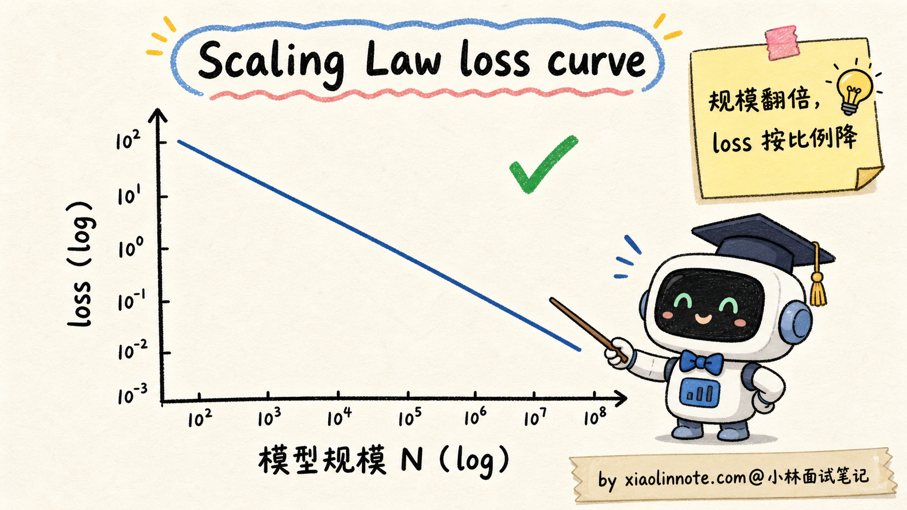

这个发现震撼业界的关键有三点：

第一，**它是可预测的**。不是「试试看运气」，而是「我现在有 X 算力，按 Scaling Law 算一下，最终能达到什么 loss」。这给了大公司投资大模型的底气，因为可以预测投入产出比。

第二，**它没有看到饱和点**。论文里把规模一直加大到当时能训的极限，loss 还在按幂律下降，没有「再加就不动了」的拐点。这给业界传递了一个信号：**继续加大规模就还能继续提升**。

第三，**算力、数据、参数都可以独立做幂律分析**。也就是说，可以分别问「我加倍参数能下降多少 loss」「我加倍数据能下降多少 loss」「我加倍算力能下降多少 loss」。这为后来的 Chinchilla 把这三个变量联立起来打下了基础。

但 OpenAI 这版 Scaling Law 有一个隐含的问题：**它没回答「参数和数据应该按什么比例配」**。当时业界的普遍做法是「能加多少参数加多少，数据用差不多就行」。结果训出了一批「严重欠训」的大模型，最典型的就是 GPT-3。

### [Chinchilla 2022：参数和数据要按 1:20 的比例配](https://xiaolinnote.com/ai/llm/scaling_law_emergence.html#chinchilla-2022-参数和数据要按-1-20-的比例配)

2022 年 DeepMind 发了一篇论文 *Training Compute-Optimal Large Language Models*，里面提出了著名的 **Chinchilla 缩放定律**，把 OpenAI 的 Scaling Law 精修了一步。

DeepMind 做了一个相当壕的实验：**训了 400 个不同规模的 Transformer 模型**，参数从 70M 到 16B，数据量从 5B tokens 到 500B tokens，全部跑完拟合损失曲面。

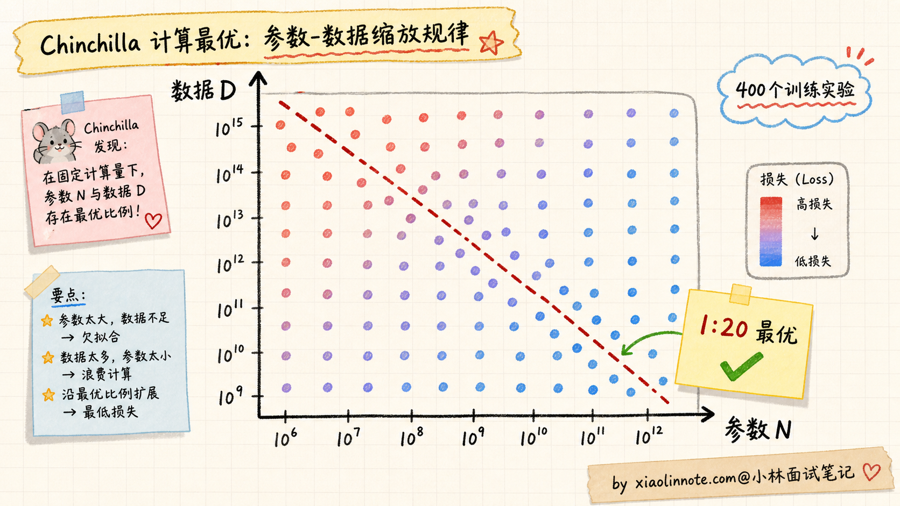

实验结果很清晰：**给定固定的训练算力 C，参数和数据要按接近 1:20 的比例配，最终损失更低**。换句话说，参数 N 每加倍，数据 D 也要按比例加倍，经验上大约是「每个参数配 20 个 token」。这个 1:20 不是自然常数，而是 Chinchilla 实验条件下拟合出来的 compute-optimal 经验点，但它把业界从「只堆参数」拉回了「参数和数据要均衡」。

为了验证这个发现，DeepMind 训了一个对照实验：

| 模型                           | 参数    | 数据            | 训练算力 | 最终效果                     |
| ------------------------------ | ------- | --------------- | -------- | ---------------------------- |
| Gopher（DeepMind 自家旧版）    | 280B    | 300B tokens     | X        | 基线                         |
| GPT-3                          | 175B    | 300B tokens     | 0.7X     | 比 Gopher 略弱               |
| **Chinchilla**（按 1:20 配比） | **70B** | **1.4T tokens** | X        | **明显超过 Gopher 和 GPT-3** |

注意：Chinchilla 的训练算力和 Gopher 接近（FLOPs 总量相同量级），但参数砍到 1/4，数据加到 4.7 倍。结果是用更小的模型 + 更多的数据，明显超过了 4 倍参数的 Gopher。

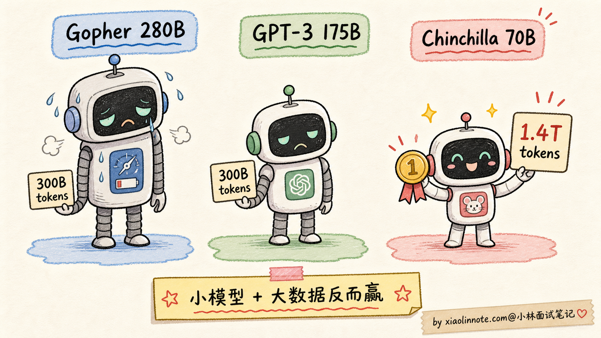

这个对照让业界恍然大悟：**当时所有人训的大模型都严重欠训**。

具体看 GPT-3 的比例：


```
GPT-3: 175B 参数 / 300B tokens = 1 : 1.7
最优比例: 1 : 20
GPT-3 数据缺口: 12 倍
```

GPT-3 应该配 3.5T tokens 才是 Chinchilla 最优，但实际只用了 300B，差了一个数量级。如果当时 OpenAI 知道这个结论，可能就不会训那么大的 GPT-3，而是训一个更小但配足数据的模型。

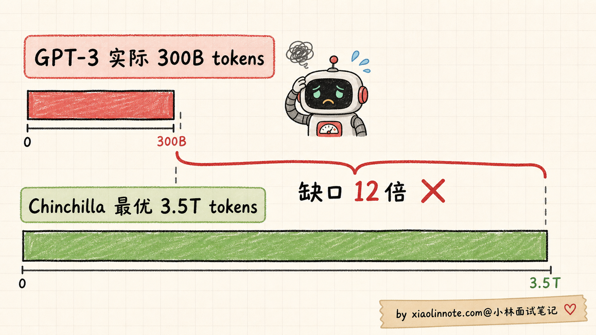

Chinchilla 改变了整个大模型行业。2022 年之后训的所有主流模型，配比都比之前激进得多。比如 LLaMA 1 的 7B 模型用了 1T tokens（比例 1:140），LLaMA 2 的 7B 用了 2T tokens（1:285），都远超 Chinchilla 推荐的 1:20。越来越多模型主动「过量」喂数据，因为 Chinchilla 让大家意识到：参数加得没那么疯也行，数据要喂够才是关键。

但故事到这里还没结束。Chinchilla 这个 1:20 的配比，真的是终极答案吗？2024 年的 Llama 3 给了一个让所有人都没想到的答案。

### [Llama 3 时代：Chinchilla 不是数据上限](https://xiaolinnote.com/ai/llm/scaling_law_emergence.html#llama-3-时代-chinchilla-不是数据上限)

2024 年 Meta 训 Llama 3 时，做了一件激进的事：**把数据量推到 1:1875 的极端配比**。

具体数据：


```
Llama 3 8B: 8B 参数 / 15T tokens = 1 : 1875
（Chinchilla 推荐: 1 : 20）
```

数据规模是 Chinchilla 推荐的 **94 倍**。按当时的常识，应该早就过拟合或者收益递减了。但 Meta 实测发现：**模型在数据量从 1T 推到 15T 的过程中，loss 一直在稳定下降，效果一直在提升**。

最后训出来的 Llama 3 8B 在多项基准测试上**超过了 GPT-3 175B**。一个 8B 的小模型打赢了 22 倍参数的大模型，靠的就是数据规模。

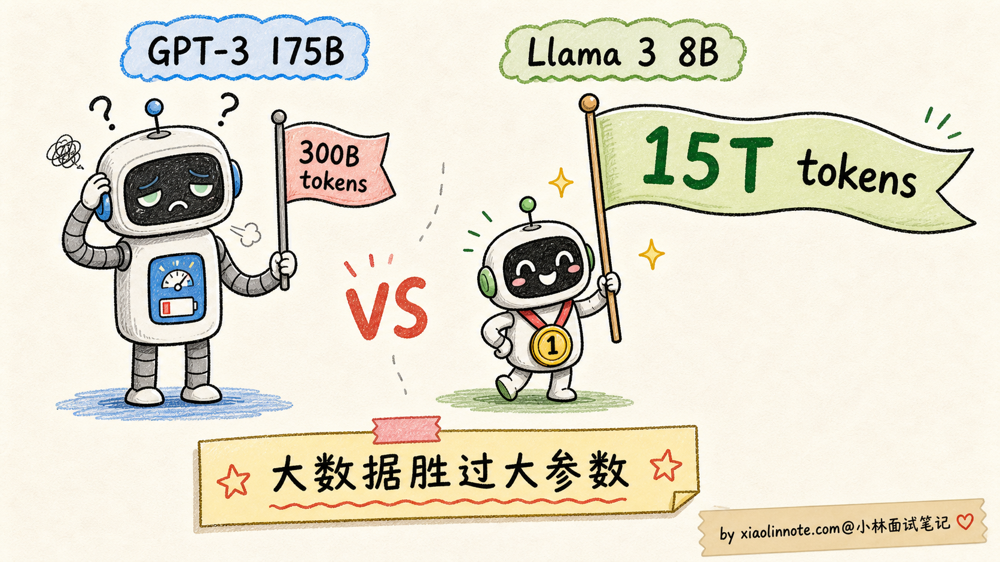

这件事重新定义了业界对 Scaling Law 的理解。原来的 Chinchilla 1:20 配比不是「数据上限」，而是「**给定训练算力时，参数和数据怎么分配更划算**」的经验答案。如果你愿意投入更多训练计算，继续喂更多高质量 token，loss 仍然可能下降，只是边际收益会变小。

所以更准确的说法是：Chinchilla 告诉我们「别只堆参数，数据也要跟上」；Llama 3 之后的趋势告诉我们「为了降低推理成本，可以训练一个较小参数、更多 token 的模型」。这两句话不矛盾，只是在优化不同目标，一个偏训练算力最优，一个偏部署成本最优。

Qwen3-0.6B 把这个趋势推到了更极端，用 36T tokens 训一个 0.6B 的小模型，比例 1:60000，远超 Llama 3 的 1:1875。这说明在追求「推理时性能 / 部署成本」最优的方向上，「小参数 + 海量数据」已经是当前最热门的路径。

为什么会出现这个趋势？背后有两个很现实的工程原因。第一是**推理成本**：参数越多，推理时显存和延迟越高。一个 8B 模型部署一台消费级 GPU 就够，175B 模型要好几台 H100，成本天差地别。如果 8B + 大数据能达到同等效果，何乐不为？第二是**数据相对便宜**：算力是真金白银的硬件投入（一张 H100 三万美元，集群上千万），数据虽然也要花钱清洗，但相比 GPU 集群仍然便宜得多。在算力受限的环境下，把算力多花在「跑过更多数据」而不是「跑过更多参数」更划算。

### [涌现能力：量变到质变的临界点](https://xiaolinnote.com/ai/llm/scaling_law_emergence.html#涌现能力-量变到质变的临界点)

Scaling Law 还有一个让所有人都没想到的副产物，叫**涌现能力（Emergent Abilities）**。

涌现的精确定义是：「**某项能力在小模型上完全看不到，规模超过某个临界点之后突然出现**」。它不是平滑上升，而是一条「先趴在地上、到某个点垂直冲天」的折线。

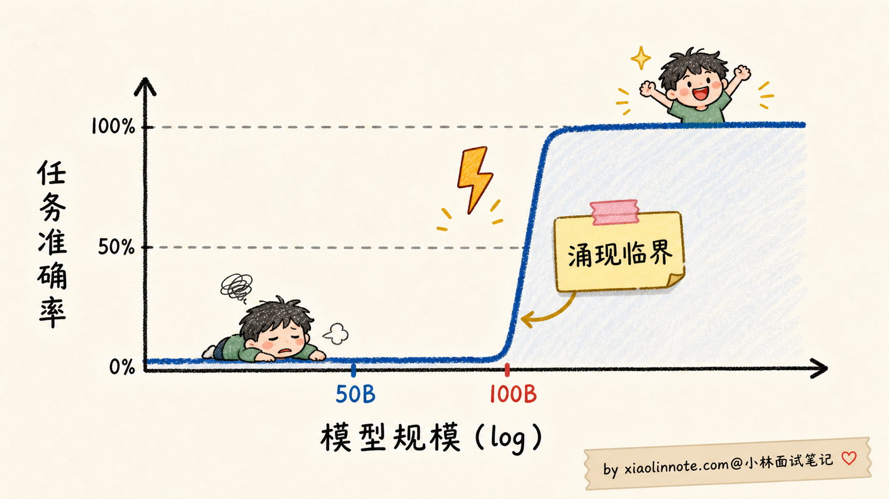

学术界总结了几类典型的涌现能力，每一类都有具体的数据点支撑：

**1. 多步算术推理**

Google PaLM 论文里测试 5 步算术应用题。准确率随规模变化：


```
8B  -> ~0%
62B -> ~5%
540B -> ~60%
```

中间没有任何渐进过程，从「完全不会」直接到「会一大半」。这种跳变只能用「涌现」来解释。

**2. In-Context Learning（上下文学习）**

GPT-3 175B 出现之前，业界共识是「想让模型学新任务，必须微调」。GPT-3 出来之后，OpenAI 发现只要在 Prompt 里给几个例子，模型就能学会新任务。这个能力在 1.5B 的 GPT-2 上完全看不到，在 175B 的 GPT-3 上突然就有了，临界点在 100B 左右。

**3. 跨语言泛化**

GPT-3 训练数据 92% 是英文，但训完之后能直接处理中文、阿拉伯语、甚至冰岛语。模型从来没被显式教过「中文怎么说」，它通过大规模混合语料的预训练，自己学会了不同语言间的对应关系。这种能力也是规模到了 100B 左右才稳定出现。


涌现的临界规模通常出现在 50B-100B 这个区间。这个区间到底是什么物理意义，业界还没有定论。一个流行的解释是：模型大到一定程度，注意力头数、隐藏维度等达到了「能编码复杂推理结构」的最低门槛。再小就编码不了，再大就开始展示这些能力。

### [Mirage 挑战：涌现可能是测量假象](https://xiaolinnote.com/ai/llm/scaling_law_emergence.html#mirage-挑战-涌现可能是测量假象)

正当涌现能力被业界广泛接受时，2023 年斯坦福的一篇论文炸了锅：*Are Emergent Abilities of Large Language Models a Mirage?*

论文作者 Schaeffer 等人观察到一个奇怪现象：**很多「涌现」能力只在某些评估指标下才出现，换个指标就消失了**。

举个具体例子。多步算术任务，常规评估指标是「最终答案是否完全正确」（exact match）：

- 答错任何一步，最终答案就错，得 0 分
- 答对所有步骤，得 1 分

这是一个**离散的二元指标**，要么 0 要么 1。在这个指标下，看到的就是「小模型一直 0 分，大模型突然跳到 60%」的涌现曲线。

但如果换成「**部分正确率**」（比如答对了前 4 步算 0.8 分），同样的实验数据，能力提升曲线就变成了**平滑的对数曲线**，没有任何突变。


论文的核心论点是：「**涌现」可能不是模型本身的非线性特性，而是评估指标的不连续性放大了一个本来连续的能力提升过程**。

这个挑战引发了广泛讨论。后续也有论文反驳，认为某些涌现现象在多种连续指标下都能观察到，不能完全用「指标假象」解释。学术争议还在继续，目前的中立结论是：

- **能力跃迁是客观存在的**：从工程效果看，模型规模到了 100B 之后，确实能做小模型完全做不了的事
- **但「涌现」这个概念可能被过度神化了**：很多所谓的「突变」其实是连续提升 + 指标放大效应
- **不存在「魔法的涌现规模」**：不同任务的临界点不同，有的早有的晚，没有统一的「100B 之后必然涌现」

这个争议对面试来说很有用。如果你能在面试里指出 Mirage 论文的存在，并把双方观点都讲清楚，会显得你**真的看过论文，不是只在背技术博客**。

### [对工程选型的启发](https://xiaolinnote.com/ai/llm/scaling_law_emergence.html#对工程选型的启发)

理解了 Scaling Law 和涌现的内核，对实际工程选型有几个直接启发：

**1. 不是越大越好，要看 Chinchilla 比例**

参数和数据要匹配，至少不能出现「参数很大但数据很少」的欠训状态。1:20 可以作为理解 Chinchilla 的标尺，但不是所有模型都必须卡死在这个比例。选型时更应该问：这个模型是不是训练充分？数据质量怎么样？它是为训练算力最优设计，还是为推理成本最优设计？

**2. 数据规模可能比参数规模更值得加大**

如果你有限的算力是 X，与其训一个 7B + 100B tokens 的模型，不如训 3B + 250B tokens。同样的算力开销，后者效果通常更好，推理还便宜。Llama 3 和 Qwen3 都验证了这个直觉。

**3. 推理成本和参数规模强相关**

部署一个 175B 模型要好几台 H100，部署 8B 模型一张消费级 GPU 就够。在效果差不多的前提下，「小参数 + 海量数据」的模型在推理成本上有天然优势。这也是为什么 2024 年之后开源社区疯狂做小模型大数据。

**4. 涌现能力对模型选型的影响**

如果你的任务依赖「涌现能力」（多步推理、ICL、跨语言迁移），最低门槛是 30B-70B 这个量级，再往下就不行。如果是简单分类、抽取、摘要任务，7B-13B 完全够用，没必要硬上大模型。


### [Scaling Law 的天花板与未来](https://xiaolinnote.com/ai/llm/scaling_law_emergence.html#scaling-law-的天花板与未来)

最后简单提一下 Scaling Law 的尽头，作为面试加分项。

虽然到目前为止还没看到饱和点，但业界已经开始担心两个潜在天花板。

**第一，数据见底**。互联网上高质量公开文本的总量是有限的，估计在 10T-50T tokens 这个量级。Llama 3 已经用了 15T，Qwen3 用了 36T，再过几年就会把人类历史上所有公开文本都用完。这就是「**数据墙（Data Wall）**」问题。

应对方向有三个：

- **合成数据**：用强模型生成训练数据训弱模型（DeepSeek-Math、Qwen2.5-Math 都用了大量合成数据）
- **多模态数据**：扩展到图像、视频、音频，把人类所有形式的信号都纳入训练
- **强化学习数据**：用环境交互生成数据（DeepSeek R1 的 RL 训练就属于这一类）

**第二，算力增长放缓**。摩尔定律已经接近物理极限，GPU 算力的增长速度在放缓。能买得起 10 万张 H100 的玩家就那么几个，进一步堆参数的边际成本越来越高。


这些挑战是 2026 年大模型领域最热的话题之一。能在面试里聊到这些，说明你不只是知道现在，还在思考未来。

## [🎯 面试总结](https://xiaolinnote.com/ai/llm/scaling_law_emergence.html#🎯-面试总结)

回到开头那段对话，问到 Scaling Law 和涌现能力，最重要的是把 Scaling Law 的本质讲清楚。它讲的是 loss 和参数 N、数据 D、算力 C 的幂律关系（loss ∝ N^-α）。OpenAI 2020 年提出，给业界传递了「规模可预测地带来效果」这个革命性结论，是后面所有大模型烧钱投入的理论基础。

讲完本质之后，自然引出 Chinchilla 配比的故事。DeepMind 2022 年训 400 个模型实验，发现固定训练算力下，参数和数据接近 1:20 更划算。GPT-3 175B 配 300B tokens 是严重欠训，70B 的 Chinchilla 配 1.4T tokens 反而明显超过 175B 级别的旧模型。这个发现改变了整个行业，2022 年之后大家不再盲目堆参数，而是更重视训练 token 和数据质量。

接下来讲 Llama 3 时代的进一步变化。Meta 把数据推到 1:1875 的极端配比，用 8B + 15T tokens 训出超过 GPT-3 175B 的效果，说明 Chinchilla 不是「数据上限」。当目标变成「推理便宜、部署容易」时，小参数 + 大数据会非常有吸引力，这是 2024 年之后的重要趋势。

最关键的是讲清涌现能力 + Mirage 挑战。涌现是某项能力从「完全不会」突变到「能做」，临界规模 50B-100B。但 2023 年斯坦福 Mirage 论文挑战，认为很多涌现是「评估指标不连续」造成的假象，换连续指标曲线就平滑了。学术争议在继续，但能力跃迁客观存在。**能在面试里提出这个学术争议，会显示你真的看过论文，不是只在背技术博客**。

如果还想再加分，提一句 Scaling Law 的天花板（数据墙 + 算力墙）和应对方向（合成数据、多模态、强化学习），让面试官知道你对未来趋势有思考。能讲到这一层，已经是面试里很难追问的水平了。

# 8. 大模型微调的方案有哪些？

👔面试官：来讲讲大模型微调的方案有哪些？

🙋‍♂️我：微调方案有全量微调、LoRA、QLoRA、SFT、DPO 这些，工业界常用 LoRA。

👔面试官：……你这是把名词都背了一遍，但没说清楚关系。LoRA 和 SFT 是同一个层面的东西吗？SFT 和 DPO 又是什么关系？为什么要分这么多名字？

🙋‍♂️我：呃，应该都是不同的微调方法吧？

👔面试官：完全错。这些名词其实分两个维度。一个维度是「**改哪些参数**」（全量微调 vs LoRA vs QLoRA），另一个维度是「**学什么目标**」（SFT vs DPO）。这两个维度是正交的，可以组合：你可以用 LoRA 做 SFT，也可以用 LoRA 做 DPO。这层关系搞不清楚就讲不出选型逻辑。

🙋‍♂️我：哦，原来是两个维度。

👔面试官：那再问你一个问题，什么时候真的需要微调？是不是模型表现不好就该上微调？

🙋‍♂️我：嗯，应该是吧？

👔面试官：典型的新人思维。微调是「最后手段」，不是「第一选择」。能用 Prompt + Few-shot 解决的问题，绝对不要上微调，因为微调的成本和维护代价远比想象大。「什么时候该微调、什么时候不该」是这道题的关键判断点。回去搞清楚再来。

这道题我开始还以为是把 LoRA、SFT、RLHF 这些名词背一遍就行，问到这里才反应过来，真正考的是两条正交的轴：改哪些参数、学什么目标，外加一条前置判断「这个需求到底该不该微调」。

## [💡 简要回答](https://xiaolinnote.com/ai/llm/finetuning.html#💡-简要回答)

我了解微调之后，首先意识到的是：微调不是首选，而是最后手段。大多数问题先把 Prompt 写好、加 Few-shot 示例，或者用 RAG 接外部知识，基本都能解决。真正需要微调的场景是：模型需要以特定风格持续输出、需要学会稳定的任务格式、或者需要大幅降低成本用小模型替代大模型。方案上，LoRA/QLoRA 是最常用的，因为它只训练一小部分参数，普通 GPU 上就能跑，不需要全量更新所有权重；SFT 是微调的目标形式，让模型从续写模式变成指令回答模式；有偏好对齐需求的话，DPO 比 RLHF 简单得多、效果也不差。选模型不是看谁排行榜最高，选微调方案也是同理，核心是看资源约束和实际需求。

## [📝 详细解析](https://xiaolinnote.com/ai/llm/finetuning.html#📝-详细解析)

### [先回答一个前置问题：什么时候才真的需要微调？](https://xiaolinnote.com/ai/llm/finetuning.html#先回答一个前置问题-什么时候才真的需要微调)

很多人一遇到「模型表现不好」就想上微调，这其实是新人的本能反应。但工业界踩过坑的人都知道，**微调是最后手段，不是第一选择**。

为什么？因为微调的成本远比想象大。需要准备高质量数据集（光是标注就可能花几万到几十万）、需要 GPU 资源（少说几张 A100）、需要工程经验（调参、防过拟合、防灾难性遗忘）。最坑的是维护成本，底层基础模型一升级（比如 Llama 3 出来要换 Llama 4），你之前微调的版本基本就废了，得重新微调一遍。

那什么时候才该上微调？我自己总结的判断标准是这样的。

如果只是想让模型回答某种特定格式（比如必须是 JSON），先试 Prompt + Few-shot，写清楚格式要求 + 给 3-5 个示例，大模型基本能搞定。如果想让模型回答某种特定风格（比如公司客服的口吻），先试 System Prompt 描述风格 + 几个对话示例，多数情况也能行。如果想让模型懂某个领域知识，先试 RAG（检索增强），把领域知识库挂上让模型实时查，比硬塞进参数里灵活得多。

只有当上面这些都试过、效果还是不达标的时候，才认真考虑微调。具体来说，下面三种场景微调才是真的值得做：第一种是模型需要持续以一种特殊风格输出（Prompt 控制不住，比如生成特定格式的代码、特定语气的文案）；第二种是需要模型稳定掌握某类任务模式或内部术语表达；第三种是想用小模型替代大模型省成本（用 7B 微调模型替代 70B 通用模型，推理成本能省很多）。

这里要特别提醒：如果需求是「补充经常变化的事实知识」，微调通常不是好选择。比如产品价格、政策条款、库存状态、合同原文，这些内容应该放进 RAG 或数据库里实时查。微调更适合学行为、格式、风格和任务模式，不适合当一个会频繁更新的知识库。


理清「该不该微调」之后，再来看「微调有哪些方案」。这里有一个特别容易踩的坑，很多人把「全量微调、LoRA、QLoRA、SFT、DPO」都当成同一类的「不同微调方法」来背。其实它们分两个完全不同的维度。

### [微调的两个正交维度：改哪些参数 vs 学什么目标](https://xiaolinnote.com/ai/llm/finetuning.html#微调的两个正交维度-改哪些参数-vs-学什么目标)

微调本质上是回答两个问题。

**第一个问题是「改哪些参数」**。模型有几十亿到几百亿参数，你是要全部改，还是只改一小部分？这一维度上有三个主流方案：全量微调（全改）、LoRA（改一小部分）、QLoRA（改一小部分 + 量化基础模型）。

**第二个问题是「学什么目标」**。模型要学的是「按指令回答」还是「学会哪种回答更好」？这一维度上有两个主流方案：SFT（学指令格式）、DPO（学偏好对齐）。

这两个维度是**正交**的，可以任意组合。比如：

- 用全量微调做 SFT
- 用 LoRA 做 SFT
- 用 QLoRA 做 SFT
- 用 LoRA 做 DPO
- 用 QLoRA 做 DPO

每种组合都是合法的「微调方案」。理解这两个维度的正交关系，是回答这道题的钥匙。


下面分别看这两个维度上的方案。

### [「改哪些参数」维度：从全量微调到 QLoRA](https://xiaolinnote.com/ai/llm/finetuning.html#「改哪些参数」维度-从全量微调到-qlora)

**全量微调（Full Fine-tuning）**：所有参数都改

最朴素的方案就是把模型所有参数都拿出来在新数据上继续训练，让所有层都重新适配新任务。效果通常是最好的，因为模型有最大的自由度去调整。

但代价大到吓人。一个 7B 模型的全量微调，不光要存权重本身（FP16 大约 14GB），还要存梯度（14GB）、优化器状态（Adam 的两个矩约 56GB），加起来一次训练 80GB 起步，普通研究者根本玩不动。70B 的模型更夸张，要几十张 A100 组集群才能训。

更糟的是「**灾难性遗忘**」（Catastrophic Forgetting）。模型在新任务上学得好了，原本预训练学到的通用能力反而下降。这是因为所有参数都在被改写，新数据分布有偏的话，模型会忘记原本的「通用知识」。

所以全量微调虽然效果上限高，但实际能用的团队凤毛麟角。绝大多数情况下，业界都在用更轻量的方案，最流行的就是 LoRA。

**LoRA（Low-Rank Adaptation）**：只改一小部分参数

LoRA 的核心洞见特别巧妙。它发现一个事实：模型参数的「**更新量**」（即 ΔW = W微调后 - W原始）虽然维度很大（比如 4096×4096），但真正有意义的变化只发生在一个**低维子空间**里。换句话说，权重的更新具有「**内在低秩性**」，不需要每个维度都去改。

基于这个洞见，LoRA 的做法是：冻结原始权重 W 不动，在 W 旁边新增两个小矩阵 A 和 B（维度分别是 d×r 和 r×d，其中 r 远小于 d，通常 r=8 或 16），训练时只更新这两个小矩阵。推理时把 B·A 加回到 W 上，等价于一个全量微调过的模型，但训练时显存和算力开销是全量微调的几十分之一。

打个比方，全量微调像是把一本厚厚的教科书全部重写一遍，LoRA 像是在书的空白处贴便利贴，原书一字不动，便利贴上写着新增的修正和补充。看书的时候原文 + 便利贴一起看，效果叠加。


参数量对比很直观。一个 4096×4096 的权重矩阵原本有 1600 万参数，LoRA r=16 只需要 4096×16 + 16×4096 = 13 万参数，参数量降到 1/120。整个 7B 模型的可训练参数从 70 亿降到 2000 万左右，显存需求从 80GB+ 降到 20GB 量级，一张 A100 就能搞定。

LoRA 已经是 2023 年之后最主流的微调方案，几乎所有开源社区的微调项目都在用。

**QLoRA**：消费级 GPU 的入场券

LoRA 解决了「不用 80GB 显存也能微调」的问题，但对个人开发者来说，20GB 显存还是有门槛（4090 是 24GB，刚刚够 7B 模型的 LoRA）。QLoRA 把这个门槛进一步往下打。

QLoRA 的核心思路是：先把基础模型用 4-bit 量化（一种叫 NF4 的格式，专为模型权重的近似高斯分布设计），把 7B 模型的显存占用从 14GB 压到 4GB 左右；然后在量化后的基础模型上套 LoRA。这样整个微调过程的显存占用降到 10GB 以内，**一张 4090（24GB）就能微调 7B 甚至 13B 模型**。

QLoRA 的精度损失非常小，实测效果和全精度 LoRA 几乎没差别。这一招直接让微调民主化了，无数个人开发者用 QLoRA 训出了自己的领域模型。Alpaca、Vicuna 这些早期开源指令模型基本都是用 QLoRA 训出来的。

到这里，「改哪些参数」维度的三个方案就清楚了。下面看另一个维度。

### [「学什么目标」维度：SFT 和 DPO](https://xiaolinnote.com/ai/llm/finetuning.html#「学什么目标」维度-sft-和-dpo)

「改哪些参数」回答的是「**怎么改**」的问题，但还有一个更核心的问题没回答：**改的目标是什么？让模型学会做什么？**

这一维度上有两个主流方案。

**SFT（Supervised Fine-Tuning，监督微调）**：让模型学会「按指令回答」

预训练模型本质是「文本续写机器」，给一段文字就接着往下写，根本不知道「问问题」是什么意思。SFT 的目标就是把模型从「续写模式」切换到「对话模式」。

它的训练数据格式是 (指令，期望回答) 的对，比如「请介绍一下北京 → 北京是中国的首都，位于华北平原……」。模型在这样的数据上继续训练，慢慢学会「看到这种格式就该给一个完整回答，不要无限续写下去」。

SFT 是一个「**目标**」，不是「**方法**」。具体怎么实现？可以用全量微调做 SFT、可以用 LoRA 做 SFT、也可以用 QLoRA 做 SFT。在工业界最常见的组合是 **QLoRA + SFT 数据**，性价比最高。

SFT 数据的关键是质量大于数量。Llama 2 用了大约 100 万条 SFT 数据，但每条都是精心标注的。AlpacaFarm 的研究还发现一个反直觉结论：几千条高质量数据训出来的效果，比几十万条粗糙数据要好。

**DPO（Direct Preference Optimization，直接偏好优化）**：让模型学会「哪种回答更受欢迎」

SFT 之后，模型已经会按指令回答了，但回答风格不一定是用户喜欢的（可能太啰嗦、太简洁、有时候说话不得体）。这时候需要更进一步的「**偏好对齐**」，告诉模型「同样合格的回答里，哪种用户更喜欢」。

早期做偏好对齐的标配方案是 RLHF（Reinforcement Learning from Human Feedback），流程是：收集人类偏好数据 → 训一个奖励模型 → 用 PPO 算法优化主模型。但 RLHF 流程长、要同时维护好几个模型、训练不稳定，能驾驭它的团队不多。

DPO 是斯坦福 2023 年提出的简化方案。它发现一个数学上的等价转换：RLHF 的优化目标可以推导成纯监督学习的损失函数，**完全绕过奖励模型，也不需要 PPO**。直接拿 (问题，好回答，差回答) 三元组训练，让模型直接学会「好回答的概率要比差回答提升得多」。


DPO 训练简单、稳定、工程门槛低，所以开源社区的偏好对齐阶段大量使用 DPO 或它的变体。但这里别说得太绝对，不同模型的 post-training 流程差异很大。比如 Llama 2-Chat 公开流程主要是 SFT、拒绝采样和 PPO/RLHF；很多社区模型为了降低成本，才会把偏好优化换成 DPO。

**DPO 也是一个「目标」，不是「方法」**。它可以用全量微调实现，也可以用 LoRA 实现。最常见的工业组合是 **LoRA + DPO**，资源友好。

### [实战选型怎么落地](https://xiaolinnote.com/ai/llm/finetuning.html#实战选型怎么落地)

理解了两个维度的方案之后，实战选型其实就清楚了。

如果你是个人开发者或资源受限的小团队，最经济的选择是 **QLoRA + SFT**。一张 4090 就能训 7B 模型，几千条精心标注的指令-回答数据就能让模型学会你的领域任务。绝大多数实际项目走这条路就够了。

如果你是中小企业、有几张 A100 但没有大集群，可以选 **LoRA + SFT**。比 QLoRA 精度略好一点（因为基础模型不量化），训练速度也更快。

如果你的需求是「让模型的回答风格更符合用户偏好」（不只是格式正确，还要好听），可以在 SFT 之后再加一步 **LoRA + DPO**。先用 SFT 让模型学会回答格式，再用 DPO 让回答风格对齐用户偏好。很多社区 Instruct 模型走的是 SFT -> DPO 这条轻量路线；而 Llama 2-Chat 这类大厂公开模型可能会用拒绝采样、PPO/RLHF 等更重的组合。

如果你是大厂、有充足 GPU 资源、追求最高效果，可以考虑**全量微调 + SFT**（甚至 + RLHF）。但要承担得起几十张 A100 的成本和工程复杂度。OpenAI 早期的 ChatGPT、Anthropic 的 Claude 都是走的这条最贵也最强的路。


一个常见误区是「方案越重越好」。其实工程上恰恰相反，**能用轻量方案搞定的需求，一定不要上重的**。原因有三：训练成本指数级上升、调参难度也上升、维护成本（基础模型升级后要重新微调）也上升。所以实战中绝大多数项目都在用 QLoRA + SFT 这种最轻量的组合，只有真的需求够特殊才会往上加方案。

## [🎯 面试总结](https://xiaolinnote.com/ai/llm/finetuning.html#🎯-面试总结)

回到开头那段对话，问到大模型微调方案，最重要的不是把名词列一遍，而是讲清楚两件事。

第一件事是**前置判断**：微调是最后手段不是第一选择。能用 Prompt + Few-shot 解决就别上微调；能用 System Prompt 控制风格就别上微调；能用 RAG 接知识库就别上微调。只有这些都试过不行，再考虑微调。这一句说出来，面试官就知道你不是「为了微调而微调」的新人。

第二件事是**两个正交维度**：「改哪些参数」（全量微调 / LoRA / QLoRA）和「学什么目标」（SFT / DPO）是两个独立的维度，可以任意组合。能说出「LoRA 是方法、SFT 是目标，可以用 LoRA 做 SFT，也可以用 LoRA 做 DPO」，比把这五个名词当作并列项罗列要深刻得多。

讲清楚这两点之后，再补一下实战选型经验。个人开发者用 QLoRA + SFT，有点资源用 LoRA + SFT + DPO（社区主流），大厂追求顶级用全量微调 + RLHF。能说出这种「按资源 + 需求选组合」的工程视角，就是面试加分项。

最关键的一句话是，**绝大多数项目能用 QLoRA + SFT 搞定，没必要上更重的方案**。这种「克制」的工程态度，面试官会觉得你真的踩过微调的坑，而不是只会堆方案。

# 9. 请讲一下 LoRA 技术，除了减少参数量，它还有哪些优点？

👔面试官：来讲一下 LoRA 技术，除了减少参数量，它还有哪些优点？

🙋‍♂️我：LoRA 主要就是减少参数量，让显存占用降下来，普通 GPU 也能微调大模型。

👔面试官：……「除了减少参数量」是题目里写明白了的限定条件，你又把这个答了一遍。我问的是「除了这个还有什么」，你能再说几条吗？

🙋‍♂️我：呃……训练快一点？

👔面试官：「快一点」太笼统。LoRA 在「推理速度」「部署灵活性」「灾难性遗忘」「训练稳定性」「权重组合」这五个维度上都有 Adapter 这种早期方案做不到的优点。这些点你能讲清楚吗？

🙋‍♂️我：呃……我没仔细想过这么多优点。

👔面试官：典型的「会用但没深入想过」。LoRA 之所以能在 2023 年之后成为微调的事实标准、把 Adapter 等同期方案完全淘汰，正是因为这些容易被忽略的优点叠加起来。回去搞清楚再来。

这几个问题问完，LoRA 才显出真容貌，「省参数」只是它最浅的那一层。推理零开销、多任务可插拔、训练显存大降、组合性强，这些被人忽略的优点串起来，才是它在工业界真正流行的理由。

## [💡 简要回答](https://xiaolinnote.com/ai/llm/lora.html#💡-简要回答)

LoRA 我在项目里用过，省参数这个优点大家都知道，但它还有几个很实用的好处。

- 第一个是推理零开销，训练完之后，LoRA 的 A、B 两个小矩阵可以直接合并回原始权重，推理阶段完全不需要带额外模块，速度和原始模型一样，这比 Adapter 方案有明显优势。
- 第二个是部署特别灵活，一个 7B 基础模型才 14GB，每套 LoRA 只有几十 MB，可以同时维护客服、代码、翻译几套 LoRA，按请求类型热切换，不需要为每个场景各跑一个完整模型。
- 第三个是灾难性遗忘风险更低，因为原始权重全程冻结，只有旁路的小矩阵在学习，相当于在原来知识旁边打补丁，通用能力通常更容易保住。
- 第四个是训练更稳定，可训练参数少，梯度空间小，对学习率这类超参不那么敏感，调参成本低。
- 还有一个进阶的点是多个 LoRA 可以加权混合，比如把指令遵循 LoRA 和代码 LoRA 合并一下，不用重新训练就能融合两种能力。

## [📝 详细解析](https://xiaolinnote.com/ai/llm/lora.html#📝-详细解析)

### [背景：微调大模型，代价有多大？](https://xiaolinnote.com/ai/llm/lora.html#背景-微调大模型-代价有多大)

要理解 LoRA 的价值，先得搞清楚它在解决什么问题。

大模型预训练完之后，通用能力很强，但要让它专注做某类任务（比如医疗问答、代码生成），通常需要在特定数据上做微调。最直接的方式是**全量微调（Full Fine-tuning）**：把模型所有参数都拿出来，在新数据上继续训练，更新全部权重。

但全量微调的显存需求极高。以一个 7B 参数的模型为例，用 FP16 精度存储权重本身就要约 14GB；训练时还需要存梯度（14GB），以及 Adam 优化器的两个状态，一阶矩和二阶矩（合计约 56GB）。光这几项加起来，一次训练迭代就需要 **80GB+ 的显存**。

普通研究者或开发者手里顶多是一张 24GB 的消费级 GPU（比如 RTX 4090），全量微调一个 7B 模型根本跑不动。如果是 70B 模型，需要的显存更是以百 GB 计，别说个人，普通公司都很难负担。

这就催生了一类新方法，**参数高效微调（PEFT，Parameter-Efficient Fine-Tuning）**，核心思路是：不更新全部参数，只训练一小部分，同时尽量不损失微调效果。LoRA 是其中最成功的方案之一。

### [LoRA 的核心思路：不改原模型，在旁边打补丁](https://xiaolinnote.com/ai/llm/lora.html#lora-的核心思路-不改原模型-在旁边打补丁)

LoRA（Low-Rank Adaptation）的思路很直觉：**不动原始权重 W，在旁边加两个小矩阵 A 和 B**，训练时只更新 A 和 B，W 全程冻结。

前向传播的公式变成：


```python
# W 是原始权重（冻结，不更新）
# A 和 B 是两个小矩阵（可训练，随机初始化）
# α 是缩放因子（超参，控制 LoRA 更新的强度）

output = x @ (W + α * (B @ A))
#                   ↑ 这部分就是 LoRA 的「旁路」，只有这里在学习
```

A 和 B 两个小矩阵组成一个「旁路分支」，负责学习微调任务需要的增量知识；原始权重 W 保存着预训练学到的通用知识，一字不改。

可以用「给书批注」来类比：全量微调是把书重新印一遍、改掉原文内容；LoRA 是在书的空白处贴便利贴，原书一个字都不动，便利贴上写的是修正和补充。读书的时候，原文和便利贴的内容都能看到，效果叠加在一起。这种「在旁边打补丁」的设计，是 LoRA 后续很多优点的根源。


### [「低秩分解」到底是什么意思？](https://xiaolinnote.com/ai/llm/lora.html#「低秩分解」到底是什么意思)

LoRA 里最让初学者困惑的词是「低秩分解」。拆开来理解：

**先说「秩」（rank）是什么。** 矩阵的秩代表矩阵里「真正独立的信息维度」。一个 4096×4096 的大矩阵，秩最高可以是 4096，意味着里面有 4096 个完全独立的信息方向。但研究发现，微调时权重的「更新量」（即 ΔW = W微调后 - W原始）往往具有**内在低秩性**，这些变化只在很低维的子空间里发生，秩通常只有 8-16，其余几千个维度几乎没有有效信息。

用一个类比来感受：一张 4K 照片有几百万像素，但它的信息量可以用几十个主要「颜色分量」来近似表达，这正是 JPEG 压缩的工作原理，把高维数据投影到低维空间，保留最主要的信息，丢掉噪声。低秩分解的思路与此类似。

**再说「分解」是什么操作。** 既然「有效信息只在 r 维子空间」，我们就不需要存储整个 d×d 的大矩阵来表示更新量，而是用两个小矩阵的乘积来近似它：

- 矩阵 A：形状 d×r（把输入从 d 维压缩到 r 维）
- 矩阵 B：形状 r×d（把 r 维还原回 d 维）
- 两者乘积 B·A 形状是 d×d，和原始更新矩阵同维，但参数量大幅减少

这里的 r 就叫做**秩（rank）**，是 LoRA 最重要的超参，通常设 8 或 16。r 越小，参数越少，但表达能力也越弱；r 越大，参数越多，但更接近全量微调效果。大多数任务 r=8 到 r=16 就够了。


### [参数量减少了多少？](https://xiaolinnote.com/ai/llm/lora.html#参数量减少了多少)

来做一道具体的计算，有个直观感受：

- 原始更新矩阵（d=4096）：4096 × 4096 = **约 1677 万参数**
- LoRA r=16：4096×16（矩阵 A）+ 16×4096（矩阵 B）= **约 13.1 万参数**，减少了约 **128 倍**

放到整个 7B 模型上：全部可训练参数约 70 亿，用 LoRA 微调后只剩约 2000 万可训练参数，不到原来的 **0.3%**。显存需求从 80GB+ 直接降到了普通 GPU 可以接受的范围。

参数少只是第一步，LoRA 还带来了几个连锁的好处，理解了它「原始权重冻结 + 旁路小矩阵」的数学结构，这些优点都是自然推论出来的。

### [优点一：推理零开销，合并就消失](https://xiaolinnote.com/ai/llm/lora.html#优点一-推理零开销-合并就消失)

LoRA 最被低估的优点之一，是它的推理部分**不产生任何额外延迟**。

来看一下数学上是怎么回事。LoRA 的完整公式是这样的：


```python
# LoRA 的核心公式
# W 是原始权重（冻结），A 和 B 是两个小矩阵（可训练）
# α 是缩放因子（超参，控制 LoRA 更新的强度）

# 前向计算时：
output = x @ (W + α * (B @ A))

# 但由于 W 是固定的，我们可以提前把 LoRA 更新合并进去：
W_merged = W + α * (B @ A)  # 提前算好，只做一次

# 推理时，就和原始模型完全一样，没有额外计算
output = x @ W_merged
```

训练完成之后，把 `α * B·A` 的结果加到 W 上，得到一个新的 `W_merged`，这个合并操作只需要做一次。推理时直接用 `W_merged`，和原始模型结构完全一样，不需要带着 A、B 两个额外矩阵。

这一点和另一种 PEFT（参数高效微调）方法，Adapter 形成了鲜明对比。Adapter 是在 Transformer 每层之间插入一个小型网络，推理时每次都要让激活值额外过一遍这个小网络，每层都有延迟叠加。在一个 32 层的模型里，每层多几毫秒，叠加起来就很可观了。LoRA 合并之后，推理阶段的计算图和原始模型完全相同，没有这个问题。

对延迟敏感的在线服务来说，这个特性非常重要。


### [优点二：模块化插拔，一个基底，多套能力](https://xiaolinnote.com/ai/llm/lora.html#优点二-模块化插拔-一个基底-多套能力)

LoRA 带来了一种非常灵活的部署模式：**一个基础模型 + 多套 LoRA 权重，按需加载**。

可以用手机来类比：基础模型就像手机的操作系统（14GB），每套 LoRA 就像一个 APP（10-100MB）。你不需要为「打电话」和「拍照」分别装两部手机，切换功能只需要切换 APP。

这种模式在实际工程里是怎么运作的？基础模型只加载一次，常驻显存；不同场景的 LoRA 像插件一样按需挂载，需要哪个能力就挂哪个，切换时不用重新加载几十 GB 的模型主体，只需要换掉那几十 MB 的旁路矩阵：


```python
from peft import PeftModel
from transformers import AutoModelForCausalLM

# 基础模型只加载一次，常驻显存（约 14GB）
base_model = AutoModelForCausalLM.from_pretrained("Qwen2.5-7B")

# 场景一：用户发来客服请求，挂载客服 LoRA（只有几十 MB）
lora_customer_service = PeftModel.from_pretrained(
    base_model,
    "path/to/customer_service_lora"
)

# 场景二：用户发来代码问题，换成代码 LoRA
# 基础模型不用重新加载，只替换旁路矩阵
lora_coding = PeftModel.from_pretrained(
    base_model,
    "path/to/coding_lora"
)
```

可以看到，`base_model` 始终只有一份，两套 LoRA 都挂在同一个基础模型上，显存里不需要同时跑两个完整的 7B 模型。一个 7B 模型大约占 14GB 显存，而每套 LoRA 只有几十 MB。对于需要服务多个不同场景的平台，这个方案比「每个场景部署一个独立微调模型」要经济得多，存储和显存占用都大大降低。在 AI 应用平台里，这种「一基础模型 + 多 LoRA」的架构已经非常普遍。


### [优点三：不丢通用能力，白板旁边贴便利贴](https://xiaolinnote.com/ai/llm/lora.html#优点三-不丢通用能力-白板旁边贴便利贴)

全量微调有一个著名的问题叫**灾难性遗忘（Catastrophic Forgetting）**。

这个问题是这样产生的：全量微调时，所有参数都在被更新，模型为了在新任务上表现好，会把原来的权重改掉。如果新任务的训练数据分布比较窄（比如只有医疗问答），模型就会逐渐「忘掉」它在预训练时学到的通用能力，比如代码能力、逻辑推理能力。你微调完一个专门回答医疗问题的模型，发现它写代码的能力大幅下降了，这就是灾难性遗忘。

LoRA 对这个问题的风险要低得多，原因直接体现在它的设计上：**原始权重 W 全程冻结，训练过程中一个参数都不动**，所有的学习都发生在旁边的 A、B 小矩阵里。

用这个类比来理解：全量微调是在白板上擦掉原来的内容再重写，LoRA 是在白板旁边贴便利贴，原来白板上的内容完好无损，便利贴上写的是新补充的知识。推理时，白板内容（原始知识）和便利贴内容（新知识）都能用到。

这也是为什么 LoRA 微调的模型通常能在新任务上学好，同时尽量保留预训练的通用能力。不过它不是绝对不会遗忘，如果数据很偏、rank 设得很大、学习率过高，或者把 LoRA 合并后继续训练，通用能力仍然可能下降，所以微调后还是要跑通用能力回归测试。

### [优点四：训练更稳定，超参不敏感](https://xiaolinnote.com/ai/llm/lora.html#优点四-训练更稳定-超参不敏感)

全量微调对超参很敏感，尤其是学习率。学习率稍微大一点，模型就会「跑飞」，训练不稳定甚至崩溃；学习率太小，收敛又非常慢。这是因为要同步调整几十亿个参数，梯度空间极其复杂。

LoRA 只训练 A 和 B 两个小矩阵，可训练参数量减少了 100 倍以上，梯度的搜索空间随之大幅缩小。搜索空间小，意味着优化器更容易找到好的方向，训练过程更平稳，对学习率等超参的敏感性也更低。

实践中，LoRA 最关键的超参只有一个：rank r（低秩维度）。r=8 到 r=64 在很多任务上都能得到不错的结果，不需要反复调参。相比之下，全量微调通常需要大量实验找到合适的学习率和调度策略。对资源有限的团队来说，「调参成本低」意味着更少的实验开销，这也是一个很实际的优点。

### [优点五（进阶）：LoRA 权重可以加权混合](https://xiaolinnote.com/ai/llm/lora.html#优点五-进阶-lora-权重可以加权混合)

这是一个比较进阶、但在面试里能让你出彩的点：**多个 LoRA 权重可以加权混合，实现能力融合，而不需要重新训练**。

数学上，合并两个 LoRA 非常简单。假设有一个指令遵循 LoRA（A₁, B₁）和一个代码生成 LoRA（A₂, B₂），同时使用时：


```
W' = W + α₁ * (B₁ · A₁) + α₂ * (B₂ · A₂)
```

调整 α₁ 和 α₂ 的比例，就可以调整两种能力的「配比」。在代码里，PEFT 库支持同时加载多个 LoRA：


```python
from peft import PeftModel

# 加载第一个 LoRA（指令遵循能力）
model = PeftModel.from_pretrained(base_model, "instruction_lora")

# 再加载第二个 LoRA（代码生成能力）
model.load_adapter("coding_lora", adapter_name="coding")

# 同时激活两个 LoRA，两套权重叠加生效
model.set_adapter(["default", "coding"])
```

这种技术被称为 **LoRA Merging**，是 Model Merging（模型融合）领域的重要方向。它的实际意义是：如果你分别微调了「擅长写代码的 LoRA」和「擅长遵循指令的 LoRA」，可以直接混合两者，得到「擅长写代码且遵循指令」的效果，不用专门为这个组合再收集数据、重新训练，大大节省了开发成本。


### [总结对比：LoRA vs 全量微调 vs Adapter](https://xiaolinnote.com/ai/llm/lora.html#总结对比-lora-vs-全量微调-vs-adapter)

| 维度           | 全量微调                 | Adapter             | LoRA                       |
| -------------- | ------------------------ | ------------------- | -------------------------- |
| 可训练参数量   | 全部（100%）             | 少量额外参数（~1%） | 少量旁路参数（~0.1%-1%）   |
| 推理额外开销   | 无                       | 有（每层额外网络）  | 无（可合并进 W）           |
| 灾难性遗忘风险 | 高                       | 低                  | 低                         |
| 部署灵活性     | 低（每任务一个全量模型） | 中                  | 高（一个基底 + 多套 LoRA） |
| 训练稳定性     | 较差（超参敏感）         | 较好                | 好（超参不敏感）           |
| 权重可组合性   | 不支持                   | 不支持              | 支持（LoRA Merging）       |
| 效果上限       | 最高                     | 中等                | 接近全量微调               |

从这张表里可以看到，LoRA 在「推理开销」「灵活性」「稳定性」「可组合性」上全面优于 Adapter，在「效果」上与全量微调接近，「资源需求」上远低于全量微调。这也是为什么 LoRA 已经成为 PEFT 方法里的绝对主流，从个人开发者到大型团队，都会优先选它作为微调方案。


## [🎯 面试总结](https://xiaolinnote.com/ai/llm/lora.html#🎯-面试总结)

回到开头那段对话，问到「LoRA 除了减少参数量还有哪些优点」，最关键的是要跳出「省参数」这一个点，把 LoRA 在多个维度上的优势都讲出来。

最容易被低估的是**推理零开销**。训练完之后 LoRA 的 A、B 两个小矩阵可以直接合并回原始权重，推理时和原始模型完全一样，没有任何延迟。这一点和 Adapter 形成鲜明对比，Adapter 在推理时每层都要过一个额外的小网络，长模型上累积起来延迟可观。

接下来讲**部署灵活性**。一个 7B 基础模型才 14GB，每套 LoRA 才几十 MB，可以同时维护几套 LoRA（客服、代码、翻译）按请求类型热切换。这种「一个基底 + 多套 LoRA」的部署模式是工业界的现实做法，和「每个任务部署一个全量模型」对比成本能省一个数量级。

然后是**灾难性遗忘风险更低**。原始权重全程冻结，所有学习都发生在旁路的小矩阵里，相当于在原本的知识旁边贴便利贴，通用能力更容易保住。这是 LoRA 比全量微调最大的稳定性优势之一，但不是免测金牌，微调后仍然要做回归评测。

还有两个进阶优点可以提：**训练稳定性**（可训练参数少，梯度空间小，对学习率不敏感，调参成本低）和 **LoRA 权重的可组合性**（不同任务的 LoRA 可以加权混合，不用重新训练就能融合多种能力，业内叫 LoRA Merging）。

最关键的一句话：**LoRA 之所以能成为 PEFT 的事实标准，不是因为单一维度的优势，是「推理零开销 + 部署灵活 + 不遗忘 + 训练稳 + 可组合」这五个优点的叠加，恰好把 Adapter 等早期方案完全比下去了**。能讲到这一层，面试官就知道你不是会背一两个优点的新人，是真正理解 LoRA 工程价值的人。

# 10. SFT 之后还有哪些 Post-Training？RLHF、DPO、GRPO、拒绝采样什么关系？

👔面试官：来讲讲 SFT 之后还有哪些 Post-Training 方法？RLHF、DPO、GRPO、拒绝采样这几个什么关系？

🙋‍♂️我：SFT 之后就是 RLHF 嘛，先训个奖励模型再用 PPO 强化学习，让模型按人类偏好生成回答。

👔面试官：你只说了 RLHF，那 DPO 你跳过去了？DPO 和 RLHF 是替代关系还是补充关系？再说，「奖励模型」是怎么训的？「PPO 强化学习」具体在调什么？为什么需要「参考模型」？

🙋‍♂️我：哦哦，DPO 是 RLHF 的简化版，绕过奖励模型，直接拿好坏回答对学。

👔面试官：好，那 GRPO 又是什么？为什么 DeepSeek R1 出了之后整个圈子都在讨论 GRPO？它和 PPO、DPO 是什么关系？还有「拒绝采样」是怎么回事？「RLAIF」呢？这一堆方法你能画一张家族图谱吗？

🙋‍♂️我：呃……GRPO 我有点模糊，是不是 PPO 的另一种形式？

👔面试官：你这是在猜词。GRPO 是 DeepSeek 在 2024 年提出的，相比 PPO 砍掉了 Value Model。「相比 PPO 砍掉 Value Model」具体是怎么砍的？省掉它之后用什么估计优势函数？这些不搞清楚，面试官一追问就露馅。回去补一下。

被这几个问题点完，Post-Training 这道题才显出深度，它不是「RLHF 一招走天下」，是 SFT 之后分叉出来的一整个家族：DPO、GRPO、RLAIF、拒绝采样各有各的位置。特别是 GRPO 这两年的爆火，不知道这段历史会显得跟不上节奏。

## [💡 简要回答](https://xiaolinnote.com/ai/llm/post_training.html#💡-简要回答)

我理解 Post-Training 是个上位概念，指的是 SFT 之后所有继续提升模型质量的训练阶段。它不是一个单一方法，而是一族方法的总称。

SFT 让模型学会「按指令格式回答」，但 SFT 后的模型还有两个问题没解决。第一，回答可能有害、不符合人类价值观；第二，同一个问题的多种合格回答里，模型不知道哪个更受人类欢迎。这就是 Post-Training 要补的课。

主流的 Post-Training 方法有五大类。

**RLHF（Reinforcement Learning from Human Feedback）** 是最经典的方案。流程是先用人类对回答的排名训练一个奖励模型，再用 PPO 算法让大模型生成的回答尽量得高分。同时维护一个参考模型用 KL 散度约束，防止主模型「钻空子」。优点是效果上限高，缺点是流程复杂、要同时维护 4 个模型、训练不稳定。

**DPO（Direct Preference Optimization）** 是 RLHF 的简化版。核心洞见是 RLHF 的优化目标可以推导成一个等价的监督学习损失，绕过显式奖励模型，直接拿（提示，好回答，差回答）三元组训练。优点是只需 2 个模型、训练稳定、实现简单。缺点是效果上限依赖偏好数据质量，探索能力不如精心调过的 RL。很多开源 Instruct 模型会用 DPO 或 DPO 的变体做偏好对齐，但不能把 Llama 2-Chat 也说成 DPO 路线，它公开论文里的关键对齐方法是拒绝采样和 PPO/RLHF。

**GRPO（Group Relative Policy Optimization）** 是 DeepSeek 在 2024 年提出的 PPO 改进版。核心思路是砍掉 PPO 的 Value Model，改用「同一问题采样 G 个回答、用组内相对排名作为基线」估计优势函数。这样省掉 Value Model 的训练成本，显存减半。DeepSeek R1、DeepSeek-Math、Qwen 系列推理模型都用 GRPO，是 2026 年最热的对齐方案。

**拒绝采样（Rejection Sampling Fine-tuning）** 是个简单粗暴的方法。让模型对每个 Prompt 生成多个回答，用奖励模型筛出高分的，然后再做一轮 SFT。流程上没有 RL，就是「生成 -> 筛选 -> 再 SFT」循环。Llama 2 的对齐流程里就用了这个。

**RLAIF（Reinforcement Learning from AI Feedback）** 是用强 AI 模型代替人类标注偏好。Anthropic 的 Constitutional AI、Google 的相关工作里都有 RLAIF 的影子。优点是可以批量生成偏好数据、标注成本低，缺点是依赖一个更强的「教师 AI」。

最关键的认知是这五类方法不是互相替代，**真实的对齐流程通常是组合使用的**。比如 Llama 2-Chat 公开流程里用了 SFT、拒绝采样和 PPO/RLHF；DeepSeek R1 用了「SFT 冷启动 + GRPO 多轮迭代 + 拒绝采样筛数据」这一类组合路线。

## [📝 详细解析](https://xiaolinnote.com/ai/llm/post_training.html#📝-详细解析)

### [Post-Training 是什么概念？为什么 SFT 之后还需要它](https://xiaolinnote.com/ai/llm/post_training.html#post-training-是什么概念-为什么-sft-之后还需要它)

要理解 Post-Training 这一族方法，得先回答一个问题：SFT 之后，模型还差什么？

SFT（Supervised Fine-Tuning，监督微调）的目标是让模型从「文本续写机器」变成「按指令回答的对话机器」。训练数据是（指令，期望回答）对，模型学会的是「碰到指令格式就给出格式化的回答」。

问题是，SFT 学到的只是「**合格**」，不是「**优质**」。同一个问题，可以有很多种「合格」的回答：有的简洁、有的啰嗦；有的带代码、有的纯文字；有的承认「我不确定」、有的硬装专业胡说八道。SFT 数据里可能各种风格都有，模型学完之后会随机挑一种风格输出，但用户对质量是有偏好的。


更严重的问题是**安全对齐**。SFT 训练数据里可能没覆盖「用户问怎么造毒」「用户问怎么诈骗」这种场景，SFT 模型遇到这些问题可能就一本正经地回答了。Post-Training 的任务之一就是教会模型「什么不能说」「不知道就说不知道」。

Post-Training 这个词本身是个上位概念，覆盖了 SFT 之后所有继续训练的方法。下面五大类是工业界最主流的方案，每一类的设计哲学都不一样。

### [RLHF：经典方案，4 模型架构](https://xiaolinnote.com/ai/llm/post_training.html#rlhf-经典方案-4-模型架构)

RLHF（Reinforcement Learning from Human Feedback，基于人类反馈的强化学习）是 OpenAI 在 InstructGPT 中开创的方案，也是 ChatGPT 早期版本的核心训练方法。

整个流程分三步：

**第一步：收集偏好数据**。人类标注员对同一个 Prompt 的多个回答做排序，比如「回答 A 比回答 B 好，B 比 C 好」。这种排序数据比绝对评分更稳定，因为人类比较两个回答的相对好坏比给绝对分数容易。

**第二步：训练奖励模型（Reward Model）**。用偏好数据训一个独立的小模型，输入是（Prompt + 回答），输出是一个分数。训练目标是让「人类觉得好的回答」分数高、「差回答」分数低。这个奖励模型代替了人类，可以批量给后续生成的回答自动打分。

**第三步：用 PPO 算法优化主模型**。让主模型生成回答 -> 用奖励模型打分 -> PPO 调整主模型参数往高分方向走。同时维护一个「参考模型」（SFT 模型的冻结副本），用 KL 散度约束主模型不要离参考模型太远，防止「奖励 hacking」（模型学会欺骗奖励模型而不是真的变好）。


RLHF 的优点和缺点都很突出：

- **优点**：效果上限高，因为 RL 可以探索出 SFT 数据里没有的好回答方式
- **缺点**：4 个模型同时训练，显存占用是 SFT 的好几倍；PPO 算法本身不稳定、超参敏感；reward hacking 风险一直存在

OpenAI 早期的 ChatGPT 强大效果就来自精心调优的 RLHF，但工业界能驾驭 RLHF 的团队凤毛麟角，所以后来出现了一系列简化方案。

### [DPO：绕过奖励模型的等价转换](https://xiaolinnote.com/ai/llm/post_training.html#dpo-绕过奖励模型的等价转换)

DPO（Direct Preference Optimization，直接偏好优化）是 2023 年斯坦福提出的方案，核心是一个数学上的等价转换。

研究者们发现：RLHF 的优化目标，可以通过推导改写成一个纯监督学习的目标函数，**不需要显式训练奖励模型**。直觉上，「奖励模型」的功能可以被「主模型相对于参考模型的概率比值」完全替代。

数据格式简单到不能再简单：


```python
# DPO 训练数据：每条是一个三元组
{
    "prompt": "如何学好 Python？",
    "chosen": "建议先从官方文档入手，配合做小项目实践……",  # 人类更偏好的回答
    "rejected": "Python 很简单，随便找个教程看看就行了……"  # 人类不太喜欢的回答
}
```


DPO 的损失函数直觉上做的事情是：


```python
# DPO 损失（简化直觉版，不是完整公式）
loss = -log(sigma(
    beta * (
        log(policy(chosen) / ref(chosen))   # 主模型 vs 参考模型在「好回答」上的概率比
      - log(policy(rejected) / ref(rejected)) # 主模型 vs 参考模型在「差回答」上的概率比
    )
))
# 目标：让 chosen 的比值 > rejected 的比值
# 即：训练后的主模型对「好回答」概率提升，对「差回答」概率降低
```


DPO 的优势：

- **只需 2 个模型**：policy + reference，显存占用是 RLHF 的一半
- **训练稳定**：变成监督学习问题，没有 RL 的不稳定性
- **实现简单**：用现成的深度学习框架就能写

代价：

- **效果上限略低于精心调过的 PPO**：因为 DPO 的优化目标是「往偏好数据分布靠拢」，没法像 RL 那样探索数据之外的好回答
- **依赖偏好数据质量**：偏好对收集得不好，DPO 学到的偏好就会失真

谁在用：Zephyr、部分 Mistral / Qwen 社区微调版本，以及大量开源 Instruct 派生模型都用过 DPO 或 DPO 变体。Llama 2-Chat 这里要单独记，它不是 DPO 代表，而是 SFT + 拒绝采样 + PPO/RLHF 的经典案例。

### [GRPO：砍掉 Value Model 的 PPO 进化版](https://xiaolinnote.com/ai/llm/post_training.html#grpo-砍掉-value-model-的-ppo-进化版)

GRPO（Group Relative Policy Optimization）是 DeepSeek 在 2024 年的 DeepSeek-Math 论文里提出的，后来 DeepSeek R1 把它推向了风口浪尖。2026 年大厂面试问对齐方法，GRPO 几乎是必问题。

要理解 GRPO，得先搞清楚 PPO 为什么需要 Value Model。

**PPO 的优势函数（Advantage）**：在强化学习里，「优势」表示「这个动作比平均水平好多少」。PPO 用这个优势来决定参数往哪个方向调。Value Model 的作用就是估计「当前状态的预期奖励」作为基线，优势 = 实际奖励 - 预期奖励。

Value Model 是个独立的神经网络，规模通常和主模型一样大，要单独训练、占显存、调参。这就是 PPO 显存吃紧的根源之一。

**GRPO 的核心创新**：直接砍掉 Value Model，用「同一个问题采样 G 个回答，组内归一化」来估计优势。

具体流程：

1. 对一个问题 q，从主模型采样 G 个回答（典型 G=8）：
2. 用奖励模型（或者直接用对错判定，比如数学题对了给 1 错了给 0）给每个回答打分得到
3. 计算每个回答的「**组内相对优势**」：


```
A_i = (r_i - mean(r₁..r_G)) / std(r₁..r_G)
```

1. 用 PPO 风格的 clipping loss 优化，但优势用 A_i 替代

GRPO 的优势：

- **省掉 Value Model**：4 个模型变 3 个，显存接近 DPO 但还能保留 RL 的探索能力
- **训练更稳**：组内归一化天然降低了梯度方差，比 PPO 更容易训
- **特别适合可验证任务**：数学、代码这种「对就是对、错就是错」的任务，r_i 不需要训练奖励模型，直接用对错判定就行（DeepSeek R1-Zero 就是这么做的，连 Reward Model 都省了）

为什么 2026 年这么火？因为推理模型（Reasoning Models）成了主流：

- DeepSeek R1 / R1-Zero
- Qwen-Math、Qwen 推理版
- 各家追随者的推理增强模型

这些模型和相关研究把 GRPO 或类似的可验证奖励强化学习路线推到了台前。推理任务天然有「对错可验证」的特性，特别适合这种设计。不过面试里不要把所有推理模型都一口咬定为 GRPO，公开报告怎么写就怎么说，没有公开细节的就说「可能采用类似路线」更稳。

### [拒绝采样：简单粗暴的迭代式 SFT](https://xiaolinnote.com/ai/llm/post_training.html#拒绝采样-简单粗暴的迭代式-sft)

拒绝采样（Rejection Sampling Fine-tuning）是几种 Post-Training 方法里最简单的一个，**根本不用 RL**。

流程是这样的：

1. 给模型一批 Prompt
2. 让模型对每个 Prompt 生成多个候选回答（典型 K=8 或 16）
3. 用奖励模型（或人类标注、或规则判定）给所有候选回答打分
4. **筛出每个 Prompt 里得分最高的回答**
5. 把（Prompt，最高分回答）当作新的 SFT 数据，再做一轮 SFT

整个流程没有 RL 算法、没有 PPO/DPO 损失函数，就是「采样 -> 筛选 -> 再 SFT」的循环。


拒绝采样的优点：

- **实现极简**：就是反复 SFT，不需要任何 RL 算法
- **训练稳**：监督学习没有不稳定性
- **可解释**：训练数据全在那里，调试容易

代价：

- **上限不如 RL 方法**：因为模型学到的只是「自己生成的高分回答的分布」，没有 RL 那种「探索数据之外的好回答」的能力
- **多轮迭代成本高**：每轮要采样 + 筛选 + SFT，比一次性 DPO 慢

谁在用：Llama 2 的对齐流程、Llama 3 的早期阶段都用了拒绝采样。它通常作为对齐的「热身」步骤，先把模型推到一个不错的起点，然后再用 DPO 或 GRPO 做精修。

### [RLAIF：让强 AI 当老师](https://xiaolinnote.com/ai/llm/post_training.html#rlaif-让强-ai-当老师)

RLAIF（Reinforcement Learning from AI Feedback，基于 AI 反馈的强化学习）是 RLHF 的变种。

核心思路：**用一个更强的 AI 模型替代人类标注员**，去给候选回答打偏好排序。

为什么要这么做？因为人类标注偏好极其昂贵：

- 一个偏好对要标注员读两份回答、做出选择，平均 1-2 分钟
- 训练一个高质量奖励模型需要几十万对偏好数据
- 数据成本几百万美金起步

如果有一个比当前模型更强的「教师模型」（比如用 GPT-4 级别模型给 Llama 训练数据打分），可以批量生成偏好数据，把人工标注成本大幅降下来。当然这不是零成本，因为教师模型调用本身也要钱，还可能把教师模型的偏见带进数据里。


代表工作：

- **Anthropic 的 Constitutional AI**：用 Claude 自己批评自己的回答，生成「自我修正后的好版本」作为偏好对
- **Google 的 RLAIF 论文**：直接对比了 RLHF 和 RLAIF，发现 RLAIF 在多个任务上和 RLHF 效果相当甚至更好

代价：

- **依赖一个强教师 AI**：如果你的目标模型本身就是当前最强的，没法找到比它更强的老师
- **可能放大教师 AI 的偏见**：教师不完美，学生也跟着不完美

RLAIF 在工业界还在普及中，2026 年很多大厂都在用「人类标注 + AI 标注混合」的策略，纯人类标注已经越来越少了。

### [五类方案对比表](https://xiaolinnote.com/ai/llm/post_training.html#五类方案对比表)

讲到这里，五种方法各自的逻辑都讲完了。现在把它们放到一张表里横向对比，方便看出每种方法在不同维度上的取舍。

| 方法            | 是否用 RL      | 维护模型数                       | 训练稳定性 | 效果上限 | 典型应用                                |
| --------------- | -------------- | -------------------------------- | ---------- | -------- | --------------------------------------- |
| **RLHF（PPO）** | 是             | 4（policy/ref/RM/value）         | 较差       | 高       | ChatGPT 早期                            |
| **DPO**         | 否（监督学习） | 2（policy/ref）                  | 好         | 中高     | Zephyr、Mistral 派生模型、社区 Instruct |
| **GRPO**        | 是             | 3（policy/ref/RM）               | 好         | 高       | DeepSeek R1、Qwen-Math                  |
| **拒绝采样**    | 否（迭代 SFT） | 2（policy/RM）                   | 极好       | 中       | Llama 2 早期、Llama 3 热身              |
| **RLAIF**       | 是             | 3-4（同 RLHF，但 RM 由 AI 标注） | 较差       | 高       | Constitutional AI、Anthropic            |

看完表之后，怎么选就清楚了。

如果你的团队**资源有限 + 实现优先简单**，选 DPO 就对了。它把 RL 简化成监督学习，2 个模型搞定，绝大多数开源 Instruct 模型都用这一招。如果是**推理类任务**（数学、代码这种「答案对不对可以验证」的场景）+ 想用 RL 探索能力上限，选 GRPO。DeepSeek R1 就走的这条路，把推理能力拉到了一个新高度。

想要先有一个**稳定的对齐基线再做精修**的话，可以先做拒绝采样（用 SFT 模型采样一批高分回答再 SFT 一遍），然后再按资源选择 DPO 或 PPO/RLHF 做偏好对齐。Llama 2-Chat 公开流程里是拒绝采样加 PPO/RLHF；很多社区模型为了降低工程复杂度，会把后面的 RLHF 换成 DPO。如果**数据规模大 + 人工标注成本敏感**，可以用 RLAIF 替代部分人类标注，让一个强 AI（比如 GPT-4 级别模型）代替人类给候选回答打偏好分，能省下一大笔标注费用。

最后如果你是大厂、**资源充足 + 追求最高上限**，可以完整跑 RLHF 或者 GRPO 全流程。OpenAI 早期的 ChatGPT、Anthropic 的 Claude 都是走的这条最贵也最强的路。


### [实际工程怎么组合使用](https://xiaolinnote.com/ai/llm/post_training.html#实际工程怎么组合使用)

最关键的认知是，**这五类方法不是替代关系，工业界的对齐流程通常是组合用的**。看两个真实例子：

**Llama 2-Chat 的对齐流程**：


```
SFT（人工编写的高质量指令-回答对）
  ↓
拒绝采样（用 Llama 自己生成 + 人类奖励模型筛高分）
  ↓
PPO/RLHF（用奖励模型继续做偏好优化）
  ↓
最终的 Llama 2-Chat
```


Meta 在 Llama 2 论文里详细描述了这个流程，他们把拒绝采样和 PPO 都作为对齐优化手段来迭代。这里最容易记错：Llama 2-Chat 不是 DPO 代表，别在面试里把它说成「SFT + 拒绝采样 + DPO」。

**DeepSeek R1 的训练流程**：


```
SFT 冷启动（少量人工示范的「思维链」数据）
  ↓
GRPO 第一轮（数学/代码任务的 RL，奖励来自对错判定）
  ↓
拒绝采样（用 GRPO 后的模型生成高质量推理链，筛选）
  ↓
SFT 第二轮（用筛出来的推理链做指令微调，让模型学会更好的推理表达）
  ↓
GRPO 第二轮（再次 RL 优化）
  ↓
最终的 DeepSeek R1
```

DeepSeek R1 的 paper 里把这个流程拆得很细，整个对齐其实是「SFT + GRPO + 拒绝采样」的多轮交替。


这种组合用法是面试里能加分的关键。如果你在面试里只能讲单一方法，面试官会觉得你没做过工程；能讲清楚「Llama 2-Chat 是 SFT + 拒绝采样 + PPO/RLHF，DeepSeek R1 是 SFT 冷启动 + 多轮 GRPO + 拒绝采样」，面试官会觉得你真的研究过这些前沿模型的训练 pipeline。

## [🎯 面试总结](https://xiaolinnote.com/ai/llm/post_training.html#🎯-面试总结)

回到开头那段对话，被怼三次后再来回答这个问题，思路应该清晰了。

第一，先讲清楚 Post-Training 是个上位概念。SFT 之后模型只是「合格」，不是「优质」，也不一定「安全」。Post-Training 这个伞下覆盖了 RLHF、DPO、GRPO、拒绝采样、RLAIF 等一族方法，目标都是让 SFT 后的模型继续提升。

第二，把五类方法各自的位置讲明白。RLHF（PPO）经典但工程复杂，4 模型架构；DPO 是 RLHF 的等价简化版，绕过奖励模型，只需 2 模型，是开源社区常见的低成本方案；GRPO 是 DeepSeek 2024 年提出的 PPO 进化版，砍掉 Value Model 用组内相对优势替代，2026 年因 DeepSeek R1 火得不行；拒绝采样是「采样-筛选-再 SFT」的循环，不用 RL；RLAIF 是用强 AI 当老师代替人类标注。

第三，最关键的一句话，**这五类方法是组合用的，不是替代**。Llama 2-Chat 用的是「SFT + 拒绝采样 + PPO/RLHF」，DeepSeek R1 用的是「SFT 冷启动 + 多轮 GRPO + 拒绝采样」。能说出这种组合用法，面试官就知道你不是在背单点，而是真的看过这些模型的训练论文。

如果还想加分，可以指出 GRPO 在「可验证任务」（数学、代码）上有特别优势（对错就是 reward，连 Reward Model 都省了），这正是 DeepSeek R1-Zero 能纯 RL 训出推理能力的关键。能讲到这一层，已经是面试里很难追问的水平了。

# 11. 大模型的 DPO 和 PPO 的区别是什么？

👔面试官：来讲讲大模型的 DPO 和 PPO 有什么区别？

🙋‍♂️我：DPO 和 PPO 都是用来做对齐的，让模型的输出更符合人类偏好。DPO 比 PPO 简单一些。

👔面试官：……「简单一些」是表面话。具体哪里简单？少了什么组件？再说，PPO 是强化学习算法，DPO 是监督学习算法，这个根本性差别你能讲出来吗？

🙋‍♂️我：哦哦，DPO 不需要奖励模型，PPO 需要奖励模型？

👔面试官：方向对了。那再问一个：PPO 训练时要同时维护几个模型？为什么需要这么多？KL 约束又是干什么的？

🙋‍♂️我：呃……我记得是有 4 个模型，但具体是哪 4 个想不起来。

👔面试官：典型的「知道有但讲不清」。PPO 的 4 模型架构是 policy（主模型）+ reference（参考模型）+ reward model（奖励模型）+ value model（价值模型），DPO 把这个砍到只剩 policy + reference 两个。这种「能不能说清楚每个组件做什么」是面试拉差距的地方。回去搞清楚再来。

答到这里才反应过来，DPO 和 PPO 的区别不是「谁更简单」那一层，而是「在线 RL vs 等价监督学习」的本质分歧。把这条主线讲清楚，剩下 GRPO 那些新东西也就顺出来了。

## [💡 简要回答](https://xiaolinnote.com/ai/llm/dpo_vs_ppo.html#💡-简要回答)

DPO 和 PPO 都是大模型对齐训练里的方法，都是在 SFT 之后让模型的输出更符合人类期望。

PPO 是强化学习里的一个算法，在大模型里的用法是：先额外训练一个「奖励模型」来给模型的回答打分，然后用 PPO 这个 RL 算法不断调整大模型的参数，让它生成的内容往高分方向走。这套流程需要同时维护好几个模型，工程复杂度高，训练也容易不稳定，所以成本比较大。

DPO 是后来提出的简化方案，它不需要单独训练奖励模型。它直接拿「人类偏好对」数据，就是同一个问题的「好回答」和「差回答」，让模型直接学「应该更像哪个」。更准确地说，DPO 是从带 KL 约束的 RLHF 目标推导出来的一个闭式偏好优化目标，不是说它和任意 PPO 训练过程都完全等价。工程上可以把它理解成把复杂 RL 流程简化成监督学习问题，只需要两个模型，更稳定、更好实现。

简单总结：PPO 是「先训练裁判、再训练选手」，DPO 是「直接拿比赛录像告诉选手哪个动作对哪个动作错」，两者目标一致，但 DPO 省去了裁判这个中间层。

## [📝 详细解析](https://xiaolinnote.com/ai/llm/dpo_vs_ppo.html#📝-详细解析)

### [SFT 之后，还差什么？](https://xiaolinnote.com/ai/llm/dpo_vs_ppo.html#sft-之后-还差什么)

要理解 PPO 和 DPO，得先搞清楚它们出现的背景：为什么 SFT 训完之后还需要对齐？

预训练让模型掌握了语言能力和世界知识；SFT（监督微调）让模型学会了用对话格式回答问题。但 SFT 本质上是「模仿」，模型在模仿标注人员写的标准答案的格式和风格。这里有一个根本问题：SFT 告诉模型「怎么写」，但没有告诉模型「哪个更好」。

举个例子，同一个问题「怎么学好 Python」，可以有很多种合格的回答：有的很简洁，有的很详细，有的带代码，有的全文字。SFT 只学了某一种写法，但用户对质量的偏好是有排序的，比如带代码示例的回答会更受欢迎，或者承认「我不知道」比自信地胡说更安全。

这种「知道合格，但不知道哪个更好」的局限，就是对齐阶段要解决的问题。不经过对齐的模型可能会生成有毒内容、一本正经地胡说八道，或者输出让用户不满意的答案。PPO 和 DPO 都是解决这个问题的方案，只是路径不同。


### [PPO：先培养「裁判」，再训练「选手」](https://xiaolinnote.com/ai/llm/dpo_vs_ppo.html#ppo-先培养「裁判」-再训练「选手」)

PPO（Proximal Policy Optimization，近端策略优化）是强化学习里的一个经典算法，最早不是为大模型设计的，但 OpenAI 在 InstructGPT 里把它用到了 RLHF（基于人类反馈的强化学习）流程里。

**第一步：训练奖励模型（Reward Model）**

这个阶段，人类标注员会拿到很多「同一问题的多个回答」，然后按质量排名。比如问题「解释什么是递归」，回答 A 比回答 B 好，回答 B 比回答 C 好。用这些排名数据，训练一个专门的奖励模型，让它学会「给一个回答打质量分」。这个奖励模型就是裁判，它代替人类完成后续的自动评分。

**第二步：用 PPO 优化主模型**

有了裁判，就可以用强化学习来训练主模型了。流程是：主模型生成一段回答 -> 奖励模型打分 -> PPO 根据得分调整主模型的参数，让它以后生成更高分的回答。

但这里有一个危险：如果只追求高分，模型可能学会「钻空子」，生成一些奖励模型打高分但实际上没用的内容（这叫做 reward hacking）。为了防止这个，PPO 流程里会同时维护一个「参考模型」（Reference Model），也就是 SFT 之后的原始模型的冻结副本，并用 KL 散度（一种衡量两个概率分布差距的指标）约束主模型，让它不要偏离参考模型太远。KL 散度就像一根绳子，主模型可以向高分方向移动，但不能走太远。

整个 PPO 训练中，同时需要维护 4 个模型：


```python
# PPO 训练时需要同时维护的四个模型
policy_model     = load_sft_model()   # 主模型（正在被优化的）
reference_model  = load_sft_model()   # 参考模型（冻结，SFT 模型副本，用于 KL 约束）
reward_model     = load_reward_model() # 奖励模型（裁判，给回答打分）
value_model      = load_value_model()  # 价值模型（RL 辅助，估算未来奖励期望）
```

4 个模型同时加载到显存里，每个都和主模型差不多大，光是显存占用就是 SFT 训练的好几倍。加上 RL 训练本身的不稳定性（超参数敏感、容易 reward hacking、训练曲线震荡），PPO 的工程难度和资源成本都极高，能驾驭 PPO 的团队在业界凤毛麟角。


### [DPO：绕过裁判，直接看回放](https://xiaolinnote.com/ai/llm/dpo_vs_ppo.html#dpo-绕过裁判-直接看回放)

DPO（Direct Preference Optimization，直接偏好优化）是 2023 年斯坦福提出的方法，核心思路是一个数学上的等价转化。

研究者们发现：RLHF（PPO 方案）的优化目标，可以通过推导改写成一个纯监督学习的目标函数，不需要显式训练和调用奖励模型。直觉上，「奖励模型」的功能可以被「主模型相对于参考模型的概率比值」完全替代，如果主模型在某个回答上比参考模型提升了更多概率，那这个回答就被认为更受偏好。

这个等价关系让 DPO 可以直接用「偏好对」数据（chosen/rejected）来训练，数据格式长这样：


```python
# DPO 的训练数据格式：同一问题的「好回答」和「差回答」对
{
    "prompt": "如何学好 Python？",
    "chosen": "建议先从官方文档入手，配合做小项目实践...",  # 人类更偏好的回答
    "rejected": "Python 很简单，随便找个教程看看就行了..."  # 人类不太喜欢的回答
}
```

DPO 的损失函数直觉上做的事情是：


```python
# DPO 损失函数直觉（简化版，不是完整公式）
loss = -log(
    sigma(
        beta * (log(policy(chosen) / ref(chosen))   # chosen 在主模型和参考模型之间的对数概率比
        -     log(policy(rejected) / ref(rejected))) # rejected 在主模型和参考模型之间的对数概率比
    )
)
# 目标：让 chosen 的比值 > rejected 的比值
# 即：相对于参考模型，主模型在 chosen 上的概率提升要大于在 rejected 上的提升
```

简单说就是两件事同时发生：模型对「好回答」的概率，相对于参考模型升高；模型对「差回答」的概率，相对于参考模型降低。整个过程不需要奖励模型，只需要主模型和参考模型两个：


```python
# DPO 训练只需要两个模型
policy_model    = load_sft_model()  # 主模型（正在被优化的）
reference_model = load_sft_model()  # 参考模型（冻结，用于计算概率比）
# 相比 PPO 少了 reward_model 和 value_model，资源需求减半
```

DPO 把对齐训练变成了一个普通的监督学习问题，用现成的深度学习框架就能实现，训练稳定，超参数也容易调。这就是为什么开源社区大量采用 DPO 的原因，不需要复杂的 RL 基础设施。


### [两种方案的对比](https://xiaolinnote.com/ai/llm/dpo_vs_ppo.html#两种方案的对比)

| 维度             | PPO                                         | DPO                                            |
| ---------------- | ------------------------------------------- | ---------------------------------------------- |
| 是否需要奖励模型 | 需要（需单独训练）                          | 不需要                                         |
| 同时维护的模型数 | 4 个                                        | 2 个                                           |
| 训练稳定性       | 较差（RL 本身不稳定）                       | 好（等价于监督学习）                           |
| 实现难度         | 高（需要 RL 基础设施）                      | 低（标准训练框架即可）                         |
| 表达能力         | 强（可探索训练数据之外的空间）              | 稍弱（受偏好数据分布限制）                     |
| 代表模型         | ChatGPT 早期版本、InstructGPT、Llama 2-Chat | Zephyr、部分 Mistral / Qwen 派生 Instruct 模型 |


### [PPO 的进阶版：GRPO 简介](https://xiaolinnote.com/ai/llm/dpo_vs_ppo.html#ppo-的进阶版-grpo-简介)

讲 PPO 和 DPO 的同时，最近两年（2024-2026）非常火的一个新方案是 **GRPO（Group Relative Policy Optimization）**，是 DeepSeek 在 2024 年 *DeepSeekMath* 论文里提出的 PPO 改进版。

GRPO 的核心创新是**砍掉了 PPO 的 Value Model**。

PPO 的 4 模型架构里，Value Model 的作用是估计「当前状态的预期奖励」作为基线，然后算「实际奖励 - 预期奖励」得到优势函数（Advantage）。但 Value Model 是一个独立的神经网络，规模和主模型差不多大，要单独训练、占显存。

GRPO 的做法是：对一个问题 q，从主模型采样 G 个回答（典型 G=8），用奖励模型（或对错判定）给每个回答打分得到 r_1, r_2, ..., r_G。然后用「组内归一化」算每个回答的相对优势：


```
A_i = (r_i - mean(r_1..r_G)) / std(r_1..r_G)
```

「组内平均分」充当了 Value Model 的角色，这个基线天然就有，不用单独训练 Value Model。整个 PPO 的 4 模型架构变成 3 模型架构（Policy / Reference / Reward），显存占用接近 DPO 但保留了 RL 探索能力。

GRPO 还有一个杀手级特性：**对「可验证任务」特别友好**。数学题、代码题这类「答案对就是对、错就是错」的场景，r_i 直接用 0/1 判定就行，连 Reward Model 都可以省。DeepSeek R1-Zero 就是这么做的，纯靠强化学习训出推理能力。


谁在用 GRPO：

- **DeepSeek R1 / R1-Zero**：推理模型的代表
- **DeepSeek-Math**：数学推理模型
- **Qwen-Math 系列**：阿里的推理增强模型

2026 年大厂面试问对齐方法，GRPO 几乎是必问点，能讲出「**砍掉 Value Model 用组内归一化代替**」这一句，就是高分回答。

### [各自适合什么场景？](https://xiaolinnote.com/ai/llm/dpo_vs_ppo.html#各自适合什么场景)

理解了两者的权衡，选择就很清晰了。

**PPO 适合**对对齐效果要求极高、资源充足、有 RL 工程能力的团队。它能探索训练数据里没有的高质量回答方式，理论上表达能力更强，ChatGPT 早期的强大效果很大程度上就来自精心调优的 PPO 流程。但门槛极高，能驾驭它的团队凤毛麟角。

**DPO 适合**快速迭代、GPU 资源有限、开源社区场景。不需要 RL 工程能力，偏好数据收集相对容易（众包打排名就可以），训练一次成功率高。大多数开源模型在资源有限的情况下都选 DPO，效果虽然可能略逊于精心调优的 PPO，但工程代价小得多。

一个简单的判断原则是：如果你想在已有偏好数据的分布上把模型质量提升一步，DPO 够用且高效；如果你需要模型探索超出现有数据的能力边界、或者对齐效果要求接近 OpenAI 的水平，才值得投入 PPO 的工程成本。


## [🎯 面试总结](https://xiaolinnote.com/ai/llm/dpo_vs_ppo.html#🎯-面试总结)

回到开头那段对话，问到 DPO 和 PPO 的区别，最重要的是先讲清楚**两者都在解决「SFT 之后的对齐问题」**。SFT 让模型学会按指令回答，但回答风格不一定符合人类偏好，所以需要进一步训练让模型学会「哪种回答更受人类欢迎」。这一句铺垫先讲到，面试官就知道你抓到了对齐这件事的本质。

接下来讲 PPO 的流程：先收集人类偏好排序数据 → 训一个奖励模型代替人类打分 → 用 PPO 算法调整主模型参数让它生成的回答尽量得高分。整个流程要同时维护 4 个模型（policy / reference / reward / value），训练复杂、不稳定、调参难。能把「4 个模型分别做什么」讲清楚，面试官就知道你真的研究过 RLHF 流程。

DPO 的核心创新是「**把带 KL 约束的 RLHF 目标改写成偏好对上的监督学习损失**」。不需要显式奖励模型，不需要跑 PPO，直接拿 (prompt, chosen, rejected) 三元组训练，让模型学会「好回答的概率比差回答提升得多」。流程从 4 模型砍到 2 模型，训练稳定、容易实现。能用「PPO 是先训裁判再训选手，DPO 是直接拿比赛录像告诉选手哪个动作对」这种类比讲出来，会比纯讲算法生动很多。

最关键的一句话是：**两者目标一致，但 DPO 省掉了「奖励模型」这个中间层，让对齐训练变成监督学习**。这是 DPO 在开源社区大爆发的核心原因。

如果还想再加分，可以提一句 GRPO（DeepSeek 2024 年提出的 PPO 改进版，砍掉 Value Model 用组内归一化代替），让面试官知道你跟得上 2026 年的最新对齐方法。能讲到这一层，已经是面试里很难追问的水平了。

# 12. 大模型生成文本时的解码策略有哪些？贪心、Beam Search、采样分别什么时候用？

👔面试官：来讲讲大模型生成文本时的解码策略有哪些？贪心、Beam Search、采样这几种各自在什么场景用？

🙋‍♂️我：解码策略就是怎么从模型输出的概率分布里选一个 token。最简单的是贪心，每次选概率最高的那个；复杂一点是 Beam Search，会保留几个候选；还有采样的，有 Temperature、Top-K、Top-P 这些。

👔面试官：……你只列了名字，没说本质。贪心和采样的区别是「确定 vs 随机」，那 Beam Search 是确定还是随机？为什么 LLM 现在很少用 Beam Search 了？翻译模型时代为什么大家都用 Beam Search？

🙋‍♂️我：哦哦，Beam Search 应该是确定的，能更准。LLM 不用是因为……更慢吧？

👔面试官：「更慢」是表面原因。深一点说，Beam Search 在翻译时代很受欢迎是因为翻译任务有「单一最优译文」的特性，但生成式对话/写作任务没有「单一最优答案」，Beam Search 的「保留多个高概率路径」反而成了缺陷。这个本质区别你能讲清楚吗？

🙋‍♂️我：呃……我没想这么深。

👔面试官：那再问一个：贪心解码和「Temperature=0 的采样」是同一回事吗？为什么 LLM 工程实践里大多数推理 API 默认用 Temperature 采样而不是贪心？回去搞清楚再来。

问到这里我自己也清醒了，解码策略表面是「下一个 token 怎么挑」，本质是「不同生成任务想要什么样的结果」。把这层捋顺，每种策略适合在哪用就自然出来了。

## [💡 简要回答](https://xiaolinnote.com/ai/llm/decoding_strategies.html#💡-简要回答)

我理解大模型的解码策略本质上是回答一个问题：**模型在每一步输出了一个 vocabulary 大小的概率分布，我们怎么从中选下一个 token？**

主流方案分两大类。

第一类是**确定性策略**，输入相同输出永远相同。

- **贪心解码（Greedy Decoding）**：每一步选概率最高的 token。简单、可复现，但容易重复啰嗦、缺乏多样性
- **Beam Search**：每一步保留 Top-B 条候选路径（B=4、8 等），最后选总概率最高的整条序列。比贪心更接近全局最优，但对生成式任务有「天然缺陷」

第二类是**随机性策略**，引入随机性让输出有多样性。

- **Temperature 采样**：通过缩放概率分布的「锐度」，控制随机性强度。Temperature 越低越确定，越高越发散
- **Top-K 采样**：每步只从概率最高的 K 个 token 里采样，截断长尾
- **Top-P（Nucleus）采样**：每步累加概率到 P 为止，从这个「核」里采样，自适应截断

这两大类的核心区别是，**确定性策略保证质量但牺牲多样性；随机性策略保证多样性但每次输出不同**。

LLM 工程实践里有个反直觉的现象：**Beam Search 在大模型时代基本被弃用了**。原因是 Beam Search 优化的是「整体序列概率最高」，但生成式任务（聊天、写作、推理）没有「单一最优答案」，Beam Search 给出的「最高概率序列」往往是「最 boring 的回答」，多样性差还容易陷入复读循环。

所以现在的 LLM API 通常都会提供 **Temperature + Top-P** 这类采样参数，但默认值各家不完全一样，有的默认更稳定，有的默认更开放。更稳的工程表达是：精确任务（代码、数学、信息抽取）用 Temperature=0 或低温来提高可复现性；对话/创意任务用较高 Temperature 配合 Top-P 平衡多样性和质量。

## [📝 详细解析](https://xiaolinnote.com/ai/llm/decoding_strategies.html#📝-详细解析)

### [解码策略的本质：从概率分布里选下一个 token](https://xiaolinnote.com/ai/llm/decoding_strategies.html#解码策略的本质-从概率分布里选下一个-token)

要讲清楚解码策略，得先回到大模型生成的最底层机制。

LLM 是自回归生成的，每生成一个新 token，模型都会输出一个 vocabulary 大小（典型 5 万到 15 万）的概率分布，告诉你「下一个 token 是『苹』的概率 30%、是『香』的概率 25%、是『桃』的概率 20%……」。所谓的「解码策略」，就是回答**怎么从这个概率分布里选一个 token 出来**。


不同的解码策略就是不同的「选择规则」。规则的差异不只是「选哪个」，更深层是**对生成任务本质的不同假设**：

- 贪心和 Beam Search 假设「存在一个唯一最优答案」，目标是找到它
- Temperature/Top-K/Top-P 假设「答案有多种合理可能」，目标是从可能空间里采样

理解了这个底层假设的差异，下面五种策略各自的取舍就好理解了。

### [贪心解码：最简单也最容易踩坑](https://xiaolinnote.com/ai/llm/decoding_strategies.html#贪心解码-最简单也最容易踩坑)

贪心解码（Greedy Decoding）是最朴素的策略：**每一步无脑选概率最高的那个 token**，然后这个 token 拼到序列后面，进入下一步。


贪心解码的优点：

- **极简**：每步只挑最大值，时间复杂度 O(V)，几乎没开销
- **完全确定**：相同输入永远得到相同输出，便于调试和复现
- **不引入随机性**：API 调用结果稳定，对单元测试、批处理友好

但贪心有一个臭名昭著的毛病，叫「**复读机问题（Repetition Loop）**」。

举个具体例子。让 GPT-2 用贪心解码续写「I love my dog because」，常见的输出会是这样：


```
I love my dog because he is so cute. He is so cute. He is so cute. He is so cute. ...
```

为什么会这样？因为模型某一步生成了「He is so cute」，下一步在概率分布里发现「He is so cute」这个模式刚刚出现过、上下文里这个模式的概率很高，又选了它；再下一步又选了一遍。贪心策略一旦走进这种「自我加强的循环」，就出不来了，会一直无限重复。


更隐蔽的问题是，贪心解码生成的文本**乏味、保守、缺乏惊喜**。因为模型每步都选最稳的那条路，最终生成的文本就是「最大众化的表达」，读起来很 boring。这对代码生成、信息抽取这类任务可能没问题，但对创意写作、对话场景就太单调了。

不过贪心也有它的最佳战场：**精确任务**。比如代码生成、SQL 生成、JSON 抽取这种「输出有标准答案」的任务，贪心反而是首选，因为它确定、不会乱写。

### [Beam Search：翻译时代的王者](https://xiaolinnote.com/ai/llm/decoding_strategies.html#beam-search-翻译时代的王者)

Beam Search 是贪心的扩展版本，思路是：**每一步不只保留一条路径，而是保留 B 条最高概率的路径同时推进**（B 叫「束宽」beam width，典型 B=4 或 B=8）。

具体怎么做？看个例子，假设 B=3：

- 第 1 步：模型预测下一个 token 的概率分布，保留前 3 个：「我」「你」「他」
- 第 2 步：把这 3 个 token 各自当作前缀继续预测，得到 3×V 个候选（V 是 vocabulary 大小），从中挑总概率最高的 3 条路径，可能是「我喜」「我爱」「你爱」
- 第 3 步：重复上述过程，3 个前缀各自展开，挑总概率最高的 3 条
- ……一直进行到生成结束（遇到 EOS token）
- 最后从 3 条最终路径里选**整体概率乘积最高**的那条作为输出


Beam Search 的优点：

- **全局视野更好**：能避开贪心走进死胡同的情况。比如某一步贪心选错了，Beam Search 还有其他 B-1 条备份路径可以走
- **接近全局最优**：总体概率上比贪心高得多，输出更「合理」

Beam Search 在 2014-2018 年的**机器翻译时代**是绝对主流，几乎所有翻译模型（Google NMT、Facebook fairseq、OpenNMT）都用 Beam Search。原因是翻译任务有一个独特属性：**给定源语言句子，存在一个或几个「最优译文」**，Beam Search 的「找概率最高序列」目标和翻译任务高度匹配。


但到了 LLM 时代，Beam Search 几乎被弃用了。原因得单独讲一节。

### [为什么 LLM 时代 Beam Search 失宠了](https://xiaolinnote.com/ai/llm/decoding_strategies.html#为什么-llm-时代-beam-search-失宠了)

这是一个面试里的高频追问点。表面理由是「Beam Search 慢」（B 倍计算量），但深层原因是**生成式任务的本质和 Beam Search 的目标不匹配**。

Beam Search 的优化目标是「**找到整体概率最高的那条序列**」。这个目标在翻译时代很合理，因为「I love you -> 我爱你」这种翻译任务确实有「最优答案」。但在 LLM 的开放式生成任务（写故事、对话、回答开放问题）里，**根本不存在「最优答案」**，存在的只是「一个广阔的合理回答空间」。

更糟的是，Beam Search 在长序列上有一个反直觉的失效模式：**它会输出最 boring、最重复的内容**。

为什么？因为「整体概率最高」往往等价于「每一步都选最稳的词」。最稳的词通常是「重复前面已经出现过的内容」，因为重复内容在概率分布上特别尖锐（模型对重复模式特别熟悉）。结果就是 Beam Search 在生成长文本时，会陷入和贪心类似的复读，甚至比贪心还严重。


实测过 LLM Beam Search 的人会发现，B 越大，输出越保守乏味，B=8 比 B=4 还差。这就是有名的**「Beam Search 困境（Beam Search Curse）」**。

还有一个工程上的硬伤：**Beam Search 和现代 LLM 推理优化不兼容**。

KV Cache 假设序列是「单一前缀往下生成」，Beam Search 要同时维护 B 条不同前缀，KV Cache 要复制 B 份，显存爆炸。Flash Attention、PagedAttention 这些优化也是为单序列设计的，Beam Search 改起来很麻烦。

所以现在主流的 LLM 推理框架（vLLM、SGLang、TGI）虽然大多支持 Beam Search，但默认通常不开，开放式对话和写作场景也很少优先用它。更准确地说，Beam Search 不是彻底没用，而是从「默认主角」退回了「特定任务工具」，比如某些翻译、受约束生成、候选重排场景仍然可能用到。

### [采样族：用随机性换多样性](https://xiaolinnote.com/ai/llm/decoding_strategies.html#采样族-用随机性换多样性)

LLM 时代的解码主流是**采样**，核心思路从「找最优」变成「按概率分布掷骰子」。

最基础的采样叫**普通采样（vanilla sampling）**：直接按模型输出的概率分布随机抽。这样每次生成的结果都不一样，多样性是有了，但有一个新问题：**长尾噪声**。

模型的概率分布往往有一个「长长的尾巴」，比如「下一个词」分布里前 20 个词概率合起来 90%，但后面还有几万个词分布着 10% 的概率，每个都极小。普通采样有概率从这堆极小概率的词里抽到一个完全不合理的词（比如生成中文时突然冒出「@$%」），让整段输出毁掉。

为了解决长尾问题，业界发展出三种采样调节器：**Temperature、Top-K、Top-P**。


**Temperature** 控制的是分布的**锐度**。数学上 Temperature T 的作用是把每个 logit 除以 T 再做 softmax：

- T=0：等价于贪心（永远选最高）
- T=1：用模型原始分布采样
- T<1（比如 0.5）：分布变尖锐，更倾向高概率词
- T>1（比如 1.2）：分布变平坦，更倾向探索低概率词

**Top-K** 是固定截断：每步只从概率最高的 K 个 token 里采样，后面全部丢弃。比如 K=50，意味着每步从概率前 50 的词里挑。

**Top-P（Nucleus 采样）** 是自适应截断：从高到低累加概率，超过阈值 P（比如 0.9）就停，从这个「核」里采样。Top-P 的好处是候选集大小会根据分布形状自动调整，分布尖锐时候选集小（几个词就累加到 0.9），分布平坦时候选集大。

这三种调节器的具体使用场景和参数选择，是另一个独立的话题。本题层面只需要记住：**采样族通过引入随机性 + 截断长尾，在「多样性」和「质量」之间找到平衡**。

### [实际选型：什么任务用什么策略](https://xiaolinnote.com/ai/llm/decoding_strategies.html#实际选型-什么任务用什么策略)

工业界的解码策略选择，本质上是看任务对「确定性」和「多样性」的需求：

| 任务类型                 | 推荐策略                         | 典型参数                           | 为什么                         |
| ------------------------ | -------------------------------- | ---------------------------------- | ------------------------------ |
| **代码生成**             | 贪心 / 低温采样                  | Temperature=0~0.2                  | 代码有标准结构，要稳定可复现   |
| **SQL 生成 / JSON 抽取** | 贪心                             | Temperature=0                      | 输出结构严格，错一个字符就报错 |
| **数学推理**             | 贪心 / Self-Consistency 多次采样 | Temperature=0 或 0.7（多样性投票） | 单次贪心稳，多次采样投票更准   |
| **日常对话**             | Top-P 采样                       | Temperature=0.7，Top-P=0.9         | 既要自然又不能太离谱           |
| **创意写作**             | Top-P 采样                       | Temperature=1.0~1.2，Top-P=0.95    | 鼓励多样性和惊喜               |
| **头脑风暴**             | 高温 Top-P 采样                  | Temperature=1.2，Top-P=0.95        | 越发散越好                     |
| **机器翻译**             | 贪心 / 低温采样                  | Temperature=0~0.3                  | 翻译有相对标准答案             |


实践中有个简单的判断口诀：

- **任务有标准答案** -> 贪心或 Temperature=0
- **任务有多种合理答案，要稳一些** -> Top-P=0.9 + Temperature=0.7
- **任务鼓励多样性** -> Top-P=0.95 + Temperature=1.0+

OpenAI、Claude、Qwen 这些主流 API 都提供 Temperature / Top-P 这类参数，但默认值会随模型版本和产品形态变化，不能死记一个固定配置。工程上更可靠的做法是：先用官方默认值作为基线，再按任务是「精确」还是「开放」去调。

### [进阶策略：推测解码与 Self-Consistency](https://xiaolinnote.com/ai/llm/decoding_strategies.html#进阶策略-推测解码与-self-consistency)

讲到这里，主流策略基本覆盖了。再简单提两个进阶方向，作为面试加分项。

**推测解码（Speculative Decoding）** 是一种推理加速技术。核心思路是用一个**小的草稿模型**（比如 7B）快速生成多个 token，再用**大的目标模型**（比如 70B）一次性验证这几个 token。如果草稿模型的预测和大模型一致，就直接用；不一致就以大模型为准。

为什么这能加速？因为大模型的推理瓶颈是「访存」（每次只生成一个 token，要把整个权重从显存搬到计算单元），如果一次能验证 5 个 token，访存次数就少了 5 倍。实测下来，推测解码可以让大模型推理速度提升 2-3 倍，结果完全等价。


**Self-Consistency** 是用于推理类任务的解码增强。核心思路：对同一个数学题/逻辑题，用较高的 Temperature 采样生成 N 条独立的推理路径，最后取**最终答案出现最多次**的那个（多数投票）。

直觉是：正确答案往往可以通过多种推理路径得到，错误答案是随机的，多条路径不太可能收敛到同一个错误。Self-Consistency 在 GSM8K 等数学推理任务上能比单次贪心提升 5-15 个百分点，代价是 N 倍 API 调用成本。

这两个进阶策略都是「在主流采样基础上的加速/加强」，不替代基础解码策略，而是叠加使用。能在面试里提一句，会显得你跟得上工业界的最新实践。

## [🎯 面试总结](https://xiaolinnote.com/ai/llm/decoding_strategies.html#🎯-面试总结)

回到开头那段对话，问到解码策略，最重要的是先把本质讲清楚。每生成一个 token 都对应一个 vocabulary 大小的概率分布，解码策略就是「怎么从这个分布里挑下一个 token」。不同策略对应「生成任务到底有没有最优答案」的不同假设，这是整道题的地基。

讲完本质，自然过渡到贪心和 Beam Search 这两种确定性策略。贪心每步选最高，简单可复现但容易陷入复读循环；Beam Search 是贪心的并行版，保留 B 条候选最后选总分最高的整条序列。Beam Search 在翻译时代是王者，因为翻译有「单一最优译文」，所以「找概率最高序列」这个目标和任务本质契合。

最关键的是讲清**为什么 LLM 时代 Beam Search 失宠了**，这是面试官最爱追问的点。生成式任务（对话、写作、推理）根本没有「单一最优答案」，Beam Search 优化的「整体概率最高」反而等价于「最 boring 的回答」，多样性差还容易陷入复读。再加上和 KV Cache、Flash Attention 等现代推理优化不兼容，工业界几乎弃用。能说出「**任务本质和 Beam Search 算法目标不匹配**」这一句，比单纯说「Beam Search 慢」深刻一个层次。

最后讲采样族（Temperature/Top-K/Top-P）的整体定位。它们用随机性换多样性，配合长尾截断保证质量。实际选型上，精确任务（代码、SQL、JSON）用贪心或低温；对话/写作可以从官方默认值开始微调；创意任务再提高 Temperature，但要用测试集观察跑偏率。

如果还想再加分，可以提一句推测解码（小模型起草 + 大模型验证，推理速度 2-3 倍）和 Self-Consistency（多次采样投票，推理任务准确率涨 5-15%）。能讲到这一层，面试官基本就没什么追问的余地了。