# 1. Java基础

有几块在面试里出现频率特别高，建议重点花时间：

- **面向对象三大特性**：封装、继承、多态，尤其是多态的几种体现形式、重载和重写的区别，这类题看起来基础，但很多人答得很浅，容易被追问到哑口无言。
- **int 和 Integer**：为什么要有包装类、自动装箱拆箱的原理、Integer 的缓存机制（-128 到 127），这条线问得很频繁，而且很容易出坑。
- **String、StringBuffer、StringBuilder**：三者的区别和适用场景，以及 String 不可变性的原理，这是一道老题，但每次还是会问。
- **equals 和 hashCode**：为什么要配套重写、不重写会有什么问题，在 HashMap 和 HashSet 里的影响，这个很多人只知道结论，答不出背后的原因。
- **Java 8 新特性**：Lambda 表达式、Stream API、Optional，这些在实际开发里用得很多，面试里也经常问。
- **反射机制**：是什么、怎么用、实际应用在哪里（Spring 的 IOC 就是典型），这块理解清楚了对后面学框架原理很有帮助。

如果你是第一次系统准备 Java 基础，建议先把面向对象和数据类型搞清楚，再去看反射、注解这些稍微深一点的内容，整体理解起来会顺很多。

## 1.1 概念

### 1.1.1 说一下Java的特点

- **平台无关性**：Java的“编写一次，运行无处不在”哲学是其最大的特点之一。Java编译器将源代码编译成字节码（bytecode），该字节码可以在任何安装了Java虚拟机（JVM）的系统上运行。
- **面向对象**：Java是一门严格的面向对象编程语言，几乎一切都是对象。面向对象编程（OOP）特性使得代码更易于维护和重用，包括类（class）、对象（object）、继承（inheritance）、多态（polymorphism）、抽象（abstraction）和封装（encapsulation）。
- **内存管理**：Java有自己的垃圾回收机制，自动管理内存和回收不再使用的对象。这样，开发者不需要手动管理内存，从而减少内存泄漏和其他内存相关的问题。

### 1.1.2 Java的优势和劣势

首先，Java的优势，我记得**跨平台**应该是一个大点，因为JVM的存在，一次编写到处运行。然后**面向对象**，这个可能也是优势，不过现在很多语言都支持面向对象，但是Java的设计从一开始就是OOP的。还有**强大的生态系统**，比如Spring框架，Hibernate，各种库和工具，社区支持大，企业应用广泛。另外，内存管理方面，**自动垃圾回收机制**，减少了内存泄漏的问题，对开发者友好。还有**多线程支持**，内置的线程机制，方便并发编程。安全性方面，Java有安全模型，比如沙箱机制，适合网络环境。还有稳定性，企业级应用长期使用，版本更新也比较注重向后兼容。

劣势的话，**性能**可能是一个，虽然JVM优化了很多，但相比C++或者Rust这种原生编译语言，还是有一定开销。特别是启动时间，比如微服务场景下，可能不如Go之类的快。**语法繁琐**，比如样板代码多，之前没有lambda的时候更麻烦，现在有了但比起Python还是不够简洁。内存消耗，JVM本身占内存，对于资源有限的环境可能不太友好。还有面向对象过于严格，有时候写简单程序反而麻烦，虽然Java8引入了函数式编程，但不如其他语言自然。还有开发效率，相比动态语言如Python，Java需要更多代码，编译过程也可能拖慢开发节奏。

### 1.1.3 Java为什么是跨平台的？

Java 能支持跨平台，主要依赖于 **JVM** 关系比较大。

JVM也是一个软件，不同的平台有不同的版本。我们编写的**Java源码**，**编译后会生成**一种 .class 文件，称为**字节码文件**。**Java虚拟机**就是**负责将字节码文件翻译成特定平台下的机器码然后运行**。也就是说，只要在不同平台上安装对应的JVM，就可以运行字节码文件，运行我们编写的Java程序。

而这个过程中，我们编写的Java程序没有做任何改变，仅仅是通过JVM这一”中间层“，就能在不同平台上运行，真正实现了”一次编译，到处运行“的目的。

JVM是一个”桥梁“，是一个”中间件“，是实现跨平台的关键，Java代码首先被编译成字节码文件，再由JVM将字节码文件翻译成机器语言，从而达到运行Java程序的目的。

编译的结果不是生成机器码，而是生成字节码，字节码不能直接运行，必须通过JVM翻译成机器码才能运行。不同平台下编译生成的字节码是一样的，但是由JVM翻译成的机器码却不一样。

所以，运行Java程序必须有JVM的支持，因为编译的结果不是机器码，必须要经过JVM的再次翻译才能执行。即使你将Java程序打包成可执行文件（例如 .exe），仍然需要JVM的支持。

跨平台的是Java程序，不是JVM。JVM是用C/C++开发的，是编译后的机器码，不能跨平台，不同平台下需要安装不同版本的JVM。

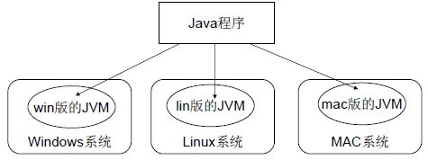

### 1.1.4 JVM、JDK、JRE三者的关系

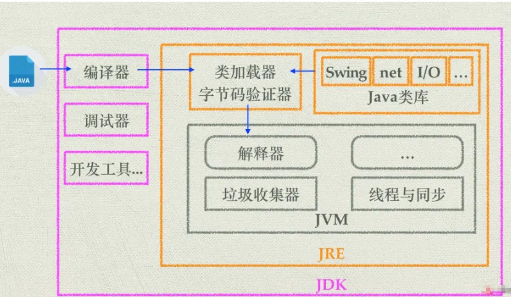

- JVM是Java虚拟机，是Java程序运行的环境。它负责将Java字节码（由Java编译器生成）解释或编译成机器码，并执行程序。JVM提供了内存管理、垃圾回收、安全性等功能，使得Java程序具备跨平台性。
- JDK是Java开发工具包，是开发Java程序所需的工具集合。它包含了JVM、编译器（javac）、调试器（jdb）等开发工具，以及一系列的类库（如Java标准库和开发工具库）。JDK提供了开发、编译、调试和运行Java程序所需的全部工具和环境。
- JRE是Java运行时环境，是Java程序运行所需的最小环境。它包含了JVM和一组Java类库，用于支持Java程序的执行。JRE不包含开发工具，只提供Java程序运行所需的运行环境。

### 1.1.5 JVM和Java的关系

**Java是语言，JVM是平台，一个是写代码的工具，一个是跑代码的环境，**两者分工不同但相互配合。

简单来说，Java是一门编程语言，就是我们平时写代码用的那个语言，像String、List这些都是Java语言提供的。而JVM呢，全称是Java虚拟机，它是用来运行Java程序的一个平台或者说运行环境。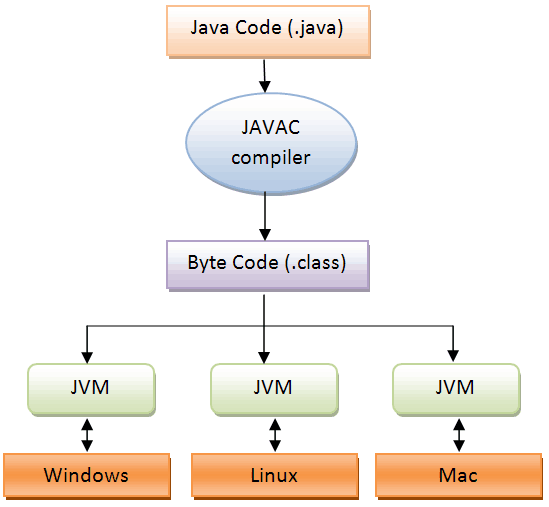

打个比方，Java就像是我们写文章用的中文，而JVM就像是能够阅读和理解这篇文章的人。我们用Java语言写代码，但代码不能直接运行，得先通过编译器编译成字节码，也就是.class文件，然后JVM再把这些字节码翻译成机器能懂的指令去执行。

这里面还有一个很关键的点，就是Java能够跨平台，也就是"一次编译，到处运行"。这个跨平台能力其实主要是JVM提供的。我们写好的Java代码编译成字节码后，这份字节码可以在Windows的JVM上运行，也可以在Linux的JVM上运行，还可以在Mac上运行。虽然底层操作系统不一样，但因为有JVM这一层，它帮我们屏蔽了这些差异，做好了适配。所以本质上是JVM依赖平台，但Java字节码不依赖平台。

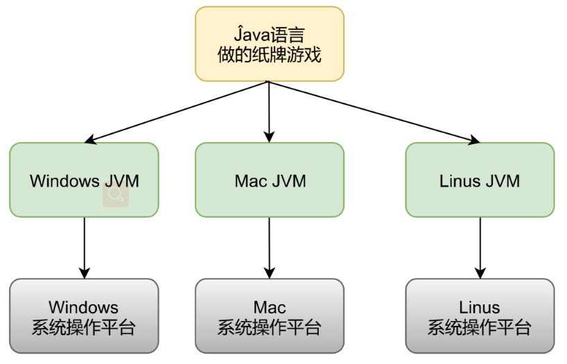

再简单说说它们和其他概念的关系。**JDK是开发工具包，里面有编译器、调试工具这些，也包含了JRE。JRE是运行环境，包含了JVM和Java的核心类库。**所以关系就是JDK大于JRE大于JVM，一个比一个小。如果你**要开发Java程序就得装JDK，如果只是运行别人写好的程序，装个JRE就够了。**

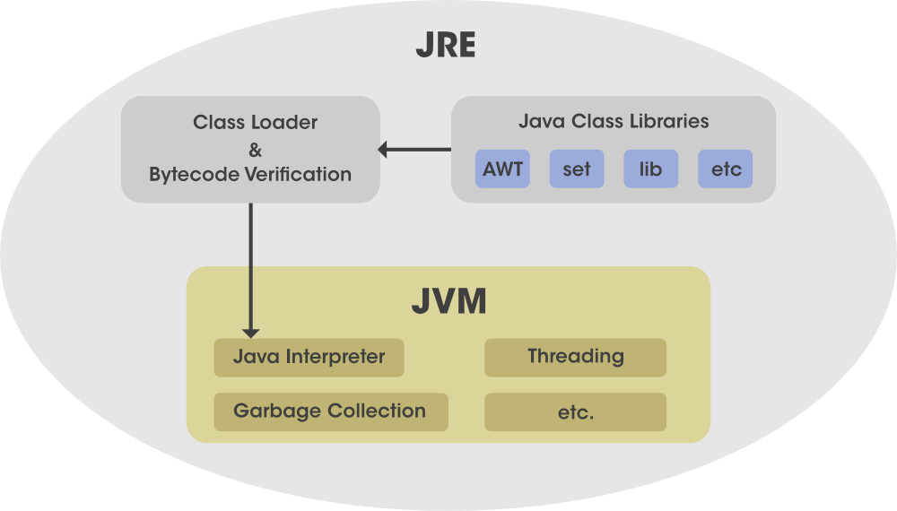

还有一点，JVM其实不只能跑Java。因为JVM执行的是字节码，所以像Kotlin、Scala这些语言，虽然语法跟Java不一样，但编译后也是生成Java字节码，一样可以在JVM上运行。所以JVM现在已经不只是Java的专属了，而是整个JVM语言生态的基础平台。

### 1.1.6 为什么Java解释和编译都有

首先在Java经过编译之后生成字节码文件，接下来进入JVM中，就有两个步骤编译和解释。 如下图：

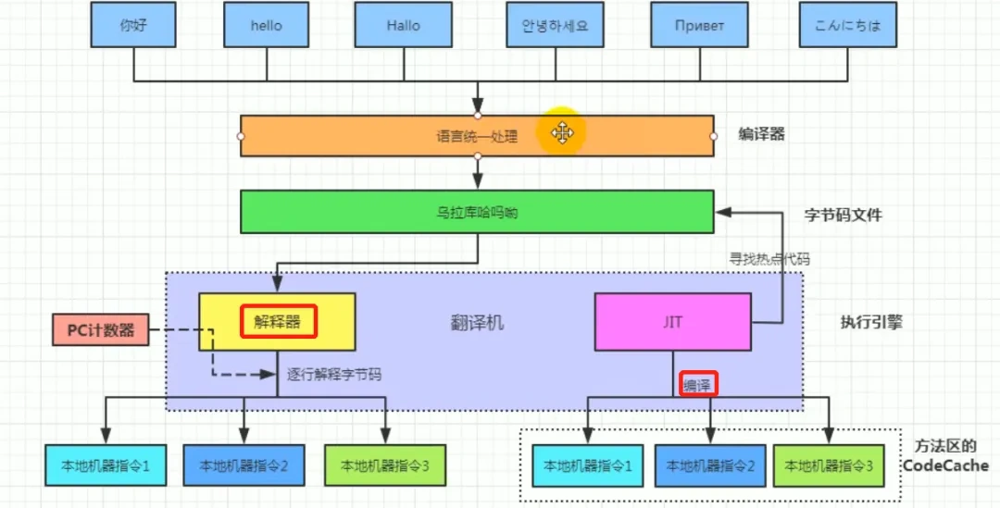

**编译**：

- Java 源代码会先被 `javac` 编译为平台无关的字节码（`.class`）文件，这一步发生在程序运行之前。

**解释 / JIT**：

- JVM 启动后由解释器逐条解释执行字节码；同时 JVM 通过方法调用计数器和回边计数器识别热点代码，达到阈值后由 JIT 编译为本地机器码并缓存到 Code Cache 中，后续执行直接走机器码。

所以Java既是编译型也是解释性语言，默认采用的是解释器和编译器混合的模式。

### 1.1.6 JVM是什么

JVM是 java 虚拟机，主要工作是解释自己的指令集（即字节码）并映射到本地的CPU指令集和OS的系统调用。

JVM屏蔽了与操作系统平台相关的信息，使得Java程序只需要生成在Java虚拟机上运行的目标代码（字节码），就可在多种平台上不加修改的运行，这也是Java能够“**一次编译，到处运行的**”原因。

### 1.1.7 编译型语言和解释型语言的区别

编译型语言和解释型语言的区别在于：

- **编译型语言**：在程序执行之前，整个**源代码会被编译成目标平台的机器码**（注：Java 这种"编译为字节码再由虚拟机解释 / JIT 执行"的模式严格说属于编译型与解释型的混合），**生成可执行文件**。**执行时直接运行编译后的代码，速度快，但跨平台性较差。**
- **解释型语言**：在程序**执行时，逐行解释执行源代码**，不生成独立的可执行文件。通常由解释器动态解释并执行代码，**跨平台性好，但执行速度相对较慢**。
- 典型的编译型语言如C、C++，典型的解释型语言如Python、JavaScript。

### 1.1.8 Python和Java的区别

- **Java** 是一种**编译与解释混合执行**的语言：源代码先被 `javac` 编译成字节码（.class），再由 JVM 加载后通过解释器 + JIT 即时编译器执行。
- **Python** 是一种**解释型语言**，运行时由解释器逐行翻译并执行源代码（CPython 内部也会先编译为字节码 `.pyc`，但整体执行模型仍以解释执行为主）。

### 1.1.9 值传递和引用传递的区别

在 Java 中，参数传递只有**值传递**一种方式，不存在真正的 “引用传递”。但很多人会混淆这两个概念，核心区别在于传递的是 “值的副本” 还是 “引用的副本”。

**值传递（Pass by Value）。传递的是实际值的副本**，适用于**基本数据类型**（如 `int`、`char` 等），修改方法内的参数副本，**不会影响原变量的值**。例子：

```java
public static void main(String[] args) {
    int num = 10;
    changeValue(num);
    System.out.println(num); // 输出 10（原变量未被修改）
}

public static void changeValue(int a) {
    a = 20; // 仅修改副本
}
```

**引用传递的误解（本质仍是值传递）。对于对象（引用类型）**，传递的是**对象引用的副本**（而非对象本身）。

两个引用（原引用和副本）指向**同一个对象**，因此通过副本修改对象内部数据，**会影响原对象**。但如果修改副本的指向（如重新赋值），**不会影响原引用的指向**。示例：

```java
public class Person {
    String name;
    Person(String name) { this.name = name; }
}

public static void main(String[] args) {
    Person p = new Person("Alice");
    changeName(p);
    System.out.println(p.name); // 输出 "Bob"（对象内部被修改）
    
    changeReference(p);
    System.out.println(p.name); // 仍输出 "Bob"（原引用指向未变）
}

// 修改对象内部数据
public static void changeName(Person obj) {
    obj.name = "Bob"; // 副本和原引用指向同一个对象
}

// 修改副本的指向（不影响原引用）
public static void changeReference(Person obj) {
    obj = new Person("Charlie"); // 副本指向新对象，原引用仍指向旧对象
}
```

简单来说，Java 中**所有参数传递都是值传递**：

- 基本类型传递 “值的副本”，修改副本不影响原值。
- 引用类型传递 “引用的副本”，通过副本可修改对象内容，但无法改变原引用的指向。

## 1.2 数据类型

### 1.2.1 基本数据类型

Java支持数据类型分为两类： 基本数据类型和引用数据类型。

基本数据类型共有8种，可以分为三类：

- 数值型：整数类型（byte、short、int、long）和浮点类型（float、double）
- 字符型：char
- 布尔型：boolean

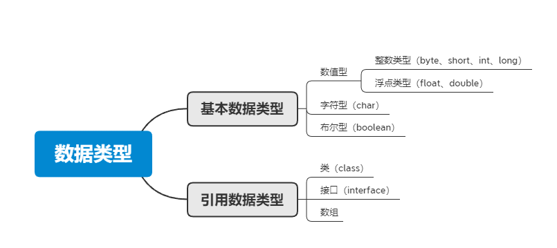

8种基本数据类型的默认值、位数、取值范围，如下表所示：

| 数据类型  | 占用大小（字节）              | 位数       | 取值范围                                                     | 默认值   | 描述                                                         |
| --------- | ----------------------------- | ---------- | ------------------------------------------------------------ | -------- | ------------------------------------------------------------ |
| `byte`    | 1                             | 8          | -128（-2^7^） 到 127（2^7^ - 1）                             | 0        | 是最小的整数类型，适合用于节省内存，例如在处理文件或网络流时存储小范围整数数据。 |
| `short`   | 2                             | 16         | -32768（-2^15^） 到 32767（2^15^ - 1）                       | 0        | 较少使用，通常用于在需要节省内存且数值范围在该区间的场景。   |
| `int`     | 4                             | 32         | -2147483648（-2^31^） 到 2147483647（2^31^ - 1）             | 0        | 最常用的整数类型，可满足大多数日常编程中整数计算的需求。     |
| `long`    | 8                             | 64         | -9223372036854775808（-2^63^） 到 9223372036854775807（2^63^ - 1） | 0L       | 用于表示非常大的整数，当 `int` 类型无法满足需求时使用，定义时数值后需加 `L` 或 `l`。 |
| `float`   | 4                             | 32         | -3.4028235E38 到 3.4028235E38                                | 0.0f     | 单精度浮点数，用于表示小数，精度相对较低，定义时数值后需加 `F` 或 `f`。 |
| `double`  | 8                             | 64         | -1.7976931348623157E308 到 1.7976931348623157E308            | 0.0d     | 双精度浮点数，精度比 `float` 高，是 Java 中表示小数的默认类型。 |
| `char`    | 2                             | 16         | '\u0000'（0） 到 '\uffff'（65535）                           | '\u0000' | 用于表示单个字符，采用 Unicode 编码，可表示各种语言的字符。  |
| `boolean` | 无明确字节大小（理论上 1 位） | 无明确位数 | `true` 或 `false`                                            | `false`  | 用于逻辑判断，只有两个取值，常用于条件判断和循环控制等逻辑场景。 |

Float 和 Double 的最大值都是以科学记数法的形式输出的，结尾的"E+数字"表示 E 之前的数字要乘以 10 的多少倍。比如 3.14E3 就是 3.14×1000=3140，3.14E-3 就是 3.14/1000=0.00314。注意：`Float.MIN_VALUE` / `Double.MIN_VALUE` 表示的是**最小正非零值**（如 `1.4E-45`），并不是负的最小值；浮点类型的最小负值是 `-MAX_VALUE`。

注意一下几点：

- Java八种基本数据类型的字节数：1字节(byte、boolean)、 2字节(short、char)、4字节(int、float)、8字节(long、double)
- 浮点数的默认类型为double（如果需要声明一个常量为float型，则必须要在末尾加上f或F）
- 整数的默认类型为int（声明Long型在末尾加上l或者L）
- 八种基本数据类型的包装类：除了char的是Character、int类型的是Integer，其他都是首字母大写
- char类型是无符号的，不能为负，所以是0开始的

### 1.2.2 int和long的位数、字节数

- `int`类型是 32 位（bit），占 4 个字节（byte），int 是有符号整数类型，其取值范围是从 -2^31^ 到 2^31^-1 。例如，在一个简单的计数器程序中，如果使用`int`类型来存储计数值，它可以表示的最大正数是 2,147,483,647。如果计数值超过这个范围，就会发生溢出，导致结果不符合预期。
- `long`类型是 64 位，占 8 个字节，`long`类型也是有符号整数类型，它的取值范围是从 -2^63^ 到 2^63^ -1 ，在处理较大的整数数值时，果`int`类型的取值范围不够，就需要使用`long`类型。例如，在一个文件传输程序中，文件的大小可能会很大，使用`int`类型可能无法准确表示，而`long`类型就可以很好地处理这种情况。

### 1.2.3 long和int可以相互转换吗

可以的，Java中的`long`和`int`可以相互转换。由于`long`类型的范围比`int`类型大，因此将`int`转换为`long`是安全的，而将`long`转换为`int`可能会导致数据丢失或溢出。

将`int`转换为`long`可以通过直接赋值或强制类型转换来实现。例如：

```java
int intValue = 10;
long longValue = intValue; // 自动转换，安全的
```

将`long`转换为`int`需要使用强制类型转换，但需要注意潜在的数据丢失或溢出问题。

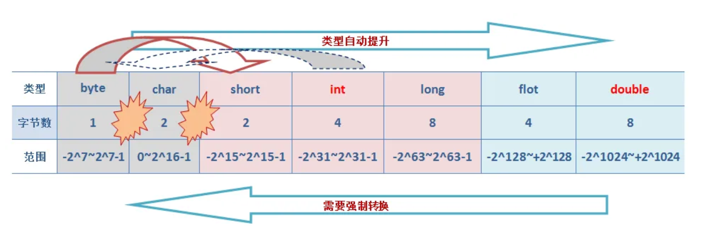

```java
long longValue = 100L;
int intValue = (int) longValue; // 强制类型转换，可能会有数据丢失或溢出
```

在将`long`转换为`int`时，如果`longValue`的值超出了`int`类型的范围，转换结果将是截断后的低位部分。因此，在进行转换之前，建议先检查`longValue`的值是否在`int`类型的范围内，以避免数据丢失或溢出的问题。

### 1.2.4 数据类型转换方式

- **自动类型转换（隐式转换）**：当**目标类型的范围大于源类型**时，Java会自动将源类型转换为目标类型，不需要显式的类型转换。例如，将`int`转换为`long`、将`float`转换为`double`等。
- **强制类型转换（显式转换）**：当**目标类型的范围小于源类型**时，需要使用强制类型转换将源类型转换为目标类型。这可能导致**数据丢失或溢出**。例如，将`long`转换为`int`、将`double`转换为`int`等。语法为：目标类型 变量名 = (目标类型) 源类型。
- **字符串转换**：Java提供了**将字符串表示的数据转换为其他类型数据**的方法。例如，将字符串转换为整型`int`，可以使用`Integer.parseInt()`方法；将字符串转换为浮点型`double`，可以使用`Double.parseDouble()`方法等。
- **数值之间的转换**：Java提供了一些数值类型之间的转换方法，如将**整型转换为字符型**、将**字符型转换为整型**等。这些转换方式可以通过类型的包装类来实现，例如`Character`类、`Integer`类等提供了相应的转换方法。

### 1.2.5 类型互转的问题

> 基本数据类型转换的问题

当把**小范围数据类型赋值给大范围数据类型**时，Java 会自动进行类型转换，这种转换一般是**安全**的。

```java
int num = 100;
long bigNum = num; // 自动将int转换为long
```

但是**大范围数据类型赋值给小范围数据类型**时，会发生数据数据溢出或者精度损失的问题。

- **数据溢出**：如果大范围数据类型赋值给小范围数据类型时，当目标类型无法容纳原数据时，就会发生数据溢出。比如下面，byte 类型的取值范围是 - 128 到 127。300 的二进制表示为`00000001 00101100`，强制转换为 byte 类型时，会丢弃高位字节，只保留低位的 8 位`00101100`，其十进制值为 44。

```java
int largeNum = 300;
byte b = (byte) largeNum; // b的值为44
```

- **精度损失**：在进行浮点数类型的转换时，可能会发生精度损失。由于浮点数的表示方式不同，将一个单精度浮点数(`float`)转换为双精度浮点数(`double`)时，精度可能会损失，如果 double 转换为 int 也会发生精度损失的问题，如下：

```java
double d = 3.14;
int i = (int) d; // i的值为3，小数部分0.14被舍弃
```

> 对象引用转换的问题

向上转型是自动进行的，而且是安全的，如下：

```java
class Animal {}
class Dog extends Animal {}

Dog dog = new Dog();
Animal animal = dog; // 自动向上转型
```

但是向下转型需要手动进行，并且存在风险。**如果父类对象实际上并不是目标子类的实例，在转型时就会抛出异常**：

```java
Animal animal = new Animal();
Dog dog = (Dog) animal; // 运行时抛出ClassCastException
```

原因是Java 的对象在运行时会记录其真实类型，**当进行向下转型时，Java 会检查对象的实际类型是否与目标类型兼容。如果不兼容，就会抛出`ClassCastException`**。

**解决方式是需要使用 `instanceof` 检查**：

```java
if (animal instanceof Dog) {
    Dog dog = (Dog) animal; // 只有确认animal是Dog的实例时才进行转型
}
```

### 1.2.5 为什么使用bigDecimal，不用double

double会出现精度丢失的问题，double执行的是二进制浮点运算，**二进制有些情况下不能准确的表示一个小数**，就像十进制不能准确的表示1/3(1/3=0.3333...)，也就是说二进制表示小数的时候只能够表示能够用1/(2^n^)的和的任意组合，但是0.1不能够精确表示，因为它不能够表示成为1/(2^n^)的和的形式。

比如：

```java
System.out.println(0.05 + 0.01);
System.out.println(1.0 - 0.42);
System.out.println(4.015 * 100);
System.out.println(123.3 / 100);

输出：
0.060000000000000005
0.5800000000000001
401.49999999999994
1.2329999999999999
```

可以看到在**Java中进行浮点数运算的时候，会出现丢失精度的问题**。那么我们如果在进行商品价格计算的时候，就会出现问题。很有可能造成我们手中有0.06元，却无法购买一个0.05元和一个0.01元的商品。因为如上所示，他们两个的总和为0.060000000000000005。这无疑是一个很严重的问题，**尤其是当电商网站的并发量上去的时候，出现的问题将是巨大的。可能会导致无法下单，或者对账出现问题。**

而 Decimal 是精确计算 , 所以一般牵扯到金钱的计算 , 都使用 Decimal。

```java
import java.math.BigDecimal;

public class BigDecimalExample {
    public static void main(String[] args) {
        BigDecimal num1 = new BigDecimal("0.1");
        BigDecimal num2 = new BigDecimal("0.2");

        BigDecimal sum = num1.add(num2);
        BigDecimal product = num1.multiply(num2);

        System.out.println("Sum: " + sum);
        System.out.println("Product: " + product);
    }
}

//输出
Sum: 0.3
Product: 0.02
```

在上述代码中，我们创建了两个`BigDecimal`对象`num1`和`num2`，分别表示0.1和0.2这两个十进制数。然后，我们使用`add()`方法计算它们的和，并使用`multiply()`方法计算它们的乘积。最后，我们通过`System.out.println()`打印结果。

这样的使用`BigDecimal`可以确保精确的十进制数值计算，避免了使用`double`可能出现的舍入误差。需要注意的是，在创建`BigDecimal`对象时，应该使用字符串作为参数，而不是直接使用浮点数值，以避免浮点数精度丢失。

### 1.2.6 装箱和拆箱是什么

装箱（Boxing）和拆箱（Unboxing）是将基本数据类型和对应的包装类之间进行转换的过程。

```text
Integer i = 10;  //装箱
int n = i;   //拆箱
```

**自动装箱**主要发生在两种情况，一种是**赋值时**，另一种是在**方法调用**的时候。

> 赋值时

这是最常见的一种情况，在Java 1.5以前我们需要手动地进行转换才行，而现在所有的转换都是由编译器来完成。

```java
//before autoboxing
Integer iObject = Integer.valueOf(3);
int iPrimitive = iObject.intValue();

//after java5
Integer iObject = 3; //autoboxing - primitive to wrapper conversion
int iPrimitive = iObject; //unboxing - object to primitive conversion
```

> 方法调用时

当我们在方法调用时，我们可以传入原始数据值或者对象，同样编译器会帮我们进行转换。

```java
public static Integer show(Integer iParam){
   System.out.println("autoboxing example - method invocation i: " + iParam);
   return iParam;
}

//autoboxing and unboxing in method invocation
show(3); //autoboxing
int result = show(3); //unboxing because return type of method is Integer
```

show方法接受Integer对象作为参数，当调用`show(3)`时，会将int值转换成对应的Integer对象，这就是所谓的自动装箱，show方法返回Integer对象，而`int result = show(3);`中result为int类型，所以这时候发生自动拆箱操作，将show方法的返回的Integer对象转换成int值。

> 自动装箱的弊端

自动装箱有一个问题，那就是**在一个循环中进行自动装箱操作的情况**，如下面的例子就**会创建多余的对象，影响程序的性能。**

```java
Integer sum = 0; 
for(int i=1000; i<5000; i++){ 
    sum+=i; 
} 
```

上面的代码`sum+=i`可以看成`sum = sum + i`，但是`+`这个操作符不适用于Integer对象，首先sum进行自动拆箱操作，进行数值相加操作，最后发生自动装箱操作转换成Integer对象。其内部变化如下

```java
int result = sum.intValue() + i; 
Integer sum = Integer.valueOf(result); 
```

由于我们这里声明的 sum 为 Integer 类型，自动装箱实际上由编译器替换为 `Integer.valueOf(...)` 调用，命中 `IntegerCache`（默认 -128~127）时会复用缓存对象，但本例中循环值都已超出缓存范围，因此会创建将近 4000 个 Integer 对象，降低程序性能并加重 GC 负担。因此**在编程时需要注意：正确声明变量类型，避免因为自动装箱引起的性能问题**（另外，`new Integer(int)` 自 JDK 9 起已被 `@Deprecated`，应统一使用 `Integer.valueOf(int)` 或直接自动装箱）。

### 1.2.7 Java为什么要有Integer

Integer对应是int类型的包装类，就是**把int类型包装成Object对象**，**对象封装**有很多好处，**可以把属性也就是数据跟处理这些数据的方法结合在一起**，比如Integer就有parseInt()等方法来专门处理int型相关的数据。

另一个非常重要的原因就是在**Java中绝大部分方法或类都是用来处理类类型对象的**，**如ArrayList集合类就只能以类作为他的存储对象，而这时如果想把一个int型的数据存入list是不可能的，必须把它包装成类**，也就是Integer才能被List所接受。所以Integer的存在是很必要的。

> 泛型中的应用

在Java中，**泛型只能使用引用类型**，而不能使用基本类型。因此，如果要在泛型中使用int类型，必须使用Integer包装类。例如，假设我们有一个**列表**，我们想要将其**元素排序**，并将排序结果存储在一个新的列表中。如果我们使用**基本数据类型int，无法直接使用Collections.sort()方法**。但是，如果我们使用Integer包装类，我们就可以轻松地使用Collections.sort()方法。

```java
List<Integer> list = new ArrayList<>();
list.add(3);
list.add(1);
list.add(2);
Collections.sort(list);
System.out.println(list);
```

> 转换中的应用

在Java中，**基本类型和引用类型不能直接进行转换，必须使用包装类来实现。**例如，将一个int类型的值转换为String类型，必须首先将其转换为Integer类型，然后再转换为String类型。

```java
int i = 10;
Integer integer = Integer.valueOf(i);
String str = integer.toString();
System.out.println(str);
```

> 集合中的应用

**Java集合中只能存储对象，而不能存储基本数据类型。**因此，如果要将int类型的数据存储在集合中，必须使用Integer包装类。例如，假设我们有一个列表，我们想要计算列表中所有元素的和。如果我们使用基本数据类型int，我们需要使用一个循环来遍历列表，并将每个元素相加。但是，如果我们使用Integer包装类，我们可以直接使用stream()方法来计算所有元素的和。

```java
List<Integer> list = new ArrayList<>();
list.add(3);
list.add(1);
list.add(2);
int sum = list.stream().mapToInt(Integer::intValue).sum();
System.out.println(sum);
```

### 1.2.7 Integer相比于int的优点

int是Java中的原始数据类型，而Integer是int的包装类。

Integer和 int 的区别：

- 基本类型和引用类型：首先，int是一种基本数据类型，而Integer是一种引用类型。**基本数据类型**是Java中最基本的数据类型，它们**是预定义的，不需要实例化就可以使用**。而**引用类型**则**需要通过实例化对象来使用**。这意味着，使用**int**来存储一个整数时，**不需要任何额外的内存分配**，而使用**Integer**时，**必须为对象分配内存**。在性能方面，**基本数据类型的操作通常比相应的引用类型快**。
- 自动装箱和拆箱：其次，**Integer作为int的包装类，它可以实现自动装箱和拆箱。**自动装箱是指将基本类型转化为相应的包装类类型，而自动拆箱则是将包装类类型转化为相应的基本类型。这使得Java程序员更加方便地进行数据类型转换。例如，当我们需要将int类型的值赋给Integer变量时，Java可以自动地将int类型转换为Integer类型。同样地，当我们需要将Integer类型的值赋给int变量时，Java可以自动地将Integer类型转换为int类型。
- 空指针异常：另外，**int 变量默认值为 0**，而 **Integer** 作为引用类型**默认值为 null**。如果**对一个值为 null 的 Integer（如未显式赋值的成员变量）执行自动拆箱操作，就会抛出空指针异常**，因为 null 无法被拆箱为基本类型。

### 1.2.8 为什么保留int类型

包装类是引用类型，对象的引用和对象本身是分开存储的，而对于基本类型数据，变量对应的内存块直接存储数据本身。

因此，基本类型数据在读写效率方面，要比包装类高效。除此之外，在64位JVM上，在开启引用压缩的情况下，一个Integer对象占用16个字节的内存空间，而一个int类型数据只占用4字节的内存空间，前者对空间的占用是后者的4倍。

也就是说，**不管是读写效率，还是存储效率，基本类型都比包装类高效**

### 1.2.9 说一下integer的缓存

Java的**Integer类内部实现了一个静态缓存池**，用于**存储特定范围内的整数值对应的Integer对象**。

默认情况下，这个范围是-128至127。当**通过Integer.valueOf(int)方法创建一个在这个范围内的整数对象时**，并不会每次都生成新的对象实例，而是**复用缓存中的现有对象**，会直接从内存中取出，不需要新建一个对象。

## 1.3 面向对象

### 1.3.1 怎样理解面向对象？说一下封装、继承、多态

面向对象是一种编程范式，它**将现实世界中的事物抽象为对象**，对象具有属性（称为字段或属性）和行为（称为方法）。面向对象编程的设计思想是**以对象为中心，通过对象之间的交互来完成程序的功能**，具有灵活性和可扩展性，通过封装和继承可以更好地应对需求变化。

Java面向对象的三大特性包括：**封装、继承、多态**：

- **封装**：封装是指**将对象的属性（数据）和行为（方法）结合在一起，对外隐藏对象的内部细节，仅通过对象提供的接口与外界交互。**封装的目的是增强安全性和简化编程，使得对象更加独立。
- **继承**：继承是一种可以使得**子类自动共享父类数据结构和方法的机制**。它是代码复用的重要手段，通过继承可以建立类与类之间的层次关系，使得结构更加清晰。
- **多态**：多态是指允许**不同类的对象对同一消息作出响应**。即同一个接口，使用不同的实例而执行不同操作。多态性可以**分为编译时多态（重载）和运行时多态（重写）**。它使得程序具有良好的灵活性和扩展性。

### 1.3.2 多态体现在哪些方面

多态在面向对象编程中可以体现在以下几个方面：

- **方法重载：**
  - 方法重载是指同一类中可以有多个同名方法，它们具有不同的参数列表（参数类型、数量或顺序不同）。虽然方法名相同，但根据传入的参数不同，编译器会在编译时确定调用哪个方法。
  - 示例：对于一个 `add` 方法，可以定义为 `add(int a, int b)` 和 `add(double a, double b)`。
- **方法重写：**
  - 方法重写是指子类能够提供对父类中同名方法的具体实现。在运行时，JVM会根据对象的实际类型确定调用哪个版本的方法。这是实现多态的主要方式。
  - 示例：在一个动物类中，定义一个 `sound` 方法，子类 `Dog` 可以重写该方法以实现 `bark`，而 `Cat` 可以实现 `meow`。
- **接口与实现：**
  - 多态也体现在接口的使用上，多个类可以实现同一个接口，并且用接口类型的引用来调用这些类的方法。这使得程序在面对不同具体实现时保持一贯的调用方式。
  - 示例：多个类（如 `Dog`, `Cat`）都实现了一个 `Animal` 接口，当用 `Animal` 类型的引用来调用 `makeSound` 方法时，会触发对应的实现。
- **向上转型和向下转型：**
  - 在Java中，可以使用父类类型的引用指向子类对象，这是向上转型。通过这种方式，可以在运行时期采用不同的子类实现。
  - 向下转型是将父类引用转回其子类类型，但在执行前需要确认引用实际指向的对象类型以避免 `ClassCastException`。

### 1.3.3 多态解决了什么问题？

多态是指子类可以替换父类，在实际的代码运行过程中，调用子类的方法实现。多态这种特性也需要编程语言提供特殊的语法机制来实现，比如继承、接口类。

多态可以提高代码的扩展性和复用性，是很多设计模式、设计原则、编程技巧的代码实现基础。比如策略模式、基于接口而非实现编程、依赖倒置原则、里式替换原则、利用多态去掉冗长的 if-else 语句等等

### 1.3.4 面向对象的设计原则你知道有哪些吗

面向对象编程中的六大原则：

- **单一职责原则（SRP）**：一个类应该只有一个引起它变化的原因，即一个类应该只负责一项职责。例子：考虑一个员工类，它应该只负责管理员工信息，而不应负责其他无关工作。
- **开放封闭原则（OCP）**：软件实体应该对扩展开放，对修改封闭。例子：通过制定接口来实现这一原则，比如定义一个图形类，然后让不同类型的图形继承这个类，而不需要修改图形类本身。
- **里氏替换原则（LSP）**：子类对象应该能够替换掉所有父类对象。例子：一个正方形是一个矩形，但如果修改一个矩形的高度和宽度时，正方形的行为应该如何改变就是一个违反里氏替换原则的例子。
- **接口隔离原则（ISP）**：客户端不应该依赖那些它不需要的接口，即接口应该小而专。例子：通过接口抽象层来实现底层和高层模块之间的解耦，比如使用依赖注入。
- **依赖倒置原则（DIP）**：高层模块不应该依赖低层模块，二者都应该依赖于抽象；抽象不应该依赖于细节，细节应该依赖于抽象。例子：如果一个公司类包含部门类，应该考虑使用合成/聚合关系，而不是将公司类继承自部门类。
- **最少知识原则 (Law of Demeter)**：一个对象应当对其他对象有最少的了解，只与其直接的朋友交互。

### 1.3.5 重载与重写有什么区别？

**重载是同名方法的参数列表不同，重写是子类重新实现父类的方法。**它们最大的区别，是方法选择发生的时机不同。

> 重载（Overloading）

重载可以发生在同一个类中，也可以涉及继承得到的方法。方法名相同，但参数的类型、数量或者类型顺序不同，编译器会根据调用时的参数和声明类型，选择对应的方法。

```java
class Calculator {
    public int add(int a, int b) {
        return a + b;
    }

    public double add(double a, double b) {
        return a + b;
    }
}
```

比如`add(1, 2)`匹配int参数的方法，`add(1.0, 2.0)`匹配double参数的方法。

注意，**不能只靠返回类型不同来重载方法**。如果方法名和参数列表相同，只修改返回类型，编译器会认为方法重复。

> 重写（Overriding）

重写发生在继承关系中。子类对父类可被重写的实例方法提供新的实现，方法名和参数列表保持一致。调用时，JVM会根据对象的实际类型执行对应的实现。

```java
class Parent {
    public Number getValue() {
        return 1;
    }
}

class Child extends Parent {
    @Override
    public Integer getValue() {
        return 2;
    }
}
```

这里子类返回Integer，父类返回Number，也是合法的重写，因为Integer是Number的子类，这叫**协变返回类型**。

```java
Parent obj = new Child();
System.out.println(obj.getValue()); // 输出2，执行的是Child的方法
```

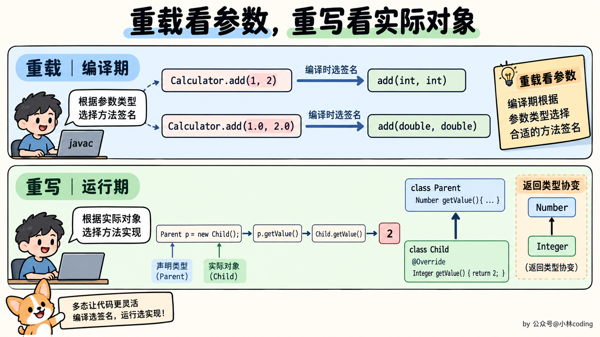

重写还有几个限制：

- 返回类型如果是基本类型或者void，要与父类一致；如果是引用类型，可以与父类相同，也可以是父类返回类型的子类型。
- 访问权限不能比父类更严格，比如父类是public，子类不能改成protected。
- 不能新增父类方法没有声明的受检异常，也不能把受检异常的范围扩大，但可以不抛或者抛更具体的受检异常。
- final方法不能重写，private方法不被子类继承；static方法属于类，子类的同名同参数静态方法属于隐藏，不是重写。

`@Override`不是重写成立的必要条件，但建议加上，让编译器帮我们检查方法是否真的重写成功，避免把参数写错后变成了重载。

所以，重载主要是在编译时确定调用哪个签名的方法，而重写是在运行时确定这个方法执行哪个类的实现。

### 1.3.6 抽象类和普通类区别？

- 实例化：普通类可以直接实例化对象，而抽象类不能被实例化，只能被继承。
- 方法实现：普通类中的方法可以有具体的实现，而抽象类中的方法可以有实现也可以没有实现。
- 继承：普通类和抽象类在继承规则上完全一样——都只能被单继承（`extends`），都可以实现多个接口（`implements`），这一点两者没有区别。
- 实现限制：普通类可以被其他类继承和使用，而抽象类一般用于作为基类，被其他类继承和扩展使用。

### 1.3.7 Java抽象类和接口的区别是什么？

**两者的特点：**

- 抽象类用于描述类的共同特性和行为，可以有成员变量、构造方法和具体方法。适用于有明显继承关系的场景。
- 接口用于定义行为规范，可以多实现，只能有常量和抽象方法（Java 8 以后可以有默认方法和静态方法）。适用于定义类的能力或功能。

**两者的区别：**

- 实现方式：实现接口的关键字为implements，继承抽象类的关键字为extends。一个类可以实现多个接口，但一个类只能继承一个抽象类。所以，使用接口可以间接地实现多重继承。
- 方法方式：接口只有定义，不能有方法的实现，java 1.8中可以定义default方法体，而抽象类可以有定义与实现，方法可在抽象类中实现。
- 访问修饰符：接口成员变量默认为 `public static final`，必须赋初值，不能被修改；接口中的抽象方法默认是 `public abstract`，从 Java 8 起接口可以定义 `default` 和 `static` 方法（带方法体），从 Java 9 起还可以定义 `private` 方法用于辅助 default 方法的实现。抽象类中成员变量默认为 default 访问权限，可在子类中被重新定义，也可被重新赋值；抽象方法被 abstract 修饰，不能被 private、static、synchronized 和 native 等修饰，必须以分号结尾，不带花括号。
- 变量：抽象类可以包含实例变量和静态变量，而接口只能包含常量（即静态常量）。

### 1.3.8 抽象类能加final修饰吗？

**不能**，Java中的抽象类是用来被继承的，而final修饰符用于禁止类被继承或方法被重写，因此，抽象类和final修饰符是互斥的，不能同时使用。

### 1.3.9 接口里面可以定义哪些方法？

- **抽象方法**

抽象方法是接口的核心部分，所有实现接口的类都必须实现这些方法。抽象方法默认是 public 和 abstract，这些修饰符可以省略。

```java
public interface Animal {
    void makeSound();
}
```

- **默认方法**

默认方法是在 Java 8 中引入的，允许接口提供具体实现。实现类可以选择重写默认方法。

```java
public interface Animal {
    void makeSound();
    
    default void sleep() {
        System.out.println("Sleeping...");
    }
}
```

- **静态方法**

静态方法也是在 Java 8 中引入的，它们属于接口本身，可以通过接口名直接调用，而不需要实现类的对象。

```java
public interface Animal {
    void makeSound();
    
    static void staticMethod() {
        System.out.println("Static method in interface");
    }
}
```

- **私有方法**

私有方法是在 Java 9 中引入的，用于在接口中为默认方法或其他私有方法提供辅助功能。这些方法不能被实现类访问，只能在接口内部使用。

```java
public interface Animal {
    void makeSound();
    
    default void sleep() {
        System.out.println("Sleeping...");
        logSleep();
    }
    
    private void logSleep() {
        System.out.println("Logging sleep");
    }
}
public interface Animal {
    void makeSound();
}
```

### 1.3.10 抽象类可以被实例化吗？

在Java中，抽象类本身不能被实例化。

这意味着不能使用`new`关键字直接创建一个抽象类的对象。抽象类的存在主要是为了被继承，它通常包含一个或多个抽象方法（由`abstract`关键字修饰且无方法体的方法），这些方法需要在子类中被实现。

抽象类可以有构造器，这些构造器在子类实例化时会被调用，以便进行必要的初始化工作。然而，这个过程并不是直接实例化抽象类，而是创建了子类的实例，间接地使用了抽象类的构造器。

例如：

```java
public abstract class AbstractClass {
    public AbstractClass() {
        // 构造器代码
    }
    
    public abstract void abstractMethod();
}

public class ConcreteClass extends AbstractClass {
    public ConcreteClass() {
        super(); // 调用抽象类的构造器
    }
    
    @Override
    public void abstractMethod() {
        // 实现抽象方法
    }
}

// 下面的代码可以运行
ConcreteClass obj = new ConcreteClass();
```

在这个例子中，`ConcreteClass`继承了`AbstractClass`并实现了抽象方法`abstractMethod()`。当我们创建`ConcreteClass`的实例时，`AbstractClass`的构造器被调用，但这并不意味着`AbstractClass`被实例化；实际上，我们创建的是`ConcreteClass`的一个对象。

简而言之，抽象类不能直接实例化，但通过继承抽象类并实现所有抽象方法的子类是可以被实例化的。

### 1.3.11 接口可以包含构造函数吗？

在接口中，不可以有构造方法,在接口里写入构造方法时，编译器提示：Interfaces cannot have constructors，因为接口不会有自己的实例的，所以不需要有构造函数。

为什么呢？构造函数就是初始化class的属性或者方法，在new的一瞬间自动调用，那么问题来了Java的接口，都不能new 那么要构造函数干嘛呢？根本就没法调用

### 1.3.12 解释Java中的静态变量和静态方法

在Java中，静态变量和静态方法是与类本身关联的，而不是与类的实例（对象）关联。它们在内存中只存在一份，可以被类的所有实例共享。

> 静态变量

静态变量（也称为类变量）是在类中使用`static`关键字声明的变量。它们属于类而不是任何具体的对象。主要的特点：

- **共享性**：所有该类的实例共享同一个静态变量。如果一个实例修改了静态变量的值，其他实例也会看到这个更改。
- **初始化**：静态变量在类被加载时初始化，只会对其进行一次分配内存。
- **访问方式**：静态变量可以直接通过类名访问，也可以通过实例访问，但推荐使用类名。

示例：

```java
public class MyClass {
    static int staticVar = 0; // 静态变量

    public MyClass() {
        staticVar++; // 每创建一个对象，静态变量自增
    }
    
    public static void printStaticVar() {
        System.out.println("Static Var: " + staticVar);
    }
}

// 使用示例
MyClass obj1 = new MyClass();
MyClass obj2 = new MyClass();
MyClass.printStaticVar(); // 输出 Static Var: 2
```

> 静态方法

静态方法是在类中使用`static`关键字声明的方法。类似于静态变量，静态方法也属于类，而不是任何具体的对象。主要的特点：

- **无实例依赖**：静态方法可以在没有创建类实例的情况下调用。对于静态方法来说，不能直接访问非静态的成员变量或方法，因为静态方法没有上下文的实例。
- **访问静态成员**：静态方法可以直接调用其他静态变量和静态方法，但不能直接访问非静态成员。
- **多态性**：静态方法不支持重写（Override），但可以被隐藏（Hide）。

```java
public class MyClass {
    static int count = 0;

    // 静态方法
    public static void incrementCount() {
        count++;
    }

    public static void displayCount() {
        System.out.println("Count: " + count);
    }
}

// 使用示例
MyClass.incrementCount(); // 调用静态方法
MyClass.displayCount();   // 输出 Count: 1
```

> 使用场景

- **静态变量**：常用于需要在所有对象间共享的数据，如计数器、常量等。
- **静态方法**：常用于助手方法（utility methods）、获取类级别的信息或者是没有依赖于实例的数据处理。

### 1.3.13 非静态内部类和静态内部类的区别？

区别包括：

- 非静态内部类依赖于外部类的实例，而静态内部类不依赖于外部类的实例。
- 非静态内部类可以直接访问外部类的所有成员（包括实例变量和方法）；静态内部类可以直接访问外部类的静态成员，访问外部类的实例成员则必须通过外部类的实例引用。
- 非静态内部类不能定义静态成员（Java 16 之前），而静态内部类可以定义静态成员。
- 非静态内部类在外部类实例化后才能实例化，而静态内部类可以独立实例化。
- 静态内部类和非静态内部类都**可以**访问外部类的私有成员（因为编译器会为嵌套类提供访问权限）——两者的区别在于静态内部类访问外部类的私有**实例**成员时必须先拿到外部类实例，而不是像非静态内部类那样能直接访问。

### 1.3.14 非静态内部类可以直接访问外部方法，编译器是怎么做到的？

非静态内部类可以直接访问外部方法是因为编译器在生成字节码时会为非静态内部类维护一个指向外部类实例的引用。

这个引用使得非静态内部类能够访问外部类的实例变量和方法。编译器会在生成非静态内部类的构造方法时，将外部类实例作为参数传入，并在内部类的实例化过程中建立外部类实例与内部类实例之间的联系，从而实现直接访问外部方法的功能。

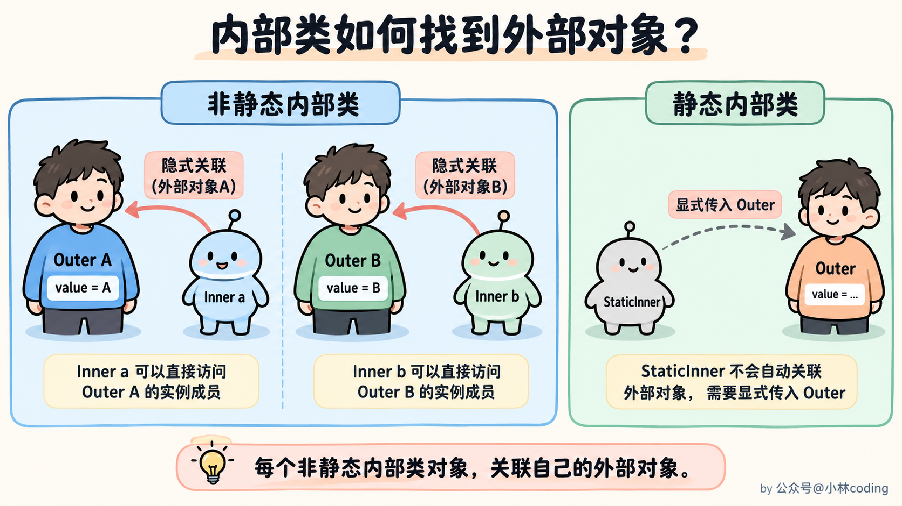

## 1.4 关键字

### 1.4.1 Java 中 final 作用是什么？

final主要用来修饰类、方法和变量，分别表示**不能继承、不能重写、不能再次赋值**。

> 修饰类

final修饰的类不能被继承，比如String就是final类。这样可以避免子类重写方法，改变这个类原本的行为。

不过，**类被final修饰，不代表它的对象就一定不可变**。如果类里还有可以修改字段的方法，对象的内容仍然可以改变。

> 修饰方法

final修饰的方法不能被子类重写，但可以正常被继承和调用，也可以定义不同参数列表的同名方法，也就是重载。

比如Object的getClass方法就是final方法，子类不能通过重写改变它返回对象实际类型的行为。

> 修饰变量

final变量只能被赋值一次。局部变量必须在使用前完成赋值；final实例字段可以在声明、实例初始化块或者构造方法中赋值，但必须保证构造完成时已经赋值，而且不能重复赋值。

对于基本类型，不能再改变变量保存的值；对于引用类型，不能再让变量指向另一个对象，但对象内部的数据可能仍然可以修改：

```java
final int num = 10;
// num = 20; // 编译不通过

final StringBuilder builder = new StringBuilder("Hello");
builder.append(" World"); // 可以，修改的是对象内部的内容
// builder = new StringBuilder(); // 编译不通过，不能重新赋值
```

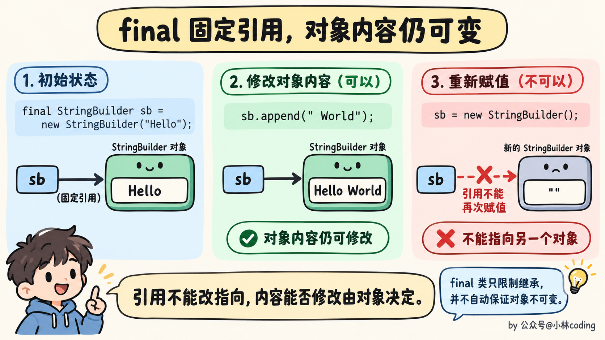

另外，final变量不一定都是编译期常量。只有基本类型或者String类型的final变量，并且使用常量表达式初始化，才是Java所说的常量变量。比如`final int num = 10`是，但`final int num = getNum()`不是。

> 为什么String是不可变的？

String不可变不是只靠类上的final。它还把内部存储封装起来，不提供修改自身内容的公开方法，构造和对外传递数据时也会避免把可修改的内部存储直接暴露出去。final类主要是防止子类通过继承改变这些行为。

所以，设计不可变对象时，需要同时考虑字段、可变成员的防御性拷贝和对外接口，不能只给类或者引用加一个final就认为完成了。

### 1.4.2 Java 中 static的作用是什么？

`static` 关键字主要用于修饰类的成员（变量、方法、代码块）和内部类，其核心作用是**将成员与类本身关联，而非与类的实例（对象）关联**。具体作用如下：

> 1、修饰变量

被 `static` 修饰的变量属于类本身，而非类的某个实例。所有对象共享同一份静态变量，内存中只存在一份副本。可以通过 `类名.变量名` 直接访问，无需创建对象（也可通过对象访问，但不推荐）。

通常用于存储所有对象共享的数据，如常量、计数器等。

```java
public class Student {
    // 静态变量（所有学生共享同一个学校名称）
    public static String schoolName = "阳光中学";
    // 实例变量（每个学生有自己的姓名）
    private String name;
}

// 访问静态变量
public class Test {
    public static void main(String[] args) {
        System.out.println(Student.schoolName); // 直接通过类名访问
    }
}
```

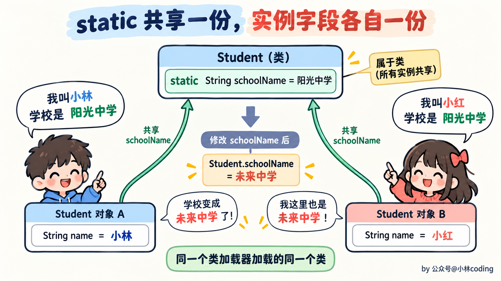

> 2、修饰方法

静态方法属于类，不属于任何实例，因此**不能直接访问类中的非静态成员（变量 / 方法）**（因为非静态成员依赖于对象存在），但可以访问静态成员。通过 `类名.方法名` 直接调用，无需创建对象。

通常用于工具类方法（如 `Math.random()`）、工厂方法等，不需要依赖对象状态即可完成操作。

```java
public class MathUtils {
    // 静态方法（无需创建对象即可调用）
    public static int add(int a, int b) {
        return a + b;
    }
}

// 调用静态方法
public class Test {
    public static void main(String[] args) {
        int result = MathUtils.add(2, 3); // 直接通过类名调用
    }
}
```

> 3、修饰代码块

静态代码块在**类初始化阶段**（即执行 `<clinit>` 时）执行，且只执行一次（优于对象构造方法），用于初始化静态变量或执行类级别的预处理操作。JVM 的类生命周期为：加载 → 链接（验证、准备、解析）→ 初始化，静态代码块属于"初始化"阶段而非"加载"阶段。

多个静态代码块按定义顺序执行，且先于非静态代码块和构造方法。

```java
public class Database {
    private static String url;
    
    // 静态代码块：初始化静态变量
    static {
        url = "jdbc:mysql://localhost:3306/test";
        System.out.println("数据库连接地址初始化完成");
    }
}
```

> 4、修饰内部类

静态内部类不依赖于外部类的实例，可以独立存在，**不能直接访问外部类的非静态成员**（需通过外部类实例访问）。

当内部类与外部类的实例无关时使用，避免内部类持有外部类的引用导致的内存泄漏。

```java
public class OuterClass {
    private static int staticVar = 10;
    private int instanceVar = 20;
    
    // 静态内部类
    public static class StaticInnerClass {
        public void print() {
            System.out.println(staticVar); // 可访问外部类静态变量
            // System.out.println(instanceVar); // 错误：不能直接访问非静态变量
        }
    }
}

// 使用静态内部类
public class Test {
    public static void main(String[] args) {
        OuterClass.StaticInnerClass inner = new OuterClass.StaticInnerClass();
        inner.print();
    }
}
```

## 1.5 深拷贝和浅拷贝

### 1.5.1 深拷贝和浅拷贝的区别？

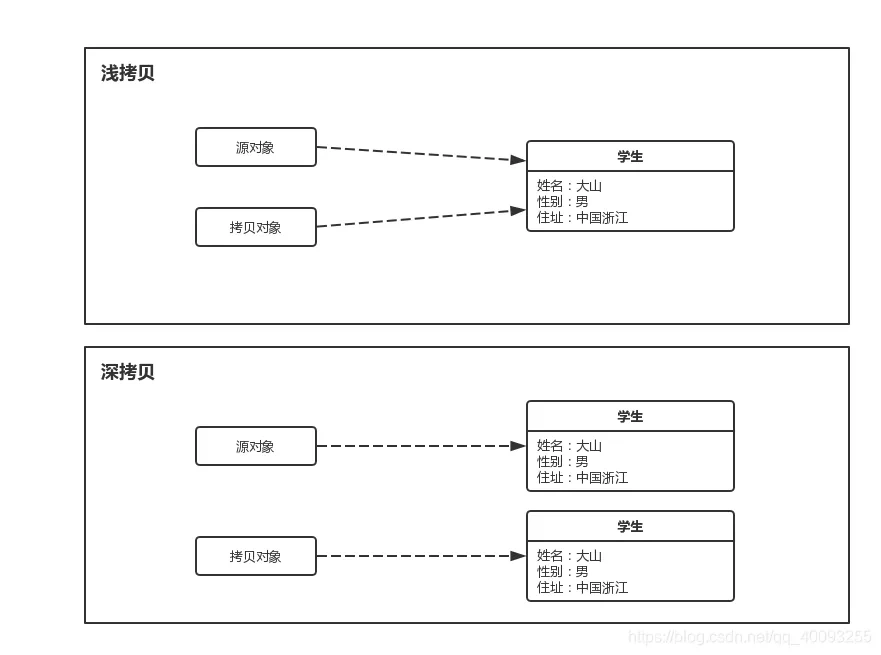

- 浅拷贝是指只复制对象本身和其内部的值类型字段，但不会复制对象内部的引用类型字段。换句话说，浅拷贝只是创建一个新的对象，然后将原对象的字段值复制到新对象中，但如果原对象内部有引用类型的字段，只是将引用复制到新对象中，两个对象指向的是同一个引用对象。
- 深拷贝是指在复制对象的同时，将对象内部的所有引用类型字段的内容也复制一份，而不是共享引用。换句话说，深拷贝会递归复制对象内部所有引用类型的字段，生成一个全新的对象以及其内部的所有对象。

### 1.5.2 实现深拷贝的三种方法是什么？

在 Java 中，实现对象深拷贝的方法有以下几种主要方式：

> 实现 Cloneable 接口并重写 clone() 方法

这种方法要求对象及其所有引用类型字段都实现 Cloneable 接口，并且重写 clone() 方法。在 clone() 方法中，通过递归克隆引用类型字段来实现深拷贝。

```java
class MyClass implements Cloneable {
    private String field1;
    private NestedClass nestedObject;

    @Override
    protected Object clone() throws CloneNotSupportedException {
        MyClass cloned = (MyClass) super.clone();
        cloned.nestedObject = (NestedClass) nestedObject.clone(); // 深拷贝内部的引用对象
        return cloned;
    }
}

class NestedClass implements Cloneable {
    private int nestedField;

    @Override
    protected Object clone() throws CloneNotSupportedException {
        return super.clone();
    }
}
```

> 使用序列化和反序列化

通过将对象序列化为字节流，再从字节流反序列化为对象来实现深拷贝。要求对象及其所有引用类型字段都实现 Serializable 接口。

```java
import java.io.*;

class MyClass implements Serializable {
    private String field1;
    private NestedClass nestedObject;

    public MyClass deepCopy() {
        try {
            ByteArrayOutputStream bos = new ByteArrayOutputStream();
            ObjectOutputStream oos = new ObjectOutputStream(bos);
            oos.writeObject(this);
            oos.flush();
            oos.close();

            ByteArrayInputStream bis = new ByteArrayInputStream(bos.toByteArray());
            ObjectInputStream ois = new ObjectInputStream(bis);
            return (MyClass) ois.readObject();
        } catch (IOException | ClassNotFoundException e) {
            e.printStackTrace();
            return null;
        }
    }
}

class NestedClass implements Serializable {
    private int nestedField;
}
```

> 手动递归复制

针对特定对象结构，手动递归复制对象及其引用类型字段。适用于对象结构复杂度不高的情况。

```java
class MyClass {
    private String field1;
    private NestedClass nestedObject;

    public MyClass deepCopy() {
        MyClass copy = new MyClass();
        copy.setField1(this.field1);
        copy.setNestedObject(this.nestedObject.deepCopy());
        return copy;
    }
}

class NestedClass {
    private int nestedField;

    public NestedClass deepCopy() {
        NestedClass copy = new NestedClass();
        copy.setNestedField(this.nestedField);
        return copy;
    }
}
```

## 1.6 泛型

### 1.6.1 什么是泛型？

泛型就是在定义类、接口或者方法时，先用一个类型参数来表示具体的数据类型，等使用时再指定。比如`List<String>`，就是告诉编译器，这个集合里存放的是String。

**泛型主要解决两个问题：一是复用代码，二是把类型检查提前到编译阶段。**

> 为什么需要泛型？

如果不用泛型，集合中可以放入不同类型的对象，取出时就需要自己强制转换，稍不注意就会出现ClassCastException。

```java
List list = new ArrayList();
list.add("小林");
list.add(100);

String name = (String) list.get(0); // 需要强制转换
String num = (String) list.get(1);  // 运行时抛出ClassCastException
```

使用泛型之后，编译器就能检查放进去的类型，取出来时也不用手动转换：

```java
List<String> list = new ArrayList<>();
list.add("小林");
// list.add(100); // 编译不通过，提前发现类型错误

String name = list.get(0);
```

代码复用也是同样的道理。比如定义一个存放数据的Box，不用分别写StringBox、IntegerBox，用一个泛型类就可以了：

```java
class Box<T> {
    private T value;

    public void set(T value) {
        this.value = value;
    }

    public T get() {
        return value;
    }
}
```

使用时，`Box<String>`存放字符串，`Box<Integer>`存放整数，复用的都是同一份代码。

> 泛型在运行时还存在吗？

Java泛型主要通过**类型擦除**来实现。编译时会进行类型检查，生成字节码时，会把类型参数替换成它的上界，没有指定上界时就替换成Object，并在必要的位置插入类型转换。

比如`List<String>`和`List<Integer>`，运行时都是同一个ArrayList类，不会分别生成两个类：

```java
List<String> names = new ArrayList<>();
List<Integer> numbers = new ArrayList<>();
System.out.println(names.getClass() == numbers.getClass()); // true
```

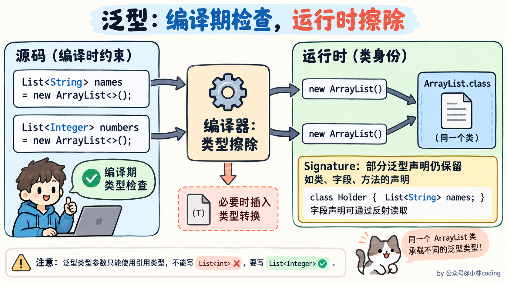

不过，类型擦除不代表所有泛型信息都消失了。类、字段和方法声明中的部分泛型信息会保存在class文件的Signature属性中，可以通过反射读取。但不能仅凭一个普通的`new ArrayList<String>()`对象，就直接获知它的类型参数是String。

还有两个常见的注意点：

- 泛型类型参数只能使用引用类型，不能写`List<int>`，要写`List<Integer>`。
- Integer虽然是Number的子类，但`List<Integer>`不是`List<Number>`的子类。如果方法要接收不同数值类型的列表，可以根据读写需求使用通配符，比如`List<? extends Number>`用于读取Number，`List<? super Integer>`允许写入Integer。

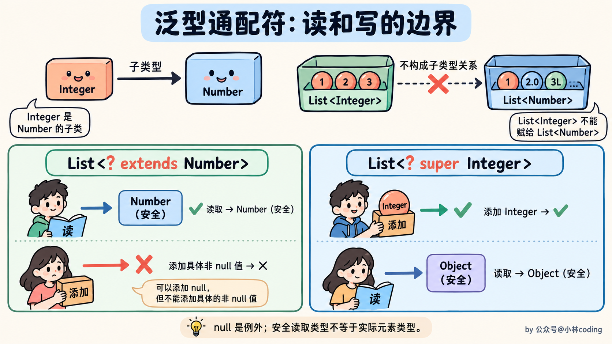

正常使用泛型可以减少类型转换错误，但如果混用原始类型、进行未经检查的转换，仍然可能在运行时出现ClassCastException。

## 1.7 对象

### 1.7.1 java创建对象有哪些方式？

在Java中，创建对象的方式有多种，常见的包括：

**1、使用new关键字**：这是最常见、最基础的创建对象方式。通过调用类的构造器来实例化对象。

```java
// 定义一个类
public class Person {
    private String name;
    
    public Person() {} // 默认构造器
    public Person(String name) { // 带参构造器
        this.name = name;
    }
    
    public void sayHello() {
        System.out.println("Hello, " + name);
    }
}

// 使用 new 创建对象
public class Main {
    public static void main(String[] args) {
        Person person1 = new Person(); // 调用无参构造
        Person person2 = new Person("Alice"); // 调用有参构造
        
        person2.sayHello(); // 输出: Hello, Alice
    }
}
```

优点是简单、直接、明确。缺点是紧密耦合，必须知道具体的类名。

**2、使用Class类的newInstance()方法**：通过 Java 的反射 API，在运行时动态地创建对象。这种方式不需要在编译时知道具体的类。

```java
MyClass obj = (MyClass) Class.forName("com.example.MyClass").getDeclaredConstructor().newInstance();
```

应用场景：框架设计（如 Spring 的 IOC 容器）、动态代理等。

**注意**：`Class.newInstance()` 在 JDK 9 后被标记为过时，因为它只能调用无参公有构造器，且会抛出所有受检异常。推荐使用 `Constructor.newInstance()`，更强大也更灵活。

**使用Constructor类的newInstance()方法**：同样是通过反射机制，可以使用Constructor类的newInstance()方法创建对象。

```java
Constructor<MyClass> constructor = MyClass.class.getConstructor();
MyClass obj = constructor.newInstance();
```

**3、使用clone()方法**：通过实现 `Cloneable` 接口并重写 `Object` 类的 `clone()` 方法，可以基于一个现有对象（原型）创建一个新的副本对象。

```java
// 实现 Cloneable 接口
public class Person implements Cloneable {
    private String name;
    
    // ... 构造器和其他方法 ...
    
    @Override
    protected Object clone() throws CloneNotSupportedException {
        return super.clone(); // 浅拷贝
    }
}

public class Main {
    public static void main(String[] args) {
        Person original = new Person("Charlie");
        try {
            Person copy = (Person) original.clone(); // 创建副本
            copy.sayHello(); // 输出: Hello, Charlie
        } catch (CloneNotSupportedException e) {
            e.printStackTrace();
        }
    }
}
```

`Object.clone()` 默认是浅拷贝，对于引用类型的字段，复制的是引用地址，而不是引用的对象本身。如果需要深拷贝，必须在 `clone()` 方法中手动对引用对象进行克隆。

**4、使用反序列化**：通过 `ObjectInputStream` 从一个字节流（通常是文件或网络）中重建一个对象。

```java
import java.io.*;

// 必须实现 Serializable 接口
public class Person implements Serializable {
    private String name;
    // ... 构造器和其他方法 ...
}

public class Main {
    public static void main(String[] args) {
        Person personToSave = new Person("David");
        
        // 序列化对象到文件
        try (ObjectOutputStream oos = new ObjectOutputStream(new FileOutputStream("person.dat"))) {
            oos.writeObject(personToSave);
        } catch (IOException e) {
            e.printStackTrace();
        }
        
        // 从文件反序列化对象
        try (ObjectInputStream ois = new ObjectInputStream(new FileInputStream("person.dat"))) {
            Person restoredPerson = (Person) ois.readObject(); // 创建新对象
            restoredPerson.sayHello(); // 输出: Hello, David
        } catch (IOException | ClassNotFoundException e) {
            e.printStackTrace();
        }
    }
}
```

特点是不会调用类的任何构造器，类必须实现 `java.io.Serializable` 接口。

**5、使用工厂模式**：这是一种设计模式，不直接使用 `new`，而是通过一个方法来返回对象实例。`getInstance()`、`valueOf()` 等都是常见的工厂方法。

```java
public class Person {
    private String name;
    
    private Person(String name) { // 构造器可以是私有的
        this.name = name;
    }
    
    // 静态工厂方法
    public static Person createPerson(String name) {
        // 这里可以做一些额外的逻辑，比如缓存、日志、返回子类实例等
        return new Person(name);
    }
}

public class Main {
    public static void main(String[] args) {
        // 不是用 new，而是用工厂方法创建
        Person person = Person.createPerson("Eva");
        person.sayHello();
    }
}
```

优点是将对象的创建与使用分离，降低耦合，还可以隐藏创建对象的复杂逻辑（如池化技术、缓存）。

Java 标准库中的例子：`Integer.valueOf(int)`，`Calendar.getInstance()`。

最后来个，总结对比：

| 方式             | 核心原理       | 是否调用构造器？       | 特点与应用场景                              |
| :--------------- | :------------- | :--------------------- | :------------------------------------------ |
| **`new` 关键字** | JVM 指令       | **是**                 | 最标准、最常用，紧密耦合                    |
| **反射**         | 运行时类信息   | **是** (`Constructor`) | 灵活，解耦，用于框架                        |
| **`clone()`**    | 复制现有对象   | **否**                 | 基于原型创建副本，需实现 `Cloneable`        |
| **反序列化**     | 从字节流恢复   | **否**                 | 用于持久化和网络通信，需实现 `Serializable` |
| **工厂模式**     | 方法封装 `new` | **是** (在方法内)      | 解耦，隐藏创建逻辑，控制实例                |

### 1.7.2 Java创建对象除了new还有别的什么方式?

- **通过反射创建对象**：通过 Java 的反射机制可以在运行时动态地创建对象。可以使用 Class 类的 newInstance() 方法或者通过 Constructor 类来创建对象。

```java
public class MyClass {
    public MyClass() {
        // Constructor
    }
}

public class Main {
    public static void main(String[] args) throws Exception {
        Class<?> clazz = MyClass.class;
        MyClass obj = (MyClass) clazz.getDeclaredConstructor().newInstance();
    }
}
```

- **通过反序列化创建对象**：通过将对象序列化（保存到文件或网络传输）然后再反序列化（从文件或网络传输中读取对象）的方式来创建对象，对象能被序列化和反序列化的前提是类实现Serializable接口。

```java
import java.io.*;

public class MyClass implements Serializable {
    // Class definition
}

public class Main {
    public static void main(String[] args) throws Exception {
        // Serialize object
        MyClass obj = new MyClass();
        ObjectOutputStream out = new ObjectOutputStream(new FileOutputStream("object.ser"));
        out.writeObject(obj);
        out.close();
        
        // Deserialize object
        ObjectInputStream in = new ObjectInputStream(new FileInputStream("object.ser"));
        MyClass newObj = (MyClass) in.readObject();
        in.close();
    }
}
```

- **通过clone创建对象**：所有 Java 对象都继承自 Object 类，Object 类中有一个 clone() 方法，可以用来创建对象的副本，要使用 clone 方法，我们必须先实现 Cloneable 接口并实现其定义的 clone 方法。

```java
public class MyClass implements Cloneable {
    @Override
    public Object clone() throws CloneNotSupportedException {
        return super.clone();
    }
}

public class Main {
    public static void main(String[] args) throws CloneNotSupportedException {
        MyClass obj1 = new MyClass();
        MyClass obj2 = (MyClass) obj1.clone();
    }
}
```

### 1.7.3 New出的对象什么时候回收？

通过new创建的对象，一般由垃圾回收器负责回收。**判断它能不能被回收，主要看它是否还可达；至于什么时候实际回收，由GC的执行时机决定。**

> 怎么判断对象还在不在使用？

HotSpot主要通过可达性分析判断对象是否存活。从GC Roots出发，沿着引用关系寻找对象，如果某个对象已经不能通过强引用链到达，就通常可以作为垃圾回收的候选对象。软引用、弱引用等特殊引用还会按各自规则处理。

常见的GC Roots包括活动线程栈中的引用、已加载类的静态字段引用，以及JNI全局引用等。

```java
Object obj = new Object();
Object other = obj;

obj = null;   // other仍然引用这个对象，不能因此回收
other = null; // 假设没有其他引用，对象才可能成为回收候选
```

所以，**把一个变量设为null，只是断开这一条引用，不代表对象马上就会被回收**。如果它还被静态变量、集合或者其他对象引用，就可能一直存活。

> 两个对象互相引用，会不会无法回收？

不会仅仅因为循环引用就无法回收。比如A引用B，B也引用A，但从GC Roots出发已经无法到达它们，那么这两个对象仍然可以被回收。这也是可达性分析和简单引用计数的区别。

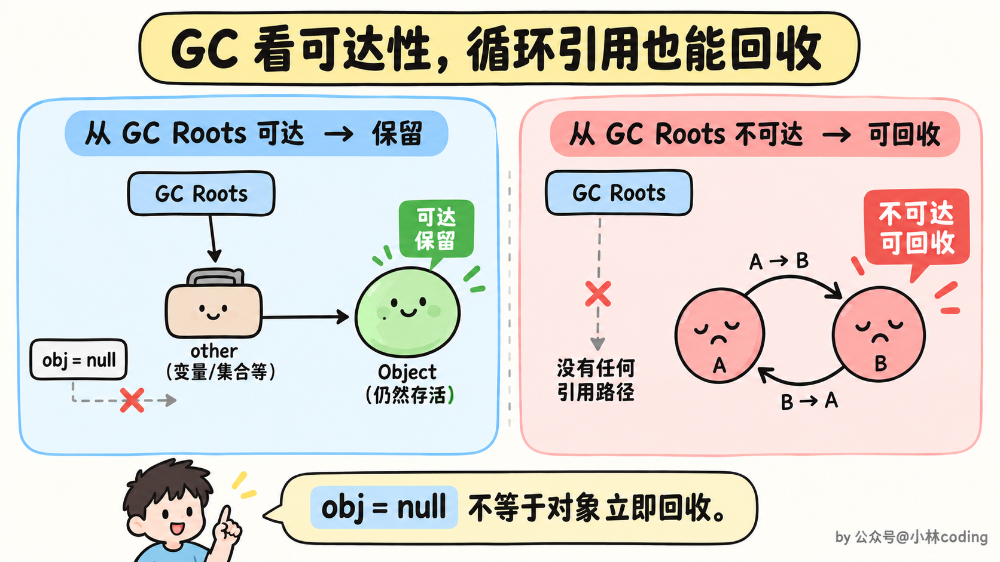

> 对象不可达后，什么时候实际回收？

不一定马上回收，要看什么时候触发GC，以及这次GC是否处理对象所在的区域。内存分配压力、堆使用情况、垃圾回收器的策略等，都会影响回收时机。

调用`System.gc()`也只是请求JVM尝试进行垃圾回收，不保证某个对象会立刻被回收，因此不能依赖它控制资源释放。

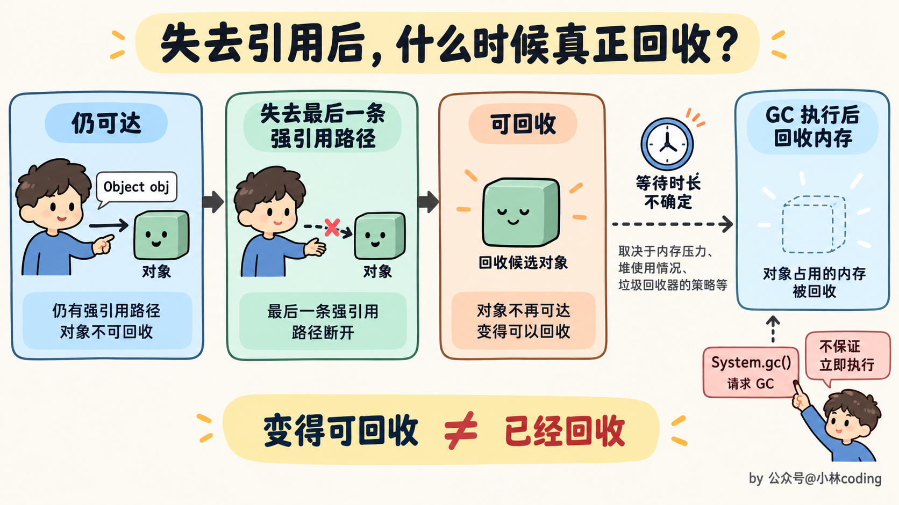

还有一点，垃圾回收主要负责对象占用的内存，文件、数据库连接、Socket这些资源，应该通过close或者try-with-resources及时释放。不要依赖finalize，它的执行时机没有保证，也不能保证一定执行；这个机制已经过时，Java 18起被标记为待移除。

### 1.7.4 如何获取私有对象？

在 Java 中，私有对象通常指的是类中被声明为 `private` 的成员变量或方法。由于 `private` 访问修饰符的限制，这些成员只能在其所在的类内部被访问。

不过，可以通过下面两种方式来间接获取私有对象。

- 使用公共访问器方法（getter 方法）：如果类的设计者遵循良好的编程规范，通常会为私有成员变量提供公共的访问器方法（即 `getter` 方法），通过调用这些方法可以安全地获取私有对象。

```java
class MyClass {
    // 私有成员变量
    private String privateField = "私有字段的值";

    // 公共的 getter 方法
    public String getPrivateField() {
        return privateField;
    }
}

public class Main {
    public static void main(String[] args) {
        MyClass obj = new MyClass();
        // 通过调用 getter 方法获取私有对象
        String value = obj.getPrivateField();
        System.out.println(value); 
    }
}
```

- 反射机制。反射机制允许在运行时检查和修改类、方法、字段等信息，通过反射可以绕过 `private` 访问修饰符的限制来获取私有对象。

```java
import java.lang.reflect.Field;

class MyClass {
    private String privateField = "私有字段的值";
}

public class Main {
    public static void main(String[] args) throws NoSuchFieldException, IllegalAccessException {
        MyClass obj = new MyClass();
        // 获取 Class 对象
        Class<?> clazz = obj.getClass();
        // 获取私有字段
        Field privateField = clazz.getDeclaredField("privateField");
        // 设置可访问性
        privateField.setAccessible(true);
        // 获取私有字段的值
        String value = (String) privateField.get(obj);
        System.out.println(value); 
    }
}
```

## 1.8 反射

### 1.8.1 什么是反射？

反射就是**在程序运行时获取类的结构信息，并动态创建对象、调用方法或者访问字段的机制**。比如编译时没有写死要调用哪个类，而是在运行时读取配置，再根据类名找到这个类，就可以用到反射。

Java反射主要围绕Class对象展开，通过它可以获取构造方法、方法、字段等信息：

- **Constructor**：用于调用构造方法，创建对象。
- **Method**：用于获取方法信息，并通过invoke调用方法。
- **Field**：用于读取或者修改字段值。

比如，正常调用一个方法时，我们直接写`user.sayHello()`；使用反射，则是先找到对应的Method，再调用它：

```java
public class User {
    public String sayHello(String name) {
        return "你好，" + name;
    }

    public static void main(String[] args) throws Exception {
        Class<?> clazz = Class.forName("User"); // 有包名时需要使用完整类名
        Object user = clazz.getDeclaredConstructor().newInstance();

        java.lang.reflect.Method method =
            clazz.getMethod("sayHello", String.class);
        Object result = method.invoke(user, "小林");
        System.out.println(result); // 你好，小林
    }
}
```

框架里很常见这种做法。比如Spring可以根据配置和注解创建对象、进行依赖注入；ORM框架可以读取字段信息，把数据库记录映射成对象。

> 反射能随意访问私有成员吗？

不能说完全没有限制。`getMethod`主要获取public方法，包括继承的方法；`getDeclaredMethod`可以获取当前类声明的方法，包括private方法，但不包含继承来的方法。**能获取方法信息，不代表就有权限调用它。**

访问私有成员时，通常需要通过`setAccessible(true)`尝试关闭语言层面的访问检查，但仍然受到权限和模块封装的限制。Java 9引入模块系统后，如果目标包没有向调用方开放，可能无法启用访问。final字段的修改也有额外限制，不能认为反射能任意修改所有字段。

> 反射有什么代价？

反射把部分检查推迟到了运行时，类名、方法名写错，或者参数不匹配，都可能到运行时才报错。它也增加了访问检查、动态调用等成本，具体性能取决于JDK版本和使用方式，不能简单说一定慢多少倍。

所以，反射适合框架、通用工具这些需要动态处理类型的场景，普通业务代码如果能直接调用，一般优先直接调用。频繁使用时，可以缓存Class、Method等信息，减少重复查找。

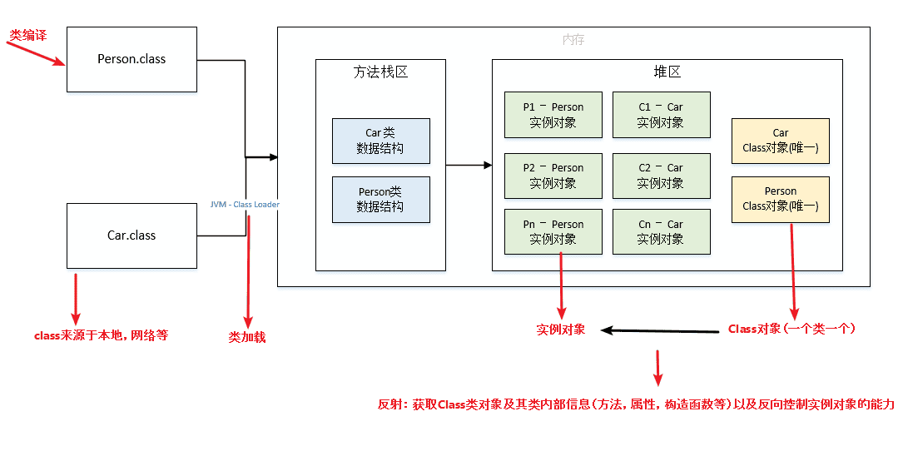

### 1.8.2 反射在你平时写代码或者框架中的应用场景有哪些反射在你平时写代码或者框架中的应用场景有哪些?

> 加载数据库驱动

我们的项目底层数据库有时是用mysql，有时用oracle，需要动态地根据实际情况加载驱动类，这个时候反射就有用了，假设 com.mikechen.java.myqlConnection，com.mikechen.java.oracleConnection这两个类我们要用。

这时候我们在使用 JDBC 连接数据库时使用 Class.forName()通过反射加载数据库的驱动程序，如果是mysql则传入mysql的驱动类，而如果是oracle则传入的参数就变成另一个了。

```java
//  DriverManager.registerDriver(new com.mysql.cj.jdbc.Driver());
Class.forName("com.mysql.cj.jdbc.Driver");
```

> 配置文件加载

Spring 框架的 IOC（动态加载管理 Bean），Spring通过配置文件配置各种各样的bean，你需要用到哪些bean就配哪些，spring容器就会根据你的需求去动态加载，你的程序就能健壮地运行。

Spring通过XML配置模式装载Bean的过程：

- 将程序中所有XML或properties配置文件加载入内存
- Java类里面解析xml或者properties里面的内容，得到对应实体类的字节码字符串以及相关的属性信息
- 使用反射机制，根据这个字符串获得某个类的Class实例
- 动态配置实例的属性

配置文件

```java
className=com.example.reflectdemo.TestInvoke
methodName=printlnState
```

实体类

```java
public class TestInvoke {
    private void printlnState(){
        System.out.println("I am fine");
    }
}
```

解析配置文件内容

```java
// 解析xml或properties里面的内容，得到对应实体类的字节码字符串以及属性信息
public static String getName(String key) throws IOException {
    Properties properties = new Properties();
    FileInputStream in = new FileInputStream("D:/IdeaProjects/AllDemos/language-specification/src/main/resources/application.properties");
    properties.load(in);
    in.close();
    return properties.getProperty(key);
}
```

利用反射获取实体类的Class实例，创建实体类的实例对象，调用方法

```java
public static void main(String[] args) throws NoSuchMethodException, InvocationTargetException, IllegalAccessException, IOException, ClassNotFoundException, InstantiationException {
    // 使用反射机制，根据这个字符串获得Class对象
    Class<?> c = Class.forName(getName("className"));
    System.out.println(c.getSimpleName());
    // 获取方法
    Method method = c.getDeclaredMethod(getName("methodName"));
    // 绕过安全检查
    method.setAccessible(true);
    // 创建实例对象（Class.newInstance() 已过时，使用 Constructor.newInstance()）
    TestInvoke testInvoke = (TestInvoke) c.getDeclaredConstructor().newInstance();
    // 调用方法
    method.invoke(testInvoke);

}
```

运行结果：


## 1.9 注解

### 1.9.1 能讲一讲Java注解的原理吗？

注解本质是一个继承了Annotation的特殊接口，其具体实现类是Java运行时生成的动态代理类。

我们通过反射获取注解时，返回的是Java运行时生成的动态代理对象。通过代理对象调用自定义注解的方法，会最终调用AnnotationInvocationHandler的invoke方法。该方法会从memberValues这个Map中索引出对应的值。而memberValues的来源是Java常量池。

### 1.9.2 对注解解析的底层实现了解吗？

注解本质上是一种特殊的接口，它继承自 `java.lang.annotation.Annotation` 接口，**所以注解也叫声明式接口**，例如，定义一个简单的注解：

```java
public @interface MyAnnotation {
    String value();
}
```

编译后，Java 编译器会将其转换为一个继承自 `Annotation` 的接口，并生成相应的字节码文件。

根据注解的作用范围，Java 注解可以分为以下几种类型：

- **源码级别注解** ：仅存在于源码中，编译后不会保留（`@Retention(RetentionPolicy.SOURCE)`）。
- **类文件级别注解** ：保留在 `.class` 文件中，但运行时不可见（`@Retention(RetentionPolicy.CLASS)`）。
- **运行时注解** ：保留在 `.class` 文件中，并且可以通过反射在运行时访问（`@Retention(RetentionPolicy.RUNTIME)`）。

只有运行时注解可以通过反射机制进行解析。

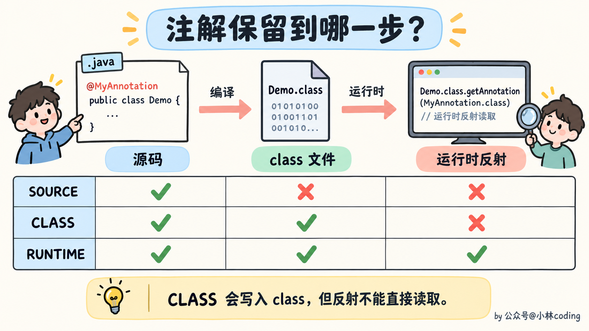

当注解被标记为 `RUNTIME` 时，Java 编译器会在生成的 `.class` 文件中保存注解信息。这些信息存储在字节码的属性表（Attribute Table）中，具体包括以下内容：

- **RuntimeVisibleAnnotations** ：存储运行时可见的注解信息。
- **RuntimeInvisibleAnnotations** ：存储运行时不可见的注解信息。
- **RuntimeVisibleParameterAnnotations** 和 **RuntimeInvisibleParameterAnnotations** ：存储方法参数上的注解信息。

通过工具（如 `javap -v`）可以查看 `.class` 文件中的注解信息。

注解的解析主要依赖于 Java 的反射机制。以下是解析注解的基本流程：

1、获取注册信息：通过反射 API 可以获取类、方法、字段等元素上的注解。例如：

```java
Class<?> clazz = MyClass.class;
MyAnnotation annotation = clazz.getAnnotation(MyAnnotation.class);
if (annotation != null) {
    System.out.println(annotation.value());
}
```

2、底层原理：反射机制的核心类是 `java.lang.reflect.AnnotatedElement`，它是所有可以被注解修饰的元素（如 `Class`、`Method`、`Field` 等）的父接口。该接口提供了以下方法：

- `getAnnotation(Class<T> annotationClass)`：获取指定类型的注解。
- `getAnnotations()`：获取所有注解。
- `isAnnotationPresent(Class<? extends Annotation> annotationClass)`：判断是否包含指定注解。

这些方法本身由纯 Java 实现，并不是 native 方法。以 `Class.getAnnotation(...)` 为例，其内部会先触发注解数据的延迟解析：通过 `AnnotationParser.parseAnnotations(...)` 读取 JVM 在类加载阶段从 class 文件属性表（`RuntimeVisibleAnnotations` 等）中抽取并传回的原始字节，反序列化成 `Map<Class<? extends Annotation>, Annotation>`，最终以动态代理对象（`AnnotationInvocationHandler`）的形式返回给调用方。

JVM 在类加载阶段确实会解析 `.class` 文件中的注解信息，但这部分工作对应的 native 接口位于底层的常量池与属性表读取，而不是 `getAnnotation` 这一层 API。

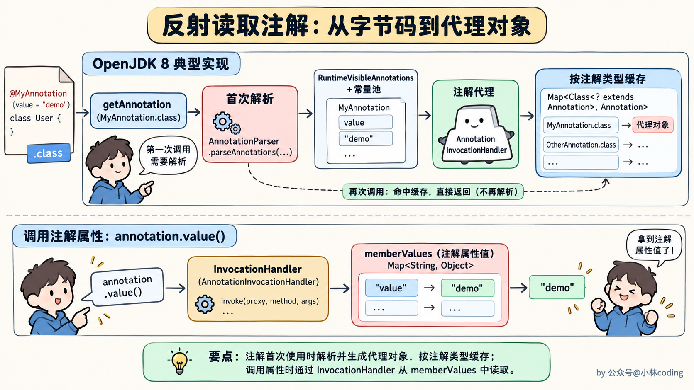

因此，注解解析的底层实现主要依赖于 Java 的反射机制和字节码文件的存储。通过 `@Retention` 元注解可以控制注解的保留策略，当使用 `RetentionPolicy.RUNTIME` 时，可以在运行时通过反射 API 来解析注解信息。在 JVM 层面，会从字节码文件中读取注解信息，并创建注解的代理对象来获取注解的属性值。

### 1.9.3 Java注解的作用域呢？

注解的作用域（Scope）指的是注解可以应用在哪些程序元素上，由元注解 `@Target` 配合 `ElementType` 枚举来指定。在 Java 21 中，`ElementType` 共有 12 种取值：

1. `TYPE`：类、接口、枚举、注解类型
2. `FIELD`：字段（包括枚举常量）
3. `METHOD`：方法
4. `PARAMETER`：方法或构造器的参数
5. `CONSTRUCTOR`：构造方法
6. `LOCAL_VARIABLE`：局部变量
7. `ANNOTATION_TYPE`：注解类型本身（即元注解）
8. `PACKAGE`：包（写在 `package-info.java` 中）
9. `TYPE_PARAMETER`：类型参数声明（Java 8 新增，用于泛型形参上）
10. `TYPE_USE`：任何使用类型的地方（Java 8 新增，常用于配合 Checker Framework 做类型检查）
11. `MODULE`：模块（Java 9 模块系统引入）
12. `RECORD_COMPONENT`：记录类组件（Java 16 引入 record 时新增）

其中最常用的是 `TYPE`、`FIELD`、`METHOD`、`PARAMETER` 这几种。如果定义注解时不显式指定 `@Target`，那么该注解默认可以用于上述除 `TYPE_PARAMETER` 和 `TYPE_USE` 之外的所有位置。

## 1.10 异常

### 1.10.1 介绍一下Java异常

Java异常类层次结构图：

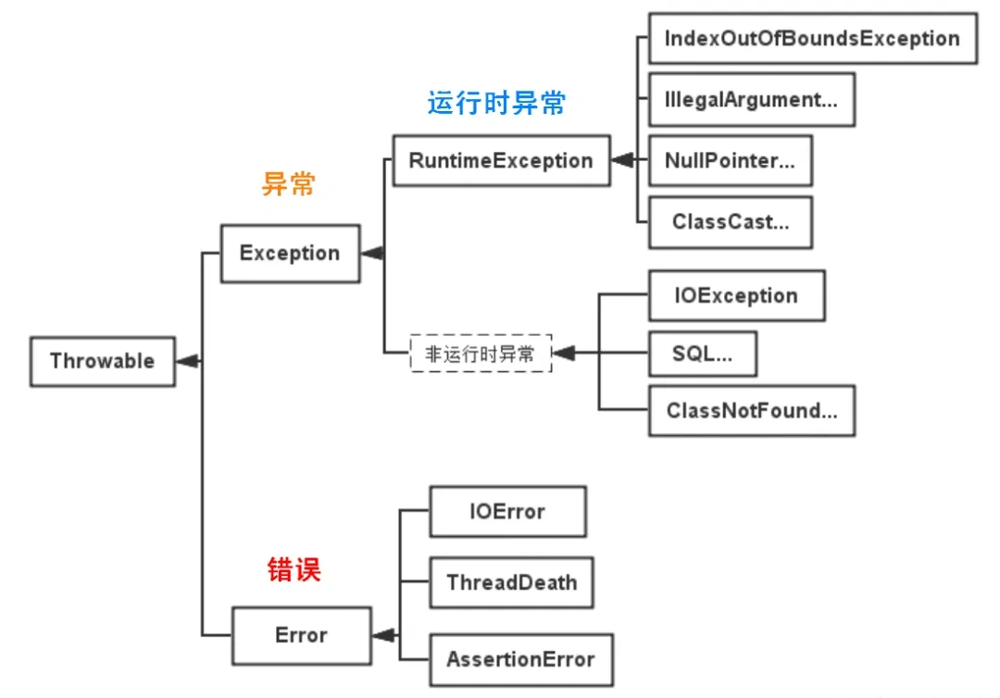

Java 的异常体系主要基于 `Throwable` 及其子类。`Throwable` 有两个重要的子类：`Error` 和 `Exception`，它们分别代表了不同类型的异常情况。

1. **`Error` (错误)**： 表示运行环境的错误，错误是程序无法处理的严重问题，如虚拟机错误、动态链接库失效等。程序不应该尝试捕获这类错误。例如，`OutOfMemoryError`、`StackOverflowError` 等。
2. **`Exception` (异常)**： 表示程序本身可以处理的异常情况。异常分为两大类：
   - **非运行时异常（受检异常，Checked Exception）**： 这类异常在编译时就必须被捕获或者声明抛出。它们通常是外部错误，如文件不存在 (`FileNotFoundException`)、类未找到 (`ClassNotFoundException`) 等。非运行时异常强制程序员处理这些可能出现的问题，增强了程序的健壮性。
   - **运行时异常（非受检异常，Unchecked Exception 或 RuntimeException）**： 这类异常特指 `RuntimeException` 及其子类。它与 `Error` 一起构成了 Java 中的**非受检异常**家族。运行时异常由程序逻辑错误导致，如空指针访问 (`NullPointerException`)、数组越界 (`ArrayIndexOutOfBoundsException`) 等。运行时异常是不需要在编译时强制捕获或声明的。

### 1.10.2 Java异常处理有哪些？

Java异常处理主要涉及**try-catch、throw、throws、finally，以及try-with-resources**。它们分别负责捕获异常、主动抛出异常、声明异常和释放资源。

> try-catch：捕获并处理异常

try中放可能抛出异常的代码，catch匹配对应的异常类型。发生异常后，try中异常位置后面的代码不会继续执行，而是跳到匹配的catch。

```java
try {
    int num = Integer.parseInt("abc");
    System.out.println(num); // 前面抛出异常，这里不会执行
} catch (NumberFormatException e) {
    System.out.println("输入的内容不是有效整数");
}
```

如果有多个catch，应该把具体的异常类型放在前面，范围大的放在后面，避免父类异常把子类异常提前接住。没有匹配的catch，异常就继续向调用方传播。

> throw和throws：抛出与声明

throw用在方法体里，主动抛出一个异常对象；throws用在方法声明上，说明这个方法可能把哪些异常交给调用方。

```java
public static void checkAge(int age) {
    if (age < 0) {
        throw new IllegalArgumentException("年龄不能为负数");
    }
}

public static String readFirstLine(String path) throws IOException {
    try (BufferedReader reader = new BufferedReader(new FileReader(path))) {
        return reader.readLine();
    }
}
```

像IOException这样的受检异常，要么在方法内部捕获，要么通过throws声明。RuntimeException和Error属于非受检异常，编译器不强制要求捕获或者声明。

> finally：执行清理逻辑

正常进入try之后，不管是正常结束、抛出异常，还是执行return，通常都会执行finally。但不能说它在所有情况下都一定执行，比如JVM直接退出、进程被强制终止，或者代码一直没有离开try，finally就可能无法执行。

还要注意，**不要在finally里写return**，因为它可能覆盖try、catch中的返回值，甚至把原本应该传播的异常吞掉。

> try-with-resources：自动关闭资源

对于文件流、数据库连接等实现了AutoCloseable接口的资源，可以使用try-with-resources。离开try时会自动调用close，比自己在finally里写关闭逻辑更方便。

```java
try (BufferedReader reader = new BufferedReader(new FileReader("data.txt"))) {
    System.out.println(reader.readLine());
} catch (IOException e) {
    throw new IllegalStateException("读取文件失败", e);
}
```

如果声明了多个资源，会按声明的相反顺序关闭。如果try中的业务代码和close都抛出异常，业务异常会保留为主异常，关闭异常作为suppressed异常附加上去，可以通过getSuppressed查看。

实际开发中，异常处理还要避免空catch。能够处理就给出明确的恢复逻辑，不能处理就向上抛出，包装异常时保留原始cause，方便定位问题。

### 1.10.3 抛出异常为什么不用throws？

如果异常是未检查异常或者在方法内部被捕获和处理了，那么就不需要使用throws。

- **Unchecked Exceptions**：未检查异常（unchecked exceptions）是继承自RuntimeException类或Error类的异常，编译器不强制要求进行异常处理。因此，对于这些异常，不需要在方法签名中使用throws来声明。示例包括NullPointerException、ArrayIndexOutOfBoundsException等。
- **捕获和处理异常**：另一种常见情况是，在方法内部捕获了可能抛出的异常，并在方法内部处理它们，而不是通过throws子句将它们传递到调用者。这种情况下，方法可以处理异常而无需在方法签名中使用throws。

### 1.10.4 try catch中的语句运行情况

try块中的代码将按顺序执行，如果抛出异常，将在catch块中进行匹配和处理，然后程序将继续执行catch块之后的代码。如果没有匹配的catch块，异常将被传递给上一层调用的方法。

### 1.10.5 try{return “a”} finally{return “b”}这条语句返回啥

finally块中的return语句会覆盖try块中的return返回，因此，该语句将返回"b"。

## 1.11 object

### 1.11.1 **Object类有哪些方法？**

Java Object 类是所有类的超类，默认提供 11 个核心方法，核心用于对象比较、哈希、字符串表示、线程同步等。

首先最常用的是 equals 方法，它的默认实现是比较两个对象的内存地址，也就是和 == 的效果一样，但实际开发中我们常需要按对象的内容比较，比如两个用户对象只要 id 相同就认为相等，这时候就需要重写 equals。比如：

```java
class User {
    private int id;
    private String name;

    @Override
    public boolean equals(Object obj) {
        if (this == obj) return true;
        if (obj == null || getClass() != obj.getClass()) return false;
        User user = (User) obj;
        return id == user.id;
    }
}
```

和 equals 配套的必须重写 hashCode 方法，因为 Java 的约定是如果两个对象 equals 返回 true，它们的 hashCode 必须相等；如果 hashCode 不相等，equals 一定返回 false。如果只重写 equals 不重写 hashCode，会导致对象在 HashMap HashSet 等集合中无法正确存储，比如两个 id 相同的 User 对象，equals 返回 true，但 hashCode 不同，会被当成两个不同元素存入集合。重写示例：

```java
@Override
public int hashCode() {
    return Integer.hashCode(id);
}
```

然后是 toString 方法，默认返回类名加 @加对象的哈希码十六进制表示，比如 User@1b6d3586，可读性很差。实际开发中重写它是为了返回对象的具体信息，方便日志打印和调试，比如：

```java
@Override
public String toString() {
    return "User{id=" + id + ", name=" + name + "}";
}
```

接下来是 getClass 方法，它返回对象运行时的实际类对象，和编译时类型可能不同，而且这个方法不能重写。比如父类 Animal 的子类 Dog，Animal animal = new Dog，animal.getClass 返回的是 Dog 的类对象，常用于反射场景，比如通过 getClass 获取类的属性和方法：

```java
Animal animal = new Dog();
Class<?> clazz = animal.getClass();
System.out.println(clazz.getName()); // 输出Dog
```

然后是 clone 方法，用于创建对象的浅拷贝，默认是浅拷贝意味着如果对象有引用类型属性，拷贝后的对象和原对象会共享该引用属性。使用 clone 需要让类实现 Cloneable 接口，否则会抛出 CloneNotSupportedException，比如：

```java
class Product implements Cloneable {
    private String name;
    private double price;

    @Override
    protected Object clone() throws CloneNotSupportedException {
        return super.clone();
    }
}
```

还有 notify 和 notifyAll 方法，它们都是用于多线程同步的，和 synchronized 配合使用，作用是唤醒等待当前对象锁的线程。notify 是随机唤醒一个等待线程，notifyAll 是唤醒所有等待线程，比如生产者消费者模式中，生产者生产完数据后调用 notifyAll，唤醒等待的消费者线程。

wait 方法有三个重载，作用是让当前持有对象锁的线程释放锁并进入等待状态，直到被 notify notifyAll 唤醒或者等待时间到期。同样需要在 synchronized 同步块或方法中使用，否则会抛 IllegalMonitorStateException，比如：

```java
synchronized (lockObj) {
    while (条件不满足) {
        lockObj.wait(1000); // 等待1秒，超时自动唤醒
    }
    // 执行业务逻辑
}
```

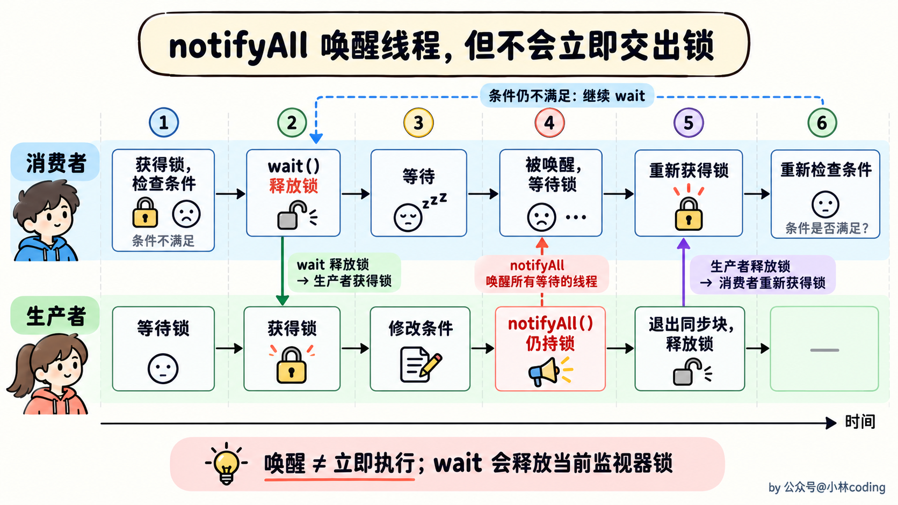

最后是 finalize 方法，它是对象被垃圾回收器回收前会调用的方法，默认是空实现。但现在基本不推荐使用，因为它的执行时机不确定，可能很久才执行甚至不执行，而且可能导致对象复活，影响垃圾回收效率，Java9 之后已经标记为过时，替代方案是使用 try with resources 或者 PhantomReference 来处理资源释放。

### 1.11.2 == 与 equals 有什么区别？

简单来说，**`==` 比较的是"地址"，而 `equals` 比较的是"内容"**。但这句话如果不展开讲，其实很容易让人懵，我给你详细说一下。

**先说 `==` 这个运算符。**

`==` 在 Java 里其实是个非常**简单粗暴**的比较方式。如果你比较的是**基本数据类型**（比如 int、double），那它就直接比数值是不是相等，这个没啥问题。

但如果你比较的是**对象（引用类型）**，那 `==` 比较的就不是对象里面装的内容了，而是比较这两个变量**是不是指向内存中同一个对象**，也就是**地址是否相同**。

我举个例子你就明白了：

```text
String a = new String("hello");
String b = new String("hello");

System.out.println(a == b);  // 输出 false
```

虽然 a 和 b 里面装的内容都是 "hello"，但因为我用了两次 `new`，所以在堆内存里创建了两个完全独立的 String 对象。a 和 b 这两个变量分别指向了不同的对象，所以 `==` 一比较，发现地址不一样，就返回 false 了。

**再说 `equals` 方法。**

`equals` 是 Object 类里定义的一个方法，所有的 Java 对象都继承了它。它的**默认行为其实和 `==` 一模一样**，也是比地址。

但关键在于，很多常用的类（比如 String、Integer）都把这个方法给**重写**了。重写之后，`equals` 就不再比地址了，而是去比较**对象里面实际存储的内容**是否相等。

还是刚才那个例子：

```text
String a = new String("hello");
String b = new String("hello");

System.out.println(a.equals(b));  // 输出 true
```

虽然 a 和 b 是两个不同的对象，但 String 类重写了 `equals` 方法，会逐个字符去比较内容。发现都是 "hello"，所以返回 true。

**这里有个经典的面试陷阱，就是字符串常量池的问题。**

```text
String c = "hello";
String d = "hello";

System.out.println(c == d);  // 输出 true
```

这里为什么 `==` 比较也是 true 呢？因为当你直接用双引号创建字符串的时候，JVM 会把它扔到一个叫"字符串常量池"的地方。如果池子里已经有了 "hello"，那 d 就直接复用 c 指向的那个对象，所以它俩地址是一样的，`==` 自然就返回 true 了。

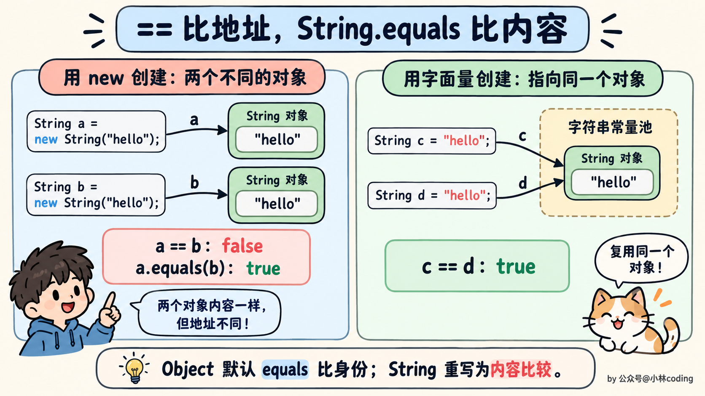

**总结一下：**

- `==` 是比较**引用地址**，适合用来判断两个变量是不是指向同一个对象；
- `equals` 是比较**对象内容**，但前提是这个类重写了 equals 方法（比如 String），如果没重写，那它俩效果是一样的。

所以在实际开发中，如果我们要比较两个字符串或者对象的内容是否相等，一定要用 `equals`，而不是 `==`。这也是为什么阿里巴巴开发规范里明确要求，判断字符串相等必须用 `equals` 的原因。

### 1.11.3 hashcode和equals方法有什么关系？

**equals用来判断两个对象是否相等，hashCode用来帮助哈希集合快速定位对象。**它们的关系主要有以下几点：

- 如果两个对象通过equals比较为true，那么它们的hashCode必须相同。
- 如果两个对象的hashCode相同，equals不一定为true，因为不同对象也可能发生哈希冲突。
- 如果参与equals比较的信息没有改变，那么同一个对象在一次程序运行期间，多次调用hashCode应该得到相同的结果。

为什么重写equals时，也要重写hashCode呢？这就要看HashMap、HashSet是怎么判断对象的了。

以HashMap为例，查找一个key时，它会先根据key的hashCode计算哈希值，再定位到对应的桶。找到桶之后，还要比较保存的哈希值，并通过`==`或者equals判断是不是要找的key。**它不会把整个Map里的key都拿出来逐个调用equals。**

所以，如果只重写equals，没有重写hashCode，两个业务上相等的对象就可能产生不同的哈希值，导致明明存过这个key，换一个相等的对象去查却查不到。

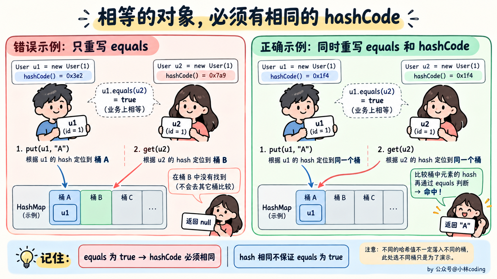

比如，我们认为两个User对象只要id相同，就是同一个用户，那么equals和hashCode都应该围绕id来实现：

```java
final class User {
    private final int id;

    User(int id) {
        this.id = id;
    }

    @Override
    public boolean equals(Object obj) {
        if (this == obj) {
            return true;
        }
        if (obj == null || getClass() != obj.getClass()) {
            return false;
        }
        User other = (User) obj;
        return id == other.id;
    }

    @Override
    public int hashCode() {
        return Integer.hashCode(id);
    }
}
```

这样，即使是两个不同的User对象，也能作为同一个key来使用：

```java
Map<User, String> map = new HashMap<>();
map.put(new User(1), "小林");

System.out.println(map.get(new User(1))); // 输出“小林”
```

还有一个需要注意的地方：**对象作为HashMap的key之后，不要修改参与equals和hashCode计算的字段。**否则，存入时计算的哈希值和查找时计算的哈希值可能不一致，也会出现查不到的问题。上面的例子把id声明为final，就是为了避免这种情况。

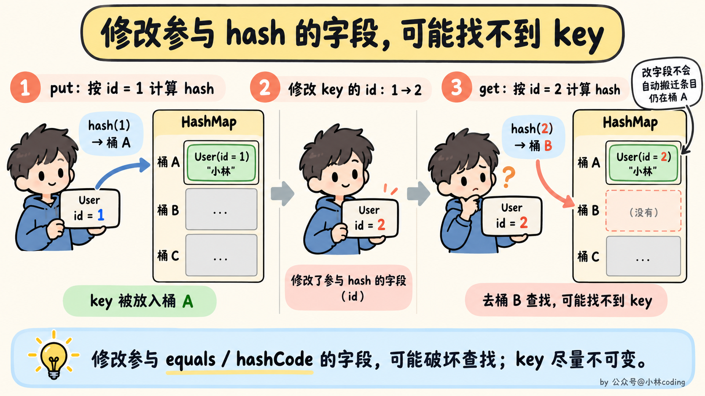

### 1.11.4 java 里 string的常用方法有哪些？

我常用的 String 常用方法有这些：

- **获取长度**：`int length()`：返回字符串的长度（字符个数）。例：`"abc".length()` → 3
- **判断内容**：`boolean equals(Object obj)`：比较两个字符串的内容是否完全相同（区分大小写）。例：`"abc".equals("ABC")` → false
- **截取子串：**`String substring(int beginIndex)`：从指定索引开始截取到末尾。例：`"hello".substring(2)` → "llo"
- **去除空格：**`String trim()`：去除字符串首尾的空白字符（空格、制表符等）。例：`" abc ".trim()` → "abc"
- **替换内容：**`String replace(char oldChar, char newChar)`：替换所有指定字符。例：`"aaa".replace('a', 'b')` → "bbb"
- **判断空字符串：**`boolean isEmpty()`：判断字符串长度是否为 0（注意：`null` 调用会报错，需先判空）。

### 1.11.5 String、StringBuffer、StringBuilder的区别和联系

三者都可以用来处理字符串，主要区别在于**内容是否可变、是否支持多线程共享，以及适合什么场景**。

**1、可变性**：String是不可变的，创建后不能通过正常的String API修改它的内容。拼接、替换这些操作会返回结果字符串，原来的字符串不会被改掉。StringBuilder和StringBuffer是可变的，可以通过append、insert、delete等方法修改自身内容。

```java
String str = "abc";
String old = str;
str = str + "def";

System.out.println(str); // abcdef
System.out.println(old); // abc，原对象的内容没有改变
```

**2、线程安全性**：String的内容不可变，可以被多个线程安全地共享。StringBuilder没有提供同步保护，适合由一个线程独立使用。StringBuffer在需要同步的方法上使用了synchronized，可以支持多个线程对同一个实例进行操作。

不过，**StringBuffer的方法线程安全，不代表多个方法组合起来的业务操作也一定线程安全**。比如先判断长度，再追加内容，这两步之间仍然可能被其他线程插入操作，需要额外同步。假设buffer是多个线程共享的StringBuffer实例，可以把两步放在同一个同步块里：

```java
synchronized (buffer) {
    if (buffer.length() < 10) {
        buffer.append("a");
    }
}
```

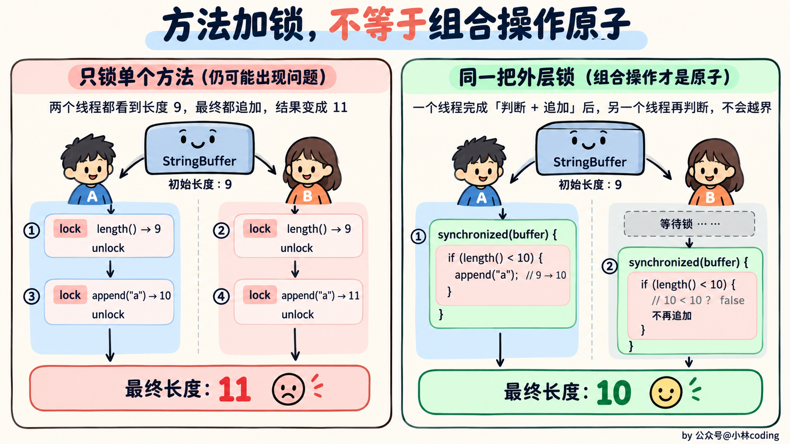

**3、性能**：不能简单地说String性能最低。对于固定内容、少量拼接，直接使用String通常就可以，编译器和JVM也会进行优化，比如`"a" + "b"`会在编译时合并为`"ab"`。

如果在循环里不断把内容拼接到同一个String变量上，会反复产生结果字符串、复制已有内容，这时候一般使用StringBuilder更合适：

```java
StringBuilder builder = new StringBuilder();
for (int i = 0; i < 100; i++) {
    builder.append(i).append(",");
}
String result = builder.toString();
```

StringBuffer因为有同步开销，在不需要共享同一个实例的情况下，一般优先选择StringBuilder。另外，StringBuilder和StringBuffer追加内容时也可能触发内部缓冲区扩容，并不是整个操作过程完全不分配新内存。

**4、使用场景**：可以参考下面的对比：

| 特性         | String                     | StringBuilder      | StringBuffer                         |
| ------------ | -------------------------- | ------------------ | ------------------------------------ |
| 内容是否可变 | 不可变                     | 可变               | 可变                                 |
| 线程安全性   | 内容可安全共享             | 不提供同步保护     | 方法提供同步保护，组合操作需另行判断 |
| 适用场景     | 字符串存储、传递和少量拼接 | 单个线程内频繁拼接 | 多线程共享同一个可变字符串实例       |

这里要注意，**应用是多线程的，不代表就必须使用StringBuffer**。比如Web请求中的局部StringBuilder，每个请求各用各的实例，没有共享，通常就不需要StringBuffer。

## 1.12 Java 新特性

### 1.12.1 Java 8 你知道有什么新特性？

下面是 Java 8 主要新特性的整理表格，包含关键改进和示例说明：

| **特性名称**                 | **描述**                                                     | **示例或说明**                                               |
| ---------------------------- | ------------------------------------------------------------ | ------------------------------------------------------------ |
| **Lambda 表达式**            | 简化匿名内部类，支持函数式编程                               | `(a, b) -> a + b` 代替匿名类实现接口                         |
| **函数式接口**               | 仅含一个抽象方法的接口，可用 `@FunctionalInterface` 注解标记 | `Runnable`, `Comparator`, 或自定义接口 `@FunctionalInterface interface MyFunc { void run(); }` |
| **Stream API**               | 提供链式操作处理集合数据，支持并行处理                       | `list.stream().filter(x -> x > 0).collect(Collectors.toList())` |
| **Optional 类**              | 封装可能为 `null` 的对象，减少空指针异常                     | `Optional.ofNullable(value).orElse("default")`               |
| **方法引用**                 | 简化 Lambda 表达式，直接引用现有方法                         | `System.out::println` 等价于 `x -> System.out.println(x)`    |
| **接口的默认方法与静态方法** | 接口可定义默认实现和静态方法，增强扩展性                     | `interface A { default void print() { System.out.println("默认方法"); } }` |
| **并行数组排序**             | 使用多线程加速数组排序                                       | `Arrays.parallelSort(array)`                                 |
| **重复注解**                 | 允许同一位置多次使用相同注解                                 | `@Repeatable` 注解配合容器注解使用                           |
| **类型注解**                 | 注解可应用于更多位置（如泛型、异常等）                       | `List<@NonNull String> list`                                 |
| **CompletableFuture**        | 增强异步编程能力，支持链式调用和组合操作                     | `CompletableFuture.supplyAsync(() -> "result").thenAccept(System.out::println)` |

### 1.12.2 Lambda 表达式了解吗？

Lambda 表达式它是一种简洁的语法，用于创建匿名函数，主要用于简化函数式接口（只有一个抽象方法的接口）的使用。其基本语法有以下两种形式：

- `(parameters) -> expression`：当 Lambda 体只有一个表达式时使用，表达式的结果会作为返回值。
- `(parameters) -> { statements; }`：当 Lambda 体包含多条语句时，需要使用大括号将语句括起来，若有返回值则需要使用 `return` 语句。

传统的匿名内部类实现方式代码较为冗长，而 Lambda 表达式可以用更简洁的语法实现相同的功能。比如，使用匿名内部类实现 `Runnable` 接口

```java
public class AnonymousClassExample {
    public static void main(String[] args) {
        Thread t1 = new Thread(new Runnable() {
            @Override
            public void run() {
                System.out.println("Running using anonymous class");
            }
        });
        t1.start();
    }
}
```

使用 Lambda 表达式实现相同功能：

```java
public class LambdaExample {
    public static void main(String[] args) {
        Thread t1 = new Thread(() -> System.out.println("Running using lambda expression"));
        t1.start();
    }
}
```

可以看到，Lambda 表达式的代码更加简洁明了。

还有，Lambda 表达式能够更清晰地表达代码的意图，尤其是在处理集合操作时，如过滤、映射等。比如，过滤出列表中所有偶数

```java
import java.util.Arrays;
import java.util.List;
import java.util.stream.Collectors;

public class ReadabilityExample {
    public static void main(String[] args) {
        List<Integer> numbers = Arrays.asList(1, 2, 3, 4, 5, 6);
        // 使用 Lambda 表达式结合 Stream API 过滤偶数
        List<Integer> evenNumbers = numbers.stream()
                                           .filter(n -> n % 2 == 0)
                                           .collect(Collectors.toList());
        System.out.println(evenNumbers);
    }
}
```

通过 Lambda 表达式，代码的逻辑更加直观，易于理解。

还有，Lambda 表达式使得 Java 支持函数式编程范式，允许将函数作为参数传递，从而可以编写更灵活、可复用的代码。比如定义一个通用的计算函数。

```java
interface Calculator {
    int calculate(int a, int b);
}

public class FunctionalProgrammingExample {
    public static int operate(int a, int b, Calculator calculator) {
        return calculator.calculate(a, b);
    }

    public static void main(String[] args) {
        // 使用 Lambda 表达式传递加法函数
        int sum = operate(3, 5, (x, y) -> x + y);
        System.out.println("Sum: " + sum);

        // 使用 Lambda 表达式传递乘法函数
        int product = operate(3, 5, (x, y) -> x * y);
        System.out.println("Product: " + product);
    }
}
```

虽然 Lambda 表达式优点蛮多的，不过也有一些缺点，比如会增加调试困难，因为 Lambda 表达式是匿名的，在调试时很难定位具体是哪个 Lambda 表达式出现了问题。尤其是当 Lambda 表达式嵌套使用或者比较复杂时，调试难度会进一步增加。

### 1.12.3 Java中stream的API介绍一下

Java 8引入了Stream API，它提供了一种高效且易于使用的数据处理方式，特别适合集合对象的操作，如过滤、映射、排序等。Stream API不仅可以提高代码的可读性和简洁性，还能利用多核处理器的优势进行并行处理。让我们通过两个具体的例子来感受下Java Stream API带来的便利，对比在Stream API引入之前的传统做法。

> 案例1：过滤并收集满足条件的元素

**问题场景**：从一个列表中筛选出所有长度大于3的字符串，并收集到一个新的列表中。

**没有Stream API的做法**：

```java
List<String> originalList = Arrays.asList("apple", "fig", "banana", "kiwi");
List<String> filteredList = new ArrayList<>();

for (String item : originalList) {
    if (item.length() > 3) {
        filteredList.add(item);
    }
}
```

这段代码需要显式地创建一个新的ArrayList，并通过循环遍历原列表，手动检查每个元素是否满足条件，然后添加到新列表中。

**使用Stream API的做法**：

```java
List<String> originalList = Arrays.asList("apple", "fig", "banana", "kiwi");
List<String> filteredList = originalList.stream()
                                        .filter(s -> s.length() > 3)
                                        .collect(Collectors.toList());
```

这里，我们直接在原始列表上调用`.stream()`方法创建了一个流，使用`.filter()`中间操作筛选出长度大于3的字符串，最后使用`.collect(Collectors.toList())`终端操作将结果收集到一个新的列表中。代码更加简洁明了，逻辑一目了然。

> 案例2：计算列表中所有数字的总和

**问题场景**：计算一个数字列表中所有元素的总和。

**没有Stream API的做法**：

```java
List<Integer> numbers = Arrays.asList(1, 2, 3, 4, 5);
int sum = 0;
for (Integer number : numbers) {
    sum += number;
}
```

这个传统的for-each循环遍历列表中的每一个元素，累加它们的值来计算总和。

**使用Stream API的做法**：

```java
List<Integer> numbers = Arrays.asList(1, 2, 3, 4, 5);
int sum = numbers.stream()
                 .mapToInt(Integer::intValue)
                 .sum();
```

通过Stream API，我们可以先使用`.mapToInt()`将Integer流转换为IntStream（这是为了高效处理基本类型），然后直接调用`.sum()`方法来计算总和，极大地简化了代码。

### 1.12.4 Stream流的并行API是什么？

是 ParallelStream。

并行流（ParallelStream）就是将源数据分为多个子流对象进行多线程操作，然后将处理的结果再汇总为一个流对象，底层是使用通用的 fork/join 池来实现，即将一个任务拆分成多个“小任务”并行计算，再把多个“小任务”的结果合并成总的计算结果

Stream串行流与并行流的主要区别：

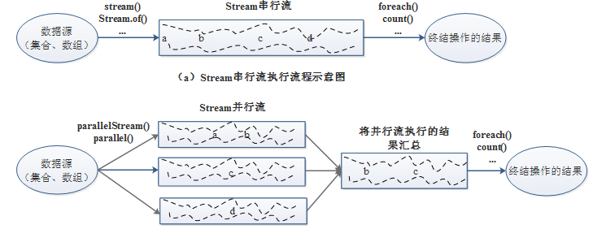

对CPU密集型的任务来说，并行流使用ForkJoinPool线程池，为每个CPU分配一个任务，这是非常有效率的，但是如果任务不是CPU密集的，而是I/O密集的，并且任务数相对线程数比较大，那么直接用ParallelStream并不是很好的选择。

### 1.12.5 completableFuture怎么用的？

CompletableFuture是Java 8引入的异步编程工具，实现了Future和CompletionStage接口。**它不仅能表示一个异步任务的结果，还能把多个异步任务按依赖关系组合起来。**

普通Future通常需要通过get等待结果，再继续处理；CompletableFuture可以直接注册后续操作，任务完成后再触发下一步，减少手动等待和嵌套回调。

> 创建异步任务

- `runAsync`：执行没有返回值的任务。
- `supplyAsync`：执行有返回值的任务。

两者都可以传入自定义Executor。实际项目里，可以根据任务类型配置线程池，避免所有任务都挤到默认的公共线程池中。

> 处理和组合结果

常用方法主要有这些：

| 方法        | 作用                                                         |
| ----------- | ------------------------------------------------------------ |
| thenApply   | 根据上一步结果进行转换，返回新结果                           |
| thenAccept  | 消费上一步结果，不返回业务结果                               |
| thenRun     | 执行后续操作，不使用上一步的结果                             |
| thenCompose | 上一步完成后启动一个依赖它的异步任务，把结果展平             |
| thenCombine | 两个任务都正常完成后，合并它们的结果                         |
| allOf       | 等待所有任务完成，返回`CompletableFuture<Void>`，不直接收集结果 |

比如，查询用户信息和查询订单数量互不依赖，可以同时执行，等两者完成后再拼成一个结果：

```java
ExecutorService executor = Executors.newFixedThreadPool(4);
try {
    CompletableFuture<String> userFuture = CompletableFuture.supplyAsync(() -> {
        // 模拟查询用户信息
        return "小林";
    }, executor);

    CompletableFuture<Integer> orderFuture = CompletableFuture.supplyAsync(() -> {
        // 模拟查询订单数量
        return 3;
    }, executor);

    CompletableFuture<String> resultFuture = userFuture
        .thenCombine(orderFuture, (user, count) -> user + "有" + count + "笔订单")
        .exceptionally(ex -> "查询失败，请稍后重试");

    System.out.println(resultFuture.join()); // 小林有3笔订单
} finally {
    executor.shutdown();
}
```

这里两个查询没有依赖关系，所以用thenCombine。如果需要先查询用户ID，再根据ID异步查询订单，就更适合用thenCompose。

thenApply和thenCompose的区别，主要看后续操作返回什么：返回普通值，使用thenApply；返回另一个CompletableFuture，通常使用thenCompose，避免结果变成`CompletableFuture<CompletableFuture<T>>`。

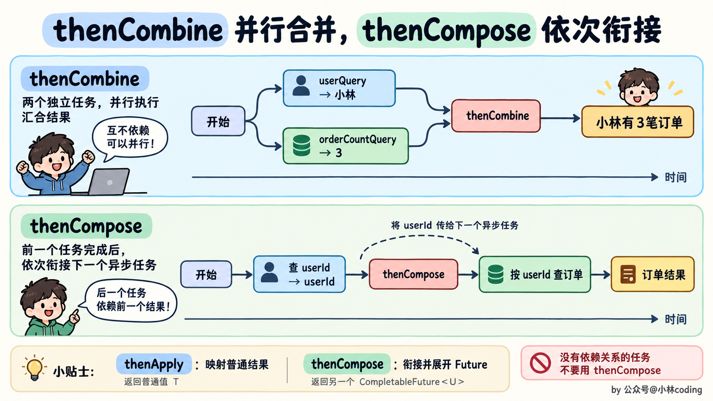

> 异常怎么处理？

- `exceptionally`：上游异常时提供一个替代结果。
- `handle`：不管成功还是异常，都会处理，并返回一个新结果。
- `whenComplete`：观察结果或异常，常用于日志和清理；通常保留原来的结果或异常，不用于返回替代值，回调自身抛出异常也可能影响后续阶段。

上面的exceptionally是简化的降级示例，实际项目里还要记录异常，并区分哪些异常可以降级，不能把所有错误都静默转换成默认值。

> 后续操作在哪个线程执行？

不带Async的方法，比如thenApply，可能由完成上游任务的线程执行；如果注册时上游已经完成，也可能由注册回调的线程执行。**注册回调不代表一定会切换线程。**

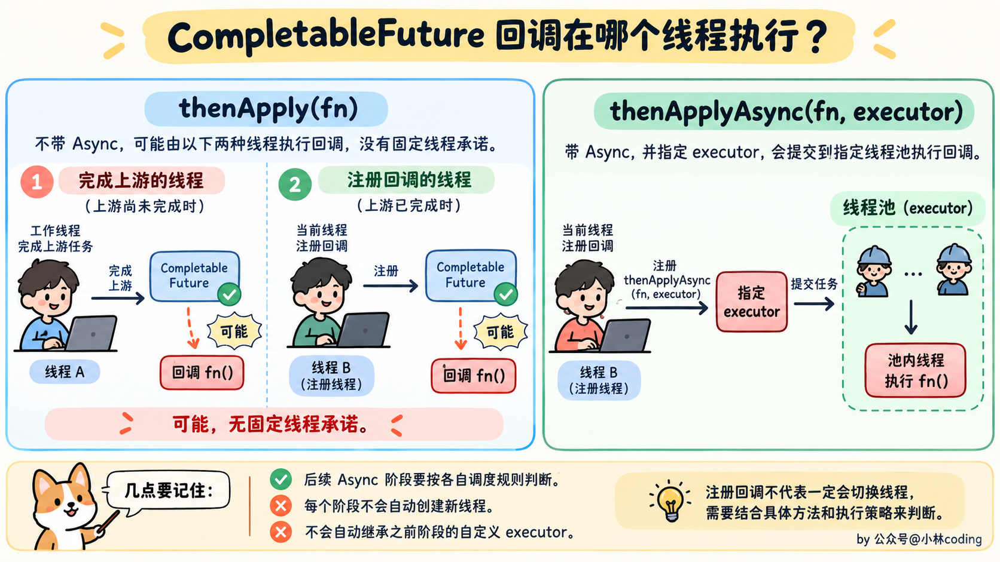

带Async的方法可以通过Executor指定执行线程池。对于直接创建的CompletableFuture，不指定Executor时，默认通常使用ForkJoinPool.commonPool；公共池并行度不足时还有其他执行策略。因此，耗时的阻塞IO任务一般使用单独配置的线程池，并明确传给相应的异步阶段。

最后，get和join都会在结果没有完成时等待。get需要处理InterruptedException、ExecutionException等受检异常，join主要通过CompletionException传播任务异常。异步编排时应尽量先组合任务，在确实需要结果的边界再等待，避免每启动一个任务就立刻get，变成串行执行。

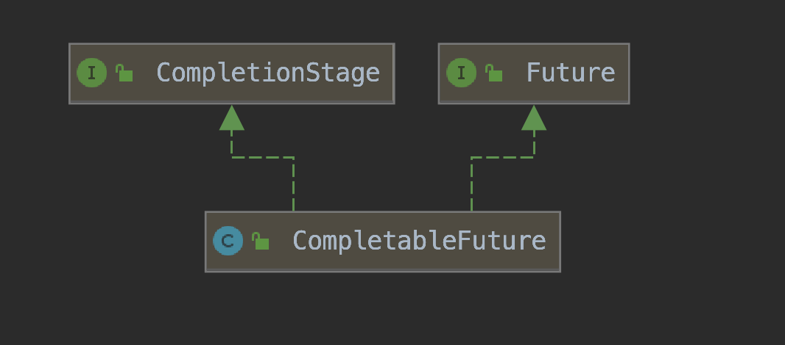

### 1.12.6 Java 21 新特性知道哪些？

**新语言特性：**

- **Switch 语句的模式匹配（JEP 441）**：它允许在`switch`的`case`标签中使用模式匹配，使操作更加灵活和类型安全，减少了样板代码和潜在错误。例如，对于不同类型的账户类，可以在`switch`语句中直接根据账户类型的模式来获取相应的余额，如`case SavingsAccount sa -> result = sa.getSavings();`
- **记录模式（Record Patterns，JEP 440）**：将模式匹配扩展到记录类（record），允许在 `instanceof` 或 `switch` 中直接对 record 进行解构。例如：`if (obj instanceof Point(int x, int y)) { ... }`，可以直接把 `Point` 记录的组件解构到 `x`、`y` 变量中。
- **字符串模板（预览版，JEP 430）**：提供了一种更可读、更易维护的方式来构建复杂字符串，支持在字符串字面量中直接嵌入表达式。需要通过模板处理器（如 `STR`）调用，嵌入表达式使用 `\{...}` 语法。例如，以前可能需要使用 `"hello " + name + ", welcome!"` 这样的方式拼接字符串，Java 21 中可以写成 `STR."hello \{name}, welcome!"`。注意：该特性在 JDK 23 中已被撤回以待重新设计。

**新并发特性方面：**

- **虚拟线程**：这是 Java 21 引入的一种轻量级并发的新选择。它的栈在堆上动态分配，运行时挂载到平台载体线程（carrier thread）上执行，挂起时栈被卸载到堆中，因此可以创建大量虚拟线程而不消耗大量内存，显著提升了 I/O 密集型应用的吞吐量和响应速度。可以使用静态构建方法、构建器或 `ExecutorService` 来创建和使用虚拟线程。
- **Scoped Values（范围值）**：提供了一种在线程间共享不可变数据的新方式，避免使用传统的线程局部存储，促进了更好的封装性和线程安全，可用于在不通过方法参数传递的情况下，传递上下文信息，如用户会话或配置设置。

## 1.13 序列化

### 1.13.1 怎么把一个对象从一个jvm转移到另一个jvm?

- **使用序列化和反序列化**：将对象序列化为字节流，并将其发送到另一个 JVM，然后在另一个 JVM 中反序列化字节流恢复对象。这可以通过 Java 的 ObjectOutputStream 和 ObjectInputStream 来实现。
- **使用消息传递机制**：利用消息传递机制，比如使用消息队列（如 RabbitMQ、Kafka）或者通过网络套接字进行通信，将对象从一个 JVM 发送到另一个。这需要自定义协议来序列化对象并在另一个 JVM 中反序列化。
- **使用远程方法调用（RPC）**：可以使用远程方法调用框架，如 gRPC，来实现对象在不同 JVM 之间的传输。远程方法调用可以让你在分布式系统中调用远程 JVM 上的对象的方法。
- **使用共享数据库或缓存**：将对象存储在共享数据库（如 MySQL、PostgreSQL）或共享缓存（如 Redis）中，让不同的 JVM 可以访问这些共享数据。这种方法适用于需要共享数据但不需要直接传输对象的场景。

### 1.13.2序列化和反序列化让你自己实现你会怎么做?

如果让我自己实现，我会先定义一套**对象和字节流之间的转换协议**，再分别实现编码器和解码器。核心不是简单地把字段拼起来，而是让接收方知道每一段数据是什么、怎么还原，以及版本变化后怎么兼容。

> 先确定支持哪些数据

第一版可以先支持基本类型、字符串、列表和简单对象，把支持范围说清楚。比如要传一个User对象，里面有id、name，就要约定这两个字段如何编码。

整数需要约定占用字节数和字节序；字符串需要约定字符编码，比如UTF-8，以及长度表示的是编码后的字节数。null和空字符串也要能区分。

> 定义字节流格式

我会把消息分成消息头和消息体。消息头保存魔数、协议版本、消息体长度和类型标识；消息体按字段组织，比如采用“字段编号、字段类型、数据长度、字段数据”的格式。

```text
消息头：魔数 | 协议版本 | 消息体长度 | 类型标识
消息体：字段编号 | 字段类型 | 数据长度 | 字段数据
```

比如User的id用字段编号1，name用字段编号2。字段编号固定后，即使以后调整代码里的字段顺序，解码时也可以根据编号找到对应的字段。

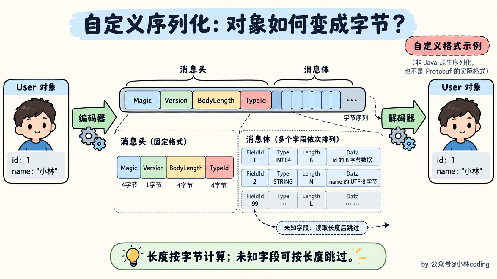

> 实现序列化和反序列化

序列化时，读取对象的字段，把数值按约定格式写入字节流；字符串先转成UTF-8字节，再写入长度和内容。可以用DataOutputStream写入基本类型数据，也可以用ByteBuffer组织字节。

反序列化时，先检查消息头，再逐个读取字段，根据类型和编号解析数据，最后创建对象并填充字段。简单对象可以手写编码器，通用场景可以借助反射或者代码生成，但两边必须遵循同一套协议。

如果数据通过TCP发送，还需要按消息长度识别边界，处理一次只收到部分消息，或者一次收到多条消息的情况，不能认为一次read就对应一个完整对象。

> 处理版本兼容

新增字段时使用新的编号，旧版本遇到不认识的字段，可以根据长度跳过；新版本读取旧数据时，对缺失字段使用约定的默认值。已经删除的字段编号不要复用，已有字段的类型也不能随意修改。

循环引用和重复引用也需要单独设计。比如A引用B、B又引用A，直接递归编码会停不下来。如果要支持这种对象图，就需要给对象分配编号，后续写入引用编号；如果第一版不支持，就要检测后明确报错。

> 做好输入检查

反序列化时需要限制消息大小、字符串长度、集合大小和嵌套深度，检查长度是否合法、数据是否完整，避免畸形数据导致越界或者大量内存分配。类型标识也应该映射到允许的类型，不能根据输入里的任意类名加载和创建对象。

所以，面试里我会从格式设计、编码解码、版本兼容、对象引用和输入校验这几个方面回答。实际项目中，如果没有特殊要求，一般优先选择成熟方案，比如跨语言的结构化数据可以考虑Protobuf，调试和可读性优先时可以考虑JSON，再根据需求评估体积和性能。

### 1.13.3 将对象转为二进制字节流具体怎么实现?

其实，像序列化和反序列化，无论这些可逆操作是什么机制，都会有对应的**处理和解析协议**，例如加密和解密，TCP的粘包和拆包，序列化机制是通过序列化协议来进行处理的，和 class 文件类似，它其实是定义了序列化后的字节流格式，然后对此格式进行操作，生成符合格式的字节流或者将字节流解析成对象。

在Java中通过序列化对象流来完成序列化和反序列化：

- ObjectOutputStream：通过writeObject(）方法做序列化操作。
- ObjectInputStrean：通过readObject()方法做反序列化操作。

只有实现了Serializable或Externalizable接口的类的对象才能被序列化，否则抛出异常！

实现对象序列化：

- 让类实现Serializable接口：

```java
import java.io.Serializable;

public class MyClass implements Serializable {
    // class code
}
```

- 创建输出流并写入对象：

```java
import java.io.FileOutputStream;
import java.io.ObjectOutputStream;

MyClass obj = new MyClass();
try {
    FileOutputStream fileOut = new FileOutputStream("object.ser");
    ObjectOutputStream out = new ObjectOutputStream(fileOut);
    out.writeObject(obj);
    out.close();
    fileOut.close();
} catch (IOException e) {
    e.printStackTrace();
}
```

实现对象反序列化：

- 创建输入流并读取对象：

```java
import java.io.FileInputStream;
import java.io.ObjectInputStream;

MyClass newObj = null;
try {
    FileInputStream fileIn = new FileInputStream("object.ser");
    ObjectInputStream in = new ObjectInputStream(fileIn);
    newObj = (MyClass) in.readObject();
    in.close();
    fileIn.close();
} catch (IOException | ClassNotFoundException e) {
    e.printStackTrace();
}
```

通过以上步骤，对象 obj 会被序列化并写入到文件 "object.ser" 中，然后通过反序列化操作，从文件中读取字节流并恢复为对象 newObj。这种方式可以方便地将对象转换为字节流用于持久化存储、网络传输等操作。需要注意的是，要确保类实现了 Serializable 接口，并且所有需要序列化的（即非 `static`、非 `transient`）成员变量都是 Serializable 的才能被正确序列化；被 `transient` 或 `static` 修饰的字段不会参与默认序列化。

## 1.14 设计模式

### 1.14.1 volatile和sychronized如何实现单例模式

```java
public class SingleTon {

    // volatile 关键字修饰变量 防止指令重排序
    private static volatile SingleTon instance = null;
    private SingleTon(){}
     
    public static  SingleTon getInstance(){
        if(instance == null){
            //同步代码块 只有在第一次获取对象的时候会执行到 ，第二次及以后访问时 instance变量均非null故不会往下执行了 直接返回啦
            synchronized(SingleTon.class){
                if(instance == null){
                    instance = new SingleTon();
                }
            }
        }
        return instance;
    }
}
```

正确的双重检查锁定模式需要使用 volatile。volatile主要包含两个功能。

- 保证可见性。使用 volatile 定义的变量，将会保证对所有线程的可见性。
- 禁止指令重排序优化。

由于 volatile 禁止对象创建时指令之间重排序，所以其他线程不会访问到一个未初始化的对象，从而保证安全性。

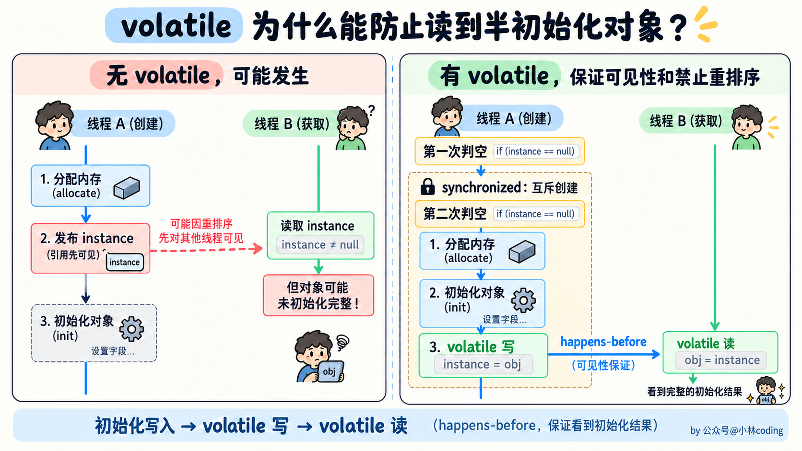

### 1.14.2 代理模式和适配器模式有什么区别？

- **目的不同**：代理模式主要关注控制对对象的访问，而适配器模式则用于接口转换，使不兼容的类能够一起工作。
- **结构不同**：代理模式一般包含抽象主题、真实主题和代理三个角色，适配器模式包含目标接口、适配器和被适配者三个角色。
- **应用场景不同**：代理模式常用于添加额外功能或控制对对象的访问，适配器模式常用于让不兼容的接口协同工作。

### 1.14.3 责任链模式使用场景是什么？

责任链模式的使用场景核心很明确，就是一个请求需要多个独立的处理逻辑来承接，同时不想让请求发起方和所有处理者产生强关联，还得让处理流程能灵活调整，简单说就是谁能处理就谁来接手，整个处理顺序和参与节点能按需改动。

比如实际开发里最常遇到的接口请求校验，用户调用我们的接口时，可能得先检查登录状态，再验证 token 是否有效，接着确认接口访问权限，最后还要限制请求频率，这些校验逻辑各自独立，而且不同接口需要的校验步骤不一样，比如登录接口只需要验证验证码，查询用户信息的接口得同时过登录和权限校验。要是不用责任链，就得在每个接口里写一堆 if-else 把这些校验串起来，后续想改某个校验规则，所有相关接口都得动，维护起来特别麻烦。

这时候用责任链就很合适，我们可以把每个校验逻辑封装成一个处理节点，先定义一个抽象的处理者类：

```java
// 抽象处理者
abstract class Handler {
    protected Handler next;
    // 设置下一个处理节点
    public void setNext(Handler next) {
        this.next = next;
    }
    // 抽象处理方法
    public abstract boolean handle(Request request);
}
```

然后每个校验逻辑都继承这个类，比如登录校验：

```java
// 登录态校验节点
class LoginHandler extends Handler {
    @Override
    public boolean handle(Request request) {
        if (request.isLogin()) {
            System.out.println("登录态校验通过，交给下一个节点");
            // 校验通过，交给下一个处理者
            return next != null ? next.handle(request) : true;
        } else {
            System.out.println("未登录，直接返回失败");
            // 校验不通过，终止链路
            return false;
        }
    }
}
```

再写个权限校验节点、频率限制节点，最后在使用的时候，根据接口需求动态组装链路：

```java
// 组装链路：登录校验 -> 权限校验 -> 频率限制
Handler loginHandler = new LoginHandler();
Handler authHandler = new AuthHandler();
Handler rateLimitHandler = new RateLimitHandler();
loginHandler.setNext(authHandler);
authHandler.setNext(rateLimitHandler);

// 发起请求
Request request = new Request(true, "admin", 1); // 已登录、管理员权限、第1次请求
boolean result = loginHandler.handle(request);
```

这样一来，请求发起方只需要调用第一个节点，根本不用关心后面有多少校验步骤，也不用知道具体是哪个节点在处理；如果某个接口不需要频率限制，直接去掉 rateLimitHandler 的组装就行，不用修改任何校验节点的代码，流程调整起来特别灵活。

### 1.14.4 介绍一下策略模式和责任链模式，分别用在哪些场景？

这两个设计模式都属于行为型模式，而且在实际开发中，它们往往都是为了解决同一个痛点：**如何消除代码中复杂的** `**if-else**` **或** `**switch-case**` **逻辑，从而让系统更易于扩展。**

> 策略模式

策略模式定义一系列算法，把它们一个个封装起来，并且使它们可相互替换。从而让算法可独立于使用它的客户而变化。

假设你正在开发一个电商网站的支付模块。用户可以选择支付宝、微信支付或者银行卡支付。每种支付方式的底层逻辑（比如调用的 API、加密方式、参数构造）都完全不同，但对于调用支付功能的上层业务逻辑来说，它只需要调用一个统一的 “支付” 方法即可，无需关心具体是哪种支付。

这就是策略模式的用武之地。我们把每种支付方式（支付宝、微信）都封装成一个独立的 “策略” 类，它们都遵循一个共同的接口。上层业务代码通过这个共同的接口来调用支付功能，并可以在运行时根据用户的选择，动态地切换不同的策略。

所以，策略模式**适用场景如下：**

- 当一个系统需要动态地在几种算法中选择一种时。
- 当一个对象有很多行为，不想使用大量的 `if-else` 或 `switch-case` 语句来选择时。
- 当你希望算法的变化不会影响到使用它的客户端时。

> 责任链模式

责任链模式核心思想是为请求创建一个接收者对象的链。对请求的发送者和接收者进行解耦，让多个对象都有机会处理这个请求。请求沿着链传递，直到链上的一个对象处理它为止。

想象一下公司里的请假审批流程。一个员工要请假，他首先会把请假条交给自己的直属经理。如果请假天数很短（比如 1 天），经理自己就能批准。如果天数较长（比如 5 天），经理没有权限，就需要把请假条上报给部门总监。总监也有自己的审批权限上限，如果超过了，就需要继续上报给总经理。

在这个过程中，请假条（请求）就在一条由经理 -> 总监 -> 总经理（接收者链）上传递，直到某个角色（接收者）能够处理它。发送请假条的员工（客户端）并不知道最终是谁批准了他的假，他只需要把请求提交给链的第一个节点（经理）即可。

所以，责任链模式适用场景总结：

- 当有多个对象可以处理同一个请求，但具体由哪个对象处理需要在运行时决定时。
- 当你希望请求的发送者和接收者解耦，不直接通信时。
- 当你需要动态地指定和修改处理一个请求的对象集合时。

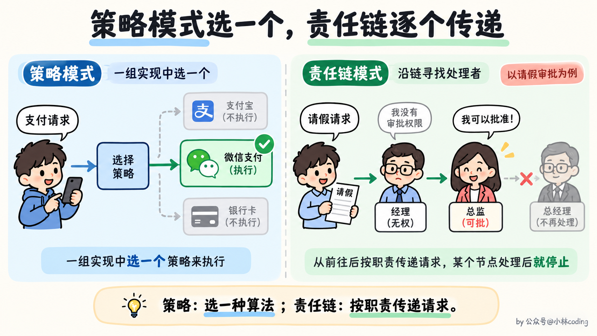

## 1.15 I/O

### 1.15.1 **Java怎么实现网络IO高并发编程？**

可以用 Java NIO ，是一种同步非阻塞的I/O模型，也是I/O多路复用的基础。

传统的BIO里面socket.read()，如果TCP RecvBuffer里没有数据，函数会一直阻塞，直到收到数据，返回读到的数据， 如果使用BIO要想要并发处理多个客户端的i/o，那么会使用多线程模式，一个线程专门处理一个客户端 io，这种模式随着客户端越来越多，所需要创建的线程也越来越多，会急剧消耗系统的性能。

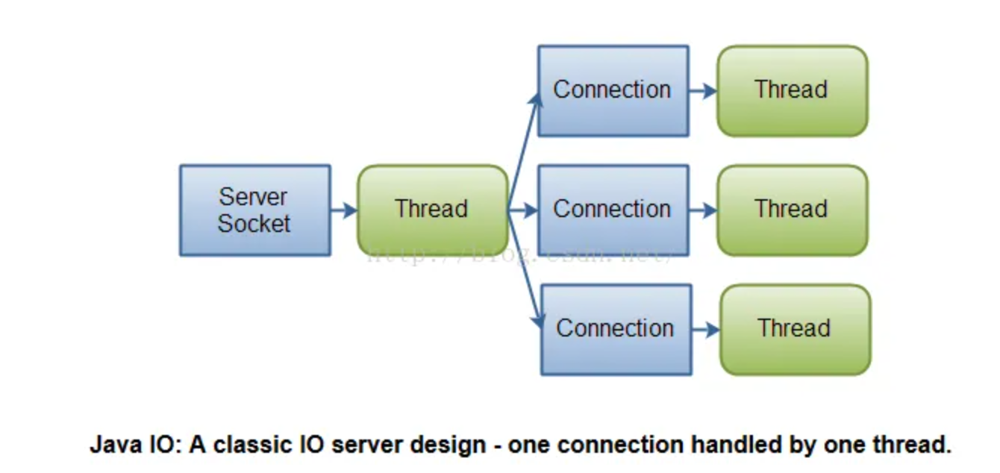

NIO 是基于I/O多路复用实现的，它可以只用一个线程处理多个客户端I/O，如果你需要同时管理成千上万的连接，但是每个连接只发送少量数据，例如一个聊天服务器，用NIO实现会更好一些。

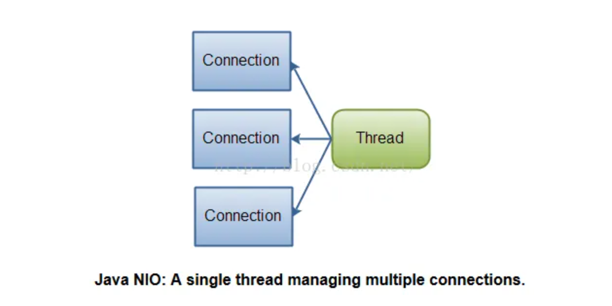

### 1.15.2 BIO、NIO、AIO区别是什么？

- BIO（blocking IO）：就是传统的 java.io 包，它是基于流模型实现的，交互的方式是同步、阻塞方式，也就是说在读入输入流或者输出流时，在读写动作完成之前，线程会一直阻塞在那里，它们之间的调用是可靠的线性顺序。优点是代码比较简单、直观；缺点是 IO 的效率和扩展性很低，容易成为应用性能瓶颈。
- NIO（non-blocking IO） ：Java 1.4 引入的 java.nio 包，提供了 Channel、Selector、Buffer 等新的抽象，可以构建多路复用的、同步非阻塞 IO 程序，同时提供了更接近操作系统底层高性能的数据操作方式。
- AIO（Asynchronous IO） ：也称 NIO.2，是 Java 1.7 引入的，对 NIO 的扩展，提供了异步非阻塞的 IO 操作方式，所以人们叫它 AIO（Asynchronous IO）。异步 IO 是基于事件和回调机制实现的，也就是应用操作之后会直接返回，不会阻塞在那里，当后台处理完成，操作系统会通知相应的线程进行后续的操作。

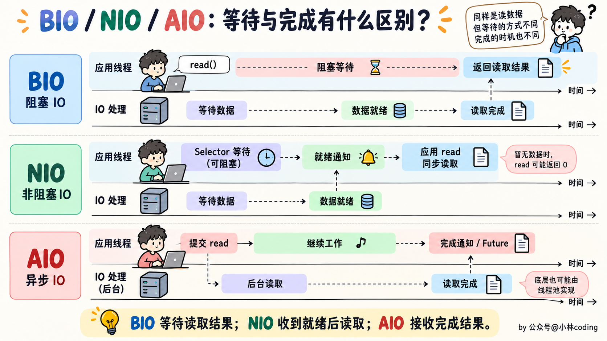

### 1.15.3 NIO是怎么实现的？

Java NIO主要通过**Channel、Buffer、Selector**这三个核心组件来实现。在网络编程中，把通道设置为非阻塞模式，再配合Selector，就可以让一个线程管理多个连接。

三个组件的作用分别是：

- **Channel（通道）**：负责数据的读写，比如SocketChannel用于网络连接。通道本身可以工作在阻塞模式，也可以工作在非阻塞模式，使用Selector时需要设置为非阻塞模式。
- **Buffer（缓冲区）**：负责存放数据。从Channel读取的数据会放进Buffer，发送数据时则把Buffer中的数据写入Channel。
- **Selector（多路复用器）**：负责监听多个通道的就绪事件，比如有新的连接到来、通道可读或者可写。

以一个网络服务器为例，基本的处理过程是：

1. 把ServerSocketChannel设置为非阻塞模式，注册到Selector，监听连接事件。
2. 有客户端连接后，创建对应的SocketChannel，同样设置为非阻塞模式，注册到Selector，监听读事件。
3. 线程调用Selector的select方法，等待通道就绪。
4. select返回后，遍历就绪事件，对相应的通道执行接收连接、读取数据或者写入数据的操作。

这样，一个连接暂时没有数据时，线程就不用一直等在这个连接上，可以去处理其他已经就绪的连接。

**这里的“非阻塞”，主要指通道的读写操作不会为了等待数据就绪而一直阻塞。**比如非阻塞的SocketChannel调用read时，没有数据可读，就可能返回0。但Selector的`select()`本身可以阻塞等待事件，`selectNow()`才是立即返回。

**而“同步”，是指通道就绪后，仍然需要应用线程自己调用read、write完成数据读写。**Selector通知的是“可以读写了”，不会替应用把数据读好。

还要注意，**通道就绪不代表一次就能读完或写完所有数据**。一次read可能只读到一部分数据，一次write也可能只写出一部分数据，所以程序需要保留未处理的数据，后续继续处理。Buffer只是存放数据的容器，不能保证一次IO操作就完成。

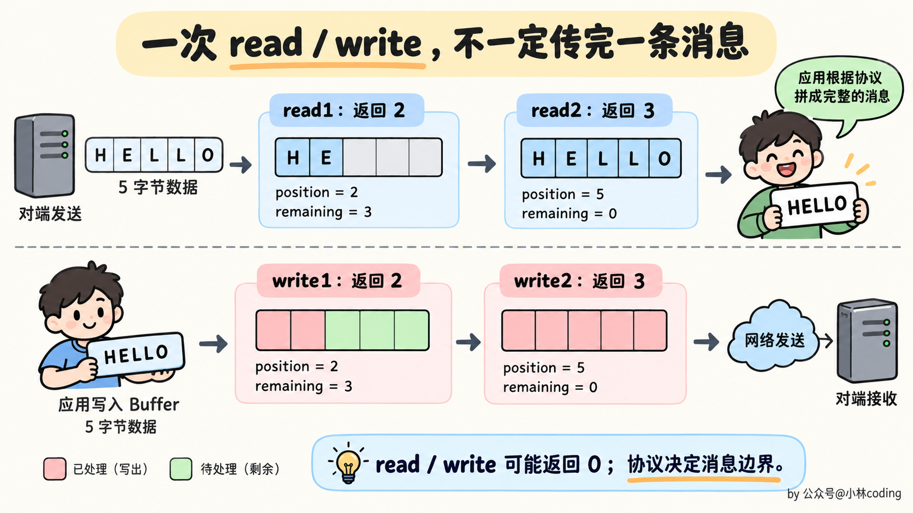

NIO提高并发能力的关键，就是让少量线程管理大量连接，减少一个连接对应一个线程带来的资源开销。如果业务处理比较耗时，一般还会把业务任务交给其他线程处理，避免占住负责IO事件的线程。

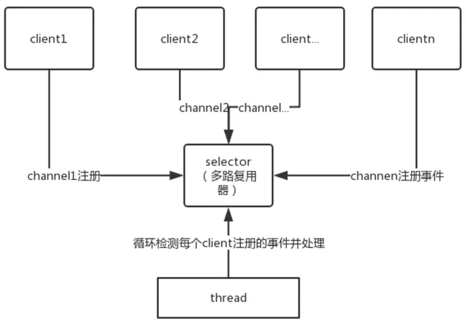

### 1.15.4 你知道有哪个框架用到NIO了吗？

**Netty就是一个典型的例子。**它在Java NIO之上封装了网络通信能力，我们不用自己写Selector循环、维护连接状态，就能实现网络服务。

使用NIO传输时，Netty主要通过NioEventLoopGroup、NioEventLoop和Channel来组织IO处理：

- **EventLoopGroup**：管理一组EventLoop，负责分配连接。
- **EventLoop**：在NIO实现中，通常由一个线程运行事件循环，通过Selector监听多个Channel的就绪事件，再处理读写和其他任务。
- **ChannelPipeline和ChannelHandler**：负责把网络事件交给相应的处理逻辑，比如解码、业务处理、编码等。

以TCP服务器为例，常见的配置是两组EventLoopGroup：bossGroup处理接收连接，workerGroup处理连接上的读写事件。一个worker中的EventLoop可以管理多个连接，所以不需要给每个连接都创建一个线程。

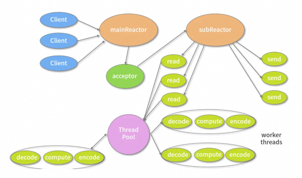

这里要区分一下，**Netty的NIO传输和原生epoll传输是两种实现**：

- 使用NioEventLoopGroup时，依赖Java NIO的Selector；Selector底层采用什么机制，由JDK和操作系统的实现决定。
- 在Linux上使用EpollEventLoopGroup时，走的是Netty的原生epoll传输，不再通过Java的Selector API，需要对应的原生依赖。

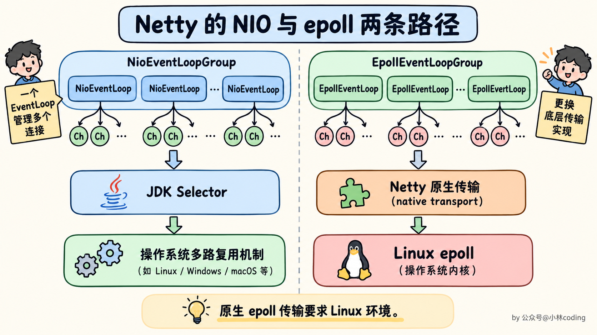

所以，不能简单理解成“Netty使用epoll后，整个服务就只有一个线程”。线程数量取决于EventLoopGroup的配置，一个EventLoop管理多个Channel，多个EventLoop可以一起工作。

从事件模型上说，这两类实现主要采用Reactor模式：监听IO就绪事件，再由应用线程执行读写。Netty API中的异步操作和Future，也不代表底层就一定采用Proactor模型。

实际开发中还要注意，**不要在EventLoop里直接执行耗时的数据库查询、阻塞RPC调用等任务**，否则会影响同一个EventLoop管理的其他连接。可以把这些任务交给业务线程池，再把结果交回后续处理流程。

## 1.16 其他

### 1.16.1 有一个学生类，想按照分数排序，再按学号排序，应该怎么做？

可以使用Comparable接口来实现按照分数排序，再按照学号排序。首先在学生类中实现Comparable接口，并重写compareTo方法，然后在compareTo方法中实现按照分数排序和按照学号排序的逻辑。

```java
public class Student implements Comparable<Student> {
    private int id;
    private int score;

    // 构造方法和其他属性、方法省略

    @Override
    public int compareTo(Student other) {
        if (this.score != other.score) {
            return Integer.compare(other.score, this.score); // 按照分数降序排序
        } else {
            return Integer.compare(this.id, other.id); // 如果分数相同，则按照学号升序排序
        }
    }
}
```

然后在需要对学生列表进行排序的地方，使用Collections.sort()方法对学生列表进行排序即可：

```plain
List<Student> students = new ArrayList<>();
// 添加学生对象到列表中
Collections.sort(students);
```

### 1.16.2 Native方法解释一下

在Java中，native方法是一种特殊类型的方法，它允许Java代码调用外部的本地代码，即用C、C++或其他语言编写的代码。native关键字是Java语言中的一种声明，用于标记一个方法的实现将在外部定义。

在Java类中，native方法看起来与其他方法相似，只是其方法体由native关键字代替，没有实际的实现代码。例如：

```java
public class NativeExample {
    public native void nativeMethod();
}
```

要实现native方法，你需要完成以下步骤：

1. **生成 JNI 头文件**：使用 `javac -h <dir>` 选项从你的 Java 类生成 C/C++ 的头文件，这个头文件包含了所有 native 方法的原型（注意：旧的独立工具 `javah` 自 Java 9 起被废弃，Java 10 已正式移除，应改用 `javac -h`）。
2. **编写本地代码**：使用C/C++编写本地方法的实现，并确保方法签名与生成的头文件中的原型匹配。
3. **编译本地代码**：将C/C++代码编译成动态链接库（DLL，在Windows上），共享库（SO，在Linux上）
4. **加载本地库**：在Java程序中，使用System.loadLibrary()方法来加载你编译好的本地库，这样JVM就能找到并调用native方法的实现了。

### 1.16.3 Java 进程是怎么跟操作系统交互的？

Java程序虽然是运行在JVM上的，但JVM本身就是一个操作系统进程，所以Java跟操作系统的交互，本质上是通过JVM这个中间层来完成的。

最基础的交互就是内存管理。JVM启动时会通过系统调用向操作系统申请内存，比如在Linux上用mmap、brk这些系统调用来分配堆内存、栈内存。虽然我们在Java代码里写new对象，但底层还是要跟操作系统打交道获取真实的物理内存。

线程管理也是重要的交互点。Java 中传统的平台线程（platform thread）与操作系统的原生线程是一对一的关系，在 Linux 上会调用 `pthread_create` 来创建线程；线程的调度、同步机制（比如 `synchronized` 底层用的互斥锁）最终都是由操作系统来管理的。注意：Java 21 引入的虚拟线程（virtual thread）属于用户态，不直接对应 OS 线程，而是由 JVM 调度并复用到少量平台载体线程上执行。

IO操作是最频繁的交互场景。文件读写会调用read、write这些系统调用，网络编程底层也是调用socket、bind、listen这些系统调用。Java的NIO用的是操作系统提供的高性能IO机制，Linux上是epoll，Windows上是IOCP。

JNI是另一个重要通道。有些操作Java做不了或者性能不够，就通过JNI调用C/C++代码，这些本地代码可以直接调用操作系统API。JVM本身也大量使用JNI来实现底层功能。

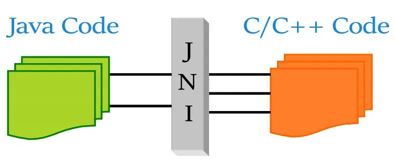

还有信号处理，比如你用kill命令给Java进程发SIGTERM信号，JVM会捕获这个信号然后执行关闭钩子。进程间通信、获取系统资源信息这些，底层也都是通过系统调用完成的。

从用户态和内核态的角度说，Java代码运行在用户态，但IO、网络这些操作需要切换到内核态，这个切换是有开销的。JVM会做很多优化，比如用缓冲区减少系统调用次数。虽然JVM屏蔽了底层差异让Java代码跨平台，但在每个平台上JVM都要适配该平台的系统调用和API。

# 2 Java集合面试题

有几块内容在面试里被问得特别多，建议重点花时间：

- **HashMap**：put 过程、扩容机制、为什么初始容量是 2 的幂次方、链表转红黑树的条件，这些几乎每次都会问，而且很容易被追问到细节。
- **ConcurrentHashMap**：JDK 1.7 的分段锁和 JDK 1.8 的 CAS + synchronized 方案的区别，是并发面试里的高频考点。
- **ArrayList 的线程安全问题**：为什么不安全、具体会出现哪些问题、有哪些替代方案，这个看起来简单但答起来很容易流于表面。
- **equals 和 hashCode 的关系**：这两个方法为什么要配套重写，放到 HashMap 和 HashSet 里会有什么影响，基础但经常被忽略。

如果你是第一次系统准备这块，建议先搞清楚 ArrayList 和 HashMap 的底层原理，再去看线程安全相关的集合类，这样理解起来会顺很多。

------

## 2.1 概念

### 2.1.1数组与集合区别，用过哪些？

数组和集合的区别：

- 数组是固定长度的数据结构，一旦创建长度就无法改变，而常见的 ArrayList、HashSet 等集合支持动态增删元素。不过，Arrays.asList() 返回的列表是固定大小的，并不是所有集合都能增删。
- 数组可以包含基本数据类型和对象，而集合只能包含对象。
- 数组通过下标访问元素，List 也支持 get(index) 访问；Set 没有下标，Map 则通过 key 查找 value。能不能随机访问、访问有多快，要看具体实现。

我用过的一些 Java 集合类：

1. **ArrayList：** 动态数组，实现了List接口，支持动态增长。
2. **LinkedList：** 双向链表，实现了 List 和 Deque 接口，头尾插入、删除很快，按下标操作则需要先遍历定位。
3. **HashMap：** 基于哈希表的Map实现，存储键值对，通过键快速查找值。
4. **HashSet：** 基于HashMap实现的Set集合，用于存储唯一元素。
5. **TreeMap：** 基于红黑树实现的有序Map集合，可以按照键的顺序进行排序。
6. **LinkedHashMap：** 基于哈希表和双向链表实现的Map集合，保持插入顺序或访问顺序。
7. **PriorityQueue：** 优先队列，保证队头是优先级最高的元素，但遍历整个队列并不保证有序。

### 2.1.2 说说Java中的集合？

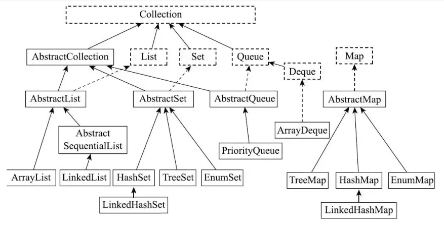List是有序的Collection，使用此接口能够精确的控制每个元素的插入位置，用户能根据索引访问List中元素。常用的实现List的类有LinkedList，ArrayList，Vector，Stack。

- ArrayList 是容量可变的非线程安全列表，其底层使用数组实现。当集合扩容时，会创建更大的数组，并把原数组复制到新数组。ArrayList 支持对元素的快速随机访问，在尾部追加/删除元素效率很高，但在中间位置插入/删除需要搬移元素，代价较高。
- LinkedList 本质是一个双向链表，支持高效的头尾插入/删除和作为双端队列使用。需要注意的是："LinkedList 插入/删除比 ArrayList 更快"是一个常见误区：其 O(1) 的前提是**已经持有目标节点的引用**；如果要在任意位置插入/删除，仍需先 O(n) 遍历链表找到位置，加上每个节点都需要独立分配、对 CPU 缓存不友好，实测大多数场景下 LinkedList 反而比 ArrayList 慢，这也是现在主流建议优先使用 ArrayList 的原因。

Set 不允许存在重复的元素，但是否有序取决于实现类：HashSet 不保证顺序，LinkedHashSet 保留插入顺序，TreeSet 按比较规则排序。常用的实现有HashSet，LinkedHashSet和TreeSet。

- HashSet通过HashMap实现，HashMap的Key即HashSet存储的元素，所有Key都是用相同的Value，一个名为PRESENT的Object类型常量。使用Key保证元素唯一性，但不保证有序性。由于其底层的 HashMap 本身就是非线程安全的，因此 HashSet 也是非线程安全的。
- LinkedHashSet继承自HashSet，通过LinkedHashMap实现，使用双向链表维护元素插入顺序。
- TreeSet通过TreeMap实现的，添加元素到集合时按照比较规则将其插入合适的位置，保证插入后的集合仍然有序。

Map 是一个键值对集合，存储键、值和之间的映射。Key 唯一，value 可以重复；遍历顺序由实现类决定，比如 HashMap 不保证顺序，TreeMap 按 key 排序。Map 没有继承于 Collection 接口，从 Map 集合中检索元素时，只要给出键对象，就会返回对应的值对象。主要实现有TreeMap、HashMap、Hashtable、LinkedHashMap、ConcurrentHashMap

- HashMap：JDK1.8 之前 HashMap 由数组+链表组成的，数组是 HashMap 的主体，链表则是主要为了解决哈希冲突而存在的（"拉链法"解决冲突），JDK1.8 以后在解决哈希冲突时有了较大的变化：以 JDK 8 的 `put` 为例，当桶中已有至少 8 个节点，再插入一个新节点（插入后长度至少为 9），**且哈希表数组长度 ≥ 64** 时，才会将该链表转化为红黑树，以减少搜索时间；如果数组长度 < 64，则只会触发扩容而不做树化。
- LinkedHashMap：LinkedHashMap 继承自 HashMap，所以它的底层仍然是基于拉链式散列结构即由数组和链表或红黑树组成。另外，LinkedHashMap 在上面结构的基础上，增加了一条双向链表，使得上面的结构可以保持键值对的插入顺序。同时通过对链表进行相应的操作，实现了访问顺序相关逻辑。
- Hashtable：数组+链表组成的，数组是 Hashtable 的主体，链表则是主要为了解决哈希冲突而存在的
- TreeMap：红黑树（自平衡的排序二叉树）
- ConcurrentHashMap：Node数组+链表+红黑树实现，线程安全的（jdk1.8以前Segment锁，1.8以后volatile + CAS 或者 synchronized）

### 2.1.3 Java中的线程安全的集合是什么？

在 java.util 包中，常见的老牌线程安全集合有 Vector 和 Hashtable，Stack 继承自 Vector，也带有同步能力。另外，还可以用 Collections.synchronizedList()、synchronizedMap() 等方法包装普通集合。

- **Vector**：线程安全的动态数组，其内部方法基本都经过synchronized修饰，如果不需要线程安全，并不建议选择，毕竟同步是有额外开销的。Vector 内部是使用对象数组来保存数据，可以根据需要自动的增加容量，当数组已满时，会创建新的数组，并拷贝原有数组数据。
- **Hashtable**：线程安全的哈希表，Hashtable 的加锁方法是给每个方法加上 synchronized 关键字，这样锁住的是整个 Table 对象，不支持 null 键和值，由于同步导致的性能开销，所以已经很少被推荐使用，如果要保证线程安全的哈希表，可以用ConcurrentHashMap。

java.util.concurrent 包还提供了多种线程安全的集合：

并发Map：

- **ConcurrentHashMap**：它与 Hashtable 的主要区别是二者加锁粒度的不同，在 **JDK 1.7**，ConcurrentHashMap 加的是分段锁，也就是 Segment 锁，每个 Segment 含有整个 table 的一部分，这样不同分段之间的并发操作就互不影响。在 **JDK 1.8**，它取消了 Segment，直接在 table 元素（桶的头节点）上加锁，使加锁粒度进一步缩小到单个桶级别。对于 put 操作，如果 Key 对应的数组槽位为 null，则通过 CAS 操作（Compare and Swap）将新节点写入该槽位；如果槽位不为 null（即已存在链表头或红黑树根节点），则对该头节点使用 `synchronized` 加锁，然后遍历桶中的数据执行替换或新增。如果该 put 操作使得当前桶的链表长度超过阈值，则将其转换为红黑树，从而提高查找效率。
- **ConcurrentSkipListMap**：实现了一个基于SkipList（跳表）算法的可排序的并发集合，SkipList是一种可以在对数预期时间内完成搜索、插入、删除等操作的数据结构，通过维护多个指向其他元素的“跳跃”链接来实现高效查找。

并发Set：

- **ConcurrentSkipListSet**：是线程安全的有序的集合。底层是使用ConcurrentSkipListMap实现。
- **CopyOnWriteArraySet**：是线程安全的Set实现，它基于 CopyOnWriteArrayList 实现，按元素的添加顺序遍历，通过 equals 判断重复，更适合元素较少、读多写少的场景。有意思的是，CopyOnWriteArraySet和HashSet虽然都继承于共同的父类AbstractSet；但是，HashSet是通过“散列表”实现的，而CopyOnWriteArraySet则是通过“动态数组(CopyOnWriteArrayList)”实现的，并不是散列表。

并发List：

- **CopyOnWriteArrayList**：它是 ArrayList 的线程安全的变体，其中改变数组内容的写操作通常通过复制底层数组来实现，允许存储 null 元素。即当对象进行写操作时，使用了Lock锁做同步处理，内部拷贝了原数组，并在新数组上进行添加操作，最后将新数组替换掉旧数组；若进行的读操作，则直接返回结果，操作过程中不需要进行同步。

并发 Queue：

- **ConcurrentLinkedQueue**：是一个适用于高并发场景下的队列，它通过无锁的方式(CAS)，实现了高并发状态下的高性能。它不提供阻塞等待，队列为空时 poll() 返回 null。BlockingQueue 是一类接口，是否更快要看具体实现和使用场景，不能直接比较。
- **BlockingQueue**：与 ConcurrentLinkedQueue 的使用场景不同，BlockingQueue 的主要功能并不是在于提升高并发时的队列性能，而在于简化多线程间的数据共享。BlockingQueue 提供一种读写阻塞等待的机制，即如果消费者速度较快，则 BlockingQueue 则可能被清空，此时消费线程再试图从 BlockingQueue 读取数据时就会被阻塞。反之，如果生产线程较快，则 BlockingQueue 可能会被装满，此时，生产线程再试图向 BlockingQueue 队列装入数据时，便会被阻塞等待。

并发 Deque：

- **LinkedBlockingDeque**：是一个线程安全的双端队列实现。它的内部使用链表结构，每一个节点都维护了一个前驱节点和一个后驱节点。LinkedBlockingDeque 的入队、出队共用一把 ReentrantLock，通过条件变量等待队列非空或未满；等待时会释放锁，让其他线程继续入队或出队。
- **ConcurrentLinkedDeque**：ConcurrentLinkedDeque是一种基于链接节点的无限并发链表。可以安全地并发执行插入、删除和访问操作。当许多线程同时访问一个公共集合时，ConcurrentLinkedDeque是一个合适的选择。

### 2.1.4 Collections和Collection的区别

- Collection 是 Java 集合框架中的一个接口，是 List、Set、Queue 等接口的上层接口，Map 不继承它。它定义了一组通用的操作和方法，如添加、删除、遍历等，用于操作和管理一组对象。List、Set、Queue 都是它的子接口，ArrayList、HashSet 等才是具体实现类。
- Collections（注意有一个s）是Java提供的一个工具类，位于java.util包中。它提供了一系列静态方法，用于对集合进行操作和算法。Collections类中的方法包括排序、查找、替换、反转、随机化等等。这些方法可以对实现了Collection接口的集合进行操作，如List和Set。

### 2.1.5 集合遍历的方法有哪些？

在Java中，集合的遍历方法主要有以下几种：

- **普通 for 循环：** 可以使用带有索引的普通 for 循环来遍历 List。

```java
List<String> list = new ArrayList<>();
list.add("A");
list.add("B");
list.add("C");

for (int i = 0; i < list.size(); i++) {
    String element = list.get(i);
    System.out.println(element);
}
```

- **增强 for 循环（for-each循环）：** 用于循环访问数组或集合中的元素。

```java
List<String> list = new ArrayList<>();
list.add("A");
list.add("B");
list.add("C");

for (String element : list) {
    System.out.println(element);
}
```

- **Iterator 迭代器：** 可以使用迭代器来遍历集合，特别适用于需要删除元素的情况。

```java
List<String> list = new ArrayList<>();
list.add("A");
list.add("B");
list.add("C");

Iterator<String> iterator = list.iterator();
while(iterator.hasNext()) {
    String element = iterator.next();
    System.out.println(element);
}
```

- **ListIterator 列表迭代器：** ListIterator是迭代器的子类，可以双向访问列表并在迭代过程中修改元素。

```java
List<String> list = new ArrayList<>();
list.add("A");
list.add("B");
list.add("C");

ListIterator<String> listIterator= list.listIterator();
while(listIterator.hasNext()) {
    String element = listIterator.next();
    System.out.println(element);
}
```

- **使用 forEach 方法：** Java 8引入了 forEach 方法，可以对集合进行快速遍历。

```java
List<String> list = new ArrayList<>();
list.add("A");
list.add("B");
list.add("C");

list.forEach(element -> System.out.println(element));
```

- **Stream API：** Java 8的Stream API提供了丰富的功能，可以对集合进行函数式操作，如过滤、映射等。

```java
List<String> list = new ArrayList<>();
list.add("A");
list.add("B");
list.add("C");

list.stream().forEach(element -> System.out.println(element));
```

这些是常用的集合遍历方法，根据情况选择合适的方法来遍历和操作集合。

需要注意，LinkedList 不适合用 get(i) 配合普通 for 循环遍历，因为每次 get 都要重新定位节点，整轮遍历可能达到 O(n²)。用增强 for 或 Iterator 才是 O(n)。forEach 和 Stream 主要是写法更简洁，并不代表一定比普通循环更快。

### 2.1.6 fail-fast 是什么？线程安全的集合遍历就一定能看到最新数据吗？

fail-fast 就是“快速失败”：遍历时发现集合被意外修改，就尽早抛出 ConcurrentModificationException，帮助我们发现错误。

以 ArrayList 为例，集合用 modCount 记录结构修改，迭代器创建时保存 expectedModCount。调用 next 等方法时，如果两个值不一致，就说明迭代器之外有人改了结构。

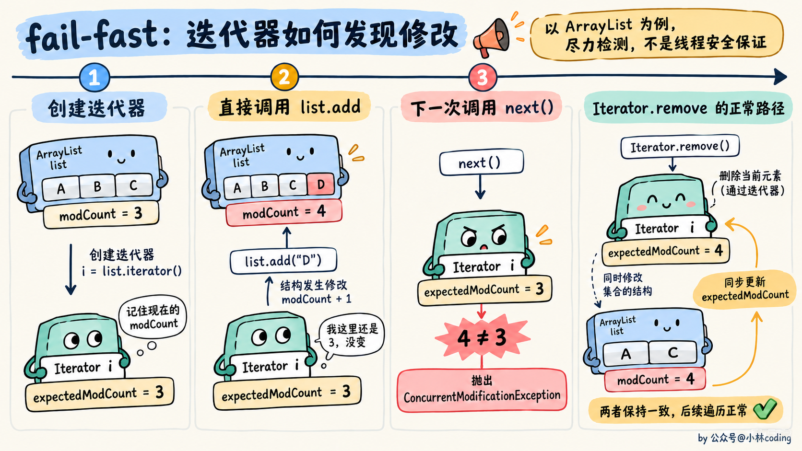

这里要注意两点：

- **单线程也可能触发**：比如在增强 for 里调用 list.remove，和有没有多个线程无关。
- **它不是线程安全机制**：检查只是尽力而为，不保证一定抛异常，更不能靠“没有异常”判断并发操作安全。

并发集合的遍历也不一定看到最新的完整数据，常见的有两种方式：

- **CopyOnWriteArrayList 的快照迭代**：读取迭代器创建时的数组，之后的增删不会反映在本轮遍历里。
- **ConcurrentHashMap 的弱一致迭代**：允许一边遍历一边更新，不会因为并发更新抛 CME，但可能看到部分更新，不是某一时刻整个 Map 的快照。

所以，线程安全保证的是规定操作的并发安全，不等于遍历结果具有整体快照或实时一致性。

### 2.1.7 不可修改集合和不可变集合有什么区别？

不可修改，通常指不能通过当前引用调用 add、remove、set 等方法；不可变则强调对象状态不会再变化，这两个说法不能直接画等号。

比如 Collections.unmodifiableList 返回的是原列表的只读视图，原列表改了，视图也会跟着变：

```java
List<String> source = new ArrayList<>(Arrays.asList("a", "b"));
List<String> view = Collections.unmodifiableList(source);
source.add("c");
System.out.println(view); // [a, b, c]
// view.add("d"); // 抛 UnsupportedOperationException
```

如果不希望原集合后续的增删影响结果，可以先复制，再包装：

```java
List<String> snapshot = Collections.unmodifiableList(new ArrayList<>(source));
```

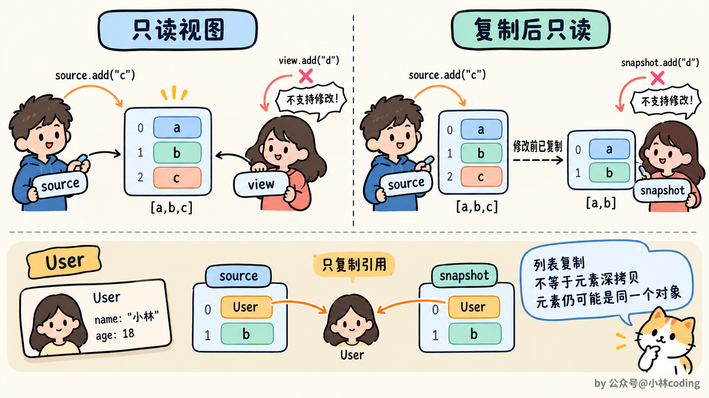

JDK 9 的 List.of、JDK 10 的 List.copyOf 也能创建不可修改列表，并且不允许 null 元素。List.copyOf 不会随着原集合的后续增删而变化。

但这些方式都不会自动深拷贝元素。如果里面放的是可变 User 对象，仍然可以修改 User 的字段。要做到整个对象结构都不可变，还需要元素本身不可变，或者按需求做防御性拷贝。

## 2.2 List

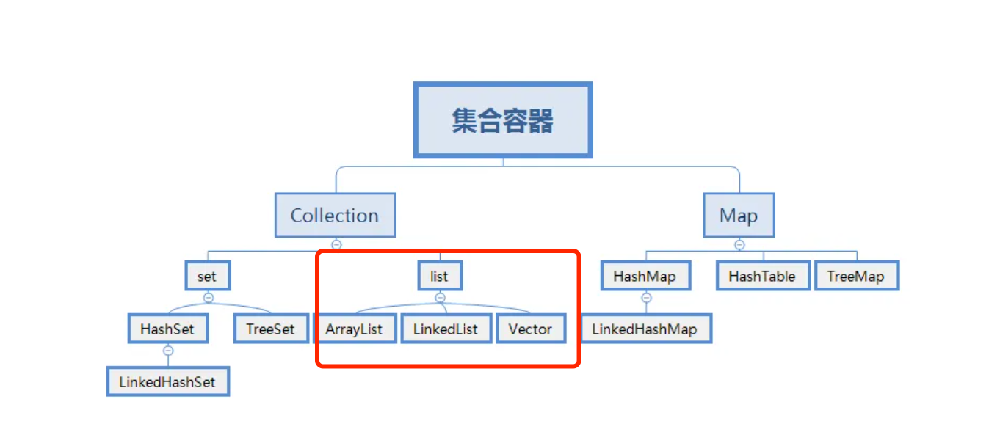

常见的List集合（非线程安全）：

- `ArrayList`基于动态数组实现，它允许快速的随机访问，即通过索引访问元素的时间复杂度为 O (1)。在添加和删除元素时，如果操作位置不是列表末尾，可能需要移动大量元素，性能相对较低。适用于需要频繁随机访问元素，而对插入和删除操作性能要求不高的场景，如数据的查询和展示等。
- `LinkedList` 基于双向链表实现，头尾插入、删除是 O(1)；通过已经定位的迭代器插入、删除，也只需要调整节点指针。但 add(index, element)、remove(index) 需要先找到节点，最坏是 O(n)，不能笼统地说它在中间增删就比 ArrayList 快。

常见的List集合（线程安全）：

- `Vector`和`ArrayList`类似，也是基于数组实现。`Vector`中的方法大多是同步的，这使得它在多线程环境下可以保证数据的一致性，但在单线程环境下，由于同步带来的开销，性能会略低于`ArrayList`。
- `CopyOnWriteArrayList`在对列表进行修改（如添加、删除元素）时，会创建一个新的底层数组，将修改操作应用到新数组上，而读操作仍然在原数组上进行，这样可以保证读操作不会被写操作阻塞，实现了读写分离，提高了并发性能。适用于读操作远远多于写操作的并发场景，如事件监听列表等，在这种场景下可以避免大量的锁竞争，提高系统的性能和响应速度。

### [#](https://xiaolincoding.com/interview/collections.html#讲一下java里面list的几种实现-几种实现有什么不同)讲一下java里面list的几种实现，几种实现有什么不同？

在Java中，`List`接口是最常用的集合类型之一，用于存储元素的有序集合。以下是Java中常见的`List`实现及其特点： 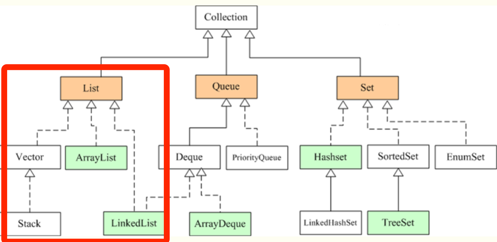

- Vector 是 Java 早期提供的线程安全的动态数组，如果不需要线程安全，并不建议选择，毕竟同步是有额外开销的。Vector 内部是使用对象数组来保存数据，可以根据需要自动的增加容量，当数组已满时，会创建新的数组，并拷贝原有数组数据。
- ArrayList 是应用更加广泛的动态数组实现，它本身不是线程安全的，所以性能要好很多。与 Vector 近似，ArrayList 也是可以根据需要调整容量，不过两者的调整逻辑有所区别：Vector 默认按 2 倍扩容（如果构造时指定了 `capacityIncrement`，则按该值线性增长），而 ArrayList 则是增加 50%（即 1.5 倍）。
- LinkedList 顾名思义是 Java 提供的双向链表，所以它不需要像上面两种那样调整容量，它也不是线程安全的。

> 这几种实现具体在什么场景下应该用哪种？

- Vector 和 ArrayList 作为动态数组，其内部元素以数组形式顺序存储的，所以非常适合随机访问的场合。除了尾部插入和删除元素，往往性能会相对较差，比如我们在中间位置插入一个元素，需要移动后续所有元素。
- 而 LinkedList 在头尾操作，或者通过已经定位的迭代器增删节点时，只需要调整指针；按下标增删仍然要先遍历。选择时还要考虑节点的额外内存和数组更好的缓存局部性，多数普通列表场景优先考虑 ArrayList。

### [#](https://xiaolincoding.com/interview/collections.html#list可以一边遍历一边修改元素吗)list可以一边遍历一边修改元素吗？

在 Java 中，`List`在遍历过程中是否可以修改元素取决于遍历方式和具体的`List`实现类，以下是几种常见情况：

- 使用普通 for 循环遍历：可以用 set 替换元素；如果要删除，注意后面的元素会前移，直接 i++ 容易漏掉元素，可以倒序遍历，或者删除后调整索引。

```java
import java.util.ArrayList;
import java.util.List;

public class ListTraversalAndModification {
    public static void main(String[] args) {
        List<Integer> list = new ArrayList<>();
        list.add(1);
        list.add(2);
        list.add(3);

        // 使用普通for循环遍历并修改元素
        for (int i = 0; i < list.size(); i++) {
            list.set(i, list.get(i) * 2);
        }

        System.out.println(list);
    }
}
```

- 使用 foreach 循环遍历：一般不建议在 `foreach` 循环中直接**修改集合结构**（add/remove），因为 `foreach` 底层基于迭代器实现，集合结构被修改后，迭代器下一次调用 `next()` 时会检测到 `modCount != expectedModCount`，从而抛出 `ConcurrentModificationException` 异常。注意：对 ArrayList 来说，"替换元素值"（即 `list.set(i, newValue)`）**并不会改变 `modCount`**，所以这种替换不会触发它的迭代器检查；成功增删元素则会改变结构。不过 fail-fast 只是尽力检测，并不保证每次修改都一定抛异常。下面是一个会抛 CME 的反例：

```java
import java.util.ArrayList;
import java.util.List;

public class ListTraversalAndModification {
    public static void main(String[] args) {
        List<Integer> list = new ArrayList<>();
        list.add(1);
        list.add(2);
        list.add(3);
        list.add(4);

        // 在foreach中调用list.add/remove会抛出ConcurrentModificationException
        for (Integer num : list) {
            if (num == 2) {
                list.remove(num); // 修改了结构，下一次迭代会抛CME
            }
        }

        System.out.println(list);
    }
}
```

- 使用迭代器遍历时：如果需要在遍历过程中删除元素，应使用 `Iterator.remove()`；如果需要替换元素，使用 `ListIterator.set()` 是最通用、最推荐的做法。直接调用 `List.set(index, value)` 虽然不会抛 CME（因为它不改变结构），但通过 `ListIterator.set()` 更符合"遍历中修改"的惯用写法，可读性也更好。

```java
import java.util.ArrayList;
import java.util.ListIterator;

public class ListTraversalAndModification {
    public static void main(String[] args) {
        ArrayList<Integer> list = new ArrayList<>();
        list.add(1);
        list.add(2);
        list.add(3);

        // 使用 ListIterator 遍历并修改元素
        ListIterator<Integer> iterator = list.listIterator();
        while (iterator.hasNext()) {
            Integer num = iterator.next();
            if (num.equals(2)) {
                // 使用 ListIterator 的 set 方法修改（替换）元素
                iterator.set(4);
            }
        }
        
        System.out.println(list); // 输出: [1, 4, 3]
    }
}
```

对于 CopyOnWriteArrayList，可以在遍历时调用列表自身的 add、remove 等方法，迭代器仍然读创建时的快照，不会抛 ConcurrentModificationException。不过它的迭代器不支持 remove、set、add，会抛 UnsupportedOperationException。Vector 和 synchronizedList 并没有这种快照机制，不能把这个结论推广到所有线程安全的 List。

如果只是按条件删除，支持该操作的集合还可以直接使用 removeIf，比如 list.removeIf(num -> num % 2 == 0)，通常比自己维护下标更清楚。

### [#](https://xiaolincoding.com/interview/collections.html#list如何快速删除某个指定下标的元素)list如何快速删除某个指定下标的元素？

`ArrayList`提供了`remove(int index)`方法来删除指定下标的元素，该方法在删除元素后，会将后续元素向前移动，以填补被删除元素的位置。如果删除的是列表末尾的元素，时间复杂度为 O (1)；如果删除的是列表中间的元素，时间复杂度为 O (n)，n 为列表中元素的个数，因为需要移动后续的元素。示例代码如下：

```java
import java.util.ArrayList;
import java.util.List;

public class ArrayListRemoveExample {
    public static void main(String[] args) {
        List<Integer> list = new ArrayList<>();
        list.add(1);
        list.add(2);
        list.add(3);

        // 删除下标为1的元素
        list.remove(1);

        System.out.println(list);
    }
}
```

`LinkedList`的`remove(int index)`方法也可以用来删除指定下标的元素。它需要先遍历到指定下标位置，然后修改链表的指针来删除元素。最坏时间复杂度为 O(n)，n 为集合元素总数；它会根据下标离头还是尾更近，选择从哪一端开始遍历。不过，如果已知要删除的元素是链表的头节点或尾节点，可以直接通过修改头指针或尾指针来实现删除，时间复杂度为 O (1)。示例代码如下：

```java
import java.util.LinkedList;
import java.util.List;

public class LinkedListRemoveExample {
    public static void main(String[] args) {
        List<Integer> list = new LinkedList<>();
        list.add(1);
        list.add(2);
        list.add(3);

        // 删除下标为1的元素
        list.remove(1);

        System.out.println(list);
    }
}
```

`CopyOnWriteArrayList`的`remove`方法同样可以删除指定下标的元素。由于`CopyOnWriteArrayList`在写操作时会创建一个新的数组，所以删除操作的时间复杂度取决于数组的复制速度，通常为 O (n)，n 为数组的长度。但在并发环境下，它的删除操作不会影响读操作，具有较好的并发性能。示例代码如下：

```java
import java.util.concurrent.CopyOnWriteArrayList;

public class CopyOnWriteArrayListRemoveExample {
    public static void main(String[] args) {
        CopyOnWriteArrayList<Integer> list = new CopyOnWriteArrayList<>();
        list.add(1);
        list.add(2);
        list.add(3);

        // 删除下标为1的元素
        list.remove(1);

        System.out.println(list);
    }
}
```

### [#](https://xiaolincoding.com/interview/collections.html#arraylist和linkedlist的区别-哪个集合是线程安全的)Arraylist和LinkedList的区别，哪个集合是线程安全的？

ArrayList和LinkedList都是Java中常见的集合类，它们都实现了List接口。

- **底层数据结构不同**：ArrayList 使用动态数组实现，通过索引可以快速定位到元素。LinkedList 使用双向链表实现，每个节点都存储了元素本身以及指向前一个和后一个节点的指针，通过节点之间的指针关联来访问和操作元素。
- **插入和删除操作的效率不同**：ArrayList 在尾部进行插入和删除操作时效率较高，因为不需要移动其他元素；但如果是在中间或开头插入、删除，就需要移动后面的所有元素，效率会比较低。LinkedList 在头部和尾部进行插入、删除操作时效率很高，只需要调整节点的指针即可；但如果是在中间位置操作，需要先从头或尾遍历链表找到目标位置，时间复杂度也是 O (n)，不过找到位置后只需要调整指针，不需要像 ArrayList 那样移动大量元素，所以在某些特定场景下还是有优势的，而且 LinkedList 实现了 Deque 接口，还可以当作双端队列、栈来使用。
- **随机访问的效率不同**：ArrayList 支持通过索引直接快速访问元素，时间复杂度为 O (1)。LinkedList 不支持随机访问，想要获取某个位置的元素，必须从头节点或尾节点开始逐个遍历，时间复杂度为 O (n)。

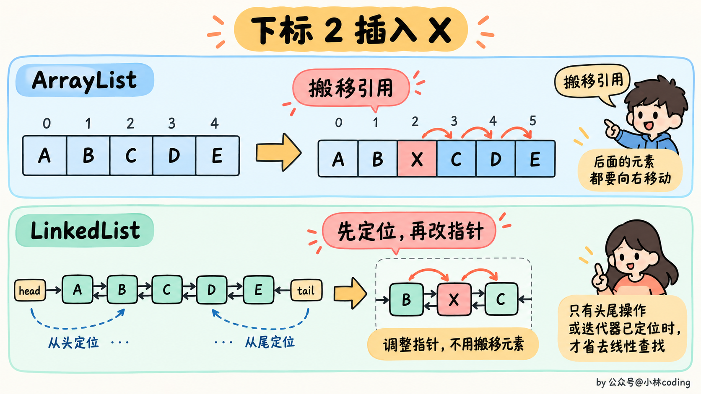

- **空间占用**：ArrayList 使用数组保存元素引用，虽然会有一定的容量浪费（比如实际元素没装满数组），但不需要为每个元素额外分配链表节点，元素对象本身也不一定连续存放。无参构造在 JDK 8 中会延迟分配实际的存储数组。LinkedList 每个节点除了存储元素引用，还需要额外存储两个指针（指向前一个和后一个节点），所以在存储相同数量元素的情况下，LinkedList 的空间占用通常会比 ArrayList 更大一些。
- **使用场景**：ArrayList 更适合需要频繁随机访问元素，或者主要在尾部进行插入、删除操作的场景。LinkedList 更适合需要频繁在头部或尾部进行插入、删除操作，或者需要作为双端队列、栈使用的场景；如果是通过迭代器直接操作已知位置的节点，在中间插入、删除时也能发挥它调整指针快的优势。
- **线程安全**：这两个集合都不是线程安全的，如果在多线程环境下使用，需要自己加锁保证线程安全，或者使用线程安全的 List 集合，比如 Vector、Collections.synchronizedList () 包装的 List，或者 CopyOnWriteArrayList。

### [#](https://xiaolincoding.com/interview/collections.html#arraylist和vector-区别是什么)arraylist和vector 区别是什么？

ArrayList 和 Vector 都是 Java 中常用的动态数组实现，用于存储和操作对象集合，但它们在设计上有几个关键区别，主要体现在线程安全性、性能和功能细节上。

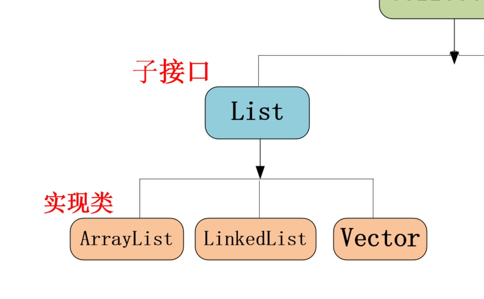

首先是线程安全性，这是最核心的区别。Vector 是线程安全的，它的大部分方法（比如 add、remove、get 等）都被 synchronized 修饰，这能保证单个同步方法的线程安全，但遍历、先判断再操作等复合逻辑，仍然可能需要在整个操作外层加锁。而 ArrayList 没有任何同步机制，是非线程安全的，在多线程并发修改时可能会出现数据不一致的问题，比如抛出 ConcurrentModificationException 异常。

正因为同步机制的存在，两者在性能上也有差异。由于 Vector 的方法需要加锁释放锁，在单线程环境下，它的操作效率通常比 ArrayList 低。所以如果是单线程场景，或者能自己保证线程安全的情况下，ArrayList 是更优的选择，性能更好。

另外，在扩容机制上，两者也有所不同。当集合元素数量超过当前容量时，都会自动扩容。Vector 默认的扩容策略是翻倍（如果没有指定容量增量的话），比如初始容量 10，满了之后会扩容到 20。而 ArrayList 默认扩容为原来的 1.5 倍（`newCapacity = oldCapacity + (oldCapacity >> 1)`），通常按这个比例增长，如果最小所需容量更大，就直接满足最小需求，相对来说扩容幅度更小，能在一定程度上节省内存空间。Vector 可以通过构造方法指定容量增量 `capacityIncrement`（按固定数值线性增长），灵活控制扩容幅度，而 ArrayList 没有这个功能。

总的来说，选择两者时主要看是否需要线程安全：如果是多线程环境且需要内置同步支持，可能会用到 Vector；但现在更多时候会用 ArrayList，因为它性能更好，而且在需要线程安全时，可以通过 Collections.synchronizedList () 方法将 ArrayList 包装成线程安全的集合，灵活性更高。

### [#](https://xiaolincoding.com/interview/collections.html#arraylist线程安全吗-把arraylist变成线程安全有哪些方法)ArrayList线程安全吗？把ArrayList变成线程安全有哪些方法？

不是线程安全的，ArrayList变成线程安全的方式有：

- 使用Collections类的synchronizedList方法将ArrayList包装成线程安全的List：

```java
List<String> synchronizedList = Collections.synchronizedList(arrayList);
```

- 使用CopyOnWriteArrayList类代替ArrayList，它是一个线程安全的List实现：

```java
CopyOnWriteArrayList<String> copyOnWriteArrayList = new CopyOnWriteArrayList<>(arrayList);
```

- 使用Vector类代替ArrayList，Vector是线程安全的List实现：

```java
Vector<String> vector = new Vector<>(arrayList);
```

包装成 synchronizedList 后，单个方法调用有同步保护，但遍历和复合操作还需要自己保证整体同步，而且所有访问都应该经过包装后的列表，不能绕过它操作原 ArrayList。

```java
List<String> list = Collections.synchronizedList(new ArrayList<>());
synchronized (list) {
    for (String value : list) {
        System.out.println(value);
    }
}

synchronized (list) {
    if (!list.contains("a")) {
        list.add("a");
    }
}
```

注意锁的是返回的 list 对象，并且迭代器也应该在同步块里创建。CopyOnWriteArrayList 适合读多写少；如果是写入很多、需要复合操作的场景，统一加锁的列表通常更合适。

### [#](https://xiaolincoding.com/interview/collections.html#为什么arraylist不是线程安全的-具体来说是哪里不安全)为什么ArrayList不是线程安全的，具体来说是哪里不安全？

ArrayList 的问题在于：**检查容量、写入元素、更新 size 这几个步骤没有同步保护，整个 add 操作不是原子的。**并发时可能出现元素被覆盖、size 不准确、索引越界，扩容竞争还可能让部分位置出现 null。

以 JDK 8 的 add 为例：

```java
public boolean add(E e) {
    ensureCapacityInternal(size + 1);
    elementData[size++] = e;
    return true;
}
```

大体可以分为三步：

- 判断当前容量是否够用，不够就创建更大的数组并复制数据；
- 取得写入位置，并更新 size；
- 把元素写入数组。

注意，size++ 是后缀自增，表达式返回旧值作为下标，更新 size 发生在数组赋值完成之前，不能简单理解成“先写元素，再执行 size++”。

下面用几个例子说明：

- **元素覆盖、size 少算**：两个线程都读到 size 为 5，都选择下标 5 写入，并把 size 更新为 6。结果本来添加了两个元素，却可能只保留一个。

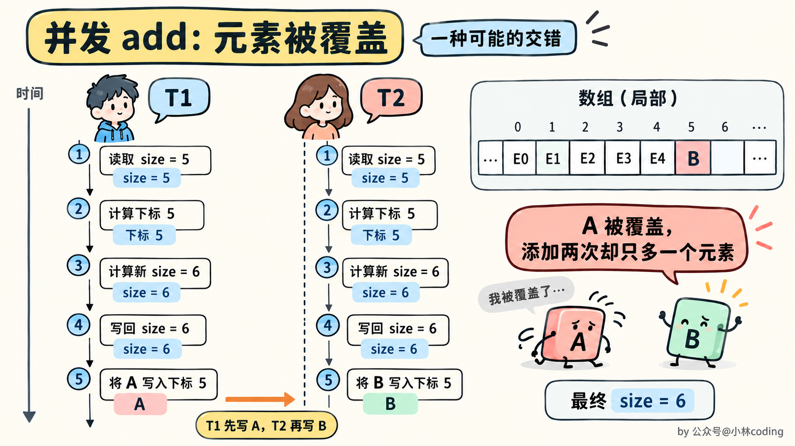

- **索引越界**：size 为 9，数组容量为 10，两个线程都通过了容量检查。线程 1 写入下标 9，并把 size 更新为 10；线程 2 随后执行写入表达式，取得下标 10，此时没有重新检查容量，就可能越界。

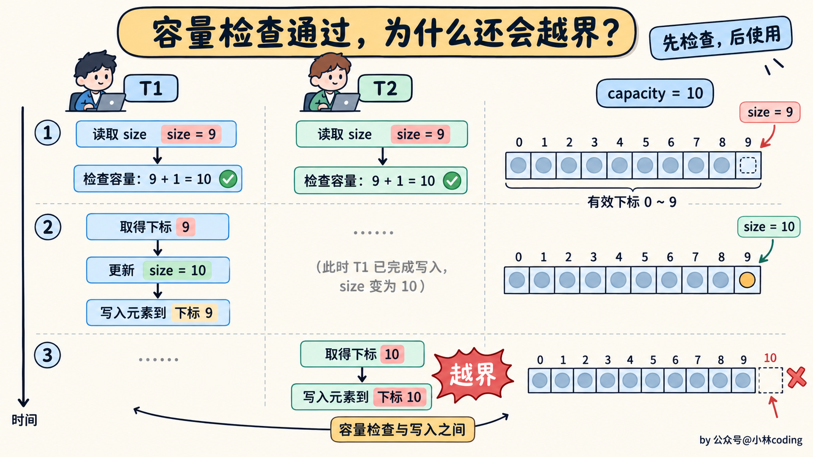

- **扩容时数据丢失或出现 null**：一个线程复制旧数组，另一个线程还在向旧数组写入。如果新数组没复制到这次写入，随后又替换了数组引用，那么这次写入就可能丢失，新数组对应位置也可能保留 null。

所以，不能只把 size 改成 volatile 就认为安全了。volatile 解决可见性，不能让 size++ 和整个 add 过程变成原子操作。并发读写时需要统一加锁，或者选择合适的线程安全集合。

### [#](https://xiaolincoding.com/interview/collections.html#arraylist-和-linkedlist-的应用场景)ArrayList 和 LinkedList 的应用场景？

- **ArrayList**：适合普通列表、按下标访问、遍历，以及主要在尾部追加的场景。尾部追加的均摊时间复杂度是 O(1)，但单次扩容需要 O(n) 复制，所以“大小经常变化”并不代表 ArrayList 就不适合。
- **LinkedList**：适合头尾增删，或者通过已经定位的 ListIterator 连续增删节点的场景。如果每次都按下标定位，中间增删仍然是 O(n)，还要承担节点分配和额外指针的开销。
- **如果只是实现栈或双端队列**：通常可以优先考虑 ArrayDeque，它用数组保存元素，头尾操作均摊 O(1)，也没有每个链表节点的额外开销。不过它不允许 null，也不是线程安全的。

### [#](https://xiaolincoding.com/interview/collections.html#arraylist的扩容机制说一下)ArrayList的扩容机制说一下

ArrayList 底层是数组，**size 是实际元素个数，capacity 是数组能容纳的元素个数**，这两个概念要分清楚。

以 JDK 8 为例：

- 无参构造时，先使用一个共享的空数组，第一次 add 时才分配容量为 10 的数组。
- 如果通过 new ArrayList<>(20) 指定容量，会直接创建容量为 20 的数组，但 size 仍然是 0，不能马上调用 get(0) 或 set(0, value)。
- 容量不足时，通常计算 oldCapacity + (oldCapacity >> 1)，也就是原容量的约 1.5 倍。
- 如果新容量仍然小于本次所需容量，比如一次 addAll 很多元素，就以最小所需容量为准，并处理最大数组长度和溢出问题。
- 最后通过 Arrays.copyOf 创建新数组、复制原数组中的引用，再让 elementData 指向新数组。


```java
int newCapacity = oldCapacity + (oldCapacity >> 1);
if (newCapacity < minCapacity) {
    newCapacity = minCapacity;
}
```

1.5 倍主要是在空间浪费和复制次数之间做权衡：增长太小会频繁扩容，增长太大又会空出很多位置。移位只是计算方式，不能把“为了使用移位”当作选择这个比例的主要原因。

如果提前知道数据量，可以通过构造方法或 ensureCapacity 预留容量，减少复制。删除元素后不会自动缩容；如果确实需要释放多余容量，可以调用 trimToSize，但反复缩容、扩容也会增加开销。

### [#](https://xiaolincoding.com/interview/collections.html#线程安全的-list-copyonwritearraylist是如何实现线程安全的)线程安全的 List， CopyonWriteArraylist是如何实现线程安全的

CopyOnWriteArrayList底层也是通过一个数组保存数据，使用volatile关键字修饰数组，保证当前线程对数组对象重新赋值后，其他线程可以及时感知到。

```java
private transient volatile Object[] array;
```

下面以 JDK 8 的 add 源码为例，写入时使用 ReentrantLock，避免多个写线程同时复制并覆盖结果。不同 JDK 版本的锁实现可能不同，但“写入串行化、复制数组、发布新数组”的思路一致。

```java
public boolean add(E e) {
    //获取锁
    final ReentrantLock lock = this.lock;
    //加锁
    lock.lock();
    try {
        //获取到当前List集合保存数据的数组
        Object[] elements = getArray();
        //获取该数组的长度（这是一个伏笔，同时len也是新数组的最后一个元素的索引值）
        int len = elements.length;
        //将当前数组拷贝一份的同时，让其长度加1
        Object[] newElements = Arrays.copyOf(elements, len + 1);
        //将加入的元素放在新数组最后一位，len不是旧数组长度吗，为什么现在用它当成新数组的最后一个元素的下标？建议自行画图推演，就很容易理解。
        newElements[len] = e;
        //替换引用，将数组的引用指向给新数组的地址
        setArray(newElements);
        return true;
    } finally {
        //释放锁
        lock.unlock();
    }
}
```

看到源码可以知道写入新元素时，首先会先将原来的数组拷贝一份并且让原来数组的长度+1后就得到了一个新数组，新数组里的元素和旧数组的元素一样并且长度比旧数组多一个长度，然后将新加入的元素放置都在新数组最后一个位置后，用新数组的地址替换掉老数组的地址就能得到最新的数据了。


在我们执行替换地址操作之前，读取的是老数组的数据，数据是有效数据；执行替换地址操作之后，读取的是新数组的数据，同样也是有效数据，这样可以避免读写之间的锁竞争，更适合读多写少的场景；如果写入频繁，反复复制数组反而会增加开销。

现在我们来看读操作，它先取得当前数组引用，再从该数组读取元素，不需要获取写锁：

```java
public E get(int index) {
    return get(getArray(), index);
}
```

这里还有几个容易被追问的点：

- **迭代器读的是快照**：创建迭代器时取得的数组不会被后续写操作修改，因此本轮遍历看不到之后的增删。后续新发起的 get 会读取当时已发布的数组，但并不保证多次读取组成一个整体快照。
- **复制的是引用**：新旧数组里的元素对象仍然可能是同一个。集合线程安全，并不代表元素对象里的字段也线程安全。


- **适合读多写少**：写操作通常要复制 O(n) 个引用；迭代器还可能持有旧数组，因此会增加内存占用。监听器列表、较少更新的配置列表比较合适，频繁写入的大列表不合适。

### [#](https://xiaolincoding.com/interview/collections.html#list-里面填基本数据类型为什么会报错)List<>里面填基本数据类型为什么会报错？

`List<>` 等泛型集合类要求填充的必须是**引用类型**（对象类型），而不能直接使用**基本数据类型**（如 `int`、`char`、`double` 等），否则会编译报错。

这是因为 Java 的泛型机制在设计时就只支持引用类型，不支持基本数据类型。例如，下面的代码会报错：

```java
// 错误示例：List 中直接使用基本数据类型 int
List<int> list = new ArrayList<>(); // 编译报错
```

解决的办法是，使用基本数据类型对应的包装类。因此，正确的写法是：

```java
// 正确示例：使用包装类 Integer
List<Integer> list = new ArrayList<>();
list.add(10); // 自动装箱：int -> Integer
int num = list.get(0); // 自动拆箱：Integer -> int
```

这么设计的原因是：

- **泛型的类型擦除机制**：Java 泛型的类型参数在编译后会被擦除为上界，没有显式上界时就是 `Object`，而 `Object` 只能接收引用类型，不能接收基本数据类型。
- **历史原因**：Java 最初设计时基本数据类型和引用类型是严格区分的，泛型是后期（JDK 1.5）才引入的特性，为了兼容已有的类型系统，选择只支持引用类型。

通过使用包装类，结合 Java 的**自动装箱**（基本类型 → 包装类）和**自动拆箱**（包装类 → 基本类型）机制，可以很方便地在泛型集合中操作基本数据类型的数据。

### [#](https://xiaolincoding.com/interview/collections.html#list和数组如何互相转换)List和数组如何互相转换？

> List 转数组

主要有两种方式，核心是用 List 的`toArray()`方法，重点注意「泛型和类型匹配」：

- 无参 toArray ()（返回 Object []，不推荐）

```java
List<String> strList = new ArrayList<>();
strList.add("a");
strList.add("b");
// 返回Object[]，强转可能报错
Object[] objArr = strList.toArray();
```

这种方式返回的是 Object 数组，若强转成 String [] 会抛 ClassCastException，仅适合不确定数组类型的场景，基本不用。

- 带参 toArray (T [] a)（推荐，指定类型）

```java
List<String> strList = new ArrayList<>();
strList.add("a");
strList.add("b");
// 方式1：传入指定长度的数组
String[] strArr1 = strList.toArray(new String[strList.size()]);
// 方式2：传入空数组，由方法创建合适长度的数组
String[] strArr2 = strList.toArray(new String[0]);

// 自定义对象List转数组
List<User> userList = new ArrayList<>();
userList.add(new User("张三", 20));
User[] userArr = userList.toArray(new User[0]);
```

这是最常用的方式，传入对应类型的数组，List 会把元素复制到该数组中，若传入的数组长度不足，会自动创建新数组，两种写法都正确，不必把某一种写法说成在所有 JDK 和场景下都更快。JDK 11 起还可以写 strList.toArray(String[]::new)。

> 数组转 List

核心是用`Arrays.asList()`，但要注意「返回的 List 固定大小、与原数组共享数据」和「基本类型数组的坑」：

- 普通对象数组转 List（常用）

```java
String[] strArr = {"a", "b", "c"};
// 返回固定大小的List（属于Arrays内部类，不可add/remove）
List<String> strList1 = Arrays.asList(strArr);

// 若需要可变List，包装一层ArrayList
List<String> strList2 = new ArrayList<>(Arrays.asList(strArr));
strList2.add("d"); // 正常执行
```

Arrays.asList() 返回的是 java.util.Arrays.ArrayList，和常用的 java.util.ArrayList 不是同一个类。它不支持改变大小，但支持 set 替换元素，而且与原数组共享数据：

```java
strList1.set(0, "x");
System.out.println(strArr[0]); // x，原数组也变了
strArr[1] = "y";
System.out.println(strList1); // [x, y]
```

如果需要自由增删，并且不希望列表的结构变化影响原数组，就像上面一样再套一层 new ArrayList<>(...)。不过这仍然只是复制元素引用，不是深拷贝。


- 基本类型数组转 List（避坑）

```java
// 错误示例：int[]转List会变成List<int[]>，而非List<Integer>
int[] numArr = {1, 2, 3};
List<int[]> wrongList = Arrays.asList(numArr);

// 正确方式1：手动装箱（JDK8-）
List<Integer> numList1 = new ArrayList<>();
for (int num : numArr) {
    numList1.add(num);
}

// 正确方式2：Stream流（JDK8+）
List<Integer> numList2 = Arrays.stream(numArr).boxed().collect(Collectors.toList());
```

基本类型数组（int []、long []）直接用`Arrays.asList()`会把整个数组当成一个元素，必须手动装箱或用 Stream 流转换为包装类（Integer）的 List。

### [#](https://xiaolincoding.com/interview/collections.html#arraylist-的-sublist-是复制了一份新列表吗)ArrayList 的 subList 是复制了一份新列表吗？

不是，**subList 返回的是原列表一段范围的视图**，范围是左闭右开，也就是包含 fromIndex，不包含 toIndex。

```java
List<String> list = new ArrayList<>(Arrays.asList("a", "b", "c", "d"));
List<String> sub = list.subList(1, 3);
sub.set(0, "B");
System.out.println(list); // [a, B, c, d]
sub.clear();
System.out.println(list); // [a, d]
```

通过 sub 修改会影响原列表。如果创建视图后，又绕过视图对原 ArrayList 做 add、remove 等结构修改，继续使用原来的 sub 就可能抛 ConcurrentModificationException，不要依赖它还能正常工作。


另外，一个很小的 subList 也可能持有整个原列表的引用，让大数组无法被回收。如果需要独立保存一段数据，可以写：

```java
List<String> copy = new ArrayList<>(list.subList(0, 1));
```

这会复制列表中的元素引用，元素对象本身仍然共享。

### [#](https://xiaolincoding.com/interview/collections.html#list-中的-remove-1-删除的是下标还是元素)List 中的 remove(1) 删除的是下标还是元素？

删除的是**下标 1**，因为 List 的 remove 有两个重载：

- remove(int index)：按下标删除，返回被删除的元素。
- remove(Object value)：删除第一个匹配的元素，返回是否删除成功。

```java
List<Integer> list = new ArrayList<>(Arrays.asList(1, 2, 1));
list.remove(1);
System.out.println(list); // [1, 1]，删除了下标 1 的元素 2

list.remove(Integer.valueOf(1));
System.out.println(list); // [1]，删除了第一个值为 1 的元素
```

所以，整数列表中按值删除时，要显式传 Integer，或者把参数转成 Object。想删除所有值为 1 的元素，则可以用 list.removeIf(value -> Integer.valueOf(1).equals(value))。

## [#](https://xiaolincoding.com/interview/collections.html#set)Set

### [#](https://xiaolincoding.com/interview/collections.html#java-集合中-list-和-set区别是什么)Java 集合中 List 和 Set区别是什么？

Java 里 List 和 Set 作为 Collection 的核心子接口，最核心的区别就是「是否允许元素重复」和「是否支持位置索引」，原理和使用场景也因此完全不同。


先说说 **List**，它是按位置组织的集合，允许元素重复。通常尾部追加时会保留添加顺序，但也可以按下标插入或排序，所以不一定始终等于最初的添加顺序。ArrayList、LinkedList 允许多个 null，但 List.of 等实现不允许 null。

比如往 ArrayList 里依次加 1、2、1，遍历出来还是 1、2、1，能通过下标（索引）直接访问元素，像 get (0) 就能拿到第一个元素，这是 List 独有的特性。底层实现比如 ArrayList 靠数组、LinkedList 靠双向链表，都是为了维护顺序和支持下标操作，适合需要按顺序存取、频繁根据位置访问元素的场景，比如购物车列表、订单明细这类要保留添加顺序的场景。

再看 **Set**，它的核心是「元素唯一」，不允许重复，HashSet / LinkedHashSet 最多只能存一个 null 值（TreeSet 默认不允许 null，因为排序时调用 compare 会抛 NPE），至于顺序则取决于具体实现，HashSet 不保证顺序，LinkedHashSet 保留插入顺序，TreeSet 按比较规则排序。

比如往 HashSet 里加 1、2、1，最终只会存 1 和 2，重复的 1 会被过滤掉。Set 判断元素重复的依据是 equals () 和 hashCode () 方法（HashSet、LinkedHashSet），或者元素的自然排序 / 自定义比较器（TreeSet），它没有下标，没法通过索引访问元素，只能遍历。适合需要去重的场景，比如用户标签、商品分类、抽奖名单（避免同一个用户重复中奖）这类不允许重复元素的场景。

补充一点特殊实现的差异：List 里的 Vector 是线程安全的，但性能差，现在基本不用；Set 里的 LinkedHashSet 既保证元素唯一，又能保留添加顺序，TreeSet 则会按元素大小排序，而 ArrayList、HashSet 都是非线程安全的。

### [#](https://xiaolincoding.com/interview/collections.html#hashset-怎么保证元素不重复-自定义对象为什么有时去重失败)HashSet 怎么保证元素不重复？自定义对象为什么有时去重失败？

HashSet 底层用 HashMap 保存元素，元素作为 key，value 统一使用一个占位对象 PRESENT。

```java
public boolean add(E e) {
    return map.put(e, PRESENT) == null;
}
```

如果 Map 中已经有相同的 key，put 会返回原来的 PRESENT，add 就返回 false；如果是新 key，put 返回 null，add 返回 true。

判断相同元素时，先计算 hash 定位，再比较引用是否相同或 equals 是否相等。**只有 hashCode 相同还不够，哈希冲突并不代表元素重复。**


自定义对象去重失败，常见原因有两个：

- 没有重写 equals 和 hashCode，默认按对象身份判断，两个字段一样的新对象仍然可能被当成不同元素。
- 只重写 equals，没有配套重写 hashCode，逻辑相等的对象可能因为 hash 不同而没有被识别出来。

如果按用户 id 去重，就让两个方法都基于 id。存入后也不要修改参与这两个方法的字段，否则 contains、remove 可能找不到元素，Set 的去重行为也可能被破坏。

### [#](https://xiaolincoding.com/interview/collections.html#如何对set排序)如何对Set排序？

Set 接口本身不规定排序规则。需要排序时，可以使用 TreeSet，或者先转成 List 再排序。比较数字时建议用 Integer.compare 等方法，直接相减可能溢出，导致比较结果错误。

TreeSet 底层是红黑树，插入时自动排序，支持「自然排序」（元素实现 Comparable）和「自定义 Comparator 排序」。

```java
import java.util.TreeSet;
import java.util.Comparator;
import java.util.LinkedHashSet;

public class SetSortDemo {
    // 1. 包装类型/字符串（自然排序）
    public static void testTreeSetBasic() {
        TreeSet<Integer> numSet = new TreeSet<>();
        numSet.add(3);
        numSet.add(1);
        numSet.add(2);
        // 遍历输出：1 2 3（自动按自然顺序升序）
        for (Integer num : numSet) {
            System.out.print(num + " ");
        }
    }

    // 2. 自定义对象（实现Comparable接口）
    static class User implements Comparable<User> {
        private String name;
        private int age;

        public User(String name, int age) {
            this.name = name;
            this.age = age;
        }

        // 按年龄升序，同龄时再按姓名排序
        @Override
        public int compareTo(User o) {
            int result = Integer.compare(this.age, o.age);
            return result != 0 ? result : this.name.compareTo(o.name);
        }

        @Override
        public String toString() {
            return name + ":" + age;
        }
    }

    // 3. 自定义对象（传入Comparator，按年龄降序）
    public static void testTreeSetCustom() {
        TreeSet<User> userSet = new TreeSet<>(new Comparator<User>() {
            @Override
            public int compare(User u1, User u2) {
                int result = Integer.compare(u2.age, u1.age); // 年龄降序
                return result != 0 ? result : u1.name.compareTo(u2.name);
            }
        });
        userSet.add(new User("张三", 20));
        userSet.add(new User("李四", 25));
        userSet.add(new User("王五", 22));
        // 遍历输出：李四:25 王五:22 张三:20（按年龄降序）
        for (User user : userSet) {
            System.out.println(user);
        }
    }

    // 4. LinkedHashSet：保留添加顺序（不按值排序）
    public static void testLinkedHashSet() {
        LinkedHashSet<String> strSet = new LinkedHashSet<>();
        strSet.add("b");
        strSet.add("a");
        strSet.add("c");
        // 遍历输出：b a c（和添加顺序一致）
        for (String str : strSet) {
            System.out.print(str + " ");
        }
    }
}
```

如果只是想按「插入顺序」遍历，不用按元素值排序，用 LinkedHashSet 即可，它的基本增删查在哈希分布良好时平均是 O(1)，而 TreeSet 是 O(log n)：

```java
import java.util.LinkedHashSet;

public class LinkedHashSetDemo {
    public static void main(String[] args) {
        LinkedHashSet<String> strSet = new LinkedHashSet<>();
        strSet.add("b");
        strSet.add("a");
        strSet.add("c");
        // 遍历输出：b a c（严格按添加顺序）
        for (String str : strSet) {
            System.out.print(str + " ");
        }
    }
}
```

### [#](https://xiaolincoding.com/interview/collections.html#set集合有什么特点-如何实现key无重复的)Set集合有什么特点？如何实现key无重复的？

- **set集合特点**：Set集合中的元素是唯一的，不会出现重复的元素。
- **set实现原理**：Set 集合通过内部的数据结构来实现元素的无重复，不同实现去重方式不同：
  - **HashSet / LinkedHashSet**：底层是哈希表，插入元素时先用 `hashCode()` 定位桶，再用 `equals()` 比较是否已存在相同元素，存在则不再插入；
  - **TreeSet**：底层是红黑树，插入元素时不调用 `hashCode/equals`，而是用 `Comparable.compareTo()`（自然排序）或自定义 `Comparator.compare()` 的返回值是否为 0 来判断是否重复。

### [#](https://xiaolincoding.com/interview/collections.html#有序的set是什么-记录插入顺序的集合是什么)有序的Set是什么？记录插入顺序的集合是什么？

- **"有序" 的 Set 有 TreeSet 和 LinkedHashSet，但两者"有序"的含义并不一样**：
  - **TreeSet** 基于红黑树实现，元素按"**自然顺序**（natural ordering，即 `Comparable.compareTo()` 定义的顺序）"或自定义 `Comparator` 排序存储，属于"**按值排序**"。
  - **LinkedHashSet** 基于哈希表 + 双向链表实现，链表记录了元素的**插入顺序**，遍历时按插入顺序输出，属于"**保留插入顺序**"（注意：这不是"自然顺序"，和元素值的大小无关）。
- **记录插入顺序的集合通常指的是 LinkedHashSet**，它既保证元素唯一，又能按插入顺序遍历，当你需要"去重 + 保留添加顺序"时它是首选。

### [#](https://xiaolincoding.com/interview/collections.html#treeset-为什么会把两个不同的对象当成重复元素)TreeSet 为什么会把两个不同的对象当成重复元素？

因为 TreeSet 判断重复看的是 **compareTo 或 Comparator.compare 的结果是否为 0**，不是看两个对象是不是同一个引用，也不是直接调用 equals。

比如只按年龄排序，两个人即使姓名不同，只要年龄一样，比较结果就是 0，TreeSet 就只会保留其中一个。

```java
TreeSet<String> set = new TreeSet<>(Comparator.comparingInt(String::length));
set.add("ab");
set.add("cd");
System.out.println(set.size()); // 1，因为两个字符串长度相同
```

如果长度相同时还要保留不同字符串，就需要加第二个比较条件：

```java
Comparator<String> comparator = Comparator.comparingInt(String::length)
        .thenComparing(Comparator.naturalOrder());
TreeSet<String> set = new TreeSet<>(comparator);
```


比较器的“相等”最好和 equals 的“相等”一致，才能符合 Set 的通用约定。如果只是想把所有元素排个序，不想让比较器影响去重规则，可以先转成 List 再排序。

TreeMap 也一样，比较结果为 0 的 key 会被当成同一个 key，后插入的 value 会替换之前的 value。

## [#](https://xiaolincoding.com/interview/collections.html#map)Map


常见的Map集合（非线程安全）：

- `HashMap` 是基于哈希表实现的 `Map`，它根据键的哈希值来存储和获取键值对，JDK 1.8 中使用数组 + 链表 + 红黑树来实现。`HashMap` 是非线程安全的，在多线程环境下可能出现数据不一致的问题。需要区分两个时代：**JDK 1.7** 使用头插法 + 并发扩容时可能形成环形链表，进而触发 `get()` 时的死循环；**JDK 1.8** 改为尾插法后已经**避免了旧版头插迁移导致的典型环形链表问题**，但多线程 `put()` 仍存在数据覆盖和丢失等线程安全问题。
- `LinkedHashMap`继承自`HashMap`，它在`HashMap`的基础上，使用双向链表维护了键值对的插入顺序或访问顺序，使得迭代顺序与插入顺序或访问顺序一致。由于它继承自`HashMap`，在多线程并发访问时，同样会出现与`HashMap`类似的线程安全问题。
- `TreeMap`是基于红黑树实现的`Map`，它可以对键进行排序，默认按照自然顺序排序，也可以通过指定的比较器进行排序。`TreeMap`是非线程安全的，在多线程环境下，如果多个线程同时对`TreeMap`进行插入、删除等操作，可能会破坏红黑树的结构，导致数据不一致或程序出现异常。

常见的Map集合（线程安全）：

- `Hashtable`是早期 Java 提供的线程安全的`Map`实现，它的实现方式与`HashMap`类似，但在方法上使用了`synchronized`关键字来保证线程安全。通过在每个可能修改`Hashtable`状态的方法上加上`synchronized`关键字，使得在同一时刻，只能有一个线程能够访问`Hashtable`的这些方法，从而保证了线程安全。
- `ConcurrentHashMap`在 JDK 1.8 以前采用了分段锁等技术来提高并发性能。在`ConcurrentHashMap`中，将数据分成多个段（Segment），每个段都有自己的锁。在进行插入、删除等操作时，只需要获取相应段的锁，而不是整个`Map`的锁，这样可以允许多个线程同时访问不同的段，提高了并发访问的效率。在 JDK 1.8 以后是通过 volatile + CAS 或者 synchronized 来保证线程安全的。

### [#](https://xiaolincoding.com/interview/collections.html#如何对map进行快速遍历)如何对map进行快速遍历？

如果同时需要 key 和 value，通常优先使用 entrySet() 或 map.forEach()，不用遍历 key 后再调用一次 get。Stream 更适合过滤、映射等处理，并不保证遍历更快。

- 使用for-each循环和entrySet()方法：这是一种较为常见和简洁的遍历方式，它可以同时获取`Map`中的键和值

```java
import java.util.HashMap;
import java.util.Map;

public class MapTraversalExample {
    public static void main(String[] args) {
        Map<String, Integer> map = new HashMap<>();
        map.put("key1", 1);
        map.put("key2", 2);
        map.put("key3", 3);

        // 使用for-each循环和entrySet()遍历Map
        for (Map.Entry<String, Integer> entry : map.entrySet()) {
            System.out.println("Key: " + entry.getKey() + ", Value: " + entry.getValue());
        }
    }
}
```

- 使用for-each循环和keySet()方法：如果只需要遍历`Map`中的键，可以使用`keySet()`方法，这种方式相对简单，性能也较好。

```java
import java.util.HashMap;
import java.util.Map;

public class MapTraversalExample {
    public static void main(String[] args) {
        Map<String, Integer> map = new HashMap<>();
        map.put("key1", 1);
        map.put("key2", 2);
        map.put("key3", 3);

        // 使用for-each循环和keySet()遍历Map的键
        for (String key : map.keySet()) {
            System.out.println("Key: " + key);
        }
    }
}
```

- 使用迭代器：通过获取Map的entrySet()或keySet()的迭代器，也可以实现对Map的遍历，这种方式在需要删除元素等操作时比较有用。

```java
import java.util.HashMap;
import java.util.Iterator;
import java.util.Map;
import java.util.Map.Entry;

public class MapTraversalExample {
    public static void main(String[] args) {
        Map<String, Integer> map = new HashMap<>();
        map.put("key1", 1);
        map.put("key2", 2);
        map.put("key3", 3);

        // 使用迭代器遍历Map
        Iterator<Entry<String, Integer>> iterator = map.entrySet().iterator();
        while (iterator.hasNext()) {
            Entry<String, Integer> entry = iterator.next();
            System.out.println("Key: " + entry.getKey() + ", Value: " + entry.getValue());
        }
    }
}
```

- 使用 Lambda 表达式和forEach()方法：在 Java 8 及以上版本中，可以使用 Lambda 表达式和`forEach()`方法来遍历`Map`，这种方式更加简洁和函数式。

```java
import java.util.HashMap;
import java.util.Map;

public class MapTraversalExample {
    public static void main(String[] args) {
        Map<String, Integer> map = new HashMap<>();
        map.put("key1", 1);
        map.put("key2", 2);
        map.put("key3", 3);

        // 使用Lambda表达式和forEach()方法遍历Map
        map.forEach((key, value) -> System.out.println("Key: " + key + ", Value: " + value));
    }
}
```

- 使用Stream API：Java 8 引入的`Stream API`也可以用于遍历`Map`，可以将`Map`转换为流，然后进行各种操作。

```java
import java.util.HashMap;
import java.util.Map;
import java.util.stream.Collectors;

public class MapTraversalExample {
    public static void main(String[] args) {
        Map<String, Integer> map = new HashMap<>();
        map.put("key1", 1);
        map.put("key2", 2);
        map.put("key3", 3);

        // 使用Stream API遍历Map
        map.entrySet().stream()
          .forEach(entry -> System.out.println("Key: " + entry.getKey() + ", Value: " + entry.getValue()));

        // 还可以进行其他操作，如过滤、映射等
        Map<String, Integer> filteredMap = map.entrySet().stream()
                                            .filter(entry -> entry.getValue() > 1)
                                            .collect(Collectors.toMap(Map.Entry::getKey, Map.Entry::getValue));
        System.out.println(filteredMap);
    }
}
```

### [#](https://xiaolincoding.com/interview/collections.html#hashmap实现原理介绍一下)HashMap实现原理介绍一下？

在 JDK 1.7 及以前，HashMap 数据结构是数组和链表，HashMap通过哈希算法将元素的键（Key）映射到数组中的槽位（Bucket）。如果多个键映射到同一个槽位，它们会以链表的形式存储在同一个槽位上，因为链表的查询时间是O(n)，所以冲突很严重，一个索引上的链表非常长，效率就很低了。  所以在 **JDK 1.8** 版本的时候做了优化：以 JDK 8 的 `put` 为例，`TREEIFY_THRESHOLD` 为 **8**：当桶中已有至少 8 个节点，再插入一个新节点（插入后长度至少为 9），且哈希表数组长度 ≥ **64**（`MIN_TREEIFY_CAPACITY`）时，会把链表转换为**红黑树**，改善长链表的查询效率，通常可以接近 O(log n)；如果数组长度 < 64，则只会触发扩容（`resize()`），并不会立刻树化。反向地，在 `resize()` 过程中，若某个桶的节点数 ≤ **6**（`UNTREEIFY_THRESHOLD`），红黑树会被退化回链表。


### [#](https://xiaolincoding.com/interview/collections.html#hashmap-链表转红黑树、红黑树退化成链表的条件是什么)HashMap 链表转红黑树、红黑树退化成链表的条件是什么？

以 JDK 8 为例，有三个常见常量：

- TREEIFY_THRESHOLD = 8：树化相关的链表长度阈值。
- MIN_TREEIFY_CAPACITY = 64：允许树化的最小数组容量。
- UNTREEIFY_THRESHOLD = 6：扩容拆分时，退化为链表的节点数阈值。

面试时不能只背“8 转树、6 转链表”，还要说明触发路径：

- **普通 put 追加链表节点时**：桶中已有 8 个节点，再加一个达到 9 个，会尝试树化；数组容量小于 64 时先扩容，容量至少为 64 才转成树。compute 等其他写入路径的计数方式有差异，不能把“第 9 个”推广到所有方法。
- **扩容拆分树桶时**：分别统计低位、高位两部分的节点数，某一部分不超过 6 个，就将那一部分退化为链表。
- **普通 remove 删除树节点时**：还会根据树的结构判断是否退化，不是每删除一个节点都单纯比较“是否小于等于 6”。


为什么不一发生冲突就用树？因为树节点需要保存更多引用，维护成本比普通链表节点高。节点少的时候，链表更简单；冲突严重时再用树，可以兼顾空间和查询效率。

为什么先扩容？数组小时，不同 hash 可能只是因为下标位数不够才挤在同一个桶，扩容后有机会分散。如果所有 key 的 hash 都一样，扩容也不能把它们分开。

另外，红黑树树高是 O(log n)，但不能据此保证 HashMap 的任何树桶查找都一定是 O(log n)。大量 key 的 hash 完全相同，又无法通过 Comparable 区分方向时，查找可能搜索多个分支，仍然可能退化。

### [#](https://xiaolincoding.com/interview/collections.html#hashmap链表发生转换后为什么不用平衡二叉树)HashMap链表发生转换后为什么不用平衡二叉树？

这里说的“平衡二叉树”通常指 AVL 树，红黑树本身也是一种自平衡二叉搜索树，所以问题实际是在比较红黑树和 AVL 树。

- **AVL 树平衡要求更严格**：每个节点的左右子树高度差不能超过 1，树通常更矮，适合特别关注查找性能的场景，但增删后可能需要更多平衡调整。
- **红黑树的平衡要求相对宽松**：通过颜色和黑高规则限制树高，在保持 O(log n) 树高的同时，兼顾查找与更新成本。
- **HashMap 的树只用于处理较长的冲突桶**：节点还会不断插入、删除，红黑树能在查找效率和维护成本之间做一个比较合适的权衡。

不能说 AVL 每次修改都要大量旋转，也不能说 HashMap 的增删和查询一定一样多。选择红黑树是通用实现的权衡，不是说它在所有工作负载下都比 AVL 快。

### [#](https://xiaolincoding.com/interview/collections.html#了解的哈希冲突解决方法有哪些)了解的哈希冲突解决方法有哪些？

- 链接法：使用链表或其他数据结构来存储冲突的键值对，将它们链接在同一个哈希桶中。
- 开放寻址法：在哈希表中找到另一个可用的位置来存储冲突的键值对，而不是存储在链表中。常见的开放寻址方法包括线性探测、二次探测和双重散列。
- 再哈希法：发生冲突后换用其他哈希函数来确定候选位置。这里要和“扩容后重新分配元素”区分，不同语境下 rehash 的含义可能不同。
- 哈希桶扩容：扩大桶数组并重新分配键值对，有机会减少不同 hash 映射到同一下标的冲突。不过如果原始 hash 完全一样，单纯扩容也无法把它们分开。HashMap 主要使用链接法，扩容和树化是进一步的优化。

### [#](https://xiaolincoding.com/interview/collections.html#hashmap是线程安全的吗)HashMap是线程安全的吗？

hashmap不是线程安全的，hashmap在多线程会存在下面的问题：

- JDK 1.7 HashMap 采用数组 + 链表的数据结构，多线程背景下，在数组扩容的时候，存在 Entry 链死循环和数据丢失问题。
- JDK 1.8 HashMap 采用数组 + 链表 + 红黑树的数据结构，并在扩容时将同一个桶的节点拆成低位链表和高位链表，按原顺序连接，因此解决了 JDK 1.7 头插法在并发扩容时可能形成环形链表、导致死循环的问题。**但 JDK 1.8 并没有解决多线程操作 HashMap 时的数据丢失问题**：`resize()` 和 `put()` 都没有同步保护，并发扩容可能因多个线程竞争 `table`、清空旧桶或改写节点的 `next` 引用而丢失节点；并发 `put()` 也可能发生数据覆盖。

如果要保证线程安全，可以通过这些方法来保证：

- 多线程环境可以使用 Collections.synchronizedMap 包装普通 Map，所有访问都应经过这个包装对象。遍历和复合操作还需要在同一把锁下执行。Hashtable 也能提供同步，但它们的主要操作共用一把对象锁，竞争较多时通常不如 ConcurrentHashMap 适合。
- ConcurrentHashmap在JDK1.7和1.8的版本改动比较大，1.7使用Segment+HashEntry分段锁的方式实现，1.8则抛弃了Segment，改为使用CAS+synchronized+Node实现，同样也加入了红黑树，避免链表过长导致性能的问题。

### [#](https://xiaolincoding.com/interview/collections.html#在-java-的-hashmap-中-get一个元素的过程是怎样的)在 Java 的 hashmap 中 get一个元素的过程是怎样的？

`get`方法的作用是传入我们需要获取的节点的`key`，然后将这个节点的`value`返回。首先先贴上`get`方法的代码：

```java
public V get(Object key) {
    Node<K,V> e;
    return (e = getNode(hash(key), key)) == null ? null : e.value;
}
```

可以看到，`get`方法的代码非常的简洁，因为具体的代码都封装在了`getNode`这个方法里面，`get`方法只是对它进行了调用。

`getNode`方法接收两个参数，第一个参数是`key`的`hash`值，第二个参数就是`key`本身。下面我们就来看看`getNode`方法的源代码（通过注释，对源码进行了逐句解读）：

```java
/**
 * Implements Map.get and related methods
 *
 * @param hash key的hash值
 * @param key key值
 * @return the node, or null if none
 */
final HashMap.Node<K,V> getNode(int hash, Object key) {
    HashMap.Node<K,V>[] tab; HashMap.Node<K,V> first, e; int n; K k;

    // 以下if语句中判断三个条件：
    //   1、HashMap中存储数据的数组table不为null；
    //   2、数组table不为null，且长度大于0；
    //   3、table已经创建，且通过hash值计算出的节点存放位置有节点存在；
    // 若上面三个条件都满足，才表示HashMap中可能有我们需要获取的元素
    if ((tab = table) != null && (n = tab.length) > 0 &&
        (first = tab[(n - 1) & hash]) != null) {

        // 定位到元素在数组中的位置后，我们开始沿着这个位置的链表或者树开始遍历寻找
        // 注：JDK1.8之前，HashMap的实现是数组+链表，到1.8开始变成数组+链表+红黑树

        // 首先判断这个位置的第一个节点的key值是否与参数的key值相等，
        // 若相等，则这个节点就是我们要找的节点，将其返回
        if (first.hash == hash && // always check first node
            ((k = first.key) == key || (key != null && key.equals(k))))
            return first;
        // 若上面的不满足，则判断第一个节点是否有下一个节点
        // 若有，继续判断；若没有，那表示我们要找的节点不存在
        if ((e = first.next) != null) {
            // 若第一个节点是应该树节点，则通过红黑树的查找算法进行查找
            if (first instanceof HashMap.TreeNode)
                return ((HashMap.TreeNode<K,V>)first).getTreeNode(hash, key);
            // 若不是一个树节点，表示当前位置是一个链表，则使用do...while循环遍历查找
            do {
                // 若查找到某个节点的key值与参数的key值相等，则表示它就是我们要找的节点，将其返回
                if (e.hash == hash &&
                    ((k = e.key) == key || (key != null && key.equals(k))))
                    return e;
            } while ((e = e.next) != null);
        }
    }
    // 若没有找到对应的节点，返回null
    return null;
}
```

### [#](https://xiaolincoding.com/interview/collections.html#hashmap的put过程介绍一下)hashmap的put过程介绍一下


HashMap 的 put() 方法用于向HashMap中添加键值对，当调用HashMap的put()方法时，会按照以下详细流程执行（JDK8 1.8版本）：

> 第一步：计算 key 的 hash，如果数组还没有初始化，先初始化数组，再通过 `(n - 1) & hash` 定位桶。

> 第二步：检查该位置是否为空（即没有键值对存在）

- 如果为空，则直接在该位置创建一个新的 Node 对象来存储键值对。将要添加的键值对作为该 Node 的键和值，并保存在数组的对应位置。新增成功后会统一更新 size 和 modCount，以便记录元素数量和检测结构变化。

> 第三步：如果该位置已经存在其他键值对，检查该位置的第一个键值对的哈希码和键是否与要添加的键值对相同？

- 如果相同，则表示找到了相同的键，直接将新的值替换旧的值，完成更新操作。

> 第四步：如果第一个键值对的哈希码和键不相同，则需要遍历链表或红黑树来查找是否有相同的键：

如果键值对集合是链表结构，从链表的头部开始逐个比较键的哈希码和equals()方法，直到找到相同的键或达到链表末尾。

- 如果找到了相同的键，则使用新的值取代旧的值，即更新键对应的值。
- 如果没有找到相同的键，则将新的键值对添加到链表的尾部。

如果键值对集合是红黑树结构，在红黑树中使用哈希码和equals()方法进行查找。根据键的哈希码，定位到红黑树中的某个节点，然后逐个比较键，直到找到相同的键或达到红黑树末尾。

- 如果找到了相同的键，则使用新的值取代旧的值，即更新键对应的值。
- 如果没有找到相同的键，则将新的键值对添加到红黑树中。

> 第五步：判断是否需要将链表转换为红黑树：

- 如果桶中原来已有至少 8 个节点，插入新节点后达到至少 9 个，并且数组长度大于等于 64，就会将链表转换为红黑树；满足上述节点数条件时，如果数组长度小于 64，则先扩容。

> 第六步：新增节点后更新 size、modCount，检查 size 是否超过 threshold。

- threshold 通常是容量乘以负载因子，默认负载因子为 0.75。只有新增映射才会增加 size；替换已有 key 的 value，不会增加 size，也不会因为这次替换而触发容量扩张。

> 第七步：扩容操作：

- 创建一个新的两倍大小的数组。
- 遍历旧数组中的每个键值对，根据 `(e.hash & oldCap)` 的结果重新分配到新数组中的位置（要么原位置，要么 `原位置 + oldCap`），无需重新计算 hash。
- 更新HashMap的数组引用和阈值参数。

> 第八步：完成添加操作。

此外，HashMap是非线程安全的，如果在多线程环境下使用，需要采取额外的同步措施或使用线程安全的ConcurrentHashMap。

### [#](https://xiaolincoding.com/interview/collections.html#hashmap的put-key-val-和get-key-过程)HashMap的put(key,val)和get(key)过程

- **put**：先计算 hash 并定位桶，数组未初始化时先初始化。空桶直接放入新节点，非空桶按链表或红黑树查找；找到相同 key 就替换 value，没有相同 key 就新增。新增后可能触发树化或扩容，替换已有 value 不会增加 size。
- **get**：同样先计算 hash 并定位桶，先比较桶头节点，没找到再沿链表或红黑树查找。判断 key 相同，要满足 hash 相同，并且 key 是同一对象，或者 equals 返回 true。找不到返回 null，不会触发树化或扩容。

这里的 hash 不是直接使用 hashCode()，JDK 8 会把高 16 位与低 16 位异或，让高位也能参与桶下标的计算。

### [#](https://xiaolincoding.com/interview/collections.html#hashmap-调用get方法一定安全吗)hashmap 调用get方法一定安全吗？

需要区分“能不能正常调用”和“并发访问是否安全”：

- **map 本身为 null**：调用 get 肯定会抛 NullPointerException。如果已经正常创建 HashMap，get(null) 是合法的，因为它支持 null key。
- **取出的 value 为 null**：可能是 key 不存在，也可能是这个 key 映射的 value 就是 null。单线程下可以结合 containsKey 区分；如果把结果直接拆箱成基本类型，也可能抛空指针异常。
- **多线程只有读取**：如果 HashMap 已经正确构造、安全发布，而且之后没人修改，多线程读取可以使用。
- **多线程同时读写**：没有同步保护就不安全，可能读到旧值、缺失的数据或不一致的结构。JDK 8 的 get 本身没有 modCount 检查，不能把它说成会靠 ConcurrentModificationException 检测并发修改；这个异常主要出现在迭代、遍历等操作中。

```java
Map<String, Integer> map = new HashMap<>();
Integer value = map.get("missing"); // null
// int count = map.get("missing"); // 自动拆箱 null，会抛空指针异常
```

如果需要并发读写，可以使用 ConcurrentHashMap，或者让所有读写都遵循同一套加锁规则。

### [#](https://xiaolincoding.com/interview/collections.html#hashmap一般用什么做key-为啥string适合做key呢)HashMap一般用什么做Key？为啥String适合做Key呢？

常见的 key 有 String、Integer、Long，也可以用自定义对象。关键不在于一定用哪一种类型，而在于 **equals、hashCode 实现正确，而且参与这两个方法的字段在存入后保持稳定**。

String 很适合做 key，因为它不可变，已经实现了按内容比较的 equals 和 hashCode，还会缓存计算过的哈希值。

如果 key 是一个可变对象，存入后又修改了参与 hashCode 或 equals 的字段，那么之后的 get、remove 可能找不到它。原因是节点还留在原来的桶里，但查询时已经按新的 hash 去定位了。


所以自定义 key 通常使用不可变字段。如果确实要修改这些字段，应先用旧状态的 key 删除映射，再修改并重新插入。

### [#](https://xiaolincoding.com/interview/collections.html#为什么hashmap要用红黑树而不是平衡二叉树)为什么HashMap要用红黑树而不是平衡二叉树？

红黑树也是自平衡二叉搜索树，这里通常是在问“为什么不用 AVL 树”。

AVL 对左右子树高度差的约束更严格，查询路径往往更短，但维护平衡的成本也可能更高。红黑树放宽了平衡要求，树高仍然是 O(log n)，适合兼顾查询和频繁更新的通用场景。

HashMap 只在哈希冲突较严重的桶里使用树，并不靠树维护整个 Map 的排序。面试时抓住“防止冲突桶过长”和“查询、更新成本的权衡”这两点就可以，不要把红黑树说成不需要旋转或调整。

### [#](https://xiaolincoding.com/interview/collections.html#hashmap-key可以为null吗)hashmap key可以为null吗？

可以为 null。

- hashMap中使用hash()方法来计算key的哈希值，当key为空时，直接令key的哈希值为0，不走key.hashCode()方法；


- hashMap虽然支持key和value为null，但是null作为key只能有一个，null作为value可以有多个；
- 因为hashMap中，如果key值一样，那么会覆盖相同key值的value为最新，所以key为null只能有一个。

### [#](https://xiaolincoding.com/interview/collections.html#重写hashmap的equal和hashcode方法需要注意什么)重写HashMap的equal和hashcode方法需要注意什么？

准确来说，重写的是 **key 对象的 equals() 和 hashCode()**，不是 HashMap 自身的方法。

HashMap 先根据 hashCode 计算桶位置，再比较 key 是否相同。重写时需要注意：

- **equals 相等，hashCode 必须相同**，所以一般要配套重写。
- **hashCode 相同，不代表 equals 相等**，不同对象可能发生哈希冲突，HashMap 会继续比较 key。
- equals 要满足自反性、对称性、传递性、一致性，并且与 null 比较返回 false。
- 两个方法应基于同一套用于判断对象身份的字段，存入集合后不要修改这些字段。

比如用用户 id 作为唯一标识，就应让 equals 比较 id，hashCode 也基于 id 计算，而不是一个按 id、另一个按姓名。

这些规则同样适用于 HashSet、LinkedHashSet。不过 TreeMap、TreeSet 判断键或元素重复，依赖的是比较结果是否为 0，不能说所有去重集合都依赖 hashCode。

### [#](https://xiaolincoding.com/interview/collections.html#重写hashmap的equal方法不当会出现什么问题)重写HashMap的equal方法不当会出现什么问题？

如果只重写 equals，没有配套重写 hashCode，就可能出现两个逻辑上相等的 key 却得到不同的 hash 值。

这样会带来两个常见问题：

- **重复存储**：本来应该覆盖同一条映射的两个 key，没有被判断为同一个 key，结果都存进了 Map。
- **查询或删除失败**：用一个 equals 相等的新对象去 get、remove，可能因为 hash 不同而找不到原来的映射。

另一种情况是 equals 写得过于宽松，比如只按年龄判断两个用户相等，那么两个同龄用户就可能被当成同一个 key，后插入的 value 覆盖之前的 value。

所以，“漏掉 hashCode”可能导致重复存储，“equals 错把不同对象判为相等”可能导致覆盖，这两个问题要分开说明。

### [#](https://xiaolincoding.com/interview/collections.html#列举hashmap在多线程下可能会出现的问题)列举HashMap在多线程下可能会出现的问题？

- JDK1.7中的 HashMap 使用头插法插入元素，在多线程的环境下，扩容的时候有可能导致环形链表的出现，形成死循环。JDK 1.8 扩容时保持拆分后各条链表的相对顺序，避免了这个典型问题，但它仍然不是线程安全的。
- 多线程同时执行 put 操作，如果都判断同一个桶为空，再分别写入桶头，那就可能让前一个节点被后一个节点覆盖，从而导致元素的丢失。此问题在JDK 1.7和 JDK 1.8 中都存在。

### [#](https://xiaolincoding.com/interview/collections.html#hashmap的扩容机制介绍一下)HashMap的扩容机制介绍一下

hashMap默认的负载因子是0.75，即如果hashmap中的元素个数超过了总容量75%，则会触发扩容，扩容分为两个步骤：

- **第1步**是对哈希表长度的扩展（2倍）
- **第2步**是将旧哈希表中的数据放到新的哈希表中。

因为我们使用的是2次幂的扩展(指长度扩为原来2倍)，所以，元素的位置要么是在原位置，要么是在原位置再移动2次幂的位置。

如我们从16扩展为32时，具体的变化如下所示：


这里不需要重新调用 key.hashCode()。因为 n 变为 2 倍，那么n-1的mask范围在高位多1bit(红色)，因此新的index就会发生这样的变化：


因此，我们在扩充HashMap的时候，不需要重新计算hash，只需要看看原来的hash值新增的那个bit是1还是0就好了，是0的话索引没变，是1的话索引变成“原索引+oldCap”。可以看看下图为16扩充为32的resize示意图：


这个设计确实非常的巧妙，既省去了重新计算hash值的时间，而且同时，由于新增的1bit是0还是1可以认为是随机的，因此resize的过程，均匀的把之前的冲突的节点分散到新的bucket了。

### [#](https://xiaolincoding.com/interview/collections.html#hashmap的大小为什么是2的n次方大小呢)HashMap的大小为什么是2的n次方大小呢？

HashMap 底层是「数组 + 链表 / 红黑树」的结构，当我们要存一个 key-value 时，第一步就是**确定这个 key 存在数组的哪个位置（索引）**。

HashMap 用的索引计算公式是：

```text
索引 = hash & (length - 1)
```

这里的 `hash` 是经过扰动处理后的 key 的哈希值，`length` 是数组的容量（也就是我们说的 “大小”）。

这个公式的设计初衷是**用位运算替代取模运算**（因为位运算直接操作二进制位，速度远快于除法 / 取模），但它能生效的前提，就是 `length` 必须是 2 的 n 次方 —— 这是所有优化的基础。

下面我们逐个拆解原因，每个原因都配具体例子：

> 原因 1：保证「位运算等价于取模」，实现高效寻址

我们先看**当 length 是 2 的 n 次方时**，会发生什么：

- 假设 length = 16（即 2^4），那么 `length - 1 = 15`，二进制是 `00001111`（低 4 位全是 1）。
- 再假设 key 的 hash 值是 `100`，二进制是 `01100100`。

现在计算 `hash & (length - 1)`：

```text
  01100100  (hash = 100)
& 00001111  (length-1 = 15)
= 00000100  (结果 = 4)
```

你会发现，这个结果和 `100 % 16`（取模）的结果**完全一样**，都是 4。

为什么会这样？因为当 `length` 是 2 的 n 次方时，`length - 1` 的二进制低 n 位全是 1，高位全是 0。此时做「与运算」，相当于直接把 hash 值的**低 n 位截取下来**。对非负 hash 来说，结果和 `% length` 一样；hash 为负时，Java 的 `%` 可能返回负数，而这个位运算仍然能得到合法的非负下标。

> 反例对比：如果 length 不是 2 的 n 次方

假设 length = 15（不是 2 的 n 次方），`length - 1 = 14`，二进制是 `00001110`（最后一位是 0）。

还是用 hash = 100（二进制 `01100100`）计算：

```text
  01100100  (hash = 100)
& 00001110  (length-1 = 14)
= 00000100  (结果 = 4)
```

看起来结果还行？但你再试一个 hash = 101（二进制 `01100101`）：

```text
  01100101  (hash = 101)
& 00001110  (length-1 = 14)
= 00000100  (结果还是 4！)
```

发现问题了吗？因为 `length - 1` 的最后一位是 0，不管 hash 值的最后一位是 0 还是 1，与运算后都会变成 0—— 这就导致**索引的最后一位永远用不到**，比如索引 1、3、5、7... 这些位置永远不会存数据，既浪费了数组空间，又大大增加了哈希碰撞的概率（不同的 hash 挤到同一个索引里）。


> 原因 2：让哈希值的低位更均匀，减少碰撞

刚才的反例已经提到了碰撞问题，这里再深入说一下：

HashMap 会对 key 的原始 hashCode 做**扰动处理**（比如 JDK1.8 里是 `hash = (h = key.hashCode()) ^ (h >>> 16)`），目的是让 hash 值的二进制位尽可能均匀分布。

但只有当 `length - 1` 的二进制是**全 1** 时，才能 “接住” 这些均匀分布的位。比如 length=16 时，`length-1=15`（`1111`），hash 值的低 4 位每一位都能影响最终索引；如果 length=15，`length-1=14`（`1110`），最后一位直接失效，相当于少了一位来分散 hash，碰撞概率自然就高了。

> 原因 3：优化扩容时的元素重分配，不用重新算 hash

HashMap 有个扩容机制：当新增后的元素个数超过 `容量 * 负载因子`（默认是 0.75）时，数组会扩容为**原来的 2 倍**。

如果容量始终是 2 的 n 次方，扩容时元素的新索引就**不用重新计算完整的 hash**，只需要看 hash 值的**某一个高位**就行 —— 这是 JDK1.8 的核心优化之一。

我们还是用具体例子说明：

- 旧容量 oldCap = 16（2^4），二进制是 `00010000`。
- 旧索引：假设某个 key 的 hash 值是 `20`（二进制 `00010100`），旧索引是 `20 & 15 = 4`。
- 扩容后新容量 newCap = 32（2^5），现在要算新索引。

> 关键逻辑：看 hash & oldCap 的结果

旧容量 oldCap = 16（`00010000`），我们计算 `hash & oldCap`：

```text
  00010100  (hash = 20)
& 00010000  (oldCap = 16)
= 00010000  (结果 = 16，不为 0)
```

- 如果结果为 **0**：说明 hash 值对应 oldCap 的那一位是 0，新索引 = 旧索引（还是 4）。
- 如果结果**不为 0**：说明那一位是 1，新索引 = 旧索引 + oldCap（4 + 16 = 20）。

你看，整个过程只需要做一次「与运算」，根本不用重新计算 hash，也不用再取模，速度非常快。而且通过这个高位判断，还能把原来挤在同一个旧索引里的元素，均匀拆分到新数组的两个索引位（旧索引和旧索引 + 旧容量），进一步降低了哈希碰撞。

> 总结

HashMap 的大小设计为 2 的 n 次方，是一个**环环相扣的优化设计**：

1. 保证 `hash & (length - 1)` 等价于取模，用位运算实现高效寻址；
2. 让 `length - 1` 的二进制全 1，接住 hash 值的均匀分布，减少碰撞；
3. 为扩容优化铺路，不用重新算 hash，仅通过高位判断就能快速确定新索引。

### [#](https://xiaolincoding.com/interview/collections.html#往hashmap存20个元素-会扩容几次)往hashmap存20个元素，会扩容几次？

如果是 **JDK 8、new HashMap<>()、默认负载因子 0.75、20 个不同 key，而且没有严重的哈希冲突**，那么真正从已有容量向更大容量扩张只有一次：

- 创建 HashMap 时还没分配数组，第一次 put 时初始化为 16，threshold 为 12。
- 放入第 1 到第 12 个不同 key 时，不会因为 size 超过阈值而扩容。
- 放入第 13 个不同 key 后，size 为 13，超过 12，容量从 16 扩到 32，threshold 变为 24。
- 放到第 20 个不同 key 时，没有超过 24，不再扩容。

不过，如果问的是“resize() 调用了几次”，第一次初始化也走 resize()，所以是 **两次调用：一次初始化，一次扩容**。


还要注意，连续 put 同一个 key 只是在替换 value，不会让 size 不断增长；如果大量 key 挤在同一个桶里，容量不足 64 时，树化判断还会提前触发扩容。因此这道题要先说明初始容量、负载因子和 key 的分布，不能脱离条件回答。

### [#](https://xiaolincoding.com/interview/collections.html#预计放-20-个元素-new-hashmap-20-就能避免扩容吗)预计放 20 个元素，new HashMap<>(20) 就能避免扩容吗？

在默认负载因子下，普通插入 20 个不同 key 通常可以。传入的 20 会向上取到 2 的幂，也就是 32，首次分配数组后 threshold 为 24，放 20 个没有超过阈值。

但 **initialCapacity 表示桶容量的提示，不是“保证可以放多少个元素”的数量**。比如 new HashMap<>(100) 最终数组容量是 128，默认 threshold 为 96，放第 97 个不同 key 时还是会扩容。

如果预计保存 expectedSize 个元素，可以先按负载因子估算容量，再由 HashMap 向上取整：

```java
int expectedSize = 100;
int initialCapacity = (int) Math.ceil(expectedSize / 0.75d);
Map<String, Integer> map = new HashMap<>(initialCapacity);
```

这个例子首次分配的数组容量是 256，threshold 是 192。实际项目里还要考虑极端数据量下的溢出和内存开销；严重的桶冲突也可能触发额外扩容。这里主要是在减少因 size 超过阈值造成的扩容。

### [#](https://xiaolincoding.com/interview/collections.html#说说hashmap的负载因子)说说hashmap的负载因子

HashMap 负载因子 loadFactor 的默认值是 0.75，当 HashMap 中的元素个数超过了容量的 75% 时，就会进行扩容。

默认负载因子为 0.75，是因为它提供了空间和时间复杂度之间的良好平衡。

负载因子太低会导致大量的空桶浪费空间，负载因子太高会导致大量的碰撞，降低性能。0.75 的负载因子在这两个因素之间取得了良好的平衡。

### [#](https://xiaolincoding.com/interview/collections.html#hashmap和hashtable有什么不一样的-hashmap一般怎么用)Hashmap和Hashtable有什么不一样的？Hashmap一般怎么用？

- **HashMap线程不安全**，效率高一点，可以存储null的key和value，null的key只能有一个，null的value可以有多个。默认初始容量为16，每次扩充变为原来2倍。创建时如果给定了初始容量，则扩充为2的幂次方大小。底层数据结构为数组+链表，插入元素后如果链表长度大于阈值（默认为8），先判断数组长度是否小于64，如果小于，则扩充数组，反之将链表转化为红黑树，以减少搜索时间。
- **Hashtable线程安全**，效率低一点，其内部方法基本都经过synchronized修饰，不可以有null的key和value。默认初始容量为11，每次扩容变为原来的2n+1。创建时给定了初始容量，会直接用给定的大小。底层数据结构为数组+链表。它基本被淘汰了，要保证线程安全可以用ConcurrentHashMap。
- **怎么用**：HashMap主要用来存储键值对，可以调用put方法向其中加入元素，调用get方法获取某个键对应的值，也可以通过containsKey方法查看某个键是否存在等

### [#](https://xiaolincoding.com/interview/collections.html#linkedhashmap-怎么保证有序-怎么用它实现-lru)LinkedHashMap 怎么保证有序？怎么用它实现 LRU？

LinkedHashMap 在 HashMap 的基础上，增加了一条贯穿所有节点的双向链表。哈希表负责快速查找，双向链表负责记录遍历顺序。


它支持两种顺序：

- **插入顺序**：默认模式，按 key 第一次插入的顺序遍历，更新已有 key 的 value 不会把它移到末尾。
- **访问顺序**：构造时把 accessOrder 设置为 true，get、put 等访问已有映射的操作会将对应节点移到末尾，头部就是最久没访问的节点。

实现简单的 LRU，可以使用访问顺序，再重写 removeEldestEntry，超过容量时删除最老的节点：

```java
class LruCache<K, V> extends LinkedHashMap<K, V> {
    private final int capacity;

    LruCache(int capacity) {
        super(16, 0.75f, true);
        if (capacity <= 0) {
            throw new IllegalArgumentException("capacity must be positive");
        }
        this.capacity = capacity;
    }

    @Override
    protected boolean removeEldestEntry(Map.Entry<K, V> eldest) {
        return size() > capacity;
    }
}

LruCache<Integer, String> cache = new LruCache<>(2);
cache.put(1, "a");
cache.put(2, "b");
cache.get(1);
cache.put(3, "c");
System.out.println(cache.keySet()); // [1, 3]，2 最久没访问，被淘汰
```


这里还要注意，LinkedHashMap 不是线程安全的。访问顺序模式下，get 也可能调整链表，属于结构修改，所以并发使用时不能只给 put 加锁。

### [#](https://xiaolincoding.com/interview/collections.html#treemap-和-hashmap-有什么区别-什么场景用-treemap)TreeMap 和 HashMap 有什么区别？什么场景用 TreeMap？

- **底层结构**：HashMap 是哈希表，JDK 8 中桶内可以是链表或红黑树；TreeMap 整个结构就是红黑树。
- **查找方式**：HashMap 依赖 hashCode 和 equals；TreeMap 依赖 key 的自然顺序或 Comparator，比较结果为 0 就认为是同一个 key。
- **顺序**：HashMap 不保证遍历顺序；TreeMap 按 key 的比较规则排序，并不是按 value 排序，也不是按插入顺序。
- **复杂度**：哈希分布良好时，HashMap 的基本操作平均是 O(1)；TreeMap 的 get、put、remove 是 O(log n)。

如果只需要按 key 快速查找，通常选择 HashMap。如果需要排序、范围查询、寻找相邻 key，TreeMap 更合适。

```java
TreeMap<Integer, String> map = new TreeMap<>();
map.put(10, "a");
map.put(20, "b");
map.put(30, "c");

System.out.println(map.floorKey(25)); // 20，小于等于 25 的最大 key
System.out.println(map.ceilingKey(25)); // 30，大于等于 25 的最小 key
System.out.println(map.subMap(10, true, 30, false)); // {10=a, 20=b}
```


TreeMap 自然排序不允许 null key；如果自定义比较器能够处理 null，则可以支持。value 可以为 null。它本身也不是线程安全的，需要有序的并发 Map 时，可以考虑 ConcurrentSkipListMap。

### [#](https://xiaolincoding.com/interview/collections.html#map-的-keyset、values、entryset-是一份副本吗)Map 的 keySet、values、entrySet 是一份副本吗？

不是，它们是原 Map 的视图，Map 修改后，视图也会反映变化；通过视图删除映射，也会影响原 Map。

以 HashMap 为例：

```java
Map<String, Integer> map = new HashMap<>();
map.put("a", 1);
map.put("b", 2);
Set<String> keys = map.keySet();
keys.remove("a");
System.out.println(map); // {b=2}

for (Map.Entry<String, Integer> entry : map.entrySet()) {
    entry.setValue(entry.getValue() + 1);
}
System.out.println(map); // {b=3}
```

keySet 是 Set，因为 key 唯一；values 是 Collection，因为 value 可以重复；entrySet 是包含键值对的 Set。通常这些视图支持删除，但不支持直接 add，因为缺少完整的 key-value 信息。


遍历 HashMap 时，如果要删除当前映射，使用视图迭代器的 remove，不要直接调用 map.remove。想要独立保存 key 列表，可以用 new ArrayList<>(map.keySet())，而不是长期保存视图并认为它不再变化。

### [#](https://xiaolincoding.com/interview/collections.html#concurrenthashmap怎么实现的)ConcurrentHashMap怎么实现的？

> JDK 1.7 ConcurrentHashMap

在 JDK 1.7 中它使用的是数组加链表的形式实现的，而数组又分为：大数组 Segment 和小数组 HashEntry。 Segment 是一种可重入锁（ReentrantLock），在 ConcurrentHashMap 里扮演锁的角色；HashEntry 则用于存储键值对数据。一个 ConcurrentHashMap 里包含一个 Segment 数组，一个 Segment 里包含一个 HashEntry 数组，每个 HashEntry 是一个链表结构的元素。


JDK 1.7 ConcurrentHashMap 分段锁技术将数据分成一段一段的存储，然后给每一段数据配一把锁，当一个线程占用锁访问其中一个段数据的时候，其他段的数据也能被其他线程访问，能够实现真正的并发访问。

> JDK 1.8 ConcurrentHashMap

在 JDK 1.7 中，ConcurrentHashMap 虽然是线程安全的，但在哈希冲突严重、单个桶链表过长时，查询需要遍历较多节点，而 JDK 1.8 则使用了数组 + 链表/红黑树的方式优化了 ConcurrentHashMap 的实现，具体实现结构如下：


JDK 1.8 ConcurrentHashMap 主要通过 volatile + CAS 或者 synchronized 来实现的线程安全的。添加元素时首先会判断容器是否为空：

- 如果数组还没初始化，则通过 CAS 修改 sizeCtl，让一个线程负责初始化，其他线程等待或重试
- 如果容器不为空，则根据存储的元素计算该位置是否为空。
  - 如果根据存储的元素计算结果为空，则利用 CAS 设置该节点；
  - 如果根据存储的元素计算结果不为空，则使用 synchronized ，然后，遍历桶中的数据，并替换或新增节点到桶中，最后再判断是否需要转为红黑树，这样就能保证并发访问时的线程安全了。

归纳起来就是：空桶写入用 CAS，非空桶写入通过 synchronized 协调，读取依赖安全发布和可见性机制。链表桶锁住头节点，树桶锁住 TreeBin 这个包装节点，粒度比 Segment 更细。写入发现桶已经迁移时，还会走协助扩容的流程。

另外，JDK 1.8 引入红黑树，主要改善单个桶冲突较严重时的查询。在能够根据 hash 或比较结果确定查找方向时，可以从长链表的 O(n) 降到 O(log n)；不能把它理解为任何 key 分布下都保证 O(log n)。

### [#](https://xiaolincoding.com/interview/collections.html#concurrenthashmap-的-get-为什么通常不需要加锁)ConcurrentHashMap 的 get 为什么通常不需要加锁？

以 JDK 8 为例，主要依靠**安全发布和可见性保证**，并不是因为“读取不会出问题”。

- table 是 volatile 引用，桶位置通过带有 volatile 语义的 tabAt 读取；只把数组引用声明成 volatile，并不能自动让每个数组槽位都变成 volatile。
- 节点的 key、hash 是 final，value 和 next 是 volatile，写线程发布节点、更新 value 后，读线程可以按对应的内存语义读取。
- 链表桶可以直接沿 next 查找；遇到扩容标记 ForwardingNode，就转到新数组查找，不需要等待整张表扩容完成。
- 树桶还有 TreeBin 的协调机制，必要时读线程可以沿链表查找，所以不能简单地说整个树桶只靠 volatile 就够了。


get 不需要像 Hashtable 那样获取整张表的对象锁，因此通常能与写操作并行。对于同一个 key，如果一次更新已经完成，之后观察到该更新的读取有对应的可见性保证；如果读写正在同时发生，则读到修改前或修改后的合法结果都有可能。

它也不能让多个 key 的读取成为一个原子快照。如果业务要求同时读取一组 key，并保证它们来自同一次更新，仍然需要额外的整体协调。

### [#](https://xiaolincoding.com/interview/collections.html#concurrenthashmap-怎么扩容-扩容时其他线程还能读写吗)ConcurrentHashMap 怎么扩容？扩容时其他线程还能读写吗？

JDK 8 的 ConcurrentHashMap 支持**多个线程协助迁移**，避免全部迁移工作都落在一个线程上。

大体过程是：

1. 创建通常为原容量两倍的新数组，用 nextTable 记录。
2. 通过 transferIndex 分配待迁移的桶区间，让参与线程领取不同的任务。
3. 迁移链表或树桶时，按 hash 与旧容量对应位，把节点分到“原下标”和“原下标 + oldCap”。对非空桶的迁移会和该桶的写入协调。
4. 某个旧桶迁移完成后，在旧桶放入 ForwardingNode，表示这个桶已经转移到新数组。
5. 所有迁移任务完成后，让 table 指向新数组，更新扩容阈值。


扩容过程中，读线程遇到 ForwardingNode 可以继续到新数组查找；put 等写线程遇到这个标记，可以协助迁移，然后重试写入。尚未迁移的桶仍然会按原来的方式读写。


所以扩容不需要把整个 Map 的读写全部暂停，但同一个桶的写入与迁移仍然需要协调，不能说扩容过程完全无锁。

### [#](https://xiaolincoding.com/interview/collections.html#concurrenthashmap-为什么不允许-null-key-和-null-value)ConcurrentHashMap 为什么不允许 null key 和 null value？

主要是为了让并发场景下的语义更明确，尤其是 null value。

HashMap 的 get 返回 null，可能表示 key 不存在，也可能表示 value 为 null。单线程里可以再用 containsKey 判断。但在并发环境下，两次调用之间可能已经有其他线程修改了 Map，就不能把这两个结果当成一个原子判断。

ConcurrentHashMap 不允许 null value，就能让 get 返回 null 明确表示“这次读取没有找到映射”，putIfAbsent 等方法的返回值也更容易理解。null key 同样被接口实现禁止，这是一种 API 设计选择，不是说哈希表底层无法为 null key 计算位置。

注意，这并不代表 get 返回 null 后，key 就一直不存在了；下一刻其他线程仍然可能插入。如果要“没有就添加”，应直接使用 putIfAbsent 或 computeIfAbsent。

### [#](https://xiaolincoding.com/interview/collections.html#concurrenthashmap-是线程安全的-先-get-再-put-就一定安全吗)ConcurrentHashMap 是线程安全的，先 get 再 put 就一定安全吗？

不一定。**单个方法线程安全，不代表多个方法组成的操作也具有原子性。**

比如下面这个计数逻辑，两个线程可能同时读到 0，然后都写入 1，最终少算一次：

```java
ConcurrentHashMap<String, Integer> counts = new ConcurrentHashMap<>();
// 并发调用下面这行，可能丢失更新
counts.put("java", counts.getOrDefault("java", 0) + 1);
```

如果是累加，可以使用 merge，让同一个 key 的这次更新具有原子性：

```java
counts.merge("java", 1, Integer::sum);
```


其他常见场景也有对应方法：

- 没有映射才添加：putIfAbsent。
- 没有映射才计算并添加：computeIfAbsent。
- 只有 value 仍是预期值才替换：replace(key, oldValue, newValue)。
- 只有 key-value 仍匹配才删除：remove(key, value)。

compute、merge 等回调应该保持简短，避免在里面做耗时操作或递归修改同一个 Map，以免阻塞其他更新或触发异常。

另外，如果 value 是一个 ArrayList，ConcurrentHashMap 只保护映射本身，不会让这个 ArrayList 的 add 自动变成线程安全。多个 key 之间的转账、联动更新，也需要额外的业务同步。

### [#](https://xiaolincoding.com/interview/collections.html#concurrenthashmap-的-size-是怎么统计的-并发时能作为判断依据吗)ConcurrentHashMap 的 size 是怎么统计的？并发时能作为判断依据吗？

以 JDK 8 为例，它没有让所有写线程都竞争一个 size 变量，而是使用 baseCount 和 CounterCell 数组分散计数竞争，思路和 LongAdder 类似。

- 竞争较少时，通过 CAS 更新 baseCount。
- 竞争较多时，把更新分散到不同的 CounterCell。
- size 时，将 baseCount 和各个 CounterCell 的值相加。

这样能减少写线程在同一个计数器上的竞争，但相加期间其他线程可能继续增删，所以并发更新时的结果不代表整个 Map 在某个时刻的原子快照。没有并发修改时，可以得到准确数量。


因此，size、isEmpty 更适合统计和监控，不能直接用来做“容量没满就放入”这样的并发控制：即使 size 小于上限，真正 put 前也可能被其他线程抢先插入。需要严格的容量控制时，可以配合锁、信号量，或者使用有界阻塞队列。

### [#](https://xiaolincoding.com/interview/collections.html#jdk-1-7-中的分段锁是怎么加锁的)JDK 1.7 中的分段锁是怎么加锁的？

> 注意：分段锁是 **JDK 1.7** ConcurrentHashMap 的实现，JDK 1.8 之后已经废弃了 Segment，改为对桶头节点加 synchronized，参考前面 ConcurrentHashMap 实现一节。

在 JDK 1.7 的 ConcurrentHashMap 中，将整个数据结构分为多个 Segment，每个 Segment 都类似于一个小的 HashMap，每个 Segment 都有自己的锁，不同 Segment 之间的操作互不影响，从而提高并发性能。

对于插入、更新、删除等操作，需要先定位到具体的 Segment，然后再在该 Segment 上加锁，而不是像 Hashtable 那样对整个表加锁。这样可以使得不同 Segment 之间的操作并行进行，提高了并发性能。

### [#](https://xiaolincoding.com/interview/collections.html#分段锁是可重入的吗)分段锁是可重入的吗？

JDK 1.7 ConcurrentHashMap中的分段锁是用了 ReentrantLock，是一个可重入的锁。

### [#](https://xiaolincoding.com/interview/collections.html#已经用了synchronized-为什么还要用cas呢)已经用了synchronized，为什么还要用CAS呢？

ConcurrentHashMap使用这两种手段来保证线程安全主要是一种权衡的考虑，在某些操作中使用synchronized，还是使用CAS，取决于具体操作能否用一次原子更新完成，并不是运行时简单根据竞争程度在两种方式之间切换。

比如：在putVal中，如果计算出来的hash槽没有存放元素，那么就可以直接使用CAS来进行设置值，这是因为在设置元素的时候，因为hash值经过了各种扰动后，造成hash碰撞的几率较低，那么我们可以预测使用较少的自旋来完成具体的hash落槽操作。

当桶位已经存在节点（发生 hash 碰撞）时，需要遍历链表或红黑树进行查找、替换或追加节点，操作步骤较多且需要保护整条链/树的结构，CAS 自旋已经不再适合，因此改用 synchronized 锁住桶的头节点来完成这部分逻辑。

### [#](https://xiaolincoding.com/interview/collections.html#concurrenthashmap用了悲观锁还是乐观锁)ConcurrentHashMap用了悲观锁还是乐观锁?

悲观锁和乐观锁都有用到。

添加元素时首先会判断容器是否为空：

- 如果数组还没初始化，则通过 **CAS** 竞争初始化资格，由一个线程完成初始化。
- 如果容器不为空，则根据存储的元素计算该位置是否为空。
- 如果根据存储的元素计算结果为空，则利用 **CAS（乐观锁）** 设置该节点；
- 如果根据存储的元素计算结果不为空，则使用 **synchronized（悲观锁）** ，然后，遍历桶中的数据，并替换或新增节点到桶中，最后再判断是否需要转为红黑树，这样就能保证并发访问时的线程安全了。

### [#](https://xiaolincoding.com/interview/collections.html#hashtable-底层实现原理是什么)Hashtable 底层实现原理是什么？


- Hashtable的底层数据结构主要是**数组加上链表**，数组是主体，链表是解决hash冲突存在的。
- Hashtable是线程安全的，实现方式是**Hashtable 的 put、get、remove 等主要访问方法使用 synchronized 关键字**，当一个线程访问同步方法，另一个线程也访问的时候，需要等待持有同一把锁的线程释放锁。

### [#](https://xiaolincoding.com/interview/collections.html#hashtable线程安全是怎么实现的)Hashtable线程安全是怎么实现的？

因为它的put，get做成了同步方法，保证了Hashtable的线程安全性，每个操作数据的方法都进行同步控制之后，由此带来的问题任何一个时刻**只能有一个线程可以操纵Hashtable，所以其效率比较低**。

Hashtable 的 put(K key, V value) 和 get(Object key) 方法的源码：

```java
public synchronized V put(K key, V value) {
// Make sure the value is not null
if (value == null) {
    throw new NullPointerException();
}
 // Makes sure the key is not already in the hashtable.
Entry<?,?> tab[] = table;
int hash = key.hashCode();
int index = (hash & 0x7FFFFFFF) % tab.length;
@SuppressWarnings("unchecked")
Entry<K,V> entry = (Entry<K,V>)tab[index];
for(; entry != null ; entry = entry.next) {
    if ((entry.hash == hash) && entry.key.equals(key)) {
        V old = entry.value;
        entry.value = value;
        return old;
    }
}
 addEntry(hash, key, value, index);
return null;
}

public synchronized V get(Object key) {
Entry<?,?> tab[] = table;
int hash = key.hashCode();
int index = (hash & 0x7FFFFFFF) % tab.length;
for (Entry<?,?> e = tab[index] ; e != null ; e = e.next) {
    if ((e.hash == hash) && e.key.equals(key)) {
        return (V)e.value;
    }
}
return null;
}
```

可以看到，**Hashtable是通过使用了 synchronized 关键字来保证其线程安全**。

在Java中，可以使用synchronized关键字来标记一个方法或者代码块，当某个线程调用该对象的synchronized方法或者访问synchronized代码块时，这个线程便获得了该对象的锁，其他线程暂时无法访问这个方法，只有等待这个方法执行完毕或者代码块执行完毕，这个线程才会释放该对象的锁，其他线程才能执行这个方法或者代码块。

### [#](https://xiaolincoding.com/interview/collections.html#hashtable-和concurrenthashmap有什么区别)hashtable 和concurrentHashMap有什么区别

**底层数据结构：**

- jdk7之前的ConcurrentHashMap底层采用的是**分段的数组+链表**实现，jdk8之后采用的是**数组+链表/红黑树；**
- Hashtable采用的是**数组+链表**，数组是主体，链表是解决hash冲突存在的。

**实现线程安全的方式：**

- jdk8以前，ConcurrentHashMap采用分段锁，对整个数组进行了分段分割，每一把锁只锁容器里的一部分数据，多线程访问不同数据段里的数据，就不会存在锁竞争，提高了并发访问；jdk8以后，直接采用数组+链表/红黑树，并发控制使用CAS和synchronized操作，更加提高了速度。
- Hashtable：put、get、remove 等主要访问方法共用对象锁来保证线程安全，但是效率非常的低下，当一个线程访问同步方法，另一个线程也访问的时候，需要等待持有同一把锁的线程释放锁。

### [#](https://xiaolincoding.com/interview/collections.html#说一下hashmap和hashtable、concurrentmap的区别)说一下HashMap和Hashtable、ConcurrentMap的区别

ConcurrentMap 是接口，定义了 putIfAbsent、条件删除、条件替换等并发操作；ConcurrentHashMap 是它的常见实现。下面比较的是 HashMap、Hashtable 和 ConcurrentHashMap 三个具体类。

- HashMap线程不安全，效率高一点，可以存储null的key和value，null的key只能有一个，null的value可以有多个。默认初始容量为16，每次扩充变为原来2倍。创建时如果给定了初始容量，则扩充为2的幂次方大小。底层数据结构为数组+链表，插入元素后如果链表长度大于阈值（默认为8），先判断数组长度是否小于64，如果小于，则扩充数组，反之将链表转化为红黑树，以减少搜索时间。
- Hashtable线程安全，效率低一点，其内部方法基本都经过synchronized修饰，不可以有null的key和value。默认初始容量为11，每次扩容变为原来的2n+1。创建时给定了初始容量，会直接用给定的大小。底层数据结构为数组+链表。它基本被淘汰了，要保证线程安全可以用ConcurrentHashMap。
- ConcurrentHashMap 是 Java 中的线程安全哈希表实现，它可以在多线程环境下并发进行读写操作，而不需要像 Hashtable 那样对整个表加锁。**与 HashMap 不同，ConcurrentHashMap 不允许 null key 或 null value（会抛 NPE）**，原因是多线程下 null 无法区分「key 不存在」还是「key 对应的 value 就是 null」。需要区分两个版本：
  - **JDK 1.7 及以前**：基于**分段锁**实现，将整个哈希表拆成多个 Segment，每个 Segment 相当于一个小型的 HashMap，拥有自己的数组和独立的 `ReentrantLock`。写操作只需要锁定对应的 Segment，不同 Segment 之间的写入可以并行，读操作基本不需要加锁（依赖 volatile 可见性）。
  - **JDK 1.8 及以后**：**取消了 Segment**，直接在 `table` 数组的头节点上加锁，底层结构变为 **数组 + 链表 / 红黑树**，使用 `volatile + CAS + synchronized` 组合保证线程安全——空槽位写入走 CAS 乐观更新，哈希碰撞时对桶的头节点 `synchronized` 加锁，锁粒度从"段"进一步缩小到"桶"，并发度更高。

## [#](https://xiaolincoding.com/interview/collections.html#queue)Queue

### [#](https://xiaolincoding.com/interview/collections.html#queue-和-deque-有什么区别-常用方法有什么区别)Queue 和 Deque 有什么区别？常用方法有什么区别？

Queue 是队列接口，普通队列通常先进先出，但 PriorityQueue 这类实现按优先级出队。Deque 是双端队列，两端都能插入、删除，可以用来实现队列或栈。

Queue 的几组方法，主要区别是操作失败时怎么处理：

- **add 和 offer**：都用于添加元素。有界队列满时，add 抛 IllegalStateException，offer 返回 false。
- **remove 和 poll**：都取出并删除队头。队列空时，remove 抛 NoSuchElementException，poll 返回 null。
- **element 和 peek**：都查看队头但不删除。队列空时，element 抛 NoSuchElementException，peek 返回 null。

Deque 对应提供 addFirst、addLast、pollFirst、pollLast 等方法。作为队列时从尾部添加、从头部取出；作为栈时在同一端 push、pop。

普通单线程栈或双端队列可以优先考虑 ArrayDeque。它不允许 null，便于用 poll 返回 null 表示队列为空；需要线程安全时，则选择并发队列或在外部加锁。

### [#](https://xiaolincoding.com/interview/collections.html#priorityqueue-的底层是什么-遍历结果一定有序吗)PriorityQueue 的底层是什么？遍历结果一定有序吗？

PriorityQueue 底层是**数组实现的二叉堆**。默认是小顶堆，队头是自然顺序最小的元素，也可以传 Comparator 改变优先级。

- offer、poll：需要上浮或下沉，时间复杂度是 O(log n)。
- peek：直接看堆顶，时间复杂度是 O(1)。
- contains、remove(Object)：要查找具体元素，时间复杂度是 O(n)。

堆只保证父子节点满足堆序，不保证整个数组完全有序，所以 **for-each 或迭代器遍历不一定按优先级排序**。想按优先级输出，需要不断 poll：


```java
PriorityQueue<Integer> queue = new PriorityQueue<>();
queue.offer(3);
queue.offer(1);
queue.offer(2);
while (!queue.isEmpty()) {
    System.out.println(queue.poll()); // 依次输出 1、2、3
}
```

poll 会删除元素，如果还要保留原队列，可以先用 new PriorityQueue<>(queue) 复制一份再处理。PriorityQueue 允许重复元素，不允许 null，也不是线程安全的；并发场景可以考虑 PriorityBlockingQueue。

### [#](https://xiaolincoding.com/interview/collections.html#blockingqueue-怎么实现生产者、消费者等待-常见实现怎么选)BlockingQueue 怎么实现生产者、消费者等待？常见实现怎么选？

BlockingQueue 在普通队列的基础上，提供了等待机制：队列空时，消费者可以等待；有界队列满时，生产者可以等待。

- put：空间不足时等待，直到能放入元素。
- take：没有元素时等待，直到能取出元素。
- offer(element, timeout, unit)、poll(timeout, unit)：最多等待指定时间，超时后分别返回 false 或 null。


常见实现有：

- **ArrayBlockingQueue**：固定容量的数组队列，入队和出队共用一把锁，适合需要明确容量上限的场景。
- **LinkedBlockingQueue**：链表队列，入队和出队使用不同的锁，可以提高两端操作的并发度。默认容量是 Integer.MAX_VALUE，实际使用通常应该根据任务量和内存设置上限。
- **SynchronousQueue**：不保存元素，每次交付都需要与另一端的接收配对，可以理解成直接交接任务。
- **PriorityBlockingQueue**：按优先级取元素，逻辑上无界；队列空时 take 会等待，但 put 不会因为达到固定容量而等待。

比如固定容量的任务队列：

```java
BlockingQueue<String> queue = new ArrayBlockingQueue<>(100);
queue.put("task"); // 队列满时等待
String task = queue.take(); // 队列空时等待
```

put、take 可能抛 InterruptedException，实际使用时要按任务约定处理取消或恢复中断状态。与忙循环反复检查队列相比，阻塞队列通过锁和条件等待来协调线程，等待时会释放对应的锁，让其他线程继续完成入队或出队。

BlockingQueue 不允许 null，也没有统一的 close 方法。如果需要停止消费者，可以通过中断或者约定结束标记来实现。

# Java并发编程面试题

有几块是面试里的高频区域，建议重点投入：

- **synchronized 和 ReentrantLock**：两者的区别、传统 HotSpot 中的锁升级过程及不同 JDK 版本的变化、以及 AQS 是什么、怎么实现的，这条线是并发面试的核心主线。
- **volatile 和 CAS**：volatile 解决了什么问题、为什么不能保证原子性、CAS 的原理和 ABA 问题，这些问题入门好答，但深挖起来很多人答不全。
- **ThreadLocal**：用途、底层 ThreadLocalMap 的实现、为什么会内存泄漏、怎么避免，这个在面试里出现频率越来越高。
- **线程池**：核心参数的含义、任务提交后的执行流程、几种拒绝策略的区别、以及常见的线程池类型，这块是工程实践和面试的双重重点。
- **死锁**：死锁的四个必要条件、怎么排查、怎么避免，这是个老题，但每次还是会考。

如果你是第一次系统准备这块，建议先搞清楚 JMM 和 synchronized 的原理，再去看 AQS 和线程池，这样整体脉络会更清晰，后面的内容理解起来也会快很多。

------

## [#](https://xiaolincoding.com/interview/juc.html#多线程)多线程

### [#](https://xiaolincoding.com/interview/juc.html#java-的内存模型-jmm-介绍一下)Java 的内存模型（JMM）介绍一下

JMM，也就是 Java 内存模型，是 Java 定义的一套多线程访问共享变量的规则。简单说，就是规定了**一个线程修改共享变量后，其他线程什么时候能看到，以及哪些操作的先后顺序是有保证的**。


理解 JMM，主要看三个问题：可见性、原子性和有序性。

先说**可见性**。比如两个线程共享一个停止标志，线程 A 把标志改成了 `true`，希望线程 B 看到后结束循环。但如果没有同步措施，线程 B 就可能一直看不到这个变化。

为啥会这样？因为处理器有缓存，编译器也会做优化，线程读取共享变量时，不一定每次都能观察到其他线程的最新修改。

JMM 用主内存和工作内存来描述这种交互：共享变量存放在主内存中，线程通过自己的工作内存来操作变量。不过，**这是一种抽象模型，不能把工作内存直接等同于 CPU 缓存，也不能把主内存直接等同于 JVM 堆**。

对于停止标志这种场景，可以使用 `volatile`：

```java
private volatile boolean stopped = false;

public void run() {
    while (!stopped) {
        // 执行任务
    }
}

public void stop() {
    stopped = true;
}
```

一个线程修改了 `stopped`，另一个线程后续读取这个变量时，就能观察到这次修改。

再说**原子性**。比如 `i++`，看着是一行代码，其实包含“读取 i、加 1、写回 i”三个步骤。如果两个线程都读到了 10，然后都把 11 写回去，就丢失了一次更新。

这时候只加 `volatile` 没用，因为它不能把这三个步骤变成一个不可分割的操作。可以使用 `AtomicInteger`，或者用 `synchronized`、`ReentrantLock` 把整个操作保护起来。使用锁时，相关线程必须遵守同一套加锁规则。

最后是**有序性**。编译器和处理器为了提高效率，可能调整指令的执行顺序，只要不改变单线程程序的执行结果就行。但在多线程环境下，这种调整可能让另一个线程看到不符合预期的状态，比如拿到了对象引用，对象却还没初始化完成。

JMM 通过 **happens-before 规则**来规定哪些操作之间具有可见性和顺序保证。面试里可以重点说几个：

- **volatile 规则**：对一个 volatile 变量的写，happens-before 后续对这个变量的读。
- **锁规则**：对一把锁的解锁，happens-before 后续对同一把锁的加锁。
- **线程启动规则**：调用线程的 `start()`，happens-before 被启动线程中的操作。
- **线程结束规则**：线程中的操作，happens-before 另一个线程通过 `join()` 成功等待它结束之后的操作。
- **传递性**：如果 A happens-before B，B happens-before C，那么 A happens-before C。

这里要注意，**happens-before 不代表底层指令一定按这个顺序执行，而是要求最终观察到的结果符合这些规则**。所以也不能把 `volatile` 理解成禁止所有重排序，它限制的是会破坏这些保证的重排序。


理解了这几个规则，就能明白为什么线程 A 在释放锁之前修改的数据，线程 B 拿到同一把锁之后能看到，也能明白为什么等待子线程 `join()` 返回后，可以读取它计算出来的结果。

### [#](https://xiaolincoding.com/interview/juc.html#java多线程是什么-需要注意什么)java多线程是什么？需要注意什么？

Java 多线程是指在一个 Java 程序中同时运行多个线程，这些线程共享程序的内存空间（如全局变量、方法区等），但有各自的栈和程序计数器，能同时执行不同的任务，比如一个线程处理用户输入，另一个线程后台下载文件，提升程序效率。


使用 Java 多线程需要注意以下几点：

- 首先是线程安全问题。多个线程同时操作共享数据时，可能出现错误。比如两个线程同时给一个变量加 1，原本该加 2，结果可能只加了 1，这是因为线程切换时没做好数据保护。需要用`synchronized`关键字、`Lock`锁等方式，保证同一时间只有一个线程操作共享数据。
- 其次是线程间通信。线程需要协作时，比如一个线程生产数据，另一个线程消费数据，要通过`wait()`、`notify()`等方法控制，避免出现一方没准备好，另一方就操作的情况，否则可能导致数据错误或线程无限等待。
- 然后是线程的创建和销毁成本。频繁创建和销毁线程会消耗系统资源，影响性能。可以用线程池管理线程，提前创建好一定数量的线程，重复使用，减少资源消耗。

### [#](https://xiaolincoding.com/interview/juc.html#java里面的线程和操作系统的线程一样吗)java里面的线程和操作系统的线程一样吗？

要分两种情况回答：**平台线程（Platform Thread）** 和 **虚拟线程（Virtual Thread）**。

- **平台线程**：这是 Java 长期以来默认的线程实现。JVM 在 Linux 上通过 `pthread_create` 创建线程，一个 Java 平台线程对应一个操作系统线程，是严格的 **1:1 线程模型**，线程的调度、上下文切换都由操作系统内核负责，开销较大，每个线程需要栈和系统资源，栈大小受平台及 JVM 配置影响，不能无限创建。
- **虚拟线程**：Java 21 正式发布（JEP 444），是 JVM 在用户态自行调度的轻量级线程，采用 **M:N 模型**——大量虚拟线程会被映射到少量载体平台线程（Carrier Thread）上执行。虚拟线程由 JVM 的 `ForkJoinPool` 调度，创建和管理的开销较小，栈空间按需增长，适合有大量阻塞等待的 IO 密集型任务。实际能承载多少线程仍然取决于任务和内存消耗。

所以"Java 线程等于操作系统线程"这种说法只适用于 JDK 21 之前或只使用平台线程的场景；用了虚拟线程后，Java 的并发模型已经很接近 Go 协程的 M:N 调度了。


### [#](https://xiaolincoding.com/interview/juc.html#使用多线程要注意哪些问题)使用多线程要注意哪些问题？

要保证多线程的程序是安全，不要出现数据竞争造成的数据混乱的问题。

Java的线程安全在三个方面体现：

- **原子性**：一个操作或一组需要整体保护的操作，不能被其他线程观察到中间状态，可以通过原子操作或互斥保护实现，在Java中使用了atomic包（这个包提供了一些支持原子操作的类，这些类可以在多线程环境下保证操作的原子性）和synchronized关键字来确保原子性；
- **可见性**：一个线程对主内存的修改可以及时地被其他线程看到，在Java中使用了synchronized和volatile这两个关键字确保可见性；
- **有序性**：一个线程观察其他线程中的指令执行顺序，由于指令重排序，该观察结果一般杂乱无序，在Java中使用了happens-before原则来确保有序性。

### [#](https://xiaolincoding.com/interview/juc.html#保证数据的一致性有哪些方案呢)保证数据的一致性有哪些方案呢？

- **事务管理**：使用数据库事务来确保一组数据库操作要么全部成功提交，要么全部失败回滚。通过ACID（原子性、一致性、隔离性、持久性）属性，数据库事务可以保证数据的一致性。
- **锁机制**：使用锁来实现对共享资源的互斥访问。在 Java 中，可以使用 synchronized 关键字、ReentrantLock 或其他锁机制来控制并发访问，从而避免并发操作导致数据不一致。
- **版本控制**：通过乐观锁的方式，在更新数据时记录数据的版本信息，从而避免同时对同一数据进行修改，进而保证数据的一致性。

### [#](https://xiaolincoding.com/interview/juc.html#线程的创建方式有哪些)线程的创建方式有哪些?

> 1.继承Thread类

这是最直接的一种方式，用户自定义类继承java.lang.Thread类，重写其run()方法，run()方法中定义了线程执行的具体任务。创建该类的实例后，通过调用start()方法启动线程。

```java
class MyThread extends Thread {
    @Override
    public void run() {
        // 线程执行的代码
    }
}

public static void main(String[] args) {
    MyThread t = new MyThread();
    t.start();
}
```

采用继承Thread类方式

- 优点: 编写简单，如果需要访问当前线程，无需使用Thread.currentThread ()方法，直接使用this，即可获得当前线程
- 缺点:因为线程类已经继承了Thread类，所以不能再继承其他的父类

> 2.实现Runnable接口

如果一个类已经继承了其他类，就不能再继承Thread类，此时可以实现java.lang.Runnable接口。实现Runnable接口需要重写run()方法，然后将此Runnable对象作为参数传递给Thread类的构造器，创建Thread对象后调用其start()方法启动线程。

```java
class MyRunnable implements Runnable {
    @Override
    public void run() {
        // 线程执行的代码
    }
}

public static void main(String[] args) {
    Thread t = new Thread(new MyRunnable());
    t.start();
}
```

采用实现Runnable接口方式：

- 优点：线程类只是实现了Runable接口，还可以继承其他的类。在这种方式下，可以多个线程共享同一个目标对象，所以非常适合多个相同线程来处理同一份资源的情况，从而可以将CPU代码和数据分开，形成清晰的模型，较好地体现了面向对象的思想。
- 缺点：编程稍微复杂，如果需要访问当前线程，必须使用Thread.currentThread()方法。

> 1. 实现Callable接口与FutureTask

java.util.concurrent.Callable接口类似于Runnable，但Callable的call()方法可以有返回值并且可以抛出异常。要执行Callable任务，需将它包装进一个FutureTask，因为Thread类的构造器只接受Runnable参数，而FutureTask实现了Runnable接口。

```java
class MyCallable implements Callable<Integer> {
    @Override
    public Integer call() throws Exception {
        // 线程执行的代码, 这里返回一个整型结果
        return 1;
    }
}

public static void main(String[] args) {
    MyCallable task = new MyCallable();
    FutureTask<Integer> futureTask = new FutureTask<>(task);
    Thread t = new Thread(futureTask);
    t.start();

    try {
        Integer result = futureTask.get();  // 获取线程执行结果
        System.out.println("Result: " + result);
    } catch (InterruptedException | ExecutionException e) {
        e.printStackTrace();
    }
}
```

采用实现Callable接口方式：

- 缺点：编程稍微复杂，如果需要访问当前线程，必须调用Thread.currentThread()方法。
- 优点：线程类只实现 Callable 接口，仍然可以继承其他类；且 `call()` 方法可以有返回值，也可以抛出异常，配合 `FutureTask` 能方便地获取异步执行结果。

> 1. 使用线程池（Executor框架）

从Java 5开始引入的java.util.concurrent.ExecutorService和相关类提供了线程池的支持，这是一种更高效的线程管理方式，避免了频繁创建和销毁线程的开销。可以通过Executors类的静态方法创建不同类型的线程池。

```java
class Task implements Runnable {
    @Override
    public void run() {
        // 线程执行的代码
    }
}

public static void main(String[] args) {
    ExecutorService executor = Executors.newFixedThreadPool(10);  // 创建固定大小的线程池
    for (int i = 0; i < 100; i++) {
        executor.submit(new Task());  // 提交任务到线程池执行
    }
    executor.shutdown();  // 关闭线程池
}
```

采用线程池方式：

- 缺点：程池增加了程序的复杂度，特别是当涉及线程池参数调整和故障排查时。错误的配置可能导致死锁、资源耗尽等问题，这些问题的诊断和修复可能较为复杂。
- 优点：线程池可以重用预先创建的线程，避免了线程创建和销毁的开销，显著提高了程序的性能。对于需要快速响应的并发请求，线程池可以迅速提供线程来处理任务，减少等待时间。并且，线程池能够有效控制运行的线程数量，防止因创建过多线程导致的系统资源耗尽（如内存溢出）。通过合理配置线程池大小，可以最大化CPU利用率和系统吞吐量。

### [#](https://xiaolincoding.com/interview/juc.html#怎么启动线程)怎么启动线程 ？

启动线程要调用 `Thread` 对象的 **`start()` 方法**，它会启动一个新线程，由新线程执行 `run()` 中的任务。

```java
Thread thread = new Thread(() -> {
    System.out.println(Thread.currentThread().getName());
}, "worker");
thread.start();
```

这里面试经常会追问：**直接调用 `run()` 可以吗？**

可以调用，但那只是当前线程里的一次普通方法调用，不会启动新线程。比如主线程调用 `thread.run()`，任务还是在主线程里执行。

另外，**同一个 Thread 对象只能调用一次 `start()`**。即使线程已经执行结束，也不能再次启动，否则会抛出 `IllegalThreadStateException`。如果想再次执行任务，需要创建新的线程，或者把任务交给线程池。

### [#](https://xiaolincoding.com/interview/juc.html#如何停止一个线程的运行)如何停止一个线程的运行?

停止线程要靠**协作式取消**，也就是外部发出停止请求，线程在合适的位置检查请求、清理资源，然后自己退出。

常用的方式有三种：

- **共享标志位**：用 `volatile boolean` 表示是否继续运行，线程在循环中检查。适合没有长时间阻塞的任务，但只修改标志位，不能把正在 `sleep()` 或等待队列的线程立即唤醒。
- **中断机制**：调用线程的 `interrupt()`，任务通过 `isInterrupted()` 检查中断状态，或者通过 `sleep()`、`wait()` 等可中断操作响应请求。
- **取消线程池任务**：通过 `submit()` 返回的 `Future` 调用 `cancel(true)`，尝试中断执行任务的线程。任务仍然需要配合处理中断。

比如，一个既有循环又会休眠的任务，可以这样写：

```java
Thread worker = new Thread(() -> {
    try {
        while (!Thread.currentThread().isInterrupted()) {
            // 执行一轮任务
            Thread.sleep(1000);
        }
    } catch (InterruptedException e) {
        Thread.currentThread().interrupt();
    } finally {
        // 清理资源
    }
});
worker.start();
// 需要停止时，由其他线程调用
worker.interrupt();
```

要注意，**`interrupt()` 不会强行终止线程，也不会自动释放线程持有的锁**。如果任务忽略中断，就可能继续运行。

不要使用已废弃的 `Thread.stop()` 来强制停止，它可能让线程在共享数据更新到一半时退出，导致其他线程看到不一致的数据。

### [#](https://xiaolincoding.com/interview/juc.html#调用-interrupt-是如何让线程抛出异常的)调用 interrupt 是如何让线程抛出异常的?

`interrupt()` 本身是发出一个中断请求，**是否抛异常，要看目标线程正在做什么**。

- **正在正常运行**：通常只是设置中断标志，线程需要主动调用 `isInterrupted()` 检查，不会在任意一行代码上突然抛异常。
- **正在执行 `sleep()`、`wait()`、`join()` 等可中断等待**：这些方法会响应中断，结束等待，并在目标线程中抛出 `InterruptedException`，同时清除中断标志。调用这些方法前已经有中断标志，也可能直接抛异常。
- **正在执行 `LockSupport.park()`**：中断可以使它返回，但不会抛出 `InterruptedException`，也不会清除中断标志。
- **正在等待进入 `synchronized`，或者调用 `ReentrantLock.lock()` 等待锁**：不能靠中断直接取消这次锁等待。需要可中断的锁等待时，应使用 `lockInterruptibly()`。


所以，中断标志更像是一个“请停止”的信号，而不是线程的强制退出开关。

处理 `InterruptedException` 时，如果当前方法不能继续完成任务，可以向上抛出；如果不能向上抛出，通常需要恢复中断标志，并结束当前任务。不要只打印异常，然后继续原来的循环。

另外，`isInterrupted()` 只检查状态，`Thread.interrupted()` 检查的是当前线程，并且会清除中断标志，两者不要混用。

### [#](https://xiaolincoding.com/interview/juc.html#java线程的状态有哪些)Java线程的状态有哪些？


源自《Java并发编程艺术》 java.lang.Thread.State枚举类中定义了六种线程的状态，可以调用线程Thread中的getState()方法**获取当前线程的状态**。

| 线程状态      | 解释                                                         |
| ------------- | ------------------------------------------------------------ |
| NEW           | 尚未启动的线程状态，即线程创建，**还未调用start方法**        |
| RUNNABLE      | **就绪状态**（调用start，等待调度）+**正在运行**             |
| BLOCKED       | **等待监视器锁**时，陷入阻塞状态                             |
| WAITING       | 等待状态的线程正在**等待**另一线程执行特定的操作（如notify） |
| TIMED_WAITING | 具有**指定等待时间**的等待状态                               |
| TERMINATED    | 线程完成执行，**终止状态**                                   |

### [#](https://xiaolincoding.com/interview/juc.html#sleep-和-wait的区别是什么)sleep 和 wait的区别是什么？

`sleep()` 和 `wait()` 都可以让线程暂停执行，但用途不一样：**sleep 主要是让当前线程休眠，wait 主要是配合锁进行线程间协作**。

| 对比项         | `Thread.sleep()`       | `Object.wait()`                              |
| -------------- | ---------------------- | -------------------------------------------- |
| 所属类         | `Thread`，静态方法     | `Object`，实例方法                           |
| 调用前提       | 不需要持有锁           | 必须持有调用对象的监视器锁                   |
| 是否释放锁     | 不释放已经持有的锁     | 释放调用对象的监视器锁                       |
| 线程状态       | 通常是 `TIMED_WAITING` | 无超时是 `WAITING`，有超时是 `TIMED_WAITING` |
| 结束等待的原因 | 时间到，或者被中断     | 通知、超时、中断，也可能虚假唤醒             |

比如线程在 `synchronized (lock)` 里面调用 `Thread.sleep()`，虽然暂停了执行，但仍然占着 `lock`，其他线程进不来。

如果调用的是 `lock.wait()`，就会释放 `lock`，让其他线程有机会进入同步块，修改条件并发出通知。不过，**wait 只释放调用对象的监视器锁，不会释放当前线程持有的其他锁**。

还有一个关键点：**被 notify 唤醒，不代表 wait 立刻返回**。等待的线程必须重新拿到同一把锁，才能继续执行。通知线程调用 `notify()` 后，也不会马上释放锁。


使用 `wait()` 时，要在 `while` 循环里检查条件：

```java
synchronized (lock) {
    while (!ready) {
        lock.wait();
    }
    // 条件满足后再继续处理
}
```

这是因为可能发生虚假唤醒，也可能线程被唤醒后，条件又被其他线程改变了。`sleep()` 则不能用来保证多个线程的执行顺序，休眠时间到了也只是有资格继续运行，具体什么时候执行还要看调度。

### [#](https://xiaolincoding.com/interview/juc.html#sleep会释放cpu吗)sleep会释放cpu吗？

是的，调用 `Thread.sleep()` 时，线程会释放 CPU，但不会释放持有的锁。

**当线程调用** `sleep()` **后，会主动让出 CPU 时间片**，进入 `TIMED_WAITING` 状态。此时操作系统会触发调度，将 CPU 分配给其他处于就绪状态的线程。这样其他线程（无论是需要同一锁的线程还是不相关线程）便有机会执行。

`sleep()` 不会释放线程已持有的任何锁（如 `synchronized` 同步代码块或方法中获取的锁）。因此，如果有其他线程试图获取同一把锁，它们仍会被阻塞，直到原线程退出同步代码块。

### [#](https://xiaolincoding.com/interview/juc.html#blocked和waiting有啥区别)blocked和waiting有啥区别

这两个状态都表示线程暂时不能继续执行，但**等待的原因不一样**。

- **BLOCKED**：专门表示线程在等待进入或重新进入 `synchronized` 所使用的监视器。比如线程 A 占着 `lock`，线程 B 也想进入 `synchronized (lock)`，B 就会进入 BLOCKED。
- **WAITING**：表示线程在进行没有超时时间的等待，比如 `Object.wait()`、`Thread.join()`、`LockSupport.park()`。它需要等待通知、目标线程结束、许可或中断等事件，具体取决于调用的方法。


这里容易混淆的是：**不是所有“等待锁”的线程都处于 BLOCKED**。`ReentrantLock` 获取失败后，通常通过 AQS 和 `LockSupport.park()` 等待，所以在线程转储里常见的是 WAITING；如果带超时，可能是 TIMED_WAITING。

再看 `wait()`：线程调用 `lock.wait()` 后，会释放 `lock`，进入 WAITING。收到通知后，还要重新竞争 `lock`，如果锁被其他线程持有，就可能先进入 BLOCKED，拿到锁后才继续运行。

所以排查线程状态时，要结合线程栈里的方法一起看。BLOCKED 重点看谁持有监视器，WAITING 则要看线程是在等条件、等任务结果，还是通过 AQS 等待锁。

### [#](https://xiaolincoding.com/interview/juc.html#wait-状态下的线程如何恢复到-runnable-状态)wait 状态下的线程如何恢复到 RUNNABLE 状态?

如果这里说的是调用 `Object.wait()` 后进入等待状态的线程，常见的结束等待方式有：

- 其他线程对同一个对象调用 `notify()` 或 `notifyAll()`。
- 等待线程被中断，随后抛出 `InterruptedException`。
- 调用了带超时时间的 `wait()`，等待时间到达。
- 发生虚假唤醒，所以程序不能只依赖“有没有收到通知”来判断条件是否满足。

不过，**结束等待不等于马上恢复执行**。线程还需要重新获取调用 `wait()` 时释放的监视器锁，如果锁还被占用，就可能先处于 BLOCKED。

比如等待一个准备完成的标志，可以这样写，以下代码位于可以抛出 `InterruptedException` 的方法中：

```java
synchronized (lock) {
    while (!ready) {
        lock.wait();
    }
    // 已重新获得 lock，且条件满足
}

// 其他线程修改条件，并通知等待线程
synchronized (lock) {
    ready = true;
    lock.notifyAll();
}
```

`ready` 的检查和修改都放在同一把锁的保护下。这样即使通知先于等待发生，等待线程也会看到 `ready` 已经是 `true`，不再调用 `wait()`。

如果说的是更广泛的 WAITING 状态，还要区分具体方法：`join()` 等待的是目标线程结束，`park()` 可以由 `unpark()` 或中断等方式使其返回，不能都用 `notify()` 来唤醒。

### [#](https://xiaolincoding.com/interview/juc.html#notify-和-notifyall-的区别)notify 和 notifyAll 的区别?

两者都是对某个对象的等待线程发出通知，**调用时必须持有这个对象的监视器锁，而且调用后不会立即释放锁**。

- **notify()**：从这个对象的等待集合里选择一个线程通知，选择顺序没有 Java API 层面的保证。
- **notifyAll()**：通知这个对象等待集合里的所有线程，让它们有机会重新竞争锁。

这里要区分“被通知”和“获得锁”：即使调用 `notifyAll()`，同一时刻也只有一个线程能拿到这把监视器锁。线程拿到锁之后，还要重新检查自己的等待条件，条件不满足就继续 `wait()`。

比如，同一个对象上既有等待“队列非空”的消费者，也有等待“队列未满”的生产者。如果只调用 `notify()`，可能通知了一个条件仍不满足的线程，而真正能继续工作的线程还在等待，程序就可能无法继续推进。


所以，**同一把锁对应多个等待条件，或者不好判断应该通知谁时，通常用 notifyAll 更稳妥**。它的代价是可能唤醒一些暂时不能继续工作的线程，增加锁竞争。

如果希望分别通知不同条件的线程，可以使用 `ReentrantLock` 配合多个 `Condition`，比如 `notEmpty` 和 `notFull`。无论使用哪种方式，等待条件都应该放在 `while` 中检查。

### [#](https://xiaolincoding.com/interview/juc.html#notify-选择哪个线程)notify 选择哪个线程?

从 Java API 的约定来看，**notify() 选择哪个等待线程没有顺序保证**，不能认为一定是最先等待的线程，也不能把它当作公平调度。


具体 JVM 的某个版本可能采用某种等待队列处理顺序，但这是实现细节，写程序时不能依赖它。

而且，被选择的线程只是有机会重新竞争监视器锁，并不是直接获得锁。它还要和其他竞争这把锁的线程一起等待，拿到锁后才能从 `wait()` 继续执行。

如果业务要求线程按指定顺序执行，比如先 A、再 B、再 C，就应该使用明确的状态变量、独立的 `Condition` 或 `Semaphore` 来控制，不能靠 `notify()` 恰好选中某个线程。

### [#](https://xiaolincoding.com/interview/juc.html#不同的线程之间如何通信)不同的线程之间如何通信？

共享变量是最基本的线程间通信方式。多个线程可以访问和修改同一个共享变量，从而实现信息的传递。为了保证线程安全，通常需要使用 `synchronized` 关键字或 `volatile` 关键字。

```java
class SharedVariableExample {
    // 使用 volatile 关键字保证变量的可见性
    private static volatile boolean flag = false;

    public static void main(String[] args) {
        // 生产者线程
        Thread producer = new Thread(() -> {
            try {
                Thread.sleep(2000);
            } catch (InterruptedException e) {
                e.printStackTrace();
            }
            // 修改共享变量
            flag = true;
            System.out.println("Producer: Flag is set to true.");
        });

        // 消费者线程
        Thread consumer = new Thread(() -> {
            while (!flag) {
                // 等待共享变量被修改
            }
            System.out.println("Consumer: Flag is now true.");
        });

        producer.start();
        consumer.start();
    }
}
```

代码解释

- `volatile` 关键字确保了 `flag` 变量在多个线程之间的可见性，即一个线程修改了 `flag` 的值，其他线程能立即看到。
- 生产者线程在睡眠 2 秒后将 `flag` 设置为 `true`，消费者线程在 `flag` 为 `false` 时一直等待，直到 `flag` 变为 `true` 才继续执行。

`Object` 类中的 `wait()`、`notify()` 和 `notifyAll()` 方法可以用于线程间的协作。`wait()` 方法使当前线程进入等待状态，`notify()` 方法唤醒在此对象监视器上等待的单个线程，`notifyAll()` 方法唤醒在此对象监视器上等待的所有线程。

```java
class WaitNotifyExample {
    private static final Object lock = new Object();
    private static boolean ready = false;

    public static void main(String[] args) {
        // 生产者线程
        Thread producer = new Thread(() -> {
            synchronized (lock) {
                System.out.println("Producer: Producing...");
                ready = true;
                System.out.println("Producer: Production finished. Notifying consumer.");
                lock.notifyAll();
            }
        });

        // 消费者线程
        Thread consumer = new Thread(() -> {
            synchronized (lock) {
                try {
                    System.out.println("Consumer: Waiting for production to finish.");
                    // 进入等待状态
                    while (!ready) {
                        lock.wait();
                    }
                    System.out.println("Consumer: Production finished. Consuming...");
                } catch (InterruptedException e) {
                    e.printStackTrace();
                }
            }
        });

        consumer.start();
        producer.start();
    }
}
```

代码解释：

- `lock` 是一个用于同步的对象，生产者和消费者线程都需要获取该对象的锁才能执行相应的操作。
- 消费者线程调用 `lock.wait()` 方法进入等待状态，释放锁；生产者线程修改 `ready` 后调用 `lock.notifyAll()`，等待方重新获得锁、检查条件后继续执行。

`java.util.concurrent.locks` 包中的 `Lock` 和 `Condition` 接口提供了比 `synchronized` 更灵活的线程间通信方式。`Condition` 接口的 `await()` 方法类似于 `wait()` 方法，`signal()` 方法类似于 `notify()` 方法，`signalAll()` 方法类似于 `notifyAll()` 方法。

```java
import java.util.concurrent.locks.Condition;
import java.util.concurrent.locks.Lock;
import java.util.concurrent.locks.ReentrantLock;

class LockConditionExample {
    private static final Lock lock = new ReentrantLock();
    private static final Condition condition = lock.newCondition();
    private static boolean ready = false;

    public static void main(String[] args) {
        // 生产者线程
        Thread producer = new Thread(() -> {
            lock.lock();
            try {
                System.out.println("Producer: Producing...");
                ready = true;
                System.out.println("Producer: Production finished. Notifying consumer.");
                condition.signalAll();
            } finally {
                lock.unlock();
            }
        });

        // 消费者线程
        Thread consumer = new Thread(() -> {
            lock.lock();
            try {
                System.out.println("Consumer: Waiting for production to finish.");
                // 进入等待状态
                while (!ready) {
                    condition.await();
                }
                System.out.println("Consumer: Production finished. Consuming...");
            } catch (InterruptedException e) {
                e.printStackTrace();
            } finally {
                lock.unlock();
            }
        });

        consumer.start();
        producer.start();
    }
}
```

代码解释：

- `ReentrantLock` 是 `Lock` 接口的一个实现类，`condition` 是通过 `lock.newCondition()` 方法创建的。
- 消费者线程调用 `condition.await()` 方法进入等待状态，生产者线程修改 `ready` 后调用 `condition.signalAll()`，消费者重新获得锁、检查条件后继续执行。

`java.util.concurrent` 包中的 `BlockingQueue` 接口提供了线程安全的队列操作，当队列满时，插入元素的线程会被阻塞；当队列为空时，获取元素的线程会被阻塞。

```java
import java.util.concurrent.BlockingQueue;
import java.util.concurrent.LinkedBlockingQueue;

class BlockingQueueExample {
    private static final BlockingQueue<Integer> queue = new LinkedBlockingQueue<>(1);

    public static void main(String[] args) {
        // 生产者线程
        Thread producer = new Thread(() -> {
            try {
                System.out.println("Producer: Producing...");
                queue.put(1);
                System.out.println("Producer: Production finished.");
            } catch (InterruptedException e) {
                e.printStackTrace();
            }
        });

        // 消费者线程
        Thread consumer = new Thread(() -> {
            try {
                System.out.println("Consumer: Waiting for production to finish.");
                int item = queue.take();
                System.out.println("Consumer: Consumed item: " + item);
            } catch (InterruptedException e) {
                e.printStackTrace();
            }
        });

        consumer.start();
        producer.start();
    }
}
```

代码解释：

- `LinkedBlockingQueue` 是 `BlockingQueue` 接口的一个实现类，容量为 1。
- 生产者线程调用 `queue.put(1)` 方法将元素插入队列，如果队列已满，线程会被阻塞；消费者线程调用 `queue.take()` 方法从队列中取出元素，如果队列为空，线程会被阻塞。

这里的 ready 检查、修改和等待，必须使用同一把锁保护。线程启动的先后顺序不能保证它们实际执行的先后顺序，所以不能只依赖先启动消费者。wait() 和 await() 都要在 while 中检查条件，通知本身不能代替条件状态。

### [#](https://xiaolincoding.com/interview/juc.html#线程间通信方式有哪些)线程间通信方式有哪些？

1、Object 类的 wait()、notify() 和 notifyAll() 方法。这是 Java 中最基础的线程间通信方式，基于对象的监视器（锁）机制。

- `wait()`：使当前线程进入等待状态，直到其他线程调用该对象的 `notify()` 或 `notifyAll()` 方法。
- `notify()`：唤醒在此对象监视器上等待的单个线程。
- `notifyAll()`：唤醒在此对象监视器上等待的所有线程。

```java
class SharedObject {
    private boolean ready = false;

    public synchronized void consumerMethod() throws InterruptedException {
        while (!ready) {
            wait();
        }
        // 执行相应操作
    }

    public synchronized void producerMethod() {
        ready = true;
        notifyAll();
    }
}
```

2、`Lock` 和 `Condition` 接口。`Lock` 接口提供了比 `synchronized` 更灵活的锁机制，`Condition` 接口则配合 `Lock` 实现线程间的等待 / 通知机制。

- `await()`：使当前线程进入等待状态，直到被其他线程唤醒。
- `signal()`：唤醒一个等待在该 `Condition` 上的线程。
- `signalAll()`：唤醒所有等待在该 `Condition` 上的线程。

```java
import java.util.concurrent.locks.Condition;
import java.util.concurrent.locks.Lock;
import java.util.concurrent.locks.ReentrantLock;

class SharedResource {
    private final Lock lock = new ReentrantLock();
    private final Condition condition = lock.newCondition();
    private boolean ready = false;

    public void consumer() throws InterruptedException {
        lock.lock();
        try {
            while (!ready) {
                condition.await();
            }
            // 执行相应操作
        } finally {
            lock.unlock();
        }
    }

    public void producer() {
        lock.lock();
        try {
            ready = true;
            condition.signalAll();
        } finally {
            lock.unlock();
        }
    }
}
```

3、`volatile` 关键字。可以用于发布简单的状态变化，通过 volatile 写和后续读建立可见性及顺序保证。不过它不能保证复合操作原子，也不应该理解成完全绕过 CPU 缓存。下面的空循环仅演示状态传递，会消耗 CPU，长时间等待应考虑阻塞式协作。

```java
class VolatileExample {
    private volatile boolean flag = false;

    public void writer() {
        flag = true;
    }

    public void reader() {
        while (!flag) {
            // 等待
        }
        // 执行相应操作
    }
}
```

4、CountDownLatch。`CountDownLatch` 是一个同步辅助类，它允许一个或多个线程等待其他线程完成操作。

- `CountDownLatch(int count)`：构造函数，指定需要等待的线程数量。
- `countDown()`：减少计数器的值。
- `await()`：使当前线程等待，直到计数器的值为 0。

```java
import java.util.concurrent.CountDownLatch;

public class CountDownLatchExample {
    public static void main(String[] args) throws InterruptedException {
        int threadCount = 3;
        CountDownLatch latch = new CountDownLatch(threadCount);

        for (int i = 0; i < threadCount; i++) {
            new Thread(() -> {
                try {
                    // 执行任务
                    System.out.println(Thread.currentThread().getName() + " 完成任务");
                } finally {
                    latch.countDown();
                }
            }).start();
        }

        latch.await();
        System.out.println("所有线程任务完成");
    }
}
```

5、CyclicBarrier。`CyclicBarrier` 是一个同步辅助类，它允许一组线程相互等待，直到所有线程都到达某个公共屏障点。

- `CyclicBarrier(int parties, Runnable barrierAction)`：构造函数，指定参与的线程数量和所有线程到达屏障点后要执行的操作。
- `await()`：使当前线程等待，直到所有线程都到达屏障点。

```java
import java.util.concurrent.CyclicBarrier;

public class CyclicBarrierExample {
    public static void main(String[] args) {
        int threadCount = 3;
        CyclicBarrier barrier = new CyclicBarrier(threadCount, () -> {
            System.out.println("所有线程都到达屏障点");
        });

        for (int i = 0; i < threadCount; i++) {
            new Thread(() -> {
                try {
                    // 执行任务
                    System.out.println(Thread.currentThread().getName() + " 到达屏障点");
                    barrier.await();
                    // 继续执行后续任务
                } catch (Exception e) {
                    e.printStackTrace();
                }
            }).start();
        }
    }
}
```

6、Semaphore。`Semaphore` 是一个计数信号量，它可以控制同时访问特定资源的线程数量。

- `Semaphore(int permits)`：构造函数，指定信号量的初始许可数量。
- `acquire()`：获取一个许可，如果没有可用许可则阻塞。
- `release()`：释放一个许可。

```java
import java.util.concurrent.Semaphore;

public class SemaphoreExample {
    public static void main(String[] args) {
        int permitCount = 2;
        Semaphore semaphore = new Semaphore(permitCount);

        for (int i = 0; i < 5; i++) {
            new Thread(() -> {
                boolean acquired = false;
                try {
                    semaphore.acquire();
                    acquired = true;
                    System.out.println(Thread.currentThread().getName() + " 获得许可");
                    Thread.sleep(1000);
                } catch (InterruptedException e) {
                    Thread.currentThread().interrupt();
                } finally {
                    if (acquired) {
                        semaphore.release();
                        System.out.println(Thread.currentThread().getName() + " 释放许可");
                    }
                }
            }).start();
        }
    }
}
```

Semaphore 不记录许可的线程归属，release() 会增加许可数量。因此只有成功 acquire() 后才应该在 finally 中归还，不能在获取许可被中断时仍然 release()，否则可能让并发数超过设定值。

### [#](https://xiaolincoding.com/interview/juc.html#如何停止一个线程)如何停止一个线程？

在 Java 中，停止线程的正确方式是 **通过协作式的逻辑控制线程终止**，而非强制暴力终止（如已废弃的 `Thread.stop()`）。以下是实现安全停止线程的多种方法：

**第一种方式：通过共享标志位主动终止**。定义一个 可见的 状态变量，由主线程控制其值，工作线程循环检测该变量以决定是否退出。

```java
public class SafeStopWithFlag implements Runnable {
    // 使用 volatile 保证可见性
    private volatile boolean running = true;

    @Override
    public void run() {
        while (running) {
            try {
                // 处理任务逻辑
                System.out.println("Thread is running...");
                Thread.sleep(1000);
            } catch (InterruptedException e) {
                // 捕获中断异常后设置 running=false
                running = false;
                Thread.currentThread().interrupt(); // 重新设置中断标志
            }
        }
        System.out.println("Thread terminated safely.");
    }

    // 停止线程的方法（由外部调用）
    public void stop() {
        running = false;
    }
}
```

调用方式：

```java
SafeStopWithFlag task = new SafeStopWithFlag();
Thread thread = new Thread(task);
thread.start();
// 某个时刻调用停止
Thread.sleep(3000);
task.stop();
```

**第二种方式使用线程中断机制**。通过 `Thread.interrupt()` 触发线程中断状态，结合中断检测逻辑实现安全停止。

```java
public class InterruptExample implements Runnable {
    @Override
    public void run() {
        while (!Thread.currentThread().isInterrupted()) {
            try {
                System.out.println("Working...");
                Thread.sleep(1000);
            } catch (InterruptedException e) {
                // 当阻塞时被中断, 抛出异常并清除中断状态
                System.out.println("Interrupted during sleep!");
                Thread.currentThread().interrupt(); // 重新设置中断标志
            }
        }
        System.out.println("Thread terminated by interrupt.");
    }
}
```

调用方式：

```plain
Thread thread = new Thread(new InterruptExample());
thread.start();
// 中断线程
Thread.sleep(3000);
thread.interrupt();
```

- `interrupt()` 发出中断请求，不会强制终止线程，实际响应取决于线程当前执行的操作。
- 线程需手动检查中断状态（`isInterrupted()`）或触发可中断操作（如`sleep()`，`wait()`，`join()`)响应中断。
- `sleep()`、`wait()`、`join()` 等可中断等待会抛出 `InterruptedException` 并清除中断状态，不能把这个结论套用到所有阻塞操作上。

**第三种方式通过 `Future` 取消任务**。使用线程池提交任务，并通过 `Future.cancel(true)` 尝试取消任务，任务执行中的退出依赖它是否响应中断。

```java
public class FutureCancelDemo {
    public static void main(String[] args) {
        ExecutorService executor = Executors.newSingleThreadExecutor();
        Future<?> future = executor.submit(() -> {
            while (!Thread.currentThread().isInterrupted()) {
                System.out.println("Task running...");
                try {
                    Thread.sleep(1000);
                } catch (InterruptedException e) {
                    System.out.println("Task interrupted.");
                    Thread.currentThread().interrupt();
                }
            }
        });

        try {
            Thread.sleep(3000);
            future.cancel(true); // true表示尝试中断任务线程
        } catch (InterruptedException e) {
            Thread.currentThread().interrupt();
        } finally {
            executor.shutdown();
        }
    }
}
```

**第四种方式处理不可中断的阻塞操作**。并不是所有等待都响应中断。比如普通 `ReentrantLock.lock()` 不会因中断取消等待，需要改用 `lockInterruptibly()`；部分传统 IO 等待，则需要关闭资源来解除阻塞，具体行为取决于 API、线程类型和实现。下面用平台线程中的传统 `ServerSocket` 等待说明资源关闭的思路。

```java
import java.io.IOException;
import java.net.ServerSocket;
import java.net.Socket;

public class SocketHandler implements Runnable {
    private final ServerSocket serverSocket;
    private volatile boolean stopped = false;

    public SocketHandler(ServerSocket serverSocket) {
        this.serverSocket = serverSocket;
    }

    @Override
    public void run() {
        try {
            while (!stopped) {
                try (Socket socket = serverSocket.accept()) {
                    // 处理连接...
                }
            }
        } catch (IOException e) {
            if (!stopped) {
                throw new java.io.UncheckedIOException(e);
            }
        }
    }

    // 特殊关闭方法（销毁资源）
    public void stop() {
        stopped = true;
        try {
            serverSocket.close(); // 关闭资源使accept()抛出异常
        } catch (IOException e) {
            System.out.println("Error closing socket: " + e);
        }
    }
}
```

调用方式：调用 `stop()` 方法关闭资源以解除阻塞。

线程停止的正确实践，如下表格：

| **方法**            | **适用场景**                    | **注意事项**                                   |
| ------------------- | ------------------------------- | ---------------------------------------------- |
| **循环检测标志位**  | 简单无阻塞的逻辑                | 确保标志位使用 `volatile` 或通过锁保证可见性   |
| **中断机制**        | 可中断的阻塞操作                | 正确处理 `InterruptedException` 并恢复中断标志 |
| **Future.cancel()** | 线程池管理任务                  | 需要线程池任务支持中断处理机制                 |
| **资源关闭**        | 不可中断的阻塞操作（如Sockets） | 显式关闭资源触发异常，结合中断状态判断回滚     |

避免使用以下已废弃方法：

- `Thread.stop()`：暴力终止，可能导致状态不一致。
- `Thread.suspend()`/`resume()`：易导致死锁。

上面的标志位方案里，stop() 只修改 running，不能主动唤醒 sleep()，因此停止响应可能延迟。资源关闭示例只演示解除 accept() 等待，已经建立的连接如果还有阻塞读写，也需要单独设置超时或管理关闭。

### [#](https://xiaolincoding.com/interview/juc.html#go-的协程和-java-的线程有啥区别)Go 的协程和 Java 的线程有啥区别？

Go的协程和Java的线程确实有很大区别，我从几个方面来说一下。

**首先最核心的区别是它们的调度模型不一样**。Java 的**平台线程（Platform Thread）**是操作系统级别的线程，一个 Java 平台线程对应一个操作系统线程，创建、销毁、调度都由操作系统内核管理。不过从 **Java 21 开始，JEP 444 正式引入了虚拟线程（Virtual Thread）**，这是 JVM 层面的 M:N 轻量级线程，和 Go 协程的思路已经比较接近了。下面的对比主要针对传统平台线程，虚拟线程的部分会在最后补充说明。


而Go的协程，也就是goroutine，它是用户态的轻量级线程，是由Go运行时自己调度的，不需要经过操作系统内核。这就导致了很多后续的差异。


**从资源消耗上来说，差别非常明显**。Java创建一个线程的开销是比较大的，默认情况下一个线程的栈空间大概是1MB左右，而且线程的创建和销毁都需要系统调用，开销不小。所以在Java里你不能无限制地创建线程，创建几千个线程系统可能就扛不住了，这也是为什么Java里要用线程池来复用线程。

但Go的协程就轻量多了，一个goroutine初始栈空间只有2KB，而且栈空间是可以动态伸缩的。Go里创建几万甚至几十万个协程都是很正常的事情，我之前做过一个项目，同时跑了十几万个goroutine，系统压力也不大。

**调度方式上也不太一样**。Java线程的调度是抢占式的，由操作系统的调度器决定什么时候切换线程，线程切换需要保存和恢复上下文，涉及到用户态和内核态的切换，这个开销相对比较大。

Go的协程调度是在用户态完成的，Go运行时有个GMP模型，G就是goroutine，M是操作系统线程，P是逻辑处理器。Go会把多个协程映射到少量的操作系统线程上执行，协程的切换完全在用户态，不需要陷入内核，所以切换成本非常低。而且Go的调度器会在协程发生阻塞的时候，比如IO操作或者channel操作时，自动把这个协程挂起，让其他协程继续执行，现代 Go 运行时也支持抢占机制，不能把 goroutine 完全理解为必须主动让出的协作式调度。

**从使用方式上来讲，Go的协程用起来要简单太多了**。在Go里创建一个协程只需要在函数调用前加个go关键字就行了，比如go doSomething()，就这么简单，如下代码：

```go
package main

import (
    "fmt"
    "time"
)

func doSomething(name string) {
    for i := 0; i < 3; i++ {
        fmt.Printf("%s: %d\n", name, i)
        time.Sleep(100 * time.Millisecond)
    }
}

func main() {
    // 创建协程就这么简单, 加个go关键字
    go doSomething("协程1")
    go doSomething("协程2")
    go doSomething("协程3")
    
    // 等待协程执行完
    time.Sleep(time.Second)
    fmt.Println("主程序结束")
}
```

而在Java里创建线程，你要么new一个Thread对象，要么实现Runnable接口，或者用线程池，总之代码量要多一些。Go这种简洁的语法让并发编程的心智负担降低了很多。

```java
public class RunnableExample {
    public static void main(String[] args) {
        // 实现Runnable接口
        Runnable task = new Runnable() {
            @Override
            public void run() {
                for (int i = 0; i < 3; i++) {
                    System.out.println(Thread.currentThread().getName() + ": " + i);
                    try {
                        Thread.sleep(100);
                    } catch (InterruptedException e) {
                        e.printStackTrace();
                    }
                }
            }
        };
        
        // 创建Thread对象并传入Runnable
        Thread thread1 = new Thread(task, "线程1");
        Thread thread2 = new Thread(task, "线程2");
        Thread thread3 = new Thread(task, "线程3");
        
        thread1.start();
        thread2.start();
        thread3.start();
    }
}
```

**通信机制也有很大差异**。Java线程之间通信主要靠共享内存，需要用synchronized、Lock这些同步机制来保证线程安全，还要小心处理死锁、竞态条件这些问题，写起来比较容易出错。Go虽然也支持共享内存和锁，但它更提倡用channel来通信，有句话叫"不要通过共享内存来通信，而要通过通信来共享内存"。用channel的话，代码会更清晰，也更不容易出现并发问题。

**性能上不能只根据协程和线程模型就断定哪个语言更快，需要结合任务、框架和运行时版本测试**。比如说要处理几万个并发请求，Java可能需要用复杂的异步框架或者线程池来优化，而Go直接为每个请求开一个协程就行了，代码简单性能还好。当然这不是说Java不行，Java在企业级应用、生态完善性这些方面还是有很大优势的，在并发模型上也要区分 Java 平台线程和虚拟线程。

从我实际使用的感受来说，如果是写IO密集型的高并发服务，比如API网关、聊天服务器这种，Go的协程模型开发效率高，性能也好。但如果是传统的企业级应用，需要用到大量的中间件和框架，Java的生态会更成熟一些。两者各有优势，选择哪个还是要看具体场景。

**最后再补充一下 Java 21 的虚拟线程**。JEP 444 正式发布的虚拟线程，让 Java 终于也有了类似协程的 M:N 调度模型——虚拟线程由 JVM 的 `ForkJoinPool` 在用户态调度，大量虚拟线程会被映射到少量载体平台线程上执行，创建和管理开销较小，栈空间按需增长，能够用较少的平台线程承载大量处于等待中的任务。创建方式也很简洁：

```java
// 方式一：直接启动虚拟线程
Thread.startVirtualThread(() -> System.out.println("Hello from virtual thread"));

// 方式二：通过 Executors 创建每任务一个虚拟线程的线程池
try (var executor = Executors.newVirtualThreadPerTaskExecutor()) {
    executor.submit(() -> { /* 任务 */ });
}
```

虚拟线程执行支持卸载的阻塞操作时，JVM 可以把它从载体线程上卸载，让载体执行其他虚拟线程。但不能认为所有 IO、所有本地方法都不会占住载体线程。比如 JDK 21 中，部分 synchronized 范围内的阻塞会产生 pinning；JDK 24 通过 JEP 491 改进了这类情况，本地代码等仍然需要具体分析。

虚拟线程主要提高大量 IO 等待任务的并发承载能力，不会让 CPU 密集型计算凭空增加算力。Java 和 Go 的最终吞吐量，要结合具体程序、运行时版本和资源配置来比较。

## [#](https://xiaolincoding.com/interview/juc.html#并发安全)并发安全

### [#](https://xiaolincoding.com/interview/juc.html#juc包下你常用的类)juc包下你常用的类？

线程池相关：

- `ThreadPoolExecutor`：最核心的线程池类，用于创建和管理线程池。通过它可以灵活地配置线程池的参数，如核心线程数、最大线程数、任务队列等，以满足不同的并发处理需求。
- `Executors`：线程池工厂类，提供了一系列静态方法来创建不同类型的线程池，如`newFixedThreadPool`（创建固定线程数的线程池）、`newCachedThreadPool`（创建可缓存线程池）、`newSingleThreadExecutor`（创建单线程线程池）等，方便开发者快速创建线程池。

并发集合类：

- `ConcurrentHashMap`：线程安全的哈希映射表，用于在多线程环境下高效地存储和访问键值对。JDK 1.7 采用分段锁（Segment）实现；**JDK 1.8 起已废弃分段锁**，改为基于 `CAS + synchronized` 锁桶头节点的方式，锁粒度更细，并发度更高，在高并发场景下比传统的 `Hashtable` 性能更好。
- `CopyOnWriteArrayList`：线程安全的列表，在对列表进行修改操作时，会创建一个新的底层数组，将修改操作应用到新数组上，而读操作仍然可以在旧数组上进行，从而实现了读写分离，提高了并发读的性能，适用于读多写少的场景。

同步工具类：

- `CountDownLatch`：允许一个或多个线程等待其他一组线程完成操作后再继续执行。它通过一个计数器来实现，计数器初始化为线程的数量，每个线程完成任务后调用`countDown`方法将计数器减一，当计数器为零时，等待的线程可以继续执行。常用于多个线程完成各自任务后，再进行汇总或下一步操作的场景。
- `CyclicBarrier`：让一组线程互相等待，直到所有线程都到达某个屏障点后，再一起继续执行。与`CountDownLatch`不同的是，`CyclicBarrier`可以重复使用，当所有线程都通过屏障后，计数器会重置，可以再次用于下一轮的等待。适用于多个线程需要协同工作，在某个阶段完成后再一起进入下一个阶段的场景。
- `Semaphore`：信号量，用于控制同时访问某个资源的线程数量。它维护了一个许可计数器，线程在访问资源前需要获取许可，如果有可用许可，则获取成功并将许可计数器减一，否则线程需要等待，直到有其他线程释放许可。常用于控制对有限资源的访问，如数据库连接池、线程池中的线程数量等。

原子类：

- `AtomicInteger`：原子整数类，提供了对整数类型的原子操作，如自增、自减、比较并交换等。通过硬件级别的原子指令来保证操作的原子性和线程安全性，避免了使用锁带来的性能开销，在多线程环境下对整数进行计数、状态标记等操作非常方便。
- `AtomicReference`：原子引用类，用于对对象引用进行原子操作。保证的是引用更新的原子性，不会自动保护对象内部字段的修改。多个字段需要一起更新时，可以把它们放进不可变对象，再原子替换整个引用。常用于实现无锁数据结构或需要对对象进行原子更新的场景。

### [#](https://xiaolincoding.com/interview/juc.html#concurrenthashmap-是怎么保证线程安全的)ConcurrentHashMap 是怎么保证线程安全的？

这道题一般以 JDK 8 的实现为例回答：**底层使用数组、链表和红黑树，通过 CAS 和局部加锁来协调更新，普通 get() 通常不需要加锁**。

先说写入。一个桶还没有节点时，可以通过 CAS 放入第一个节点；桶已经有节点时，对这个桶的更新通常需要对桶头等进行同步，再处理链表或树中的节点。

这样不同桶上的写入，在没有其他冲突时可以并行进行，不用每次修改都锁住整个 Map。树结构的内部协调还有自己的机制，不能把所有更新都简化为同一个 CAS。

再说读取。相关节点字段通过 volatile 等机制保证可见性，`get()` 可以读取对应桶和节点。扩容时还会利用转发节点，使访问转向新表，并允许多个线程协作迁移数据。

面试里可以补充：JDK 7 使用的是 Segment 分段锁，JDK 8 的主要更新机制已经不再依赖 Segment。


但**单个方法线程安全，不代表多个方法组合起来也原子**。比如下面的写法仍然存在竞争：

```java
if (!map.containsKey(key)) {
    map.put(key, value);
}
```

如果要实现“没有才放入”，应该使用 `putIfAbsent()`；需要针对同一个键更新值，可以考虑 `compute()`、`merge()` 等原子方法。


回调里的计算尽量短，不要在里面做长时间的远程调用。它们也不代表可以对多个不同键执行一个整体事务。

还有两点：它不允许 null 键和 null 值；遍历是弱一致的，不提供整个 Map 某一时刻的固定快照。Map 里存的是可变对象时，对对象内部字段的并发修改，也不会自动被 Map 保护。

### [#](https://xiaolincoding.com/interview/juc.html#怎么保证多线程安全)怎么保证多线程安全？

- **synchronized关键字**:可以使用`synchronized`关键字来同步代码块或方法，确保同一时刻只有一个线程可以访问这些代码。对象锁是通过`synchronized`关键字锁定对象的监视器（monitor）来实现的。

```java
public synchronized void someMethod() { /* ... */ }

public void anotherMethod() {
    synchronized (someObject) {
        /* ... */
    }
}
```

- **volatile关键字**:`volatile`关键字用于变量，确保所有线程看到的是该变量的最新值，而不是可能存储在本地寄存器中的副本。

```java
public volatile int sharedVariable;
```

- **Lock接口和ReentrantLock类**:`java.util.concurrent.locks.Lock`接口提供了比`synchronized`更强大的锁定机制，`ReentrantLock`是一个实现该接口的例子，提供了更灵活的锁管理能力，性能则需要结合竞争情况评估。

```java
private final ReentrantLock lock = new ReentrantLock();

public void someMethod() {
    lock.lock();
    try {
        /* ... */
    } finally {
        lock.unlock();
    }
}
```

- **原子类**：Java并发库（`java.util.concurrent.atomic`）提供了原子类，如`AtomicInteger`、`AtomicLong`等，这些类提供了原子操作，可以用于更新基本类型的变量而无需额外的同步。

示例：

```java
AtomicInteger counter = new AtomicInteger(0);

int newValue = counter.incrementAndGet();
```

- **线程局部变量**:`ThreadLocal` 可以让每个线程分别存储自己的值，减少共享。它不会自动复制对象，如果各线程存入同一个可变对象，仍然存在竞争；使用完要及时 `remove()`。

```java
ThreadLocal<Integer> threadLocalVar = new ThreadLocal<>();

threadLocalVar.set(10);
int value = threadLocalVar.get();
```

- **并发集合**:使用`java.util.concurrent`包中的线程安全集合，如`ConcurrentHashMap`、`ConcurrentLinkedQueue`等，这些集合内部已经实现了线程安全的逻辑。
- **JUC工具类**: 使用`java.util.concurrent`包中的一些工具类可以用于控制线程间的同步和协作。例如：`Semaphore`和`CyclicBarrier`等。

还要注意，线程安全是针对完整业务操作来说的。比如 ConcurrentHashMap 的 containsKey() 和 put() 各自线程安全，但组合起来不一定原子，需要使用 putIfAbsent() 等原子方法。多字段有约束关系时，也要放在同一套同步规则下保护，不能只给每个字段单独加一个原子类。

### [#](https://xiaolincoding.com/interview/juc.html#java中有哪些常用的锁-在什么场景下使用)Java中有哪些常用的锁，在什么场景下使用？

选锁主要看两个问题：**哪些操作需要互斥，以及是否需要超时、中断、多个等待条件等能力**。

- **synchronized**：Java 的内置锁，适合简单的互斥场景，比如保护一个计数器或一组共享字段。进入同步块时加锁，退出时自动释放，抛异常也会释放，使用起来比较直接。
- **ReentrantLock**：也是可重入的互斥锁，适合需要可中断等待、超时获取锁、公平性配置、多个 `Condition` 的场景。要用 `try-finally` 确保释放锁。
- **ReentrantReadWriteLock**：把读锁和写锁分开，多个线程可以同时持有读锁，写锁则是独占的。适合读多写少、读操作确实有一定耗时的场景。读操作很短时，读写锁的管理开销也可能抵消收益。
- **StampedLock**：支持读锁、写锁和乐观读。乐观读先读取数据，再通过 `validate()` 检查期间是否发生写入，失败后退回读锁重新读取。适合能正确处理乐观读的场景，但它不支持可重入，使用时要更小心。

另外，面试里经常说的悲观锁、乐观锁、自旋锁，是对并发处理方式的分类，不全是某一个具体的 Java 类。

比如 `synchronized`、`ReentrantLock` 属于悲观锁；使用 CAS 更新共享状态，属于乐观并发控制；自旋则是在获取失败后继续尝试，用 CPU 时间换取减少阻塞的机会。

实际使用时，我会先用简单的同步方案把正确性保证好，再结合锁竞争和耗时决定是否调整。不能只看“读多写少”就认定读写锁一定更快，也不能认为 CAS 一定比锁性能好。

### [#](https://xiaolincoding.com/interview/juc.html#怎么在实践中用锁的)怎么在实践中用锁的？

Java提供了多种锁的实现，包括`synchronized`关键字、`java.util.concurrent.locks`包下的`Lock`接口及其具体实现如`ReentrantLock`、`ReadWriteLock`等。下面我们来看看这些锁的使用方式。

> 1. `synchronized`

`synchronized`关键字可以用于方法或代码块，它是Java中最早的锁实现，使用起来非常简单。

**示例：synchronized方法**

```java
public class Counter {
    private int count = 0;

    public synchronized void increment() {
        count++;
    }

    public synchronized int getCount() {
        return count;
    }
}
```

**示例：synchronized代码块**

```java
public class Counter {
    private Object lock = new Object();
    private int count = 0;

    public void increment() {
        synchronized (lock) {
            count++;
        }
    }
}
```

> 1. 使用`Lock`接口

`Lock`接口提供了比`synchronized`更灵活的锁操作，包括尝试锁、可中断锁、定时锁等。`ReentrantLock`是`Lock`接口的一个实现。

**示例：使用ReentrantLock**

```java
import java.util.concurrent.locks.Lock;
import java.util.concurrent.locks.ReentrantLock;

public class Counter {
    private Lock lock = new ReentrantLock();
    private int count = 0;

    public void increment() {
        lock.lock();
        try {
            count++;
        } finally {
            lock.unlock();
        }
    }
}
```

> 1. 使用`ReadWriteLock`

`ReadWriteLock`接口提供了一种读写锁的实现，允许多个读操作同时进行，但写操作是独占的。

**示例：使用ReadWriteLock**

```java
import java.util.concurrent.locks.Lock;
import java.util.concurrent.locks.ReadWriteLock;
import java.util.concurrent.locks.ReentrantReadWriteLock;

public class Cache {
    private ReadWriteLock lock = new ReentrantReadWriteLock();
    private Lock readLock = lock.readLock();
    private Lock writeLock = lock.writeLock();
    private Object data;

    public Object readData() {
        readLock.lock();
        try {
            return data;
        } finally {
            readLock.unlock();
        }
    }

    public void writeData(Object newData) {
        writeLock.lock();
        try {
            data = newData;
        } finally {
            writeLock.unlock();
        }
    }
}
```

### [#](https://xiaolincoding.com/interview/juc.html#java-并发工具你知道哪些)Java 并发工具你知道哪些？

Java 中一些常用的并发工具，它们位于 `java.util.concurrent` 包中，常见的有：

- **CountDownLatch**：CountDownLatch 是一个同步辅助类，它允许一个或多个线程等待其他线程完成操作。它使用一个计数器进行初始化，调用 `countDown()` 方法会使计数器减一，当计数器的值减为 0 时，等待的线程会被唤醒。可以把它想象成一个倒计时器，当倒计时结束（计数器为 0）时，等待的事件就会发生。示例代码：

```java
import java.util.concurrent.CountDownLatch;

public class CountDownLatchExample {
    public static void main(String[] args) throws InterruptedException {
        int numberOfThreads = 3;
        CountDownLatch latch = new CountDownLatch(numberOfThreads);

        // 创建并启动三个工作线程
        for (int i = 0; i < numberOfThreads; i++) {
            new Thread(() -> {
                System.out.println(Thread.currentThread().getName() + " 正在工作");
                try {
                    Thread.sleep(1000);  // 模拟工作时间
                    System.out.println(Thread.currentThread().getName() + " 完成工作");
                } catch (InterruptedException e) {
                    Thread.currentThread().interrupt();
                } finally {
                    latch.countDown(); // 成功或失败都通知等待方，结果需另行检查
                }
            }).start();
        }

        System.out.println("主线程等待工作线程完成");
        latch.await();  // 主线程等待, 直到计数器为 0
        System.out.println("所有工作线程已完成, 主线程继续执行");
    }
}
```

- **CyclicBarrier**：CyclicBarrier 允许一组线程互相等待，直到到达一个公共的屏障点。当所有线程都到达这个屏障点后，它们可以继续执行后续操作，并且这个屏障可以被重置循环使用。与 `CountDownLatch` 不同，`CyclicBarrier` 侧重于线程间的相互等待，而不是等待某些操作完成。示例代码：

```java
import java.util.concurrent.CyclicBarrier;

public class CyclicBarrierExample {
    public static void main(String[] args) {
        int numberOfThreads = 3;
        CyclicBarrier barrier = new CyclicBarrier(numberOfThreads, () -> {
            System.out.println("所有线程都到达了屏障, 继续执行后续操作");
        });

        for (int i = 0; i < numberOfThreads; i++) {
            new Thread(() -> {
                try {
                    System.out.println(Thread.currentThread().getName() + " 正在运行");
                    Thread.sleep(1000);  // 模拟运行时间
                    barrier.await();  // 等待其他线程
                    System.out.println(Thread.currentThread().getName() + " 已经通过屏障");
                } catch (Exception e) {
                    e.printStackTrace();
                }
            }).start();
        }
    }
}
```

- **Semaphore**：Semaphore 是一个计数信号量，用于控制同时访问某个共享资源的线程数量。通过 `acquire()` 方法获取许可，使用 `release()` 方法释放许可。如果没有许可可用，线程将被阻塞，直到有许可被释放。可以用来限制对某些资源（如数据库连接池、文件操作等）的并发访问量。代码如下：

```java
import java.util.concurrent.Semaphore;

public class SemaphoreExample {
    public static void main(String[] args) {
        Semaphore semaphore = new Semaphore(2);  // 允许 2 个线程同时访问

        for (int i = 0; i < 5; i++) {
            new Thread(() -> {
                boolean acquired = false;
                try {
                    semaphore.acquire();
                    acquired = true;
                    System.out.println(Thread.currentThread().getName() + " 获得了许可");
                    Thread.sleep(2000);
                } catch (InterruptedException e) {
                    Thread.currentThread().interrupt();
                } finally {
                    if (acquired) {
                        semaphore.release();
                    }
                }
            }).start();
        }
    }
}
```

- **Future 和 Callable**：Callable 是一个类似于 `Runnable` 的接口，但它可以返回结果，并且可以抛出异常。Future 用于表示一个异步计算的结果，可以通过它来获取 `Callable` 任务的执行结果或取消任务。代码如下：

```java
import java.util.concurrent.Callable;
import java.util.concurrent.ExecutorService;
import java.util.concurrent.Executors;
import java.util.concurrent.Future;

public class FutureCallableExample {
    public static void main(String[] args) throws Exception {
        ExecutorService executorService = Executors.newSingleThreadExecutor();

        Callable<Integer> callable = () -> {
            System.out.println(Thread.currentThread().getName() + " 开始执行 Callable 任务");
            Thread.sleep(2000);  // 模拟耗时操作
            return 42;  // 返回结果
        };

        Future<Integer> future = executorService.submit(callable);
        System.out.println("主线程继续执行其他任务");

        try {
            Integer result = future.get();  // 等待 Callable 任务完成并获取结果
            System.out.println("Callable 任务的结果: " + result);
        } catch (Exception e) {
            e.printStackTrace();
        }

        executorService.shutdown();
    }
}
```

- **ConcurrentHashMap**：ConcurrentHashMap 是一个线程安全的哈希表，它允许多个线程同时进行读操作，在一定程度上支持并发的修改操作，避免了 `HashMap` 在多线程环境下需要使用 `synchronized` 或 `Collections.synchronizedMap()` 进行同步的性能问题。代码如下：

```java
import java.util.concurrent.ConcurrentHashMap;

public class ConcurrentHashMapExample {
    public static void main(String[] args) {
        ConcurrentHashMap<String, Integer> map = new ConcurrentHashMap<>();
        map.put("key1", 1);
        map.put("key2", 2);

        // 并发读操作
        map.forEach((key, value) -> System.out.println(key + ": " + value));

        // 并发写操作
        map.computeIfAbsent("key3", k -> 3);
    }
}
```

### [#](https://xiaolincoding.com/interview/juc.html#countdownlatch-是做什么的讲一讲)CountDownLatch 是做什么的讲一讲？

`CountDownLatch` 是一个倒计时式的同步工具，**让一个或多个线程等待指定数量的操作完成，然后再继续执行**。

比如查询商品详情时，分别查询商品信息、库存和促销，汇总线程可以等这三个任务都结束，再组装结果。

它的使用过程很直接：

- 创建时指定计数，比如 3。
- 工作任务结束时调用 `countDown()`，计数减 1。
- 汇总线程调用 `await()`，计数不为 0 就等待，为 0 就继续执行。

```java
import java.util.concurrent.CountDownLatch;

class MainThreadWaitExample {
    public static void main(String[] args) throws InterruptedException {
        CountDownLatch latch = new CountDownLatch(3);
        for (int i = 0; i < 3; i++) {
            new Thread(() -> {
                try {
                    Thread.sleep(100);
                    System.out.println("任务处理完成");
                } catch (InterruptedException e) {
                    Thread.currentThread().interrupt();
                } finally {
                    latch.countDown();
                }
            }, "worker-" + i).start();
        }
        latch.await();
        System.out.println("三个任务都已结束，可以检查结果");
    }
}
```

这里把 `countDown()` 放在 `finally` 中，是因为即使某个任务抛异常，等待方也应该知道这个任务已经结束，否则计数可能一直无法归零。

但要注意，**计数归零只表示约定的操作已经结束，不代表所有任务都成功**。异常和结果需要另外记录，或者通过 `Future`、`CompletableFuture` 传递。

底层上，它基于 AQS 的共享模式，`state` 表示剩余计数。`countDown()` 通过 CAS 减少计数，减到 0 时使等待线程可以通过。

它还提供可见性保证：任务在 `countDown()` 前完成的写入，对成功通过对应 `await()` 的线程可见。不过这不会替代多个任务之间对共享集合进行写入时所需的同步。

最后，**CountDownLatch 是一次性的，计数不能重置**；计数表示需要倒数的次数，也不一定等于线程数。如果不希望无限等待，可以使用带超时的 `await()`，根据返回值判断是否按时完成。

### [#](https://xiaolincoding.com/interview/juc.html#countdownlatch-和-cyclicbarrier-有什么区别)CountDownLatch 和 CyclicBarrier 有什么区别？

两者都能协调多个线程，但**CountDownLatch 更像“等几件事结束”，CyclicBarrier 更像“大家在同一个集合点会合”**。

| 对比项         | CountDownLatch                      | CyclicBarrier                          |
| -------------- | ----------------------------------- | -------------------------------------- |
| 主要用途       | 一个或多个线程等待若干操作完成      | 一组线程相互等待，一起通过屏障         |
| 计数变化       | 调用 `countDown()` 减少计数         | 参与线程调用 `await()` 到达屏障        |
| 是否重复使用   | 一次性，不能重置计数                | 正常通过后可以继续下一轮               |
| 调用方是否等待 | `countDown()` 本身不等待            | `await()` 通常等待其他参与者到齐       |
| 完成动作       | 等待方通过 `await()` 后执行后续逻辑 | 可以配置屏障动作，由最后到达的线程执行 |

比如同时查三份数据，汇总线程等结果，用 `CountDownLatch`；三个线程分阶段计算，每一轮都需要等大家完成后再进入下一轮，可以用 `CyclicBarrier`。


还有一个区别：某个线程在屏障等待期间被中断或等待超时，`CyclicBarrier` 的这一轮可能被打破，其他等待者会收到 `BrokenBarrierException`，需要整体处理这一轮的失败。

而 `CountDownLatch` 的某个等待线程被中断，不会自动把计数归零，也不会替其他任务调用 `countDown()`。

使用屏障还要保证参与者能全部运行起来。如果屏障需要 3 个任务到达，线程池却只有 2 个线程，前两个任务都阻塞在屏障上，第三个任务还在队列里，就可能永远到不了集合点。

### [#](https://xiaolincoding.com/interview/juc.html#synchronized和reentrantlock及其应用场景)synchronized和reentrantlock及其应用场景？

两者都可以实现**可重入的互斥访问**，并提供相应的内存可见性保证。主要区别在于实现方式和提供的功能。

> synchronized 工作原理

`synchronized` 使用对象关联的监视器锁。同步代码块通常对应 `monitorenter`、`monitorexit` 字节码指令；同步方法则通过方法上的 `ACC_SYNCHRONIZED` 标志，由 JVM 在调用和退出时处理加锁、解锁。

同一时刻只有一个线程能持有同一把锁，持有者可以再次进入使用这把锁的同步代码。退出一次同步范围，就释放一次重入，完全释放后其他线程才有机会获取锁。

如果调用 `wait()`，线程会释放调用对象的监视器锁，进入等待集合；收到通知后，还要重新获取锁。即使之前重入了多次，`wait()` 也会释放这个监视器的全部持有，并在返回前恢复原来的持有状态。


从内存语义来说，**对一把锁的解锁，happens-before 后续对同一把锁的加锁**。也就是说，线程 A 释放锁之前的修改，线程 B 后续拿到同一把锁之后能看到。

JVM 会针对不同的竞争情况优化 `synchronized`，不能认为每次加锁都要调用操作系统互斥量，或者每次都要发生线程阻塞。

> ReentrantLock 工作原理

`ReentrantLock` 基于 AQS 实现，主要依靠同步状态 `state`、持有锁的线程信息，以及等待队列。

- **首次获取**：锁空闲时，通过 CAS 等方式尝试修改 `state`，成功后记录持有线程。
- **再次获取**：如果当前线程已经持有锁，就增加 `state`，记录重入次数。
- **获取失败**：根据调用的 API，选择排队等待、响应中断、等待超时，或者直接返回失败。
- **释放锁**：减少重入次数，完全释放后唤醒等待线程，使其重新尝试获取。

它默认是非公平锁，可以通过 `new ReentrantLock(true)` 创建公平锁。`lockInterruptibly()` 支持可中断等待，`tryLock(timeout, unit)` 支持超时等待，多个 `Condition` 可以区分不同的等待条件。

> 应用场景的区别

**简单的共享数据保护，可以优先使用 synchronized**。比如对一组字段进行更新，代码块比较短，也没有特殊的等待要求，自动释放锁能减少使用错误。

**需要控制获取锁的过程，可以使用 ReentrantLock**。比如等待锁超过 100 毫秒就放弃、任务取消后结束锁等待，或者生产者和消费者分别等待 `notFull`、`notEmpty` 两个条件。

性能要结合实际的 JDK 版本、竞争程度和临界区耗时来判断，不能直接说 `ReentrantLock` 一定比 `synchronized` 快。

### [#](https://xiaolincoding.com/interview/juc.html#除了用synchronized-还有什么方法可以实现线程同步)除了用synchronized，还有什么方法可以实现线程同步？

- **使用`ReentrantLock`类**：`ReentrantLock`是一个可重入的互斥锁，相比`synchronized`提供了更灵活的锁定和解锁操作。它还支持公平锁和非公平锁，以及可以响应中断的锁获取操作。
- **使用`volatile`关键字**：虽然 `volatile` 不是锁，但它能用于标志位或状态的安全发布，提供可见性和顺序保证。它不能代替对 `i++` 等复合操作的互斥保护。
- **使用`Atomic`类**：Java提供了一系列的原子类，例如`AtomicInteger`、`AtomicLong`、`AtomicReference`等，用于实现对单个变量的原子操作，这些类在实现细节上利用了CAS（Compare-And-Swap）算法，可以用来实现无锁的线程安全。

### [#](https://xiaolincoding.com/interview/juc.html#synchronized锁静态方法和普通方法区别)synchronized锁静态方法和普通方法区别？

主要区别是**锁的对象不同**：

- **普通同步方法**：锁的是当前对象实例，也就是 `this`。多个线程调用同一个实例的同步方法，会相互排斥；调用不同实例的同步方法，则不会因为这两把实例锁相互阻塞。
- **静态同步方法**：锁的是声明这个方法的类所对应的 `Class` 对象，比如 `Service.class`。访问同一个类的静态同步方法，使用的是同一把锁。

这里最常见的追问是：**同一个类的静态同步方法和普通同步方法，能不能同时执行？**

可以，因为一个锁的是 `Service.class`，另一个锁的是某个 `Service` 实例，是两把不同的锁。除非代码里另外获取了同一把锁，否则不会相互排斥。


```java
class Service {
    public synchronized void instanceMethod() {
        // 等价于对 this 加锁
    }

    public static synchronized void staticMethod() {
        // 等价于对 Service.class 加锁
    }
}
```

所以，如果静态方法和普通方法都会修改同一份共享数据，不能以为两个方法都加了 `synchronized` 就安全了。**相关操作必须使用同一把锁，才能建立互斥和可见性保证**。

另外，`Class` 对象的唯一性要放在类加载器的上下文里理解，同名类由不同类加载器加载，可以对应不同的 `Class` 对象。

### [#](https://xiaolincoding.com/interview/juc.html#synchronized和reentrantlock区别)synchronized和reentrantlock区别？

`synchronized` 和 `ReentrantLock` 都是可重入的互斥锁，都能用于保护共享数据，区别主要有以下几个：

- **使用方式**：`synchronized` 是关键字，进入同步范围时自动加锁，退出时自动释放；`ReentrantLock` 是类，需要显式加锁，并在 `finally` 中解锁。
- **公平性**：`synchronized` 不保证公平；`ReentrantLock` 默认非公平，也可以配置为公平锁。
- **中断和超时**：等待进入 `synchronized` 不能通过中断直接取消；`ReentrantLock` 的 `lockInterruptibly()` 支持中断，`tryLock(timeout, unit)` 支持超时。注意，普通的 `lock()` 不会因为中断就放弃等待。
- **等待通知**：`synchronized` 配合对象的 `wait()`、`notify()`、`notifyAll()`；`ReentrantLock` 可以创建多个 `Condition`，分别管理不同的等待条件。
- **底层实现**：`synchronized` 由 JVM 实现，涉及对象的锁状态和监视器；`ReentrantLock` 基于 AQS，利用同步状态、CAS 和等待队列协调线程。

还有一个细节：**公平 ReentrantLock 的无参 `tryLock()` 仍然可以插队**；带超时的 `tryLock()` 则遵守公平性设置。

选择上，简单互斥可以用 `synchronized`，需要超时、中断或多个条件队列时用 `ReentrantLock`。可中断的锁等待有助于取消任务，但不会自动解决所有死锁，仍然要正确处理中断和锁的释放。

### [#](https://xiaolincoding.com/interview/juc.html#怎么理解可重入锁)怎么理解可重入锁？

可重入锁是指同一个线程在获取了锁之后，可以再次重复获取该锁而不会造成死锁或其他问题。当一个线程持有锁时，如果再次尝试获取该锁，就会成功获取而不会被阻塞。

ReentrantLock实现可重入锁的机制是基于线程持有锁的计数器。

- 当一个线程第一次获取锁时，计数器会加1，表示该线程持有了锁。在此之后，如果同一个线程再次获取锁，计数器会再次加1。每次线程成功获取锁时，都会将计数器加1。
- 当线程释放锁时，计数器会相应地减1。只有当计数器减到0时，锁才会完全释放，其他线程才有机会获取锁。

这种计数器的设计使得同一个线程可以多次获取同一个锁，而不会造成死锁或其他问题。每次获取锁时，计数器加1；每次释放锁时，计数器减1。只有当计数器减到0时，锁才会完全释放。

ReentrantLock通过这种计数器的方式，实现了可重入锁的机制。它允许同一个线程多次获取同一个锁，并且能够正确地处理锁的获取和释放，避免了死锁和其他并发问题。

### [#](https://xiaolincoding.com/interview/juc.html#synchronized-支持重入吗-如何实现的)synchronized 支持重入吗？如何实现的?

支持。**同一个线程已经持有某个对象的监视器锁，再次进入使用同一把锁的同步代码时，可以直接重入**。

比如下面两个同步方法，锁的都是当前对象 `this`：

```java
class Service {
    public synchronized void outer() {
        inner();
    }

    public synchronized void inner() {
        // 处理业务
    }
}
```

线程执行 `outer()` 时已经拿到 `this` 的锁，调用 `inner()` 时可以继续进入，不会因为自己占着锁就把自己阻塞住。

从语义上，可以理解为 JVM 要记录锁的持有者和重入层数：同一个线程再次进入，就增加重入层数；退出一次，就减少一层；全部退出后，才真正释放锁。

不过，**不同锁实现阶段的底层表示不完全一样**。在 HotSpot 的重量级监视器实现里，可以通过持有者和重入计数来管理；轻量级锁则有自己的重入记录方式，不能说所有阶段都靠 `ObjectMonitor` 的同一个计数器实现。

另外，可重入只解决同一个线程重复获取同一把锁的问题。如果线程 A 持有锁 1 等锁 2，线程 B 持有锁 2 等锁 1，仍然会死锁。

### [#](https://xiaolincoding.com/interview/juc.html#synchronized锁升级的过程讲一下)synchronized锁升级的过程讲一下

这道题要先说明 JDK 版本。**面试里常说的“无锁 → 偏向锁 → 轻量级锁 → 重量级锁”，主要是针对开启偏向锁的早期 HotSpot 实现，比如常见的 JDK 8 场景**。

JDK 15 起，偏向锁默认禁用。较新的 JDK 对轻量级锁也有实现调整，所以不能把这条路径当成所有版本都完全一样的固定流程。


这些优化的主要思路是：**竞争不激烈时，尽量在用户态完成加锁；竞争激烈或者等待时间较长时，再通过监视器管理等待线程**。

> 以传统 HotSpot 实现为例

对象头里的 Mark Word 会保存对象的部分状态信息。在不同锁状态下，它的内容可能不同，比如偏向线程信息、锁记录指针或者监视器指针。


- **无锁状态**：对象还没有被线程锁定。锁是否需要获取、采用哪种方式，要看对象状态、JVM 配置和竞争情况。
- **偏向锁**：针对同一线程反复进入同步块的场景，把偏向线程的信息记录下来，后续这个线程进入时可以减少同步开销。其他线程访问时，可能需要撤销偏向或重新偏向，再根据是否存在竞争采用其他方式。
- **轻量级锁**：传统实现会在线程栈中建立锁记录，通过 CAS 等操作尝试更新对象头。没有竞争时，可以避免线程阻塞；获取失败时，根据具体实现和竞争情况，可能重试或使锁膨胀。
- **重量级锁**：对象关联一个 `ObjectMonitor`，由监视器管理锁的持有者和等待线程。竞争线程可能先自旋尝试，仍无法获得锁时再阻塞，等待后续唤醒。

自旋的目的，是希望持锁线程很快释放锁，从而避免一次阻塞和唤醒。它会占用 CPU，所以并不是自旋越久越好，具体策略由 JVM 实现决定。


这里有两个容易答错的地方：

第一，**锁不是每次都要按所有阶段走一遍**。比如偏向锁关闭了，就不会经过偏向锁；调用 `wait()` 等操作，也可能触发监视器膨胀。

第二，**“锁只能升级，永远不能降级”说得太绝对**。竞争期间不会为了降低开销随意切换锁状态，但 HotSpot 可以在合适的条件下，对已经空闲的监视器进行 deflation，也就是解除对象与监视器的关联。这个过程不能理解为持锁期间随意降级。

面试时可以先讲传统实现的优化思路，再补充自己使用的 JDK 版本，重点解释为什么要减少无竞争时的开销，以及为什么竞争激烈时需要阻塞等待。

### [#](https://xiaolincoding.com/interview/juc.html#jvm对synchornized的优化)JVM对Synchornized的优化？

JVM 对 `synchronized` 的优化，主要是减少不必要的加锁，以及降低锁竞争的开销。常见的有下面几种：

- **针对不同竞争情况采用不同加锁方式**：在无竞争或竞争较少时，尽量通过轻量级的操作完成加锁；必要时再膨胀为监视器锁。传统 HotSpot 还使用过偏向锁，但它从 JDK 15 起默认禁用，不能把偏向锁当作所有版本都有的默认优化。
- **锁消除**：JIT 编译器通过逃逸分析等手段，判断某个对象不会被其他线程访问时，可以消除不必要的同步。比如方法内部创建、没有逃逸出去的 `StringBuffer`，相关同步就可能被消除。不过不是所有局部变量都能消除锁，还要看它引用的对象是否逃逸。
- **锁粗化**：对同一把锁连续进行多次加锁、解锁时，JIT 可能把同步范围扩大，减少反复获取和释放的成本。是否进行粗化取决于编译器分析，不能认为代码里出现循环就一定会把锁移到循环外。
- **自适应自旋**：获取锁失败后，先尝试一段时间，避免持锁线程马上释放锁时，等待线程却已经阻塞。JVM 会结合竞争情况调整策略，长时间自旋反而会浪费 CPU。

比如锁消除和锁粗化，看起来一个是“去掉锁”，一个是“扩大锁”，但它们都要在保证程序同步语义的前提下进行。


实际开发时，还是应该先减少锁内的耗时操作、避免不必要的共享，再通过性能分析看是否存在锁竞争。不能把性能问题全部寄希望于 JVM 自动优化。

### [#](https://xiaolincoding.com/interview/juc.html#介绍一下aqs)介绍一下AQS

AQS 全称是 `AbstractQueuedSynchronizer`，是 Java 用来构建锁和同步器的基础框架。像 `ReentrantLock`、`Semaphore`、`CountDownLatch`，都使用了 AQS。

简单说，**AQS 负责同步状态的管理，以及获取失败后的排队、阻塞和唤醒；具体“怎样才算获取成功”，由它的子类决定**。


它的核心可以分成三部分：

> 同步状态 state

AQS 使用一个 `volatile int` 类型的 `state` 表示同步状态，不同工具里，它的含义不同：

- `ReentrantLock`：表示锁的持有次数，0 表示未被持有，正数表示已经持有及其重入次数。
- `Semaphore`：表示可用许可数量。
- `CountDownLatch`：表示还需要完成多少次倒数。

子类可以通过 `getState()`、`setState()`、`compareAndSetState()` 访问状态。这里要注意，**volatile 保证可见性，但涉及并发竞争的“读取后修改”，仍然需要 CAS 等措施**；`setState()` 本身不是比较并交换。

> 等待队列

获取资源失败后，AQS 会把等待线程组织到一个双向队列里。这个队列借鉴了 CLH 队列的思路，但不是让所有线程一直自旋，而是配合 `LockSupport.park()`、`unpark()` 进行等待和唤醒。

比如线程 A 持有锁，线程 B 获取失败，B 就可能进入队列并等待。A 完全释放锁后，会唤醒后继等待线程，让它重新尝试获取。

**被唤醒不代表直接拿到了锁**，等待线程仍然要再次判断同步状态，并尝试获取资源。


> 子类实现获取和释放规则

AQS 把通用的排队流程封装起来，子类按需实现以下方法：

- **独占模式**：`tryAcquire()`、`tryRelease()`，比如 `ReentrantLock`。
- **共享模式**：`tryAcquireShared()`、`tryReleaseShared()`，比如 `Semaphore`、`CountDownLatch`。
- **独占持有判断**：`isHeldExclusively()`，用于判断当前线程是否独占同步器，配合条件等待等功能。

独占模式下，通常同一时刻只有一个线程能获取资源；共享模式下，可以根据状态允许多个线程通过。比如信号量有多个许可时，多个线程都能获取成功。


具体类通常在内部定义一个继承 AQS 的 `Sync`，把自己的同步规则写进去，外部再提供 `lock()`、`acquire()`、`await()` 等 API。


最后补充一个常见追问：**AQS 有 FIFO 队列，不代表基于 AQS 的锁一定公平**。新来的线程是否需要先检查队列、能不能直接尝试获取资源，取决于子类的实现。`ReentrantLock` 的公平锁和非公平锁，就使用了不同的获取规则。

### [#](https://xiaolincoding.com/interview/juc.html#cas-和-aqs-有什么关系)CAS 和 AQS 有什么关系？

CAS 和 AQS 不是同一个层次的东西：**CAS 是一种原子更新操作，AQS 是构建锁和同步器的框架**。

CAS 可以理解成“先比较，再更新”：给出预期值和新值，如果当前值等于预期值，就把它更新成新值，否则更新失败。比较和更新作为一个原子操作完成，底层通常由硬件原子指令支持。

AQS 则解决更多问题：同步状态如何管理、获取失败的线程如何排队、什么时候阻塞、释放资源后如何唤醒。CAS 是它实现这些机制时会用到的基础操作。

以 `ReentrantLock` 为例：

1. 锁空闲时，线程尝试通过 CAS 把 `state` 从 0 改为 1，竞争成功后成为锁的持有者。
2. 获取失败时，由 AQS 管理后续的排队和等待，不会让线程无限制地循环 CAS。
3. 持有者释放锁时，减少重入次数，完全释放后再唤醒等待线程。

这里要注意，**AQS 并不是每次修改 state 都必须使用 CAS**。比如独占锁的持有者在重入或释放时，只有自己能修改持有次数，可以使用 `setState()`；而信号量等共享同步器的并发状态更新，则通常需要 CAS。

所以，CAS 负责某一步更新的原子性，AQS 在此基础上组织完整的同步流程。

### [#](https://xiaolincoding.com/interview/juc.html#如何用-aqs-实现一个可重入的公平锁)如何用 AQS 实现一个可重入的公平锁？

AQS 实现一个可重入的公平锁的详细步骤：

1. **继承 AbstractQueuedSynchronizer**：创建一个内部类继承自 `AbstractQueuedSynchronizer`，重写 `tryAcquire`、`tryRelease`、`isHeldExclusively` 等方法，这些方法将用于实现锁的获取、释放和判断锁是否被当前线程持有。
2. **实现可重入逻辑**：在 `tryAcquire` 方法中，检查当前线程是否已经持有锁，如果是，则增加锁的持有次数（通过 `state` 变量）；如果不是，尝试使用 CAS操作来获取锁。
3. **实现公平性**：在 `tryAcquire` 方法中，在首次获取锁时，通过 `hasQueuedPredecessors()` 判断当前线程前面是否有排队的等待者，有前驱就不能直接获取；当前持有者重入时则不受这个检查限制。
4. **创建锁的外部类**：创建一个外部类，内部持有 `AbstractQueuedSynchronizer` 的子类对象，并提供 `lock` 和 `unlock` 方法，这些方法将调用 `AbstractQueuedSynchronizer` 子类中的方法。

```java
import java.util.concurrent.locks.AbstractQueuedSynchronizer;
import java.util.concurrent.locks.Condition;

public class FairReentrantLock {

    private static class Sync extends AbstractQueuedSynchronizer {

        // 判断锁是否被当前线程持有
        protected boolean isHeldExclusively() {
            return getExclusiveOwnerThread() == Thread.currentThread();
        }

        // 尝试获取锁
        protected boolean tryAcquire(int acquires) {
            final Thread current = Thread.currentThread();
            int c = getState();
            if (c == 0) {
                // 公平性检查：检查队列中是否有前驱节点, 如果有, 则当前线程不能获取锁
                if (!hasQueuedPredecessors() && compareAndSetState(0, acquires)) {
                    setExclusiveOwnerThread(current);
                    return true;
                }
            } else if (current == getExclusiveOwnerThread()) {
                // 可重入逻辑：如果是当前线程持有锁, 则增加持有次数
                int nextc = c + acquires;
                if (nextc < 0) {
                    throw new Error("Maximum lock count exceeded");
                }
                setState(nextc);
                return true;
            }
            return false;
        }

        // 尝试释放锁
        protected boolean tryRelease(int releases) {
            int c = getState() - releases;
            if (Thread.currentThread()!= getExclusiveOwnerThread()) {
                throw new IllegalMonitorStateException();
            }
            boolean free = false;
            if (c == 0) {
                free = true;
                setExclusiveOwnerThread(null);
            }
            setState(c);
            return free;
        }

        // 提供一个条件变量, 用于实现更复杂的同步需求, 这里只是简单实现
        ConditionObject newCondition() {
            return new ConditionObject();
        }
    }

    private final Sync sync = new Sync();

    // 加锁方法
    public void lock() {
        sync.acquire(1);
    }

    // 解锁方法
    public void unlock() {
        sync.release(1);
    }

    // 判断当前线程是否持有锁
    public boolean isHeldByCurrentThread() {
        return sync.isHeldExclusively();
    }

    // 提供一个条件变量, 用于实现更复杂的同步需求, 这里只是简单实现
    public Condition newCondition() {
        return sync.newCondition();
    }
}
```

代码解释：

**内部类 Sync**：

- `isHeldExclusively`：使用 `getExclusiveOwnerThread` 方法检查当前锁是否被当前线程持有。
- `tryAcquire`：
  - 首先获取当前锁的状态 `c`。
  - 如果 `c` 为 0，表示锁未被持有，此时进行公平性检查，通过 `hasQueuedPredecessors` 检查是否有前驱节点在等待队列中。如果没有，使用 `compareAndSetState` 尝试将状态设置为 `acquires`（通常为 1），并设置当前线程为锁的持有线程。
  - 如果 `c` 不为 0，说明锁已被持有，检查是否为当前线程持有。如果是，增加锁的持有次数（可重入），但要防止溢出。
- `tryRelease`：
  - 先将状态减 `releases`（通常为 1）。
  - 检查当前线程是否为锁的持有线程，如果不是，抛出异常。
  - 如果状态减为 0，说明锁被完全释放，将持有线程设为 `null`。
- `newCondition`：创建一个 `ConditionObject` 用于更复杂的同步操作，如等待 / 通知机制。

**外部类 FairReentrantLock**：

- `lock` 方法：调用 `sync.acquire(1)` 尝试获取锁。
- `unlock` 方法：调用 `sync.release(1)` 释放锁。
- `isHeldByCurrentThread` 方法：调用 `sync.isHeldExclusively` 判断锁是否被当前线程持有。
- `newCondition` 方法：调用 `sync.newCondition` 提供条件变量。

### [#](https://xiaolincoding.com/interview/juc.html#threadlocal作用-原理-具体里面存的key-value是啥-会有什么问题-如何解决)Threadlocal作用，原理，具体里面存的key value是啥，会有什么问题，如何解决?

`ThreadLocal` 是 Java 提供的线程局部变量工具。简单说，就是**同一个 ThreadLocal，在不同线程里可以存不同的值，各个线程访问的是自己的那一份**。

比如处理用户请求时，可以把当前用户信息放进 `ThreadLocal`，这样同一个线程里的业务方法就能直接获取，不用每层方法都传一遍参数。


> ThreadLocal 的原理

它的底层依赖 `ThreadLocalMap`，但这里有个容易搞反的地方：**不是 ThreadLocal 对象里存着所有线程的数据，而是每个 Thread 对象里有自己的 ThreadLocalMap**。

这个 Map 内部维护了一个 Entry 数组，每个 Entry 存一组 key、value：

- **key**：对 `ThreadLocal` 对象的弱引用。
- **value**：当前线程存进去的值，是强引用。

所以，两个线程即使使用同一个 `ThreadLocal` 对象，访问的也是各自线程里的 Map，数据就隔离开了。

调用 `set()` 时，会找到当前线程的 `ThreadLocalMap`，把这个 `ThreadLocal` 和对应的值存进去。

调用 `get()` 时，也是在当前线程的 Map 里查找。如果还没有对应的条目，就调用 `initialValue()` 获取初始值并保存；默认初始值是 `null`，也可以通过 `withInitial()` 指定。

调用 `remove()` 时，则会移除当前线程里对应的条目。

不过要注意，**ThreadLocal 隔离的是变量的存储，不会自动复制对象**。如果两个线程都把同一个可变对象放进去，它们操作的还是同一个对象，仍然可能出现线程安全问题。

> 可能存在的问题

首先是**内存泄漏**。

前面说了，key 是弱引用，value 是强引用。如果外部不再持有这个 `ThreadLocal` 的强引用，它就可能被 GC 回收，Entry 的 key 变成 `null`。

但 key 被回收，不代表 value 也会一起被回收。只要线程还活着，就可能存在下面这条引用链：

```text
Thread → ThreadLocalMap → Entry → value
```

这样，已经不再使用的 value 仍然占着内存。在线程池里尤其要注意，因为工作线程通常会存活很长时间。


`ThreadLocalMap` 会在部分 `get()`、`set()`、`remove()` 操作中清理失效条目，但**不能保证下一次操作就把所有 key 为 null 的条目清理干净**，所以不能依赖它自动兜底。

而且，即使 key 没有被回收，比如 `ThreadLocal` 定义成了静态变量，忘记清理也可能让已经用完的数据长期留在线程里。

其次是**线程复用导致的数据串用**。

比如线程池里的线程处理完用户 A 的请求，没有清理用户信息。随后这个线程处理用户 B 的请求，如果新请求没有正确设置上下文，就可能读到用户 A 的数据。

所以使用时，应该把清理放在 `finally` 里：

```java
private static final ThreadLocal<String> USER_CONTEXT =
        new ThreadLocal<>();

public void handleRequest(String userId) {
    try {
        USER_CONTEXT.set(userId);
        // 处理业务，同一个线程内可以获取用户信息
    } finally {
        USER_CONTEXT.remove();
    }
}
```

这样无论业务成功还是抛出异常，都会执行清理。


另外，**普通 ThreadLocal 不会自动把数据传给异步任务**。如果把任务提交到线程池，任务执行在线程池的工作线程里，不能直接拿到提交任务的线程中的值。需要在提交前取出数据，再通过参数等方式显式传过去。

### [#](https://xiaolincoding.com/interview/juc.html#悲观锁和乐观锁的区别)悲观锁和乐观锁的区别？

- 乐观锁： 就像它的名字一样，对于并发间操作产生的线程安全问题持乐观状态，乐观锁认为竞争不总 是会发生，因此它不需要持有锁，将比较-替换这两个动作作为一个原子操作尝试去修改内存中的变量，如果失败则表示发生冲突，那么就应该有相应的重试逻辑。
- 悲观锁： 还是像它的名字一样，对于并发间操作产生的线程安全问题持悲观状态，悲观锁认为竞争总 是会发生，因此每次对某资源进行操作时，都会持有一个独占的锁，就像 synchronized，不管三七二十一，直接上了锁就操作资源了。

### [#](https://xiaolincoding.com/interview/juc.html#java中想实现一个乐观锁-都有哪些方式)Java中想实现一个乐观锁，都有哪些方式？

1. **CAS（Compare and Swap）操作：** CAS 是乐观锁的基础。Java 提供了 java.util.concurrent.atomic 包，包含各种原子变量类（如 AtomicInteger、AtomicLong），这些类使用 CAS 操作实现了线程安全的原子操作，可以用来实现乐观锁。
2. **版本号控制**：增加一个版本号字段记录数据更新时候的版本，每次更新时递增版本号。在更新数据时，同时比较版本号，若当前版本号和更新前获取的版本号一致，则更新成功，否则失败。
3. **时间戳**：把读取数据时的更新时间作为预期值，更新时原子地检查当前时间戳是否仍与预期值相同，相同才执行更新并修改时间戳。时间戳精度不足或发生重复时，可能漏掉变化，因此需要可靠的更新标识，很多场景直接使用递增版本号更合适。

### [#](https://xiaolincoding.com/interview/juc.html#cas-有什么缺点)CAS 有什么缺点？

CAS 常见的问题主要有三个：

- **ABA 问题**：线程读到 A，准备更新时发现还是 A，但中间可能已经被改成 B，再改回 A。CAS 只比较当前值，发现不了这段变化。如果业务关心状态是否经历过修改，可以把版本号一起比较，比如使用 `AtomicStampedReference`。并不是所有场景都会受到 ABA 影响，要看中间的变化是否会破坏业务判断。
- **竞争激烈时重试成本高**：CAS 本身只是一次尝试，是很多基于 CAS 的算法在失败后循环重试。大量线程同时更新一个变量时，可能反复失败，消耗 CPU，并产生缓存一致性开销。可以根据场景使用锁，或者像 `LongAdder` 一样分散计数竞争。
- **不能直接保护多个独立变量的整体操作**：比如同时扣减余额、增加积分，分别对两个变量做 CAS，不能保证这两个步骤整体原子。如果要一起更新，可以使用同一把锁，或者把多个字段放进不可变对象，通过 `AtomicReference` 原子替换整个对象引用。

这里要注意，**AtomicReference 保证的是引用更新的原子性，不是对象内部所有字段修改的原子性**。如果还在原地修改它引用的可变对象，仍然需要考虑并发安全。

### [#](https://xiaolincoding.com/interview/juc.html#为什么不能所有的锁都用cas)为什么不能所有的锁都用CAS？

因为 CAS 只能完成一次原子比较和更新，**它不会自动提供阻塞等待、超时、中断响应，也不会自动保证多个操作组成的业务逻辑是原子的**。

比如一个临界区要调用远程接口，可能执行几百毫秒。如果其他线程一直循环 CAS 等它完成，就会白白占用 CPU。这时候把等待线程阻塞起来，通常更合适。

再比如，要同时修改多个共享字段，还要保证它们之间的约束，只对某一个字段做 CAS 并不能完成这个保护。

所以 CAS 和锁往往是配合使用的。像 `ReentrantLock`，获取锁时会用 CAS，竞争失败后再由 AQS 排队等待；不是必须在“只用 CAS”和“只用阻塞”之间二选一。

实际选择时，短小的单变量更新可以用原子类，复杂的互斥逻辑可以用锁。竞争程度和临界区耗时，也会影响最终性能。

### [#](https://xiaolincoding.com/interview/juc.html#cas-有什么问题-java是怎么解决的)CAS 有什么问题，Java是怎么解决的？

面试里最常追问的是 **ABA 问题**：线程读取到的值是 A，准备更新时发现仍然是 A，但中间已经发生过 A → B → A 的变化。

比如无锁链表的节点引用回到了原来的节点，但节点之间的关系已经改变，仅比较引用就可能做出错误判断。

Java 可以使用 `AtomicStampedReference`，把对象引用和版本号作为一组状态一起比较、一起更新。只要每次相关修改都同步更新版本号，即使引用回到了 A，也能发现版本已经变化。


```java
import java.util.concurrent.atomic.AtomicStampedReference;

class AbaExample {
    public static void main(String[] args) {
        Object a = new Object();
        Object b = new Object();
        Object c = new Object();
        AtomicStampedReference<Object> ref =
                new AtomicStampedReference<>(a, 0);

        int[] stamp = new int[1];
        Object expected = ref.get(stamp);
        int expectedStamp = stamp[0];

        // 模拟其他线程把 A 改成 B，再改回 A
        ref.compareAndSet(a, b, 0, 1);
        ref.compareAndSet(b, a, 1, 2);

        // 引用相同，但版本号不匹配，更新失败
        boolean success = ref.compareAndSet(
                expected, c, expectedStamp, expectedStamp + 1);
        System.out.println(success); // false
    }
}
```

这里有两个细节：首先，最好通过 `get(int[])` 一起取得引用和版本号，避免分两次读取到不对应的状态；其次，**它比较的是对象引用是否相同，而不是调用 equals() 比较内容**。

`AtomicMarkableReference` 则配合一个布尔标记，适合表示“是否删除”等状态，但布尔标记不能像版本号一样记录多次变化，不能直接等同于通用的 ABA 解决方案。

### [#](https://xiaolincoding.com/interview/juc.html#atomiclong-和-longadder-有什么区别)AtomicLong 和 LongAdder 有什么区别？

两者都能用于并发计数，但**AtomicLong 维护一个原子值，LongAdder 则通过分散更新来减少高竞争下的冲突**。

`AtomicLong` 的自增等操作集中更新同一个值，多个线程同时修改时，需要竞争同一个更新位置。它提供 `incrementAndGet()`、`compareAndSet()` 等方法，可以获得一次原子操作对应的结果。

`LongAdder` 则在竞争发生时，把更新分散到多个 Cell 上，最后读取时再把基础值和各个 Cell 加起来。这样可以减少大家反复争抢同一个位置的情况，适合访问次数、调用次数等统计场景。

```java
LongAdder requestCount = new LongAdder();
requestCount.increment();
long count = requestCount.sum();
```

不过，**sum() 不是并发更新期间的原子快照**。它汇总不同位置时，其他线程还可能继续增加计数，所以不能拿这个结果来完成严格的“检查额度后再扣减”。


选择上，统计高并发事件次数，可以考虑 `LongAdder`；如果要生成递增序号、执行 CAS 状态转换，或者要求一次操作返回精确的原子更新结果，就使用 `AtomicLong`。

`LongAdder` 也会占用更多空间，低竞争时不一定有明显收益。

### [#](https://xiaolincoding.com/interview/juc.html#voliatle关键字有什么作用)voliatle关键字有什么作用？

`volatile` 主要有两个作用：**保证可见性，以及提供特定的顺序保证**，但它不提供互斥，不能把复合操作变成原子操作。

> 保证可见性

一个线程对 volatile 变量的写，happens-before 后续对这个变量的读。读线程不只是能看到这个标志本身的变化，还能看到写线程在这次 volatile 写之前完成的相关修改。

比如下面的代码，假设 `publish()` 由一个线程执行，`read()` 由另一个线程执行，发布后不再修改 `value`：

```java
private int value = 0;
private volatile boolean ready = false;

public void publish() {
    value = 42;
    ready = true;
}

public void read() {
    if (ready) {
        System.out.println(value); // 读到 ready 为 true 时，value 是 42
    }
}
```

虽然 `value` 没有加 volatile，但它的写入发生在 `ready = true` 之前。读线程观察到这次 `ready` 的写入后，也能看到前面的 `value` 修改。


> 限制重排序

编译器和处理器不能进行破坏 volatile 内存语义的重排序。比如上面的数据写入，不能以让读线程看到 `ready` 已经是 `true`、`value` 却仍然是 0 的方式被观察到。

底层通常通过编译器约束、内存屏障和处理器的缓存一致性机制来实现。面试里提到 `StoreStore`、`StoreLoad`、`LoadLoad`、`LoadStore` 时，可以把它们理解为限制不同读写操作排序的屏障类型，但具体指令和屏障组合取决于处理器架构、JVM 实现及优化。

**不能简单理解成 volatile 读写完全绕过 CPU 缓存，也不能说它禁止所有指令重排序**。

它适合停止标志、状态发布，以及双重检查单例中的安全发布。对于 `count++` 这种“读取、计算、写回”的操作，仍然需要原子类或锁。

### [#](https://xiaolincoding.com/interview/juc.html#指令重排序的原理是什么)指令重排序的原理是什么？

在执行程序时，为了提高性能，处理器和编译器常常会对指令进行重排序，但是重排序要满足下面 2 个条件才能进行：

- 在单线程环境下不能改变程序运行的结果
- 存在数据依赖关系的不允许重排序。

所以重排序不会对单线程有影响，只会破坏多线程的执行语义。

我们看这个例子，A和C之间存在数据依赖关系，同时B和C之间也存在数据依赖关系。因此在最终执行的指令序列中，C不能被重排序到A和B的前面，如果C排到A和B的前面，那么程序的结果将会被改变。但A和B之间没有数据依赖关系，编译器和处理器可以重排序A和B之间的执行顺序。


### [#](https://xiaolincoding.com/interview/juc.html#volatile可以保证线程安全吗)volatile可以保证线程安全吗？

要看具体的操作。**volatile 能保证可见性和特定的顺序关系，但不提供互斥，所以不能保证任意使用方式都线程安全**。

比如一个线程设置 `volatile boolean stopped`，其他线程只读取这个标志来判断是否退出，这种场景可以使用 volatile。

但如果多个线程同时对 `volatile int count` 执行 `count++`，就不安全。因为它仍然要经历读取、加 1、写回，两个线程可能读到同一个值，最后丢失一次更新。

```java
private volatile int count = 0;

public void increment() {
    count++; // volatile 不能保证这整个操作的原子性
}
```

这个场景可以改用 `AtomicInteger.incrementAndGet()`，或者把整个操作放在同一把锁的保护下。

还有一种容易忽略的情况：**volatile 修饰对象引用，不代表对象内部所有字段都自动变成线程安全的**。比如 `volatile List<String>` 可以用于发布一个新的列表引用，但多个线程同时对同一个 `ArrayList` 调用 `add()`，仍然不安全。

所以要判断的不是“有没有加 volatile”，而是业务是否需要原子更新、是否存在多个字段之间的约束，以及发布后的对象是否还会被并发修改。

### [#](https://xiaolincoding.com/interview/juc.html#volatile和sychronized比较)volatile和sychronized比较？

两者都能用于线程之间的可见性和顺序控制，但**synchronized 还提供互斥，volatile 不提供**。

| 对比项   | volatile                               | synchronized                                |
| -------- | -------------------------------------- | ------------------------------------------- |
| 使用范围 | 修饰字段                               | 修饰方法或代码块                            |
| 可见性   | volatile 写与后续读建立 happens-before | 同一把锁的解锁与后续加锁建立 happens-before |
| 复合操作 | 不能保证 `i++` 等操作整体原子          | 可以保护整个临界区，相关访问要使用同一把锁  |
| 是否阻塞 | 不会像互斥锁一样排队等待锁             | 存在竞争时，可能自旋或阻塞                  |
| 常见用途 | 标志位、状态发布                       | 多个步骤或多个字段的互斥更新                |

比如只是通知线程“任务该停止了”，可以使用 volatile 标志；如果要判断余额够不够，再扣减余额，就需要把判断和修改作为一个整体保护，不能只给余额加 volatile。

开销上，volatile 通常比获取互斥锁更轻，但它提供的能力也更少。选择时先看正确性要求，不能为了减少开销，把需要互斥的操作直接换成 volatile。

### [#](https://xiaolincoding.com/interview/juc.html#什么是公平锁和非公平锁)什么是公平锁和非公平锁？

公平锁和非公平锁，主要区别在于**新来的线程是否需要尊重已经排队等待的线程**。

- **公平锁**：获取锁时，通常会检查前面是否还有等待者，优先让等待时间更长的线程获取，减少插队和长期等待。比如 `new ReentrantLock(true)`。
- **非公平锁**：允许新来的线程先尝试获取锁，获取失败后再排队。这样可能出现后来的线程先拿到锁，但通常能减少交接期间的空闲，提高吞吐量。`ReentrantLock` 默认就是非公平锁。

举个例子，线程 A 刚释放锁，队列里的线程 B 正准备被唤醒，这时新来的线程 C 也想获取锁。公平锁通常会让 C 尊重 B 的排队位置；非公平锁则允许 C 先尝试获取。

不过，**公平不代表所有线程严格按调用方法的时间执行，也不代表操作系统的线程调度公平**。持有锁的线程可以重入，无参 `tryLock()` 也可以绕过公平性设置。

实际选择上，优先考虑吞吐量时通常使用非公平锁；如果更关心等待时间的稳定性，可以考虑公平锁，并结合业务压测评估代价。

### [#](https://xiaolincoding.com/interview/juc.html#非公平锁吞吐量为什么比公平锁大)非公平锁吞吐量为什么比公平锁大？

非公平锁通常吞吐量更高，主要是因为**允许正在运行的线程直接尝试获取锁，减少等待线程交接期间的空档**。

比如线程 A 刚释放锁，公平锁需要让排队靠前的线程 B 获得机会。但 B 可能还没有被操作系统调度起来，这段时间锁虽然空闲，其他线程也不能随意插队。

非公平锁则允许这时正在运行的线程 C 直接尝试获取。如果 C 成功，就能立刻开始工作，减少一次等待和调度带来的延迟；某些场景下，还能更好地利用当前线程相关的缓存。


不过，这不是说公平锁每次都要阻塞，也不是非公平锁没有阻塞。**两者获取失败时都可能排队等待，主要区别在于是否允许插队**。

而且“非公平一定更快”也不成立，最终要看临界区长度、竞争程度和线程调度。它的代价是等待时间可能更不稳定，个别线程可能长时间拿不到锁。

### [#](https://xiaolincoding.com/interview/juc.html#synchronized是公平锁吗)Synchronized是公平锁吗？

`synchronized` **不保证公平性**。已经等待很久的线程，不一定比新来的线程先获得锁，程序不能依赖它按照申请顺序执行。

`ReentrantLock` 也不是默认公平，它有两种模式：

```java
ReentrantLock nonfairLock = new ReentrantLock(); // 默认非公平
ReentrantLock fairLock = new ReentrantLock(true); // 公平
```

如果面试里被追问到公平性，还可以补充：即使配置了公平 `ReentrantLock`，无参 `tryLock()` 仍然可以直接尝试获取锁，不遵守排队顺序。

### [#](https://xiaolincoding.com/interview/juc.html#reentrantlock是怎么实现公平锁的)ReentrantLock是怎么实现公平锁的？

核心是在首次获取锁时，检查当前线程前面是否存在排队的等待者。下面以 JDK 8 的相关获取逻辑为例，较新版本的具体源码组织可能不同：

```java
protected final boolean tryAcquire(int acquires) {

    final Thread current = Thread.currentThread();
    int c = getState();

    if (c == 0) {

        if (!hasQueuedPredecessors() && //这里判断了 hasQueuedPredecessors()
                compareAndSetState(0, acquires)) {
            
            setExclusiveOwnerThread(current);
            
            return true;
        }

    } else if (current == getExclusiveOwnerThread()) {

        int nextc = c + acquires;

        if (nextc < 0) {
            throw new Error("Maximum lock count exceeded");
        }
        setState(nextc);
        return true;

    }
    return false;
}
```

非公平锁的锁获取源码如下：

```java
final boolean nonfairTryAcquire(int acquires) {

    final Thread current = Thread.currentThread();
    int c = getState();

    if (c == 0) {

        if (compareAndSetState(0, acquires)) { //这里没有判断      hasQueuedPredecessors()

            setExclusiveOwnerThread(current);

            return true;

        }

    }

    else if (current == getExclusiveOwnerThread()) {

        int nextc = c + acquires;

        if (nextc < 0) // overflow

        throw new Error("Maximum lock count exceeded");

        setState(nextc);

        return true;

    }

    return false;

}
```

从这两段获取逻辑可以看出，公平锁在锁空闲时多了 `hasQueuedPredecessors()` 检查：当前线程前面没有排队的等待者，才尝试 CAS 获取。这里不是判断整个队列是否为空，当前线程自己可能已经位于队列的最前面。

这也就是公平锁和非公平锁的核心区别：公平锁尊重当前线程之前的等待者；对于非公平锁而言，无论是否已经有线程在排队，都会尝试获取一下锁，获取不到的话，再去排队。这里有一个特例需要我们注意，针对 tryLock() 方法，它不遵守设定的公平原则。

例如，当有线程执行 tryLock() 方法的时候，一旦有线程释放了锁，那么这个正在 tryLock 的线程就能获取到锁，即使设置的是公平锁模式，即使在它之前已经有其他正在等待队列中等待的线程，简单地说就是 tryLock 可以插队。

看它的源码就会发现：

```java
public boolean tryLock() {

    return sync.nonfairTryAcquire(1);

}
```

这里调用的就是 nonfairTryAcquire()，表明了是不公平的，和锁本身是否是公平锁无关。带超时的 `tryLock(timeout, unit)` 则遵守公平性设置。公平锁减少插队，但不保证所有线程严格按照调用方法的时间执行。

非公平锁加锁时不考虑排队等待情况，直接尝试获取锁，所以存在后申请却先获得锁的情况，但由此也提高了整体的效率。

### [#](https://xiaolincoding.com/interview/juc.html#什么情况会产生死锁问题-如何解决)什么情况会产生死锁问题？如何解决？

死锁只有**同时满足**以下四个条件才会发生：

- 互斥条件：互斥条件是指**多个线程不能同时使用同一个资源**。
- 持有并等待条件：持有并等待条件是指，当线程 A 已经持有了资源 1，又想申请资源 2，而资源 2 已经被线程 C 持有了，所以线程 A 就会处于等待状态，但是**线程 A 在等待资源 2 的同时并不会释放自己已经持有的资源 1**。
- 不可剥夺条件：不可剥夺条件是指，当线程已经持有了资源 ，**在自己使用完之前不能被其他线程获取**，线程 B 如果也想使用此资源，则只能在线程 A 使用完并释放后才能获取。
- 环路等待条件：环路等待条件指的是，在死锁发生的时候，**多个线程之间的资源等待关系构成了环形链**。

例如，线程 A 持有资源 R1 并试图获取资源 R2，而线程 B 持有资源 R2 并试图获取资源 R1，此时两个线程相互等待对方释放资源，从而导致死锁。

```java
public class DeadlockExample {
    private static final Object resource1 = new Object();
    private static final Object resource2 = new Object();

    public static void main(String[] args) {
        Thread threadA = new Thread(() -> {
            synchronized (resource1) {
                System.out.println("Thread A acquired resource1");
                try {
                    Thread.sleep(100);
                } catch (InterruptedException e) {
                    e.printStackTrace();
                }
                synchronized (resource2) {
                    System.out.println("Thread A acquired resource2");
                }
            }
        });

        Thread threadB = new Thread(() -> {
            synchronized (resource2) {
                System.out.println("Thread B acquired resource2");
                try {
                    Thread.sleep(100);
                } catch (InterruptedException e) {
                    e.printStackTrace();
                }
                synchronized (resource1) {
                    System.out.println("Thread B acquired resource1");
                }
            }
        });

        threadA.start();
        threadB.start();
    }
}
```

避免死锁问题就只需要破环其中一个条件就可以，最常见的并且可行的就是**使用资源有序分配法，来破环环路等待条件**。

那什么是资源有序分配法呢？线程 A 和 线程 B 获取资源的顺序要一样，当线程 A 是先尝试获取资源 A，然后尝试获取资源 B 的时候，线程 B 同样也是先尝试获取资源 A，然后尝试获取资源 B。也就是说，线程 A 和 线程 B 总是以相同的顺序申请自己想要的资源。


如果线上已经出现线程一直等待，可以先用 jcmd Thread.print -l 或 jstack -l 查看线程栈，检查哪些线程持有锁、又在等待哪一把锁。工具能识别不少监视器或可拥有同步器的锁死锁，但不能保证识别所有业务层面的互相等待。

除了统一加锁顺序，也可以用带超时的 tryLock()，在获取失败时释放已经持有的锁并结束或有限重试。不要在持锁期间做长时间的远程调用，也不要认为给线程发送 interrupt 就一定能解除 synchronized 的锁等待。

## [#](https://xiaolincoding.com/interview/juc.html#线程池)线程池

### [#](https://xiaolincoding.com/interview/juc.html#线程池怎么使用)**线程池怎么使用？**

线程池的核心作用是复用线程、控制并发数，避免频繁创建销毁线程带来的性能开销。

首先最常用的是通过 Executors 工具类快速创建线程池，适合简单场景，不用手动配置复杂参数。比如需要一个固定线程数的线程池，处理一批异步任务：

```java
// 创建固定3个线程的线程池
ExecutorService fixedThreadPool = Executors.newFixedThreadPool(3);

// 提交Runnable任务 无返回值
for (int i = 0; i < 5; i++) {
    int taskNum = i;
    fixedThreadPool.submit(() -> {
        System.out.println("当前线程 " + Thread.currentThread().getName() + " 处理任务 " + taskNum);
        try {
            Thread.sleep(1000); // 模拟任务执行耗时
        } catch (InterruptedException e) {
            Thread.currentThread().interrupt();
        }
    });
}

// 提交Callable任务 有返回值
Future<Integer> future = fixedThreadPool.submit(() -> {
    Thread.sleep(500);
    return 100 + 200; // 任务返回结果
});

// 获取Callable任务的返回值 会阻塞直到任务完成
try {
    Integer result = future.get();
    System.out.println("任务返回结果: " + result);
} catch (Exception e) {
    e.printStackTrace();
}

// 任务执行完后关闭线程池 避免资源泄露
fixedThreadPool.shutdown();
```

不过 Executors 创建的线程池有潜在问题，比如 newCachedThreadPool 可能创建大量线程导致 OOM，newScheduledThreadPool 的 `maximumPoolSize` 为 `Integer.MAX_VALUE` 且内部使用无界的 `DelayedWorkQueue`，任务堆积时可能导致 OOM，所以复杂业务场景更推荐用 ThreadPoolExecutor 手动配置，能精准控制线程池行为。

手动创建 ThreadPoolExecutor 需要指定 7 个核心参数，理解这些参数才能用好。比如创建一个适合处理 IO 密集型任务的线程池（这里以 CPU 核心数的 2 倍作为示例起点，实际要结合等待时间、下游容量和压测调整）：

```java
// 获取CPU核心数 用于合理设置线程数
int corePoolSize = Runtime.getRuntime().availableProcessors() * 2;

// 手动配置线程池
ThreadPoolExecutor threadPool = new ThreadPoolExecutor(
    corePoolSize, // 核心线程数 默认按需创建，空闲时通常保留
    corePoolSize * 2, // 最大线程数 线程池能容纳的最多线程数
    60L, // 空闲线程存活时间 超过核心线程数的空闲线程 多久后销毁
    TimeUnit.SECONDS, // 存活时间单位
    new ArrayBlockingQueue<>(100), // 任务阻塞队列 核心线程忙时 新任务存这里
    Executors.defaultThreadFactory(), // 线程创建工厂 用于设置线程名 优先级等
    new ThreadPoolExecutor.AbortPolicy() // 拒绝策略 队列满且线程数达最大时 如何处理新任务
);

// 提交任务的两种方式和之前一致 这里用 execute 提交 Runnable（无 Future 返回值，执行异常需要在任务中或异常处理器中记录）
threadPool.execute(() -> {
    System.out.println("IO任务执行中 " + Thread.currentThread().getName());
    // 模拟IO操作 比如数据库查询 网络请求
});

// 发起有序关闭 shutdown 本身不等待任务完成
threadPool.shutdown();
// 若需尝试尽快停止，可调用 shutdownNow 请求中断，并返回队列中的未执行任务
// List<Runnable> unExecutedTasks = threadPool.shutdownNow();
```

这里要注意几个关键细节：比如拒绝策略有四种，除了默认的 AbortPolicy（直接抛异常），还有 CallerRunsPolicy（让提交任务的线程自己执行，减慢提交速度）、DiscardPolicy（直接丢弃新任务）、DiscardOldestPolicy（丢弃队列里最旧的任务，再提交新任务），要根据业务选择，比如核心业务不能丢任务，就别用 Discard 相关策略。

另外，提交任务时，submit 和 execute 的区别在于 submit 能提交 Callable 有返回值，还能通过 Future 捕获任务执行中的异常，而 execute 只能提交 Runnable，未捕获的执行异常通常在工作线程中传播，并非直接抛给提交任务的线程，比如：

```java
// 以下是独立示例，使用一个尚未关闭的线程池
ExecutorService examplePool = Executors.newSingleThreadExecutor();
Future<?> future = examplePool.submit(() -> {
    int i = 1 / 0; // 模拟异常
});
try {
    future.get();
} catch (ExecutionException e) {
    System.out.println("任务执行异常: " + e.getCause()); // 捕获到算术异常
} catch (InterruptedException e) {
    Thread.currentThread().interrupt();
} finally {
    examplePool.shutdown();
}
```

还有线程池的使用原则：不能创建后不关闭，否则会导致线程泄露，JVM 无法退出；任务队列的容量要合理设置，太大可能导致内存溢出，太小容易触发拒绝策略；线程数要根据任务类型调整，CPU 密集型任务（比如复杂计算）线程数不宜过多，一般和 CPU 核心数相当，避免线程切换开销，IO 密集型任务可以多设些线程，因为线程大部分时间在等待 IO 完成。

### [#](https://xiaolincoding.com/interview/juc.html#介绍一下线程池的工作原理)介绍一下线程池的工作原理

线程池的核心作用是**复用线程、控制并发数量**。任务来了以后，交给工作线程执行；执行完之后，线程继续处理下一个任务，减少反复创建和销毁线程的开销。


以 `ThreadPoolExecutor` 为例，理解它的工作原理，主要看三个参数：**核心线程数、最大线程数、任务队列**。

提交一个任务时，处理流程如下：

1. **当前线程数小于核心线程数**，创建一个工作线程来执行新任务。
2. **当前线程数达到核心线程数**，尝试把新任务放进任务队列，等待工作线程领取。
3. **任务无法入队**，尝试继续创建工作线程，但线程总数不能超过最大线程数。
4. **任务无法入队，也无法继续创建线程**，执行拒绝策略。

这里最容易答错的地方是：**达到核心线程数之后，会先尝试入队，而不是直接把线程数增加到最大线程数**。

举个例子，假设核心线程数是 2，最大线程数是 4，队列容量是 3。现在连续提交 8 个任务，并且提交过程中，前面的任务都还没有执行完：

- 第 1、2 个任务：分别创建线程执行。
- 第 3、4、5 个任务：进入任务队列。
- 第 6、7 个任务：队列已经满了，分别创建新的工作线程执行，线程总数达到 4。
- 第 8 个任务：队列满了，线程数也达到上限，执行拒绝策略。

这也说明，**线程池不一定按照提交顺序执行任务**。上面第 6、7 个任务可能比队列里的第 3、4、5 个任务更早开始执行，因为新创建的线程会直接执行触发它创建的任务。


> 工作线程执行完任务后，会做什么？

工作线程执行完一个任务后，会继续从任务队列中获取任务。

如果队列为空，线程就等待新任务。默认情况下，超过核心线程数的空闲线程，等待时间超过 `keepAliveTime` 后会被回收；核心线程通常会保留。

如果开启了 `allowCoreThreadTimeOut(true)`，核心线程也可以因为空闲超时被回收。

另外，核心线程默认也是按需创建的，**不是创建线程池时就把所有核心线程都启动起来**。如果需要提前创建，可以调用 `prestartAllCoreThreads()`。

> 任务队列会怎样影响线程池的行为？

这个问题经常和线程池原理一起追问：

- **有界队列**：能限制积压任务的数量。队列满了以后，才会尝试增加线程，达到最大线程数后再拒绝任务。
- **无界队列**：任务通常能一直入队，因此线程数一般不会因为任务积压而增长到核心线程数以上。即使最大线程数设得很大，也通常发挥不了作用，反而要注意任务堆积带来的内存压力。
- **SynchronousQueue**：不存储任务，需要直接把任务交给接收它的工作线程。如果无法交接，就尝试创建新线程；无法创建时执行拒绝策略。


还有一点，**触发拒绝策略不只是因为线程数和队列都满了**。线程池关闭后再提交新任务，也会触发拒绝策略。

### [#](https://xiaolincoding.com/interview/juc.html#线程池的参数有哪些)线程池的参数有哪些？

`ThreadPoolExecutor` 常用的完整构造方法有 7 个参数：


- **corePoolSize**：核心线程数。默认按需创建，当前工作线程数小于它时，提交任务通常会创建新线程，即使已有线程处于空闲状态。默认情况下，空闲回收不会让线程数降到它以下；开启核心线程超时后则可以继续回收。
- **maximumPoolSize**：最大工作线程总数，包括核心线程和非核心线程。达到核心线程数后，会先尝试入队，入队失败才尝试创建更多线程。


- **keepAliveTime**：空闲线程等待新任务的最长时间。默认用于超过核心线程数的部分，开启 `allowCoreThreadTimeOut(true)` 后也适用于核心线程，此时必须设置大于 0 的存活时间。
- **unit**：`keepAliveTime` 的时间单位，比如秒、毫秒。
- **workQueue**：保存等待执行任务的阻塞队列。它的类型和容量会影响排队、扩容和拒绝行为，不能只根据“有没有空闲线程”来理解任务是否入队。
- **threadFactory**：线程创建工厂。可以设置有意义的线程名、异常处理器等，方便排查问题。
- **handler**：拒绝策略。当线程池关闭，或者无法接收新任务时，决定是抛异常、让调用者执行，还是丢弃任务等。

参数之间不是互相独立的。**比如使用无界队列时，任务通常会持续入队，maximumPoolSize 设得再大，也通常不会因为任务积压而扩容**。

另外，构造时需要满足 `corePoolSize >= 0`、`maximumPoolSize > 0`、最大线程数不小于核心线程数，空闲存活时间不能为负。配置时要把线程数、队列容量和拒绝策略放在一起考虑。

### [#](https://xiaolincoding.com/interview/juc.html#线程池工作队列满了有哪些拒接策略)线程池工作队列满了有哪些拒接策略？

先说明一点：**队列满了，不一定马上拒绝任务**。如果线程数还没达到 `maximumPoolSize`，线程池会先尝试创建新的工作线程；无法继续接收任务时才执行拒绝策略。线程池关闭后提交任务，也会触发拒绝策略。

`ThreadPoolExecutor` 内置了四种策略：

- **AbortPolicy**：默认策略，直接抛出 `RejectedExecutionException`。适合需要让调用方明确知道提交失败的场景，调用方可以返回错误、降级或者安排后续重试。
- **CallerRunsPolicy**：线程池没有关闭时，由提交任务的线程自己执行任务，让提交方慢下来。注意是“提交任务的线程”，不一定是主线程；线程池已经关闭时，则丢弃任务。
- **DiscardPolicy**：直接丢弃新任务，不抛异常。只适合业务明确允许丢失的任务，否则容易造成结果缺失又不好排查。
- **DiscardOldestPolicy**：线程池没有关闭时，丢弃队列头部的任务，再尝试提交新任务。它丢掉的是队列头，不一定是提交时间最早的任务，具体取决于队列的排序规则。

还可以实现 `RejectedExecutionHandler` 自定义策略，比如记录告警、写入可靠的任务存储，再由其他流程处理。重试需要有次数和时间限制，不能在系统过载时无限重试。

这里有两个常见的坑：

第一，**CallerRunsPolicy 会占用调用线程的时间**。如果提交方是处理请求或事件循环的线程，执行耗时任务可能影响整个入口的响应。

第二，**静默丢弃和 Future 一起使用，可能让 get() 一直等待**。比如 `submit()` 包装出来的任务被丢弃了，但对应 Future 没有完成，也没有被取消。需要明确失败结果的任务，通常应该让拒绝变得可见，或者在自定义策略里完成取消和通知。

### [#](https://xiaolincoding.com/interview/juc.html#有线程池参数设置的经验吗)有线程池参数设置的经验吗？

线程池参数不能只套“CPU 核数加 1”或者“CPU 核数乘 2”。我会先看**任务类型、处理时间、流量，以及下游能承受多少并发**，再通过压测调整。

> 先估算线程数

- **CPU 密集型**：比如加密、计算，线程数可以从可用 CPU 核数附近开始。线程太多不会让 CPU 多出算力，反而增加上下文切换。
- **IO 密集型**：比如调用数据库、远程接口，线程经常等待，可以适当增加。一个粗略的估算是：`线程数 ≈ CPU 核数 × 目标 CPU 利用率 × (1 + 等待时间 / 计算时间)`。

比如有 8 个可用 CPU 核，目标利用率是 80%，任务平均计算 10 毫秒、等待 90 毫秒，估算得到约 64 个线程。但这只是起点，**不能只看这个数字，还要看数据库连接池、下游限流和服务自身的资源上限**。


从流量角度，也可以用“每秒任务数 × 平均处理时间”估算平均在途任务数。比如每秒 200 个任务，平均耗时 100 毫秒，平均约有 20 个任务在处理或等待，不是只要有几条线程就一定能扛住。

> 再设置队列和拒绝策略

队列需要有界，容量要结合允许的排队时间和任务占用内存来估算。队列太大，虽然暂时不拒绝，但用户可能早已超时；队列太小，则可能在短暂峰值时频繁拒绝。

比如一个调用下游服务的线程池，压测确认下游能承受 32 个并发请求，而每个任务同一时刻最多发出一个请求，可以先尝试下面的配置：

```java
ThreadPoolExecutor executor = new ThreadPoolExecutor(
        16,
        32,
        60, TimeUnit.SECONDS,
        new ArrayBlockingQueue<>(100),
        Executors.defaultThreadFactory(),
        new ThreadPoolExecutor.AbortPolicy()
);
```

这里的 16、32、100 是待验证的初始配置，不是所有 8 核机器都适用。还要注意，**队列满了才会从 16 继续扩到 32**，如果队列很大，扩容可能迟迟不发生。

> 最后看压测和监控结果

我会重点观察活跃线程数、队列长度、任务排队时间、执行时间、拒绝次数，以及 CPU、内存、下游响应时间。

- CPU 已经很高，再加线程通常没有帮助。
- 队列在增长、CPU 不高，要检查是不是等待下游或连接池，而不是直接无限加线程。
- 下游已经变慢，要配合超时、限流和降级，增加并发可能进一步拖垮它。

不同类型的任务也尽量使用独立线程池，比如耗时的报表任务和在线接口调用分开，避免一个业务的积压把另一个业务也堵住。

### [#](https://xiaolincoding.com/interview/juc.html#核心线程数设置为0可不可以)**核心线程数设置为0可不可以？**

可以，**corePoolSize 可以设置为 0，但 maximumPoolSize 必须大于 0**。这不代表线程池永远没有工作线程。

提交任务时，会先尝试入队。如果入队成功，而当前工作线程数为 0，线程池会尝试创建一个工作线程，从队列里取任务，避免任务一直没人执行。


但这个流程取决于队列类型。比如使用 `SynchronousQueue`，没有接收者时任务无法入队，就会走创建工作线程的分支，而不是先把任务存进队列。

再比如，`corePoolSize = 0`、最大线程数是 10、使用无界队列。通常第一个任务入队后会创建一个线程，后续任务继续排队，**不能认为它会自动扩到 10 个线程**。

因为核心线程数为 0，空闲线程可以根据 `keepAliveTime` 被回收，最终回到没有工作线程的状态。适合需要空闲时释放线程的场景，但要结合队列和最大线程数一起设计。

### [#](https://xiaolincoding.com/interview/juc.html#线程池种类有哪些)线程池种类有哪些？

- ScheduledThreadPool：可以设置定期的执行任务，它支持定时或周期性执行任务，比如每隔 10 秒钟执行一次任务，我通过这个实现类设置定期执行任务的策略。
- FixedThreadPool：它的核心线程数和最大线程数是一样的，所以可以把它看作是固定线程数的线程池，它的特点是线程池中的线程数除了初始阶段需要从 0 开始增加外，之后的线程数量就是固定的，就算任务数超过线程数，线程池也不会再创建更多的线程来处理任务，而是会把超出线程处理能力的任务放到任务队列中进行等待。需要特别注意的是：**它使用的是无界的 `LinkedBlockingQueue`（容量 Integer.MAX_VALUE）**，在任务消费速度跟不上生产速度时，队列会无限堆积，最终可能导致 OOM——这也是阿里手册禁止直接使用 `Executors.newFixedThreadPool()` 的主要原因。
- CachedThreadPool：可以称作可缓存线程池，它的特点在于线程数理论上没有上限（`maximumPoolSize` 被设置为 `Integer.MAX_VALUE`），当线程闲置 60 秒后会被回收。它使用 `SynchronousQueue` 作为工作队列，容量为 0，只负责对任务进行中转和传递，每来一个任务若无空闲线程就会立即创建新线程。**在高并发瞬时大量任务提交的场景下，CachedThreadPool 会快速创建成百上千的线程，很可能直接把系统资源耗尽导致 OOM**，这也是阿里手册禁止使用它的核心原因，生产环境请手动 new `ThreadPoolExecutor` 并显式约束最大线程数。
- SingleThreadExecutor：它会使用唯一的线程去执行任务，原理和 FixedThreadPool 是一样的，只不过这里线程只有一个，如果线程在执行任务的过程中发生异常，线程池也会重新创建一个线程来执行后续的任务。这种线程池由于只有一个线程，所以非常适合用于所有任务都需要按被提交的顺序依次执行的场景，而前几种线程池不一定能够保障任务的执行顺序等于被提交的顺序，因为它们是多线程并行执行的。
- SingleThreadScheduledExecutor：它实际和 ScheduledThreadPool 线程池非常相似，它只是 ScheduledThreadPool 的一个特例，内部只有一个线程。

### [#](https://xiaolincoding.com/interview/juc.html#线程池一般是怎么用的)线程池一般是怎么用的？

Java 中的 Executors 类定义了一些快捷的工具方法，来帮助我们快速创建线程池。《阿里巴巴 Java 开发手册》中提到，禁止使用这些方法来创建线程池，而应该手动 new ThreadPoolExecutor 来创建线程池。这一条规则的背后，是大量血淋淋的生产事故，最典型的就是 newFixedThreadPool 和 newCachedThreadPool，可能因为资源耗尽导致 OOM 问题。

所以，不建议使用 Executors 提供的两种快捷的线程池，原因如下：

- 我们需要根据自己的场景、并发情况来评估线程池的几个核心参数，包括核心线程数、最大线程数、线程回收策略、工作队列的类型，以及拒绝策略，确保线程池的工作行为符合需求，一般都需要设置有界的工作队列和可控的线程数。
- 任何时候，都应该为自定义线程池指定有意义的名称，以方便排查问题。当出现线程数量暴增、线程死锁、线程占用大量 CPU、线程执行出现异常等问题时，我们往往会抓取线程栈。此时，有意义的线程名称，就可以方便我们定位问题。

除了建议手动声明线程池以外，我还建议用一些监控手段来观察线程池的状态。线程池这个组件往往会表现得任劳任怨、默默无闻，除非是出现了拒绝策略，否则压力再大都不会抛出一个异常。如果我们能提前观察到线程池队列的积压，或者线程数量的快速膨胀，往往可以提早发现并解决问题。

### [#](https://xiaolincoding.com/interview/juc.html#线程池和三个线程同时并发比有什么优势)线程池和三个线程同时并发比有什么优势？

假设业务中需要处理大量并发任务，直接创建三个线程（或每次任务来了新建线程）存在明显局限，而线程池的优势主要体现在：

- **资源复用，降低开销**：线程创建 / 销毁需要内核态操作（如系统调用），开销较大。线程池会复用核心线程，避免频繁创建线程，尤其在任务量大时，能显著减少资源消耗。而三个固定线程若任务超过负载，要么排队等待（效率低），要么需要临时新建线程（开销高）。
- **控制并发强度，避免资源耗尽**：线程池通过最大线程数和队列限制并发数，防止线程无限制创建（比如瞬间 1000 个任务直接创建 1000 个线程，可能导致 CPU / 内存耗尽）。而三个线程若面对突发大量任务，要么处理不过来（任务堆积），要么手动扩容线程（难以控制）。
- **任务管理更灵活**：线程池支持任务排队、优先级调度、拒绝策略等，能应对任务峰值（如秒杀场景的突发请求）。而三个线程的并发方式，缺乏这些机制，任务处理逻辑会和业务代码耦合（如手动写队列、处理超时）。

比如在接口网关场景中，每秒可能有上百个请求，若用三个线程处理，会导致大量请求排队超时；而线程池通过合理的核心线程数（如 10）、队列（如 200）和最大线程数（如 20），既能高效处理请求，又不会因线程过多拖垮系统。

### [#](https://xiaolincoding.com/interview/juc.html#线程池用了哪些设计模式)线程池用了哪些设计模式？

线程池的实现中运用了多种设计模式，这些模式共同支撑了其高效的线程管理和任务调度能力，主要包括：

首先是**工厂模式**，体现在线程池的创建过程中。Java 中`Executors`类提供的`newFixedThreadPool`、`newCachedThreadPool`等静态方法，本质上是工厂方法，它们封装了`ThreadPoolExecutor`复杂的参数配置，根据不同场景返回预配置的线程池实例，简化了用户创建线程池的操作。用户无需关心线程池内部参数的细节，只需根据需求选择对应的工厂方法即可。

其次是**享元模式**，这是线程池的核心设计思想之一。线程池通过复用已创建的线程（尤其是核心线程）来执行多个任务，避免了频繁创建和销毁线程带来的资源消耗。线程作为 “共享资源”，在完成一个任务后不会被销毁，而是回到线程池等待新的任务，这种对线程资源的共享复用，正是享元模式的典型应用，有效提高了系统的资源利用率。

还有**生产者 - 消费者模式**，体现在任务的提交与执行流程中。用户通过`execute`或`submit`方法提交任务（生产者），任务被放入阻塞队列中；线程池中的工作线程（消费者）不断从队列中取出任务并执行。阻塞队列作为缓冲区，平衡了生产者和消费者的处理速度，避免了任务提交过快导致的线程资源不足，或线程空闲时的资源浪费，实现了任务的异步处理和解耦。

另外，线程池还隐式用到了**模板方法模式**。`ThreadPoolExecutor`的`execute`方法定义了任务执行的整体流程框架：先尝试添加任务到核心线程，失败则加入队列，再失败则创建非核心线程，最后执行拒绝策略。这个流程是固定的模板，而具体的任务执行、线程创建等细节则通过重写`beforeExecute`、`afterExecute`等钩子方法进行扩展，用户可以在不改变核心流程的前提下自定义任务执行前后的操作。

### [#](https://xiaolincoding.com/interview/juc.html#线程池中shutdown-shutdownnow-这两个方法有什么作用)线程池中shutdown ()，shutdownNow()这两个方法有什么作用？

两者都会让线程池停止接收新任务，区别在于**怎样处理已经提交的任务**。

- **shutdown()**：有序关闭。已经运行的任务继续执行，队列里的任务也会继续处理；后续提交的新任务交给拒绝策略。它会唤醒空闲工作线程，让线程池逐步退出，但不会为了关闭而中断正在执行的任务。
- **shutdownNow()**：尝试更快地停止。通过中断请求让正在执行的任务停止，不再领取队列里的等待任务，并返回从队列中取出的未执行任务。

不过，**shutdownNow() 不是强制终止线程**。如果任务不检查中断，或者阻塞在不能通过中断取消的操作上，就可能继续运行。计算任务即使没有调用 `sleep()`，也可以通过检查中断标志来配合退出。


这两个方法本身都不会等待线程池彻底结束。如果需要确认已经退出，应使用 `awaitTermination()`，例如：

```java
executor.shutdown();
try {
    if (!executor.awaitTermination(30, TimeUnit.SECONDS)) {
        executor.shutdownNow();
        if (!executor.awaitTermination(10, TimeUnit.SECONDS)) {
            System.out.println("仍有任务没有结束，需要进一步处理");
        }
    }
} catch (InterruptedException e) {
    executor.shutdownNow();
    Thread.currentThread().interrupt();
}
```

`isShutdown()` 表示已经发起关闭，`isTerminated()` 才表示关闭后所有任务和工作线程都已结束。

另外，`shutdownNow()` 返回的任务，需要由业务决定是否记录、补偿或重新提交。**从队列移除不代表对应的 Future 一定自动进入取消状态**，不能继续无条件等待这些任务的结果。

### [#](https://xiaolincoding.com/interview/juc.html#execute-和-submit-有什么区别)execute 和 submit 有什么区别？

两者都能提交任务，主要区别是**可提交的任务类型、返回值，以及异常如何被观察到**。

- **execute()**：接受 `Runnable`，没有 Future 返回值。
- **submit()**：可以接受 `Runnable` 或 `Callable`，返回 Future。`Callable` 可以返回结果，`Runnable` 也可以通过 Future 判断完成或取消。

对于常见的 `ThreadPoolExecutor`，任务通过 `execute()` 执行时，如果有未捕获的运行时异常，会离开任务执行流程，通常导致这个工作线程退出，异常可以交给线程的未捕获异常处理器。线程池会根据状态和配置补充工作线程。

通过 `submit()` 提交时，任务通常会被包装成 `FutureTask`。任务异常会保存在 Future 里，调用 `get()` 时以 `ExecutionException` 的形式抛出，原始原因可以通过 `getCause()` 获取。


```java
Future<?> future = executor.submit(() -> {
    throw new IllegalStateException("任务执行失败");
});
try {
    future.get();
} catch (ExecutionException e) {
    System.out.println(e.getCause());
} catch (InterruptedException e) {
    Thread.currentThread().interrupt();
}
```

所以，**submit() 不是让异常消失了，而是改变了异常的传递方式**。如果不检查 Future，也没有其他异常记录机制，就可能忽略任务失败。

另外，任务执行异常和任务提交失败是两回事。线程池使用 `AbortPolicy` 拒绝任务时，`execute()`、`submit()` 都可能在提交阶段直接抛出 `RejectedExecutionException`。

### [#](https://xiaolincoding.com/interview/juc.html#提交给线程池中的任务可以被撤回吗)提交给线程池中的任务可以被撤回吗？

可以尝试取消，但要区分**取消任务的结果状态**和**让实际执行停止**。通过 `submit()` 提交任务后，可以用返回的 `Future` 调用 `cancel()`。

- **任务还没开始**：成功取消后，不应再执行它。
- **任务已经开始，调用 `cancel(true)`**：对于常见的 `ThreadPoolExecutor` 和 `FutureTask`，会尝试中断执行线程，任务需要配合响应。
- **任务已经开始，调用 `cancel(false)`**：不向执行线程发送中断。`FutureTask` 仍可能成功标记取消，但实际任务会继续运行，结果不会再通过这个 Future 正常返回。
- **任务已经完成**：通常无法再取消，取消也不会撤销已经发生的数据库写入或其他业务操作。

比如等待任务超过 2 秒，就尝试取消：

```java
import java.util.concurrent.*;

class FutureCancelExample {
    public static void main(String[] args) {
        ExecutorService executor = Executors.newSingleThreadExecutor();
        Future<Integer> future = executor.submit(() -> {
            Thread.sleep(5000); // 可以响应中断
            return 42;
        });

        try {
            System.out.println(future.get(2, TimeUnit.SECONDS));
        } catch (TimeoutException e) {
            future.cancel(true);
        } catch (InterruptedException e) {
            future.cancel(true);
            Thread.currentThread().interrupt();
        } catch (ExecutionException e) {
            System.out.println("任务失败：" + e.getCause());
        } finally {
            executor.shutdown();
        }
    }
}
```

这里要注意：**get() 超时只表示调用方等不下去了，不会自动取消任务**，所以需要显式调用 `cancel()`。

取消之后，`get()` 会抛出 `CancellationException`。即使 `isCancelled()`、`isDone()` 都是 `true`，也不能据此认为执行线程已经停止。


另外，取消的任务包装对象可能暂时还在普通线程池的队列里，需要时可结合 `ThreadPoolExecutor.purge()` 清理。不同 Future 实现的取消机制也不完全一样，比如 `CompletableFuture.cancel(true)` 不会因此中断底层计算线程。

### [#](https://xiaolincoding.com/interview/juc.html#completablefuture-和-future-有什么区别)CompletableFuture 和 Future 有什么区别？

`Future` 主要用于获取异步结果、等待完成和取消任务，`CompletableFuture` 在这些能力上，进一步支持**异步任务之间的组合和完成后的回调**。

比如先查询用户，再用用户信息查询订单；或者同时查询价格和库存，等两个结果都回来后组合。这些场景用普通 Future 往往要手动调用 `get()`，用 `CompletableFuture` 可以表达任务之间的关系。

常见方法可以这样区分：

- **supplyAsync() / runAsync()**：启动有返回值或无返回值的异步任务。
- **thenApply()**：把上一个阶段的结果转换成另一个值。
- **thenCompose()**：下一步也返回 `CompletableFuture` 时，把两层异步结果串起来。
- **thenCombine()**：等两个阶段正常完成后，组合它们的结果。
- **allOf()**：等待多个阶段全部完成，返回 `CompletableFuture<Void>`，各个结果仍需从原来的 Future 获取。
- **exceptionally() / handle()**：处理失败，或者把成功和失败都转换成后续结果。


```java
import java.util.concurrent.*;

class CompletableFutureExample {
    public static void main(String[] args) {
        ExecutorService executor = Executors.newFixedThreadPool(2);
        try {
            CompletableFuture<Integer> price =
                    CompletableFuture.supplyAsync(() -> 100, executor);
            CompletableFuture<Integer> stock =
                    CompletableFuture.supplyAsync(() -> 20, executor);
            CompletableFuture<String> result = price.thenCombine(stock,
                    (p, s) -> "价格：" + p + "，库存：" + s);
            System.out.println(result.join());
        } finally {
            executor.shutdown();
        }
    }
}
```

这里还要注意几个容易被追问的点：

第一，不指定执行器的异步方法，通常使用公共 `ForkJoinPool`。如果大量阻塞 IO 共用这个池，可能影响其他任务，业务里可以传入专用执行器。

第二，**不带 Async 的回调，不保证运行在一个新的线程里**。它可能由完成前一个阶段的线程执行，也可能在注册回调的线程中直接执行，不能依靠它自动切换线程。

第三，`get()` 会抛出受检异常，能处理中断；`join()` 主要用 `CompletionException` 传递计算异常，没有受检的 `InterruptedException`，但两者都可能阻塞。

第四，**CompletableFuture.cancel(true) 不会因此中断底层计算线程**。取消和超时首先影响结果状态，要停止实际计算，还需要任务本身的取消机制。

最后，不要在资源有限的线程池里，让所有工作线程都阻塞等待同一个池中尚未执行的子任务。可以用异步组合减少这种等待，必要时把不同任务安排到独立的执行器。


## [#](https://xiaolincoding.com/interview/juc.html#场景)场景

### [#](https://xiaolincoding.com/interview/juc.html#多线程打印奇偶数-怎么控制打印的顺序)多线程打印奇偶数，怎么控制打印的顺序

可以利用wait()和notify()来控制线程的执行顺序。

以下是一个基于这种方法的简单示例：

```java
public class PrintOddEven {
    private static final Object lock = new Object();
    private static int count = 1;
    private static final int MAX_COUNT = 10;

    public static void main(String[] args) {
        Runnable printOdd = () -> {
            synchronized (lock) {
                while (count <= MAX_COUNT) {
                    if (count % 2 != 0) {
                        System.out.println(Thread.currentThread().getName() + ": " + count++);
                        lock.notify();
                    } else {
                        try {
                            lock.wait();
                        } catch (InterruptedException e) {
                            e.printStackTrace();
                        }
                    }
                }
            }
        };

        Runnable printEven = () -> {
            synchronized (lock) {
                while (count <= MAX_COUNT) {
                    if (count % 2 == 0) {
                        System.out.println(Thread.currentThread().getName() + ": " + count++);
                        lock.notify();
                    } else {
                        try {
                            lock.wait();
                        } catch (InterruptedException e) {
                            e.printStackTrace();
                        }
                    }
                }
            }
        };

        Thread oddThread = new Thread(printOdd, "OddThread");
        Thread evenThread = new Thread(printEven, "EvenThread");

        oddThread.start();
        evenThread.start();
    }
}
```

在上面的示例中，通过一个共享的锁对象lock来控制两个线程的交替执行。一个线程负责打印奇数，另一个线程负责打印偶数，通过wait()和notify()方法来在两个线程之间实现顺序控制。当当前应该打印奇数时，偶数线程会进入等待状态，反之亦然。

### [#](https://xiaolincoding.com/interview/juc.html#单例模型既然已经用了synchronized-为什么还要在加volatile)单例模型既然已经用了synchronized，为什么还要在加volatile？

这里说的是**双重检查锁定的单例写法**。关键原因是：第一次检查和最终读取实例引用，并不都在 `synchronized` 里面，所以不能只靠锁来保证对象的安全发布。

```java
public class Singleton {
    private static volatile Singleton instance;

    private Singleton() {}

    public static Singleton getInstance() {
        if (instance == null) { // 第一次检查，不持有锁
            synchronized (Singleton.class) {
                if (instance == null) { // 第二次检查，持有锁
                    instance = new Singleton();
                }
            }
        }
        return instance;
    }
}
```

**synchronized 的作用，是避免多个线程同时创建实例**。第一次检查减少已经初始化后的加锁开销，第二次检查则避免多个线程先后进入同步块后重复创建。

**volatile 的作用，是让这个实例引用被安全地发布给没有获取锁的读线程**。

`instance = new Singleton()` 可以粗略理解为分配内存、初始化对象、把引用赋给 `instance`。如果缺少安全发布，其他线程可能观察到 `instance` 已经不为 `null`，但对象初始化的结果还没有正确对它可见。

这时它会跳过同步块，直接返回这个对象。虽然创建者在同步块里，但读取者没有获取同一把锁，不能建立锁对应的 happens-before 关系。


加上 volatile 后，对 `instance` 的写与后续读建立 happens-before，初始化过程中已经完成的写入，对读到这个实例的线程可见。

所以，**不是单例用了 synchronized 就一定还要加 volatile，而是这段双重检查代码存在无锁读取**。如果整个 `getInstance()` 都用同一把锁保护，就不需要为了这个发布问题额外加 volatile；也可以使用静态内部类或枚举来实现单例。

### [#](https://xiaolincoding.com/interview/juc.html#_3个线程并发执行-1个线程等待这三个线程全部执行完在执行-怎么实现)3个线程并发执行，1个线程等待这三个线程全部执行完在执行，怎么实现？

可以使用 `CountDownLatch` 来实现 3 个线程并发执行，另一个线程等待这三个线程全部执行完再执行的需求。以下是具体的实现步骤：

- 创建一个 `CountDownLatch` 对象，并将计数器初始化为 3，因为有 3 个线程需要等待。
- 创建 3 个并发执行的线程，在每个线程的任务结束时调用 `countDown` 方法将计数器减 1。
- 创建第 4 个线程，使用 `await` 方法等待计数器为 0，即等待其他 3 个线程完成任务。

```java
import java.util.concurrent.CountDownLatch;

public class CountDownLatchExample {
    public static void main(String[] args) {
        // 创建一个 CountDownLatch, 初始计数为 3
        CountDownLatch latch = new CountDownLatch(3);

        // 创建并启动 3 个并发线程
        for (int i = 0; i < 3; i++) {
            final int threadNumber = i + 1;
            new Thread(() -> {
                try {
                    System.out.println("Thread " + threadNumber + " is working.");
                    // 模拟线程执行任务
                    Thread.sleep((long) (Math.random() * 1000));
                    System.out.println("Thread " + threadNumber + " has finished.");
                } catch (InterruptedException e) {
                    e.printStackTrace();
                } finally {
                    // 任务完成后, 计数器减 1
                    latch.countDown();
                }
            }).start();
        }

        // 创建并启动第 4 个线程, 等待其他 3 个线程完成
        new Thread(() -> {
            try {
                System.out.println("Waiting for other threads to finish.");
                // 等待计数器为 0
                latch.await();
                System.out.println("All threads have finished, this thread starts to work.");
            } catch (InterruptedException e) {
                e.printStackTrace();
            }
        }).start();
    }
}
```

**代码解释**：

- 首先，创建了一个 `CountDownLatch` 对象 `latch`，并将其初始计数设置为 3。
- 然后，使用 `for` 循环创建并启动 3 个线程。每个线程会执行一些工作（这里使用 `Thread.sleep` 模拟），在工作完成后，会调用 `latch.countDown()` 方法，将 `latch` 的计数减 1。
- 最后，创建第 4 个线程。这个线程在开始时调用 `latch.await()` 方法，它会阻塞，直到 `latch` 的计数为 0，即前面 3 个线程都调用了 `countDown()` 方法。一旦计数为 0，该线程将继续执行后续任务。

### [#](https://xiaolincoding.com/interview/juc.html#假设两个线程并发读写同一个整型变量-初始值为零-每个线程加-50-次-结果可能是什么)假设两个线程并发读写同一个整型变量，初始值为零，每个线程加 50 次，结果可能是什么？

在没有任何同步机制的情况下，两个线程并发对同一个整型变量进行 50 次加 1 操作，最终结果可能是 100，也可能远小于 100。由于每次 `num++` 都可能因竞争而丢失更新，理论上结果可以低至 2（极端交错下），通常实际结果落在 (1, 100] 范围内。

小于 100 情况的分析，由于对整型变量的 `num++` 操作不是原子操作，它实际上包含了三个步骤：读取变量的值、将值加 1、将新值写回变量。在多线程环境下，可能会出现线程安全问题。例如，线程 1 和线程 2 同时读取了变量的当前值，然后各自将其加 1，最后都将相同的新值写回变量，这就导致了一次加 1 操作的丢失。这种情况会多次发生，最终结果就会小于 100。


```java
import java.util.concurrent.atomic.AtomicInteger;

public class AtomicIntegerAddition {
    private static AtomicInteger num = new AtomicInteger(0);

    public static void main(String[] args) throws InterruptedException {
        Thread thread1 = new Thread(() -> {
            for (int i = 0; i < 50; i++) {
                num.incrementAndGet();
            }
        });

        Thread thread2 = new Thread(() -> {
            for (int i = 0; i < 50; i++) {
                num.incrementAndGet();
            }
        });

        thread1.start();
        thread2.start();

        thread1.join();
        thread2.join();

        System.out.println("最终结果: " + num.get());
    }
}
```

第二种方式：通过 `synchronized` 关键字或 `ReentrantLock` 确保操作的互斥性，代码如下：

```java
public class SynchronizedAddition {
    private static int num = 0;
    private static final Object lock = new Object();

    public static void main(String[] args) throws InterruptedException {
        Thread thread1 = new Thread(() -> {
            for (int i = 0; i < 50; i++) {
                synchronized (lock) {
                    num++;
                }
            }
        });

        Thread thread2 = new Thread(() -> {
            for (int i = 0; i < 50; i++) {
                synchronized (lock) {
                    num++;
                }
            }
        });

        thread1.start();
        thread2.start();

        thread1.join();
        thread2.join();

        System.out.println("最终结果: " + num);
    }
}
```

# Java虚拟机面试题

几个在面试里出现频率最高的方向，建议重点花时间：

- **内存结构**：堆、栈、方法区、程序计数器各自存什么、有什么区别，堆里的新生代老年代怎么划分，这些是后面所有问题的基础。
- **垃圾回收**：可达性分析是怎么工作的、几种 GC 算法的原理和优缺点、Minor GC 和 Full GC 的触发条件，以及 CMS 和 G1 的区别，这条线是 JVM 面试的主线。
- **类加载机制**：类加载的过程（加载→验证→准备→解析→初始化）、双亲委派模型是什么、为什么要有双亲委派，这块问得也很频繁，逻辑理清楚之后其实不难答。
- **内存问题排查**：堆溢出和栈溢出的原因与解决思路、内存泄漏和内存溢出的区别，这类题在面试里越来越多，结合实际案例来答会比纯背理论效果好很多。

如果你是第一次系统准备 JVM，建议先把内存结构搞清楚，再去看垃圾回收，这两块是理解其他内容的前提，其他知识点理解起来也会顺很多。

------

## [#](https://xiaolincoding.com/interview/jvm.html#内存结构)内存结构

### [#](https://xiaolincoding.com/interview/jvm.html#jvm的内存模型介绍一下)JVM的内存模型介绍一下

面试里问到这个问题，通常是想让我们介绍 **JVM 运行时数据区**，也就是堆、方法区、虚拟机栈、本地方法栈和程序计数器这五个部分。这里先按虚拟机规范来讲，再结合我们常用的 HotSpot 实现理解。


JVM 的内存结构主要分为以下几个部分：

- **程序计数器**：可以看作当前线程执行字节码的位置记录，存储当前 Java 方法正在执行的 JVM 指令地址。线程切换回来时，就知道应该从哪里继续执行。如果执行的是 Native 方法，计数器的值为 undefined（未定义）。它是虚拟机规范中唯一没有规定 OutOfMemoryError 情况的区域。
- **Java 虚拟机栈**：每个线程都有自己的栈，生命周期与线程相同。每调用一个方法，就会创建一个栈帧，里面保存局部变量表、操作数栈、动态链接和方法出口等信息。调用深度超过栈容量时会抛出 StackOverflowError；创建线程的栈或扩展栈时无法申请到内存，则可能抛出 OutOfMemoryError。
- **本地方法栈**：主要为 Native 方法服务，与虚拟机栈类似。在 HotSpot 中，本地方法栈和 Java 虚拟机栈合在一起实现。
- **Java 堆**：所有线程共享，主要存放对象实例和数组，也是垃圾回收的主要区域。堆可以设置初始大小和最大大小，无法为对象分配足够内存时，会抛出 OutOfMemoryError。新生代、老年代怎么划分，要看具体的垃圾回收器。
- **方法区**：所有线程共享，保存类信息、运行时常量池、方法字节码等数据。**方法区是规范里的概念，元空间是 JDK 8 及以后 HotSpot 存储类元数据的实现，不能说方法区这个概念被取消了。** 元空间使用本地内存，也可能发生 OutOfMemoryError。

另外还有两块经常被问到的内容：

- **运行时常量池**：是方法区的一部分，每个类或接口都有自己的运行时常量池，保存从 class 文件常量池加载进来的字面量信息、类和方法的符号引用等。它和字符串常量池不是同一个东西。
- **直接内存**：不属于虚拟机规范定义的运行时数据区，但 NIO 的 `ByteBuffer.allocateDirect()` 等操作会使用它。它在堆外分配，受到直接内存限制和本机可用内存的约束，也可能出现 OOM。

记忆时可以抓住一个区别：**堆和方法区是线程共享的，程序计数器、虚拟机栈和本地方法栈是线程私有的。**

### [#](https://xiaolincoding.com/interview/jvm.html#jvm-内存结构和-java-内存模型有什么区别)JVM 内存结构和 Java 内存模型有什么区别？

这两个名字很像，但回答的方向不一样。

**JVM 内存结构讲的是“数据放在哪里”**，比如对象放在堆里，方法调用需要栈帧，类元数据保存在元空间。

**Java 内存模型（JMM）讲的是“多线程怎么正确地读写共享数据”**，重点是可见性、原子性、有序性，以及 happens-before 规则。比如一个线程修改了变量，另一个线程什么时候能看到，就属于 JMM 要解决的问题，`volatile`、`synchronized` 都和它有关。

JMM 里的“主内存”和“工作内存”是抽象概念，不能直接把主内存等同于堆、工作内存等同于栈。面试时先把这两个概念分开，后面就不容易答偏。


### [#](https://xiaolincoding.com/interview/jvm.html#jvm内存模型里的堆和栈有什么区别)JVM内存模型里的堆和栈有什么区别？

主要可以从用途、生命周期和线程之间的关系这几个角度来回答：

- **用途**：栈主要保存方法调用产生的栈帧，里面有局部变量、操作数栈等。局部变量可以是基本类型的值，也可以是对象引用。堆主要保存对象实例和数组，比如 `new User()` 创建的对象。
- **生命周期**：方法执行结束，对应的栈帧就会出栈。堆里的对象是否回收，要看它是否还从 GC Roots 可达，不是方法一结束就一定回收，也不是执行 `obj = null` 就立即释放。
- **线程关系**：每个线程都有自己的栈，其他线程不能直接访问这个栈帧。但栈里的引用可以指向同一个堆对象，所以“引用在线程自己的栈里”并不意味着“这个对象就是线程安全的”。
- **空间与异常**：单个线程的栈大小可以通过 `-Xss` 配置，方法调用过深容易出现 StackOverflowError。堆的初始大小和最大大小可以通过 `-Xms`、`-Xmx` 配置，对象分配失败时可能出现 OutOfMemoryError。
- **分配方式**：栈帧按方法调用顺序入栈、出栈，管理比较简单。堆需要分配对象并配合 GC 回收，但有 TLAB、指针碰撞等优化，不能简单认为“堆上的操作一定比栈慢”。

比如方法里写了 `byte[] data = new byte[1024 * 1024];`，栈里主要保存的是 `data` 这个引用，1MB 的数组内容在堆里，不会因为数组很大就直接把当前线程的栈撑满。

### [#](https://xiaolincoding.com/interview/jvm.html#栈中存的到底是指针还是对象)栈中存的到底是指针还是对象？

一般来说，栈帧的局部变量表里保存的是**基本类型的值和对象的引用**，对象实例和数组保存在堆中。

比如方法中有下面这段代码：

```java
int count = 10;
MyObject obj = new MyObject();
```

`count` 保存的是整数值，`obj` 保存的是引用，通过这个引用才能访问堆中的 `MyObject` 实例。


不过，“引用”不一定就是一个普通的内存地址，它的具体表示由虚拟机实现决定，也不能直接说“64 位系统的对象引用一定占 8 字节”。比如 64 位 HotSpot 开启压缩对象指针后，堆中对象字段里的引用通常可以用 4 字节表示；栈帧里的引用表示还要看解释器或编译器的实现。

另外，JIT 编译器可能通过逃逸分析和标量替换，把某些对象拆成几个值，让对象根本不用实际分配。这个属于运行时优化，不能据此把所有局部对象都说成“放在栈上”。

### [#](https://xiaolincoding.com/interview/jvm.html#堆分为哪几部分呢)堆分为哪几部分呢？

通常可以先按传统分代收集器来回答：**Java 堆分为新生代和老年代，新生代又分为 Eden 区和两个 Survivor 区。**


- **新生代（Young Generation）**：大多数新对象先在 Eden 分配，Eden 空间不足时通常触发 Young GC。存活对象会被复制到另一个 Survivor 区，或者晋升到老年代。两个 Survivor 区轮流使用，一次回收完成后通常有一个为空。常见的初始空间比例是 Eden:S0:S1 = 8:1:1，但收集器的自适应策略可能调整它，不能当成所有 JVM 都固定使用的比例。
- **老年代（Old Generation）**：主要保存存活时间较长的对象，也可能接收直接分配的大对象。老年代回收的方式和时机由收集器决定，不能把老年代 GC 都叫作 Full GC。

如果面试官继续问 G1，就要补充它的不同：**G1 把堆划分成多个大小相等的 Region，但仍然保留新生代和老年代的逻辑划分。** Eden、Survivor、Old 都由若干 Region 组成，不需要各自占据一整块连续空间。Humongous Region 用来保存超过一个 Region 一半大小的大对象，逻辑上属于老年代。


还有一个容易答错的地方：**元空间不属于 Java 堆**，它使用的是本地内存。不要因为它也由 JVM 管理，就把它算进堆的组成部分。

### [#](https://xiaolincoding.com/interview/jvm.html#如果有个大对象一般是在哪个区域)如果有个大对象一般是在哪个区域？

**要看具体的垃圾回收器，不能一概说“大对象一定直接进入老年代”。**

在传统分代收集器中，为了减少大对象在 Eden 和 Survivor 之间反复复制的开销，有些收集器会让大对象直接进入老年代。比如 JDK 8 中，`-XX:PretenureSizeThreshold` 可以影响 Serial、ParNew 的大对象分配，但不能把这个参数套用到 Parallel Scavenge 或 G1 上。

在 G1 中，**对象大小超过单个 Region 的一半，就会被当作 Humongous 对象**，直接分配到老年代的一组连续 Humongous Region 中。比如 Region 大小为 4MB，一个实际占用超过 2MB 的对象就符合这个条件，判断时还要把对象头等开销算进去。


大对象带来的问题也不只是“占用内存多”。G1 为它寻找连续 Region 时，可能出现堆里还有空闲空间，却凑不出足够连续 Region 的情况；最后一个 Region 的剩余空间也可能被浪费。


所以遇到大对象分配频繁的场景，比如一次读取整个文件、生成超大的字节数组，通常优先考虑分块处理、流式读取，再结合 GC 日志决定是否调整堆或 Region 大小。

### [#](https://xiaolincoding.com/interview/jvm.html#程序计数器的作用-为什么是私有的)程序计数器的作用，为什么是私有的？

程序计数器可以看作当前线程执行字节码的位置记录。Java 支持多线程，一个 CPU 核心会在不同线程之间切换，比如线程 1 执行了一段代码后，切换到线程 2，再过一会儿又切回线程 1。

我们考虑一下，切回线程 1 时，总要知道它之前执行到哪里，接下来应该继续执行哪条指令吧？每个线程执行的代码和当前位置都可能不一样，如果共用一个程序计数器，位置就会互相覆盖，所以它必须是线程私有的，生命周期也与线程相同。

这里说的是 JVM 执行字节码时的逻辑位置，不能把它当成操作系统线程切换时保存的全部 CPU 状态。执行 Native 方法时，它的值是未定义的；它也是虚拟机规范中唯一没有规定 OutOfMemoryError 情况的运行时数据区。

### [#](https://xiaolincoding.com/interview/jvm.html#方法区中的方法的执行过程)方法区中的方法的执行过程？

先区分一下：**方法区保存的是方法的字节码等信息，方法执行时产生的数据主要放在当前线程的栈帧里。**

当程序调用一个方法时，可以按下面几个步骤来理解：

- **找到调用目标**：先根据方法的符号引用完成必要的解析。静态方法、构造方法等调用目标比较明确；重写后的实例方法，还需要结合对象的实际类型进行动态分派。
- **创建栈帧**：在当前线程的 Java 虚拟机栈中创建新的栈帧，保存参数、局部变量、操作数栈、动态链接和方法出口等信息。
- **执行方法**：解释器可以逐条执行字节码。如果方法被频繁调用，JIT 编译器可能把它编译成机器码，后续直接执行机器码；符合条件的方法还可能被内联，实际运行时不再单独创建它的调用栈帧。
- **返回调用者**：方法正常返回或因异常退出时，恢复调用者的执行环境。返回值交给调用者，未被当前方法处理的异常继续向上查找处理逻辑。

所以不能理解成“方法在方法区里执行”，更准确的说法是：方法信息在那里保存，执行过程由线程来完成。

### [#](https://xiaolincoding.com/interview/jvm.html#方法区中还有哪些东西)方法区中还有哪些东西？

从虚拟机规范的角度看，方法区主要保存**类信息、字段和方法信息、方法字节码、运行时常量池等类级别的数据**。

- **类信息**：包括类的名称、访问修饰符、父类、接口，以及字段、方法的描述信息。
- **方法字节码**：保存方法的字节码指令和相关信息，解释器执行时会用到。
- **运行时常量池**：保存类加载后使用的常量信息和符号引用，比如一个方法调用的是哪个类中的哪个方法。解析后，相关引用可以定位到实际的运行时目标。

但说到具体位置时，需要结合 HotSpot 的版本来回答。在 JDK 8 及以后的 HotSpot 中：

- 类元数据、方法字节码和运行时常量池等主要保存在**元空间**。
- 类的**静态字段**保存在堆中的 `java.lang.Class` 镜像对象里。如果静态字段是对象引用，它指向的对象也在堆中。
- **字符串常量池中的 String 对象**自 JDK 7 起保存在堆中，不能说它们还在元空间里。
- **JIT 编译后的机器码**放在单独的 Code Cache 中，也不能直接把它算进元空间。


面试里常见的“方法区存类信息、常量、静态变量”是概念层面的概括，如果被追问 JDK 8 的实际内存位置，就要把这些实现细节分清楚。

### [#](https://xiaolincoding.com/interview/jvm.html#为什么用元空间替代永久代-元空间还会溢出吗)为什么用元空间替代永久代？元空间还会溢出吗？

永久代是 JDK 7 及以前 HotSpot 保存类元数据的一种实现，它的容量受到永久代参数限制。应用加载的类比较多，或者框架大量生成动态代理类时，就容易遇到 `OutOfMemoryError: PermGen space`。

JDK 8 把类元数据放到使用本地内存的元空间中，减少了对固定永久代大小的依赖，也让类元数据的内存管理更灵活。

但这不意味着元空间可以无限使用内存。**配置了 `-XX:MaxMetaspaceSize` 时，它受这个上限约束；没有显式配置，也仍然受进程可用的本地内存约束。** 所以它一样可能出现 `OutOfMemoryError: Metaspace`。

还要区分两个参数：

- `-XX:MetaspaceSize`：主要控制首次因元空间占用触发 GC 的阈值，后续阈值会动态调整，并不是元空间固定预分配的大小。
- `-XX:MaxMetaspaceSize`：控制元空间的最大容量。

排查时重点看是不是不断生成新类，或者旧的类加载器仍被线程、缓存等对象引用，导致类无法卸载。单纯调大上限只能缓解症状，解决不了类加载器泄漏。

### [#](https://xiaolincoding.com/interview/jvm.html#string保存在哪里呢)String保存在哪里呢？

在 JDK 7 及以后的 HotSpot 中，**String 对象保存在堆中，字符串常量池中驻留的 String 对象也在堆中**。更早的 JDK 6 则把驻留字符串放在永久代中。

这里要分清“字符串对象”和“指向它的变量”：如果 `String s` 是方法里的局部变量，`s` 这个引用保存在栈帧中；如果它是对象的成员字段，引用就跟着对象保存在堆中。

字符串常量池的作用是让相同内容的字符串复用同一个实例。比如 `String a = "abc"; String b = "abc";`，两个变量都指向常量池中同一个 String 对象。通过 `new String("abc")` 创建的实例则不会因为内容相同，就自动变成同一个对象。

### [#](https://xiaolincoding.com/interview/jvm.html#string-s-new-string-abc-执行过程中分别对应哪些内存区域)String s = new String("abc") 执行过程中分别对应哪些内存区域？

假设这行代码写在方法里面，可以分成三个部分来看：

- **局部变量 `s`**：保存在当前方法的栈帧中，保存的是对象引用。
- **字符串字面量 `"abc"`**：class 文件里有对应的常量信息，类加载后通过运行时常量池解析它，得到字符串常量池中驻留的 String 对象。在 JDK 7 及以后，这个 String 对象位于堆中。
- **`new String("abc")`**：在堆中再创建一个新的 String 实例，`s` 指向这个新实例，而不是常量池中的实例。


所以常见的回答是：**如果 `"abc"` 对应的驻留字符串原本不存在，涉及两个 String 对象；如果它已经存在，则只新增一个 String 对象。** 这里数的是 String 实例，不包括底层字符数组或字节数组等对象，也没有考虑 JIT 消除分配的优化。

字面量也不一定到执行这行代码时才首次创建，虚拟机可能提前解析相关常量。因此不能仅凭这行代码，就断言这一刻一定创建了两个对象。

### [#](https://xiaolincoding.com/interview/jvm.html#string-intern-的作用是什么)String.intern() 的作用是什么？

`intern()` 的作用是**获取当前字符串内容在字符串常量池中的规范引用**。

如果池里已经有相同内容的字符串，就返回池中的引用；如果没有，在现代 HotSpot 中可以把当前字符串实例驻留到池里，再返回对应引用。

举个例子：

```java
String a = new String("abc");
String b = a.intern();
String c = "abc";

System.out.println(a == c); // false
System.out.println(b == c); // true
System.out.println(a.equals(c)); // true
```

`==` 比较的是是否为同一个对象，`equals()` 比较的是字符串内容。`intern()` 不会把变量 `a` 自动改成常量池中的引用，要使用它的返回值。

它可以用来复用重复字符串，但不适合把大量内容各不相同的字符串都放进常量池。那样复用收益不大，还会增加查找和内存管理的开销。

### [#](https://xiaolincoding.com/interview/jvm.html#引用类型有哪些-有什么区别)引用类型有哪些？有什么区别？

Java 中主要有强引用、软引用、弱引用和虚引用四种，区别在于**它们能在多大程度上阻止对象被 GC 回收**。

- **强引用**：最常见的引用，比如 `User user = new User()`。只要对象还能通过 GC Roots 的强引用链到达，GC 就不会回收它。要注意，两个对象互相强引用，但整体已经从 GC Roots 不可达，仍然可以回收。
- **软引用**：用 `SoftReference` 表示。对象只有软引用可达时，JVM 可以在内存紧张时清理它，且会在抛出堆内存 OOM 前清除软可达对象的软引用。可以用于允许丢失的数据，但回收时机不稳定，不能代替有容量和过期策略的缓存。
- **弱引用**：用 `WeakReference` 表示。GC 发现对象只有弱引用可达时，就会清除弱引用，不需要等内存紧张。因此 `get()` 随时可能返回 `null`，不能保证对象保留到下一次业务访问。
- **虚引用**：用 `PhantomReference` 表示，需要配合 `ReferenceQueue` 使用，`get()` 始终返回 `null`。对象达到相应的回收状态后，引用会入队，程序可以据此安排清理相关资源，比如释放堆外内存。

另外，软引用、弱引用也可以配合引用队列来清理失效条目。**引用入队只是通知，不会自动执行我们自己的资源清理代码**，还需要程序处理队列，或者使用 Cleaner 等机制。


### [#](https://xiaolincoding.com/interview/jvm.html#弱引用了解吗-举例说明在哪里可以用)弱引用了解吗?举例说明在哪里可以用?

弱引用不会阻止对象被垃圾回收。**只要对象没有更强的引用保持可达，GC 发现它弱可达时就可以清除弱引用，即使当前内存还很充足。**

比较常见的场景是：维护对象的附加信息，又不希望这份信息反过来延长对象的生命周期，比如 `WeakHashMap` 用弱引用保存 key。还有 ThreadLocalMap，也用弱引用保存 ThreadLocal 这个 key。

如果用弱引用保存可以重新加载的数据，要处理好 `get()` 返回 `null` 的情况。比如下面这个简单缓存：

```java
import java.lang.ref.WeakReference;
import java.util.HashMap;
import java.util.Map;

public class CacheExample {

    private final Map<String, WeakReference<MyHeavyObject>> cache = new HashMap<>();

    public MyHeavyObject get(String key) {
        WeakReference<MyHeavyObject> ref = cache.get(key);
        MyHeavyObject obj = ref == null ? null : ref.get();
        if (obj == null) {
            obj = new MyHeavyObject();
            cache.put(key, new WeakReference<>(obj));
        }
        return obj;
    }

    private static class MyHeavyObject {
        private final byte[] largeData = new byte[10 * 1024 * 1024];
    }
}
```

这里不能只判断 `ref` 是不是 `null`，因为 **WeakReference 对象还在，里面引用的业务对象却可能已经被回收了**。先把 `ref.get()` 的结果放到局部变量里，再判断是否需要重建。

这个例子只演示单线程下的弱引用访问。Map 中的 key 和 WeakReference 本身不会因为业务对象被回收就自动删除，如果 key 不断增加，Map 仍然可能越积越大，需要结合引用队列或定期清理来移除失效条目。实际业务缓存通常还需要容量、过期时间和并发控制，不能只靠弱引用。

### [#](https://xiaolincoding.com/interview/jvm.html#直接内存是什么-为什么-nio-会用它)直接内存是什么？为什么 NIO 会用它？

直接内存是堆外分配的本地内存。比如调用 `ByteBuffer.allocateDirect()`，ByteBuffer 这个 Java 对象还在堆中，但它管理的缓冲区数据放在堆外。

使用直接缓冲区时，JVM 可以在一些原生 I/O 操作中直接访问这块内存，减少把堆内缓冲区内容复制到临时本地缓冲区的开销。所以它适合某些高频、大数据量的 I/O 场景。

不过，**使用直接内存不等于实现了完整的零拷贝**。内核和用户空间之间的数据传输是否还需要复制，取决于具体 I/O 方式；直接缓冲区主要减少其中一部分中间复制。


它也有代价：分配和释放通常比普通堆缓冲区更贵，生命周期不容易从普通堆占用里直接看出来，因此不适合为每个小请求频繁创建。

`-XX:MaxDirectMemorySize` 可以限制标准 NIO 直接缓冲区的总容量，但不是所有本地内存分配都受它控制。线程栈、元空间、JNI 或某些框架直接申请的本地内存，还需要分别观察。

### [#](https://xiaolincoding.com/interview/jvm.html#内存泄漏和内存溢出的理解)内存泄漏和内存溢出的理解？

**内存泄漏**：内存泄漏是指程序在运行过程中不再使用的对象仍然被引用，而无法被垃圾收集器回收，从而导致可用内存逐渐减少。虽然在Java中，垃圾回收机制会自动回收不再使用的对象，但如果有对象仍被不再使用的引用持有，垃圾收集器无法回收这些内存，最终可能导致程序的内存使用不断增加。

内存泄漏常见原因：

- **静态集合**：使用静态数据结构（如`HashMap`或`ArrayList`）存储对象，且未清理。
- **事件监听**：未取消对事件源的监听，导致对象持续被引用。
- **线程**：未停止的线程可能持有对象引用，无法被回收。

**内存溢出**：内存溢出是指Java虚拟机（JVM）在申请内存时，无法找到足够的内存，最终引发`OutOfMemoryError`。这通常发生在堆内存不足以存放新创建的对象时。

内存溢出常见原因：

- **大量对象创建**：程序中不断创建大量对象，超出JVM堆的限制。
- **持久引用**：大型数据结构（如缓存、集合等）长时间持有对象引用，导致内存累积。
- **线程过多**：每个线程都需要独立的栈空间，线程数过多时申请栈内存失败可能抛出 `OutOfMemoryError: unable to create new native thread`（注意：深度递归触发的是 `StackOverflowError`，并不属于 OOM，二者是不同的 Error）。

**内存泄漏可能最终导致内存溢出，但内存溢出不一定是内存泄漏。** 比如一次性读取一个超过堆容量的大文件，就算没有任何对象泄漏，也可能直接 OOM。

区分时可以看回收后的内存趋势：业务量稳定时，如果多次老年代回收后的占用仍持续上涨，优先怀疑对象被长期持有；如果回收后的占用比较稳定，只在突发流量或大任务时失败，则更可能是容量或分配方式的问题。最终还要结合堆快照确认。


### [#](https://xiaolincoding.com/interview/jvm.html#jvm-内存结构有哪几种内存溢出的情况)jvm 内存结构有哪几种内存溢出的情况？

常见的情况可以根据错误信息来区分：

- **堆内存溢出**：`OutOfMemoryError: Java heap space`。对象占用超过堆容量，或者没有足够空间完成当前分配。可能是内存泄漏，也可能是大对象、突发流量、一次性加载太多数据。
- **GC 开销过大**：`OutOfMemoryError: GC overhead limit exceeded`。在启用相应开销限制的收集器中，JVM 发现长时间忙于 GC，却只能回收很少的内存，就可能抛出这个错误。关闭检查通常解决不了对象占用过高的问题。
- **元空间溢出**：`OutOfMemoryError: Metaspace`。常见原因是动态生成的类过多、类加载器泄漏，或者元空间上限设置过小。
- **直接内存溢出**：`OutOfMemoryError: Direct buffer memory`。通过 `ByteBuffer.allocateDirect()` 等方式申请直接内存时，超过容量限制或无法完成分配，可能出现这个错误。
- **无法创建本地线程**：`OutOfMemoryError: unable to create new native thread`。线程过多导致本地内存不足，或者达到操作系统、容器的线程数限制。此时即使 Java 堆还有空闲，也可能失败。

还有一种经常一起被问到的是 **StackOverflowError**，通常来自递归过深或方法调用链过长。它是栈溢出，但不属于 OutOfMemoryError，需要和“无法创建线程”的问题区分开。

### [#](https://xiaolincoding.com/interview/jvm.html#遇到过堆溢出的情况吗-如何解决)遇到过堆溢出的情况吗？如何解决？

堆溢出（`java.lang.OutOfMemoryError: Java heap space`）通常发生在程序持续创建对象且无法被 GC 及时回收的场景下。

遇到堆溢出时，首先需要定位原因，一般分两步：

1. **捕获内存快照**：通过 JVM 参数`-XX:+HeapDumpOnOutOfMemoryError -XX:HeapDumpPath=./heapdump.hprof`，让程序在发生 OOM 时自动生成堆快照文件。
2. **分析快照文件**：使用 MAT（Memory Analyzer Tool）或 JProfiler 等工具分析快照，重点看哪些对象占用了大量内存、是否存在内存泄漏（如对象长期被无用引用持有，无法回收）。

常见的解决思路根据原因不同而不同：

- **如果是内存泄漏**：比如静态集合无意识地缓存了大量对象、长生命周期对象持有短生命周期对象的引用（如单例类持有业务对象）等。这时候需要梳理对象引用链，找到未释放的根源，比如清理静态集合中不再使用的元素、解除不必要的对象关联。
- **如果是内存不足**：即程序确实需要大量内存（如处理大文件、加载大量数据到内存），但当前堆配置太小。这种情况下可以通过调整 JVM 参数扩大堆内存，比如`-Xms2g -Xmx4g`（初始堆 2G，最大堆 4G），但要给线程栈、元空间、直接内存等堆外开销留空间，并结合容器内存限制，避免频繁 swap 或进程被系统杀掉。

另外，从代码层面优化也很重要：比如避免一次性加载全部数据（改用分批处理）、使用缓存时设置合理的过期策略、及时释放资源（如 IO 流、数据库连接）等，从源头减少内存占用。

举个例子：一个批量处理任务，代码中把所有处理结果都存到了一个静态 List 里，导致对象越积越多，最终堆溢出。通过分析快照发现这个 List 及其持有的对象占用了大部分堆内存，修改为处理完一批就写入数据库并清空 List 后，问题解决。

### [#](https://xiaolincoding.com/interview/jvm.html#栈溢出的情况呢)栈溢出的情况呢？

栈溢出（`java.lang.StackOverflowError`）是 JVM 中另一种常见的内存错误，和堆溢出的原理与场景截然不同。栈溢出主要发生在 Java 虚拟机栈（或本地方法栈）的内存空间被耗尽时，通常与方法调用的深度直接相关。

从触发原因来看，最常见的场景是**无限递归调用**。因为 Java 方法调用时会在栈中创建栈帧（存储局部变量、操作数栈、方法返回地址等），每递归一次就会新增一个栈帧。如果递归没有正确的终止条件，栈帧会不断累积，最终超过虚拟机栈的最大容量，导致栈溢出。比如一个简单的无终止条件的递归方法：

```java
public void recursiveMethod() {
    recursiveMethod(); // 无限递归，没有终止条件
}
```

调用这个方法很快就会抛出`StackOverflowError`。

另一种情况是**单个方法的栈帧较大**，比如局部变量槽和操作数栈需求较多，会使相同栈容量下能容纳的调用层数减少。这里不要把“大数组”当成大栈帧的例子：数组内容在堆里，局部变量表保存的是数组引用。

解决栈溢出的思路主要有：

1. **排查递归逻辑**：检查是否存在无限递归或递归层级过深的问题，添加正确的终止条件，或减少递归深度。必要时可将递归改写为迭代（如用循环替代），因为迭代不会持续创建新栈帧。
2. **调整栈内存大小**：先确认当前配置，再通过 JVM 参数 `-Xss` 调大栈容量，比如从 `-Xss512k` 调整到 `-Xss1m`。但这种方式要谨慎，栈内存过大会导致线程可创建数量减少（总内存固定时，单个线程栈越大，能创建的线程数越少）。
3. **优化方法栈帧**：在确实存在大栈帧时，简化方法逻辑，减少不必要的局部变量和临时计算；但不要指望把大数组“移到堆里”解决栈溢出，因为普通 Java 数组本来就在堆里。

举个例子：一个树形结构遍历的方法，因节点层级很深且用递归实现，导致栈溢出。解决方式是将递归遍历改为基于栈的迭代遍历，手动维护节点访问顺序，避免了栈帧的无限累积，问题得以解决。

总的来说，栈溢出的核心原因是方法调用栈深度超过了栈内存限制，解决时应优先从代码逻辑（尤其是递归）入手，而非单纯调大栈内存。

### [#](https://xiaolincoding.com/interview/jvm.html#有具体的内存泄漏和内存溢出的例子么请举例及解决方案)有具体的内存泄漏和内存溢出的例子么请举例及解决方案?

> 1、静态属性导致内存泄漏

会导致内存泄漏的一种情况就是用 static 集合持续保留已经不再需要的数据。在Java中，静态属性的生命周期通常伴随着应用整个生命周期（除非ClassLoader符合垃圾回收的条件）。下面来看一个具体的会导致内存泄漏的实例：

```java
import java.util.ArrayList;
import java.util.List;

public class StaticTest {
    public static List<Double> list = new ArrayList<>();
    public void populateList() {
        for (int i = 0; i < 10000000; i++) {
            list.add(Math.random());
        }
        System.out.println("Debug Point 2");
    }
    public static void main(String[] args) {
        System.out.println("Debug Point 1");
        new StaticTest().populateList();
        System.out.println("Debug Point 3");
    }
}
```

这个例子重点看的是引用关系：从 Point1 到 Point2 创建了大量 Double 对象，堆占用会上升。但 populateList 方法结束后，静态字段 list 仍然持有集合及其中的对象，因此 GC 不能回收这部分数据。实际观察监控图时，还需要让进程保持运行并留出采样时间。


但针对上述程序，如果将定义list的变量前的static关键字去掉，再次执行程序，会发现内存发生了具体的变化。VisualVM监控信息如下图：


去掉 static 后，集合成为 StaticTest 实例的成员。这个例子中，调用完成后没有其他引用继续持有该实例，集合及其元素就可以变得不可达，并在后续 GC 中回收，但不是方法结束的一瞬间立即释放。两张监控图可以帮助理解这个变化，实际曲线还取决于 GC 和采样时机。反过来，如果这个实例仍被其他长生命周期对象持有，去掉 static 也解决不了问题。

那么如何优化呢？重点不是看到 static 就去掉，而是明确数据还需不需要保留。使用完的数据及时移除，缓存设置容量和过期时间，批量任务分批处理。单例改成懒加载只改变创建时机，并不能解决已经创建的集合不断积累数据的问题。

> 2、 未关闭的资源

无论什么时候当我们创建一个连接或打开一个流，JVM都会分配内存给这些资源。比如，数据库链接、输入流和session对象。

忘记关闭资源，可能导致文件句柄、连接池连接、堆外内存等资源迟迟不释放。GC 主要管理 Java 对象，不能保证在业务需要的时间内帮我们关闭外部资源。因此问题不一定先表现为堆 OOM，也可能是连接池耗尽、文件句柄超限或本地内存不足。

如何处理呢？实现了 AutoCloseable 的资源，优先使用 Java 7 引入的 try-with-resources；其他资源在 finally 中释放，并正确处理关闭异常，避免一个资源关闭失败后，后面的资源就不再关闭。

> 3、 使用ThreadLocal

ThreadLocal 提供了线程本地变量，同一个 ThreadLocal 可以让不同线程保存各自的值，访问时从当前线程的存储中取出。它不会自动复制对象，如果不同线程存进去的仍是同一个可变对象，这个对象本身并不会因此变得线程安全。


ThreadLocal的实现中，每个Thread维护一个ThreadLocalMap映射表，key是ThreadLocal实例本身，value是真正需要存储的Object。

ThreadLocalMap 的 Entry 用弱引用保存 ThreadLocal 这个 key，用强引用保存 value。当 ThreadLocal 没有其他强引用保持可达，GC 就可能清除这个弱引用，Entry 中的 key 变成 null；但 Entry 和 value 不会因此立即消失。

如果当前线程迟迟不结束，比如线程池中的工作线程一直复用，这些 Entry 的 value 仍可能存在强引用链：`Thread → ThreadLocalMap → Entry → value`，导致业务数据无法及时回收。ThreadLocalMap 会在部分 get、set、remove 操作中清理失效 Entry，但并不是 key 一被 GC 回收，value 就立即清理。如果后续没有触发相应清理，这些值就可能长时间滞留；即使 key 还在，任务结束后没有移除旧值，也可能把数据留在池化线程里。


如何解决此问题？

- 第一，使用ThreadLocal提供的remove方法，可对当前线程中的value值进行移除；
- 第二，`set(null)` 会把当前 Entry 的 value 设为 null，可以断开对原 value 的引用，但 Entry 仍然存在；`remove()` 则会移除当前 ThreadLocal 对应的 Entry，更适合在任务结束时清理。
- 第三，把 `remove()` 放在 finally 中，保证任务正常结束和抛出异常时都能清理，也避免线程复用时读到上一次任务留下的数据。


```java
try {
    threadLocal.set(System.nanoTime());
    //... further processing
} finally {
    threadLocal.remove();
}
```

## [#](https://xiaolincoding.com/interview/jvm.html#类初始化和类加载)类初始化和类加载

### [#](https://xiaolincoding.com/interview/jvm.html#创建对象的过程)创建对象的过程？


以 `new` 创建普通对象为例，可以按下面几个步骤来理解：

1. **类加载检查**：虚拟机遇到一条 new 指令时，首先将去检查这个指令的参数是否能在**常量池**中定位到一个类的**符号引用**，并确保目标类已经完成必要的加载、连接和初始化。如果是第一次主动使用这个类，就要先完成相应的类初始化过程；并不是每次 new 都重新加载、初始化这个类。
2. **分配内存**：在类加载检查通过后，接下来虚拟机将为新生对象分配内存。对象所需的**内存大小**在**类加载**完成后便可确定，为对象分配空间的任务等同于把一块确定大小的内存从 Java 堆中划分出来。内存规整时可以通过指针碰撞分配，有碎片时可能使用空闲列表，具体取决于收集器实现。多个线程并发分配时，可以使用 CAS 保证更新的原子性，也可以先在各自的 TLAB 中分配。
3. **初始化零值**：内存分配完成后，虚拟机需要将分配到的内存空间都初始化为零值（不包括对象头），这一步操作保证了对象的实例字段在 Java 代码中可以不赋初始值就直接使用，程序能访问到这些字段的数据类型所对应的零值。
4. **进行必要设置，比如对象头**：初始化零值完成之后，虚拟机要对对象进行**必要的设置**，例如这个对象是哪个类的实例、如何才能找到类的元数据信息、对象的 GC 分代年龄、锁状态等信息。哈希码相关信息也可能保存在对象头中，但不一定在创建时就计算。这些信息存放在**对象头**中。对象头的具体布局与 JDK 版本、压缩指针等配置有关。
5. **执行 `<init>()` 方法**：完成内存分配和零值初始化后，再执行实例构造器，包括相应的父类构造器、实例字段初始化和实例初始化块等逻辑，把对象初始化为程序需要的状态。这里的 `<init>()` 是对象构造过程，和类初始化时执行的 `<clinit>()` 要区分开。

### [#](https://xiaolincoding.com/interview/jvm.html#对象的生命周期)对象的生命周期

对象的生命周期包括创建、使用和销毁三个阶段：

- 创建：对象通过关键字new在堆内存中被实例化，构造函数被调用，对象的内存空间被分配。
- 使用：对象被引用并执行相应的操作，可以通过引用访问对象的属性和方法，在程序运行过程中被不断使用。
- 回收：当对象从 GC Roots 不再可达，并满足相应的回收条件时，GC 可以回收它占用的内存。对象互相引用并不一定妨碍回收，对象变得不可达也不代表内存立刻释放。文件、连接等外部资源仍需要显式关闭，不能依赖对象被 GC 回收来及时释放。

### [#](https://xiaolincoding.com/interview/jvm.html#对象一定分配在堆上吗-什么是逃逸分析)对象一定分配在堆上吗？什么是逃逸分析？

从 Java 虚拟机规范和通常的内存结构来看，对象实例和数组在堆上分配。但在实际运行时，**JIT 编译器可能优化掉一部分对象分配**。

逃逸分析就是分析一个对象会不会跑到当前方法或线程之外。比如对象被作为方法返回值返回、保存到静态字段，或者传给其他线程使用，就可能发生逃逸。

如果编译器确定对象不会逃逸，并且满足其他优化条件，就可能做下面这些优化：

- **标量替换**：把对象拆成几个独立的字段值，不再真正创建整个对象。
- **锁消除**：如果能证明相关锁不会被其他线程竞争，就可能消除不必要的同步操作。

比如一个方法只创建一个坐标对象，计算 `x + y` 后返回结果，坐标对象没有传到外部，编译器就可能直接用两个值计算，不再为这个对象分配堆内存。


所以面试里不要简单说“没有逃逸的对象就一定在栈上分配”。在常见 HotSpot 实现中，重点是逃逸分析可能带来标量替换和分配消除，而且**没有逃逸也不代表优化一定成功**。

### [#](https://xiaolincoding.com/interview/jvm.html#tlab-是什么-为什么能提高对象分配效率)TLAB 是什么？为什么能提高对象分配效率？

TLAB 全称是 Thread Local Allocation Buffer，也就是**线程本地分配缓冲区**。在常见的 HotSpot 分代收集器中，JVM 可以在堆的 Eden 区为每个线程划一小块空间，让线程优先在自己的空间里分配对象。

我们考虑一下，如果所有线程每创建一个对象，都去争抢同一个分配指针，是不是就需要频繁做同步？有了 TLAB，线程在自己的缓冲区里分配时，通常只需要移动本地的分配指针，减少了线程之间的竞争。


当前 TLAB 空间不够时，JVM 可能重新申请 TLAB，也可能让这次分配走 TLAB 外的路径。大对象不一定适合放进 TLAB，具体由分配策略决定。

要注意：**TLAB 在堆里，不在虚拟机栈里。** “线程私有”说的是分配时由对应线程使用，不代表其中的对象不能被别的线程访问，也不代表这块空间不需要 GC。

### [#](https://xiaolincoding.com/interview/jvm.html#类加载器有哪些)类加载器有哪些？


- **启动类加载器（Bootstrap Class Loader）**：这是最顶层的类加载器，负责加载 Java 的核心类库。在 Java 8 及之前加载 `jre/lib/rt.jar` 中的类，**从 Java 9 起 `rt.jar` 已被 JEP 220 移除**，核心类库存放在 `$JAVA_HOME/lib/modules` 的模块化运行时镜像中（如 `java.base` 模块）。它由 C++ 编写，是 JVM 的一部分，在 Java 层面没有对应的 ClassLoader 对象（通过 `getClassLoader()` 获取时返回 `null`），无法被 Java 程序直接引用。
- **平台类加载器 / 扩展类加载器**：
  - **Java 8 及以前称为 Extension Class Loader（扩展类加载器）**，负责加载 `jre/lib/ext` 或由 `java.ext.dirs` 系统属性指定目录下的 jar 包和类库。
  - **Java 9 起通过 JEP 220 替换为 Platform Class Loader（平台类加载器）**，`jre/lib/ext` 目录和 `java.ext.dirs` 属性都已被移除。平台类加载器负责加载一部分 Java 平台模块中的类，具体模块的归属由 JDK 实现决定，不能理解为“核心类以外的所有 JDK 类都由它加载”。
  - 在常见 HotSpot 实现中，`getParent()` 返回 `null`，但在默认委派逻辑上仍会先尝试启动类加载器。
- **应用程序类加载器（Application Class Loader，也叫 System Class Loader）**：负责加载用户类路径（ClassPath）上的类，以及通常分配给它的应用模块中的类，是开发者平时默认使用的类加载器。可以通过 `ClassLoader.getSystemClassLoader()` 获取。它的父加载器是 Platform Class Loader（Java 8 下为 Extension Class Loader）。
- **自定义类加载器（Custom Class Loader）**：开发者可以根据需求定制类的加载方式，比如从网络加载 class 文件、数据库、甚至是加密的文件中加载类等。自定义类加载器可以用来扩展 Java 应用程序的灵活性和安全性，是 Java 动态性的一个重要体现。

传统的父加载器委派关系形成了双亲委派模型，其核心思想是当一个类加载器收到类加载的请求时，首先不会自己去尝试加载这个类，而是把这个请求委派给父类加载器去完成，每一层次的类加载器都是如此，因此所有的加载请求最终都应该传送到顶层的启动类加载器中。

只有当父加载器反馈自己无法完成这个加载请求（它的搜索范围中没有找到所需的类）时，子加载器才会尝试自己去加载。

### [#](https://xiaolincoding.com/interview/jvm.html#java-中-双亲委派-是什么-有啥用)Java 中 双亲委派 是什么？有啥用？

Java 中的 “双亲委派” 是类加载机制的核心原则，简单说就是 「**一个类加载器要加载类时，先让父加载器去尝试加载，只有父加载器加载不了，自己才会去加载**」。这里的 “双亲” 并不是指真正的继承关系，而是类加载器之间的一种层级委派关系。

具体来说，Java 的类加载器有一套默认的层级结构：最顶层是 `Bootstrap ClassLoader`（启动类加载器，负责加载 JDK 核心类，如 `java.lang.String`），往下是 `Extension ClassLoader`（扩展类加载器，加载 JDK 扩展目录的类；**JDK 9 起已被 `Platform ClassLoader` 取代**），再往下是 `AppClassLoader`（应用类加载器，加载我们自己写的类和第三方 jar 包），我们也可以自定义类加载器，放在最下层。下文沿用 JDK 8 的传统命名。

当某个类加载器（比如自定义加载器）收到加载类的请求时，它不会先自己动手，而是把请求 “委派” 给父加载器；父加载器同样会继续委派给它的父加载器，直到传到最顶层的启动类加载器。如果父加载器能找到并加载这个类，就直接返回；如果所有父加载器都加载不了（比如不在它们的加载范围内），子加载器才会自己去尝试加载。

举个例子：我们自己写了一个`java.lang.String`类，当`AppClassLoader`要加载它时，会先委派给`Extension ClassLoader`，再委派给`Bootstrap ClassLoader`。而启动类加载器发现自己已经加载过 JDK 自带的`String`类了，就直接返回这个类，不会去加载我们自定义的`String`类。

这种机制的核心作用有两个：

1. **保证类的唯一性和安全性**：让子加载器尽量复用父加载器已经定义的类，减少重复加载，确保核心类（如 JDK 的`String`、`Integer`）不会被篡改。比如上面的例子，防止我们自定义的`String`类替换掉 JDK 的核心类，否则可能引发安全问题（比如修改`String`的底层实现导致系统混乱）。
2. **实现类的复用**：核心类只需要被顶层加载器加载一次，所有子加载器都能共享这个类，减少内存消耗。

简单说，双亲委派就像 「孩子找东西先问家长，家长解决不了再自己找」，通过层级委派确保了 Java 核心类的安全和类加载的有序性，是 Java 运行时环境稳定的基础。

### [#](https://xiaolincoding.com/interview/jvm.html#双亲委派模型的作用)双亲委派模型的作用

双亲委派主要有三个作用：

- **复用父加载器定义的类**：比如应用中用到 `java.lang.String` 时，复用启动类加载器加载的版本，避免每一层加载器都重新定义一份。
- **保护核心类库**：普通应用按默认委派路径加载时，会优先找到 JDK 的核心类，避免被应用路径下的同名类覆盖。除此之外，Java 对 `java.*` 包的类定义也有额外限制，不能把核心类安全完全归功于双亲委派。
- **划分类加载职责**：不同加载器负责不同范围的类，便于管理依赖关系。

不过它不保证“整个 JVM 中相同类名只能存在一份”。不同的自定义类加载器仍然可以各自定义同名类，它们在 JVM 中是不同类型。双亲委派是一种常用的加载策略，不是所有类加载器都必须遵守的强制规则。

### [#](https://xiaolincoding.com/interview/jvm.html#讲一下类加载过程)讲一下类加载过程？

类从被加载到虚拟机内存开始，到卸载出内存为止，它的整个生命周期包括以下 7 个阶段：


- **加载**：通过类的全限定名（包名 + 类名），获取到该类的.class文件的二进制字节流，将二进制字节流所代表的静态存储结构，转化为方法区运行时的数据结构，在内存中生成一个代表该类的java.lang.Class对象，作为方法区这个类的各种数据的访问入口
- **连接**：验证、准备、解析 3 个阶段统称为连接。
  - **验证**：确保class文件中的字节流包含的信息，符合当前虚拟机的要求，保证这个被加载的class类的正确性，不会危害到虚拟机的安全。验证阶段大致会完成以下四个阶段的检验动作：文件格式校验、元数据验证、字节码验证、符号引用验证
  - **准备**：为类中的静态字段分配内存，并设置默认的初始值，比如int类型初始值是0。对于带 ConstantValue 属性的静态字段，比如 `static final int LIMIT = 100`，会按常量值赋值，而不是只设为 0。不能说所有 static final 字段都在编译期完成了赋值，比如 `static final Integer LIMIT = 100` 或调用方法得到的值，还需要在初始化阶段执行相关代码
  - **解析**：解析阶段是虚拟机将常量池的「符号引用」直接替换为「直接引用」的过程。符号引用是以一组符号来描述所引用的目标，符号可以是任何形式的字面量，只要使用的时候可以无歧义地定位到目标即可。直接引用可以是直接指向目标的指针、相对偏移量或是一个能间接定位到目标的句柄，直接引用是和虚拟机实现的内存布局相关的。如果有了直接引用， 那引用的目标必定已经存在在内存中了。
- **初始化**：初始化是整个类加载过程的最后一个阶段，初始化阶段简单来说就是执行类的类构造器方法 `<clinit>()`，要注意的是这里的 `<clinit>()` 并不是开发者写的构造函数（那个是实例构造器 `<init>()`），而是**编译器自动收集类中所有静态变量的赋值语句和静态代码块合并生成的**。
- **使用**：使用类或者创建对象
- **卸载**：一个类要被JVM卸载，条件非常苛刻，**需要同时满足以下三点**：
  - **该类所有的实例都已经被回收**：这是最显而易见的前提。如果堆中还存在这个类的任何一个实例对象，那么定义这个对象的Class对象肯定不能被卸载。
  - **定义该类的 ClassLoader 可以被回收**：对于普通类，如果定义它的类加载器仍然可达，就不能卸载它。这里不是要求先单独回收加载器，再按固定顺序卸载类，而是判断加载器以及相关类、实例是否整体失去外部可达引用。
  - **对应的 Class 对象也不可达**：没有存活的外部对象通过反射缓存、静态字段、JNI 等方式继续持有它。满足这些条件只是具备卸载资格，实际是否卸载，还要看收集器和配置。启动类加载器定义的普通核心类不会按这种方式卸载。

### [#](https://xiaolincoding.com/interview/jvm.html#讲一下类的加载和双亲委派原则)讲一下类的加载和双亲委派原则

我们把 Java 的类加载过程分为三个主要步骤：加载、链接、初始化。

首先是加载阶段（Loading），它是 Java 将字节码数据从不同的数据源读取到 JVM 中，转化为方法区中的运行时数据结构，并在堆中生成对应的 Class 对象作为访问入口，这里的数据源可能是各种各样的形态，如 jar 文件、class 文件，甚至是网络数据源等；如果输入数据不是 ClassFile 的结构，则会抛出 ClassFormatError。

加载阶段是用户参与的阶段，我们可以自定义类加载器，去实现自己的类加载过程。

第二阶段是链接（Linking），这是核心的步骤，简单说是把原始的类定义信息平滑地转化入 JVM 运行的过程中。这里可进一步细分为三个步骤：

- 验证（Verification），这是虚拟机安全的重要保障，JVM 需要核验字节信息是符合 Java 虚拟机规范的，否则就被认为是 VerifyError，这样就防止了恶意信息或者不合规的信息危害 JVM 的运行，验证阶段有可能触发更多 class 的加载。
- 准备（Preparation），创建类或接口中的静态变量，并初始化静态变量的初始值。但这里的“初始化”和下面的显式初始化阶段是有区别的，侧重点在于分配所需要的内存空间，不会去执行更进一步的 JVM 指令。
- 解析（Resolution），在这一步会将常量池中的符号引用（symbolic reference）替换为直接引用。

最后是初始化阶段（initialization），这一步真正去执行类初始化的代码逻辑，包括静态字段赋值的动作，以及执行类定义中的静态初始化块内的逻辑，编译器在编译阶段就会把这部分逻辑整理好，类的初始化会先保证父类完成初始化，但接口不是一律跟着父类规则来初始化：初始化一个接口不会自动初始化所有父接口；类初始化时，声明了 default 方法的相关父接口则需要按规则先初始化。

再来谈谈双亲委派模型，简单说就是当类加载器（Class-Loader）试图加载某个类型的时候，除非父加载器找不到相应类型，否则尽量将这个任务代理给当前加载器的父加载器去做。使用委派模型的目的是优先复用父加载器定义的类、保护核心类库，而不是保证整个 JVM 中所有同名类都只有一份。

### [#](https://xiaolincoding.com/interview/jvm.html#哪些情况会触发类初始化)哪些情况会触发类初始化？

可以先抓住一个关键词：**主动使用**。加载一个类，不代表它已经执行了静态代码块。

常见的初始化触发场景有：

- 使用 `new` 创建对象。
- 读取或修改类的静态字段，但读取编译期常量除外。
- 调用类的静态方法。
- 通过某些反射操作主动使用类，比如 `Class.forName("com.example.User")` 默认会触发初始化。
- 初始化子类时，先初始化还没有完成初始化的父类。
- JVM 启动时，初始化包含 main 方法的入口类。

反过来，下面这些操作通常不会触发目标类初始化：

- 读取编译期常量，比如 `static final int LIMIT = 100`，常量值可以被编译器放进调用方的字节码中。
- 使用 `User.class` 获取 Class 对象。
- 创建 `new User[10]`，创建的是数组，不是 10 个 User 实例。
- 使用 ClassLoader 的 `loadClass()` 加载类，或者使用 `Class.forName(name, false, loader)` 明确不初始化。

还有一个常见追问：通过子类名读取父类声明的静态字段，比如 `Child.parentValue`，初始化的是**真正声明这个字段的父类**，不一定初始化 Child。


### [#](https://xiaolincoding.com/interview/jvm.html#类初始化是线程安全的吗)类初始化是线程安全的吗？

**同一个类的初始化过程由 JVM 保证同步，正常情况下只会成功执行一次。** 如果多个线程同时第一次使用这个类，JVM 会让一个线程执行初始化，其他需要初始化结果的线程等待。

这也是静态内部类单例能够实现延迟加载的原因之一：第一次使用内部类中的静态实例时，才触发内部类初始化，由 JVM 保证这次初始化的同步和结果的可见性。

但这只能保证初始化过程，不能保证对象后续的所有操作都线程安全。静态字段里放了一个普通 HashMap，初始化完成后多个线程同时修改它，仍然需要另外做并发控制。

如果静态初始化代码抛出异常，类会进入初始化失败的状态。比如静态代码块抛出 RuntimeException，第一次通常会看到 `ExceptionInInitializerError`，后续再次主动使用这个类时可能看到 `NoClassDefFoundError: Could not initialize class`。所以看到 NoClassDefFoundError，也要检查之前是不是已经发生过初始化失败。

### [#](https://xiaolincoding.com/interview/jvm.html#双亲委派模型可以打破吗-为什么要打破)双亲委派模型可以打破吗？为什么要打破？

可以。双亲委派主要体现在 ClassLoader 默认的 `loadClass()` 流程中，**自定义类加载器可以改变这个委派顺序**。

默认的流程是：先检查是否已经加载，再让父加载器尝试，最后才调用自己的 `findClass()`。如果只是想改变“从哪里读取 class 文件”，通常重写 `findClass()` 就够了，仍然保留双亲委派。

如果需要优先加载自己范围内的某些类，就可能重写 `loadClass()`，为这些类采用子加载器优先的策略。比如应用容器希望不同应用使用各自版本的依赖，就会使用类加载隔离；核心 Java 类仍然通常交给父加载器。

还有一种经常被问到的情况是 **SPI 和线程上下文类加载器**。比如 JDBC 的接口在 JDK 中，具体数据库驱动却在应用依赖里，加载接口的上层加载器不一定看得到驱动实现。ServiceLoader 可以借助线程上下文类加载器查找应用提供的实现。

这里要分清：**线程上下文类加载器是让上层代码借助另一个加载器找实现，不等于这个加载器自身一定采用了子加载器优先。** 面试里常把它称为突破了双亲委派的可见性限制，但具体的 loadClass 流程仍可能遵守父优先。


### [#](https://xiaolincoding.com/interview/jvm.html#两个相同类名的类-一定是同一个类吗)两个相同类名的类，一定是同一个类吗？

不一定。**JVM 判断普通类的身份，要同时看类的全限定名和定义它的类加载器。**

比如两个自定义加载器，各自定义了一份 `com.example.User`，即使 class 文件内容完全相同，在 JVM 看来也是两个不同的类型。一个加载器创建的 User 对象，不能直接转换成另一个加载器定义的 User，否则可能出现“User 不能转换成 User”的 ClassCastException。

但也不是“经过两个加载器就一定不同”。如果两个加载器最终都委派给同一个父加载器，由父加载器定义并返回同一个 User，它们拿到的就是同一个类。


这种问题常出现在插件系统、应用容器、热部署场景中。排查时除了看类名，还要看 `getClassLoader()` 的结果，以及共享接口是不是由双方共同的父加载器定义。

## [#](https://xiaolincoding.com/interview/jvm.html#垃圾回收)垃圾回收

### [#](https://xiaolincoding.com/interview/jvm.html#什么是java里的垃圾回收-如何触发垃圾回收)什么是Java里的垃圾回收？如何触发垃圾回收？

垃圾回收（Garbage Collection，GC）是 JVM 自动管理对象内存的一种机制。它主要做两件事：**找出不再需要保留的对象，再回收它们占用的内存**。是否需要保留，主要通过对象从 GC Roots 的可达性来判断，而不是根据业务上“以后会不会用到”。

常见的触发场景有：

- **对象分配空间不足**：比如 Eden 空间不足，通常会触发 Young GC；对象晋升或老年代分配失败，可能触发进一步的回收。
- **达到收集器的启动阈值**：并发收集器通常会提前启动回收，而不是等整个堆都满了。比如 G1 会根据老年代占用、对象分配速度、标记所需时间等信息，决定什么时候启动并发标记。
- **元空间达到相关阈值**：JVM 可能通过 GC 尝试卸载无用的类，释放类元数据占用的空间。
- **显式请求**：`System.gc()` 或 `Runtime.getRuntime().gc()` 可以提出回收请求，但具体如何执行，要看收集器和 JVM 参数，也可以被配置为忽略。

`-Xms`、`-Xmx` 等参数会影响容量和回收频率，但“设置参数”本身不是一次 GC 事件。G1 的 `-XX:InitiatingHeapOccupancyPercent` 也不能简单理解成“整个堆固定用到 45% 就触发 Full GC”：它涉及并发标记的启动阈值，现代 G1 默认还会自适应调整。

### [#](https://xiaolincoding.com/interview/jvm.html#判断垃圾的方法有哪些)判断垃圾的方法有哪些？

在Java中，判断对象是否为垃圾（即不再被使用，可以被垃圾回收器回收）常见思路有**引用计数法和可达性分析算法**，但 HotSpot 主要使用可达性分析，不是靠引用计数来判断对象能不能回收。

> 引用计数法（Reference Counting）

- **原理**：为每个对象分配一个引用计数器，每当有一个地方引用它时，计数器加1；当引用失效时，计数器减1。当计数器为0时，表示对象不再被任何变量引用，可以被回收。
- **缺点**：不能解决循环引用的问题，即两个对象相互引用，但不再被其他任何对象引用，这时引用计数器不会为0，导致对象无法被回收。

> 可达性分析算法（Reachability Analysis）


Java虚拟机主要采用此算法来判断对象是否为垃圾。

- **原理**：从一组称为 GC Roots（垃圾收集根）的对象出发，向下追溯它们引用的对象，以及这些对象引用的其他对象，以此类推。如果一个对象到 GC Roots 没有任何引用链相连（即从 GC Roots 到这个对象不可达），那么这个对象就被认为是不可达的，可以被回收。GC Roots 对象主要包括：
  1. 虚拟机栈（栈帧中的本地变量表）中引用的对象；
  2. 存活类的静态字段引用的对象，面试里通常概括为“方法区中类静态属性引用的对象”；
  3. 本地方法中 JNI 的局部引用和全局引用所指向的对象；
  4. 存活线程及 JVM 内部仍需要保持存活的对象；
  5. 被同步锁持有等原因需要保持存活的对象。

这里列的是常见来源，具体根集合由 JVM 实现维护。不要把“所有常量池条目”都理解成永久的 GC Roots，字符串常量池中的字符串也可以在不再被使用时回收。

比如 A 和 B 互相引用，但外部已经没有任何从 GC Roots 到它们的引用链，引用计数可能处理不了，可达性分析却能识别出它们可以回收。

### [#](https://xiaolincoding.com/interview/jvm.html#垃圾回收算法是什么-是为了解决了什么问题)垃圾回收算法是什么，是为了解决了什么问题？

垃圾回收算法主要解决两个问题：**哪些对象已经可以回收，以及怎样回收、整理这些对象占用的空间。**

比如可达性分析用来判断存活对象，标记-清除、复制、标记-整理等算法负责具体回收。不同算法会在回收效率、空间利用率、对象移动开销之间做不同取舍。

GC 的好处是程序员不用手动释放每一个对象，减少了手动内存管理带来的错误。但它不能判断业务上某个对象是不是“已经没用了”。如果一个静态 Map 一直保存过期数据，这些对象仍然可达，GC 就不会帮我们删除它们。

所以 **有 GC 不代表不会内存泄漏，也不代表不会 OOM**。长期持有无用对象、一次性分配超大数组，都可能让应用出问题。文件、数据库连接等外部资源，也需要我们按使用约定主动释放。

### [#](https://xiaolincoding.com/interview/jvm.html#java的gc-机制你知道哪些)java的gc 机制你知道哪些？

Java 的 GC（垃圾回收）简单说就是「自动识别并回收可以回收的对象，释放内存空间」，减少手动管理对象内存的负担。主要可以从 “哪些对象会被回收”“怎么回收”“回收器有哪些” 这几个角度来理解。

首先，判断一个对象是否该被回收，核心是看它「是否还能从 GC Roots 到达」。最经典的是 「可达性分析」：以 GC Roots（比如虚拟机栈里的局部变量、静态变量、常量等）为起点，遍历对象的引用链，如果某个对象从 GC Roots 出发不可达，就会被标记为可回收对象。比如方法里的局部变量，方法执行完后出栈，它引用的对象如果没有其他引用，就会被标记。

然后是具体的回收算法。最基础的有 “标记 - 清除”：先通过可达性分析标记存活对象，再清理没有被标记的对象。但这样会产生很多内存碎片，后续分配大对象时可能找不到连续空间。


为了解决碎片问题，有 “标记 - 整理”：标记后不是直接清除，而是把存活对象往一端移动，然后清理边界外的内存，这样内存更整齐，但移动对象会有性能开销。


还有 “复制算法”：把内存分成两块，每次只用其中一块，回收时把存活对象复制到另一块，然后清空当前块。这种方式没有碎片，但会浪费一半内存，适合存活对象少的场景（比如新生代）。


在传统分代收集器中，通常会结合对象的代际使用这些算法。因为对象的生命周期不同，新生代（刚创建的对象）存活率低，老年代（存活久的对象）存活率高。新生代一般用 “复制算法”：分成 Eden 区和两个 Survivor 区（比如 8:1:1），新对象先放 Eden，满了就触发 Minor GC，把存活对象复制到一个 Survivor，多次存活后移到老年代。老年代用 “标记 - 清除” 或 “标记 - 整理”，因为对象存活率高，复制成本太高。

具体的垃圾回收器就是这些算法的实现，不同回收器适用场景不同。比如

- Serial GC 是单线程回收，实现简单，在小堆、CPU 资源有限的场景下也可以很高效；
- Parallel GC 多线程回收，注重吞吐量（单位时间内处理任务多）；
- CMS追求低延迟，回收时大部分工作和用户线程并发执行，减少停顿时间，但会占用更多 CPU；
- G1则把内存分成多个区域，优先回收垃圾多的区域，平衡吞吐量和延迟，适合大内存场景。
- ZGC、Shenandoah 则把更多工作放到并发阶段，进一步降低停顿，适合对延迟敏感的应用；实际停顿仍然受版本、负载和运行环境影响。

总的来说，GC 机制的核心是 「自动管理内存」，通过可达性分析判断垃圾，结合分代思想和不同算法，再由具体的回收器实现，最终目的是在保证程序正常运行的前提下，高效释放内存，减少对用户线程的影响。

### [#](https://xiaolincoding.com/interview/jvm.html#垃圾回收算法有哪些)垃圾回收算法有哪些？

- **标记-清除算法**：标记-清除算法分为“标记”和“清除”两个阶段，首先通过可达性分析标记存活对象，再统一回收没有被标记的对象。标记-清除算法有两个缺陷，一个是效率问题，标记和清除的过程效率都不高，另外一个就是，清除结束后会造成大量的碎片空间。有可能会造成在申请大块内存的时候因为没有足够的连续空间导致再次 GC。
- **复制算法**：为了解决碎片空间的问题，出现了“复制算法”。复制算法的原理是，将内存分成两块，每次申请内存时都使用其中的一块，当内存不够时，将这一块内存中所有存活的对象复制到另一块上，然后再把已使用的内存整个清理掉。复制算法解决了空间碎片的问题。但是也带来了新的问题。因为每次在申请内存时，都只能使用一半的内存空间。内存利用率严重不足。
- **标记-整理算法**：复制算法在 GC 之后存活对象较少的情况下效率比较高，但如果存活对象比较多时，会执行较多的复制操作，效率就会下降。而老年代的对象在 GC 之后的存活率就比较高，所以就有人提出了“标记-整理算法”。标记-整理算法的“标记”过程与“标记-清除算法”的标记过程一致，但标记之后不会直接清理。而是将所有存活对象都移动到内存的一端。移动结束后直接清理掉剩余部分。
- **分代收集思想**：严格说，分代不是和前三种并列的具体回收动作，而是基于“多数对象很快死亡，少数对象长期存活”的特点，把对象划分为不同代，再选择适合的回收算法。新生代存活率低，常用复制；老年代存活率高，可以采用标记-清除或标记-整理。对象晋升年龄和具体策略由收集器决定，不能统一说都是固定 15 次 GC。

### [#](https://xiaolincoding.com/interview/jvm.html#对象什么时候会进入老年代)对象什么时候会进入老年代？

在传统分代收集器和 G1 中，常见情况主要有下面几种：

- **达到晋升年龄**：对象在新生代回收后仍然存活，留在 Survivor 中时年龄会增加。达到收集器采用的晋升阈值后，就可能进入老年代。`-XX:MaxTenuringThreshold` 用来设置最大晋升年龄，但默认值和实际阈值与收集器有关。
- **Survivor 放不下**：一次 Young GC 后存活对象太多，Survivor 空间不足，部分对象可能提前晋升，不用等到最大年龄。
- **动态年龄判断**：收集器可以根据各年龄对象占用的空间，动态降低实际晋升阈值，所以不是所有对象都会在 Survivor 中待满固定次数。
- **大对象直接分配**：部分传统收集器有大对象预晋升策略，G1 的 Humongous 对象则直接按老年代对象分配。


如果老年代增长很快，除了怀疑内存泄漏，还要看年轻代是不是过小、Survivor 是不是容纳不下存活对象，以及业务是不是频繁创建大对象。**晋升快说明对象进入老年代快，不等于这些对象一定泄漏了。**

### [#](https://xiaolincoding.com/interview/jvm.html#垃圾回收器有哪些)垃圾回收器有哪些？


常见的垃圾回收器可以分为下面几类，图中的部分组合属于早期 JDK，回答时要带上版本背景：

- **Serial / Serial Old**：分别用于新生代和老年代，单线程执行回收。新生代使用复制算法，老年代使用标记-整理。实现简单，在小堆、CPU 资源有限的场景中有优势，回收时需要暂停应用线程。
- **ParNew**：新生代并行收集器，可以看作 Serial 的多线程版本，历史上常与 CMS 配合使用。随着 CMS 在 JDK 14 被移除，这个组合已经不能用于现代 HotSpot。
- **Parallel Scavenge / Parallel Old**：新生代和老年代的并行收集器，分别主要使用复制、标记-整理算法。重点追求吞吐量，适合后台计算、批处理等能够容忍一定停顿的场景。
- **CMS（Concurrent Mark Sweep）**：老年代收集器，基于标记-清除，大部分工作可以和应用线程并发执行，目标是降低停顿。缺点是内存碎片、浮动垃圾，以及并发阶段对 CPU 的占用。JDK 9 废弃、JDK 14 从 HotSpot 移除，主要作为历史知识点理解。
- **G1（Garbage First）**：覆盖整个堆，按 Region 管理，但仍然分代。常规回收时复制选中 Region 的存活对象，释放原 Region，减少碎片；同时根据停顿目标选择本次回收范围。JDK 9 起成为服务端配置下的默认收集器，兼顾吞吐量和停顿。
- **ZGC**：把标记、对象转移等主要工作并发化，追求很低的停顿时间。JDK 11 实验性引入、JDK 15 转为正式特性，JDK 21 引入可选的分代模式。它用染色指针和屏障等机制保证并发回收的正确性，低停顿是设计目标，不能理解成所有负载下都保证固定的延迟上限。
- **Shenandoah**：同样强调并发回收和低停顿，JDK 12 引入、JDK 15 转为正式特性。是否可用还要看所使用的 JDK 发行版，不是所有发行版都包含它。

面试时不必只背名字，可以说清它们的侧重点：**Parallel 更关注吞吐量，G1 追求吞吐量与停顿的平衡，ZGC、Shenandoah 更关注低停顿。** 最终选哪一个，还要结合 JDK 版本、堆大小、CPU 资源和业务的延迟要求。

### [#](https://xiaolincoding.com/interview/jvm.html#标记清除算法的缺点是什么)标记清除算法的缺点是什么？

主要缺点有两个：

- 一个是效率问题，标记和清除过程的效率都不高；
- 另外一个是空间问题，标记清除之后会产生大量不连续的内存碎片，空间碎片太多可能会导致，当程序在以后的运行过程中需要分配较大对象时无法找到足够的连续内存而不得不提前触发另一次垃圾收集动作。

### [#](https://xiaolincoding.com/interview/jvm.html#垃圾回收算法哪些阶段会stop-the-world)垃圾回收算法哪些阶段会stop the world?

**哪些阶段需要 Stop The World（STW），主要取决于收集器怎么实现，不能只根据算法名字判断。** 同样是对象复制，G1 的常规转移需要停顿，ZGC、Shenandoah 则可以把主要转移工作并发化。

STW 的意思是 JVM 暂停执行 Java 代码的应用线程，让它们不能继续修改相关对象图。它不等于“GC 只用一个线程”，多个 GC 工作线程仍可以并行回收。

常见收集器可以这样理解：

- **Serial、ParNew、Parallel 系列**：主要回收工作在 STW 期间完成。其中 ParNew、Parallel 是多个 GC 线程一起回收，但应用线程仍然暂停。
- **CMS**：初始标记和重新标记需要 STW，并发标记、并发清除可以与应用线程一起运行。
- **G1**：Young GC 和 Mixed GC 中的对象转移需要 STW；并发标记主要和应用一起运行，但启动标记、Remark、Cleanup 等环节有停顿。
- **ZGC、Shenandoah**：把标记、转移等主要工作放到并发阶段，仍保留必要的短暂停顿，不能说它们完全没有 STW。

下面以 G1 为例来理解：


1. **启动并发标记**：通常借一次 Young GC 的停顿完成初始标记，建立本轮标记的起点。
2. **并发标记**：GC 线程与应用线程一起运行，统计存活情况。这个阶段虽然不长时间暂停应用，但仍会占用 CPU，不能认为对业务完全没有影响。
3. **Remark（重新标记）**：暂停应用，处理并发标记期间记录的信息，完成标记和相关处理。耗时取决于剩余工作量，不是一定很短。
4. **Cleanup（清理）**：完成本轮存活统计和回收候选集合的相关处理，其中有短暂停顿，也有工作可以并发完成，具体细节随 JDK 版本变化。
5. **Mixed GC**：在多次 STW 中，回收年轻代和选中的部分老年代 Region，复制存活对象并更新引用。

排查 G1 停顿时，常见开销包括**根和跨 Region 引用扫描、存活对象复制、引用处理**等。不能只凭“G1 用复制算法”，就断言每次都是对象复制最慢，要看 GC 日志里各阶段的耗时。

### [#](https://xiaolincoding.com/interview/jvm.html#什么是安全点-为什么-gc-要等线程到达安全点)什么是安全点？为什么 GC 要等线程到达安全点？

安全点（Safepoint）可以理解为**JVM 能够安全观察线程状态的位置**。在这里，JVM 能确定线程正在使用哪些对象引用，保证进行全局操作时不会漏掉存活对象。

比如进行需要 STW 的 GC 时，如果直接在任意机器指令处把线程停下来，局部变量和寄存器里的引用不一定容易准确识别。因此 JVM 会让执行 Java 代码的线程到达可安全处理的位置，再开始相关操作。对于阻塞或执行本地代码的线程，也有相应的状态协调机制，不是必须让所有线程先回到 Java 代码里。

面试里可以把一次停顿分成两部分理解：**等待线程进入安全状态的时间，以及真正执行 GC 等操作的时间。** 如果到达安全点的时间很长，即使 GC 工作本身不多，业务也可能出现明显卡顿。


安全点也不只服务于 GC，某些类重定义、全局状态检查等操作也可能用到它。排查时可以结合 safepoint 日志，区分到底是“等线程停下来慢”，还是“停下来之后回收慢”。

### [#](https://xiaolincoding.com/interview/jvm.html#minorgc、majorgc、fullgc的区别-什么场景触发full-gc)minorGC、majorGC、fullGC的区别，什么场景触发full GC

可以先按回收范围区分，但要注意：**Major GC 这个名字在不同资料、不同收集器里含义不完全一致，不能把它直接当成 Full GC 的同义词。**

> Minor GC / Young GC

主要回收年轻代。传统分代收集器中，Eden 空间不足时通常触发，将存活对象复制到 Survivor 或晋升到老年代。它不以回收老年代为主要目标，但对象晋升仍会影响老年代占用，也需要处理来自老年代的引用。

> Major GC / Old GC

通常用来描述以老年代为主要目标的回收，比如 CMS 的老年代收集周期。但这个名称不够统一，面试时最好说清具体是哪一种收集器、回收了哪些区域。

> Mixed GC

这是 G1 的常见概念：**一次回收年轻代，以及选中的部分老年代 Region**。它会暂停应用线程，但没有回收整个堆，所以不是 Full GC。

> Full GC

通常指对整个 Java 堆进行的完整回收，常见 HotSpot 收集器的这类兜底回收需要 STW，停顿开销可能较大。期间可能伴随类卸载，但元空间是否实际释放，还要看哪些类可以卸载和相关配置。类卸载也不一定只能在 Full GC 时发生。


常见触发场景有：

- **老年代分配或晋升失败**：回收后仍没有足够空间，收集器可能执行 Full GC 尝试腾出空间。具体策略由收集器决定，不能把早期的空间分配担保检查当成所有 JVM 的统一流程。
- **G1 回收跟不上分配**：并发标记来不及完成、可用 Region 不足，或者无法找到足够连续的 Region 分配 Humongous 对象时，可能进入 Full GC。转移失败可能出现在它之前，但并不是每次转移失败都会立刻 Full GC。
- **CMS 并发失败**：老年代在并发回收完成前被填满，出现 Concurrent Mode Failure 等情况时，可能退回停顿式的老年代回收。这个属于旧版本 CMS 的场景。
- **元空间压力**：JVM 可能触发回收尝试卸载类，但具体表现可能是并发周期，也可能是 Full GC，要看收集器和配置。
- **显式回收请求**：`System.gc()` 在某些配置下会触发 Full GC，也可能被 `-XX:+DisableExplicitGC` 忽略，或者在支持的收集器上通过 `-XX:+ExplicitGCInvokesConcurrent` 请求并发回收。

所以排查时不要只看“Full GC 次数”，还要看 **GC 日志中的回收原因、回收前后的占用和停顿时间**，确认是容量不足、对象泄漏、大对象分配，还是代码或工具主动发起的回收。

### [#](https://xiaolincoding.com/interview/jvm.html#垃圾回收器-cms-和-g1的区别)垃圾回收器 CMS 和 G1的区别？

**区别一：回收范围和堆布局不同**

- CMS 主要回收老年代，历史上通常配合 ParNew 回收新生代，采用传统的分代布局。
- G1 管理整个堆，把堆划成多个 Region，但仍保留 Eden、Survivor、Old 的逻辑分代，不需要再搭配另一个年轻代收集器。

**区别二：回收算法和碎片情况不同**

- CMS 基于标记-清除，回收后容易留下不连续的空闲空间，分配大对象时可能受到碎片影响。
- G1 的常规回收把选中 Region 中的存活对象复制到其他 Region，再释放原 Region，能够减少碎片。但 Humongous 对象需要连续 Region，依然可能遇到碎片或空间浪费，不能说“G1 完全没有碎片”。

**区别三：停顿目标和回收方式不同**

- CMS 通过并发标记、并发清除减少老年代回收的停顿，但不能根据一个停顿目标灵活选择本次老年代回收范围。
- G1 会估算不同 Region 的回收收益和耗时，根据 `-XX:MaxGCPauseMillis` 选择本次回收集合。但这是尽量满足的目标，**不是每次都不能超过的硬性上限**。

**区别四：并发阶段与对象转移不同**


CMS 的常规老年代周期主要是“初始标记、并发标记、重新标记、并发清除”。G1 则通过并发标记获得老年代存活信息，之后用多次 Mixed GC 回收部分老年代。上图是简化流程，不能理解成 G1 每一轮 Young GC 都必须先完整标记一次老年代。

**区别五：失败时的兜底方式不同**

- CMS 和 G1 都可能存在浮动垃圾，也都需要给并发阶段的对象分配留空间。CMS 如果回收赶不上分配，可能发生 Concurrent Mode Failure，退回停顿式回收；不是只要出现浮动垃圾就立刻退化。
- G1 如果空间回收跟不上分配，也可能出现转移失败，最终进入自己的 Full GC。**G1 不会切换成 Serial Old 收集器**，而且从 JDK 10 起，G1 的 Full GC 已支持并行执行，但仍会暂停应用。

还有版本区别：CMS 已在 JDK 14 从 HotSpot 中移除，现在讨论新项目选择时，通常应比较 G1、Parallel、ZGC 等仍可用的收集器。

### [#](https://xiaolincoding.com/interview/jvm.html#什么情况下使用cms-什么情况使用g1)什么情况下使用CMS，什么情况使用G1?

这个问题要先带上 JDK 版本。**CMS 在 JDK 14 已被移除，所以在现代 HotSpot 中，不能再把它当作一个可用的新项目选项。**

在旧版 JDK 8 应用中，CMS 曾适用于对响应时间敏感、希望减少老年代停顿的服务。但它需要考虑 CPU 开销、碎片和并发失败风险，堆快满时可能出现很长的停顿。

G1 适合希望在吞吐量和停顿之间取得平衡的服务，尤其是堆较大、对象分配与晋升速率会变化的场景。它通过 Region 管理和分批回收老年代，更容易控制单次回收的工作量。

如果是批处理或计算任务，更看重单位时间完成多少工作，也可以评估 Parallel GC；如果业务对延迟特别敏感，G1 停顿仍达不到要求，可以评估 ZGC 或发行版支持的 Shenandoah。

最后还是要用业务负载压测，看吞吐量、P99 响应时间、GC 停顿、CPU 占用和内存开销。不能只根据“堆比较大”或“某个收集器比较新”，就认定它一定更合适。

### [#](https://xiaolincoding.com/interview/jvm.html#g1回收器的特色是什么)G1回收器的特色是什么？

G1 最核心的特点是：**用 Region 管理堆，在保留分代的基础上，根据回收收益和停顿目标分批回收。**

可以从下面几个方面来回答：

- **Region 布局**：堆被划分成多个等大的 Region，Region 可以承担 Eden、Survivor、Old 等角色，角色会随着运行发生变化。年轻代和老年代不用分别占据一整块连续空间。
- **优先回收收益高的区域**：并发标记后，G1 可以知道老年代 Region 的存活情况，结合回收成本选择候选区域。不是每次只按“垃圾最多”排序，还要考虑复制存活对象等开销。
- **停顿目标**：通过 `-XX:MaxGCPauseMillis` 设置期望停顿时间，G1 根据历史统计调整年轻代大小和回收集合。它会尽量满足目标，但无法保证每次都不超时；目标太激进还可能增加回收频率、降低吞吐量。
- **减少碎片**：常规回收通过复制存活对象，释放整个源 Region。它能改善普通对象的碎片问题，但大对象需要连续 Region，仍可能带来空间浪费和分配失败。
- **并行与并发结合**：并发标记与应用一起运行，Young GC、Mixed GC 的转移阶段则暂停应用，由多个 GC 线程并行完成。

所以 G1 “可预测停顿”的关键，是**预测本次工作量并选择回收范围**，不是把所有阶段都变成并发，也不是设置一个参数就能彻底避免长停顿。

### [#](https://xiaolincoding.com/interview/jvm.html#g1-的-young-gc、并发标记和-mixed-gc-是什么关系)G1 的 Young GC、并发标记和 Mixed GC 是什么关系？

它们不是三种互相替代的回收方式，而是 G1 在运行过程中配合使用的不同环节。

刚开始主要进行 **Young GC**，回收 Eden 和 Survivor，存活对象继续留在 Survivor 或晋升到老年代。这个过程不需要每次都先完整标记老年代。

当 G1 判断老年代需要开始准备回收时，会借一次 Young GC 的停顿启动**并发标记**。并发标记主要是获得老年代 Region 的存活信息，帮助决定哪些区域值得回收；标记期间，Young GC 仍然可能发生。

标记结束并完成 Remark、Cleanup 等处理后，如果有值得回收的老年代区域，G1 就进入**混合回收阶段**。通过多次 Mixed GC，每次回收年轻代和部分老年代 Region，避免一次把整个老年代都处理完。

所以可以按“**Young GC 处理年轻代 → 并发标记获取老年代存活信息 → 多次 Mixed GC 逐步回收部分老年代**”来记。Mixed GC 仍然需要 STW，它也不是 Full GC。


### [#](https://xiaolincoding.com/interview/jvm.html#young-gc-为什么不用扫描整个老年代)Young GC 为什么不用扫描整个老年代？

因为年轻代里的对象，可能被老年代对象引用。如果 Young GC 只扫描线程栈等根引用，不考虑这些跨代引用，就可能把仍然存活的对象误回收。

但每次都遍历整个老年代，代价又太高。因此 JVM 会维护一些辅助记录，记住**哪些老年代区域可能有指向年轻代的引用**。

传统分代收集器常使用卡表（Card Table）：把堆划成较小的块，也就是 Card。修改对象引用时，通过写屏障记录相关 Card 的变化，GC 再扫描这些可能存在跨代引用的位置。

G1 还会维护 Remembered Set（记忆集），帮助找到其他 Region 指向当前回收集合的引用，不必为每次局部回收都扫描整个堆。


这里的“写屏障”是 JVM 在写入引用时插入的辅助逻辑，**和 JMM 中用于保证内存可见性、有序性的内存屏障不是同一个概念**。它减少了局部回收的扫描范围，但维护记录和扫描这些引用本身也有开销。

### [#](https://xiaolincoding.com/interview/jvm.html#并发标记时-应用还在修改引用-怎么避免漏标)并发标记时，应用还在修改引用，怎么避免漏标？

问题就在于：GC 线程一边找存活对象，应用线程一边改变对象之间的引用。如果没有额外处理，GC 可能漏掉仍然活着的对象。

可以用三色标记来帮助理解：**白色表示还没发现，灰色表示发现了但引用还没扫描完，黑色表示自身和它的引用已经扫描完**。颜色是逻辑上的分类，不一定真的写在对象里。

比如应用让一个已经扫描完的黑色对象指向某个白色对象，同时又断开了 GC 原本可以继续追踪到这个白色对象的路径，GC 就有可能漏掉它。收集器需要通过屏障记录这类变化，再补充处理。


常见思路有两种：

- **增量更新**：重点记录新增的引用关系，避免已扫描对象新增的引用被遗漏。CMS 使用这种思路。
- **SATB（Snapshot At The Beginning）**：按标记开始时的对象图判断存活，引用被覆盖或删除时，把旧引用记录下来，后续继续追踪，避免原来的路径丢失。G1 使用这种思路。

SATB 不是把整个堆复制一份，而是用记录来维持“开始时的存活视图”。对象后来即使已经变成垃圾，本轮也可能保守地保留，形成浮动垃圾，留到后续回收。


### [#](https://xiaolincoding.com/interview/jvm.html#g1-和-zgc-有什么区别)G1 和 ZGC 有什么区别？

两者都支持并发工作，但侧重点不同：**G1 更关注吞吐量和停顿之间的平衡，ZGC 更强调把停顿压低。**

- **对象转移**：G1 的 Young GC、Mixed GC 在 STW 期间复制存活对象，存活对象多时，复制和引用处理会影响停顿。ZGC 则把主要的对象转移工作与应用线程并发执行，减少停顿中的工作量。
- **正确性保障**：两者都需要屏障等机制处理应用与 GC 的协作。ZGC 使用染色指针和相关屏障，在对象可能已经移动时，仍让应用能访问到正确位置；分代 ZGC 还需要维护跨代引用等信息。
- **资源取舍**：并发回收仍然要消耗 CPU，也需要为回收期间的新分配预留空间。低停顿不等于没有开销，不能直接说 ZGC 的吞吐量一定比 G1 高或低。
- **版本差异**：以 JDK 21 为例，`-XX:+UseZGC` 启用 ZGC，额外使用 `-XX:+ZGenerational` 可以启用该版本的分代模式。其他版本的默认模式和参数可能不同，不能照搬。


选择时主要看业务对 GC 停顿是否敏感。如果 G1 已经满足延迟要求，可以继续使用；如果 P99 延迟经常受到 GC 停顿影响，就值得在相同负载下评估 ZGC，同时比较 CPU、吞吐量和内存占用。

### [#](https://xiaolincoding.com/interview/jvm.html#gc只会对堆进行gc吗)GC只会对堆进行GC吗？

不只。**堆是 GC 回收对象的主要区域，但 JVM 也可以在符合条件时卸载类，释放元空间中的类元数据。**

- **堆中的对象**：通过可达性分析等机制判断是否需要保留，再由具体收集器回收。
- **类元数据**：普通类的实例、Class 对象和定义它的类加载器整体不再可达，并满足相应条件时，才可能卸载。并不是一轮 GC 后没有实例，就一定卸载这个类；类卸载也不一定只发生在 Full GC。
- **字符串常量池中的对象**：现代 HotSpot 中驻留字符串本身在堆上，不再被使用的字符串也可能回收，不能认为进了常量池就永远活着。

直接内存也经常被追问。DirectByteBuffer 的 Java 包装对象在堆里，其本地内存可能由 Cleaner 等机制在对象不可达后安排释放，但这不是 GC 像管理堆对象一样直接扫描所有堆外资源，释放也未必及时。

所以文件、连接和框架管理的堆外缓冲区，仍应按接口约定主动关闭或释放。像 Netty 的引用计数缓冲区，还要遵守它自己的 `release()` 规则，不能单纯等 JVM 的 GC。

## [#](https://xiaolincoding.com/interview/jvm.html#执行与性能排查)执行与性能排查

### [#](https://xiaolincoding.com/interview/jvm.html#jvm-为什么既有解释器-又有-jit-编译器)JVM 为什么既有解释器，又有 JIT 编译器？

Java 源码先编译成字节码，JVM 再负责执行。解释器可以直接逐条执行字节码，**不需要先花时间把所有方法编译成机器码，所以比较容易快速开始运行**。

但一个方法如果调用了很多次，每次都解释执行就会有重复开销。JIT（即时编译器）会根据运行时统计，识别热点方法或热点循环，把相关代码编译成机器码，并进行内联、逃逸分析等优化，提高后续执行效率。

常见 HotSpot 会使用分层编译：结合解释执行、C1 和 C2 等编译层级，在启动速度、编译成本和运行性能之间做取舍，而不是所有代码一启动就直接由 C2 编译。

这也是 Java 服务通常需要“预热”的原因：刚启动时，一些代码还没有积累足够的热点信息，等运行一段时间后，编译优化逐渐完成，性能才更稳定。

还有一种情况是**反优化**：JIT 可能根据运行时情况作出某些假设，如果后来假设不成立，就需要退回解释执行或重新编译。所以“编译成机器码”也不代表此后永远不会改变。


### [#](https://xiaolincoding.com/interview/jvm.html#线上-gc-很频繁-怎么排查)线上 GC 很频繁，怎么排查？

先确认是 **Young GC 频繁、老年代回收频繁，还是 Full GC 频繁**，再看停顿和业务延迟。Young GC 次数多，但每次很短、回收效果好，未必就是问题。

可以按下面这个顺序来看：

1. **看 GC 日志**：确认收集器、回收原因、频率、停顿时间，以及回收前后的占用。JDK 9 及以后可以使用下面的日志参数，路径需要提前准备好：

   ```text
   -Xlog:gc*,safepoint:file=/var/log/app/gc.log:time,uptime,level,tags:filecount=5,filesize=20M
   ```

   JDK 8 通常使用 `-XX:+PrintGCDetails -XX:+PrintGCDateStamps -Xloggc:/var/log/app/gc.log`，不要把两套参数直接混用。

2. **看分配与晋升速度**：Young GC 频繁，重点看是不是创建了大量临时对象，或者年轻代容量不合适。老年代增长快，则看对象是否大量存活、Survivor 是否不足，以及是否频繁分配大对象。

3. **看回收后的占用**：如果老年代回收后占用依然很高，甚至不断上涨，就需要分析堆快照和引用链。如果回收后能明显降下来，但很快又被填满，可能是流量增加、分配过快或容量不足。

4. **看回收原因**：比如 System.gc() 表示显式请求，G1 的转移失败可能表示可用空间不足，元空间相关原因则要检查类加载和类卸载。不同原因，解决方向不一样。

5. **结合业务数据验证**：对照请求量、批处理任务、缓存变化、发布记录，找到发生异常的时间点。修复后比较 GC 耗时、吞吐量和 P99 延迟，而不是只要求 GC 次数变少。

举个例子：接口每次都把大量数据库结果加载成对象，再做筛选，可能导致 Young GC 非常频繁。改成在数据库中过滤、分页读取后，对象分配量下降，回收压力也会减少。这时候单纯调大堆，往往不如先减少不必要的分配有效。


### [#](https://xiaolincoding.com/interview/jvm.html#常用的-jvm-排查工具有哪些)常用的 JVM 排查工具有哪些？

工具主要是帮我们看线程、内存、GC 和代码执行情况，不同问题选不同工具：

- **jcmd**：查看 JVM 参数、线程栈、堆信息，也可以生成堆快照、启动 JFR。先用 `jcmd <pid> help` 查看当前 JVM 支持的命令。
- **jstat**：持续观察 GC 次数、耗时和各区域占用等统计信息，适合先看变化趋势；具体指标还要结合收集器理解。
- **jstack**：查看线程栈和锁信息，用来分析线程阻塞、死锁，以及某个线程在执行什么代码。
- **JFR（Java Flight Recorder）**：记录 CPU 采样、对象分配、GC、锁竞争等事件，适合把一段时间内的性能变化串起来分析，事件是否开启取决于录制配置。
- **MAT**：分析堆快照，查看对象数量、占用、支配树和到 GC Roots 的路径，定位哪些对象被谁长期持有。

比如下面这些命令，`12345` 只是示例进程号，使用时替换成实际 PID：

```bash
jcmd 12345 VM.flags
jcmd 12345 GC.heap_info
jcmd 12345 Thread.print -l
jstat -gcutil 12345 1000 10
```

前三个分别查看参数、堆概要和线程信息；最后一个每隔 1 秒采样一次，共采样 10 次。执行时需要具备目标进程的访问权限，通常使用同一用户和对应 JDK 的工具。

如果要主动导出堆快照，可以使用 `jcmd 12345 GC.heap_dump /tmp/heapdump.hprof`。不过导出可能造成停顿，默认还可能请求一次 Full GC，文件也可能很大，需要提前考虑磁盘空间和业务影响，不能把它当成没有成本的普通查询。

### [#](https://xiaolincoding.com/interview/jvm.html#分析堆快照时-怎么定位内存泄漏)分析堆快照时，怎么定位内存泄漏？

可以用 MAT 打开 hprof 文件，先看哪些类型和对象占用了大量内存，再沿引用链找到它们为什么还活着。

这里有两个概念比较重要：

- **Shallow Heap（浅堆大小）**：对象自身占用的内存，不包括它引用的其他对象。
- **Retained Heap（保留堆大小）**：如果这个对象变得不可达，连带能够释放的内存。它不是简单把所有被引用对象的大小相加，因为某些对象还可能被别的对象持有。

比如一个 ArrayList 对象本身可能不大，但它独占持有的大量业务对象，可能使保留堆大小非常大。因此不能只看“哪个对象自身最大”，还要看支配树中的主要持有者。


具体可以分三步：

1. **找主要占用者**：通过类直方图、支配树、Leak Suspects 等结果定位大集合、大数组和异常多的业务对象。
2. **查到 GC Roots 的路径**：找出是什么让对象保持可达，比如静态 Map、池化线程里的 ThreadLocal、监听器或仍然存活的类加载器。分析泄漏时，要区分强引用路径和软、弱引用路径。
3. **结合业务判断**：确认这些对象是不是已经过期、任务结束后是否仍在保留。必要时对比不同时刻的快照，看对象数量和保留堆大小是否持续增长。

堆快照只能告诉我们“对象被谁持有”，不能自动判断业务上它还需不需要。一个很大的缓存可能是正常设计，也可能忘了淘汰，需要结合容量、过期策略和实际使用情况来确认。


### [#](https://xiaolincoding.com/interview/jvm.html#java-进程-cpu-飙高-怎么排查)Java 进程 CPU 飙高，怎么排查？

先判断 CPU 主要花在 **业务代码、GC，还是其他线程活动** 上，不要看到 CPU 高就直接调 JVM 参数。

以 Linux 上的平台线程为例，可以按下面的步骤排查：

1. 用 `top` 找到 CPU 占用高的 Java 进程，再用 `top -H -p 12345` 找到占用高的线程。
2. 把线程 ID 转成十六进制，比如线程 ID 是 23456，可以执行 `printf '%x\n' 23456`。
3. 使用 `jstack 12345` 或 `jcmd 12345 Thread.print -l` 获取线程栈，通过 `nid=0x...` 找到对应线程。
4. 间隔采集几次，判断是否持续停在同一段代码，再结合 JFR 的 CPU 采样和 GC 日志确认原因。

如果是业务线程，常见原因有死循环、大量计算、复杂正则、数据量突然增大等；如果 GC 占用了很多 CPU，就继续看对象分配速度、回收频率和回收效果。

线程栈只是一瞬间的状态，某次恰好采到一个方法，不代表 CPU 都消耗在那里。多次采样或持续的性能录制，才能更可靠地定位热点。死锁、线程一直等待通常表现为响应慢，但不一定造成 CPU 飙高。

### [#](https://xiaolincoding.com/interview/jvm.html#堆没满-但-java-进程占用内存很高-可能是什么原因)堆没满，但 Java 进程占用内存很高，可能是什么原因？

因为 **Java 进程的内存不只有 `-Xmx` 控制的堆**。还有线程栈、元空间、Code Cache、直接内存、GC 自身的数据结构，以及 JNI 等本地库申请的内存。


比如堆最多只有 2GB，但线程数非常多、直接缓冲区持续增长，进程仍然可能占用远超 2GB 的内存。在容器中，还可能达到容器限制，被系统杀掉，表现为 OOMKilled，而不一定抛出 Java 的 OutOfMemoryError。

排查时可以分开看：

- **堆**：结合 GC 日志和堆概要，看实际使用、已提交容量和回收后的变化。
- **线程**：看线程数量和栈大小，确认是不是线程池失控或不断创建线程。
- **类与代码**：看加载类数量、元空间、Code Cache，检查动态生成类和类加载器是否持续增长。
- **直接内存与本地内存**：标准 NIO 缓冲区可以结合 BufferPoolMXBean 查看容量，框架还需要看自己的分配器指标。

对于 HotSpot 管理的本地内存，可以在启动时加 `-XX:NativeMemoryTracking=summary`，再执行 `jcmd 12345 VM.native_memory summary` 查看分类统计；还可以记录 baseline，之后通过 summary.diff 比较增长。

但 NMT 不能完整覆盖第三方本地库的所有分配，统计的 reserved、committed 也不等于操作系统看到的 RSS。**堆快照、NMT 和系统内存指标需要结合起来看**，不能只拿其中一个数字就断定泄漏。

### [#](https://xiaolincoding.com/interview/jvm.html#jvm-调优一般从哪些方面入手)JVM 调优一般从哪些方面入手？

先明确目标：是提高吞吐量、降低响应时间，还是减少内存占用？不同目标可能互相牵制，没有一套参数能适合所有应用。

通常可以按下面几个方向来做：

1. **先建立基线**：记录吞吐量、P99 延迟、GC 停顿、分配速度、回收后占用和 CPU 使用率，并结合业务高峰负载。
2. **先解决代码问题**：比如一次性加载全部数据、缓存没有容量限制、重复创建大量临时对象、ThreadLocal 没有清理。这些问题不是换一个收集器就能解决的。
3. **合理分配内存**：根据存活对象规模和分配压力设置 `-Xms`、`-Xmx`，给堆外内存和容器限制留余量。固定初始堆和最大堆可以减少运行时扩缩容，但也意味着更早占用相应容量，要结合资源预算。
4. **选择合适的收集器**：吞吐量优先可以评估 Parallel，平衡吞吐和停顿可以评估 G1，更低停顿需求可以评估 ZGC 等。
5. **根据证据调整参数**：比如 G1 先考虑堆容量和停顿目标，不要一上来用 `-Xmn` 固定年轻代，限制它根据停顿目标自适应调整；其他参数也要结合日志和压测结果。
6. **验证整体效果**：在相同负载下比较调整前后表现，一次只改变少量因素，并保留可回退的配置。

比如调大堆后 GC 次数减少了，但单次停顿更长、P99 延迟变差，就不能说调优成功。面试时能讲清“发现了什么问题、根据什么数据调整、结果怎么验证”，比只背参数更有说服力。

# Spring面试题

几个在面试里出现频率特别高的方向，建议重点花时间：

- **IOC 和 AOP**：IOC 的底层实现原理、三种依赖注入方式的区别，AOP 的动态代理机制（JDK 动态代理 vs CGLIB），以及 AOP 的实际应用场景，这两块是 Spring 面试的绝对核心。
- **循环依赖和三级缓存**：为什么需要三级缓存、二级缓存为什么不够，这个问题在面试里被问得越来越频繁，而且很容易被追问到细节。
- **Spring 事务**：事务什么时候会失效（绕过代理、方法无法被代理、异常不符合回滚规则），这是一道经典坑题，答起来很容易只说表面。
- **SpringBoot 自动装配原理**：`@SpringBootApplication` 背后的逻辑、自动配置类是怎么被发现和筛选的，这块是 SpringBoot 的核心，面试里问的很多。
- **Bean 的生命周期**：从实例化到销毁经历了哪些步骤、各个扩展点在哪里介入，这块答好了能体现对 Spring 底层的理解深度。

如果你是第一次系统准备 Spring，建议先搞清楚 IOC 和 AOP 的原理，再去看 Bean 生命周期和循环依赖，顺序理清楚之后，后面的 SpringBoot 自动装配理解起来会顺很多。

------

## [#](https://xiaolincoding.com/interview/spring.html#spring)Spring

### [#](https://xiaolincoding.com/interview/spring.html#说一下你对-spring-的理解)说一下你对 Spring 的理解


Spring框架核心特性包括：

- **IoC容器**：Spring通过控制反转实现了对象的创建和对象间的依赖关系管理。开发者只需要定义好Bean及其依赖关系，Spring容器负责创建和组装这些对象。
- **AOP**：面向切面编程，允许开发者定义横切关注点，例如事务管理、安全控制等，独立于业务逻辑的代码。通过AOP，可以将这些关注点模块化，提高代码的可维护性和可重用性。
- **事务管理**：Spring提供了一致的事务管理接口，支持声明式和编程式事务。开发者可以轻松地进行事务管理，而无需关心具体的事务API。
- **MVC框架**：Spring MVC是一个基于Servlet API构建的Web框架，采用了模型-视图-控制器（MVC）架构。它支持灵活的URL到页面控制器的映射，以及多种视图技术。

### [#](https://xiaolincoding.com/interview/spring.html#spring的核心思想说说你的理解)spring的核心思想说说你的理解？

| **核心思想** | **解决的问题**             | **实现手段**           | **典型应用场景**             |
| ------------ | -------------------------- | ---------------------- | ---------------------------- |
| **IOC**      | 对象创建与依赖管理的高耦合 | 容器管理Bean生命周期   | 动态替换数据库实现、服务组装 |
| **DI**       | 依赖关系的硬编码问题       | 构造器/Setter/字段注入 | 注入数据源、服务层依赖DAO层  |
| **AOP**      | 横切逻辑分散在业务代码中   | 动态代理与切面配置     | 日志、事务、权限校验统一处理 |

Spring通过这IOC、DI、AOP三大核心思想，实现了轻量级、高内聚低耦合的企业级应用开发框架，成为Java生态中不可或缺的基石。

### [#](https://xiaolincoding.com/interview/spring.html#spring-ioc和aop-介绍一下)Spring IoC和AOP 介绍一下

Spring IoC和AOP 区别：

- **IoC**：即控制反转的意思，它是一种创建和获取对象的技术思想，依赖注入(DI)是实现这种技术的一种方式。传统开发过程中，我们需要通过new关键字来创建对象。使用IoC思想开发方式的话，我们不通过new关键字创建对象，而是通过IoC容器来帮我们实例化对象。 通过IoC的方式，可以大大降低对象之间的耦合度。
- **AOP**：是面向切面编程，能够将那些与业务无关，却为业务模块所共同调用的逻辑封装起来，以减少系统的重复代码，降低模块间的耦合度。Spring AOP 基于动态代理：如果被代理对象实现了接口，Spring AOP 默认会使用 JDK Proxy 创建代理对象；如果没有实现接口，则会使用 CGLIB 生成被代理对象的子类作为代理。**注意：自 Spring Boot 2.0 起，默认配置 `spring.aop.proxy-target-class=true`，即无论是否实现接口都优先使用 CGLIB，如需切回 JDK 动态代理需手动设为 false**。

在 Spring 框架中，IOC 和 AOP 结合使用，可以更好地实现代码的模块化和分层管理。例如：

- 通过 IOC 容器管理对象的依赖关系，然后通过 AOP 将横切关注点统一切入到需要的业务逻辑中。
- 使用 IOC 容器管理 Service 层和 DAO 层的依赖关系，然后通过 AOP 在 Service 层实现事务管理、日志记录等横切功能，使得业务逻辑更加清晰和可维护。

### [#](https://xiaolincoding.com/interview/spring.html#spring的aop介绍一下)Spring的aop介绍一下

Spring AOP是Spring框架中的一个重要模块，用于实现面向切面编程。

我们知道，Java 就是一门面向对象编程的语言，在 OOP 中最小的单元就是“Class 对象”，但是在 AOP 中最小的单元是“切面”。一个“切面”可以包含很多种类型和对象，对它们进行模块化管理，例如事务管理。

在面向切面编程的思想里面，把功能分为两种

- **核心业务**：登陆、注册、增、删、改、查、都叫核心业务
- **周边功能**：日志、事务管理这些次要的为周边业务

在面向切面编程中，核心业务功能和周边功能是分别独立进行开发，两者不是耦合的，然后把切面功能和核心业务功能 "编织" 在一起，这就叫AOP。

AOP能够将那些与业务无关，**却为业务模块所共同调用的逻辑或责任（例如事务处理、日志管理、权限控制等）封装起来**，便于**减少系统的重复代码**，**降低模块间的耦合度**，并**有利于未来的可拓展性和可维护性**。

在 AOP 中有以下几个概念：

- **Aspect**：切面，把切点和通知组织在一起，描述在哪里执行什么横切逻辑。使用注解方式时，通常对应一个带有 `@Aspect` 的类。AspectJ 是独立的 AOP 框架，Spring AOP 可以使用它的注解和切点表达式，但底层仍然是代理机制。
- **Join point**：连接点，指程序执行过程中的一个点，例如方法调用、异常处理等。在 Spring AOP 中，仅支持方法级别的连接点。
- **Advice**：通知，即我们定义的一个切面中的横切逻辑，包含 `before`、`after`、`after-returning`、`after-throwing`、`around` 五种类型。在很多的 AOP 实现框架中，Advice 通常作为一个拦截器，也可以包含许多个拦截器作为一条链路围绕着 Join point 进行处理。
- **Pointcut**：切点，用于匹配连接点，决定通知要作用在哪些方法上，比如匹配某个包下的方法，或者带有指定注解的方法。
- **Introduction**：引介，为代理对象增加目标类原本没有实现的接口，并提供相应的实现，比如让代理对象额外具备某种状态查询能力。
- **Weaving**：织入，在有了连接点、切点、通知以及切面，如何将它们应用到程序中呢？没错，就是织入，在切点的引导下，将通知逻辑插入到目标方法上，使得我们的通知逻辑在方法调用时得以执行。
- **AOP proxy**：AOP 代理，指在 AOP 实现框架中实现切面协议的对象。在 Spring AOP 中有两种代理，分别是 JDK 动态代理和 CGLIB 动态代理。
- **Target object**：目标对象，就是被代理的对象。

Spring AOP 是基于 JDK 动态代理和 CGLIB 字节码增强实现的，两种代理方式都属于**运行期织入**，不需要专用编译器（与 AspectJ 的编译期 / 类加载期织入相对），因此 Spring AOP 完全可以在普通 Java 项目中使用。

### [#](https://xiaolincoding.com/interview/spring.html#ioc和aop是通过什么机制来实现的)IOC和AOP是通过什么机制来实现的?

> Spring IOC 实现机制

- **反射**：Spring IOC容器利用Java的反射机制动态地加载类、创建对象实例及调用对象方法，反射允许在运行时检查类、方法、属性等信息，从而实现灵活的对象实例化和管理。
- **依赖注入**：依赖注入是实现 IOC 的主要方式，即容器负责管理应用程序组件之间的依赖关系。Spring通过构造函数注入、属性注入或方法注入，将组件之间的依赖关系描述在配置文件中或使用注解。
- **设计模式 - 工厂模式**：Spring IOC容器通常采用工厂模式来管理对象的创建和生命周期。容器作为工厂负责实例化Bean并管理它们的生命周期，将Bean的实例化过程交给容器来管理。
- **容器实现**：Spring IOC容器是实现IOC的核心，通常使用BeanFactory或ApplicationContext来管理Bean。BeanFactory是IOC容器的基本形式，提供基本的IOC功能；ApplicationContext是BeanFactory的扩展，并提供更多企业级功能。

> Spring AOP 实现机制

Spring AOP的实现依赖于**动态代理技术**。动态代理是在运行时动态生成代理对象，而不是在编译时。它允许开发者在运行时指定要代理的接口和行为，从而实现在不修改源码的情况下增强方法的功能。

Spring AOP支持两种动态代理：

- **基于JDK的动态代理**：使用java.lang.reflect.Proxy类和java.lang.reflect.InvocationHandler接口实现。这种方式需要代理的类实现一个或多个接口。
- **基于CGLIB的动态代理**：当被代理的类没有实现接口时，Spring会使用CGLIB库生成一个被代理类的子类作为代理。CGLIB（Code Generation Library）是一个第三方代码生成库，通过继承方式实现代理。

### [#](https://xiaolincoding.com/interview/spring.html#怎么理解springioc)怎么理解SpringIoc？

**IOC**：Inversion Of Control，即控制反转，是一种设计思想。在传统的 Java SE 程序设计中，我们直接在对象内部通过 new 的方式来创建对象，是程序主动创建依赖对象；


而在Spring程序设计中，IOC 是有专门的容器去控制对象。


**所谓控制**就是对象的创建、初始化、销毁。

- 创建对象：原来是 new 一个，现在是由 Spring 容器创建。
- 初始化对象：原来是对象自己通过构造器或者 setter 方法给依赖的对象赋值，现在是由 Spring 容器自动注入。
- 销毁对象：容器关闭时，Spring 会调用它所管理的 Bean 的销毁回调，比如关闭连接、释放资源。这里的“销毁”指资源清理，对象内存最终还是由 JVM 的垃圾回收器回收。

总结：IOC 解决了繁琐的对象生命周期的操作，解耦了我们的代码。**所谓反转**：其实是反转的控制权，前面提到是由 Spring 来控制对象的生命周期，那么对象的控制就完全脱离了我们的控制，控制权交给了 Spring 。这里反转的是对象创建和依赖组装的控制权：业务代码从“自己创建依赖”，变成“声明依赖并接收容器提供的对象”。

### [#](https://xiaolincoding.com/interview/spring.html#依赖倒置-依赖注入-控制反转分别是什么)依赖倒置，依赖注入，控制反转分别是什么？

这三个概念经常一起出现，但它们说的是不同层面的事情。

- **控制反转（IoC）**：是一种设计思想。原来由业务对象自己创建和管理依赖，现在把这部分控制权交给外部容器。在 Spring 里，就是由 IoC 容器负责创建 Bean、组装依赖和管理生命周期。
- **依赖注入（DI）**：是实现控制反转的一种方式。对象只声明自己需要什么，外部通过构造器、Setter 方法或者字段把依赖传进来。**DI 和 IoC 不是相反的关系，而是实现方式和设计思想的关系**，而且依赖注入并不一定要用 Spring，手动通过构造器传入对象也是 DI。
- **依赖倒置（DIP）**：是一条设计原则。高层模块和低层模块都应该依赖抽象，抽象不应该依赖具体实现，具体实现应该依赖抽象。

举个例子，订单服务需要发通知。如果它直接 `new SmsSender()`，就和短信实现绑死了。我们可以让它依赖 `MessageSender` 接口，再通过构造器注入具体实现：**依赖接口体现依赖倒置，构造器传参体现依赖注入，把创建和组装交给 Spring 则体现控制反转**。

### [#](https://xiaolincoding.com/interview/spring.html#依赖注入了解吗-怎么实现依赖注入的)依赖注入了解吗？怎么实现依赖注入的？

在传统编程中，当一个类需要使用另一个类的对象时，通常会在该类内部通过`new`关键字来创建依赖对象，这使得类与类之间的耦合度较高。

而依赖注入则是将对象的创建和依赖关系的管理交给 Spring 容器来完成，类只需要声明自己所依赖的对象，容器会在运行时将这些依赖对象注入到类中，从而降低了类与类之间的耦合度，提高了代码的可维护性和可测试性。

具体到Spring中，常见的依赖注入的实现方式，比如构造器注入、Setter方法注入，还有字段注入。

- **构造器注入：**通过构造函数传递依赖对象，保证对象初始化时依赖已就绪。

```java
@Service
public class UserService {
    private final UserRepository userRepository;
    
    // 构造器注入（Spring 4.3+ 自动识别单构造器，无需显式@Autowired）
    public UserService(UserRepository userRepository) {
        this.userRepository = userRepository;
    }
}
```

- **Setter 方法注入：**通过 Setter 方法设置依赖，灵活性高，但依赖可能未完全初始化。

```java
public class PaymentService {
    private PaymentGateway gateway;
    
    @Autowired
    public void setGateway(PaymentGateway gateway) {
        this.gateway = gateway;
    }
}
```

- **字段注入：**直接通过 `@Autowired` 注解字段，代码简洁但隐藏依赖关系，不推荐生产代码。

```java
@Service
public class OrderService {
    @Autowired
    private OrderRepository orderRepository;
}
```

### [#](https://xiaolincoding.com/interview/spring.html#为什么更推荐构造器注入)为什么更推荐构造器注入？

我一般会把**必需的依赖放在构造器里，可选的依赖再考虑 Setter 注入**。

构造器注入主要有这么几个好处：

- **依赖明确**：看构造方法就知道这个类要用哪些组件，依赖太多也能直接暴露出来，方便判断是不是该拆分类了。
- **对象创建后就能使用**：必需的依赖在构造时就传进来了，不容易出现对象已经创建、依赖却还是 `null` 的情况。
- **方便测试**：单元测试里直接 `new UserService(mockRepository)` 就可以，不用启动 Spring 容器，也不用反射给字段赋值。
- **支持 `final` 字段**：依赖引用可以固定下来，避免后续被随意替换。不过 `final` 只是保证引用不变，不代表依赖对象本身就线程安全。

还有一点，构造器注入遇到循环依赖会在启动时暴露问题，这反而能提醒我们检查设计。如果两个 Service 必须互相依赖，通常可以抽出公共逻辑，或者加一个上层服务来协调。

### [#](https://xiaolincoding.com/interview/spring.html#autowired-和-resource-有什么区别)@Autowired 和 @Resource 有什么区别？

它们都可以用来注入依赖，主要区别在于**来源和依赖匹配方式**。

- **`@Autowired`**：是 Spring 提供的注解，主要按类型匹配。存在多个同类型 Bean 时，可以通过 `@Qualifier` 指定候选，或者用 `@Primary` 标记默认候选；没有这些明确选择时，在满足条件的情况下还可能根据字段名、参数名匹配 Bean 名。仍然无法确定唯一候选，就会报错。
- **`@Resource`**：是 Java 的标准注解，常用于字段和 Setter 方法。显式写了 `name` 时，按指定名称查找；没写 `name` 时，先尝试字段名或属性名，找不到对应名称再按类型匹配。显式指定名称却找不到时，不会再随便选一个同类型 Bean。

比如有支付宝和微信两个支付实现，写 `@Autowired PaymentService paymentService` 就可能存在歧义，可以用 `@Qualifier("wechatPaymentService")` 明确选择；也可以写 `@Resource(name = "wechatPaymentService")`。

版本上也要注意：Spring Boot 2.x 常见的是 `javax.annotation.Resource`，Spring Boot 3.x 起使用 `jakarta.annotation.Resource`。

### [#](https://xiaolincoding.com/interview/spring.html#如果让你设计一个springioc-你觉得会从哪些方面考虑这个设计)如果让你设计一个SpringIoc，你觉得会从哪些方面考虑这个设计？

我会先把它拆成 **读取定义、创建对象、注入依赖、管理生命周期** 四个主要过程，再补作用域和扩展能力。


- **Bean定义管理**：设计类似 BeanDefinition 的结构，记录类型、作用域、构造参数、属性和初始化方法。XML、注解、Java 配置都先转换成统一的定义，后面的创建逻辑就不用关心配置来源了。
- **对象创建与依赖解析**：根据定义选择构造器或工厂方法，递归查找依赖，再通过构造器、Setter 等方式完成注入。同类型有多个候选时，需要支持按名称、限定符等选择，并在无法确定时给出清晰的异常。
- **作用域和缓存**：单例按 Bean 名缓存并复用，prototype 每次获取时创建，其他作用域由对应的策略管理。还要保证并发创建单例时不会产生多个对外实例。
- **生命周期**：把实例化和初始化分开，提供初始化、销毁回调，并根据作用域决定容器管理到哪一步。
- **循环依赖**：记录正在创建的 Bean，能提前暴露实例的单例循环可以按规则处理；构造器循环等无法解决的情况要及时报错，不能无限递归。
- **扩展点和代理**：定义类似 BeanFactoryPostProcessor、BeanPostProcessor 的扩展接口，让外部能修改定义、处理实例或者替换成代理对象。

如果只是实现一个最小版本，我会先做“定义注册 + 单例创建 + 构造器注入”，把依赖解析和错误处理跑通，再逐步加入生命周期、其他作用域和 AOP。这样设计的关键是**把对象怎么描述、怎么创建、怎么扩展分开**。

### [#](https://xiaolincoding.com/interview/spring.html#springaop主要想解决什么问题)SpringAOP主要想解决什么问题

Spring AOP 主要解决的是**横切逻辑重复、分散在各个业务类中的问题**。

举个例子，订单、支付、用户这些 Service 都要记录调用日志。如果每个方法都手动写日志代码，业务代码就会被通用逻辑打断；以后调整日志格式或增加耗时统计，还要到很多地方逐个修改。

这些 Service 的主要业务职责不同，不能为了共享日志就强行放进同一条继承关系里。我们可以通过组合封装日志组件，但每个业务方法仍然需要主动调用它。

AOP 则把这部分逻辑放到切面里，通过切点指定哪些方法需要增强，再由代理在方法执行时统一调用。业务方法主要关注下单、支付等核心流程，日志、事务等逻辑可以独立维护。


所以它是对面向对象设计的一种补充，重点在于**把跨多个模块的共性行为抽出来**，而不是专门弥补 Java 不支持多继承。

### [#](https://xiaolincoding.com/interview/spring.html#aop在spring中的应用-你知道哪些)AOP在spring中的应用，你知道哪些？

在 Spring 中，AOP（面向切面编程）是核心特性之一，它通过分离横切关注点（如日志、事务、安全等）与业务逻辑，让代码更清晰、可维护。实际应用中，Spring AOP 的典型场景有这么几个：

- 最常见的是**事务管理**，Spring 的声明式事务就是基于 AOP 实现的。我们只需要在方法上标注`@Transactional`，Spring 就会通过 AOP 在方法执行前开启事务，执行后根据是否有异常决定提交或回滚，不用手动写事务控制代码，大大简化了事务管理。
- 然后是**日志记录**，比如对接口的调用参数、返回结果、执行时间做日志，用 AOP 可以把这些逻辑抽离出来，定义一个切面，通过`@Before`获取入参，`@AfterReturning`获取返回值，`@Around`统计执行时间，这样业务方法里就不用掺杂日志代码，既干净又方便统一修改。
- 还有**权限校验**，比如某些接口需要登录后才能访问，或者需要特定角色权限。可以定义一个切面，在方法执行前（`@Before`）检查用户的登录状态或权限，如果不满足就直接抛出异常阻止方法执行，避免在每个接口方法里重复写权限判断。

Spring AOP 的这些应用，本质上都是通过 “切面” 封装横切逻辑，通过 “切入点” 指定要作用的方法，然后在方法执行的不同阶段（前、后、异常时等）插入这些逻辑，实现了 “无侵入” 地增强业务功能，这也是 AOP 在 Spring 中如此重要的原因。

### [#](https://xiaolincoding.com/interview/spring.html#谈谈你对-spring-aop-的了解程度)谈谈你对 Spring AOP 的了解程度？

我对 Spring AOP 的理解，核心就是它是一种**不侵入业务代码的横切逻辑解决方案**。比如日志、事务、权限校验这些，如果全写在业务方法里会非常乱，AOP 的作用就是把这些和业务无关、但又必须要做的事情抽出来，统一处理。

在 Spring 里，AOP 主要是通过**代理机制**来实现的。在没有强制使用类代理的情况下，有接口通常用 JDK 动态代理，没有接口用 CGLIB；Spring Boot 2.x、3.x 的 AOP 自动配置默认倾向于 CGLIB，所以还要结合项目的代理配置判断。本质上，调用的并不是原始对象，而是代理对象，方法执行前后会被织入额外逻辑。


从使用角度来看，Spring AOP 是**基于运行时代理的 AOP**，不是像 AspectJ 那种编译期或类加载期织入。我们平时写 `@Aspect`、`@Before`、`@After`、`@Around` 这些注解，其实就是在定义切面、切点和通知，Spring 在容器启动的时候会解析这些配置，最后帮我们把代理对象准备好。

真正执行的时候，方法调用会走一条拦截器链。以 `@Around` 为例，本质上就是在方法执行前后包一层逻辑，是否放行、是否执行原方法，都是通过 `proceed()` 来控制的。事务、日志这些底层实现，其实就是一组 MethodInterceptor 在按顺序执行。

在实际项目里，我主要用 AOP 来做几类事情，比如声明式事务、接口日志、统一异常处理、参数校验或者一些轻量级的权限控制。这些场景的共同点是，它们都不属于核心业务逻辑，但又需要在很多地方重复出现，用 AOP 抽出来会非常干净。

当然 Spring AOP 也有它的边界。第一是它**只能作用在 Spring 容器管理的 Bean 上**，自己 new 出来的对象是不会生效的。第二是**同类内部方法调用不会触发 AOP**，因为走的是 `this`，绕过了代理。第三是它只能拦截方法级别的调用，做不到字段级别或者构造方法级别的增强。

整体来说，我会把 Spring AOP 当成一种**工程层面的工具**，用来解决通用、可复用的横切问题，而不是拿它去写复杂业务逻辑，超过这个边界我一般会考虑别的设计方式。

### [#](https://xiaolincoding.com/interview/spring.html#springaop的原理了解吗)SpringAOP的原理了解吗

Spring AOP 的核心是**在目标对象外面包一层代理，把匹配到的通知组织成拦截器链**。

可以从创建代理和执行代理这两个过程来看：

1. **解析切面**：Spring 解析 `@Aspect` 类中的切点和通知，把它们转换成 Advisor。Advisor 可以理解为“在哪些方法上执行什么增强逻辑”。
2. **创建代理**：自动代理创建器作为 Bean 后置处理器，检查当前 Bean 是否匹配这些 Advisor。匹配就创建代理，一般在初始化后完成；遇到循环依赖时，可能提前暴露代理引用。
3. **执行增强**：外部通过代理调用方法时，代理找到适用的拦截器，按顺序执行。拦截器可以在目标方法前后加逻辑，也可以决定是否继续调用。

比如事务增强，调用链大致是：**调用方 → 代理对象 → 事务拦截器 → 目标方法 → 提交或回滚**。


代理有两种主要实现：

- **JDK 动态代理**：生成实现目标接口的代理类，通过 `InvocationHandler` 处理调用，主要代理接口中暴露的方法。
- **CGLIB 代理**：生成目标类的子类，通过方法拦截完成增强，不要求目标类实现接口。因为依赖继承，`final` 类不能用它创建子类代理，`final` 方法和 `private` 方法也不能被它增强。

如果没有强制使用类代理，Spring 通常有接口就用 JDK 动态代理，没有接口就用 CGLIB；Spring Boot 2.x、3.x 的 AOP 自动配置默认使用 CGLIB，可以通过 `spring.aop.proxy-target-class=false` 调整。

最后要注意，**代理生效的前提是调用经过代理对象**。同类内部的 `this` 调用直接进入目标对象，不会重新经过拦截器链，这也是事务、缓存等注解经常失效的原因。

### [#](https://xiaolincoding.com/interview/spring.html#动态代理是什么)动态代理是什么？

Java的动态代理是一种在运行时动态创建代理对象的机制，主要用于在不修改原始类的情况下对方法调用进行拦截和增强。

Java动态代理主要分为两种类型：

- **基于接口的代理**（JDK动态代理）： 这种类型的代理要求目标对象必须实现至少一个接口。Java动态代理会创建一个实现了相同接口的代理类，然后在运行时动态生成该类的实例。这种代理的实现核心是`java.lang.reflect.Proxy`类和`java.lang.reflect.InvocationHandler`接口。代理类本身实现的是业务接口，增强逻辑由实现了 `InvocationHandler` 的处理器负责，每个代理对象都关联到一个 `handler`。当通过代理对象调用一个方法时，这个方法的调用会被转发为由`InvocationHandler`接口的`invoke()`方法来进行调用。
- **基于类的代理**（CGLIB动态代理）： CGLIB（Code Generation Library）是一个强大的高性能的代码生成库，它可以在运行时动态生成一个目标类的子类。CGLIB代理不需要目标类实现接口，而是通过继承的方式创建代理类。因此，如果目标对象没有实现任何接口，可以使用CGLIB来创建动态代理。


### [#](https://xiaolincoding.com/interview/spring.html#动态代理和静态代理的区别)动态代理和静态代理的区别

代理是一种常用的设计模式，目的是：为其他对象提供一个代理以控制对某个对象的访问，将两个类的关系解耦。代理类和委托类都要实现相同的接口，因为代理真正调用的是委托类的方法。

区别：

- 静态代理：由程序员创建或者是由特定工具创建，在代码编译时就确定了被代理的类是一个静态代理。静态代理通常只代理一个类；
- 动态代理：在代码运行期间，由 JVM 根据目标对象自动生成代理类，不需要为每个被代理类手写代理类。JDK 动态代理基于接口（要求目标对象实现接口），CGLIB 动态代理基于继承（通过生成目标类的子类作为代理，不要求目标对象实现接口）。

### [#](https://xiaolincoding.com/interview/spring.html#能使用静态代理的方式实现aop吗)能使用静态代理的方式实现AOP吗？

可以，**静态代理也能实现方法增强，只是通用性和维护成本不同**。

比如手写一个 `OrderServiceProxy`，在调用真正的 `OrderService` 前后记录日志、统计耗时，就实现了最基本的横切逻辑。

但业务接口和方法一多，静态代理就比较麻烦：

- **代理代码多**：每个接口的方法都要写转发逻辑，很多方法前后做的事情其实一样。
- **维护成本高**：接口新增方法或调整签名时，对应的代理类也要同步修改。动态代理可以减少手写转发代码，但业务调用方仍然要适配接口变化。
- **统一配置不方便**：如果想通过切点表达式批量匹配方法，还得自己实现匹配和分发机制。

所以 Spring AOP 采用运行时动态代理，把代理对象的生成、方法匹配和通知执行统一交给框架处理。面试里可以回答：**静态代理能做 AOP 的基本增强，动态代理更适合框架层面的大规模复用**。

### [#](https://xiaolincoding.com/interview/spring.html#aop实现有哪些注解)AOP实现有哪些注解？

常用的注解包括：

- @Aspect：用于定义切面，标注在切面类上。
- @Pointcut：定义切点，标注在方法上，用于指定连接点。
- @Before：在方法执行之前执行通知。
- @After：在方法执行之后执行通知（无论方法正常返回还是抛出异常）。
- @Around：在方法执行前后都执行通知，是功能最强的一种。
- @AfterReturning：在方法正常返回结果后执行通知。
- @AfterThrowing：在方法抛出异常后执行通知。

### [#](https://xiaolincoding.com/interview/spring.html#什么是反射-有哪些使用场景)什么是反射？有哪些使用场景？

反射机制是指程序在运行状态下，对于任意一个类，都能够获取这个类的所有属性和方法；对于任意一个对象，都能够调用它的任意属性和方法。也就是说，Java 反射允许在运行时获取类的信息并动态操作对象，即使在编译时不知道具体的类也能实现。

反射具有以下特性：

1. **运行时类信息访问**：反射机制允许程序在运行时获取类的完整结构信息，包括类名、包名、父类、实现的接口、构造函数、方法和字段等。
2. **动态对象创建**：可以使用反射API动态地创建对象实例，即使在编译时不知道具体的类名。这通常通过 `Constructor.newInstance()` 方法实现（`Class.newInstance()` 自 Java 9 起已被标记为 `@Deprecated`，推荐使用 `clazz.getDeclaredConstructor().newInstance()`）。
3. **动态方法调用**：可以在运行时动态地调用对象的方法，包括私有方法。这通过Method类的invoke()方法实现，允许你传入对象实例和参数值来执行方法。
4. **访问和修改字段值**：反射还允许程序在运行时访问和修改对象的字段值，即使是私有的。这是通过Field类的get()和set()方法完成的。


Java反射机制在spring框架中，很多地方都用到了反射，让我们来看看Spring的IoC和AOP是如何使用反射技术的。

> 1、Spring框架的依赖注入（DI）和控制反转（IoC）

Spring 使用反射来实现其核心特性：依赖注入。

在Spring中，开发者可以通过XML配置文件或者基于注解的方式声明组件之间的依赖关系。当应用程序启动时，Spring容器会扫描这些配置或注解，然后利用反射来实例化Bean（即Java对象），并根据配置自动装配它们的依赖。

例如，当一个Service类需要依赖另一个DAO类时，开发者可以在Service类中使用@Autowired注解，而无需自己编写创建DAO实例的代码。Spring容器会在运行时解析这个注解，通过反射找到对应的DAO类，实例化它，并将其注入到Service类中。这样不仅降低了组件之间的耦合度，也极大地增强了代码的可维护性和可测试性。

> 2、动态代理的实现

在需要对现有类的方法调用进行拦截、记录日志、权限控制或是事务管理等场景中，反射结合动态代理技术被广泛应用。

一个典型的例子是Spring AOP（面向切面编程）的实现。Spring AOP允许开发者定义切面（Aspect），这些切面可以横切关注点（如日志记录、事务管理），并将其插入到业务逻辑中，而不需要修改业务逻辑代码。

例如，为了给所有的服务层方法添加日志记录功能，可以定义一个切面，在这个切面中，Spring会使用JDK动态代理或CGLIB（如果目标类没有实现接口）来创建目标类的代理对象。这个代理对象在调用任何方法前或后，都会执行切面中定义的代码逻辑（如记录日志），而这一切都是在运行时通过反射来动态构建和执行的，无需硬编码到每个方法调用中。

这两个例子展示了反射机制如何在实际工程中促进**松耦合、高内聚**的设计，以及如何提供动态、灵活的编程能力，特别是在框架层面和解决跨切面问题时。

### [#](https://xiaolincoding.com/interview/spring.html#spring是如何解决循环依赖的)**spring是如何解决循环依赖的？**

循环依赖指的是两个类中的属性相互依赖对方：例如 A 类中有 B 属性，B 类中有 A属性，从而形成了一个依赖闭环，如下图。


循环依赖问题在Spring中主要有三种情况：

- 第一种：通过构造方法进行依赖注入时产生的循环依赖问题。
- 第二种：通过setter方法进行依赖注入且是在多例（原型）模式下产生的循环依赖问题。
- 第三种：通过 setter 方法或字段（Field）进行依赖注入且是在单例模式下产生的循环依赖问题。

这三种典型情况里，Spring 的早期引用机制主要解决【第三种方式】，前提是容器允许循环依赖，并且相关 Bean 能正确暴露早期引用。双方都通过构造器直接依赖对方、或者双方都是 prototype 的循环依赖，不能靠这套机制解决。

Spring 在 `DefaultSingletonBeanRegistry` 类中维护了三个重要的缓存 (Map)，称为“三级缓存”：

- `singletonObjects` (一级缓存)：存放的是完全初始化好的、可用的 Bean 实例，`getBean()` 方法最终返回的就是这里面的 Bean。此时 Bean 已实例化、属性已填充、初始化方法已执行、AOP 代理（如果需要）也已生成。
- `earlySingletonObjects` (二级缓存)：存放的是提前暴露的 Bean 的原始对象引用 或 早期代理对象引用，专门用来处理循环依赖。当一个 Bean 还在创建过程中（尚未完成属性填充和初始化），但它的引用需要被注入到另一个 Bean 时，就暂时放在这里。此时 Bean 已实例化，但属性可能还没填充完，初始化方法也可能尚未执行，它可能是一个原始对象，也可能是一个为了解决 AOP 代理问题而提前生成的代理对象。
- `singletonFactories` (三级缓存)：存放的是 Bean 的 `ObjectFactory` 工厂对象，这是解决循环依赖和 AOP 代理协同工作的关键。当 Bean 被实例化后（刚调完构造函数），Spring 会创建一个 `ObjectFactory` 并将其放入三级缓存。这个工厂的 `getObject()` 方法负责返回该 Bean 的早期引用（可能是原始对象，也可能是提前生成的代理对象），当检测到循环依赖需要注入一个尚未完全初始化的 Bean 时，就会调用这个工厂来获取早期引用。


Spring 通过 三级缓存 和 提前暴露未完全初始化的对象引用 的机制来解决单例作用域 Bean 的 setter 注入方式的循环依赖问题。

假设存在两个相互依赖的单例Bean：`BeanA` 依赖 `BeanB`，同时 `BeanB` 也依赖 `BeanA`。当Spring容器启动时，它会按照以下流程处理：

- 第一步：创建`BeanA`的实例并提前暴露工厂。

Spring首先调用`BeanA`的构造函数进行实例化，此时得到一个原始对象（尚未填充属性）。紧接着，Spring会将一个特殊的`ObjectFactory`工厂对象存入第三级缓存（`singletonFactories`）。这个工厂的使命是：当其他Bean需要引用`BeanA`时，它能动态返回当前这个半成品的`BeanA`（可能是原始对象，也可能是为应对AOP而提前生成的代理对象）。此时`BeanA`的状态是"已实例化但未初始化"，像一座刚搭好钢筋骨架的大楼。

- 第二步：填充`BeanA`的属性时触发`BeanB`的创建。

Spring开始为`BeanA`注入属性，发现它依赖`BeanB`。于是容器转向创建`BeanB`，同样先调用其构造函数实例化，并将`BeanB`对应的`ObjectFactory`工厂存入三级缓存。至此，三级缓存中同时存在`BeanA`和`BeanB`的工厂，它们都代表未完成初始化的半成品。

- 第三步：`BeanB`属性注入时发现循环依赖。

当Spring试图填充`BeanB`的属性时，检测到它需要注入`BeanA`。此时容器启动依赖查找：

1. 在一级缓存（存放完整Bean）中未找到`BeanA`；
2. 在二级缓存（存放已暴露的早期引用）中同样未命中；
3. 最终在三级缓存中定位到`BeanA`的工厂。

Spring立即调用该工厂的`getObject()`方法。这个方法会执行关键决策：若`BeanA`需要AOP代理，则动态生成代理对象（即使`BeanA`还未初始化）；若无需代理，则直接返回原始对象。得到的这个早期引用（可能是代理）被放入二级缓存（`earlySingletonObjects`），同时从三级缓存清理工厂条目。最后，Spring将这个早期引用注入到`BeanB`的属性中。至此，`BeanB`成功持有`BeanA`的引用——尽管`BeanA`此时仍是个半成品。

- 第四步：完成`BeanB`的生命周期。

`BeanB`获得所有依赖后，Spring执行其初始化方法（如`@PostConstruct`），将其转化为完整可用的Bean。随后，`BeanB`被提升至一级缓存（`singletonObjects`），二级和三级缓存中关于`BeanB`的临时条目均被清除。此时`BeanB`已准备就绪，可被其他对象使用。

- 第五步：回溯完成`BeanA`的构建。

随着`BeanB`创建完毕，流程回溯到最初中断的`BeanA`属性注入环节。Spring将已完备的`BeanB`实例注入`BeanA`，接着执行`BeanA`的初始化方法。这里有个精妙细节：若之前为`BeanA`生成过早期代理，Spring会直接复用二级缓存中的代理对象作为最终Bean，而非重复创建。最终，完全初始化的`BeanA`（可能是原始对象或代理）入驻一级缓存，其早期引用从二级缓存移除。至此循环闭环完成，两个Bean皆可用。


三级缓存的设计的精髓：

- **三级缓存工厂**（`singletonFactories`）负责在实例化后立刻暴露对象生成能力，兼顾AOP代理的提前生成；
- **二级缓存**（`earlySingletonObjects`）临时存储已确定的早期引用，避免重复生成代理；
- **一级缓存**（`singletonObjects`）最终交付完整Bean。

整个机制通过**中断初始化流程、逆向注入半成品、延迟代理生成**三大策略，将循环依赖的死结转化为有序的接力协作。

值得注意的是，这里讲的是基于早期引用解决单例 Bean 的 Setter/字段循环依赖。双方都通过构造器直接依赖对方时，连第一个实例都创建不出来，容器通常会抛出 `BeanCurrentlyInCreationException`，并不是线程意义上的死锁。

另外，**Spring Boot 从 2.6 起默认禁止循环依赖**。设置 `spring.main.allow-circular-references=true` 只是允许容器尝试解决支持的循环依赖，不代表任何循环都能解决。实际项目里优先拆分职责、抽出公共组件，必要时再通过 `@Lazy` 或 `ObjectProvider` 延迟获取依赖；也不要在初始化方法里急着调用尚未初始化完成的依赖。

### [#](https://xiaolincoding.com/interview/spring.html#spring为什么用3级缓存解决循环依赖问题-用2级缓存不行吗)Spring为什么用3级缓存解决循环依赖问题？用2级缓存不行吗？

先说结论：**如果只是解决普通对象的循环依赖，两个缓存也能做到；Spring 使用三级缓存，主要是为了按需提供早期引用，并和 AOP 代理的创建流程配合**。

假设 A 依赖 B，B 又依赖 A，而且 A 需要事务代理。如果实例化 A 后直接把原始对象放进二级缓存，B 注入的就是原始 A。等 A 初始化后再创建代理，容器对外提供的是代理 A，B 却还拿着原始 A，通过 B 调用 A 时就会绕过事务增强。

这里的问题是**对外引用不一致**，不是目标对象和代理对象不能同时存在。正常的代理机制本来就会同时有目标对象和代理对象。


三级缓存里的 `ObjectFactory` 不直接保存最终引用，而是保留一个获取早期引用的入口：

1. A 实例化后，先把工厂放进三级缓存，不急着创建早期代理。
2. 如果 B 在创建时确实需要 A，就调用工厂，通过 `getEarlyBeanReference()` 获取原始引用或早期代理。
3. 把得到的引用放进二级缓存，后续直接复用，不重复生成。
4. A 初始化完成后，再把一致的对外引用放进一级缓存，并清理二、三级缓存。

那能不能实例化后就提前生成代理，直接放进二级缓存？**理论上可以重新设计这样的两级方案**，只是这会让没发生循环依赖的 Bean 也提前执行代理相关处理，改变 Spring 通常在初始化后包装 Bean 的流程。

所以面试里不要简单说“没有三级缓存就一定无法解决循环依赖”。更准确的回答是：**三级缓存让早期引用按需生成，二级缓存让生成后的引用可以复用，一级缓存保存最终可用的 Bean**。这套配合能处理常见的自动代理场景，但自定义后置处理器如果只在初始化后包装对象、又不支持早期引用，仍然可能出问题。

### [#](https://xiaolincoding.com/interview/spring.html#spring三级缓存的数据结构是什么)spring三级缓存的数据结构是什么？

三者都是 Map 类型的缓存，但 value 的类型不同：

1. **一级缓存（Singleton Objects）**：`Map<String, Object>`，存储的是已经完全初始化好的 bean，即完全准备好可以使用的 bean 实例。键是 bean 的名称，值是 bean 的实例。对应 `DefaultSingletonBeanRegistry` 类中的 `singletonObjects` 属性。
2. **二级缓存（Early Singleton Objects）**：`Map<String, Object>`，存储的是早期的 bean 引用，即已经实例化但还未完全初始化的 bean（可能是原始对象，也可能是为解决 AOP 循环依赖而提前生成的代理对象）。这些 bean 已经被实例化，但可能还没有完成属性注入等操作。对应 `DefaultSingletonBeanRegistry` 类中的 `earlySingletonObjects` 属性。
3. **三级缓存（Singleton Factories）**：`Map<String, ObjectFactory<?>>`，注意 value 不是 bean 实例本身，而是一个 `ObjectFactory` 工厂函数。当一个 bean 正在创建过程中被其他 bean 依赖时，就会调用这个工厂的 `getObject()` 方法生成早期引用（必要时会提前生成代理），从而解决循环依赖与 AOP 协同的问题。对应 `DefaultSingletonBeanRegistry` 类中的 `singletonFactories` 属性。

### [#](https://xiaolincoding.com/interview/spring.html#spring框架中都用到了哪些设计模式)spring框架中都用到了哪些设计模式

Spring 里设计模式很多，我会结合具体组件来举例，而不是只背模式名字。

- **工厂模式**：BeanFactory 把对象的创建和获取统一起来，调用方只需要描述依赖，不必自己处理复杂的组装过程。
- **代理模式**：Spring AOP 用代理对象在目标方法前后加入事务、日志等增强。
- **单例管理**：默认 singleton 作用域通过容器缓存复用实例，范围是每个容器中的每个 Bean 定义。
- **模板方法模式**：AbstractApplicationContext 的 `refresh()` 定义容器刷新的主要步骤，把部分具体工作交给子类和扩展点。JdbcTemplate 则体现了模板与回调结合的思路，统一处理连接、异常和资源清理，把具体 SQL 操作交给回调。
- **策略模式**：比如不同的 Resource 实现负责读取不同来源的资源；动态数据源也可以通过路由策略选择目标数据源。
- **装饰器模式**：TransactionAwareCacheDecorator 在普通缓存外面增加事务相关的处理能力，而不要求重写底层缓存实现。
- **观察者模式**：通过 ApplicationEventPublisher 发布事件，由监听器接收并处理。
- **适配器模式**：Spring MVC 用 HandlerAdapter 适配不同类型的 Handler，让 DispatcherServlet 能统一调度。

重点是能说明这个模式解决了什么问题，比如 MVC 的适配器解决调用方式不统一，AOP 的代理解决通用逻辑增强。

### [#](https://xiaolincoding.com/interview/spring.html#spring-常用注解有什么)spring **常用注解有什么？**

> @Autowired 注解

@Autowired：主要用于自动装配bean。当Spring容器中存在与要注入的属性类型匹配的bean时，它会自动将bean注入到属性中。就跟我们new 对象一样。

用法很简单，如下示例代码：

```java
@Component
public class MyService {
}

@Component
public class MyController {

    @Autowired
    private MyService myService;

}
```

在上面的示例代码中，MyController类中的myService属性被@Autowired注解标记，Spring会自动将MyService类型的bean注入到myService属性中。

> @Component

这个注解用于标记一个类作为Spring的bean。当一个类被@Component注解标记时，Spring会将其实例化为一个bean，并将其添加到Spring容器中。在上面讲解@Autowired的时候也看到了，示例代码：

```java
@Component
public class MyComponent {
}
```

在上面的示例代码中，MyComponent类被@Component注解标记，Spring会将其实例化为一个bean，并将其添加到Spring容器中。

> @Configuration

@Configuration，注解用于标记一个类作为Spring的配置类。配置类可以包含@Bean注解的方法，用于定义和配置bean，作为全局配置。示例代码：

```java
@Configuration
public class MyConfiguration {

    @Bean
    public MyBean myBean() {
        return new MyBean();
    }

}
```

> @Bean

@Bean注解用于标记一个方法作为Spring的bean工厂方法。当一个方法被@Bean注解标记时，Spring会将该方法的返回值作为一个bean，并将其添加到Spring容器中，如果自定义配置，经常用到这个注解。

```java
@Configuration
public class MyConfiguration {

    @Bean
    public MyBean myBean() {
        return new MyBean();

    }

}
```

> @Service

@Service，这个注解用于标记一个类作为服务层的组件。它是@Component注解的特例，用于标记服务层的bean，一般标记在业务service的实现类。

```java
@Service
public class MyServiceImpl {

}
```

> @Repository

@Repository注解用于标记一个类作为数据访问层的组件。它也是@Component注解的特例，用于标记数据访问层的bean。加上这个注解后，Spring 会通过 `PersistenceExceptionTranslationPostProcessor` 对持久层抛出的异常进行统一翻译（转换为 Spring 的 `DataAccessException` 体系），忽略它会丢失这层异常转换能力。

```java
@Repository
public class MyRepository {

}
```

在上面的示例代码中，MyRepository类被@Repository注解标记，Spring会将其实例化为一个bean，并将其添加到Spring容器中。

> @Controller

@Controller注解用于标记一个类作为控制层的组件。它也是@Component注解的特例，用于标记控制层的bean。这是MVC结构的另一个部分，加在控制层

```java
@Controller
public class MyController {

}
```

在上面的示例代码中，MyController类被@Controller注解标记，Spring会将其实例化为一个bean，并将其添加到Spring容器中。

### [#](https://xiaolincoding.com/interview/spring.html#spring的事务什么情况下会失效)Spring的事务什么情况下会失效？

我会先从三个方向看：**调用有没有经过代理、方法能不能被代理、事务和回滚规则有没有配置正确**。下面这些情况都比较常见，这里讨论的是默认的代理模式。

1. **对象没有交给 Spring 管理**：自己 `new` 出来的 Service 没有事务代理，即使方法上写了 `@Transactional` 也不会自动开启事务。
2. **同类内部调用**：`this.xxx()` 绕过代理，被调用方法上的事务配置不会被应用。尤其是想通过内部方法的 `REQUIRES_NEW` 开启新事务时，很容易踩坑。
3. **方法无法被代理**：`private` 方法不能通过代理增强；CGLIB 不能增强 `final` 方法，也不能代理 `final` 类。JDK 代理主要拦截接口暴露的 public 方法。**不能一概说非 public 方法都失效**，Spring 6.0 起，类代理默认还支持可代理的 protected 和包可见方法。为了减少差异，业务事务方法通常仍然写成 public。
4. **异常不符合回滚规则**：默认只对 `RuntimeException` 和 `Error` 回滚，受检异常默认不回滚。需要时配置 `rollbackFor = Exception.class`；如果项目调整了全局默认回滚规则，还要结合实际配置判断。
5. **异常被当前方法吞掉**：如果异常没有传到事务拦截器，也没有其他地方把事务标记成 rollback-only，代理会按正常返回提交。可以重新抛出异常，或者在确实需要时显式标记回滚。
6. **跨线程执行**：常见的 JDBC 本地事务资源绑定在当前线程，方法里新建线程或提交异步任务，不会自动继承外层事务。异步方法可以通过自己的事务代理开启事务，但这是另一个事务。
7. **事务管理器或底层资源不匹配**：例如多数据源场景选错了事务管理器，SQL 用的连接不归当前事务管理器管理，或者数据库存储引擎不支持事务。
8. **传播行为不符合预期**：比如 `NOT_SUPPORTED` 会以非事务方式执行，`REQUIRES_NEW` 会独立提交，外层回滚也不会把它已提交的数据撤销。这些通常是配置语义和预期不同，不是 Spring 没有工作。


还有一个容易漏掉的点：在 `@PostConstruct` 中依赖当前 Bean 的事务代理通常不可靠，因为此时代理可能还没有准备好。需要启动时执行业务事务，可以在容器准备好后，通过另一个 Bean 的代理调用。

### [#](https://xiaolincoding.com/interview/spring.html#spring的事务-使用this调用是否生效)Spring的事务，使用this调用是否生效？

准确地说，**被调用方法上的 `@Transactional` 不会因为 `this` 调用而生效，但它里面的数据库操作可能仍然处在外层已有的事务中**。

比如下面这个例子：

```java
@Service
public class OrderService {
    @Transactional
    public void createOrder() {
        this.saveLog();
    }

    @Transactional(propagation = Propagation.REQUIRES_NEW)
    public void saveLog() {
        // 保存日志
    }
}
```

如果外部通过代理调用 `createOrder()`，外层事务已经开启。接着 `this.saveLog()` 直接调用目标对象，**不会应用 `saveLog()` 上的 `REQUIRES_NEW`**。如果日志操作使用同一事务管理器管理的数据源，它仍然参与外层事务，不会独立提交。

如果 `createOrder()` 本身也没有事务，那么这次内部调用就不会因为 `saveLog()` 上的注解自动开启事务。


原因是 Spring 声明式事务默认通过 AOP 代理实现，只有经过代理的调用才会进入事务拦截器。常见的处理方式是**把需要独立事务的方法拆到另一个 Service，通过注入的 Bean 调用**；如果需要在一个方法里明确控制事务边界，也可以使用 `TransactionTemplate`。

### [#](https://xiaolincoding.com/interview/spring.html#spring声明式事务的实现原理是什么)Spring声明式事务的实现原理是什么？

Spring 声明式事务的核心是 **AOP 代理 + 事务拦截器 + 事务管理器**。`@Transactional` 负责描述事务规则，真正控制提交和回滚的是事务管理器。

以常见的 JDBC 本地事务为例，执行过程大致是：

1. 调用方通过代理对象调用事务方法，进入 `TransactionInterceptor`。
2. 拦截器读取传播行为、隔离级别、超时时间、回滚规则等配置，交给 `PlatformTransactionManager` 获取事务。
3. 事务管理器根据传播行为，决定新建事务、加入已有事务，还是挂起事务。新建 JDBC 事务时，会获取连接、关闭自动提交，并把相关资源绑定到当前线程。
4. 执行业务方法。`JdbcTemplate`、MyBatis-Spring 等组件可以获取当前事务绑定的连接，让相关 SQL 处在同一个事务里。
5. 方法正常返回时尝试提交；抛出异常时根据回滚规则决定回滚还是提交。最后清理线程绑定的资源，并按需要恢复被挂起的事务。


所以，**Spring 负责协调事务，数据库负责执行底层的提交和回滚**。一个普通的本地事务也不会自动把 HTTP 调用、Redis 写入和另一个数据库的操作都变成原子操作。

### [#](https://xiaolincoding.com/interview/spring.html#spring事务的传播行为有哪些)Spring事务的传播行为有哪些？

传播行为解决的是：**一个事务方法调用另一个事务方法时，后者怎么处理当前已经存在的事务**。它和数据库的隔离级别不是一回事。

Spring 一共有七种传播行为：

| **传播行为**      | **当前有事务**                       | **当前没有事务**         |
| ----------------- | ------------------------------------ | ------------------------ |
| **REQUIRED**      | 加入当前事务                         | 新建事务，默认选项       |
| **REQUIRES_NEW**  | 挂起当前事务，新建独立事务           | 新建事务                 |
| **NESTED**        | 在当前事务中建立保存点，形成嵌套事务 | 像 REQUIRED 一样新建事务 |
| **SUPPORTS**      | 加入当前事务                         | 以非事务方式执行         |
| **NOT_SUPPORTED** | 挂起当前事务，以非事务方式执行       | 以非事务方式执行         |
| **MANDATORY**     | 加入当前事务                         | 抛出异常                 |
| **NEVER**         | 抛出异常                             | 以非事务方式执行         |

重点一般是前三种。比如下单和扣库存要一起成功或失败，通常用 `REQUIRED`；希望业务回滚后失败日志还能保存，可以通过另一个 Bean 的 `REQUIRES_NEW` 方法写日志。

不过传播行为生效仍然要经过事务代理，直接 `this` 调用不会切换事务。另外，是否支持事务挂起、保存点，也要看具体事务管理器。

### [#](https://xiaolincoding.com/interview/spring.html#requires-new-和-nested-有什么区别)REQUIRES_NEW 和 NESTED 有什么区别？

它们都可以让内部操作在一定条件下单独回滚，但**一个是独立的物理事务，一个是同一物理事务里的保存点**。

- **`REQUIRES_NEW`**：挂起外层事务，开启一个新事务。内层一旦提交，外层之后回滚，也不会撤销内层已经提交的数据。JDBC 场景通常还需要额外获取一条连接，要考虑连接池容量。
- **`NESTED`**：在外层事务里创建保存点。内层失败时可以回滚到保存点，外层如果捕获并处理异常，还可以继续执行；但外层最终回滚时，内层的修改也会一起回滚，内层成功不等于已经独立提交。


比如一个批量导入任务，某条记录失败后希望跳过它、继续处理其他记录，可以在支持保存点的事务管理器下考虑 `NESTED`。如果外层任务最终失败，整个批次仍然可以一起回滚。


需要注意，**不是所有事务管理器都支持 NESTED**。它常见于支持 JDBC 保存点的场景，不能直接认为 JPA 或 JTA 也有完全相同的行为。

### [#](https://xiaolincoding.com/interview/spring.html#为什么捕获了异常-事务还是回滚了)为什么捕获了异常，事务还是回滚了？

这通常和 **rollback-only 标记**有关。捕获异常不一定能把事务恢复成可提交状态。

比如 A 的事务方法通过 B 的代理调用 B 的事务方法，两者都用默认的 `REQUIRED`，实际上共享同一个物理事务：

1. B 抛出运行时异常，异常经过 B 的事务拦截器，当前事务被标记为 rollback-only。
2. A 捕获了这个异常，继续执行后面的代码。
3. A 正常返回后尝试提交，但事务已经被标记为只能回滚，于是最终回滚，并可能抛出 `UnexpectedRollbackException`。


这和“在同一个事务方法内部捕获异常，异常从来没有经过事务拦截器”的情况不同。

实际处理要看业务语义：如果内外操作必须一起成功，就应该让错误向外传播；如果内层操作允许独立失败，可以考虑通过另一个 Bean 使用独立事务，或者在支持的场景下使用保存点，不能只靠加一个 `try-catch`。

### [#](https://xiaolincoding.com/interview/spring.html#transactional里的隔离级别和readonly有什么作用)@Transactional里的隔离级别和readOnly有什么作用？

**隔离级别控制并发事务之间能看到什么数据，`readOnly` 表达这个事务主要用于读取**。

Spring 支持 `DEFAULT`、`READ_UNCOMMITTED`、`READ_COMMITTED`、`REPEATABLE_READ` 和 `SERIALIZABLE`。默认是 `DEFAULT`，也就是使用底层数据库的默认隔离级别，Spring 不会统一把所有数据库改成某一种级别。具体能避免哪些并发问题，还要结合数据库的实现来看。

`readOnly = true` 通常是给事务管理器、JDBC 驱动或 ORM 的提示，用于可能的优化。**它不等于所有情况下都会禁止写入**，是否强制只读取决于事务管理器和数据库的配置，因此不能拿它当权限控制。

还有一点，隔离级别等配置主要在新建事务时生效。如果一个 `REQUIRED` 方法加入已有事务，通常沿用外层事务的配置，不会因为内层写了另一个隔离级别就重新创建事务。

### [#](https://xiaolincoding.com/interview/spring.html#bean的生命周期说一下)Bean的生命周期说一下？


我一般按 **实例化 → 属性填充 → 初始化 → 使用 → 销毁** 这条主线来回答，再把扩展点放进去。

以容器正常创建一个普通 Bean 为例：

1. **实例化**：根据 BeanDefinition，通过构造器或工厂方法创建对象。这里只是对象有了，不代表依赖已经注入。
2. **属性填充**：解析依赖、设置属性，`@Autowired` 等注入也在相关后置处理器的参与下完成。
3. **Aware 回调**：如果实现了 `BeanNameAware`、`BeanFactoryAware` 等接口，容器把 Bean 名、BeanFactory 等信息传进来。`ApplicationContextAware` 则由相应的后置处理器处理。
4. **初始化前处理**：容器调用已注册的 BeanPostProcessor 的 `postProcessBeforeInitialization()`。`@PostConstruct` 方法通常也由这一阶段的相关处理器调用。
5. **初始化方法**：先执行 `InitializingBean.afterPropertiesSet()`，再执行配置的 `init-method` 或 `@Bean(initMethod = "...")` 方法。
6. **初始化后处理**：调用 BeanPostProcessor 的 `postProcessAfterInitialization()`。常见的 AOP 代理就是在这里创建，最终交给调用方的对象可能已经是代理对象。
7. **使用 Bean**：单例 Bean 通常会进入单例缓存，后续获取时复用。
8. **销毁**：容器正常关闭时，执行单例 Bean 的销毁回调，一般依次是 `@PreDestroy`、`DisposableBean.destroy()`、自定义 `destroy-method`。

这里有个容易说错的地方：**不是当前 Bean 必须实现 BeanPostProcessor，才会执行前后处理**。BeanPostProcessor 是容器里单独注册的一组处理器，它们负责处理其他符合条件的 Bean。

如果同一个 Bean 配置了不同的初始化回调方法，顺序通常是：**`@PostConstruct` → `afterPropertiesSet()` → 自定义初始化方法**。另外，prototype Bean 创建时也会执行初始化流程，但容器不会自动管理它后续的销毁。


上面说的是常规流程。循环依赖可能提前暴露引用，实例化前的某些后置处理器也可能直接返回代理对象，所以看源码时还会遇到提前返回的分支。

### [#](https://xiaolincoding.com/interview/spring.html#bean是否单例)Bean是否单例？

Spring Bean **默认是单例，但这个单例的范围是“同一个容器中的同一个 Bean 定义”**，不是整个 JVM 只有一个实例。

比如同一个类注册成两个不同的 Bean 定义，容器可以创建两个实例；不同 ApplicationContext 里也可以各有自己的实例。这和把构造方法私有化、用静态字段保存唯一对象的单例写法不同。


如果把作用域设置为 `prototype`，每次向容器请求这个 Bean 时，通常都会创建一个新对象。这里的“请求”是获取 Bean，不是指每个 HTTP 请求都会自动创建一个。

还要区分单例和线程安全：**单例只保证实例复用，不保证并发访问安全**。Service、DAO 通常可以用单例，是因为它们一般不把每个请求的可变数据保存在成员变量中；不可变对象也通常适合共享，而需要独立状态的对象才要考虑其他作用域。

### [#](https://xiaolincoding.com/interview/spring.html#bean的单例和非单例-生命周期是否一样)Bean的单例和非单例，生命周期是否一样

创建和初始化的主流程相同，主要区别是创建时机和销毁管理。对于单例 Bean，Spring 通常管理完整生命周期；对于 `prototype` Bean，Spring 创建并初始化后交给调用方，就不再自动跟踪它的销毁。这里的“非单例”特指 prototype，request、session 等作用域有各自的清理机制。

具体区别如下：

| **阶段**       | **单例（Singleton）**                                       | **非单例（如Prototype）**                                    |
| :------------- | :---------------------------------------------------------- | :----------------------------------------------------------- |
| **创建时机**   | 容器启动时创建（或首次请求时，取决于配置）。                | 每次请求时创建新实例。                                       |
| **初始化流程** | 完整执行生命周期流程（属性注入、Aware接口、初始化方法等）。 | 每次创建新实例时都会完整执行生命周期流程（仅到初始化完成）。 |
| **销毁时机**   | 容器关闭时销毁，触发`DisposableBean`或`destroy-method`。    | **容器不管理销毁**，需由调用者自行释放资源（Spring不跟踪实例）。 |
| **内存占用**   | 单实例常驻内存，高效但需注意线程安全。                      | 每次请求生成新实例，内存开销较大，需手动管理资源释放。       |
| **适用场景**   | 无状态服务（如Service、DAO层）。                            | 每次获取时需要独立状态的临时对象。                           |

### [#](https://xiaolincoding.com/interview/spring.html#spring-bean的作用域有哪些)Spring bean的作用域有哪些？

Spring框架中的Bean作用域（Scope）定义了Bean的生命周期和可见性。不同的作用域影响着Spring容器如何管理这些Bean的实例，包括它们如何被创建、如何被销毁以及它们是否可以被多个用户共享。

Spring支持几种不同的作用域，以满足不同的应用场景需求。以下是一些主要的Bean作用域：

- **Singleton（单例）**：默认作用域，同一个容器中的同一个 Bean 定义只创建一个共享实例。
- **Prototype（原型）**：每次向容器请求该 Bean 时创建新实例，适用于需要独立状态的临时对象。它不等同于每个 HTTP 请求一个实例。
- **Request（请求）**：每个 HTTP 请求都会创建一个新的 Bean 实例。仅在 Spring Web 应用程序中有效，每个 HTTP 请求都会创建一个新的 Bean 实例，适用于 Web 应用中需求局部性的 Bean。
- **Session（会话）**：Session 范围内只会创建一个 Bean 实例。该 Bean 实例在用户会话范围内共享，仅在 Spring Web 应用程序中有效，适用于与用户会话相关的 Bean。
- **Application**：当前 ServletContext 中只存在一个 Bean 实例。仅在 Spring Web 应用程序中有效，该 Bean 实例在整个 ServletContext 范围内共享，适用于应用程序范围内共享的 Bean。
- **WebSocket（Web套接字）**：在 WebSocket 范围内只存在一个 Bean 实例。仅在支持 WebSocket 的应用程序中有效，该 Bean 实例在 WebSocket 会话范围内共享，适用于 WebSocket 会话范围内共享的 Bean。
- **Custom scopes（自定义作用域）**：Spring 允许开发者定义自定义的作用域，通过实现 Scope 接口来创建新的 Bean 作用域。

在Spring配置文件中，可以通过`<bean>`标签的scope属性来指定Bean的作用域。例如：

```xml
<bean id="myBean" class="com.example.MyBeanClass" scope="singleton"/>
```

在Spring Boot或基于Java的配置中，可以通过@Scope注解来指定Bean的作用域。例如：

```java
@Bean  
@Scope("prototype")  
public MyBeanClass myBean() {  
    return new MyBeanClass();  
}
```

### [#](https://xiaolincoding.com/interview/spring.html#spring单例bean是线程安全的吗)Spring单例Bean是线程安全的吗？

**不一定，Spring 不会因为 Bean 是单例，就自动给它的方法加锁**。

比如下面这种写法就有问题：

```java
@Service
public class UserService {
    private Long currentUserId;

    public void handle(Long userId) {
        this.currentUserId = userId;
        // 后续业务使用 currentUserId
    }
}
```

多个请求共享同一个 `UserService`，线程 A 刚写入用户 1，线程 B 就可能改成用户 2，后面的业务就会读到错误的用户信息。


一般的处理思路是：

- **请求数据放在方法参数或局部变量里**，避免存在单例 Bean 的可变成员变量中。
- 确实需要共享状态时，使用合适的锁、原子类或并发容器，而且要考虑整个操作是否需要原子性，不能只看某一个字段。
- 状态属于一次请求或一个会话时，可以考虑 request、session 作用域。但同一个 session 也可能被多个请求并发访问，不等于天然线程安全。

`ThreadLocal` 可以隔离线程数据，但线程池会复用线程，使用后要清理，也不能把它当成所有并发问题的通用解法。

### [#](https://xiaolincoding.com/interview/spring.html#单例bean里注入prototype-bean-每次使用都会创建新对象吗)单例Bean里注入prototype Bean，每次使用都会创建新对象吗？

**直接注入不会。单例 Bean 通常只创建一次，依赖也在创建时解析一次，所以它会一直持有当时注入的那个 prototype 对象**。

如果希望每次使用都获取新实例，可以注入 `ObjectProvider`，需要时再向容器获取：

```java
@Component
@Scope("prototype")
public class TaskContext {
    // 每个任务独立使用的状态
}

@Service
public class TaskService {
    private final ObjectProvider<TaskContext> contexts;

    public TaskService(ObjectProvider<TaskContext> contexts) {
        this.contexts = contexts;
    }

    public void execute() {
        TaskContext context = contexts.getObject();
        // 本次任务使用新获取的 context
    }
}
```

每次 `getObject()` 都重新解析这个 prototype Bean。也可以考虑 `@Lookup` 或作用域代理，但要理解它们具体的获取时机；如果对象占用了外部资源，使用完仍然需要自己做好清理。


### [#](https://xiaolincoding.com/interview/spring.html#spring容器里存的是什么)Spring容器里存的是什么？

不只是 Bean 对象，还包括**Bean 的定义信息，以及创建和管理 Bean 所需的基础设施**。

- **BeanDefinition**：描述 Bean 怎么创建，比如类型、作用域、构造参数、属性值、初始化方法等，可以理解为对象的“生产说明书”。
- **Bean 实例**：已经创建的单例对象保存在单例缓存中，对外提供的可能是原始对象，也可能是 AOP 代理。prototype Bean 则不会像单例一样长期缓存在这里。
- **相关元数据和扩展组件**：比如 Bean 名与别名、后置处理器、依赖关系，以及 ApplicationContext 提供的事件、环境配置等能力。

所以容器启动时不是先把所有对象都放进一个 Map 就完了，而是**先整理 BeanDefinition，再根据作用域、依赖关系和加载时机创建对象**。

### [#](https://xiaolincoding.com/interview/spring.html#beanfactory-和-applicationcontext-有什么区别)BeanFactory 和 ApplicationContext 有什么区别？

**BeanFactory 是 IoC 容器的基础接口，ApplicationContext 在它的基础上提供了更完整的应用上下文能力**。

BeanFactory 主要解决 Bean 的创建、获取和依赖管理。ApplicationContext 除了这些，还提供事件发布、国际化、资源访问、环境配置等功能，并在刷新上下文时自动发现、注册和执行相关后置处理器。

创建时机上也经常被问到：普通 BeanFactory 的 Bean 通常按需创建；ApplicationContext 刷新时，通常会提前实例化非懒加载的单例 Bean，让依赖或配置错误尽早暴露。**这不代表 ApplicationContext 会启动时创建所有 Bean**，懒加载单例和 prototype 仍然有不同的创建时机。

实际业务开发里我们通常使用 ApplicationContext，Spring Boot 启动时也会创建对应类型的 ApplicationContext。

### [#](https://xiaolincoding.com/interview/spring.html#beanfactory-和-factorybean-有什么区别)BeanFactory 和 FactoryBean 有什么区别？

名字很像，但职责完全不同：**BeanFactory 是管理 Bean 的容器接口，FactoryBean 是让某个 Bean 负责生产另一个对象的扩展接口**。

`FactoryBean<T>` 主要有三个方法：

- `getObject()`：返回它生产的对象。
- `getObjectType()`：告诉容器生产对象的类型。
- `isSingleton()`：描述生产对象是否按单例方式处理。

比如 MyBatis 和 Spring 整合时，`MapperFactoryBean` 就可以负责生产 Mapper 接口的代理对象，调用方拿到的是 Mapper 代理。

如果容器中有一个名为 `userMapper` 的 FactoryBean，调用 `getBean("userMapper")` 默认拿到它生产的对象；调用 `getBean("&userMapper")`，才是拿到 FactoryBean 本身。


这里还要注意，**FactoryBean 自身的作用域和它生产对象的单例语义是两个层面的事情**，不能看到 FactoryBean 是单例，就直接认为它每次生产的对象也一定是单例。

### [#](https://xiaolincoding.com/interview/spring.html#在spring中-在bean加载-销毁前后-如果想实现某些逻辑-可以怎么做)在Spring中，在bean加载/销毁前后，如果想实现某些逻辑，可以怎么做

在Spring框架中，如果你希望在Bean加载（即实例化、属性赋值、初始化等过程完成后）或销毁前后执行某些逻辑，你可以使用Spring的生命周期回调接口或注解。这些接口和注解允许你定义在Bean生命周期的关键点执行的代码。

> 使用init-method和destroy-method

在XML配置中，你可以通过init-method和destroy-method属性来指定Bean初始化后和销毁前需要调用的方法。

```xml
<bean id="myBean" class="com.example.MyBeanClass"  
      init-method="init" destroy-method="destroy"/>
```

然后，在你的Bean类中实现这些方法：

```java
public class MyBeanClass {  
  
    public void init() {  
        // 初始化逻辑  
    }  
  
    public void destroy() {  
        // 销毁逻辑  
    }  
}
```

> 实现InitializingBean和DisposableBean接口

你的Bean类可以实现org.springframework.beans.factory.InitializingBean和org.springframework.beans.factory.DisposableBean接口，并分别实现afterPropertiesSet和destroy方法。

```java
import org.springframework.beans.factory.DisposableBean;  
import org.springframework.beans.factory.InitializingBean;  
  
public class MyBeanClass implements InitializingBean, DisposableBean {  
  
    @Override  
    public void afterPropertiesSet() throws Exception {  
        // 初始化逻辑  
    }  
  
    @Override  
    public void destroy() throws Exception {  
        // 销毁逻辑  
    }  
}
```

> 使用@PostConstruct和@PreDestroy注解

下面以 Spring Boot 3.x 起使用的 `jakarta.annotation` 为例；Spring Boot 2.x 常用的是 `javax.annotation`。

```java
import jakarta.annotation.PostConstruct;
import jakarta.annotation.PreDestroy;
  
public class MyBeanClass {  
  
    @PostConstruct  
    public void init() {  
        // 初始化逻辑  
    }  
  
    @PreDestroy  
    public void destroy() {  
        // 销毁逻辑  
    }  
}
```

> 使用@Bean注解的initMethod和destroyMethod属性

在基于Java的配置中，你还可以在@Bean注解中指定initMethod和destroyMethod属性。

```java
@Configuration  
public class AppConfig {  
  
    @Bean(initMethod = "init", destroyMethod = "destroy")  
    public MyBeanClass myBean() {  
        return new MyBeanClass();  
    }  
}
```

### [#](https://xiaolincoding.com/interview/spring.html#beanfactorypostprocessor-和-beanpostprocessor-有什么区别)BeanFactoryPostProcessor 和 BeanPostProcessor 有什么区别？

区别主要是**处理对象不同、介入时机不同**。

- **BeanFactoryPostProcessor**：处理的是 Bean 的定义信息，在普通业务 Bean 实例化前介入，可以修改 BeanDefinition 中的属性、作用域等配置。如果还需要新增 Bean 定义，可以使用它的子接口 `BeanDefinitionRegistryPostProcessor`。
- **BeanPostProcessor**：处理的是已经创建出来的 Bean 实例，在初始化前后执行，可以检查、调整甚至替换对象。AOP 自动代理创建器就是这类扩展的典型应用。

比如想把某个 Bean 的作用域改成 prototype，应该修改 BeanDefinition；想在创建后的对象外面加代理，则适合用 BeanPostProcessor。


另外，`@Autowired` 的字段注入需要更早在属性填充阶段介入，使用的是 `InstantiationAwareBeanPostProcessor` 等扩展能力，不能把所有后置处理都理解成只发生在初始化之后。

面试里可以记住：**前者修改“怎么创建对象”，后者处理“已经创建的对象”**。

### [#](https://xiaolincoding.com/interview/spring.html#spring给我们提供了很多扩展点-这些有了解吗)Spring给我们提供了很多扩展点，这些有了解吗？

Spring框架提供了许多扩展点，使得开发者可以根据需求定制和扩展Spring的功能。以下是一些常用的扩展点：

1. BeanFactoryPostProcessor：允许在Spring容器实例化bean之前修改bean的定义。常用于修改bean属性或改变bean的作用域。
2. BeanPostProcessor：可以在bean实例化、配置以及初始化之后对其进行额外处理。常用于代理bean、修改bean属性等。
3. PropertySource：用于定义不同的属性源，如文件、数据库等，以便在Spring应用中使用。
4. ImportSelector和ImportBeanDefinitionRegistrar：用于根据条件动态注册bean定义，实现配置类的模块化。
5. Spring MVC中的HandlerInterceptor：用于拦截处理请求，可以在请求处理前、处理中和处理后执行特定逻辑。
6. Spring MVC中的ControllerAdvice：用于全局处理控制器的异常、数据绑定和数据校验。
7. Spring Boot的自动配置：通过创建自定义的自动配置类，可以实现对框架和第三方库的自动配置。
8. 自定义注解：创建自定义注解，用于实现特定功能或约定，如权限控制、日志记录等。

## [#](https://xiaolincoding.com/interview/spring.html#springmvc)SpringMVC

### [#](https://xiaolincoding.com/interview/spring.html#mvc分层介绍一下)MVC分层介绍一下

MVC全名是Model View Controller，是模型(model)－视图(view)－控制器(controller)的缩写，一种软件设计典范，用一种业务逻辑、数据、界面显示分离的方法组织代码，将业务逻辑聚集到一个部件里面，在改进和个性化定制界面及用户交互的同时，不需要重新编写业务逻辑。

- **视图(view)： 为用户提供使用界面，与用户直接进行交互。**
- **模型(model)： 代表一个存取数据的对象或 JAVA POJO（Plain Old Java Object，简单java对象）。它也可以带有逻辑，主要用于承载数据，并对用户提交请求进行计算的模块。模型分为两类，一类称为数据承载 Bean，一类称为业务处理Bean。所谓数据承载 Bean 是指实体类（如：User类），专门为用户承载业务数据的；而业务处理 Bean 则是指Service 或 Dao 对象， 专门用于处理用户提交请求的。**
- **控制器(controller)： 用于将用户请求转发给相应的 Model 进行处理，并根据 Model 的计算结果向用户提供相应响应。它使视图与模型分离。**


流程步骤：

1. **用户通过View 页面向服务端提出请求，可以是表单请求、超链接请求、AJAX 请求等；**
2. **服务端 Controller 控制器接收到请求后对请求进行解析，找到相应的Model，对用户请求进行处理Model 处理；**
3. **将处理结果再交给 Controller（控制器其实只是起到了承上启下的作用）；**
4. **根据处理结果找到要作为向客户端发回的响应View 页面，页面经渲染后发送给客户端。**

### [#](https://xiaolincoding.com/interview/spring.html#了解springmvc的处理流程吗)了解SpringMVC的处理流程吗？


Spring MVC 的核心是 **DispatcherServlet 统一接收请求，再把请求交给合适的处理器执行**。

以一个普通的同步请求为例，流程大致如下：

1. **请求进入 DispatcherServlet**：如果配置了 Filter，请求会先经过相应的过滤器链。
2. **查找处理器**：DispatcherServlet 调用 HandlerMapping，根据 URL、请求方法等找到 Handler，并得到包含拦截器的 HandlerExecutionChain。注解式 Controller 中，Handler 通常是一个 HandlerMethod。
3. **选择适配器**：找到能执行这个 Handler 的 HandlerAdapter，比如执行注解式 Controller 的 RequestMappingHandlerAdapter。
4. **执行前置拦截**：按顺序调用拦截器的 `preHandle()`，如果返回 false，后续处理会中止。
5. **处理参数并调用方法**：HandlerAdapter 借助参数解析器、类型转换器、消息转换器等准备参数，按配置完成校验，再调用 Controller 方法。
6. **处理返回值**：如果返回逻辑视图名或 ModelAndView，就准备模型和视图；如果使用 `@ResponseBody`、`@RestController` 或返回 ResponseEntity，则通过消息转换器把结果写入响应体。
7. **完成响应**：正常完成 HandlerAdapter 调用后执行 `postHandle()`，有视图时再解析和渲染视图，最后执行相应拦截器的 `afterCompletion()`。

如果执行中抛出了异常，DispatcherServlet 会交给 HandlerExceptionResolver 体系处理，`@ExceptionHandler` 和 `@ControllerAdvice` 就在这套机制中发挥作用。

现在项目里经常是前后端分离，所以还要补一句：**返回 JSON 的请求通常不会再走视图解析和页面渲染**。而且响应体可能在 HandlerAdapter 执行期间就已经写出，不能指望在 `postHandle()` 里统一修改 JSON，适合的扩展点是 `ResponseBodyAdvice`。


### [#](https://xiaolincoding.com/interview/spring.html#controller-和-restcontroller-有什么区别)@Controller 和 @RestController 有什么区别？

**`@RestController` 相当于 `@Controller` 加上类级别的 `@ResponseBody`**，主要区别是返回值怎么处理。

普通 `@Controller` 方法如果返回 String，通常会把它当成逻辑视图名，例如返回 `"index"`，再由视图解析器找到页面。如果给这个方法加上 `@ResponseBody`，就会把返回值交给消息转换器写入响应体。

`@RestController` 则默认对类里的请求处理方法应用响应体语义，返回对象时常见的是由 Jackson 序列化成 JSON。但**它不意味着所有返回值一定都是 JSON**，返回字符串、字节数组等会由适用的消息转换器处理，还要结合媒体类型配置。

所以返回页面一般用 `@Controller`，前后端分离的接口一般用 `@RestController`。需要同时控制响应状态码、响应头和响应体时，可以返回 `ResponseEntity`。

### [#](https://xiaolincoding.com/interview/spring.html#requestparam、-pathvariable-和-requestbody-有什么区别)@RequestParam、@PathVariable 和 @RequestBody 有什么区别？

它们主要区别是**参数从哪里来**。

- **`@RequestParam`**：读取查询参数或表单参数，比如 `/users?page=1` 中的 page，可以指定默认值和是否必填。
- **`@PathVariable`**：读取 URL 路径中的变量，比如 `/users/{id}` 中的 id。
- **`@RequestBody`**：读取 HTTP 请求体，由 HttpMessageConverter 根据 Content-Type 转换成 Java 对象，常用来接收 JSON。

比如修改用户信息：

```java
@PutMapping("/users/{id}")
public void updateUser(@PathVariable("id") Long id,
                       @Valid @RequestBody UpdateUserRequest request) {
    // id 来自路径，request 来自 JSON 请求体
}
```

需要注意，`@RequestBody` 不是专门对应 POST，关键是请求体和消息转换规则。另外，**绑定成功不等于校验通过**，还需要结合 `@Valid` 或 `@Validated` 和字段上的约束注解；Spring Boot 项目使用 Bean Validation 时通常还需要引入 validation starter。

### [#](https://xiaolincoding.com/interview/spring.html#springmvc怎么统一处理异常)SpringMVC怎么统一处理异常？

一般通过 **`@RestControllerAdvice` 配合 `@ExceptionHandler`**，把 Controller 请求处理链路中的异常转换成统一响应。

```java
@RestControllerAdvice
public class GlobalExceptionHandler {
    @ExceptionHandler(IllegalArgumentException.class)
    public ResponseEntity<String> handleInvalidArgument(
            IllegalArgumentException exception) {
        return ResponseEntity.badRequest().body("请求参数不合法");
    }
}
```

单个 Controller 也可以定义自己的 `@ExceptionHandler`，只处理它自己的请求；需要统一处理多个 Controller 时，再使用 Advice。

底层是 HandlerExceptionResolver 体系在处理异常，不是一定要给每个 Controller 加一个 AOP 切面。实际项目通常还会区分参数校验异常、业务异常和未知异常，返回统一的错误码，并记录必要的排查信息。

还要注意边界：**普通 Filter 中在进入 DispatcherServlet 前抛出的异常，不会直接被 ControllerAdvice 捕获**；独立线程里的异常也不会自动进入当前请求的异常处理链，需要在对应位置处理。

### [#](https://xiaolincoding.com/interview/spring.html#handlermapping-和-handleradapter有了解吗)Handlermapping 和 handleradapter有了解吗？

可以把它们理解成两个分工：**HandlerMapping 负责找谁来处理，HandlerAdapter 负责怎么调用它**。

- **HandlerMapping**：根据请求信息匹配 Handler，并返回带有拦截器的执行链。比如 RequestMappingHandlerMapping 会解析 `@RequestMapping`、`@GetMapping` 等映射，把请求匹配到具体的 Controller 方法。
- **HandlerAdapter**：判断自己是否支持当前 Handler，支持就按相应方式执行。比如 RequestMappingHandlerAdapter 负责调用注解式 Controller 方法，并处理参数解析、数据绑定和返回值。

为什么要分成两个组件？因为 Spring MVC 的 Handler 不一定都是同一种类型。除了注解方法，还可以是实现了 Controller、HttpRequestHandler 等接口的对象，适配器把不同的调用方式统一起来，DispatcherServlet 就不用写一大堆类型判断。

大致链路是：**DispatcherServlet → HandlerMapping 找到 Handler → 选择支持它的 HandlerAdapter → 执行 Handler → 处理返回值**。

注意，HandlerAdapter 不负责根据 URL 找 Controller，也不是所有 Handler 执行后都会返回 ModelAndView，响应体也可以在执行过程中直接写出。

## [#](https://xiaolincoding.com/interview/spring.html#springboot)SpringBoot

### [#](https://xiaolincoding.com/interview/spring.html#为什么使用springboot)为什么使用springboot

- 简化开发：Spring Boot通过提供一系列的开箱即用的组件和自动配置，简化了项目的配置和开发过程，开发人员可以更专注于业务逻辑的实现，而不需要花费过多时间在繁琐的配置上。
- 快速启动：Spring Boot提供了快速的应用程序启动方式，可通过内嵌的Tomcat、Jetty或Undertow等容器快速启动应用程序，无需额外的部署步骤，方便快捷。
- 自动化配置：Spring Boot通过自动配置功能，根据项目中的依赖关系和约定俗成的规则来配置应用程序，减少了配置的复杂性，使开发者更容易实现应用的最佳实践。

### [#](https://xiaolincoding.com/interview/spring.html#springboot比spring好在哪里)SpringBoot比Spring好在哪里

- Spring Boot 提供了自动化配置，大大简化了项目的配置过程。通过约定优于配置的原则，很多常用的配置可以自动完成，开发者可以专注于业务逻辑的实现。
- Spring Boot 提供了快速的项目启动器，通过引入不同的 Starter，可以快速集成常用的框架和库（如数据库、消息队列、Web 开发等），极大地提高了开发效率。
- Spring Boot 支持内嵌 Web 服务器，常见的 Servlet Web starter 默认使用 Tomcat，也可以按版本和依赖选择其他实现。应用可以打包成可执行 JAR，直接运行。

### [#](https://xiaolincoding.com/interview/spring.html#springboot用到哪些设计模式)SpringBoot用到哪些设计模式？

Spring Boot 本身建立在 Spring 之上，所以 IoC 的工厂、AOP 的代理、容器事件的观察者等模式也会出现。如果问 Boot 的特点，我会重点举启动和扩展相关的例子：

- **工厂模式**：ServletWebServerFactory 根据实现创建对应的内嵌 Web 服务器，应用不需要直接负责服务器的完整创建过程。
- **策略模式**：Tomcat、Jetty 等服务器工厂提供不同实现，上层通过统一接口使用，具体支持哪些实现取决于 Boot 版本和依赖。
- **观察者模式**：启动过程中会发布准备环境、上下文刷新完成、应用就绪等事件，监听器可以在不同阶段执行逻辑。
- **模板方法模式**：底层 ApplicationContext 的 `refresh()` 固定了容器刷新的主流程，Web 上下文通过扩展相应步骤接入服务器创建等功能。

另外，starter 和条件化自动配置是 Boot 的重要机制，但不能因为它们很常用，就直接把它们当成某一种经典设计模式。面试里把具体类、调用关系和解决的问题连起来，回答会更清楚。

### [#](https://xiaolincoding.com/interview/spring.html#怎么理解springboot中的约定大于配置)怎么理解SpringBoot中的约定大于配置

约定大于配置是Spring Boot的核心设计理念，它通过**预设合理的默认行为和项目规范**，大幅减少开发者需要手动配置的步骤，从而提升开发效率和项目标准化程度。

理解 Spring Boot 中的“约定大于配置”原则，可以从以下几个方面来解释：

- **自动化配置**：Spring Boot 提供了大量的自动化配置，通过分析项目的依赖和环境，自动配置应用程序的行为。开发者无需显式地配置每个细节，大部分常用的配置都已经预设好了。例如，引入`spring-boot-starter-web`后，Spring Boot会自动配置内嵌Tomcat和Spring MVC，无需手动编写XML。
- **默认配置**：Spring Boot 为诸多方面提供大量默认配置，如连接数据库、设置 Web 服务器、处理日志等。开发人员无需手动配置这些常见内容，框架已做好决策。例如，默认的日志配置可让应用程序快速输出日志信息，无需开发者额外繁琐配置日志级别、输出格式与位置等。
- **约定的项目结构**：Spring Boot 提倡特定项目结构，通常主应用程序类（含 main 方法）置于根包，控制器类、服务类、数据访问类等分别放在相应子包，如`com.example.demo.controller`放控制器类，`com.example.demo.service`放服务类等。此约定使团队成员更易理解项目结构与组织，新成员加入项目时能快速定位各功能代码位置，提升协作效率。

### [#](https://xiaolincoding.com/interview/spring.html#springboot的项目结构是怎么样的)SpringBoot的项目结构是怎么样的？

一个正常的企业项目里一种通用的项目结构和代码层级划分的指导意见。按这《阿里巴巴Java开发手册》时本书上说的，一般分为如下几层：


- 开放接口层：可直接封装 Service 接口暴露成 RPC 接口；通过 Web 封装成 http 接口；网关控制层等。
- 终端显示层：各个端的模板渲染并执行显示的层。当前主要是 velocity 渲染，JS 渲染，JSP 渲染，移动端展示等。
- Web 层：主要是对访问控制进行转发，各类基本参数校验，或者不复用的业务简单处理等。
- Service 层：相对具体的业务逻辑服务层。
- Manager 层：通用业务处理层，它有如下特征：
  - 1）对第三方平台封装的层，预处理返回结果及转化异常信息，适配上层接口。
  - 2）对 Service 层通用能力的下沉，如缓存方案、中间件通用处理。
  - 3）与 DAO 层交互，对多个 DAO 的组合复用。
- DAO 层：数据访问层，与底层 MySQL、Oracle、Hbase、OceanBase 等进行数据交互。
- 第三方服务：包括其它部门 RPC 服务接口，基础平台，其它公司的 HTTP 接口，如淘宝开放平台、支付宝付款服务、高德地图服务等。
- 外部接口：外部（应用）数据存储服务提供的接口，多见于数据迁移场景中。

如果从一个用户访问一个网站的情况来看，对应着上面的项目代码结构来分析，可以贯穿整个代码分层：


对应代码目录的流转逻辑就是：


所以，以后每当我们拿到一个新的项目到手时，只要按照这个思路去看别人项目的代码，应该基本都是能理得顺的。

### [#](https://xiaolincoding.com/interview/spring.html#springboot自动装配原理是什么)SpringBoot自动装配原理是什么？

> 什么是自动装配？

Spring Boot 的自动装配，可以理解为：**根据项目引入的依赖、配置属性和已经存在的 Bean，自动补齐一套常用的配置**。

比如项目引入 JDBC 相关依赖，配置了数据源连接信息，又没有自己定义 DataSource，Spring Boot 就可以通过数据源自动配置创建对应的 Bean。它不是把依赖包里的所有类都扫进容器，而是按约定发现自动配置类，再通过条件判断决定是否生效。

> SpringBoot自动装配原理

首先看 `@SpringBootApplication`，其中最关键的是三个注解：


- **`@SpringBootConfiguration`**：标识 Spring Boot 配置类，底层建立在 `@Configuration` 之上。
- **`@ComponentScan`**：扫描应用组件，默认从启动类所在包及其子包开始找 `@Component`、`@Service` 等。
- **`@EnableAutoConfiguration`**：开启自动配置，是这个问题的重点。

继续看 `@EnableAutoConfiguration`：


这里有两个关键部分：

- **`@AutoConfigurationPackage`**：记录自动配置默认使用的基础包，供 JPA 实体扫描等功能参考。它本身不负责扫描所有 `@Component`，也不是直接开启 `@MapperScan`。
- **`@Import(AutoConfigurationImportSelector.class)`**：通过自动配置导入选择器获取候选配置类，并参与筛选和导入。

`AutoConfigurationImportSelector` 实现了 `DeferredImportSelector`，让自动配置的导入延后处理，便于结合用户配置进行判断。整个过程可以按下面几步记：

1. **读取候选配置**：从类路径中的自动配置元数据文件获取配置类的全限定类名。
2. **去重和排除**：去掉重复项，处理 `exclude`、`excludeName`、`spring.autoconfigure.exclude` 等排除配置。
3. **筛选和排序**：通过导入过滤器做部分条件筛选，再根据自动配置之间的 before、after 等关系确定处理顺序。
4. **解析配置并注册 Bean**：Spring 继续解析这些配置类，评估类和 `@Bean` 方法上的条件，满足条件才注册相应的 Bean 定义，之后由容器按生命周期创建对象。


这里要区分版本：

| **版本**                  | **自动配置类的注册方式**                                     |
| ------------------------- | ------------------------------------------------------------ |
| **Spring Boot 2.6及以前** | `META-INF/spring.factories` 中的 `org.springframework.boot.autoconfigure.EnableAutoConfiguration` 条目 |
| **Spring Boot 2.7**       | 新增并推荐 `META-INF/spring/org.springframework.boot.autoconfigure.AutoConfiguration.imports`，同时兼容旧方式 |
| **Spring Boot 3.x起**     | 使用 `AutoConfiguration.imports`，不再通过上述 spring.factories 条目注册自动配置类 |

`AutoConfiguration.imports` 每行写一个自动配置类名，不需要再写 `EnableAutoConfiguration` 这个键。**它里面列的是自动配置类，比如 DataSourceAutoConfiguration，不是 RedisTemplate 这样的普通业务或基础设施 Bean 类**。`spring.factories` 仍然可以用于其他扩展点，不能说这个文件被整个废弃了。

> 为什么自定义Bean之后，自动配置通常会退让？

因为自动配置中大量使用了条件注解：

- **`@ConditionalOnClass`**：类路径中存在指定类时才生效。
- **`@ConditionalOnMissingBean`**：容器里没有符合条件的 Bean 时才生效。
- **`@ConditionalOnProperty`**：配置属性满足要求时才生效。
- **`@ConditionalOnWebApplication`**：当前应用是指定类型的 Web 应用时才生效。

比如数据源自动配置发现用户已经提供了 DataSource，就可以跳过默认创建逻辑。这里通常是**按类型等条件决定是否退让，不是简单地“同名 Bean 后注册的覆盖前面的”**。


面试时可以顺着这条链路回答：**启动注解开启自动配置 → 导入选择器读取候选类 → 排除、筛选和排序 → 条件注解控制配置及 Bean 注册 → 容器创建 Bean**。

### [#](https://xiaolincoding.com/interview/spring.html#说几个启动器-starter)说几个启动器（starter)？

- **spring-boot-starter-web**：这是最常用的起步依赖之一，它包含了Spring MVC和Tomcat嵌入式服务器，用于快速构建Web应用程序。
- **spring-boot-starter-security**：提供了Spring Security的基本配置，帮助开发者快速实现应用的安全性，包括认证和授权功能。
- **mybatis-spring-boot-starter**：这个Starter是由MyBatis团队提供的，用于简化在Spring Boot应用中集成MyBatis的过程。它自动配置了MyBatis的相关组件，包括SqlSessionFactory、MapperScannerConfigurer等，使得开发者能够快速地开始使用MyBatis进行数据库操作。
- **spring-boot-starter-data-jpa** 或 **spring-boot-starter-jdbc**：如果使用的是 Java Persistence API (JPA) 进行数据库操作，那么应该使用 `spring-boot-starter-data-jpa`。这个 Starter 包含了 Hibernate（JPA 实现）、Spring Data JPA、HikariCP 连接池等必要的库。**注意：该 Starter 不包含具体数据库的 JDBC 驱动，如要连接 MySQL 还需另外引入 `mysql-connector-j` 依赖**，并在 application.properties 或 application.yml 中配置 MySQL 的连接信息。如果倾向于直接使用 JDBC 而不通过 JPA，那么可以使用 `spring-boot-starter-jdbc`，它提供了基本的 JDBC 支持。
- **spring-boot-starter-data-redis**：用于集成 Redis 缓存和数据存储服务。这个 Starter 包含了与 Redis 交互所需的客户端（**自 Spring Boot 2.0 起默认是 Lettuce 客户端**，它基于 Netty 实现，线程安全且支持响应式；如需使用 Jedis，需要在依赖中排除 lettuce-core 并手动引入 jedis），以及 Spring Data Redis 的支持，使得在 Spring Boot 应用中使用 Redis 变得非常便捷。同样地，需要在配置文件中设置 Redis 服务器的连接详情。
- **spring-boot-starter-test**：包含了单元测试和集成测试所需的库，如JUnit, Spring Test, AssertJ等，便于进行测试驱动开发(TDD)。

### [#](https://xiaolincoding.com/interview/spring.html#写过springboot-starter吗)写过SpringBoot starter吗?

自定义 starter 的核心是**把依赖、配置属性和自动配置封装好，让使用方引入依赖后就能按约定使用**。

我一般会把它拆成两部分：`autoconfigure` 模块放自动配置和配置属性，`starter` 模块负责聚合依赖。功能比较小的时候，也可以合并成一个模块。下面以 Spring Boot 2.7 及之后支持的写法为例。

> 步骤1：定义功能类

假设我们要封装一个简单的消息服务，下面这些类都放在 `com.example.starter` 包下：

```java
public class MyService {
    private final String name;

    public MyService(String name) {
        this.name = name;
    }

    public String getName() {
        return name;
    }
}
```

这个类不需要加 `@Service`，后面通过自动配置的 `@Bean` 方法创建，避免依赖使用方的包扫描。

> 步骤2：定义配置属性

```java
@ConfigurationProperties(prefix = "my")
public class MyProperties {
    private String name = "default";
    private boolean enabled = true;

    public String getName() { return name; }
    public void setName(String name) { this.name = name; }
    public boolean isEnabled() { return enabled; }
    public void setEnabled(boolean enabled) { this.enabled = enabled; }
}
```

> 步骤3：编写自动配置类

```java
@AutoConfiguration
@EnableConfigurationProperties(MyProperties.class)
@ConditionalOnProperty(prefix = "my", name = "enabled",
        havingValue = "true", matchIfMissing = true)
public class MyAutoConfiguration {
    @Bean
    @ConditionalOnMissingBean(MyService.class)
    public MyService myService(MyProperties properties) {
        return new MyService(properties.getName());
    }
}
```

`@EnableConfigurationProperties` 负责注册配置属性 Bean 并启用绑定，`@ConditionalOnProperty` 让使用方可以关闭这个功能，`@ConditionalOnMissingBean` 则让使用方能够提供自己的实现。封装可选的第三方库时，还可以通过 `@ConditionalOnClass` 检查依赖是否存在。

> 步骤4：注册自动配置

在 `src/main/resources/META-INF/spring/org.springframework.boot.autoconfigure.AutoConfiguration.imports` 中写入：

```text
com.example.starter.MyAutoConfiguration
```

如果还需要兼容 Spring Boot 2.6 及以前，则要结合对应版本使用 `@Configuration` 和 `spring.factories` 注册方式，不能直接照搬 `@AutoConfiguration`。

> 步骤5：聚合依赖并使用

starter 引入 autoconfigure 模块和功能所需的依赖，发布到 Maven 仓库后，使用方只需要引入 starter，并配置属性：

```yaml
my:
  name: Hello World
  enabled: true
```

之后就可以在业务组件里注入 `MyService`。starter 本身不需要提供主启动类，也不一定要引入 `spring-boot-starter-web`，除非它的功能确实依赖 Web。


实际开发还要验证三个关键场景：**默认配置能创建 Bean、关闭功能时不创建 Bean、使用方提供自定义 Bean 时自动配置能够退让**，这几个场景可以用 `ApplicationContextRunner` 来验证。

### [#](https://xiaolincoding.com/interview/spring.html#springboot启动流程大致是什么)SpringBoot启动流程大致是什么？

Spring Boot 启动入口通常是 `SpringApplication.run()`，但核心还是**准备环境、创建并刷新 Spring 容器，最后执行启动后的任务**。

大致可以分成下面几步：

1. **准备 SpringApplication**：确定应用类型，准备初始化器和监听器等基础组件。
2. **准备 Environment**：处理命令行参数，读取配置数据，确定激活的 Profile，形成应用的配置环境。
3. **创建 ApplicationContext**：根据应用类型创建对应的上下文，例如 Servlet Web 应用使用支持 Web 服务器的上下文。
4. **准备并刷新容器**：注册启动类等 Bean 定义，执行后置处理器，解析组件扫描和自动配置，实例化非懒加载单例 Bean。
5. **启动 Web 服务器**：Web 应用在上下文刷新过程中创建和启动内嵌服务器，这不是等所有启动后回调结束才开始的。
6. **执行启动任务**：上下文刷新完成后发布相关事件，调用 ApplicationRunner、CommandLineRunner，最后发布应用就绪事件。


`ApplicationRunner` 接收解析后的 ApplicationArguments，`CommandLineRunner` 接收原始字符串参数，多个 Runner 可以通过 `@Order` 等方式安排执行顺序。

如果启动失败，我会结合异常所在阶段排查：配置没读到、Bean 创建失败、自动配置条件没满足、端口占用，还是 Runner 执行失败。

### [#](https://xiaolincoding.com/interview/spring.html#自动配置没有生效-怎么排查)自动配置没有生效，怎么排查？

我会先确认**自动配置类有没有被发现，再确认哪个条件没满足**。

- **看依赖和版本**：starter 是否真的在类路径里，相关第三方类是否存在，Spring Boot 与 starter 的版本是否兼容。
- **看注册方式**：自定义自动配置是否写进对应版本支持的元数据文件，文件路径、包名是否正确。
- **看条件**：配置属性是否满足要求，是否已经有同类型 Bean 导致 `@ConditionalOnMissingBean` 退让，当前应用类型是否符合要求。
- **看排除配置**：是否在启动注解或 `spring.autoconfigure.exclude` 中排除了这个自动配置。
- **看条件评估报告**：启动时添加 `--debug`，查看哪些配置匹配、哪些没有匹配，以及原因。项目启用了相关 Actuator 端点时，也可以通过 conditions 端点查看。

比如引入了数据源 starter 但 Bean 没有按预期创建，可能是缺少驱动或连接信息，也可能是用户定义的 DataSource 让默认配置退让。要根据报告定位原因，不要只看到“自动”两个字就认为任何依赖都会立即生效。

### [#](https://xiaolincoding.com/interview/spring.html#value-和-configurationproperties-有什么区别)@Value 和 @ConfigurationProperties 有什么区别？

**`@Value` 更适合注入零散的配置值，`@ConfigurationProperties` 更适合把一组配置绑定到对象里**。

比如只取一个开关，可以用 `@Value("${feature.enabled:false}")`；如果一个组件有地址、超时、重试次数等多项配置，我通常会定义一个配置属性类，按同一个前缀统一绑定。

- **`@Value`**：使用简单，支持占位符和 SpEL 表达式，但大量字段散落在不同类里时不方便管理。
- **`@ConfigurationProperties`**：支持结构化绑定、嵌套对象、集合和宽松绑定，可以结合 `@Validated` 进行配置校验，也方便生成 IDE 配置提示。它不会像 `@Value` 那样对属性值求值 SpEL。

配置属性类也需要被注册到容器中，可以用 `@EnableConfigurationProperties` 或 `@ConfigurationPropertiesScan`，不是只写一个注解就一定会被加载。

### [#](https://xiaolincoding.com/interview/spring.html#springboot配置文件的优先级是怎样的)SpringBoot配置文件的优先级是怎样的？

Spring Boot 可以从多个来源读取配置，**同一个属性同时出现在多个来源时，由优先级更高的来源覆盖**。

以 Spring Boot 2.4 之后常见的默认配置为例，下面这些来源从高到低可以这样记：

**命令行参数 → Java 系统属性 → 操作系统环境变量 → 应用配置文件中的值**。

配置文件这一层，在默认加载规则下，通常是：**包外的 Profile 配置 → 包外的普通配置 → 包内的 Profile 配置 → 包内的普通配置**。Profile 配置指 `application-prod.yml` 这类文件，只有对应 Profile 激活时才参与加载。

比如包内 `application.yml` 把端口设置为 8080，环境变量设置了 `SERVER_PORT=8081`，启动参数又写了 `--server.port=8082`，最终通常用 8082。


上面只列了常见来源，测试属性、`SPRING_APPLICATION_JSON`、配置导入等还有各自的优先级。配置了自定义 location 或 import 时，也要按实际加载顺序判断，不能把这条简化顺序当成所有场景的完整规则。

### [#](https://xiaolincoding.com/interview/spring.html#springboot里面有哪些重要的注解-还有一个配置相关的注解是哪个)SpringBoot里面有哪些重要的注解？还有一个配置相关的注解是哪个？

Spring Boot 中一些常用的注解包括：

- **@SpringBootApplication**：用于标注主应用程序类，标识一个Spring Boot应用程序的入口点，同时启用自动配置和组件扫描。
- **@Controller**：标识控制器类，处理HTTP请求。
- **@RestController**：结合@Controller和@ResponseBody，返回RESTful风格的数据。
- **@Service**：标识服务类，通常用于标记业务逻辑层。
- **@Repository**：标识数据访问组件，通常用于标记数据访问层。
- **@Component**：通用的Spring组件注解，表示一个受Spring管理的组件。
- **@Autowired**：用于自动装配Spring Bean。
- **@Value**：用于注入配置属性值。
- **@RequestMapping**：用于映射HTTP请求路径到Controller的处理方法。
- **@GetMapping**、@PostMapping、@PutMapping、@DeleteMapping：简化@RequestMapping的GET、POST、PUT和DELETE请求。

另外，几个与配置相关的重要注解是：

- **@Configuration**：用于指定配置类，通常与 `@Bean` 配合定义由容器管理的 Bean。
- **@ConfigurationProperties**：将指定前缀的一组配置绑定到 Java 对象中。
- **@EnableConfigurationProperties**：注册指定的配置属性类并启用绑定。
- **@ConfigurationPropertiesScan**：扫描并注册配置属性类。

### [#](https://xiaolincoding.com/interview/spring.html#springboot怎么开启事务)springboot怎么开启事务？

在 Spring Boot 中，如果已经配置好受支持的数据源和对应事务管理器，通常在由 Spring 管理的服务方法上添加 `@Transactional` 就可以使用声明式事务。调用时还需要经过代理对象。

例如，假设我们有一个 UserService 接口，其中有一个保存用户的方法 saveUser()：

```java
public interface UserService {
    void saveUser(User user);
}
```

我们希望在这个方法中开启事务，只需在该方法上添加 `@Transactional` 注解，如下所示：

```java
@Service
public class UserServiceImpl implements UserService {

    @Autowired
    private UserRepository userRepository;

    @Override
    @Transactional
    public void saveUser(User user) {
        userRepository.save(user);
    }
}
```

这样，当调用 saveUser() 方法时，Spring 就会自动为该方法开启一个事务。如果方法执行成功，事务会自动提交；如果方法抛出 **RuntimeException 或 Error**，事务会自动回滚。**注意：`@Transactional` 默认只对 RuntimeException 和 Error 触发回滚，受检异常（checked Exception，如 IOException）默认不会回滚，如果希望受检异常也回滚，需要配置 `@Transactional(rollbackFor = Exception.class)`**。在有合适的事务管理器，且相关自动配置条件满足时，Spring Boot 通常会自动启用事务管理，无需再手动添加 `@EnableTransactionManagement`。仅引入 JDBC 依赖而没有可用的数据源配置，并不能保证事务可以使用。

事务相关的依赖通常通过 `spring-boot-starter-jdbc` 或 `spring-boot-starter-data-jpa` 引入（它们会带入 `PlatformTransactionManager`）：

```xml
<dependency>
    <groupId>org.springframework.boot</groupId>
    <artifactId>spring-boot-starter-jdbc</artifactId>
</dependency>
```

### [#](https://xiaolincoding.com/interview/spring.html#springboot怎么做到导入就可以直接使用的)Springboot怎么做到导入就可以直接使用的？

这个主要依赖于自动配置、起步依赖和条件注解等特性。

> 起步依赖

起步依赖是一种特殊的 Maven 或 Gradle 依赖，它将项目所需的一系列依赖打包在一起。例如，`spring-boot-starter-web` 这个起步依赖就包含了 Spring Web MVC、Tomcat 等构建 Web 应用所需的核心依赖。

开发者只需在项目中添加一个起步依赖，Maven 或 Gradle 就会自动下载并管理与之关联的所有依赖，避免了手动添加大量依赖的繁琐过程。

比如，在 `pom.xml` 中添加 `spring-boot-starter-web` 依赖：

```xml
<dependency>
    <groupId>org.springframework.boot</groupId>
    <artifactId>spring-boot-starter-web</artifactId>
</dependency>
```

> 自动配置

Spring Boot 的自动配置机制会根据类路径下的依赖和开发者的配置，自动创建和配置应用所需的 Bean。它通过 `@EnableAutoConfiguration` 注解启用，该注解会触发 Spring Boot 去查找对应的自动配置元数据文件（2.7 以前是 `META-INF/spring.factories`，2.7 及以后是 `META-INF/spring/org.springframework.boot.autoconfigure.AutoConfiguration.imports`，Spring Boot 3.0 已彻底移除对 `spring.factories` 自动配置条目的支持）。

元数据文件中定义了一系列自动配置类，Spring Boot 会根据当前项目的依赖情况，选择合适的自动配置类进行加载。例如，如果项目中包含 `spring-boot-starter-web` 依赖，Spring Boot 会加载 `WebMvcAutoConfiguration` 类，该类会自动配置 Spring MVC 的相关组件，如 DispatcherServlet、视图解析器等。

开发者可以通过自定义配置来覆盖自动配置的默认行为。如果开发者在 `application.properties` 或 `application.yml` 中定义了特定的配置，或者提供了自动配置所检查类型的 Bean，相关自动配置通常会通过条件判断退让。它并不是靠同名 Bean 自动覆盖来保证这一点。

> 条件注解

条件注解用于控制 Bean 的创建和加载，只有在满足特定条件时，才会创建相应的 Bean。Spring Boot 的自动配置类中广泛使用了条件注解，如 `@ConditionalOnClass`、`@ConditionalOnMissingBean` 等。

比如，`@ConditionalOnClass` 表示只有当类路径中存在指定的类时，才会创建该 Bean。例如，在 `WebMvcAutoConfiguration` 类中，可能会有如下代码：

```java
@Configuration
@ConditionalOnClass({ Servlet.class, DispatcherServlet.class, WebMvcConfigurer.class })
public class WebMvcAutoConfiguration {
    // 配置相关的 Bean
}
```

这段代码表示只有当类路径中存在 `Servlet`、`DispatcherServlet` 和 `WebMvcConfigurer` 类时，才满足示例中的类路径条件；实际是否生效还要继续检查 Web 应用类型、是否存在 WebMvcConfigurationSupport 等其他条件。

### [#](https://xiaolincoding.com/interview/spring.html#springboot-过滤器和拦截器说一下)SpringBoot 过滤器和拦截器说一下？

过滤器和拦截器都可以在请求前后执行逻辑，区别主要是**所在层次和能拿到的信息不同**。

| **特性**     | **过滤器（Filter）**                              | **拦截器（HandlerInterceptor）**                   |
| ------------ | ------------------------------------------------- | -------------------------------------------------- |
| **所属体系** | Servlet 规范，由 Servlet 容器调度                 | Spring MVC，由 MVC 执行链调度                      |
| **作用位置** | 在目标 Servlet 前后                               | 在匹配 Handler 后，围绕处理器执行                  |
| **作用范围** | 取决于 URL、Servlet 和 dispatcher type 等映射配置 | 取决于 HandlerMapping 和拦截器路径配置             |
| **核心方法** | `doFilter()`                                      | `preHandle()`、`postHandle()`、`afterCompletion()` |
| **常见能力** | 处理编码、包装请求响应、通用日志、安全过滤链      | 获取 HandlerMethod 信息，处理方法相关的检查和统计  |
| **依赖注入** | 在 Boot 中作为 Spring Bean 注册时可以注入依赖     | 注册为 Spring 管理的 Bean 时可以注入依赖           |

Filter 在 `doFilter()` 中通过 `chain.doFilter()` 把请求交给后面的过滤器或 Servlet，可以在它前后执行逻辑。如果不继续调用，请求也可以直接在 Filter 中结束。

拦截器的几个方法分别是：

- **`preHandle()`**：Handler 执行前调用，返回 false 可以中止后续处理。
- **`postHandle()`**：HandlerAdapter 正常完成后调用，传统视图场景下处于视图渲染之前；如果处理器抛出异常，通常不会执行它。
- **`afterCompletion()`**：在请求处理完成后做清理，通常会对 `preHandle()` 已返回 true 的拦截器执行。

普通同步请求可以记成：**Filter 前置 → DispatcherServlet → Interceptor 前置 → Controller → 返回值处理 → Interceptor 后置 → 视图渲染（如果有）→ Interceptor 完成回调 → Filter 后置**。多个 Filter 或拦截器的后置逻辑通常按进入顺序的反方向执行，异步请求还有额外的分派流程。


有两个误区要注意：第一，**Filter 不是一定无法注入 Spring Bean**，关键看它是怎么创建和注册的；第二，拦截器也不只作用于 Controller，Spring MVC 管理的静态资源 Handler 如果匹配规则，也可能被拦截。

安全认证和授权通常优先使用 Spring Security 的过滤器链，因为它能覆盖更完整的请求处理边界；拦截器更适合依赖 MVC Handler 信息的逻辑。

## [#](https://xiaolincoding.com/interview/spring.html#mybatis)Mybatis

### [#](https://xiaolincoding.com/interview/spring.html#与传统的jdbc相比-mybatis的优点)与传统的JDBC相比，MyBatis的优点？

- 基于 SQL 语句编程，相当灵活，不会对应用程序或者数据库的现有设计造成任 何影响，SQL 写在 XML 里，解除 sql 与程序代码的耦合，便于统一管理；提供 XML 标签，支持编写动态 SQL 语句，并可重用。
- 与直接使用 JDBC 相比，封装了参数设置、结果集映射和资源管理等重复代码；独立使用时仍要正确关闭 SqlSession，与 Spring 整合后通常由相关组件管理会话和连接；
- 很好的与各种数据库兼容，因为 MyBatis 使用 JDBC 来连接数据库，所以只要 JDBC 支持的数据库 MyBatis 都支持。
- 能够与 Spring 很好的集成，开发效率高
- 提供映射标签，支持对象与数据库的 ORM 字段关系映射；提供对象关系映射 标签，支持对象关系组件维护。

### [#](https://xiaolincoding.com/interview/spring.html#mybatis觉得在哪方面做的比较好)MyBatis觉得在哪方面做的比较好？

MyBatis 在 **SQL 灵活性**、**动态 SQL 支持**、**结果集映射**和**与 Spring 整合**这几个方面比较实用，尤其适合重视 SQL 可控性的项目。

- SQL 与代码解耦，灵活可控：MyBatis 允许开发者直接编写和优化 SQL，相比全自动 ORM（如 Hibernate），MyBatis 让开发者明确知道每条 SQL 的执行逻辑，便于性能调优。

```xml
<!-- 示例：XML 中定义 SQL -->
<select id="findUserWithRole" resultMap="userRoleMap">
    SELECT u.id AS user_id, u.name AS user_name,
           r.id AS role_id, r.role_name
    FROM user u 
    LEFT JOIN user_role ur ON u.id = ur.user_id
    LEFT JOIN role r ON ur.role_id = r.id 
    WHERE u.id = #{userId}
</select>
```

- 动态 SQL 的强大支持：比如可以动态拼接SQL，通过 `<if>`, `<choose>`, `<foreach>` 等标签动态生成 SQL，避免 Java 代码中繁琐的字符串拼接。

```xml
<select id="searchUsers" resultType="User">
    SELECT * FROM user
    <where>
        <if test="name != null">AND name LIKE #{name}</if>
        <if test="status != null">AND status = #{status}</if>
    </where>
</select>
```

- 自动映射与自定义映射结合：自动将查询结果字段名与对象属性名匹配（如驼峰转换）。

```xml
<resultMap id="userRoleMap" type="User">
    <id property="id" column="user_id"/>
    <result property="name" column="user_name"/>
    <collection property="roles" ofType="Role" notNullColumn="role_id">
        <id property="id" column="role_id"/>
        <result property="roleName" column="role_name"/>
    </collection>
</resultMap>
```

- 插件扩展机制：可编写插件拦截 SQL 执行过程，实现分页、性能监控、SQL 改写等通用逻辑。

```java
@Intercepts({
    @Signature(type = Executor.class, method = "query",
        args = {MappedStatement.class, Object.class, RowBounds.class, ResultHandler.class})
})
public class SqlMonitorPlugin implements Interceptor {
    @Override
    public Object intercept(Invocation invocation) throws Throwable {
        // 在这里添加 SQL 监控等逻辑
        return invocation.proceed();
    }
}
```

- 与 Spring 生态无缝集成：通过 `@MapperScan` 快速扫描 Mapper 接口，结合 Spring 事务管理，配置简洁高效。

```java
@Configuration
@MapperScan("com.example.mapper")
public class MyBatisConfig {
    // 数据源和 SqlSessionFactory 配置
}
```

### [#](https://xiaolincoding.com/interview/spring.html#还记得jdbc连接数据库的步骤吗)还记得JDBC连接数据库的步骤吗？

主要是 **获取连接 → 创建语句 → 设置参数 → 执行 SQL → 处理结果 → 释放资源**。

1. **准备驱动**：引入数据库 JDBC 驱动。JDBC 4.0 起，驱动通常可以通过 SPI 自动加载，一般不需要再手动 `Class.forName()`。
2. **获取连接**：示例可以用 DriverManager，实际项目一般通过 DataSource 和连接池获取。
3. **创建语句并设置参数**：带有外部参数时优先使用 PreparedStatement，通过占位符传递数据，不要把用户输入直接拼接进 SQL。
4. **执行 SQL**：查询使用 `executeQuery()`，更新通常使用 `executeUpdate()`。
5. **处理结果**：通过 ResultSet 遍历结果并读取字段。
6. **释放资源**：使用 try-with-resources，异常时也能关闭 ResultSet、Statement 和 Connection。

例如：

```java
import java.sql.*;

public class Main {
    public static void main(String[] args) {
        String sql = "SELECT id, username FROM users WHERE id = ?";
        try (Connection connection = DriverManager.getConnection(
                    "jdbc:mysql://localhost:3306/mydatabase", "username", "password");
             PreparedStatement statement = connection.prepareStatement(sql)) {
            statement.setLong(1, 1L);
            try (ResultSet resultSet = statement.executeQuery()) {
                while (resultSet.next()) {
                    System.out.println(resultSet.getString("username"));
                }
            }
        } catch (SQLException exception) {
            exception.printStackTrace();
        }
    }
}
```

如果需要手动管理事务，还要关闭自动提交，成功时 commit，失败时 rollback。通过连接池获取的连接调用 `close()`，通常是归还连接池；在 Spring 管理的事务中，则应通过相应的数据访问组件配合管理连接。

### [#](https://xiaolincoding.com/interview/spring.html#如果项目中要用到原生的mybatis去查询-该怎样写)如果项目中要用到原生的mybatis去查询，该怎样写？

这里要先区分：**在 Spring Boot 里使用 MyBatis，和脱离 Spring 独立使用 MyBatis，获取 Mapper 和管理 SqlSession 的方式不同**。

以 Spring Boot 项目为例，主要有下面几步：

1. 引入与项目版本兼容的 `mybatis-spring-boot-starter`、数据库驱动，并配置数据源。
2. 创建实体类和 Mapper 接口，用 `@Mapper` 或启动配置中的 `@MapperScan` 注册 Mapper。
3. 编写 XML 映射，namespace 对应 Mapper 接口全限定名，SQL 的 id 对应接口方法名。
4. 配置 Mapper XML 的位置，在 Service 中注入 Mapper 并调用。

比如 Mapper 接口放在 `com.example.dao` 包下：

```java
@Mapper
public interface UserMapper {
    User selectUserById(@Param("id") Long id);
}
```

在 `resources/mapper/UserMapper.xml` 中定义 SQL，假设实体类是 `com.example.model.User`，具有对应属性及访问方法：

```xml
<mapper namespace="com.example.dao.UserMapper">
    <select id="selectUserById" resultType="com.example.model.User">
        SELECT id, username, email FROM users WHERE id = #{id}
    </select>
</mapper>
```

配置 XML 扫描路径：

```yaml
mybatis:
  mapper-locations: classpath*:mapper/*.xml
```

然后在服务层调用：

```java
@Service
public class UserService {
    private final UserMapper userMapper;

    public UserService(UserMapper userMapper) {
        this.userMapper = userMapper;
    }

    public User getUser(Long id) {
        return userMapper.selectUserById(id);
    }
}
```

如果完全不用 Spring，就要根据 `mybatis-config.xml` 创建 SqlSessionFactory，在配置中注册数据源和 Mapper，再自己打开和关闭 SqlSession：

```java
try (InputStream input = Resources.getResourceAsStream("mybatis-config.xml")) {
    SqlSessionFactory factory = new SqlSessionFactoryBuilder().build(input);
    try (SqlSession session = factory.openSession()) {
        UserMapper mapper = session.getMapper(UserMapper.class);
        User user = mapper.selectUserById(1L);
    }
}
```

SqlSessionFactory 通常创建一次并复用，**SqlSession 本身不能被多个线程共享**。独立使用时执行写操作还需要按配置提交或回滚；Spring 整合场景通常通过 Mapper 代理和 SqlSessionTemplate 管理会话，并配合 Spring 事务。

### [#](https://xiaolincoding.com/interview/spring.html#mybatis里的-和-的区别)Mybatis里的 # 和 $ 的区别？

核心区别是：**`#{}` 是参数绑定，`${}` 是文本替换**。

- **`#{}`**：在默认的 PreparedStatement 执行方式下，会转换成 `?` 占位符，再通过 JDBC 设置参数。用户输入作为数据传递，不会因为其中包含 SQL 关键字就变成 SQL 结构，适合用户名、id、日期等参数值。
- **`${}`**：直接把内容拼进 SQL 文本中，输入内容可能改变 SQL 结构，存在 SQL 注入风险。即使最终仍然使用 PreparedStatement 执行，也不能消除这部分文本拼接的风险。


比如：

```xml
<select id="selectByName" resultType="com.example.model.User">
    SELECT id, username FROM users WHERE username = #{name}
</select>
```

这里生成的 SQL 类似 `WHERE username = ?`，不需要手动给 `#{name}` 再加引号。

那为什么还需要 `${}`？因为表名、列名、排序方向这些属于 SQL 结构，不能直接用 `?` 当成标识符。确实需要动态选择时，应该使用**服务端白名单或 `<choose>` 等方式限定允许的选项**，不能直接把用户传入的字符串拼进去。

面试时还可以补一句：`#{}` 不代表所有 SQL 都一定更快，性能还和数据库、驱动和执行计划有关；它最关键的价值是正确进行参数绑定，降低参数值导致 SQL 注入的风险。

### [#](https://xiaolincoding.com/interview/spring.html#mybatis的执行流程是什么)MyBatis的执行流程是什么？

MyBatis 的核心是**把 Mapper 方法调用转换成 SQL 执行，再把结果映射成 Java 对象**。

大致流程可以分成两部分：

- **启动时**：读取配置和 Mapper 映射，把每条 SQL 的信息封装成 MappedStatement，统一放在 Configuration 中，再创建 SqlSessionFactory。
- **执行时**：获取 SqlSession 和 Mapper 代理，调用接口方法时，由 MapperProxy 找到对应的 SQL 定义，交给执行器执行。

一次普通查询的主要链路是：

**Mapper 代理 → SqlSession → Executor → StatementHandler → JDBC → ResultSetHandler**。

其中：

- **Executor**：负责执行调度，并处理一级缓存；开启二级缓存时还会有 CachingExecutor 包装。
- **StatementHandler**：准备和执行 JDBC Statement。
- **ParameterHandler**：设置 SQL 参数，结合 TypeHandler 完成 Java 类型和 JDBC 类型的转换。
- **ResultSetHandler**：按 resultType 或 resultMap 把结果映射成对象。


所以 Mapper 接口没有实现类也能调用，是因为运行时拿到的是代理对象，而不是 MyBatis 替我们生成了一份手写风格的 DAO 源码。

### [#](https://xiaolincoding.com/interview/spring.html#mybatis的一级缓存和二级缓存有什么区别)MyBatis的一级缓存和二级缓存有什么区别？

**一级缓存属于 SqlSession，二级缓存通常属于 Mapper 的 namespace**。

- **一级缓存**：默认启用，默认作用范围是 SESSION。同一个 SqlSession 内重复执行相同查询，如果缓存键一致，期间没有触发清理，通常可以复用结果。缓存键不只是 SQL，还包括语句标识、参数、分页信息等。更新、提交、回滚、关闭会话或显式清理等操作会清理本地缓存，也可以配置 `localCacheScope=STATEMENT` 缩小复用范围。
- **二级缓存**：需要满足全局缓存开关以及 Mapper 的 `<cache/>`、`@CacheNamespace` 等配置，才会参与查询。它可以跨 SqlSession 共享结果，常见情况下会在会话提交后发布缓存结果；具体关闭行为还取决于会话是否需要提交或回滚。回滚事务的修改不能当成已提交结果发布。

开启二级缓存后，典型查询路径是：**二级缓存 → 一级缓存 → 数据库**，但前提是这条语句允许使用对应缓存。


和 Spring 整合时还要注意：Mapper 多次调用不一定使用同一个底层 SqlSession。在同一个 Spring 事务内，通常会复用事务绑定的会话；没有事务时，会话可能在每次调用后关闭，所以不能只看 Mapper 对象相同就认定一级缓存会命中。

二级缓存也有一致性边界：一个 namespace 下的更新通常只清理关联的缓存，其他 Mapper 或外部程序修改同一张表，不一定会让这里的缓存失效。所以对更新频繁、跨表关联复杂的数据，不能随意开启二级缓存，更不能把它直接当成 Redis 那样的跨进程共享缓存。


### [#](https://xiaolincoding.com/interview/spring.html#resulttype-和-resultmap-有什么区别)resultType 和 resultMap 有什么区别？

**resultType 用于指定结果对象类型，resultMap 用于显式定义字段与对象属性之间的映射关系**。

如果字段名和属性名一致，或者通过 SQL 别名、开启下划线转驼峰就能对应，使用 resultType 比较方便。MyBatis 会根据自动映射规则填充属性，并不是不需要任何映射过程。

如果字段与属性差异较大，或者涉及一对一、一对多等复杂结果，就适合用 resultMap：

- `id`、`result`：定义普通字段映射，id 还可以帮助识别结果对象。
- `association`：映射一个关联对象。
- `collection`：映射关联集合，比如用户的多个角色。

同一个查询通常选择 resultType 或 resultMap 其中一个，不同时配置。


还要留意一对多查询的 **N+1 问题**：先查询 N 个用户，再给每个用户单独查一次角色，就可能执行 N+1 次查询。可以根据场景用关联查询映射结果，或者批量查询后组装；开启延迟加载只会推迟查询时间，不一定减少最终的查询次数。

### [#](https://xiaolincoding.com/interview/spring.html#mybatisplus和mybatis的区别)MybatisPlus和Mybatis的区别？

MybatisPlus是一个基于MyBatis的增强工具库，旨在简化开发并提高效率。以下是MybatisPlus和MyBatis之间的一些主要区别：

- **CRUD操作**：MybatisPlus通过继承BaseMapper接口，提供了一系列内置的快捷方法，使得CRUD操作更加简单，无需编写重复的SQL语句。
- **代码生成器**：MybatisPlus提供了代码生成器功能，可以根据数据库表结构自动生成实体类、Mapper接口以及XML映射文件，减少了手动编写的工作量。
- **通用方法封装**：MybatisPlus封装了许多常用的方法，如条件构造器、排序、分页查询等，简化了开发过程，提高了开发效率。
- **分页插件**：MybatisPlus内置了分页插件，支持各种数据库的分页查询，开发者可以轻松实现分页功能，而在传统的MyBatis中，需要开发者自己手动实现分页逻辑。
- **多租户支持**：MybatisPlus提供了多租户的支持，可以轻松实现多租户数据隔离的功能。
- **注解支持**：MybatisPlus引入了更多的注解支持，使得开发者可以通过注解来配置实体与数据库表之间的映射关系，减少了XML配置文件的编写。

### [#](https://xiaolincoding.com/interview/spring.html#mybatis运用了哪些常见的设计模式)MyBatis运用了哪些常见的设计模式？

比较典型的有下面这些：

- **建造者模式**：SqlSessionFactoryBuilder、XMLConfigBuilder 等，负责解析配置并逐步构建所需对象。
- **工厂模式**：SqlSessionFactory 负责创建 SqlSession，MapperProxyFactory 负责创建 Mapper 代理。
- **代理模式**：MapperProxy 用 JDK 动态代理把 Mapper 接口方法转换成 SQL 执行；延迟加载也会使用代理，具体实现要结合配置和版本。
- **组合模式**：动态 SQL 里的 SqlNode 可以组合成树状结构，统一处理 `<if>`、`<choose>` 等节点。
- **模板方法模式**：BaseExecutor 定义部分执行流程，由 SimpleExecutor、ReuseExecutor、BatchExecutor 提供具体行为。
- **适配器模式**：Log 接口把不同日志框架适配成统一的调用方式。
- **装饰器模式**：缓存中的 LruCache 等装饰器，在基础缓存外面增加淘汰等能力；CachingExecutor 则在执行器外面增加二级缓存处理。

还可以提一下 ErrorContext：它通过 ThreadLocal 管理当前线程的错误上下文，**不是整个 JVM 共享同一个可变上下文对象**。面试时举两三个自己理解的例子，比罗列一长串模式更容易回答追问。

## [#](https://xiaolincoding.com/interview/spring.html#springcloud)SpringCloud

### [#](https://xiaolincoding.com/interview/spring.html#了解springcloud吗-说一下他和springboot的区别)了解SpringCloud吗，说一下他和SpringBoot的区别

Spring Boot是用于构建单个Spring应用的框架，而Spring Cloud则是用于构建分布式系统中的微服务架构的工具，Spring Cloud提供了服务注册与发现、负载均衡、断路器、网关等功能。

两者可以结合使用，通过Spring Boot构建微服务应用，然后用Spring Cloud来实现微服务架构中的各种功能。

### [#](https://xiaolincoding.com/interview/spring.html#用过哪些微服务组件)用过哪些微服务组件？


微服务常用的组件：

- **注册中心**：注册中心是微服务架构最核心的组件。它起到的作用是对新节点的注册与状态维护，**解决了「如何发现新节点以及检查各节点的运行状态的问题」**。微服务节点在启动时会将自己的服务名称、IP、端口等信息在注册中心登记，注册中心会定时检查该节点的运行状态。注册中心通常会采用心跳机制最大程度保证已登记过的服务节点都是可用的。
- **负载均衡**：负载均衡**解决了「如何发现服务及负载均衡如何实现的问题」**，通常微服务在互相调用时，并不是直接通过IP、端口进行访问调用。而是先通过服务名在注册中心查询该服务拥有哪些节点，注册中心将该服务可用节点列表返回给服务调用者，这个过程叫服务发现，因服务高可用的要求，服务调用者会接收到多个节点，必须要从中进行选择。因此服务调用者一端必须内置负载均衡器，通过负载均衡策略选择合适的节点发起实质性的通信请求。
- **服务通信**：服务通信组件解决了「**服务间如何进行消息通信的问题**」，服务间通信采用轻量级协议，通常是HTTP RESTful风格。但因为RESTful风格过于灵活，必须加以约束，通常应用时对其封装。例如在SpringCloud中就提供了Feign和RestTemplate两种技术屏蔽底层的实现细节，所有开发者都是基于封装后统一的SDK进行开发，有利于团队间的相互合作。
- **配置中心**：配置中心主要解决了「**如何集中管理各节点配置文件的问题**」，在微服务架构下，所有的微服务节点都包含自己的各种配置文件，如jdbc配置、自定义配置、环境配置、运行参数配置等。要知道有的微服务可能可能有几十个节点，如果将这些配置文件分散存储在节点上，发生配置更改就需要逐个节点调整，将给运维人员带来巨大的压力。配置中心便由此而生，通过部署配置中心服务器，将各节点配置文件从服务中剥离，集中转存到配置中心。一般配置中心都有UI界面，方便实现大规模集群配置调整。
- **集中式日志管理**：集中式日志主要是解决了「**如何收集各节点日志并统一管理的问题**」。微服务架构默认将应用日志分别保存在部署节点上，当需要对日志数据和操作数据进行数据分析和数据统计时，必须收集所有节点的日志数据。那么怎么高效收集所有节点的日志数据呢？业内常见的方案有ELK、EFK。通过搭建独立的日志收集系统，定时抓取各节点增量日志形成有效的统计报表，为统计和分析提供数据支撑。
- 分布式链路追踪：分布式链路追踪解决了「**如何直观的了解各节点间的调用链路的问题**」。系统中一个复杂的业务流程，可能会出现连续调用多个微服务，我们需要了解完整的业务逻辑涉及的每个微服务的运行状态，通过可视化链路图展现，可以帮助开发人员快速分析系统瓶颈及出错的服务。
- **服务保护**：服务保护主要是解决了「**如何对系统进行链路保护，避免服务雪崩的问题**」。在业务运行时，微服务间互相调用支撑，如果某个微服务出现高延迟导致线程池满载，或是业务处理失败。这里就需要引入服务保护组件来实现高延迟服务的快速降级，避免系统崩溃。

SpringCloud Alibaba实现的微服务架构：


- SpringCloud Alibaba中使用**Alibaba Nacos**组件实现**注册中心**，Nacos提供了一组简单易用的特性集，可快速实现动态服务发现、服务配置、服务元数据及流量管理。
- SpringCloud Alibaba 早期复用 Ribbon 做客户端负载均衡，新版本（2020.x+）已切换为 **Spring Cloud LoadBalancer**，并可结合 Nacos 提供的权重、健康状态等元数据实现加权负载均衡（Nacos 主要承担注册中心 / 配置中心角色，真正的负载均衡仍由客户端组件完成）。
- SpringCloud Alibaba 可以使用 **Spring Cloud OpenFeign** 和 **Apache Dubbo** 相关集成组件来实现服务通信，前者与 SpringCloud 采用了相同的方案，后者则是对自家的 **RPC 框架 Dubbo** 也给予支持，为服务间通信提供另一种选择。
- SpringCloud Alibaba 在**API服务网关**组件中，使用与SpringCloud相同的组件，即：**SpringCloud Gateway**。
- SpringCloud Alibaba在配置中心组件中使用**Nacos内置配置中心**，Nacos内置的配置中心，可将配置信息**存储保存在指定数据库**中
- SpringCloud Alibaba在原有的**ELK方案**外，还可以使用阿里云日志服务（LOG）实现日志集中式管理。
- 较早的项目常使用 **Sleuth + Zipkin** 做链路追踪；Spring Boot 3.x 及对应的新一代生态主要转向 **Micrometer Tracing**，可以结合 Zipkin 或 OpenTelemetry 等方案。要根据项目版本说明，不能把 Sleuth 当成所有版本通用的组件。
- SpringCloud Alibaba 可以使用 **Sentinel** 做流量控制、熔断降级等服务保护。具体组件组合还要匹配 Spring Boot、Spring Cloud 和 Spring Cloud Alibaba 的版本。

### [#](https://xiaolincoding.com/interview/spring.html#负载均衡有哪些算法)负载均衡有哪些算法？

- 简单轮询：将请求按顺序分发给后端服务器上，不关心服务器当前的状态，比如后端服务器的性能、当前的负载。
- 加权轮询：根据服务器自身的性能给服务器设置不同的权重，将请求按顺序和权重分发给后端服务器，可以让性能高的机器处理更多的请求
- 简单随机：将请求随机分发给后端服务器上，请求越多，各个服务器接收到的请求越平均
- 加权随机：根据服务器自身的性能给服务器设置不同的权重，将请求按各个服务器的权重随机分发给后端服务器
- 一致性哈希：把节点和请求键映射到同一个哈希环上，按环上的位置选择节点，通常配合虚拟节点改善分布。节点列表不变时，同一个键会落到同一个节点；节点增减时，通常只需要迁移部分键，区别于直接按节点数量取模
- 最小活跃数：统计每台服务器上当前正在处理的请求数，也就是请求活跃数，将请求分发给活跃数最少的后台服务器


### [#](https://xiaolincoding.com/interview/spring.html#如何实现一直均衡给一个用户)如何实现一直均衡给一个用户？

如果意思是**让同一个用户的请求尽量落到同一台服务器**，一般叫会话保持或粘性会话。

可以使用用户 id、会话标识等稳定的键做一致性哈希，把请求映射到哈希环上的节点。相比直接按服务器数量取模，一致性哈希在节点增减时通常只改变部分键的映射。

但不能保证永远不变：节点下线、故障切换或路由规则变化时，用户也可能被分配到其他节点。客户端 IP 也不一定适合作为用户标识，因为多个用户可能共享出口 IP，用户自己的网络还可能变化。

如果这样做只是为了把登录状态保存在某一台机器上，我会优先考虑**把服务做成无状态，使用共享的会话存储或令牌方案**，减少对固定节点的依赖。

### [#](https://xiaolincoding.com/interview/spring.html#介绍一下服务熔断)介绍一下服务熔断

服务熔断是一种**防止下游故障持续拖垮上游的保护机制**，可以把它理解成调用链上的保险丝。

比如 A 调用 B，B 调用 C。C 如果一直响应很慢，B 的线程、连接等资源可能被占满，进而影响 A，这就是服务雪崩的一种形成过程。

熔断器会统计一段时间内的失败率、慢调用等指标，达到配置条件后，暂时拒绝继续调用下游，让请求快速失败或进入降级逻辑。

一般有三个状态：

- **关闭（Closed）**：正常放行请求，同时统计调用结果。
- **打开（Open）**：达到阈值后拒绝请求，避免持续消耗资源。
- **半开（Half-Open）**：等待一段时间后允许少量探测请求，成功达到条件就恢复关闭，失败则重新打开。

这里的“关闭”是电路接通、“打开”是电路断开，别和中文里“开服务、关服务”的习惯混淆。


Spring Cloud 项目可以通过 Spring Cloud CircuitBreaker 结合 Resilience4j 等实现，Spring Cloud Alibaba 项目也常用 Sentinel。Hystrix 是较早的常见方案，已经进入维护状态，不能把 Spring Cloud 的熔断机制等同于 Hystrix。

最后，熔断通常不能替代超时控制和资源隔离。**先设置合理的调用超时，再结合隔离、熔断和降级**，才能避免故障请求长时间占住上游资源。

### [#](https://xiaolincoding.com/interview/spring.html#介绍一下服务降级)介绍一下服务降级

服务降级一般是指在服务器压力剧增的时候，根据实际业务使用情况以及流量，对一些服务和页面有策略的不处理或者用一种简单的方式进行处理，从而**释放服务器资源，以保证核心业务的正常运行。**

服务器的资源是有限的，而请求是无限的。在用户访问的并发高峰期，会影响整体服务的性能，严重的话会导致宕机，以至于某些重要服务不可用。故高峰期为了保证核心功能服务的可用性，就需要对某些服务降级处理。可以理解为舍小保大

服务降级是从整个系统的负荷情况出发和考虑的，对某些负荷会比较高的情况，为了预防某些功能（业务场景）出现负荷过载或者响应慢的情况，在其内部暂时舍弃对一些非核心的接口和数据的请求，而直接返回一个提前准备好的fallback（退路）错误处理信息。这样，虽然提供的是一个有损的服务，但却保证了整个系统的稳定性和可用性。

### [#](https://xiaolincoding.com/interview/spring.html#限流、熔断和降级有什么区别)限流、熔断和降级有什么区别？

这三个概念经常一起使用，但它们解决的问题不同：

- **限流**：控制进入系统的请求量，避免超过处理能力。比如接口每秒只允许一定数量的请求，超出的请求直接拒绝或按策略等待。
- **熔断**：发现下游服务异常时，暂时切断调用，让请求快速失败，避免故障继续扩散。
- **降级**：在资源紧张或依赖失败时，提供简化结果，优先保住核心业务。比如推荐服务不可用时返回默认推荐列表。

举个例子，商品详情页流量突然增大，可以先限流；推荐服务持续超时，可以对它熔断；页面仍然展示商品信息，同时返回默认推荐，这就是降级。


**熔断可以触发降级，但降级不一定由熔断触发**，也可以因为超时、异常、限流或主动关闭非核心功能而触发。对于扣款、下单这类关键操作，不能随便用降级结果伪装成操作成功。

### [#](https://xiaolincoding.com/interview/spring.html#微服务调用失败后-能不能直接重试)微服务调用失败后，能不能直接重试？

不能无条件重试，要先判断**失败原因、操作是否幂等，以及重试会不会放大故障**。

比如查询商品信息，遇到短暂网络波动时可以做有限重试；但创建订单、扣款等写操作，如果只是响应超时，请求可能已经在下游执行成功，再发一次就可能重复处理。


一般需要注意这么几个点：

- **设置超时和次数上限**：重试要放在整体超时预算里，不能每次都无限等待。
- **区分可重试的失败**：短暂连接故障和参数错误的处理方式不同，明确的业务校验失败通常不应该重试。
- **保证幂等**：写操作可以使用业务唯一键、幂等令牌等，让重复请求不会产生重复副作用。
- **退避并增加随机间隔**：避免大量请求在同一时间立即重试，进一步压垮下游。
- **避免多层叠加重试**：网关、调用客户端、业务代码如果都重试，最终请求次数可能成倍放大。

所以重试是恢复短暂故障的一种手段，必须和超时、幂等、熔断一起设计。不能只因为“调用报错了”，就认定下游没有执行。