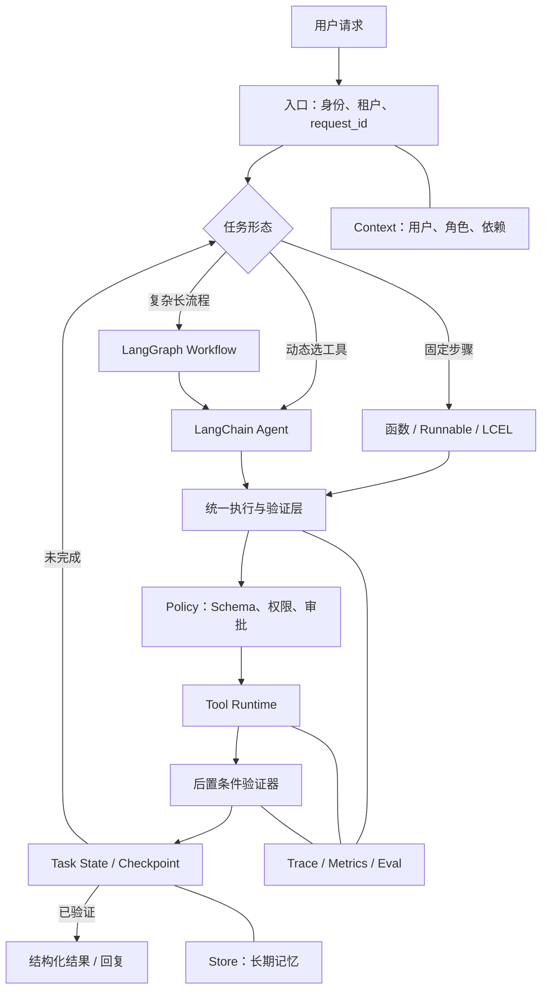

# LangChain 框架面试题：重点梳理与 Agent 项目实践

> 阅读对象：`06 大模型-LangChain 框架面试题.md`。
>
> 本文不逐题复述原文，而是重组 12 道题的知识主线，给出面试必要回答，并把可迁移内容落到生产级 Agent 的架构、状态和实施顺序上。
>
> 当前工作区只有面试笔记，没有 Agent 项目源码，因此项目建议保持技术栈无关；Python 项目可映射到 LangChain/LangGraph，Java 项目可映射到 LangChain4j 或 Spring AI。

## 一页结论

这份文档真正值得掌握的不是 API 清单，而是下面八个工程判断：

1. **先判断是否需要 Agent**：固定步骤用普通函数、Workflow 或 LCEL；运行时需要模型动态选工具才用 Agent；复杂状态、长任务和人工介入再下沉 LangGraph。
2. **LangChain 与 LangGraph 是上下层关系**：LangChain v1 提供高层 Agent 组装，`create_agent` 底层运行在 LangGraph 上；二者不是互斥选项。
3. **Runnable 是组合协议**：Prompt、Model、Parser、Retriever 等可以统一调用和组合；LCEL 表达固定数据流，组合后的流程仍然是 Runnable。
4. **Tool 是模型合同与执行能力的组合**：模型只提出工具名和业务参数；可信身份、权限和依赖由 Runtime 注入，真正的校验、执行、幂等和审计由应用负责。
5. **状态要按作用域分开**：State 保存当前线程内的可变状态，Context 提供本次调用的可信依赖，Store 保存跨线程长期信息；Checkpointer 负责按 `thread_id` 保存执行快照。
6. **确定性规则不要藏在 Prompt 里**：权限、金额阈值、审批顺序、停止条件和副作用边界用代码、Middleware 或图节点保证，LLM 只负责确实需要判断的部分。
7. **可恢复不等于恰好执行一次**：Checkpoint 能恢复流程，但恢复、重试和时间旅行都可能再次触发代码；外部写操作仍要使用幂等键、状态查询和补偿机制。
8. **复杂度渐进增加**：可靠单 Agent → 状态与评测 → 可恢复长任务 → 受治理记忆 → 按需 LangGraph/Deep Research/Multi-Agent。图越复杂不代表系统越智能。

面试时间有限时，优先准备原文 **2～6、9～10**，再补 **1、7、11～12**。如果面试岗位是 Java 后端，把第 **8 题 LangChain4j** 提升到 P0/P1。

## 文档脉络

原文 12 道题可以重组为五层，而不是按题号孤立记忆。

### 第一层：框架定位与选型（1、7、8）

- LangChain：通用模型、消息、工具、结构化输出、Middleware 和 Agent 抽象。
- LangGraph：显式状态与流程运行时，解决循环、分支、并行、暂停恢复和人工介入。
- LlamaIndex：优势重心在数据接入、文档解析、索引、检索、重排和上下文组织。
- LangChain4j：不是 Python LangChain 的官方 Java 移植，而是符合 Java 类型、接口、注解和依赖注入习惯的独立框架。

核心选型原则不是比功能表，而是定位项目的主要复杂度：**工具集成、数据检索，还是状态与流程控制。**

### 第二层：从 Chain 到现代组合协议（2、3、11）

- Chain 的本质是预先确定的数据流，不等于某个旧式 `LLMChain` 类。
- Runnable 统一 `invoke/ainvoke/batch/stream` 等调用语义；LCEL 通过 `|`、`RunnableParallel` 等组合串行和并行流程。
- LangChain 的架构演进是：稳定 `langchain-core` 协议、拆出厂商集成、使用 Runnable/LCEL 组合固定流程、用 LangGraph 承担 Agent 运行时。
- `LLMChain`、`SequentialChain`、旧 Memory 等属于 legacy 路径，新项目不应照搬旧教程。

### 第三层：构建一个完整 Agent（3～5）

- 标准 Agent loop：模型读取消息 → 生成工具调用 → 运行时执行工具 → `ToolMessage` 回传 → 模型继续判断或结束。
- 完整 Agent 不只包含模型和工具，还要包含任务边界、结构化输出、可信上下文、权限、超时、错误分类、停止条件、测试和 Trace。
- `create_agent` 适合标准模型—工具循环；Middleware 负责动态提示词、工具过滤、摘要、重试、输出检查和敏感工具审批。

### 第四层：状态、记忆与复杂编排（6、9、10）

- 短期记忆：`State + thread_id + Checkpointer`。
- 长期记忆：`namespace/key + Store`。
- Middleware 改造标准 Agent loop；LangGraph 重新定义整条业务路线。
- LangGraph 用 State、Node、Edge、Reducer、`Command`、`Send`、Subgraph 等原语表达复杂流程，并用 Checkpoint、`interrupt()` 和状态历史支持恢复与人工协作。

### 第五层：研究型 Agent（12）

- Deep Research 不是一个开关，而是一类架构：澄清范围 → Research Brief → Supervisor 拆题 → Researcher 并行搜证 → 证据压缩与补缺 → 统一写作。
- 子 Agent 的首要价值是上下文隔离，其次才是并行。
- 质量来自来源、证据和结论的可追溯关系；成本来自并发宽度与迭代深度，需要全局预算和停止条件。

## 面试重点：按优先级准备

### P0：必须能结合项目讲清楚

#### 1. Chain、Agent、LangGraph 怎么选（第 2、9、10 题）

**必要回答**：

> Chain 是开发阶段已经确定拓扑的数据流，现代 LangChain 主要用 Runnable 与 LCEL 组合；Agent 在运行时由模型决定是否调用工具、调用哪个工具以及是否继续；LangGraph 则让开发者显式控制整个有状态业务流程。固定流程用函数或 LCEL，标准工具循环用 `create_agent`，只有复杂分支、长期暂停、并行汇合、人工节点或精细恢复成为主要难点时，才直接使用 LangGraph。

必须主动纠正两个误区：

- LangChain 不等于只能线性执行，LCEL 支持并行/分支，`create_agent` 本身也包含条件路由和循环。
- LangChain 与 LangGraph 不是二选一；`create_agent` 构建在 LangGraph 上，成熟项目常把 LangChain Agent 作为外层图的节点或子图。

#### 2. Runnable 与 LCEL 的设计价值（第 2、3、11 题）

**必要回答**：

> Runnable 给 Prompt、模型、检索器、解析器和组合流程提供统一的执行与组合协议。LCEL 声明数据如何在这些 Runnable 之间流动，`prompt | model | parser` 通常形成 `RunnableSequence`，并行任务可以用 `RunnableParallel`。组合后的流程仍是 Runnable，因此可以继续嵌套，并复用异步、批处理、流式、配置、重试、回退和追踪能力。

体现深度的补充：

- 统一协议不代表类型自动兼容，前一步输出仍必须匹配后一步输入。
- `stream` 不保证端到端即时流式；中间组件不支持流式转换时，首个输出会被推迟。
- 设计思想是**少量稳定协议 + 组合**，而不是为每个场景继承一个专用 Chain 类。

#### 3. LangChain 的分层架构和 Agent loop（第 3 题）

**必要回答**：

> `langchain-core` 定义 Message、Model、Tool、Runnable 等公共协议；模型和向量库集成包负责适配厂商差异；`create_agent` 提供高层 Agent 入口；LangGraph Runtime 管理状态、路由、持久化和恢复。模型生成带 `tool_calls` 的 `AIMessage` 后，运行时执行对应工具，并用相同 `tool_call_id` 的 `ToolMessage` 回传结果，模型继续判断，直到产生最终回答或命中停止条件。

建议能现场画出：

```text
HumanMessage
   -> Model
   -> AIMessage(tool_calls?)
      -> 无：最终回答
      -> 有：Tool Runtime -> ToolMessage(tool_call_id) -> Model
```

#### 4. Tool 如何注册，安全边界在哪里（第 4、5 题）

**必要回答**：

> Tool 同时包含模型可见的调用合同和应用可执行的函数。合同包括名称、用途和参数 Schema，模型只负责选择工具并生成任务参数；用户 ID、租户、角色、权限和数据库连接等可信信息通过 Runtime/Context 注入。应用侧在执行前重新做 Schema、身份和权限校验，并对远程调用设置超时、并发和有界重试；写操作还要具备幂等、审批、审计和执行后验证。

定义方式不必背得过细，但要会选：

| 需求 | 选择 |
| --- | --- |
| 普通函数已能清楚表达用途 | 直接注册函数 |
| 需要自定义描述或 Pydantic Schema | `@tool`，业务首选 |
| 运行时组装同步/异步实现 | `StructuredTool` |
| 长期持有客户端、管理资源和完整生命周期 | `BaseTool` |

错误处理必须分类：参数错误让模型修正，业务拒绝作为正常结果，网络超时/限流才做有界重试，程序 Bug 和数据损坏要暴露给监控，不能统一吞成“工具失败”。

#### 5. State、Context、Store 和 Checkpointer 如何区分（第 3、6、9～10 题）

**必要回答**：

> State 是当前线程中不断变化的消息、步骤和中间结果；Context 是一次调用期间不变的可信身份和依赖；Checkpointer 按 `thread_id` 保存 State 快照，用于续聊、暂停恢复和故障恢复；Store 按 namespace/key 保存跨线程长期信息。不同 thread 只要可信用户身份相同，可以读取同一用户的长期 Store，但不能共享线程 State。

一句话速记：

```text
短期记忆 = State + thread_id + Checkpointer
可信依赖 = Context / Runtime
长期记忆 = namespace/key + Store
```

还要说明：Chat Memory 是模型当前需要的上下文，不等于完整聊天档案；结构化业务事实和实时余额应回源权威系统，不应从长期记忆中猜。

#### 6. LangGraph 的优势不是“能画图”（第 9～10 题）

**必要回答**：

> LangGraph 把复杂 Agent 的流程变成显式、可持久化、可观察、可恢复的业务状态机。需要模型判断的步骤由 Agent 处理，权限、阈值、审批顺序和结束条件由节点与边确定性控制。Checkpointer 支持恢复，`interrupt()` 支持任意节点人工介入，Reducer 规定并行状态如何合并，`Send` 支持动态 fan-out，子图用于模块化和多 Agent 边界。

工程边界必须补充：

- 恢复时节点可能重新执行；`interrupt()` 恢复也是从节点开头运行，所以中断前的副作用必须幂等。
- Time travel 是从旧 checkpoint 重新执行或分叉，不会撤销现实世界已经发生的动作。
- 节点过细会增加序列化和维护成本，过粗会降低恢复与观察粒度；边界应围绕副作用、重试和人工介入划分。

#### 7. 如何从 Demo 走到生产（第 4、5、6、10 题）

**必要回答**：

> 我会先定义任务边界、允许动作、成功标准和停止条件，再选择模型并把外部能力封装成职责单一的工具；用 system prompt 约束行为，用结构化输出固定业务结果；然后补齐 State、可信 Context、Checkpointer、Store 和 Middleware。测试先从确定性的 Tool 开始，再评工具选择、参数和执行轨迹，最后做端到端目标状态与线上 Trace。敏感写操作必须审批、幂等、可审计，不能只依赖 Prompt。

结构化输出只保证“形状正确”，不保证事实正确；事实必须来自可信工具，业务规则仍由代码校验。

### P1：体现架构深度

#### 8. LangChain、LangGraph、LlamaIndex 如何组合（第 1、7、9 题）

**必要回答**：

> LangChain 优势在通用模型和工具集成，LlamaIndex 优势在文档解析、索引、检索和上下文组织，LangGraph 优势在状态与流程控制。复杂知识型 Agent 可以让 LlamaIndex 管理数据和 Query Engine，把检索暴露成 LangChain Tool，再由 LangChain Agent 决定何时调用；查询改写、证据校验、人工审批和失败恢复则交给外层 LangGraph。

不要为了技术栈完整同时引入三者。只有数据层和编排层都存在独立复杂度时，组合才有收益。

#### 9. Middleware 与图编排的边界（第 3、9～10 题）

- Middleware 适合在标准 Agent loop 的模型/工具调用前后加入动态 Prompt、模型选择、工具过滤、摘要、重试、输出校验和工具审批。
- LangGraph 适合重新规划完整生产线：分类后进入不同子流程，多节点并行汇合，等待多位审核人，失败进入补偿节点，或把数据库写入、规则引擎和 Agent 混排。
- 判断信号：当 Middleware 开始承担大量业务路由、State 字段快速增加、任务必须跨时间恢复时，应把外围流程下沉 LangGraph。

#### 10. Deep Research 为什么需要 Supervisor 和子 Agent（第 12 题）

**必要回答**：

> Deep Research 适合开放、多来源、能拆成相对独立子课题的高价值研究任务。系统先明确范围并形成 Research Brief，Supervisor 根据 Brief 拆题和补缺，Researcher 在隔离上下文中多轮搜证并返回压缩证据，最后由统一写作节点处理重复、冲突、事实、推断和不确定性。子 Agent 首先解决上下文隔离，独立课题才适合并行；不要让每个 Researcher 各写一章再机械拼接。

质量评价要沿着 **来源 → 证据 → 结论** 反查；成本控制要同时限制并发宽度、单分支深度、总 Token、搜索费用和超时。网页是非可信输入，研究工具默认只读，高风险结论保留人工复核。

#### 11. LangChain 的版本演进（第 11 题）

面试无需背补丁版本，抓住四条主线：

1. 稳定核心协议，拆出第三方集成包。
2. 用 Runnable 与 LCEL 统一固定流程的组合方式。
3. 用 LangGraph 承担有状态 Agent 运行时。
4. LangChain v1 聚焦 `create_agent` 与 Middleware，旧 API 迁入 `langchain-classic`。

升级不能只解决导入报错，还要回归工具调用、结构化输出、流式、持久化、幂等与权限路径，并固定经过验证的包版本组合。

#### 12. Java 岗位如何回答 LangChain4j（第 8 题）

**必要回答**：

> LangChain4j 不是 Python LangChain 的官方移植，而是按 Java 习惯设计的独立 LLM 应用框架。它用 ChatModel、EmbeddingModel、EmbeddingStore 等接口隔离常见供应商差异，用 AI Services 把 Prompt、Tools、Chat Memory、RAG 和结构化输出包装成类型化 Java 服务，并能接入 Spring Boot、Quarkus 等现有 DI、配置、测试和监控体系。它适合 AI 是现有 Java 业务系统一部分的场景。

边界同样重要：统一接口只能覆盖能力交集；Chat Memory 不是完整历史；Guardrail 不能替代认证授权；跨小时、可恢复、强事务流程仍需工作流或编排层。强依赖单一供应商最新能力时，官方 SDK 可能更直接。

### P2：理解即可，不宜喧宾夺主

- 罗列大量 Agent 框架名称。说清 LangChain、LangGraph、LlamaIndex 的边界，比只听过十几个框架更可信。
- 背某个时点的模型名、包小版本和实验性模块状态。面试重点是架构方向，实际项目按锁定版本文档验证。
- 展开旧式 `LLMChain`、`ConversationBufferMemory`、`AgentExecutor` 的细节。能读懂存量代码即可，新项目重点讲现代路径。
- 把 Graph API 的每个类名都背下来。先讲 State、Node、Edge、Checkpoint、Interrupt、Reducer 解决什么问题。

## 可以直接用于自己 Agent 项目的架构

原文最值得迁移的不是“换成 LangChain”，而是建立清楚的控制面、状态面和执行面。



### 1. 三种执行模式并存，不要全部 Agent 化

建议在项目内部显式区分：

| 模式 | 适用任务 | 主要实现 |
| --- | --- | --- |
| Deterministic | 清洗、格式转换、固定 RAG、校验 | 普通函数或 Runnable/LCEL |
| Agentic | 运行时在少量工具中动态选择 | `create_agent` 或等价 Agent loop |
| Orchestrated | 多阶段、长时间、审批、并行、恢复 | LangGraph/工作流引擎，内部可嵌 Agent |

这能避免两个极端：用一堆 Prompt 模拟工作流，或为了简单三步流程维护复杂状态图。

### 2. 建立显式状态模型

当前 Agent 项目可以把状态拆成四块：

```yaml
state:                         # 当前线程可变，进入 checkpoint
  task_id: task_123
  messages: []
  status: running
  current_step: retrieve
  success_criteria: []
  evidence_refs: []
  tool_calls: []
  step_count: 4
  token_used: 8200
  retry_count: 1
  pending_approval: null
  final_result: null

context:                       # 可信输入，不让模型生成
  request_id: req_456
  tenant_id: tenant_a
  user_id: user_7
  role: analyst
  permissions: [knowledge.read]

store:                         # 跨线程长期数据
  preferences: []
  reusable_experience: []

artifacts:                     # 大结果外置，State 只保存引用
  - uri: artifact://report/42
    sha256: ...
    summary: ...
```

不要把身份放进模型可填写的 Tool Schema，也不要把整份网页、日志或文件永久堆进 messages。

### 3. Tool 层增加框架之外的治理元数据

无论使用 `@tool`、MCP 还是自定义 Tool Registry，项目内部都应维护更完整的工具卡片：

```yaml
name: create_ticket
description: 创建工单
side_effect: write
required_permissions: [ticket.write]
requires_confirmation: true
idempotency: required
timeout_ms: 10000
retryable_errors: [rate_limited, unavailable]
max_attempts: 2
input_schema: CreateTicketRequest
output_schema: ToolResult
postcondition: ticket_id exists and status == created
redact_fields: [customer_phone, access_token]
```

LangChain Tool Schema 主要帮助模型“选对、填对”；这份项目级元数据帮助运行时“准入、执行、恢复、验证和审计”。

### 4. 把 LangGraph 用在真正需要图的地方

第一张值得实现的图不应是“为了展示框架”，而应覆盖真实的恢复或审批问题，例如：

```text
prepare
  -> parallel[retrieve_context, inspect_environment]
  -> plan
  -> execute_agent
  -> verify
      -> success -> finalize
      -> recoverable -> replan
      -> risky -> human_review
      -> failed -> safe_stop
```

节点划分原则：

- 外部副作用前后设置清晰边界。
- 需要独立重试、人工介入或单独观察的步骤拆开。
- 纯内存的小转换不必拆成大量节点。
- 并行分支写同一字段时定义 Reducer；不要依赖最后写入者。

### 5. 记忆系统按价值写入

建议沿用前几篇笔记中的原则：

- 线程进度进入 State/Checkpointer。
- 稳定用户偏好、明确决策和可复用经验才进入 Store。
- 实时余额、订单状态、权限和库存每次回源权威系统。
- 写入长期记忆时保存来源、时间、置信度、权限域和失效策略。
- 支持用户查看、更正和删除；敏感信息默认不记。

消息过长时，裁剪、删除和摘要不是一回事。裁剪只影响本轮输入，删除会修改持久状态，摘要会引入信息损失。必须保护当前目标、硬约束、未决事项、最近工具结果和审批状态。

### 6. Deep Research 只做成受预算约束的可选模式

如果你的 Agent 项目包含调研/报告任务，可增加如下结构：

```text
clarify -> research_brief -> supervisor
  -> researcher[*] -> evidence_envelope[*]
  -> coverage_and_conflict_check
      -> gap exists: supervisor
      -> enough: final_writer -> citation_check
```

每个 Researcher 只返回结构化证据包，而不是完整聊天：

```yaml
topic: 定价与限制
claims:
  - statement: ...
    source_url: ...
    source_type: official_doc
    published_at: ...
    evidence: ...
    confidence: 0.85
conflicts: []
unresolved_questions: []
tool_calls: 6
tokens_used: 12000
```

只对相互独立的课题并行。全局设置最大 Researcher 数、每分支工具次数、补搜轮数、总 Token/费用、超时和取消策略。

## 推荐实现顺序

### P0：建立可靠的单 Agent 闭环

1. 定义任务目标、允许/禁止动作、成功标准和停止条件。
2. 为 Tool 建立 Schema、权限、风险、超时、错误类型和结构化结果。
3. 把可信身份从模型参数中移出，改为 Context/Runtime 注入。
4. 增加全局步数、时间、Token 和成本预算；无进展时安全停止。
5. 用 Verifier 检查外部目标状态；没有回执和验证，不允许声称完成。
6. 记录模型、工具、状态变化、重试、退出原因和脱敏后的 Trace。

### P1：补齐状态、恢复与评测

1. 以 `thread_id/task_id` 保存 State 与 Checkpoint，生产使用持久化后端。
2. 为写操作增加稳定幂等键和 `unknown` 状态；超时后先查原请求结果。
3. 长任务流式输出业务进度，不只流模型 Token。
4. 评测分为 Tool、轨迹、端到端目标状态和线上业务四层。
5. 把权限绕过、重复副作用、错误完成声明设为发布硬门禁。

### P2：按复杂度引入 LangGraph 和记忆

1. 当业务路由、人工节点、并行汇合和恢复边界开始复杂时，用外层图包住已有 Agent。
2. 先做线程内 Checkpointer，再做真正有价值的长期 Store。
3. 先为敏感工具增加高层审批；只有任意业务阶段都需要暂停时才设计通用 Interrupt 节点。
4. 用故障注入验证恢复：进程重启、工具超时、部分并行失败、重复 resume 和审批超时。

### P3：有明确收益后再做 Deep Research/Multi-Agent

1. 第一批 Worker 只承担只读、可隔离、可并行的检索/分析任务。
2. 主 Agent/Supervisor 保留用户意图、预算和最终决策权。
3. Worker 只返回结论、证据、产物引用、未决问题和资源消耗。
4. 用单 Agent 基线对比质量、耗时、成本和稳定性；没有可测收益就不增加角色。

## 原文中需要谨慎表述的地方

1. **框架抽象不等于完全可替换。**不同模型供应商的 Tool Calling、JSON Schema、多模态、流式和限流行为仍需分别验证。
2. **Runnable 统一调用接口，不保证内部能力相同。**`batch`、`stream` 和重试效果取决于具体组件。
3. **Structured Output 只保证结构，不保证事实、权限或业务正确性。**
4. **Checkpointer 不提供 exactly-once。**恢复、重试和重放仍可能再次执行节点。
5. **长期记忆不是完整聊天记录，也不等于向量数据库。**不同信息需要不同存储和治理策略。
6. **Middleware 不是独立工作流引擎。**它运行在标准 Agent loop 的生命周期中，不适合承载无限扩张的业务拓扑。
7. **LangGraph 更底层，不代表所有任务都应该使用。**图的自由度会带来 State、Reducer、恢复和副作用设计成本。
8. **LangChain 与 LlamaIndex 都能做 Agent 和 RAG。**比较的是优势重心，不是绝对能力边界。
9. **LangChain4j 不是 Python LangChain 的官方 Java 版。**Java 项目还要按现有 Spring/Quarkus 技术栈比较 Spring AI、官方 SDK 等方案。
10. **Deep Research 不是搜索次数更多。**它要求动态规划、证据核验、补缺、统一写作和可追溯引用。
11. **子 Agent 越多不代表研究越好。**收益主要来自上下文隔离和真正可并行的子问题，代价是调用、协调和一致性成本。
12. **示例中的模型名、版本日期和实验性状态属于时点信息。**面试讲架构方向；实现时以项目锁定版本的官方文档和回归测试为准。

## 面试项目表达模板

> 我们先按任务确定性选择执行方式：固定步骤使用函数或 Runnable/LCEL，模型需要动态选择工具时使用标准 Agent，复杂长流程再用 LangGraph 作为外层编排。Agent 的工具都有明确 Schema，但用户、租户和权限不让模型填写，而是通过可信 Runtime 注入；写操作在服务端做权限、审批、幂等和后置验证。
>
> 状态上，我们把当前任务进度放在 State，通过 thread_id 和 Checkpointer 支持恢复；跨线程偏好进入 Store，实时事实始终回源业务系统。对于人工审批和外部副作用，我们显式设计状态和恢复边界，避免把 Checkpoint 误当成 exactly-once。
>
> 评测不只看最终回答，还分别看工具选择、参数、轨迹、端到端目标状态、延迟、成本和安全硬门禁。只有任务确实可以拆成独立研究单元时，才增加 Supervisor/Researcher；子 Agent 返回结构化证据，由统一节点生成最终报告。

这段回答能覆盖框架选型、运行原理、工具安全、状态记忆、LangGraph、恢复、评测和 Multi-Agent，适合作为项目面主线。

## 面试前 10 分钟速记

1. 固定数据流用 Runnable/LCEL；动态工具决策用 Agent；复杂有状态业务流用 LangGraph。
2. `create_agent` 构建在 LangGraph 上，LangChain 与 LangGraph 是上下层，不是二选一。
3. Runnable 是统一执行与组合协议；组合后的 Chain 仍是 Runnable。
4. Tool = 模型可见合同 + 运行时执行函数；可信身份由 Runtime 注入。
5. 模型提出动作，应用校验和执行；Prompt 不是权限系统。
6. State 是当前线程状态，Context 是可信依赖，Store 是跨线程记忆，Checkpointer 保存线程快照。
7. Middleware 改造标准 Agent loop；LangGraph 重新定义完整业务拓扑。
8. Checkpoint 能恢复，不保证外部副作用只执行一次；幂等仍是业务责任。
9. Graph 的价值是显式控制、持久化、恢复和观察，不是“画图更高级”。
10. Deep Research：Brief、拆题、隔离搜证、补缺、统一写作；先保证证据，再谈并行。
11. LangChain 偏工具与 Agent，LlamaIndex 偏数据与检索，LangGraph 偏流程与状态。
12. 旧 Chain/Memory API 会读即可；新项目重点讲 Runnable、`create_agent`、Middleware、Checkpointer 和 Store。
