# 1 MySQL面试题

有几块内容建议重点花时间：

- **索引**：B+ 树的结构、聚簇索引和非聚簇索引的区别、联合索引的最左匹配原则、索引失效的场景，这块是 MySQL 面试里出现频率最高的。
- **事务和 MVCC**：四种隔离级别的区别、MVCC 是怎么用 Read View 来实现可重复读的，这是理解并发问题的核心。
- **锁**：行锁、间隙锁、临键锁各自锁的范围，以及为什么没用上合适的索引会扩大加锁范围，这块很多人答不清楚。
- **日志**：redo log、undo log、binlog 三个日志各自的作用和区别，两阶段提交是怎么保证数据一致性的。

如果你是第一次系统准备 MySQL 面试，建议先搞清楚存储引擎和索引，再去看事务和锁，最后看日志和架构部分。这样知识之间的关联会更清晰，不容易学了后面忘了前面。

------

## 1.1 SQL基础

### 1.1.1 NOSQL和SQL的区别？

SQL数据库，指关系型数据库 - 主要代表：SQL Server，Oracle，MySQL(开源)，PostgreSQL(开源)。

关系型数据库存储结构化数据。这些数据逻辑上以行列二维表的形式存在，每一列代表数据的一种属性，每一行代表一个数据实体。


NoSQL指非关系型数据库 ，主要代表：MongoDB，Redis。NoSQL 数据库逻辑上提供了不同于二维表的存储方式，存储方式可以是JSON文档、哈希表或者其他方式。


选择 SQL vs NoSQL，考虑以下因素。

> ACID vs BASE

关系型数据库通常支持 ACID，也就是原子性、一致性、隔离性和持久性。部分 NoSQL 系统更强调 BASE，也就是基本可用、软状态和最终一致性。

不过，**不能简单认为 SQL 就一定支持完整事务、NoSQL 就一定不支持事务**。比如 MySQL 的事务能力和存储引擎有关，MongoDB 也支持多文档事务，具体还是要看数据库的实现和配置。

从实用的角度出发，我们需要考虑对于面对的应用场景，ACID 是否是必须的。比如银行应用就必须保证 ACID，否则一笔钱可能被使用两次；又比如社交软件不必保证 ACID，因为一条状态的更新对于所有用户读取先后时间有数秒不同并不影响使用。

对于需要事务和复杂关联查询的应用，通常优先考虑关系型数据库；对于缓存、文档存储等场景，可以考虑对应的 NoSQL 数据库。一个系统也可以同时使用两者，比如 MySQL 存业务数据，Redis 缓存热点数据。

> 扩展性对比

很多 NoSQL 数据库围绕特定的数据模型设计，较少依赖跨节点 JOIN，因此更容易按键分片。比如 Redis 支持主从复制、哨兵和 Cluster，但扩展时仍然需要考虑热点数据、跨分片操作和一致性等问题。

相反关系型数据库的数据之间存在关联性，水平扩展较难 ，需要解决跨服务器 JOIN，分布式事务等问题。

### 1.1.2 数据库三大范式是什么？

**第一范式（1NF）：要求数据库表的每一列都是不可分割的原子数据项。**

举例说明：


在上面的表中，“家庭信息”和“学校信息”列均不满足原子性的要求，故不满足第一范式，调整如下：


可见，调整后的每一列都是不可再分的，因此满足第一范式（1NF）；

**第二范式（2NF）：在1NF的基础上，非码属性必须完全依赖于候选码（在1NF基础上消除非主属性对主码的部分函数依赖）**

**第二范式需要确保数据库表中的每一列都和主键相关，而不能只与主键的某一部分相关（主要针对联合主键而言）。**

举例说明：


在上图所示的情况中，同一个订单中可能包含不同的产品，因此主键必须是“订单号”和“产品号”联合组成，

但可以发现，产品数量、产品折扣、产品价格与“订单号”和“产品号”都相关，但是订单金额和订单时间仅与“订单号”相关，与“产品号”无关，

这样就不满足第二范式的要求，调整如下，需分成两个表：


**第三范式（3NF）：在2NF基础上，任何非主[属性 (opens new window)](https://baike.baidu.com/item/属性)不依赖于其它非主属性（在2NF基础上消除传递依赖）**

**第三范式需要确保数据表中的每一列数据都和主键直接相关，而不能间接相关。**

举例说明：


上表中，所有属性都完全依赖于学号，所以满足第二范式，但是“班主任性别”和“班主任年龄”直接依赖的是“班主任姓名”，

而不是主键“学号”，所以需做如下调整：


这样以来，就满足了第三范式的要求。

### 1.1.3 MySQL 怎么连表查询？

数据库有以下几种联表查询类型：

1. **内连接 (INNER JOIN)**
2. **左外连接 (LEFT JOIN)**
3. **右外连接 (RIGHT JOIN)**
4. **全外连接 (FULL JOIN)**


**1. 内连接 (INNER JOIN)**

内连接返回两个表中有匹配关系的行。**示例**:

```sql
SELECT employees.name, departments.name
FROM employees
INNER JOIN departments
ON employees.department_id = departments.id;
```

这个查询返回每个员工及其所在的部门名称。

**2. 左外连接 (LEFT JOIN)**

左外连接返回左表中的所有行，即使在右表中没有匹配的行。未匹配的右表列会包含NULL。**示例**:

```sql
SELECT employees.name, departments.name
FROM employees
LEFT JOIN departments
ON employees.department_id = departments.id;
```

这个查询返回所有员工及其部门名称，包括那些没有分配部门的员工。

**3. 右外连接 (RIGHT JOIN)**

右外连接返回右表中的所有行，即使左表中没有匹配的行。未匹配的左表列会包含NULL。**示例**:

```sql
SELECT employees.name, departments.name
FROM employees
RIGHT JOIN departments
ON employees.department_id = departments.id;
```

这个查询返回所有部门及其员工，包括那些没有分配员工的部门。

**4. 全外连接 (FULL JOIN)**

全外连接返回两个表中所有行，包括非匹配行，在MySQL中，FULL JOIN 需要使用 UNION 来实现，因为 MySQL 不直接支持 FULL JOIN。**示例**:

```sql
SELECT employees.name, departments.name
FROM employees
LEFT JOIN departments
ON employees.department_id = departments.id

UNION ALL

SELECT employees.name, departments.name
FROM employees
RIGHT JOIN departments
ON employees.department_id = departments.id
WHERE employees.id IS NULL;
```

这个查询返回所有员工和所有部门，包括没有匹配行的记录。第二部分只取右表没有匹配到员工的行，再用 `UNION ALL` 合并，这样既不会重复返回已经匹配的行，也不会把姓名相同的不同员工误当成重复结果去掉。

### 1.1.4 MySQL如何避免重复插入数据？

**方式一：使用UNIQUE约束**

在表的相关列上添加UNIQUE约束，确保每个值在该列中唯一。例如：

```sql
CREATE TABLE users (
    id INT PRIMARY KEY AUTO_INCREMENT,
    email VARCHAR(255) NOT NULL UNIQUE,
    name VARCHAR(255)
);
```

如果尝试插入重复的email，MySQL会返回错误。

**方式二：使用INSERT ... ON DUPLICATE KEY UPDATE**

这种语句允许在插入记录时处理重复键的情况。如果插入的记录与现有记录冲突，可以选择更新现有记录：

```sql
INSERT INTO users (email, name) 
VALUES ('example@example.com', 'John Doe') AS new_row
ON DUPLICATE KEY UPDATE name = new_row.name;
```

上面用的是 MySQL 8.0.19 及之后支持的新行别名写法。较早版本可以写 `name = VALUES(name)`，不过这种写法从 MySQL 8.0.20 开始被弃用。

**方式三：使用INSERT IGNORE**： 该语句会在插入记录时忽略那些因重复键而导致的插入错误。例如：

```sql
INSERT IGNORE INTO users (email, name) 
VALUES ('example@example.com', 'John Doe');
```

如果 email 已经存在，这条插入语句会被忽略。不过，`IGNORE` 还可能把部分数据转换错误降为警告，不能把它理解成只忽略重复键错误。

选择哪种方法取决于具体的需求：

- 如果需要保证表内某个业务键唯一，先建立 UNIQUE 约束。联合唯一索引可以保证多个字段的组合不重复。
- 如果需要插入和更新结合可以使用`ON DUPLICATE KEY UPDATE`。
- 对于允许忽略重复插入的场景，可以使用 `INSERT IGNORE`，同时注意检查警告。

**防重复的关键还是唯一约束**，后面两种写法都是建立在主键或唯一索引冲突的基础上处理数据。如果只是先 SELECT 判断不存在，再 INSERT，并发时两个请求都可能查到不存在，还是会重复插入。另外，唯一索引允许多个 NULL，如果业务要求该字段一定唯一，通常还要加上 `NOT NULL`。


### 1.1.5 CHAR 和 VARCHAR有什么区别？

- **CHAR 是定长字符串**，比如 `CHAR(10)`，不足的部分会在存储时补空格，读取时通常会去掉末尾的填充空格，适合长度比较固定的数据。
- **VARCHAR 是变长字符串**，比如 `VARCHAR(100)`，100 表示最多保存 100 个字符，实际占用空间取决于内容的字节数，还需要 1 或 2 个字节记录长度，适合姓名、地址等长度不固定的数据。

这里的长度是字符数，不是字节数。尤其使用多字节字符集时，不能简单认为 `CHAR(10)` 就只占 10 个字节。选择哪一种主要看数据特点，也不能直接认为 CHAR 一定比 VARCHAR 快。

### 1.1.6 VARCHAR 后面代表字节还是字符？

`VARCHAR` 后面括号里的数字代表的是字符数，而不是字节数。

比如 `VARCHAR(10)`，这里的 10 表示该字段最多可以存储 10 个字符。字符的字节长度取决于所使用的字符集。

- 如果字符集是 ASCII 字符集：ASCII 字符集每个字符占用 1 个字节，那么 VARCHAR(10) 最多可以存储 10 个 ASCII 字符，同时占用的存储空间最多为 10 个字节（不考虑额外的长度记录开销）。
- 如果字符集是 `utf8mb4`，每个字符最多占用 4 个字节，`VARCHAR(10)` 最多可以存储 10 个字符，内容最多占 40 个字节，另外还需要长度记录开销。MySQL 的 `utf8mb3` 每个字符最多占 3 个字节，不能和 `utf8mb4` 混为一谈。

VARCHAR 的最大可声明长度还受到字符集和整行 65,535 字节上限等限制，并不是可以随意把括号里的数字设得很大。

### 1.1.7 int(1) int(10) 在mysql有什么不同？

`INT(1)` 和 `INT(10)` 的区别主要在于 **显示宽度**，而不是存储范围或数据类型本身的大小。以下是核心区别的总结：

- 本质是显示宽度，不改变存储方式：`INT` 的存储固定为 4 字节，所有 `INT`（无论写成 `INT(1)` 还是 `INT(10)`）占用的存储空间 均为 4 字节。括号内的数值（如 `1` 或 `10`）是显示宽度，用于在 特定场景下 控制数值的展示格式。
- 唯一作用场景：`ZEROFILL` 补零显示，当字段设置 `ZEROFILL` 时：数字显示时会用前导零填充至指定宽度。比如，字段类型为 `INT(4) ZEROFILL`，实际存入 `5` → 显示为 `0005`，实际存入 `12345` → 显示仍为 `12345`（宽度超限时不截断）。

举一个例子

```sql
-- 创建一个包含 INT(1) 和 INT(10) 字段的表，并设置 ZEROFILL 属性
CREATE TABLE test_int (
    num1 INT(1) ZEROFILL,
    num2 INT(10) ZEROFILL
);

-- 插入数据
INSERT INTO test_int (num1, num2) VALUES (1, 1);

-- 查询数据
SELECT * FROM test_int;
```

结果分析：

- `num1` 字段由于设置为 `INT(1) ZEROFILL`，其显示宽度为 1，插入数据 `1` 时会显示为 `1`。
- `num2` 字段设置为 `INT(10) ZEROFILL`，显示宽度为 10，插入数据 `1` 时会在前面填充零，显示为 `0000000001`。

整数显示宽度和 `ZEROFILL` 从 MySQL 8.0.17 开始被弃用，新表直接用 `INT` 就好，需要补零展示可以交给应用处理。

### 1.1.8 Text数据类型可以无限大吗？

不能。MySQL 有 4 种 TEXT 类型，最大长度按字节计算：

- TINYTEXT：255 字节。
- TEXT：65,535 字节，约 64 KB。
- MEDIUMTEXT：16,777,215 字节，约 16 MB。
- LONGTEXT：4,294,967,295 字节，约 4 GB。

这里限制的是字节数，所以使用 `utf8mb4` 存储中文或表情时，能放下的字符数会少于这个数字。实际读写还会受到 `max_allowed_packet`、内存和传输成本等限制，大文件通常更适合放到对象存储，数据库里保存文件地址。

### 1.1.9 金额为什么建议用 DECIMAL，而不是 FLOAT 或 DOUBLE？

因为 **DECIMAL 保存的是精确的十进制数，而 FLOAT 和 DOUBLE 保存的是近似值**。金额计算如果存在精度误差，就可能出现对账不一致的问题。

比如 `DECIMAL(10, 2)`，10 表示总位数，2 表示小数位数，也就是整数部分最多 8 位，小数部分最多 2 位。

也可以用整数保存最小货币单位，比如用 BIGINT 保存「分」，100 元保存为 10000。无论采用哪一种，应用里的金额计算也要使用对应的精确类型，并明确舍入规则，不能在应用中先用浮点数算错了，再存到 DECIMAL 里。

### 1.1.10 IP地址如何在数据库里存储？

IPv4 地址是一个 32 位的二进制数，通常以点分十进制表示法呈现，例如 `192.168.1.1`。

**字符串类型的存储方式**：直接将 IP 地址作为字符串存储在数据库中，比如可以用 `VARCHAR(15)`来存储。

```sql
-- 创建一个表，使用VARCHAR类型存储IPv4地址
CREATE TABLE ip_records (
    id INT AUTO_INCREMENT PRIMARY KEY,
    ip_address VARCHAR(15)
);

-- 插入数据
INSERT INTO ip_records (ip_address) VALUES ('192.168.1.1');
```

- **优点**：直观易懂，方便直接进行数据的插入、查询和显示，不需要进行额外的转换操作。
- **缺点**：占用存储空间较大，字符串比较操作的性能相对较低，不利于进行范围查询。

整数类型的存储方式：将 IPv4 地址转换为 32 位无符号整数进行存储，常用的数据类型有 `INT UNSIGNED`。

```sql
-- 创建一个表，使用INT UNSIGNED类型存储IPv4地址
CREATE TABLE ip_records (
    id INT AUTO_INCREMENT PRIMARY KEY,
    ip_address INT UNSIGNED
);

-- 插入数据，需要先将IP地址转换为整数
INSERT INTO ip_records (ip_address) VALUES (INET_ATON('192.168.1.1'));

-- 查询时将整数转换回IP地址
SELECT INET_NTOA(ip_address) FROM ip_records;
```

- **优点**：占用存储空间小，整数比较操作的性能较高，便于进行范围查询。
- **缺点**：需要进行额外的转换操作，不够直观，增加了开发的复杂度。

如果还要支持 IPv6，就不能只用 INT UNSIGNED 了，可以用 `VARBINARY(16)` 保存二进制地址，写入时用 `INET6_ATON()`，读取时用 `INET6_NTOA()`。这两个函数也能处理 IPv4 地址。

### 1.1.11 说一下外键约束

外键约束的作用是维护表与表之间的引用关系，避免出现「子表引用的父表记录不存在」的情况。

举个栗子，一个学生可以选多门课程，一门课程也可以被多个学生选择，这是多对多关系，需要用选课表来关联，不能只在学生表里放一个 course_id。

```sql
CREATE TABLE students (
    id INT PRIMARY KEY,
    name VARCHAR(50)
) ENGINE = InnoDB;

CREATE TABLE courses (
    id INT PRIMARY KEY,
    name VARCHAR(50)
) ENGINE = InnoDB;

CREATE TABLE student_courses (
    student_id INT NOT NULL,
    course_id INT NOT NULL,
    PRIMARY KEY (student_id, course_id),
    FOREIGN KEY (student_id) REFERENCES students(id),
    FOREIGN KEY (course_id) REFERENCES courses(id)
) ENGINE = InnoDB;
```

这样，给一个不存在的学生添加选课记录，或者选择不存在的课程，数据库都会拒绝。


删除父表记录时，还可以指定处理方式：

- **RESTRICT**：如果还有子表记录引用，就拒绝删除，InnoDB 的 NO ACTION 也是这种效果。
- **CASCADE**：删除父表记录时，把关联的子表记录一起删除。
- **SET NULL**：把子表的外键字段设置为 NULL，前提是该字段允许为空。

外键可以把引用完整性检查交给数据库，不过也会增加检查和加锁开销。实际是否使用，要结合写入压力、分库分表需求来判断；如果不用外键，就需要应用自己维护这些关系。

### 1.1.12 MySQL的关键字 IN 和 EXISTS

在MySQL中，`IN` 和 `EXISTS` 都是用来处理子查询的关键词，但它们在功能、性能和使用场景上有各自的特点和区别。

> IN关键字

`IN` 用于检查左边的表达式是否存在于右边的列表或子查询的结果集中。如果存在，则`IN` 返回`TRUE`，否则返回`FALSE`。

语法结构：

```sql
SELECT column_name(s)
FROM table_name
WHERE column_name IN (value1, value2, ...);
```

或

```sql
SELECT column_name(s)
FROM table_name
WHERE column_name IN (SELECT column_name FROM another_table WHERE condition);
```

例子：

```sql
SELECT * FROM Customers
WHERE Country IN ('Germany', 'France');
```

> EXISTS关键字

`EXISTS` 用于判断子查询是否至少能返回一行数据。它不关心子查询返回什么数据，只关心是否有结果。如果子查询有结果，则`EXISTS` 返回`TRUE`，否则返回`FALSE`。

语法结构：

```sql
SELECT column_name(s)
FROM table_name
WHERE EXISTS (SELECT column_name FROM another_table WHERE condition);
```

例子：

```sql
SELECT * FROM Customers
WHERE EXISTS (SELECT 1 FROM Orders WHERE Orders.CustomerID = Customers.CustomerID);
```

区别与选择：

- **语义区别**：IN 比较值是否属于一个集合，EXISTS 判断子查询有没有返回行。`EXISTS (SELECT NULL)` 也为 TRUE，因为它确实返回了一行。
- **性能区别**：不能简单背「大表用 EXISTS、小表用 IN」。MySQL 优化器可能把它们转成半连接或者对子查询结果做物化，具体性能取决于索引、数据分布和执行计划。
- **NULL 值处理**：IN 在没有找到匹配值、但集合中包含 NULL 时，结果是 UNKNOWN，在 WHERE 中不会被保留。尤其使用 NOT IN 时，这一点很容易踩坑。

比如下面这个条件：

```sql
SELECT 1 NOT IN (2, NULL);
```

结果是 NULL，而不是 TRUE。如果要查询「没有订单的客户」，通常可以用相关子查询的 NOT EXISTS：

```sql
SELECT c.*
FROM Customers c
WHERE NOT EXISTS (
    SELECT 1 FROM Orders o WHERE o.CustomerID = c.CustomerID
);
```

这样，Orders 中有 CustomerID 为 NULL 的行，也不会把所有客户都排除掉。


### 1.1.13 mysql中的一些基本函数，你知道哪些？

> 一、字符串函数

**CONCAT(str1, str2, ...)**：连接多个字符串，返回一个合并后的字符串。

```sql
SELECT CONCAT('Hello', ' ', 'World') AS Greeting;
```

**LENGTH(str)**：返回字符串的字节数；如果要统计字符数，使用 `CHAR_LENGTH(str)`。

```sql
SELECT LENGTH('小林') AS ByteLength, CHAR_LENGTH('小林') AS CharLength;
```

**SUBSTRING(str, pos, len)**：从指定位置开始，截取指定长度的子字符串。

```sql
SELECT SUBSTRING('Hello World', 1, 5) AS SubStr;
```

**REPLACE(str, from_str, to_str)**：将字符串中的某部分替换为另一个字符串。

```sql
SELECT REPLACE('Hello World', 'World', 'MySQL') AS ReplacedStr;
```

> 二、数值函数

**ABS(num)**：返回数字的绝对值。

```sql
SELECT ABS(-10) AS AbsoluteValue;
```

**POWER(num, exponent)**：返回指定数字的指定幂次方。

```sql
SELECT POWER(2, 3) AS PowerValue;
```

> 三、日期和时间函数

**NOW()**：返回当前日期和时间。

```sql
SELECT NOW() AS CurrentDateTime;
```

**CURDATE()**：返回当前日期。

```sql
SELECT CURDATE() AS CurrentDate;
```

> 四、聚合函数

**COUNT(column)**：计算指定列中的非 NULL 值的个数；`COUNT(*)` 统计结果集中的行数，包括列值为 NULL 的行。

```sql
SELECT COUNT(*) AS RowCount FROM my_table;
```

**SUM(column)**：计算指定列的总和。

```sql
SELECT SUM(price) AS TotalPrice FROM orders;
```

**AVG(column)**：计算指定列的平均值。

```sql
SELECT AVG(price) AS AveragePrice FROM orders;
```

**MAX(column)**：返回指定列的最大值。

```sql
SELECT MAX(price) AS MaxPrice FROM orders;
```

**MIN(column)**：返回指定列的最小值。

```sql
SELECT MIN(price) AS MinPrice FROM orders;
```

### 1.1.14 COUNT(*)、COUNT(1) 和 COUNT(字段) 有什么区别？

- **COUNT(\*)**：统计行数，不管某一列是不是 NULL。
- **COUNT(1)**：对每一行统计常量 1，1 不为 NULL，所以统计结果和 COUNT(*) 一样。
- **COUNT(字段)**：只统计该字段不为 NULL 的行。如果字段定义为 NOT NULL，结果才和 COUNT(*) 相同。

对于 InnoDB，**不能直接读取一个固定的总行数返回**，因为不同事务的可见数据可能不同。没有 WHERE 条件时，MySQL 通常会选择较小的二级索引扫描；没有合适的二级索引，再扫描聚簇索引。

所以，不需要为了性能把 COUNT(*) 改成 COUNT(1)，通常直接用 COUNT(*) 表达「统计行数」就好。大表频繁统计且允许有延迟时，可以考虑维护汇总数据。

### 1.1.15 NULL 和空字符串有什么区别？

**NULL 表示值未知或者缺失，空字符串表示值已知，但内容为空**，两者不是一回事。

```sql
SELECT * FROM users WHERE name IS NULL;
SELECT * FROM users WHERE name = '';
```

判断 NULL 要用 `IS NULL` 或 `IS NOT NULL`，不能写 `name = NULL`。普通比较运算遇到 NULL，结果通常是 UNKNOWN，WHERE 只保留结果为 TRUE 的行。如果需要把两个 NULL 也当成相等，可以用 MySQL 的 NULL 安全等于运算符 `<=>`。

另外，**NULL 并不意味着不能走索引**，`IS NULL` 也可能使用索引；唯一索引允许多个 NULL，而 COUNT(字段) 不会统计 NULL，这些都是面试里容易追问的点。

### 1.1.16 DELETE、TRUNCATE 和 DROP 有什么区别？

- **DELETE**：删除表中的记录，可以带 WHERE 条件，表结构保留。对于 InnoDB，它是事务操作，在事务提交前可以回滚，会产生 undo 和 redo，也会逐行触发 DELETE 触发器。
- **TRUNCATE**：清空整张表，不能带 WHERE，表结构保留，通常会重建表并重置自增计数器，不会逐行触发 DELETE 触发器。
- **DROP**：删除整张表，表结构和数据都不再保留。

TRUNCATE 和普通 DROP TABLE 都属于 DDL，会隐式提交，不能通过应用执行 ROLLBACK 撤销。MySQL 8.0 的原子 DDL 保证的是崩溃时操作的一致性，不能把它理解成 DDL 可以像普通事务一样手动回滚。

### 1.1.17 **SQL查询语句的执行顺序是怎么样的？**


这里说的是 SQL 的**逻辑处理顺序**，不是数据库内部实际执行每一步的顺序。可以按下面这个顺序理解：

```text
FROM / JOIN → ON → WHERE → GROUP BY → HAVING
→ SELECT → DISTINCT → ORDER BY → LIMIT
```

- 先确定从哪些表取数据，按 ON 条件关联，再用 WHERE 过滤记录。
- 然后分组、计算聚合结果，通过 HAVING 过滤分组。
- 最后选择输出的列、去重、排序，再限制返回行数。

所以，**WHERE 过滤的是分组前的记录，HAVING 过滤的是分组后的结果**。SELECT 中定义的别名通常不能直接用于 WHERE，不过 MySQL 允许在 GROUP BY、HAVING 和 ORDER BY 中使用。

实际执行时，优化器可能调整连接顺序、提前过滤条件，或者利用索引省掉排序，并不会每一步都真正生成一张临时表。

### 1.1.18 sql题：给学生表、课程成绩表，求不存在01课程但存在02课程的学生的成绩

可以使用SQL的子查询和`LEFT JOIN`或者`EXISTS`关键字来实现，这里我将展示两种不同的方法来完成这个查询。

假设我们有以下两张表：

1. `Student` 表，其中包含学生的`sid`（学生编号）和其他相关信息。
2. `Score` 表，其中包含`sid`（学生编号），`cid`（课程编号）和`score`（分数）。

方法1：使用LEFT JOIN 和 IS NULL

```sql
SELECT s.sid, s.sname, sc2.cid, sc2.score
FROM Student s
LEFT JOIN Score AS sc1 ON s.sid = sc1.sid AND sc1.cid = '01'
LEFT JOIN Score AS sc2 ON s.sid = sc2.sid AND sc2.cid = '02'
WHERE sc1.cid IS NULL AND sc2.cid IS NOT NULL;
```

方法2：使用NOT EXISTS

```sql
SELECT s.sid, s.sname, sc.cid, sc.score
FROM Student s
JOIN Score sc ON s.sid = sc.sid AND sc.cid = '02'
WHERE NOT EXISTS (
    SELECT 1 FROM Score sc1 WHERE sc1.sid = s.sid AND sc1.cid = '01'
);
```

### 1.1.19 给定一个学生表 student_score（stu_id，subject_id，score），查询总分排名在5-10名的学生id及对应的总分

可以使用以下 SQL 查询来检索总分排名在 5 到 10 名的学生 ID 及对应的总分。其中我们先计算每个学生的总分，然后为其分配一个排名，最后检索排名在 5 到 10 之间的记录。

```sql
WITH StudentTotalScores AS (
    SELECT 
        stu_id,
        SUM(score) AS total_score
    FROM 
        student_score
    GROUP BY 
        stu_id
),
RankedStudents AS (
    SELECT
        stu_id,
        total_score,
        RANK() OVER (ORDER BY total_score DESC) AS ranking
    FROM
        StudentTotalScores
)
SELECT
    stu_id,
    total_score
FROM
    RankedStudents
WHERE
    ranking BETWEEN 5 AND 10
ORDER BY ranking, stu_id;
```

解释：

1. 子查询 StudentTotalScores 中，我们通过对 student_score 表中的 stu_id 分组来计算每个学生的总分。
2. 子查询 RankedStudents 中，我们使用 RANK() 函数为每个学生分配一个排名，按总分从高到低排序。
3. 最后，我们在主查询中选择排名在 5 到 10 之间的学生。

这个写法需要 MySQL 8.0 及以上版本。另外，要先问清楚同分怎么算：`RANK()` 是并列名次、后面的名次会跳号；`DENSE_RANK()` 是并列名次、不跳号；如果只是取排序后的第 5 到第 10 条记录，可以用 `ROW_NUMBER() OVER (ORDER BY total_score DESC, stu_id)`，用 stu_id 保证同分时排序稳定。

### 1.1.20 SQL题：查某个班级下所有学生的选课情况

有三张表：学生信息表、学生选课表、学生班级表

学生信息表（students）结构如下：

```sql
CREATE TABLE students (
  student_id INT PRIMARY KEY,     -- 学生的唯一标识，主键
  student_name VARCHAR(50),       -- 学生姓名
  class_id INT                    -- 学生所属班级的标识，用于关联班级表
);
```

学生选课表（`course_selections`）结构如下：

```sql
CREATE TABLE course_selections (
    selection_id INT PRIMARY KEY, -- 选课记录的唯一标识，主键
    student_id INT,               -- 选课学生的标识，用于关联学生信息表
    course_name VARCHAR(50)       -- 所选课程的名称
);
```

学生班级表（`classes`）结构如下：

```sql
CREATE TABLE classes (
    class_id INT PRIMARY KEY,   -- 班级的唯一标识，主键
    class_name VARCHAR(50)      -- 班级名称
);
```

要查询某个班级（例如班级名称为 'Class A'）下所有学生的选课情况，可以使用以下 SQL 查询语句：

```sql
SELECT 
    s.student_id,
    s.student_name,
    cs.course_name
FROM 
    students s
LEFT JOIN
    course_selections cs ON s.student_id = cs.student_id
JOIN 
    classes c ON s.class_id = c.class_id
WHERE 
    c.class_name = 'Class A';
```

选课表这里要用 LEFT JOIN，因为题目要求的是「所有学生」，没有选课的学生也要返回，对应的 course_name 为 NULL。如果把选课表的过滤条件写到 WHERE 中，还要注意不要把这些未匹配的学生过滤掉；需要保留时，通常把右表的限制条件放在 ON 中。

### 1.1.21 如何用 MySQL 实现一个可重入的锁？

可以用一张锁表，记录「锁名、持有者、重入次数」，再通过事务和 `SELECT ... FOR UPDATE` 保证加锁、解锁过程不会被并发请求打乱。

```sql
CREATE TABLE lock_table (
    lock_name VARCHAR(128) PRIMARY KEY,
    holder_id VARCHAR(128) DEFAULT NULL,
    reentry_count INT NOT NULL DEFAULT 0
) ENGINE = InnoDB;

-- 提前初始化要使用的锁，记录一直保留
INSERT INTO lock_table (lock_name) VALUES ('order_lock');
```

锁名必须唯一。持有者也不能只用线程名称，不同服务实例可能有同名线程，可以使用「实例 ID + 线程 ID + 唯一标识」来区分。

> 加锁的逻辑

1. 开启事务，查询该锁记录：`SELECT holder_id, reentry_count FROM lock_table WHERE lock_name = ? FOR UPDATE`。
2. 如果 holder_id 为 NULL，说明锁空闲，把 holder_id 设为自己，reentry_count 设为 1。
3. 如果 holder_id 是自己，说明是重入，把 reentry_count 加 1。
4. 如果 holder_id 是其他持有者，说明加锁失败，结束事务后再决定返回失败还是等待重试。
5. 提交事务。这里释放的是数据库行锁，业务锁的归属仍然保存在记录里。

> 解锁的逻辑

1. 开启事务，通过 FOR UPDATE 锁住同一条记录，并检查 holder_id 是否是自己。
2. 如果不是自己，不能释放锁。
3. 如果 reentry_count 大于 1，就减 1；如果等于 1，就把 holder_id 置为 NULL、reentry_count 置为 0，完全释放业务锁。
4. 提交事务。

这里保留固定的锁记录，可以避免「记录不存在时，多个请求同时插入」的问题。如果要动态创建锁，也必须通过主键唯一约束处理并发插入失败和重试。


不过，这只是基本实现。持有者崩溃后，数据库事务虽然已经结束，表里的业务锁记录仍可能一直被占用。生产环境还需要考虑租约、续期，以及过期持有者继续写入的问题；只是加一个过期时间，还不能保证业务操作始终互斥。

## 1.2 存储引擎

### 1.2.1 执行一条SQL请求的过程是什么？

先来一个上帝视角图，下面就是 MySQL 执行一条 SQL 查询语句的流程，也从图中可以看到 MySQL 内部架构里的各个功能模块。


- 连接器：建立连接，管理连接、校验用户身份；
- 查询缓存：查询语句如果命中查询缓存则直接返回，否则继续往下执行。MySQL 8.0 已删除该模块；
- 解析 SQL，通过解析器对 SQL 查询语句进行词法分析、语法分析，然后构建语法树，方便后续模块读取表名、字段、语句类型；
- 执行 SQL：执行 SQL 共有三个阶段：
  - 预处理阶段：检查表或字段是否存在；将 `select *` 中的 `*` 符号扩展为表上的所有列。
  - 优化阶段：基于查询成本的考虑， 选择查询成本最小的执行计划；
  - 执行阶段：根据执行计划执行 SQL 查询语句，从存储引擎读取记录，返回给客户端；

### 1.2.2 讲一讲mysql的引擎吧，你有什么了解？

- InnoDB：InnoDB是MySQL的默认存储引擎，具有ACID事务支持、行级锁、外键约束等特性。它适用于高并发的读写操作，支持较好的数据完整性和并发控制。
- MyISAM：MyISAM 是较早版本中常用的存储引擎，数据和索引分开保存，使用表级锁，不支持事务和外键。它在部分只读场景中有优势，但不能简单认为读多的业务就一定适合 MyISAM，实际还要考虑并发写入和故障恢复需求。
- Memory：Memory引擎将数据存储在内存中，适用于对性能要求较高的读操作，但是在服务器重启或崩溃时数据会丢失。它不支持事务、行级锁和外键约束。

### 1.2.3 MySQL为什么InnoDB是默认引擎？

InnoDB引擎在事务支持、并发性能、崩溃恢复等方面具有优势，因此被MySQL选择为默认的存储引擎。

- 事务支持：InnoDB引擎提供了对事务的支持，可以进行ACID（原子性、一致性、隔离性、持久性）属性的操作。Myisam存储引擎是不支持事务的。
- 并发性能：InnoDB引擎采用了行级锁定的机制，可以提供更好的并发性能，Myisam存储引擎只支持表锁，锁的粒度比较大。
- 崩溃恢复：InnoDB 引擎通过 redo log 日志实现了崩溃恢复，可以在数据库发生异常情况（如断电）时，通过日志文件进行恢复，保证数据的持久性和一致性。MyISAM 是不支持崩溃恢复的。

### 1.2.4 说一下mysql的innodb与MyISAM的区别？

- **事务**：InnoDB 支持事务，MyISAM 不支持事务，这是 MySQL 将默认存储引擎从 MyISAM 变成 InnoDB 的重要原因之一。
- **索引结构**：InnoDB 使用聚簇索引组织数据，MyISAM 的索引与数据分开保存。InnoDB 聚簇索引的叶子节点保存行数据，即使没有显式主键，也会选择合适的唯一索引或生成隐藏行 ID 来组织数据。辅助索引保存索引列和主键值，需要读取索引中没有的字段时才会回表；覆盖索引查询不需要为了获取这些字段而回表。因此，主键不应该过大，因为主键太大，其他索引也都会很大。而 MyISAM 的数据文件是分离的，索引保存的是数据记录的位置，主键索引和辅助索引都通过这个位置访问数据。
- **锁粒度**：InnoDB 最小的锁粒度是行锁，MyISAM 最小的锁粒度是表锁。一个更新语句会锁住整张表，导致其他查询和更新都会被阻塞，因此并发访问受限。
- **count 的效率**：InnoDB 不保存所有事务都能直接使用的精确总行数，执行无 WHERE 的 COUNT(*) 通常需要扫描索引，统计当前事务可见的记录。MyISAM 保存了整张表的行数，简单的无 WHERE 计数可以直接读取；加了 WHERE 条件后，也不能只靠这个总行数返回结果。

### 1.2.5 数据管理里，数据文件大体分成哪几种数据文件？

先区分一下版本和表空间配置。下面以 MySQL 5.7、InnoDB 独立表空间为例，数据目录假设是 `/var/lib/mysql/`，实际位置可以通过 `SHOW VARIABLES LIKE 'datadir'` 查看。每个数据库通常有对应的目录，用来保存该数据库的表文件。

比如，我这里有一个名为 my_test 的 database，该 database 里有一张名为 t_order 数据库表。


然后，我们进入 /var/lib/mysql/my_test 目录，看看里面有什么文件？

```plain
[root@xiaolin ~]#ls /var/lib/mysql/my_test
db.opt  
t_order.frm  
t_order.ibd
```

可以看到，共有三个文件，这三个文件分别代表着：

- db.opt，用来存储当前数据库的默认字符集和字符校验规则。
- t_order.frm ，t_order 的表结构会保存在这个文件。在 MySQL 中建立一张表都会生成一个.frm 文件，该文件是用来保存每个表的元数据信息的，主要包含表结构定义。
- t_order.ibd，t_order 的表数据会保存在这个文件。表数据既可以存在共享表空间文件（文件名：ibdata1）里，也可以存放在独占表空间文件（文件名：表名字.ibd）。这个行为是由参数 innodb_file_per_table 控制的，若设置了参数 innodb_file_per_table 为 1，则会将存储的数据、索引等信息单独存储在一个独占表空间，从 MySQL 5.6.6 版本开始，它的默认值就是 1 了，默认情况下，新建表会使用独立的 .ibd 文件，但已有表或显式使用其他表空间的表不一定如此。

**MySQL 8.0 已经取消了 .frm 文件**，表结构等元数据改为保存在事务型数据字典中。独立表空间的 .ibd 文件仍然保存表数据和索引，所以不能把上面的 5.7 文件布局直接套到 8.0 上。

### 1.2.6 Buffer Pool 是什么？有什么作用？

Buffer Pool 是 InnoDB 的内存缓冲区，主要缓存数据页和索引页。大家可以把它理解成磁盘数据在内存里的「工作区」。

- 查询时，先看需要的页是否已经在 Buffer Pool 中，命中就直接读取；没命中才从磁盘加载。
- 更新时，通常先修改 Buffer Pool 中的页，修改后的页叫脏页，再由后台线程择机刷回磁盘。
- 事务提交时，如果 redo log 已经按要求持久化，就不需要等所有脏页刷盘，这样能减少提交时的随机 I/O。


它和 MySQL 8.0 已删除的查询缓存不是一回事：**Buffer Pool 缓存的是页，查询缓存缓存的是 SQL 的结果**。

为了避免一次大表扫描把热点页全部挤出去，InnoDB 采用改进的 LRU 策略，把链表分成新、老两个区域，新加载的页先进入老区域，再结合访问时机决定是否移到新区域。


## 1.3 索引

### 1.3.1 索引是什么？有什么好处？

索引类似于书籍的目录，可以减少扫描的数据量，提高查询效率。

- 没有合适索引时，通常需要扫描整张表，逐行判断是否满足条件，时间复杂度可以理解为 O(N)。
- 有合适索引时，可以沿 B+ 树逐层定位，查找复杂度可以理解为 O(log N)，再扫描满足条件的记录。

不过，索引的价值不只是「找得快」，还可以帮助完成排序、分组，或者通过覆盖索引减少回表。对于范围查询，返回的数据越多，扫描和读取的成本也会越大，不能认为只要用了索引，整条 SQL 就一定很快。

### 1.3.2 讲讲索引的分类是什么？

MySQL可以按照四个角度来分类索引。

- 按「数据结构」分类：**B+tree索引、Hash索引、Full-text索引**。
- 按「物理存储」分类：**聚簇索引（主键索引）、二级索引（辅助索引）**。
- 按「字段特性」分类：**主键索引、唯一索引、普通索引、前缀索引**。
- 按「字段个数」分类：**单列索引、联合索引**。

接下来，按照这些角度来说说各类索引的特点。

> 按数据结构分类

从数据结构的角度来看，MySQL 常见索引有 B+Tree 索引、HASH 索引、Full-Text 索引。

每一种存储引擎支持的索引类型不一定相同，我在表中总结了 MySQL 常见的存储引擎 InnoDB、MyISAM 和 Memory 分别支持的索引类型。


InnoDB 是在 MySQL 5.5 之后成为默认的 MySQL 存储引擎，B+Tree 索引类型也是 MySQL 存储引擎采用最多的索引类型。

在创建表时，InnoDB 存储引擎会根据不同的场景选择聚簇索引：

- 如果有主键，默认会使用主键作为聚簇索引的索引键（key）；
- 如果没有主键，就选择第一个所有索引列都定义为 NOT NULL 的唯一索引作为聚簇索引的索引键（key）；
- 在上面两个都没有的情况下，InnoDB 会生成一个 6 字节的隐藏行 ID，作为聚簇索引的索引键（key）；

其它索引都属于辅助索引（Secondary Index），也被称为二级索引或非聚簇索引。**创建的主键索引和二级索引默认使用的是 B+Tree 索引**。

> 按物理存储分类

从物理存储的角度来看，索引分为聚簇索引（主键索引）、二级索引（辅助索引）。

这两个区别在前面也提到了：

- 主键索引的 B+Tree 的叶子节点存放的是实际数据，所有完整的用户记录都存放在主键索引的 B+Tree 的叶子节点里；
- 二级索引的 B+Tree 的叶子节点保存索引列的值和主键值，不保存完整的行数据。

所以，在查询时使用了二级索引，如果查询的数据能在二级索引里查询的到，那么就不需要回表，这个过程就是覆盖索引。如果查询的数据不在二级索引里，就会先检索二级索引，找到对应的叶子节点，获取到主键值后，然后再检索主键索引，就能查询到数据了，这个过程就是回表。

> 按字段特性分类

从字段特性的角度来看，索引分为主键索引、唯一索引、普通索引、前缀索引。

- 主键索引

主键索引就是建立在主键字段上的索引，通常在创建表的时候一起创建，一张表最多只有一个主键索引，索引列的值不允许有空值。

在创建表时，创建主键索引的方式如下（这里只展示定义方式，其他字段省略）：

```sql
CREATE TABLE table_name  (
  ....
  PRIMARY KEY (index_column_1) USING BTREE
);
```

- 唯一索引

唯一索引用来限制索引键不重复，一张表可以有多个唯一索引。如果是联合唯一索引，限制的是多个字段的组合唯一，不是每个字段分别唯一。MySQL 的唯一索引允许多个 NULL，需要禁止空值时再加 NOT NULL。

在创建表时，创建唯一索引的方式如下：

```sql
CREATE TABLE table_name  (
  ....
  UNIQUE KEY(index_column_1,index_column_2,...) 
);
```

建表后，如果要创建唯一索引，可以使用这面这条命令：

```sql
CREATE UNIQUE INDEX index_name
ON table_name(index_column_1,index_column_2,...);
```

- 普通索引

普通索引就是建立在普通字段上的索引，既不要求字段为主键，也不要求字段为 UNIQUE。

在创建表时，创建普通索引的方式如下：

```sql
CREATE TABLE table_name  (
  ....
  INDEX(index_column_1,index_column_2,...) 
);
```

建表后，如果要创建普通索引，可以使用这面这条命令：

```sql
CREATE INDEX index_name
ON table_name(index_column_1,index_column_2,...);
```

- 前缀索引

前缀索引是指对字符类型字段的前几个字符建立的索引，而不是在整个字段上建立的索引，前缀索引可以建立在 CHAR、VARCHAR、BINARY、VARBINARY 等列上，TEXT、BLOB 列建立普通 B+ 树索引时也需要指定前缀长度。

使用前缀索引的目的是为了减少索引占用的存储空间，提升查询效率。

在创建表时，创建前缀索引的方式如下：

```sql
CREATE TABLE table_name(
    column_list,
    INDEX(column_name(length))
);
```

建表后，如果要创建前缀索引，可以使用这面这条命令：

```sql
CREATE INDEX index_name
ON table_name(column_name(length));
```

> 按字段个数分类

从字段个数的角度来看，索引分为单列索引、联合索引（复合索引）。

- 建立在单列上的索引称为单列索引，比如主键索引；
- 建立在多列上的索引称为联合索引；

通过将多个字段组合成一个索引，该索引就被称为联合索引。

比如，将商品表中的 product_no 和 name 字段组合成联合索引(product_no, name)，创建联合索引的方式如下：

```sql
CREATE INDEX index_product_no_name ON product(product_no, name);
```

联合索引(product_no, name) 的 B+Tree 示意图如下（图中叶子节点之间我画了单向链表，但是实际上是双向链表，原图我找不到了，修改不了，偷个懒我不重画了，大家脑补成双向链表就行）。


可以看到，联合索引的非叶子节点用两个字段的值作为 B+Tree 的 key 值。当在联合索引查询数据时，先按 product_no 字段比较，在 product_no 相同的情况下再按 name 字段比较。

也就是说，联合索引查询的 B+Tree 是先按 product_no 进行排序，然后再 product_no 相同的情况再按 name 字段排序。

因此，使用联合索引定位数据时，要关注**最左匹配原则**，也就是从最左边的字段开始，连续匹配索引列。跳过最左列后，通常就不能直接按后面的字段定位到一段连续的索引范围。

比如，如果创建了一个 (a, b, c) 联合索引，如果查询条件是以下这几种，就可以匹配上联合索引：

- where a=1；
- where a=1 and b=2 and c=3；
- where a=1 and b=2；

需要注意的是，因为有查询优化器，所以 a 字段在 where 子句的顺序并不重要。

但是，如果查询条件是以下这几种，缺少最左边的 a，通常就不能使用这个索引进行常规的前缀定位：

- where b=2；
- where c=3；
- where b=2 and c=3；

原因是 (a, b, c) 联合索引先按 a 排序，a 相同再按 b 排序，b 也相同再按 c 排序。所以，**b 和 c 是全局无序、局部有序的**。

这里说的是不能按常规最左前缀快速定位，不代表索引完全不会被读取。覆盖索引时仍可能全索引扫描，MySQL 8.0 在满足条件时还可能采用索引跳跃扫描，最终要看执行计划。

联合索引有一些特殊情况，**并不是查询过程使用了联合索引查询，就代表联合索引中的所有字段都用到了联合索引进行索引查询**，也就是可能存在部分字段用到联合索引的 B+Tree，部分字段没有用到联合索引的 B+Tree 的情况。

比如对于 `WHERE a = 1 AND b > 2 AND c = 3`，a、b 可以确定扫描范围，但这个范围里 c 并不是全局有序的，所以不能继续用 c = 3 把整段扫描范围缩成只包含目标记录的区间。

**后面的字段不能继续缩小扫描范围，不代表完全没用**。它仍可能用于索引下推、覆盖索引等优化。IN 等条件还可能拆成多个等值范围，面试时不要把所有写法都机械地归成「范围之后全部失效」。


### 1.3.3 **哈希索引使用场景是什么？**

哈希索引优势是等值查询极快、能直接通过哈希函数定位数据位置，而短板是不支持范围查询、排序和前缀匹配，所以使用场景必然是那些以等值查询为核心，且不需要复杂查询操作的场景。

比如 MySQL 的 Memory 存储引擎，默认就用哈希索引。因为内存表本身是基于内存存储的，追求极致的查询速度，而这类场景通常都是简单的等值查询，比如缓存用户登录信息，通过用户 ID 快速查找对应的登录状态、权限信息，这时候哈希索引能直接通过用户 ID 计算哈希值，定位到数据所在的桶，查询效率接近 O(1)，比 B+ 树索引的等值查询更快。

### 1.3.4 MySQL聚簇索引和非聚簇索引的区别是什么？


- **数据存储**：在聚簇索引中，数据行在 B+ 树中按照索引键值组织，也就是说，索引的叶子节点包含了实际的数据行。这意味着索引结构本身就是数据的物理存储结构。非聚簇索引的叶子节点不包含完整的数据行，而是包含指向数据行的指针或主键值。数据行本身存储在聚簇索引中。
- **索引与数据关系**：由于数据与索引紧密相连，当通过聚簇索引查找数据时，可以直接从索引中获得数据行，而不需要额外的步骤去查找数据所在的位置。当通过非聚簇索引查找数据时，首先在非聚簇索引中找到对应的主键值，然后通过这个主键值回溯到聚簇索引中查找实际的数据行，这个过程称为“回表”。
- **唯一性**：聚簇索引通常是基于主键构建的，因此每个表只能有一个聚簇索引，因为数据只能有一种物理排序方式。一个表可以有多个非聚簇索引，因为它们不直接影响数据的物理存储位置。
- **效率**：对于范围查询和排序查询，聚簇索引通常更有效率，因为它避免了额外的寻址开销。非聚簇索引在使用覆盖索引进行查询时效率更高，因为它不需要读取完整的数据行。但是需要进行回表的操作，使用非聚簇索引效率比较低，因为需要进行额外的回表操作。

### 1.3.5 如果聚簇索引的数据更新，它的存储要不要变化？

要看更新的是哪个字段，以及记录长度有没有变化。

- **更新主键**：记录在聚簇索引中的排序位置会变化，需要调整聚簇索引；二级索引里也保存了主键值，所以也要维护。
- **更新二级索引列**：聚簇索引中的主键顺序不变，但相关二级索引中的记录需要调整。
- **更新普通非索引列**：如果记录长度基本不变，通常可以在原位置更新；如果变长字段增长导致当前页空间不足，仍可能涉及记录迁移、页分裂或页外存储等处理。

所以，不能简单说「更新非索引字段，存储结构一定不会变」。

### 1.3.6 MySQL主键是聚簇索引吗？

在MySQL的InnoDB存储引擎中，主键确实是以聚簇索引的形式存储的。

InnoDB将数据存储在B+树的结构中，其中主键索引的B+树就是所谓的聚簇索引。这意味着表中的数据行在 B+ 树中按主键有序组织，聚簇索引的叶节点包含了实际的数据行。但有序说的是索引的逻辑顺序，不代表这些页在磁盘上一定连续存放。


InnoDB 在创建聚簇索引时，会根据不同的场景选择不同的列作为索引：

- 如果有主键，默认会使用主键作为聚簇索引的索引键；
- 如果没有主键，就选择第一个所有索引列都定义为 NOT NULL 的唯一索引作为聚簇索引的索引键；
- 在上面两个都没有的情况下，InnoDB 会生成一个 6 字节的隐藏行 ID，作为聚簇索引的索引键；

一张表只能有一个聚簇索引，那为了实现非主键字段的快速搜索，就引出了二级索引（非聚簇索引/辅助索引），它也是利用了 B+ 树的数据结构，不过叶子节点保存的是索引列和主键值，不包含完整的行数据。

### 1.3.7 什么字段适合当做主键？

- 字段具有唯一性，且不能为空的特性
- 字段尽量短、稳定、不频繁修改，因为二级索引也要保存主键值，主键越宽，所有二级索引的空间和维护成本也会增加。
- 字段最好有递增的趋势，如果字段的值是随机无序的，可能会引发页分裂的问题，造成性能影响。
- 不建议用业务数据作为主键，比如会员卡号、订单号、学生号之类的，因为我们无法预测未来会不会因为业务需要，而出现业务字段重复或者重用的情况。
- 通常情况下会用自增字段来做主键，对于单机系统来说是没问题的。但是，如果有多台服务器，各自都可以录入数据，那就不一定适用了。因为如果每台机器各自产生的数据需要合并，就可能会出现主键重复的问题，这时候就需要考虑分布式 id 的方案了。

### 1.3.8 性别字段能加索引么？为啥？

能加，但如果只是建立性别的单列索引，通常收益不大。

比如有 100 万条数据，男女各 50 万条，执行 `SELECT * FROM users WHERE sex = '男'`，即使先通过二级索引找到 50 万条记录，还要大量回表读取其他字段，这时可能不如全表扫描，优化器就可能放弃这个索引。

不过，**值的种类少，不代表任何场景都不适合索引**：

- 如果数据分布很不均匀，查询的是数量很少的那一类，索引可能有效。
- 如果只统计数量，索引可以覆盖查询，避免为获取其他列而回表。
- 如果和其他字段组成联合索引，例如 `(sex, age)`，查询某个性别下指定年龄范围的用户，也可能有效。

所以，要结合实际查询、命中比例和回表成本判断，不能只看字段有几种取值。

### 1.3.9 表中十个字段，你主键用自增ID还是UUID，为什么？

用的是自增 id。

因为常见的随机 UUID 相对顺序的自增 id 来说，生成顺序和索引排序顺序不一致，新行的值不一定要比之前的主键的值要大，所以 innodb 无法做到总是把新行插入到索引的最后，而是需要为新行寻找新的合适的位置从而来分配新的空间。

这个过程需要做很多额外的操作，数据的毫无顺序会导致数据分布散乱，将会导致以下的问题：

- 写入的目标页很可能已经刷新到磁盘上并且从缓存上移除，或者还没有被加载到缓存中，innodb 在插入之前不得不先找到并从磁盘读取目标页到内存中，这将导致大量的随机 IO。
- 因为写入是乱序的，innodb 不得不频繁的做页分裂操作，以便为新的行分配空间，页分裂导致移动大量的数据，影响性能。
- 由于频繁的页分裂，页会变得稀疏并被不规则的填充，最终会导致数据会有碎片。

所以，单机业务通常优先选择短小、递增的主键。分布式系统还要考虑跨节点唯一性，可以使用合适的分布式 ID。这里主要说的是随机 UUID，不同 UUID 方案的有序性不同，不能把所有 UUID 都当成完全随机。


### 1.3.10 什么自增ID更快一些，UUID不快吗，它在B+树里面存储是有序的吗?

**UUID 放进 B+ 树之后也是有序的，问题在于新生成的 UUID 不一定比前一个大**，所以插入位置可能落到树的中间。

自增 ID 通常在聚簇索引的右侧追加，新插入的记录更容易集中在已经缓存的页上，减少随机读页、页分裂和空间碎片。随机 UUID 则可能需要访问不同的数据页，写入成本更高。

另外，BIGINT 只有 8 字节，常见的 UUID 字符串有 36 个字符。主键越宽，一个索引页能容纳的记录就越少，而且所有二级索引都要保存这个主键值，也会一起变大。

UUID 也可以用 `BINARY(16)` 保存，减少字符串存储和比较的开销；如果采用按时间有序的 UUID 方案，还可以改善插入局部性。不过，自增也不意味着完全没有页分裂或竞争，只是一般更适合 InnoDB 的写入方式。

### 1.3.11 自增主键一定连续吗？

不一定。**自增保证的是自动分配 ID，不保证没有空洞**。

比如，一个事务拿到了自增 ID，插入后又回滚，这个 ID 通常不会退回；插入失败、并发批量插入预分配 ID，也可能留下空洞。

而且，自增 ID 的分配顺序不等于事务提交顺序。事务 A 先拿到 100，事务 B 后拿到 101，但 B 完全可能先提交。所以，不能用「ID 连续」判断数据是否完整，也不能把 ID 顺序直接当成业务完成顺序。

### 1.3.12 Mysql中的索引是怎么实现的 ？

MySQL InnoDB 引擎是用了B+树作为了索引的数据结构。

B+Tree 是一种多叉树，叶子节点才存放数据，非叶子节点只存放索引，而且每个节点里的记录都按该索引的键值有序组织：聚簇索引按主键排序，二级索引按索引列及主键值排序。每一层父节点的索引值都会出现在下层子节点的索引值中，因此在叶子节点中，包括了所有的索引值信息，并且每一个叶子节点都有两个指针，分别指向下一个叶子节点和上一个叶子节点，形成一个双向链表。

主键索引的 B+Tree 如图所示：


比如，我们执行了下面这条查询语句：

```sql
select * from product where id= 5;
```

这条语句使用了主键索引查询 id 号为 5 的商品。查询过程是这样的，B+Tree 会自顶向下逐层进行查找：

- 将 5 与根节点的索引数据 (1，10，20) 比较，5 在 1 和 10 之间，所以根据 B+Tree的搜索逻辑，找到第二层的索引数据 (1，4，7)；
- 在第二层的索引数据 (1，4，7)中进行查找，因为 5 在 4 和 7 之间，所以找到第三层的索引数据（4，5，6）；
- 在叶子节点的索引数据（4，5，6）中进行查找，然后我们找到了索引值为 5 的行数据。

如果这些索引页都不在 Buffer Pool 中，可以把读取一个节点近似看成一次磁盘 I/O，上面的定位过程就需要读取 3 个页。如果页已经在缓存里，就不需要为它再次读取磁盘。

B+Tree 的分叉数很大，千万级数据在很多场景下只需要 3～4 层就能组织起来，所以定位一条记录需要访问的页比较少。具体高度还取决于主键宽度、记录大小和页面填充率；二级索引回表、页外数据和范围扫描也会增加访问量，不能把 3～4 次当成整条查询固定的 I/O 上限。

### 1.3.13 查询数据时，到了B+树的叶子节点，之后的查找数据是如何做？

**聚簇索引数据页中的记录按照「主键」顺序组成单向链表**，单向链表的特点就是插入、删除非常方便，但是检索效率不高，最差的情况下需要遍历链表上的所有节点才能完成检索。

因此，数据页中有一个**页目录**，起到记录的索引作用，就像我们书那样，针对书中内容的每个章节设立了一个目录，想看某个章节的时候，可以查看目录，快速找到对应的章节的页数，而数据页中的页目录就是为了能快速找到记录。那 InnoDB 是如何给记录创建页目录的呢？

页目录与记录的关系如下图：


页目录创建的过程如下：

1. 将所有的记录划分成几个组，这些记录包括最小记录和最大记录。被标记删除、但还没有被 purge 物理清理的记录，仍可能留在页内链表中；
2. 每个记录组的最后一条记录就是组内最大的那条记录，并且最后一条记录的头信息中会存储该组一共有多少条记录，作为 n_owned 字段（上图中粉红色字段）
3. 页目录用来存储每组最后一条记录的地址偏移量，这些地址偏移量会按照先后顺序存储起来，每组的地址偏移量也被称之为槽（slot），每个槽相当于指针指向了不同组的最后一个记录。

从图可以看到，**页目录就是由多个槽组成的，槽相当于分组记录的索引**。然后，因为记录是按照「主键值」从小到大排序的，所以**我们通过槽查找记录时，可以使用二分法快速定位要查询的记录在哪个槽（哪个记录分组），定位到槽后，再遍历槽内的所有记录，找到对应的记录**，无需从最小记录开始遍历整个页中的记录链表。以上面那张图举个例子，5 个槽的编号分别为 0，1，2，3，4，我想查找主键为 11 的用户记录：

- 先二分得出槽中间位是 (0+4)/2=2 ，2号槽里最大的记录为 8。因为 11 > 8，所以需要从 2 号槽后继续搜索记录；
- 再使用二分搜索出 2 号和 4 槽的中间位是 (2+4)/2= 3，3 号槽里最大的记录为 12。因为 11 < 12，所以主键为 11 的记录在 3 号槽里；
- 3 号槽实际指向该组最后一条记录，也就是主键为 12 的记录。确定目标属于这一组后，从前一个槽指向的记录（主键为 8）沿单向链表向后遍历 9、10、11，就能找到目标记录。

注意区分：**页与页之间是双向链表，页内记录之间是单向链表**。二级索引页也有类似的页目录，不过记录按对应索引键排序，并不是全部按主键排序。

### 1.3.14 B+树的特性是什么？

- **所有叶子节点都在同一层**：这是B+树的一个重要特性，使单条记录定位经过的树层数相同，实际 I/O 延迟还要看缓存命中情况，提高了搜索效率。每个叶子节点都包含指向相邻叶子节点的指针，形成一个链表，由于叶子节点之间的链接，B+树非常适合进行范围查询和排序扫描。可以沿着叶子节点的链表顺序访问数据，而无需进行多次随机访问。
- **非叶子节点存储键值**：非叶子节点仅存储键值和指向子节点的指针，不包含数据记录。这些键值用于指导搜索路径，帮助快速定位到正确的叶子节点。并且，由于非叶子节点只存放键值，当数据量比较大时，相对于B树，B+树的层高更少，查找效率也就更高。
- **叶子节点存储数据记录**：与B树不同，B+树的叶子节点存储实际的数据记录或指向数据记录的指针。这意味着每次搜索都会到达叶子节点，才能找到所需数据。
- **自平衡**：B+树在插入、删除和更新操作后会自动重新平衡，确保树的高度保持相对稳定，从而保持良好的搜索性能。每个节点最多可以有M个子节点，最少可以有ceil(M/2)个子节点（除了根节点），这里的M是树的阶数。

### 1.3.15 说说B+树和B树的区别

- 在B+树中，数据都存储在叶子节点上，而非叶子节点只存储索引信息；而B树的非叶子节点既存储索引信息也存储部分数据。
- B+树的叶子节点使用链表相连，便于范围查询和顺序访问；B树的叶子节点没有链表连接。
- B+树的查找性能更稳定，每次查找都需要查找到叶子节点；而B树的查找可能会在非叶子节点找到数据，性能相对不稳定。

### 1.3.16 B+树的好处是什么？

B 树和 B+ 都是通过多叉树的方式，会将树的高度变矮，所以这两个数据结构非常适合检索存于磁盘中的数据。

但是 MySQL 默认的存储引擎 InnoDB 采用的是 B+ 作为索引的数据结构，原因有：


- B+ 树的非叶子节点不存放实际的记录数据，仅存放索引，因此数据量相同的情况下，相比存储即存索引又存记录的 B 树，B+树的非叶子节点可以存放更多的索引，因此 B+ 树可以比 B 树更「矮胖」，查询底层节点的磁盘 I/O次数会更少。
- B+ 树把完整记录集中在叶子节点，非叶子节点只负责导航，比较适合按页组织和缓存。插入、删除仍可能触发页分裂、合并以及父节点调整，不能认为一定比 B 树的每次操作都快；
- B+ 树叶子节点之间用链表连接了起来，有利于范围查询，而 B 树要实现范围查询，因此只能通过树的遍历来完成范围查询，这会涉及多个节点的磁盘 I/O 操作，范围查询效率不如 B+ 树。

### 1.3.17 B+树的叶子节点链表是单向还是双向？

双向的，为了实现倒序遍历或者排序。


Innodb 使用的 B+ 树有一些特别的点，比如：

- B+ 树的叶子节点之间是用「双向链表」进行连接，这样的好处是既能向右遍历，也能向左遍历。
- B+ 树的节点内容是数据页，数据页里存放了用户的记录以及各种信息，每个数据页默认大小是 16 KB。

InnoDB 根据索引类型不同，分为聚簇索引和二级索引。聚簇索引的叶子节点保存行数据，二级索引的叶子节点保存索引列和主键值，不保存完整行。

因为表的数据都是存放在聚集索引的叶子节点里，所以 InnoDB 存储引擎一定会为表创建一个聚集索引，且由于数据在物理上只会保存一份，所以聚簇索引只能有一个，而二级索引可以创建多个。

### 1.3.18 MySQL为什么用B+树结构？和其他结构比的优点？

- **B+Tree vs B Tree：** B+Tree 的非叶子节点只保存索引键和子节点指针，而 B 树的非叶子节点还要保存数据。因此同样大小的页里，B+Tree 通常可以容纳更多导航项，让树更矮，定位记录需要访问的页更少。另外，InnoDB 的 B+Tree 叶子节点用双向链表连接，范围查询找到起点后就能顺序扫描；B 树通常需要通过树的遍历获取范围内的数据。
- **B+Tree vs 二叉树：** B+Tree 一个节点可以有很多子节点，而平衡二叉树每个节点最多只有两个子节点。相同数据量下，B+Tree 的高度通常更低，更适合以页为单位读取和缓存的磁盘存储。千万级数据的索引在很多场景下只有 3～4 层，实际磁盘 I/O 还要结合缓存命中、回表和扫描范围判断。
- **B+Tree vs Hash：** Hash 做等值查询很快，平均查找复杂度接近 O(1)，不过需要处理哈希冲突，而且不适合范围查询、排序和前缀匹配。B+Tree 可以同时服务等值和范围查询，所以适用场景更广。

### 1.3.19 为什么 MySQL 不用跳表？

B+树的高度在3层时存储的数据可能已达千万级别，但对于跳表而言同样去维护千万的数据量那么所造成的跳表层数过高而导致的磁盘io次数增多，也就是使用B+树在存储同样的数据下磁盘io次数更少。

### 1.3.20 联合索引的实现原理？

将多个字段组合成一个索引，该索引就被称为联合索引。

比如，将商品表中的 product_no 和 name 字段组合成联合索引(product_no, name)，创建联合索引的方式如下：

```sql
CREATE INDEX index_product_no_name ON product(product_no, name);
```

联合索引(product_no, name) 的 B+Tree 示意图如下：


可以看到，联合索引的非叶子节点用两个字段的值作为 B+Tree 的 key 值。当在联合索引查询数据时，先按 product_no 字段比较，在 product_no 相同的情况下再按 name 字段比较。

也就是说，联合索引查询的 B+Tree 是先按 product_no 进行排序，然后再 product_no 相同的情况再按 name 字段排序。

因此，使用联合索引定位数据时，要关注**最左匹配原则**，也就是从最左边的字段开始，连续匹配索引列。跳过最左列后，通常就不能直接按后面的字段定位到一段连续的索引范围。

比如，如果创建了一个 (a, b, c) 联合索引，如果查询条件是以下这几种，就可以匹配上联合索引：

- where a=1；
- where a=1 and b=2 and c=3；
- where a=1 and b=2；

需要注意的是，因为有查询优化器，所以 a 字段在 where 子句的顺序并不重要。

但是，如果查询条件是以下这几种，缺少最左边的 a，通常就不能使用这个索引进行常规的前缀定位：

- where b=2；
- where c=3；
- where b=2 and c=3；

原因是 (a, b, c) 联合索引先按 a 排序，a 相同再按 b 排序，b 也相同再按 c 排序。所以，**b 和 c 是全局无序、局部有序的**。

这里说的是不能按常规最左前缀快速定位，不代表索引完全不会被读取。覆盖索引时仍可能全索引扫描，MySQL 8.0 在满足条件时还可能采用索引跳跃扫描，最终要看执行计划。

我这里举联合索引（a，b）的例子，该联合索引的 B+ Tree 如下：


可以看到，a 是全局有序的（1, 2, 2, 3, 4, 5, 6, 7 ,8），而 b 是全局是无序的（12，7，8，2，3，8，10，5，2）。因此，直接执行 `WHERE b = 2`，通常不能像 `WHERE a = 2 AND b = 2` 那样按最左前缀定位。这里要区分「利用索引定位」和「扫描索引后过滤」，两者的查询成本并不一样。

只有在 a 相同的情况才，b 才是有序的，比如 a 等于 2 的时候，b 的值为（7，8），这时就是有序的，这个有序状态是局部的，因此，执行where a = 2 and b = 7是 a 和 b 字段能用到联合索引的，也就是联合索引生效了。

### 1.3.21 创建联合索引时需要注意什么？

**先看常用 SQL 的过滤、排序和返回字段，再决定字段顺序**，不能只背「区分度高的字段放前面」。

比如订单表经常执行下面这个查询：

```sql
SELECT id, created_at
FROM orders
WHERE user_id = 100 AND status = 0
ORDER BY created_at DESC
LIMIT 20;
```

可以考虑 `(user_id, status, created_at)`：前两列是等值条件，先缩小候选范围，再按 created_at 的索引顺序获取最近的订单。虽然 status 只有几种值，放在这里仍然有作用。

创建时主要考虑这几个方面：

- **最左前缀能否复用**：如果常按 user_id 单独查询，把它放前面就能同时服务这类 SQL。
- **等值、范围和排序怎么配合**：常见做法是先安排等值条件，再结合范围条件和 ORDER BY 决定后续列，避免排序列前面还有未固定的字段。
- **是否能覆盖查询**：二级索引自带主键值，上面的返回字段就可能直接从索引里取得。
- **索引宽度和维护成本**：字段越多、越长，索引越大，写入成本也越高，不是把所有列塞进去就好。

区分度可以用下面的方式粗略衡量，但还要结合查询值的数据分布：


优化器是否选择索引取决于成本，**没有「命中超过 30% 就一定不走索引」这种固定规则**。最后通过 EXPLAIN 和实际执行情况验证。

### 1.3.22 联合索引ABC，现在有个执行语句是A = XXX and C < XXX，索引怎么走

如果优化器选择 (A, B, C) 这个索引，A 的等值条件可以用于定位，但因为中间缺少 B，通常不能继续用 C 的条件缩小索引扫描范围。

不过 C 已经保存在二级索引里。如果查询需要回表，并且满足索引下推的条件，就可以先判断 C 是否符合条件，只有符合的记录才回表。如果查询被索引覆盖，就直接在索引中完成过滤和取值。

所以，C 不能用于连续的前缀定位，不代表 C 完全没有参与查询。

### 1.3.23 联合索引(a,b,c) ，查询条件 where b > xxx and a = x 会生效吗

a 的等值条件和 b 的范围条件符合最左匹配原则，可以利用联合索引定位扫描范围。WHERE 中先写 b 再写 a 不影响这个判断，优化器会分析条件，不是按 SQL 文本从左往右匹配。不过最终是否选择这个索引，还要看成本估算。

### 1.3.24 联合索引 (a, b，c)，where条件是 a=2 and c = 1，能用到联合索引吗？

能，a = 2 符合最左前缀，可以用来定位 a 对应的索引范围。但缺少 b，c = 1 通常不能继续缩小扫描范围。

如果查询需要回表，c 的条件可能通过索引下推，在读取完整记录前先过滤一部分数据；如果查询被索引覆盖，也可以直接利用索引里的 c 进行判断。具体采用哪种方式要看执行计划。

### 1.3.25 索引失效有哪些？

面试里说的「索引失效」，通常是指查询条件没办法利用索引快速定位。常见有下面几种情况：

- **左模糊匹配**：`LIKE '%小林'`、`LIKE '%小林%'` 不能按普通 B+ 树索引的前缀定位，`LIKE '小林%'` 则可能使用范围扫描。
- **对索引列使用函数或计算**：比如 `YEAR(created_at) = 2024`、`price + 1 = 10`，普通索引通常不能直接用于定位。可以改成时间范围，或者改写为 `price = 9`；MySQL 8.0 的函数索引也可以服务匹配的表达式。
- **隐式类型转换**：比如 phone 是 VARCHAR，却写 `phone = 13800138000`，可能需要把索引列转换成数字再比较。应该保持参数类型和列类型一致。
- **缺少联合索引最左列**：例如只有 (a, b, c)，却只按 b 查询，通常不能按最左前缀定位。
- **OR 的某个分支无法利用索引**：比如 a 有索引、b 没有索引，`a = 1 OR b = 2` 往往需要全表扫描。多个分支都有索引时，也可能使用 index_merge，但是否采用仍取决于成本。

另外，**能用索引，但优化器认为全表扫描更便宜，和条件本身无法使用索引是两回事**。比如查询命中大部分记录，还要大量回表，优化器可能主动选择全表扫描。

左模糊匹配、缺少最左列也不代表索引绝对不会被读取，仍可能存在覆盖索引全扫描或索引跳跃扫描。判断时要结合 EXPLAIN 的 key、type 和 Extra。

### 1.3.26 什么是索引下推？和覆盖索引有什么区别？

索引下推，也叫 ICP，是把能够利用索引列判断的条件交给存储引擎，**先过滤，再决定是否回表**，减少完整行的读取次数。

举个栗子，用户表有联合索引 `(name, age)`，现在查询：

```sql
SELECT * FROM users
WHERE name LIKE '张%' AND age = 20;
```

- 没有索引下推时，先根据 name 找到候选记录，再逐条回表读取整行，之后判断 age 是否等于 20。
- 有索引下推时，在二级索引里就判断 age 是否等于 20，不满足的记录直接跳过，只有满足的记录才回表。


执行计划中，索引下推通常表现为 `Using index condition`。对于 InnoDB，它主要用于二级索引，因为聚簇索引本身已经拿到了完整行。

覆盖索引则是查询需要的列都在索引里，可以直接从索引获取，通常表现为 `Using index`。**一个是减少回表次数，一个是直接从索引取得所需字段**，不能把这两个 Extra 当成一个意思。


### 1.3.27 什么情况下会回表查询

从物理存储的角度来看，索引分为聚簇索引（主键索引）、二级索引（辅助索引）。

它们的主要区别如下：

- 主键索引的 B+Tree 的叶子节点存放的是实际数据，所有完整的用户记录都存放在主键索引的 B+Tree 的叶子节点里；
- 二级索引的 B+Tree 的叶子节点保存索引列的值和主键值，不保存完整的行数据。

所以，在查询时使用了二级索引，如果查询的数据能在二级索引里查询的到，那么就不需要回表，这个过程就是覆盖索引。

**如果查询的数据不在二级索引里，就会先检索二级索引，找到对应的叶子节点，获取到主键值后，然后再检索主键索引，就能查询到数据了，这个过程就是回表**。

### 1.3.28 什么是覆盖索引？

覆盖索引是指一个索引包含了查询所需的所有列，因此不需要访问表中的数据行就能完成查询。

换句话说，查询所需的所有数据都能从索引中直接获取，而不需要进行回表查询。覆盖索引能够显著提高查询性能，因为减少了访问数据页的次数，从而减少了I/O操作。

假设有一张表 employees，表结构如下：

```sql
CREATE TABLE employees (
  id INT PRIMARY KEY,
  name VARCHAR(100),
  age INT,
  department VARCHAR(100),
  salary DECIMAL(10, 2)
);

CREATE INDEX idx_name_age_department ON employees(name, age, department);
```

如果我们有以下查询：

```sql
SELECT name, age, department FROM employees WHERE name = 'John';
```

在这种情况下，idx_name_age_department 是一个覆盖索引，因为它包含了查询所需的所有列：name、age 和 department。查询所需字段可以直接从索引取得。

对于 InnoDB，二级索引还保存了主键 id，所以查询增加 id 列通常仍然可以覆盖。如果查询增加 salary，就需要回表。覆盖索引说的是索引能提供所需列；锁定读、MVCC 可见性检查等情况仍可能需要访问聚簇索引记录。

### 1.3.29 如果一个列即使单列索引，又是联合索引，单独查它的话先走哪个？

没有固定的优先顺序，优化器会估算成本，再选择执行计划。

比如同时有单列索引 (a) 和联合索引 (a, b)：

```sql
SELECT a FROM t WHERE a = 1;
SELECT a, b FROM t WHERE a = 1;
SELECT * FROM t WHERE a = 1;
```

- 第一条两个索引都能覆盖，单列索引更小，可能成本更低。
- 第二条联合索引可以提供 a、b，通常更有优势。
- 第三条两个索引都可能需要回表，还要看统计信息、命中行数等因素。

联合索引已经能服务按 a 查询的场景时，单列索引 (a) 可能冗余，但是否删除要结合其他查询和写入成本评估，不能只看列名重复就直接删除。

### 1.3.30 索引已经建好了，那我再插入一条数据，索引会有哪些变化？

插入新数据可能导致B+树结构的调整和索引信息的更新，以保持B+树的平衡性和正确性，这些变化通常由数据库系统自动处理，确保数据的一致性和索引的有效性。

如果插入的数据导致叶子节点已满，可能会触发叶子节点的分裂操作，以保持B+树的平衡性。

### 1.3.31 索引字段是不是建的越多越好？

不是，建的的越多会占用越多的空间，而且在写入频繁的场景下，对于B+树的维护所付出的性能消耗也会越大

### 1.3.32 如果有一个字段是status值为0或者1，适合建索引吗

要看数据分布和查询方式，不能只因为只有 0、1 两种值就否定索引。

比如订单表里，99.9% 的订单已经处理，只有 0.1% 待处理。后台经常查询 `WHERE status = 0` 获取少量待处理订单，索引就可能有效。如果经常查询某个用户的订单，可以考虑 `(user_id, status)`；如果按状态取最近的订单，可以结合查询建立 `(status, created_at)`。

反过来，如果 0、1 各占一半，查询还要 SELECT *，大量回表就可能比全表扫描更贵，这时单列索引通常收益不大。

### 1.3.33 索引的优缺点？

索引最大的好处是提高查询速度，但是索引也是有缺点的，比如：

- 需要占用物理空间，数量越大，占用空间越大；
- 创建索引和维护索引要耗费时间，这种时间随着数据量的增加而增大；
- 会降低表的增删改的效率，因为每次增删改索引，B+ 树为了维护索引有序性，都需要进行动态维护。

所以，索引不是万能钥匙，它也是根据场景来使用的。

### 1.3.34 怎么决定建立哪些索引?

> 什么时候适用索引？

- 字段有唯一性限制的，比如商品编码；
- 经常用于 `WHERE` 查询条件的字段，这样能够提高整个表的查询速度，如果查询条件不是一个字段，可以建立联合索引。
- 经常用于 `GROUP BY` 和 `ORDER BY` 的字段，合适的索引顺序有机会减少排序或分组开销，因为我们都已经知道了建立索引之后在 B+Tree 中的记录都是排序好的。

> 什么时候不需要创建索引？

- `WHERE` 条件，`GROUP BY`，`ORDER BY` 里用不到的字段，索引的价值是快速定位，如果起不到定位的字段通常是不需要创建索引的，因为索引是会占用物理空间的。
- 字段区分度低、查询命中比例高，并且需要大量回表时，单列索引通常收益不大。但查询少数值、覆盖查询或组成合适的联合索引时，仍可能有效。
- 表数据太少的时候，不需要创建索引；
- 经常更新、但很少参与过滤或排序的字段，通常不值得建立索引。频繁更新会增加索引维护和日志开销，不过如果它承担关键查询，也需要权衡读写成本，不能一概不建。

### 1.3.35 索引优化详细讲讲

常见的索引优化，可以从下面几个方向回答：

- **根据实际 SQL 设计联合索引**：把过滤条件、排序和返回字段一起考虑，利用最左前缀，不要只按字段区分度排序。
- **覆盖索引优化**：查询只取需要的列，尽量让高频查询从二级索引直接得到所需字段，减少回表。
- **前缀索引优化**：对很长的字符串只建立前缀索引，节省空间，但要在前缀长度和区分度之间做取舍。
- **主键尽量短小、稳定、递增**：减少聚簇索引随机插入的成本，也减少二级索引存储主键的开销。
- **让条件便于使用索引**：避免对普通索引列做不必要的函数、计算和隐式类型转换，时间条件优先写成范围。
- **清理重复和低收益索引**：减少磁盘占用和增删改时的维护成本，删除前需要确认没有影响其他查询。

最后用 EXPLAIN 和实际执行情况验证，关注扫描行数、回表次数、排序和耗时。不能只看 key 有值，就认为优化成功了。

### 1.3.36 了解过前缀索引吗？

前缀索引就是只取字符串前面一部分建立索引，比如邮箱比较长，可以先对前 20 个字符建索引：

```sql
CREATE INDEX idx_email_prefix ON users(email(20));
```

这样索引更小，一个页里可以放下更多索引项。不过，如果很多邮箱前 20 个字符相同，就需要扫描更多候选记录，再检查完整值，所以前缀长度不能只图短。


可以比较完整值和不同长度前缀的区分度，选择一个尽量接近完整值区分度的长度：

```sql
SELECT
    COUNT(DISTINCT email) / COUNT(*) AS full_selectivity,
    COUNT(DISTINCT LEFT(email, 20)) / COUNT(*) AS prefix_selectivity
FROM users;
```

还要注意：**前缀索引不能直接提供完整字符串，也不能保证按完整字符串排序**。如果查询要返回 email 完整值，仍需要读取完整记录；唯一前缀索引限制的也是前缀唯一，可能把前缀相同、完整值不同的两条记录当成冲突。

## 1.4 事务

### 1.4.1 事务的特性是什么？如何实现的？

- **原子性（Atomicity）**：事务中的修改，要么整体提交，要么整体回滚，不会只提交其中一部分。就好比买一件商品，购买成功时，钱付给商家、商品到手；购买失败并回滚时，商品还在商家手中，消费者的钱也没花出去。不过，单条 SQL 报错不一定会自动回滚整个事务，应用仍需要正确处理失败。
- **一致性（Consistency）**：是指事务操作前和操作后，数据满足完整性约束，数据库保持一致性状态。比如，用户 A 和用户 B 在银行分别有 800 元和 600 元，总共 1400 元，用户 A 给用户 B 转账 200 元，分为两个步骤，从 A 的账户扣除 200 元和对 B 的账户增加 200 元。一致性就是要求上述步骤操作后，最后的结果是用户 A 还有 600 元，用户 B 有 800 元，总共 1400 元，而不会出现用户 A 扣除了 200 元，但用户 B 未增加的情况（该情况，用户 A 和 B 均为 600 元，总共 1200 元）。
- **隔离性（Isolation）**：控制并发事务之间能看到哪些数据，以及冲突操作如何执行。实际隔离程度取决于隔离级别，并不是给每个事务分配一份独立数据库。比如多个消费者同时购买最后一件商品，就需要通过锁或条件更新处理竞争。
- **持久性（Durability）**：事务处理结束后，对数据的修改就是永久的，即便系统故障也不会丢失。

MySQL InnoDB 引擎通过什么技术来保证事务的这四个特性的呢？

- 持久性是通过 redo log （重做日志）来保证的；
- 原子性是通过 undo log（回滚日志） 来保证的；
- 隔离性是通过 MVCC（多版本并发控制） 或锁机制来保证的；
- 一致性需要这些机制、数据库约束和正确的业务逻辑一起保证。比如转账时扣款和入账金额写错了，即使事务正常提交，也不能保证业务一致性。

### 1.4.2 mysql可能出现什么和并发相关问题？

MySQL 服务端是允许多个客户端连接的，这意味着 MySQL 会出现同时处理多个事务的情况。

那么**在同时处理多个事务的时候，就可能出现脏读（dirty read）、不可重复读（non-repeatable read）、幻读（phantom read）的问题**。

接下来，通过举例子给大家说明，这些问题是如何发生的。

> 脏读

**如果一个事务「读到」了另一个「未提交事务修改过的数据」，就意味着发生了「脏读」现象。**

举个栗子。

假设有 A 和 B 这两个事务同时在处理，事务 A 先开始从数据库中读取小林的余额数据，然后再执行更新操作，如果此时事务 A 还没有提交事务，而此时正好事务 B 也从数据库中读取小林的余额数据，那么事务 B 读取到的余额数据是刚才事务 A 更新后的数据，即使没有提交事务。


因为事务 A 是还没提交事务的，也就是它随时可能发生回滚操作，**如果在上面这种情况事务 A 发生了回滚，那么事务 B 刚才得到的数据就是过期的数据，这种现象就被称为脏读。**

> 不可重复读

**在一个事务内多次读取同一个数据，如果出现前后两次读到的数据不一样的情况，就意味着发生了「不可重复读」现象。**

举个栗子。

假设有 A 和 B 这两个事务同时在处理，事务 A 先开始从数据库中读取小林的余额数据，然后继续执行代码逻辑处理，**在这过程中如果事务 B 更新了这条数据，并提交了事务，那么当事务 A 再次读取该数据时，就会发现前后两次读到的数据是不一致的，这种现象就被称为不可重复读。**


> 幻读

**一个事务重复查询同一个条件，发现符合条件的记录集合因为其他事务的修改而发生变化，就叫幻读。** 常见表现是多了或少了记录，不过不只是比较 COUNT：即使数量相同，符合条件的记录被换成了另一批，也可能出现问题。

举个栗子。

假设有 A 和 B 这两个事务同时在处理，事务 A 先开始从数据库查询账户余额大于 100 万的记录，发现共有 5 条，然后事务 B 也按相同的搜索条件也是查询出了 5 条记录。


接下来，事务 A 插入了一条余额超过 100 万的账号，并提交了事务，此时数据库超过 100 万余额的账号个数就变为 6。

然后事务 B 再次查询账户余额大于 100 万的记录，此时查询到的记录数量有 6 条，**发现和前一次读到的记录数量不一样了，就感觉发生了幻觉一样，这种现象就被称为幻读。**

### 1.4.3 哪些场景不适合脏读，举个例子？

脏读是指一个事务在读取到另一个事务未提交的数据时发生。脏读可能会导致不一致的数据被读取，并可能引起问题。以下是一些不适合脏读的场景：

- **银行系统**：在银行系统中，如果一个账户的余额正在被调整但尚未提交，另一个事务读取了这个临时的余额，可能会导致客户看到不正确的余额。
- **库存管理系统**：在一个库存管理系统中，如果一个商品的数量正在被更新但尚未提交，另一个事务读取了这个临时的数量，可能会导致库存管理错误。
- **在线订单系统**：在一个在线订单系统中，如果一个订单正在被修改但尚未提交，另一个事务读取了这个临时的订单状态，可能导致订单状态显示错误，客户收到不准确的信息。

在以上这些场景中，脏读可能导致严重的问题，因此应该避免发生脏读，保证数据的一致性和准确性。

### 1.4.4 mysql的是怎么解决并发问题的？

- 锁机制：MySQL 提供了多种锁机制来保证数据的一致性，主要包括**行级锁**（InnoDB 支持）和**表级锁**（InnoDB 和 MyISAM 都支持）。注意：网上常提到的"页级锁"是已移除的 BDB 存储引擎的特性，InnoDB / MyISAM 都不提供页级锁。通过锁机制，可以控制冲突操作的执行顺序。多个共享锁可以共存，普通快照读也通常不会被记录的排他锁阻塞，并不是所有访问都只能排队。
- 事务隔离级别：Mysql提供了多种事务隔离级别，包括读未提交、读已提交、可重复读和串行化。通过设置合适的事务隔离级别，可以在多个事务并发执行时，控制事务之间的隔离程度，以避免数据不一致的问题。
- MVCC（多版本并发控制）：Mysql使用MVCC来管理并发访问，它通过在数据库中保存不同版本的数据来实现不同事务之间的隔离。在读取数据时，Mysql会根据事务的隔离级别来选择合适的数据版本，从而保证数据的一致性。

### 1.4.5 事务的隔离级别有哪些？

- **读未提交（read uncommitted）**，指一个事务还没提交时，它做的变更就能被其他事务看到；
- **读提交（read committed）**，指一个事务提交之后，它做的变更才能被其他事务看到；
- **可重复读（repeatable read）**，指同一个事务中的普通快照读复用同一个快照，通常在第一次快照读时建立，后续不会因为其他事务提交就改变，**MySQL InnoDB 引擎的默认隔离级别**；
- **串行化（serializable）**；会对记录加上读写锁，在多个事务对这条记录进行读写操作时，如果发生了读写冲突的时候，后访问的事务必须等前一个事务执行完成，才能继续执行；

按隔离水平高低排序如下：


针对不同的隔离级别，并发事务时可能发生的现象也会不同。

也就是说：

- 在「读未提交」隔离级别下，可能发生脏读、不可重复读和幻读现象；
- 在「读提交」隔离级别下，可能发生不可重复读和幻读现象，但是不可能发生脏读现象；
- 按 SQL 标准，「可重复读」仍允许幻读；不过 MySQL InnoDB 在普通快照读中通过 MVCC 保持同一快照，在范围锁定读中通过间隙锁、next-key lock 阻止插入。混用快照读与当前读时，还需要区分两种读的可见范围；
- 在「串行化」隔离级别下，脏读、不可重复读和幻读现象都不可能会发生。

接下来，举个具体的例子来说明这四种隔离级别，有一张账户余额表，里面有一条账户余额为 100 万的记录。然后有两个并发的事务，事务 A 只负责查询余额，事务 B 则会将我的余额改成 200 万，下面是按照时间顺序执行两个事务的行为：


在不同隔离级别下，事务 A 执行过程中查询到的余额可能会不同：

- 在「读未提交」隔离级别下，事务 B 修改余额后，虽然没有提交事务，但是此时的余额已经可以被事务 A 看见了，于是事务 A 中余额 V1 查询的值是 200 万，余额 V2、V3 自然也是 200 万了；
- 在「读提交」隔离级别下，事务 B 修改余额后，因为没有提交事务，所以事务 A 中余额 V1 的值还是 100 万，等事务 B 提交完后，最新的余额数据才能被事务 A 看见，因此额 V2、V3 都是 200 万；
- 在「可重复读」隔离级别下，假设事务 A 在 B 修改前已经建立快照，普通查询的 V1、V2 都是 100 万。A 提交后，在新的查询事务中建立新快照，就能看到 B 已提交的 200 万。单独执行 BEGIN 并不意味着马上建立快照；
- 在「串行化」隔离级别下，事务 B 在执行将余额 100 万修改为 200 万时，由于此前事务 A 执行了读操作，这样就发生了读写冲突，于是就会被锁住，直到事务 A 提交后，事务 B 才可以继续执行，所以从 A 的角度看，余额 V1、V2 的值是 100 万，余额 V3 的值是 200万。

这四种隔离级别具体是如何实现的呢？

- 对于「读未提交」隔离级别的事务来说，因为可以读到未提交事务修改的数据，所以直接读取最新的数据就好了；
- 对于「串行化」隔离级别的事务来说，通过加锁让冲突的读写互相等待；访问不冲突的数据仍然可以并发；
- 对于「读提交」和「可重复读」隔离级别的事务来说，它们是通过 Read View来实现的，它们的区别在于创建 Read View 的时机不同，**「读提交」通常在每条普通 SELECT 的一致性读开始时创建新 Read View；「可重复读」通常在事务第一次一致性读时创建，后续一致性读复用**。在可重复读下，`START TRANSACTION WITH CONSISTENT SNAPSHOT` 可以在开启事务时建立快照。这里说的是快照读，UPDATE、DELETE 和锁定读不能套用这个规则。

### 1.4.6 mysql默认级别是什么？

MySQL InnoDB 默认是可重复读，也就是 REPEATABLE READ。实际环境可能修改过，可以这样查看当前会话的隔离级别：

```sql
SELECT @@transaction_isolation;
```

MySQL 默认还开启 autocommit。如果没有显式开启事务，每条 SQL 通常都是一个独立事务，多次 SELECT 也就不一定共用同一个快照。

### 1.4.7 可重复读隔离级别下，A事务提交的数据，在B事务能看见吗？

要看 B 有没有建立快照，以及使用的是快照读还是当前读。

- **B 已经建立快照，继续普通 SELECT**：如果 A 在快照建立后才提交，B 通常看不到 A 的修改，而是沿 undo 版本链读取快照可见的旧版本。
- **B 只是执行了 BEGIN，还没有快照读**：如果 A 在 B 第一次快照读前已经提交，那么 B 建立快照时就可以看到 A 的数据。
- **B 使用 SELECT ... FOR UPDATE 等当前读**：不会复用普通 SELECT 的旧快照，而是读取并锁定当前记录；遇到未提交事务持有冲突锁时会等待。

另外，B 自己修改过的数据对自己可见。所以，不能只根据「B 比 A 先开启事务」，就断言 B 一定看不到 A 的提交。


### 1.4.8 举个例子说可重复读下的幻读问题

**普通快照读复用同一个 Read View，可以避免其他事务插入记录导致两次快照查询结果变化；不过混用快照读和当前读，还可能出现看起来像幻读的现象**。

我举例一个可重复读隔离级别发生幻读现象的场景。以这张表作为例子：


事务 A 执行查询 id = 5 的记录，此时表中是没有该记录的，所以查询不出来。

```sql
# 事务 A
mysql> begin;
Query OK, 0 rows affected (0.00 sec)

mysql> select * from t_stu where id = 5;
Empty set (0.01 sec)
```

然后事务 B 插入一条 id = 5 的记录，并且提交了事务。

```sql
# 事务 B
mysql> begin;
Query OK, 0 rows affected (0.00 sec)

mysql> insert into t_stu values(5, '小美', 18);
Query OK, 1 row affected (0.00 sec)

mysql> commit;
Query OK, 0 rows affected (0.00 sec)
```

此时，**事务 A 虽然在旧快照里看不到 id = 5，但 UPDATE 使用的是当前读，所以能更新 B 已经提交的记录**。更新后，这个新版本属于 A 自己，后续普通 SELECT 就可以看到，于是出现了前一次查询没有、后一次却有的现象。

```sql
# 事务 A
mysql> update t_stu set name = '小林coding' where id = 5;
Query OK, 1 row affected (0.01 sec)
Rows matched: 1  Changed: 1  Warnings: 0

mysql> select * from t_stu where id = 5;
+----+--------------+------+
| id | name         | age  |
+----+--------------+------+
|  5 | 小林coding   |   18 |
+----+--------------+------+
1 row in set (0.00 sec)
```

整个发生幻读的时序图如下：

在可重复读隔离级别下，事务 A 第一次执行普通的 select 语句时生成了一个 ReadView，之后事务 B 向表中新插入了一条 id = 5 的记录并提交。接着，事务 A 对 id = 5 这条记录进行了更新操作，在这个时刻，这条新记录的 trx_id 隐藏列的值就变成了事务 A 的事务 id，之后事务 A 再使用普通 select 语句去查询这条记录时就可以看到这条记录了，于是就发生了幻读。

这个例子的关键是 **UPDATE 使用当前读，而且事务始终能看到自己的修改**，不是 Read View 在中途自动更新了。如果 A 不执行 UPDATE，只是再次做相同的普通 SELECT，仍然看不到 B 后插入的记录。

同样，如果第一次是普通 SELECT，第二次改成 SELECT ... FOR UPDATE，也可能因为两种读的语义不同而看到不同的记录集合。需要先查询、再依据结果修改的业务，通常应从一开始就使用合适的锁定读或条件更新。

### 1.4.9 Mysql 设置了可重读隔离级后，怎么保证不发生幻读？

要先区分业务是在做一致性查询，还是要根据查询结果继续修改。

- **只做普通快照读**：在同一个可重复读事务里复用 Read View，就不会因为其他事务插入记录，让相同条件的快照查询突然多出记录。
- **先查后改，需要阻止条件范围内出现新记录**：在显式事务中，从第一次查询就使用 `SELECT ... FOR UPDATE` 等锁定读。InnoDB 会根据索引扫描范围加记录锁、间隙锁或 next-key lock，锁一直持有到事务结束。

比如，要查询并处理余额在一个区间内的账户，可以给 balance 建索引，再执行：

```sql
BEGIN;
SELECT id, balance FROM accounts
WHERE balance >= 1000000 AND balance < 2000000
FOR UPDATE;
-- 根据查询结果执行后续操作
COMMIT;
```

这里锁的是实际扫描的索引范围，有时比 WHERE 表达的范围更大。如果是唯一索引的等值查询，并且记录存在，就可能退化成记录锁，并不是所有 FOR UPDATE 都加 next-key lock。缺少合适索引时，加锁范围还可能明显扩大。

### 1.4.10 串行化隔离级别是通过什么实现的？

对于 InnoDB，在 SERIALIZABLE 隔离级别下，如果是显式多语句事务，普通 SELECT 会隐式变成类似 `SELECT ... FOR SHARE` 的锁定读，通过共享记录锁或 next-key lock 与其他事务的写操作形成互斥。

比如事务 A 读了一段记录，事务 B 想修改这些记录，或者向被锁住的间隙插入，就需要等待 A 结束。这种方式可以阻止不可重复读和幻读，但锁竞争也会更多。

如果开启 autocommit，并且 SELECT 自己就是一个只读事务，InnoDB 可以用非锁定一致性读完成。串行化也不等于整个数据库只能执行一个事务，不冲突的数据操作仍然可以并发。

### 1.4.11 介绍MVCC实现原理

MVCC 通过数据的多个版本，让普通快照读和写操作尽量不互相阻塞。读取时不一定取最新版本，而是根据 Read View 判断哪个版本对当前事务可见。

**MVCC 的核心是「隐藏字段 + undo 版本链 + Read View」**，不是在开启事务时把整张表复制一份。读提交和可重复读都用到 MVCC，不过快照的创建时机不同。

对于「读提交」和「可重复读」隔离级别的事务来说，它们是通过 Read View 来实现的，它们的区别在于创建 Read View 的时机不同，大家可以把 Read View 理解成一个数据快照，就像相机拍照那样，定格某一时刻的风景。

- 「读提交」隔离级别是每条普通 SELECT 的一致性读开始时创建新的 Read View；
- 「可重复读」隔离级别通常在第一次一致性读时创建 Read View，后续快照读复用；锁定读不复用这个快照。

Read View 有四个重要的字段：


- m_ids ：指的是在创建 Read View 时，当前数据库中「活跃事务」的**事务 id 列表**，注意是一个列表，**这里关注的是已经分配事务 ID、但还没提交的读写事务**，只读事务不一定会分配这种事务 ID。
- min_trx_id ：指的是在创建 Read View 时，当前数据库中「活跃事务」中事务 **id 最小的事务**，通常是 m_ids 的最小值；如果没有其他活跃读写事务，这个边界与 max_trx_id 相同。
- max_trx_id ：这个并不是 m_ids 的最大值，而是**创建 Read View 时当前数据库中应该给下一个事务的 id 值**，也就是全局事务中最大的事务 id 值 + 1；
- creator_trx_id ：指的是**创建该 Read View 的事务的事务 id**。

对于使用 InnoDB 存储引擎的数据库表，它的聚簇索引记录中都包含下面两个隐藏列：


- trx_id，当一个事务对某条聚簇索引记录进行改动时，就会**把该事务的事务 id 记录在 trx_id 隐藏列里**；
- roll_pointer，每次对某条聚簇索引记录进行改动时，都会把旧版本的记录写入到 undo 日志中，然后**这个隐藏列是个指针，指向每一个旧版本记录**，于是就可以通过它找到修改前的记录。这里的旧版本通常是通过 undo 中的回滚信息重建出来的，不一定是每次修改都复制一份完整行。

在创建 Read View 后，我们可以将记录中的 trx_id 划分这三种情况：


一个事务去访问记录的时候，除了自己的更新记录总是可见之外，还有这几种情况：

- 如果记录的 trx_id 值小于 Read View 中的 min_trx_id 值，表示这个版本的记录是在创建 Read View **前**已经提交的事务生成的，所以该版本的记录对当前事务**可见**。
- 如果记录的 trx_id 值大于等于 Read View 中的 max_trx_id 值，表示这个版本来自创建 Read View 后才分配事务 ID 的事务，所以该版本对当前事务**不可见**。
- 如果记录的 trx_id 值在 Read View 的 min_trx_id 和 max_trx_id 之间，需要判断 trx_id 是否在 m_ids 列表中：
  - 如果记录的 trx_id **在** m_ids 列表中，表示这个事务在创建 Read View 时还没有提交，所以该版本**不可见**。即使它后来提交了，也不会改变这个旧 Read View 的判断。
  - 如果记录的 trx_id **不在** m_ids 列表中，表示这个事务在创建 Read View 前已经提交，所以该版本**可见**。

如果当前版本不可见，就沿 roll_pointer 找到 undo 中的旧版本，再按相同规则判断，直到找到可见版本或确认这条记录对当前快照不存在。


**这种通过「版本链」来控制并发事务访问同一个记录时的行为就叫 MVCC（多版本并发控制）。**

### 1.4.12 快照读和当前读有什么区别？

**快照读读取的是 Read View 可见的数据版本，当前读读取的是当前记录，并根据操作加锁**。

- 在读提交、可重复读下，普通 `SELECT` 通常是快照读，通过 MVCC 获取可见版本，不会因为别的事务给记录加了排他锁就一定等待。
- `SELECT ... FOR UPDATE`、`SELECT ... FOR SHARE`，以及 UPDATE、DELETE 等属于当前读相关操作。如果遇到其他事务持有冲突锁，需要等待，不能直接绕过锁读未提交的修改。

举个栗子，A 在可重复读事务中通过普通 SELECT 读到余额 100，B 把余额改成 200 并提交。A 再做普通 SELECT，仍然可能看到 100；但 A 执行 `UPDATE accounts SET balance = balance + 10 WHERE id = 1`，是基于当前的 200 更新，结果是 210，不是 110。


所以，判断可重复读下的查询和更新行为时，一定要先说明用的是哪一种读。

### 1.4.13 有了事务，为什么还会出现丢失更新？

因为单条 UPDATE 虽然会加锁，但是 **「先读到应用里，再计算，最后写回」不一定是一个受保护的整体**。

比如库存原来是 10，两个请求都用普通 SELECT 读到 10，各自在应用里减 1，然后执行 `UPDATE products SET stock = 9 WHERE id = 1`。两次 UPDATE 可以先后成功，但最终库存还是 9，相当于丢了一次扣减。


常见的处理方式有三种：

- **原子条件更新**：直接让数据库基于当前值计算，比如 `SET stock = stock - 1 WHERE stock > 0`。
- **悲观锁**：在同一个事务里先 `SELECT ... FOR UPDATE`，拿到锁后再计算和更新。
- **乐观锁**：增加 version 字段，更新时同时检查原版本：

```sql
UPDATE products
SET stock = stock - 1, version = version + 1
WHERE id = 1 AND version = 5 AND stock > 0;
```

影响行数为 1，说明更新成功；为 0，说明版本变化或库存条件不满足，应用需要重新判断。不能把 UPDATE 执行时的行锁，理解成之前普通 SELECT 的结果也自动受到了保护。

### mysql.html#如何用-mysql-扣减库存-避免超卖)如何用 MySQL 扣减库存，避免超卖？

对于单个商品的库存，可以用一条带条件的 UPDATE：

```sql
UPDATE products
SET stock = stock - 1
WHERE id = 100 AND stock > 0;
```

InnoDB 更新时会锁住对应记录，多个事务的扣减会按锁的顺序执行，并根据当前库存判断是否满足 stock > 0。库存只剩 1 时，第一个事务扣成 0，后面的事务就不能再满足条件。


应用需要检查影响行数：**1 表示扣减成功，0 表示库存不足或商品不存在**。不能只看 SQL 有没有报错。如果扣减数量是 n，还要保证 n 大于 0，并写成 `stock = stock - n WHERE stock >= n`。

如果还需要创建订单，就把库存扣减和订单写入放到同一个事务，任一步失败都回滚。同时给业务请求或订单号建立唯一约束，避免请求重试重复扣库存。数据库的条件更新能防止库存变负数，业务幂等还需要单独保证。

### 1.4.14 一条update是不是原子性的？为什么？

对于 InnoDB，普通的一条 UPDATE 是事务中的原子操作，即使影响多行，也不能只提交其中一部分修改。

- **undo log 负责回滚**：如果语句执行失败需要撤销修改，可以通过 undo 恢复更新前的状态，这是原子性的核心。
- **锁负责并发控制**：更新时加排他锁，让其他冲突的更新等待，但锁本身不是实现回滚的机制。

开启 autocommit 时，一条 UPDATE 通常就是一个独立事务；在显式事务中，UPDATE 执行成功还不等于整个事务已经提交。

还要注意，**一条语句报错，不代表整个多语句事务已经自动回滚**。比如普通重复键错误通常只回滚当前语句；死锁会回滚被选中的整个事务；锁等待超时默认通常只回滚当前语句。应用要根据错误处理，必要时主动 ROLLBACK，不能失败后继续提交前面的修改。

### 1.4.15 滥用事务，或者一个事务里有特别多sql的弊端？

问题主要在于事务持有锁和旧版本的时间太长，不只是 SQL 数量多。

- **锁竞争加重**：写事务长时间占有记录锁，其他更新容易等待、超时，交叉加锁还可能出现死锁。
- **undo 积累**：大量修改产生很多 undo；长时间持有旧快照的读事务，即使自己不更新，也可能阻碍旧版本清理，增加空间和版本链遍历成本。
- **提交、回滚成本高**：大事务的 binlog 和 undo 较多，出错后回滚也可能耗时很长。
- **主从延迟增加**：从库需要应用已经提交的事务，大事务提交后可能产生大量回放工作，也会影响并行复制的效率。
- **DDL 被阻塞**：事务访问过的表可能一直持有 MDL 读锁，让 ALTER TABLE 等结构变更等待。


所以，尽量把事务范围控制在必要的数据库操作里，不要在事务中长时间调用外部接口、等待用户输入。批量任务可以结合业务一致性要求分批提交，但不能为了缩短事务，把必须原子完成的业务步骤随意拆开。

## 1.5 锁

### 1.5.1 讲一下mysql里有哪些锁？

在 MySQL 里，根据加锁的范围，可以分为**全局锁、表级锁和行锁**三类。


- **全局锁**：通过flush tables with read lock 语句会将整个数据库就处于只读状态了，这时其他线程执行以下操作，增删改或者表结构修改都会阻塞。全局锁主要应用于做**全库逻辑备份**，这样在备份数据库期间，不会因为数据或表结构的更新，而出现备份文件的数据与预期的不一样。
- **表级锁**：MySQL 里面表级别的锁有这几种：
  - 表锁：通过lock tables 语句可以对表加表锁，表锁除了会限制别的线程的读写外，也会限制本线程接下来的读写操作。
  - 元数据锁：当我们对数据库表进行操作时，会自动给这个表加上 MDL，对一张表进行 CRUD 操作时，加的是 **MDL 读锁**；对一张表做结构变更操作的时候，加的是 **MDL 写锁**；MDL 是为了保证当用户对表执行 CRUD 操作时，防止其他线程对这个表结构做了变更。
  - 意向锁：当执行插入、更新、删除操作，需要先对表加上「意向独占锁」，然后对该记录加独占锁。**意向锁的目的是为了快速判断表里是否有记录被加锁**。
- **行级锁**：InnoDB 引擎是支持行级锁的，而 MyISAM 引擎并不支持行级锁。
- 记录锁，锁住的是一条记录。而且记录锁是有 S 锁和 X 锁之分的，满足读写互斥，写写互斥
- 间隙锁，锁住两条索引记录之间的间隙，主要用于阻止其他事务向间隙插入。可重复读的范围查询中经常使用，串行化下也可能使用；读提交下通常不为普通搜索加间隙锁，但外键检查、重复键检查等仍可能使用。
- Next-Key Lock 称为临键锁，是 Record Lock + Gap Lock 的组合，通常表示「前一个索引值到当前索引值」的左开右闭区间，比如 (5, 10]。


另外还有插入意向锁，插入记录前需要申请对应间隙的插入意向锁。它属于间隙锁的一种，不要和表级的意向锁混淆；向同一间隙的不同位置插入，通常可以并发。

### 1.5.2 数据库的表锁和行锁有什么作用？

表锁的作用：

- **整体控制**：表锁按共享、排他等兼容关系控制整张表的访问。比如显式 READ 表锁允许其他会话读、阻止写；显式 WRITE 表锁会阻止其他会话读写，不能把所有表级锁都理解成禁止任何访问。
- **粒度大**：表锁的粒度比较大，在锁定表的情况下，可能会影响到整个表的其他操作，可能会引起锁竞争和性能问题。
- **适用于大批量操作**：表锁适合于需要大批量操作表中数据的场景，例如表的重建、大量数据的加载等。

行锁的作用：

- **细粒度控制**：行锁可以精确控制对表中某行数据的访问，使得其他事务可以同时访问表中的其他行数据，在并发量大的系统中能够提高并发性能。
- **减少锁冲突**：行锁不会像表锁那样造成整个表的锁冲突，减少了锁竞争的可能性，提高了并发访问的效率。
- **适用于频繁单行操作**：行锁适合于需要频繁对表中单独行进行操作的场景，例如订单系统中的订单修改、删除等操作。

### 1.5.3 MySQL两个线程的update语句同时处理一条数据，会不会有阻塞？

如果是两个事务同时更新了 id = 1，比如 update ... where id = 1，那么是会阻塞的。因为 InnoDB 存储引擎实现了行级锁。

当A事务对 id =1 这行记录进行更新时，会对主键 id 为 1 的记录加X类型的记录锁，这样第二事务对 id = 1 进行更新时，发现已经有记录锁了，就会陷入阻塞状态。

### 1.5.4 两条update语句处理一张表的不同的主键范围的记录，一个<10，一个>15，会不会遇到阻塞？底层是为什么的？

如果两条语句都按主键做范围扫描，没有其他关联操作，实际加的记录锁互不冲突，通常可以并发执行。

不过，**不能只把 WHERE 的数字范围画出来，就当成实际加锁范围**。在可重复读下，范围更新通常还涉及间隙锁或 next-key lock，边界取决于真实索引记录和扫描过程。例如 id < 10 扫描到边界时，可能还会锁住最后一条符合条件记录之后的间隙，而不是只锁所有 id < 10 的现有行。

还要注意两点：

- 间隙锁之间可以共存，所以间隙有重叠，也不等于两个 UPDATE 一定互相阻塞；插入意向锁遇到相应间隙锁才可能等待。
- UPDATE 如果还要维护其他索引、检查唯一键或外键，也可能产生额外锁冲突。

因此，普通主键范围更新能否并发，要看实际访问的索引和锁是否冲突，不能仅凭条件范围一概判断。


### 1.5.5 如果2个范围不是主键或索引？还会阻塞吗？

如果过滤字段没有可用索引，UPDATE 可能需要扫描聚簇索引上的所有记录，加锁范围就会明显扩大，即使两条语句在业务上更新的是不同记录，也可能互相等待。

在可重复读下，全表扫描通常会对扫描到的记录和间隙加锁，效果可能接近锁住整张表。下面这张图只是一个小表的例子，所以具体有几个记录锁、几个间隙锁，要结合表中的记录来看：


在读提交下，UPDATE 可以在判断条件后释放不匹配记录的锁，普通搜索也通常不加间隙锁，所以不能把可重复读下的结论原样套过去。不过扫描量仍然很大，锁等待也仍可能发生。

**这里不是把行锁升级成了表锁**，而是由于扫描范围变大，加了很多行级锁。给更新条件建立合适索引，既能减少扫描，也能减少锁冲突。

### 1.5.6 InnoDB 的行锁锁的是行，还是索引？

**InnoDB 的行级锁是加在索引记录上的**，不是给磁盘里的某一行地址单独挂一把锁。

比如按主键更新，锁住的是主键索引记录；按二级索引更新，通常既会对扫描到的二级索引记录加锁，也会锁住对应的聚簇索引记录。没有显式主键时，InnoDB 也会有聚簇索引，并不是没有索引就无法加行锁。


所以，「没有用索引就会升级成表锁」这个说法不准确。真正的问题是扫描和加锁范围扩大，可能让整个表的大量操作都受到影响。

### 1.5.7 MySQL 为什么会死锁？怎么处理？

死锁就是多个事务各自持有对方需要的锁，又都在等待对方释放，形成循环等待。

举个栗子：

```sql
-- 事务 A
BEGIN;
UPDATE accounts SET balance = balance - 100 WHERE id = 1;
-- 接着尝试更新 id = 2

-- 事务 B，在另一个连接中执行
BEGIN;
UPDATE accounts SET balance = balance - 100 WHERE id = 2;
-- 接着尝试更新 id = 1
```

A 持有 id = 1 的锁、等待 id = 2；B 持有 id = 2 的锁、等待 id = 1，就形成死锁。不是只有跨表才会死锁，同一张表的多行、索引记录和间隙之间也可能形成循环等待。


InnoDB 默认开启死锁检测，发现死锁后会选择一个事务回滚，通常倾向于修改记录较少、回滚代价较小的事务，应用需要对整个事务做有限次数重试。

减少死锁可以从这些方向入手：

- 多个事务按相同顺序访问记录，比如转账时统一先锁较小的账户 ID。
- 缩短事务，避免拿着数据库锁调用耗时的外部接口。
- 为条件建立合适索引，减少扫描和加锁范围。
- 通过 `SHOW ENGINE INNODB STATUS` 查看最近一次死锁；MySQL 8.0 还可以结合 `performance_schema.data_locks` 和 `data_lock_waits` 分析当前锁等待。

死锁回滚通常针对整个事务，而锁等待超时默认通常只回滚当前语句。业务重试前要确认事务状态，必要时先主动回滚，再重新执行完整业务流程。

### 1.5.8 为什么执行 ALTER TABLE 会把后续查询也堵住？

常见原因是 MDL，也就是元数据锁。

比如事务 A 查询过一张表，但一直没有提交，它持有这张表的 MDL 读锁。此时 B 执行 ALTER TABLE，需要 MDL 写锁，就要等待 A 结束。

后续新的查询也需要 MDL 读锁，但在有写锁请求排队时，也可能继续排队，避免结构变更一直抢不到锁。这样就会出现「一个长事务阻塞 ALTER TABLE，ALTER TABLE 又挡住后续查询」的情况。


排查时可以查看进程状态是否有 `Waiting for table metadata lock`，再结合 `performance_schema.metadata_locks`、`information_schema.innodb_trx` 找到未结束的事务。即使使用在线 DDL，开始或结束等阶段也仍需要元数据锁，不能理解成全程不阻塞。

## 1.6 日志

### 1.6.1 日志文件是分成了哪几种？

- redo log 重做日志，是 Innodb 存储引擎层生成的日志，实现了事务中的**持久性**，主要**用于掉电等故障恢复**；
- undo log 回滚日志，是 Innodb 存储引擎层生成的日志，实现了事务中的**原子性**，主要**用于事务回滚和 MVCC**。
- bin log 二进制日志，是 Server 层生成的日志，主要**用于主从复制，以及配合全量备份做时间点恢复**；
- relay log 中继日志，用于主从复制场景下，slave通过io线程拷贝master的bin log后本地生成的日志
- 慢查询日志，用于记录执行时间过长的sql，需要设置阈值后手动开启

### 1.6.2 讲一下binlog

MySQL 在完成一条更新操作后，Server 层还会生成一条 binlog，等之后事务提交的时候，会将该事务执行过程中产生的 binlog 从事务缓存写入 binlog 文件，binlog 是 MySQL 的 Server 层实现的日志，所有存储引擎都可以使用。

binlog 是追加写，写满一个文件，就创建一个新的文件继续写，不会像 redo log 那样循环覆盖，不过旧文件会根据保留策略清理。它保存的是数据库变更事件，不是数据库的全量备份，通常用于主从复制，以及配合全量备份做时间点恢复；

binlog 文件是记录了所有数据库表结构变更和表数据修改的日志，不会记录查询类的操作，比如 SELECT 和 SHOW 操作。

binlog 有 3 种格式类型，分别是 STATEMENT、**ROW（MySQL 5.7.7 及之后的默认格式）**、MIXED，区别如下：

- STATEMENT：主要记录修改数据的 SQL，从库重新执行这些语句。日志通常较小，但 UUID() 等不确定性函数、部分依赖执行顺序的语句可能导致主从结果不同。不能把所有时间函数都归为不安全，比如 NOW() 可以结合日志中的时间信息保持一致。
- ROW：记录行的变更，例如更新前后的行信息，具体记录哪些列还受到 binlog_row_image 等配置影响。从库根据行事件应用变化，不需要重新计算主库的表达式，因此一致性更好；不过大批量修改会生成较多日志。ROW 属于行级逻辑日志，不能因为它不记录原 SQL，就把它当成 redo 那样的数据页物理日志。MySQL 5.7.7 起默认格式是 ROW。
- MIXED：包含了 STATEMENT 和 ROW 模式，它会根据不同的情况自动使用 ROW 模式和 STATEMENT 模式；

### 1.6.3 UndoLog日志的作用是什么？

undo log 是一种用于撤销回退的日志，**它保证了事务的** **ACID 特性中的原子性**（Atomicity）。

在事务没提交之前，MySQL 会先记录更新前的数据到 undo log 日志文件里面，当事务回滚时，可以利用 undo log 来进行回滚。如下图：


每当 InnoDB 引擎对一条记录进行操作（修改、删除、新增）时，要把回滚时需要的信息都记录到 undo log 里，比如：

- 在**插入**一条记录时，要把这条记录的主键值记下来，这样之后回滚时只需要把这个主键值对应的记录**删掉**就好了；
- 在**删除**一条记录时，要把这条记录中的内容都记下来，这样之后回滚时再把由这些内容组成的记录**插入**到表中就好了；
- 在**更新**一条记录时，要把被更新的列的旧值记下来，这样之后回滚时再把这些列**更新为旧值**就好了。

回滚时，InnoDB 根据 undo 记录撤销修改，效果可以理解成做反向操作，但并不是给客户端重新执行一条相反的 SQL。

undo 的另一个作用是支持 MVCC：当最新版本对当前 Read View 不可见时，可以沿 undo 版本链重建旧版本。因此，更新或删除产生的 undo 不是事务一提交就全部删除，还需要等不再被旧快照使用后，由 purge 清理。undo 页本身的修改也受到 redo 保护。

### 1.6.4 有了undolog为啥还需要redolog呢？

Buffer Pool 是提高了读写效率没错，但是问题来了，Buffer Pool 是基于内存的，而内存总是不可靠，万一断电重启，还没来得及落盘的脏页数据就会丢失。

为了防止断电导致数据丢失的问题，当有一条记录需要更新的时候，InnoDB 引擎就会先更新内存（同时标记为脏页），并把页的修改记录到 redo log 中。此时完成的是内存里的修改，不等于事务已经持久化提交。

后续，InnoDB 引擎会在适当的时候，由后台线程将缓存在 Buffer Pool 的脏页刷新到磁盘里，这就是 **WAL （Write-Ahead Logging）技术**。

**WAL 的关键是：数据页写回磁盘之前，对应的 redo 必须先持久化**。事务提交是否需要等待 redo 刷盘，则取决于刷盘配置；内存里的数据页可以先修改，不需要等日志刷盘后才修改内存。

过程如下图：


redo log 是物理日志，记录了某个数据页做了什么修改，比如**对 XXX 表空间中的 YYY 数据页 ZZZ 偏移量的地方做了AAA 更新**，每当执行一个事务就会产生这样的一条或者多条物理日志。

在事务提交时，只要先将 redo log 持久化到磁盘即可，可以不需要等到将缓存在 Buffer Pool 里的脏页数据持久化到磁盘。

当系统崩溃时，如果对应 redo 已经持久化，就可以重放日志恢复数据页。不过，redo 中也可能有未提交事务的修改，恢复过程中还需要通过 undo 回滚这些事务，不能把重放出来的所有变化都直接当成已提交数据。

redo log 和 undo log 这两种日志是属于 InnoDB 存储引擎的日志，它们的区别在于：

- redo log 记录数据页发生的修改，用来重做这些修改，主要解决崩溃恢复和持久性问题；
- undo log 记录撤销某次修改所需的信息，用来回滚和重建旧版本，主要解决原子性和 MVCC 问题；

可以把恢复过程理解为：先利用 redo 恢复数据页，再根据事务最终状态，利用 undo 撤销未提交事务。已提交事务的修改保留下来，未提交事务的修改被回滚，如下图：


所以，在 redo 按要求持久化的前提下，再通过 WAL 技术，InnoDB 才能保证异常重启后恢复之前已提交的修改，这个能力称为 **crash-safe**（崩溃恢复）。可以看出来， **redo log 保证了事务四大特性中的持久性**。

写入 redo log 的方式使用了追加操作， 所以磁盘操作是**顺序写**，而写入数据需要先找到写入位置，然后才写到磁盘，所以磁盘操作是**随机写**。

磁盘的「顺序写 」比「随机写」 高效的多，因此 redo log 写入磁盘的开销更小。

针对「顺序写」为什么比「随机写」更快这个问题，可以比喻为你有一个本子，按照顺序一页一页写肯定比写一个字都要找到对应页写快得多。

可以说这是 WAL 技术的另外一个优点：**把事务提交时的大量数据页随机写，转成较小的 redo 顺序写**，提升语句的执行性能。数据页后续仍然需要刷盘，不是完全没有随机写了。这是因为 MySQL 的写操作并不是立刻更新到磁盘上，而是先记录在日志上，然后在合适的时间再更新到磁盘上 。

至此， 针对为什么需要 redo log 这个问题我们有两个答案：

- **实现事务的持久性，让 MySQL 有 crash-safe 的能力**，在日志按要求持久化的前提下，异常重启后可以恢复已提交的修改；
- **将写操作从「随机写」变成了「顺序写」**，提升 MySQL 写入磁盘的性能。

### 1.6.5 redo log怎么保证持久性的？

核心是 **WAL + redo 持久化 + 崩溃恢复**，不是因为日志顺序写，就自动保证不会丢数据。

1. 修改数据页时生成 redo，数据页刷盘前，相关 redo 必须先持久化。
2. 当 `innodb_flush_log_at_trx_commit = 1` 时，事务提交需要等待相关 redo 刷到持久化存储，而不用等所有脏页都刷盘。
3. 崩溃重启后，从 checkpoint 对应的位置开始恢复，通过页的 LSN 判断哪些修改需要重放，再回滚未提交事务。

redo 顺序写和组提交主要是为了减少 I/O 成本；真正决定提交后故障时能否保住数据的，是日志有没有按要求持久化。

### 1.6.6 能不能只用binlog不用redo log？

对于 InnoDB，不能直接用 binlog 替代 redo log 完成崩溃恢复。

binlog 记录的是数据库的逻辑变更，主要用于复制和时间点恢复，并不负责记录 InnoDB 数据页的具体修改、刷盘进度和 checkpoint。崩溃时，不同数据页可能处于不同的刷盘状态，不能简单再执行一遍 binlog 就修复这些页。

redo 则服务于存储引擎的数据页恢复。两者可以这样区分：**redo 帮助数据库恢复自身，binlog 帮助复制变更或配合备份恢复历史数据**。

### 1.6.7 binlog 两阶段提交过程是怎么样的？

事务提交涉及 redo log 和 binlog 两套日志。如果没有协调机制，一份日志已经确认提交，另一份还没完成，数据库又突然崩溃，就可能让主库恢复出来的数据和从库根据 binlog 复制的数据不一致。

在 MySQL 的 InnoDB 存储引擎中，开启 binlog 的情况下，MySQL 会同时维护 binlog 日志与 InnoDB 的 redo log，为了保证这两个日志的一致性，MySQL 使用了**内部 XA 事务**（是的，也有外部 XA 事务，跟本文不太相关，我就不介绍了），内部 XA 事务由 binlog 作为协调者，存储引擎是参与者。

当客户端执行 COMMIT，或者自动提交事务时，MySQL 通过内部事务协调机制，**分两阶段完成 redo 与 binlog 的提交**，如下图：


从图中可看出，事务的提交过程有两个阶段，就是**将 redo log 的写入拆成了两个步骤：prepare 和 commit，中间再穿插写入binlog**，具体如下：

- **prepare 阶段**：将 XID（内部 XA 事务的 ID） 写入到 redo log，同时将 redo log 对应的事务状态设置为 prepare，然后将 redo log 持久化到磁盘（innodb_flush_log_at_trx_commit = 1 的作用）；
- **commit 阶段**：把 XID 写入到 binlog，然后将 binlog 持久化到磁盘（sync_binlog = 1 的作用），接着调用引擎的提交事务接口，将 redo log 状态设置为 commit，commit 标记不必再为这个事务单独同步刷盘，因为只要 binlog 写磁盘成功，就算 redo log 的状态还是 prepare 也没有关系，一样会被认为事务已经执行成功；

我们来看看在两阶段提交的不同时刻，MySQL 异常重启会出现什么现象？下图中有时刻 A 和时刻 B 都有可能发生崩溃：


不管是时刻 A（redo log 已经写入磁盘， binlog 还没写入磁盘），还是时刻 B （redo log 和 binlog 都已经写入磁盘，还没写入 commit 标识）崩溃，**此时的 redo log 都处于 prepare 状态**。

在 MySQL 重启后会按顺序扫描 redo log 文件，碰到处于 prepare 状态的 redo log，就拿着 redo log 中的 XID 去 binlog 查看是否存在此 XID：

- **如果 binlog 中没有当前内部 XA 事务的 XID，说明 redolog 完成刷盘，但是 binlog 还没有刷盘，则回滚事务**。对应时刻 A 崩溃恢复的情况。
- **如果 binlog 中存在这个 XID 对应的完整、有效事务，说明可以确认提交，则完成引擎提交**。对应时刻 B 崩溃恢复的情况。

可以看到，**对于处于 prepare 阶段的 redo log，即可以提交事务，也可以回滚事务，这取决于是否能在 binlog 中查找到与 redo log 相同的 XID**，如果有就提交事务，如果没有就回滚事务。这样就可以保证 redo log 和 binlog 这两份日志的一致性了。

所以说，**在 redo prepare 已持久化的前提下，完整事务的 binlog 持久化成功，是恢复时决定提交的重要依据**。不能把仅写入 binlog cache，或者只写到操作系统缓存、还没有按要求刷盘，直接当成严格的持久化保证。

### 1.6.8 update语句的具体执行过程是怎样的？

以 `UPDATE t_user SET name = 'xiaolin' WHERE id = 1` 为例，可以按下面这个过程回答。这里假设使用 InnoDB、开启 binlog，刷盘配置为 `innodb_flush_log_at_trx_commit = 1`、`sync_binlog = 1`，先不展开组提交。

1. SQL 经过连接器、解析器、预处理和优化器，执行器选择按主键查找的计划。事务如果已经显式开启就沿用，否则在自动提交模式下作为语句事务执行。
2. InnoDB 按主键定位记录，页不在 Buffer Pool 中就从磁盘加载，并在读取待更新记录时申请相应的排他锁。即使新旧值相同，没有真正修改，也不代表查询过程一定没加锁。
3. 如果需要修改，先生成 undo，记录撤销本次更新所需的信息。
4. 修改 Buffer Pool 中的记录，把页标记为脏页，同时生成相应 redo；undo 页的修改也会生成 redo。数据页不需要此时就刷回磁盘。
5. Server 层生成对应 binlog 事件，暂存在事务的 binlog cache 中。具体事件内容取决于 binlog 格式，大事务缓存不足时还可能使用临时文件。
6. 提交事务时，先让 InnoDB 进入 prepare 阶段，并按配置持久化 redo；再写入并持久化 binlog；最后完成 InnoDB 的 commit，释放事务锁。
7. 返回执行结果。脏页后续由后台线程等机制刷回磁盘，刷页前必须保证相关 redo 已经持久化。

如果这条 UPDATE 位于显式事务中，执行成功只是其中一个步骤，提交阶段要等客户端执行 COMMIT 才发生。


### 1.6.9 MySQL是如何保障数据不丢失的？

主要通过 redo、WAL 和正确的刷盘配置保障已提交事务的持久性；开启 binlog 时，还要保证两份日志的提交一致。

- `innodb_flush_log_at_trx_commit = 1`：事务提交时等待相关 redo 持久化。
- `sync_binlog = 1`：binlog 提交组需要同步到持久化存储。
- 两阶段提交：保证崩溃恢复时 redo 和 binlog 对事务的提交判断一致。
- doublewrite：在数据页发生部分写入时，提供完整页副本帮助恢复。

面试里常说的「双 1」，就是前面两个刷盘参数都设为 1。它依赖操作系统和存储设备正确兑现持久化请求，也不能替代备份和复制。单机掉电后的事务恢复、主库磁盘彻底损坏后的恢复、主从切换时是否丢事务，是不同的问题，需要分别考虑。

### 1.6.10 RedoLog是在内存里吗？

内存和磁盘里都有对应部分。

事务执行时，生成的 redo 先进入内存中的 redo log buffer，再写入磁盘上的 redo 文件。写到文件还可能只到操作系统缓存，要真正持久化，需要完成相应的同步刷盘。

redo 也不只在提交时才写出。后台线程、日志缓冲区空间不足等情况都可能触发写出或刷盘，所以磁盘上的 redo 可以包含尚未提交事务的修改。

### 1.6.11 innodb_flush_log_at_trx_commit 的 0、1、2 有什么区别？

这三个值主要控制事务提交时，redo 要写到哪一步：

- **0**：提交时不要求立即写出或刷盘，通常由后台线程周期性把 redo 从内存写到文件，再同步到磁盘。mysqld 进程崩溃就可能丢失尚未写出的 redo。
- **1**：提交时要求相关 redo 写入并刷盘，持久性保障最强，也是默认值。组提交可以让多个事务共用一次刷盘。
- **2**：提交时要求写入文件，但不要求马上同步到磁盘，通常由后台周期性刷盘。单独的 mysqld 进程崩溃一般能保住已写入操作系统缓存的部分，操作系统崩溃或掉电仍可能丢失。

后台刷盘周期默认通常是 1 秒，也受 `innodb_flush_log_at_timeout` 和调度影响，**不能把 0、2 理解成严格最多只丢 1 秒数据**。要在性能和持久性之间根据业务做取舍。


### 1.6.12 redo log 写满了怎么办？checkpoint 是什么？

redo 的容量有限，会循环使用。已经写入的位置不断向前推进，checkpoint 表示恢复需要保留的日志起点，其之前的修改已经有相应的数据页持久化保障，可以逐步回收日志空间。

如果新的 redo 快追上不能覆盖的旧日志，就需要加快刷脏页、推进 checkpoint；空间仍然不足时，写入会受到阻塞。


所以，**redo 空间太小可能导致频繁刷脏页，磁盘刷页太慢也可能让写入出现抖动**。扩大 redo 容量可以增加缓冲余地，但不能解决持续写入速度超过磁盘刷页能力的问题。

### 1.6.13 什么是组提交？为什么能提高性能？

如果每个事务都单独对 redo、binlog 做一次同步刷盘，磁盘同步开销会很大。组提交就是把一批事务的日志写入和刷盘工作合并，让多个事务共享一次或较少次数的同步操作。

比如 10 个事务接近同时提交，不必机械地分别执行 10 次相同的 fsync，可以在符合提交顺序和两阶段提交要求的前提下成批处理。

**组提交主要减少的是同步次数，不是取消持久化保证**。所以，使用「双 1」也不代表每个事务都必须各自触发一次独立的刷盘。


### 1.6.14 为什么要写RedoLog，而不是直接写到B+树里面？

因为 redolog 写入磁盘是顺序写，而 b+树里数据页写入磁盘是随机写，顺序写的性能会比随机写好，这样可以提升事务提交的效率。

最重要的是redolog具备故障恢复的能力，Redo Log 记录的是物理级别的修改，包括页的修改，如插入、更新、删除操作在磁盘上的物理位置和修改内容。例如，当执行一个更新操作时，Redo Log 会记录修改的数据页的地址和更新后的数据，而不是 SQL 语句本身。

在脏页实际写回磁盘之前，相关 redo 必须先持久化。重启时利用 redo 恢复数据页，再根据事务状态回滚未提交事务、保留已提交修改。内存中的页可以先修改，这和 WAL 的要求并不矛盾。

### 1.6.15 mysql 两次写（double write buffer）了解吗？

doublewrite 主要解决的是**数据页的部分写入问题**，不是用来代替 redo。

InnoDB 的页默认是 16 KB，但一次刷页并不天然是原子的。如果写到一半突然断电，磁盘上的页就可能一部分是旧内容、一部分是新内容，这叫部分写入，也叫 torn page。


图里用多个小块表示一页被分段写入，这是帮助理解，并不是说所有系统都固定按 4 个 4 KB 块完成刷页。关键是底层不一定保证整页原子写入。

doublewrite 的过程可以理解成先保存一份完整副本，再写最终位置：


1. 先把准备刷出的脏页成批写入磁盘上的双写区域，并按要求持久化。
2. 再把这些页写到各自的数据文件位置。
3. 如果写数据文件期间崩溃，恢复时先从双写区域找完整页副本修复损坏页，再利用 redo 重放后续修改。


老版本的双写区域位于系统表空间，常见实现有约 2 MB 的区域；从 MySQL 8.0.20 开始，改用独立的 doublewrite 文件。面试时说明机制就好，不要把某个老版本的大小和位置当成所有版本都固定的配置。

这里的「两次写」是**先写双写副本，再写最终数据页**，不是保证一批页面要么全部写入、要么全部没写。它保证的是发生部分写入时，有机会找到完整的页来恢复。

> 为什么 redo log 无法代替 doublewrite？

redo 主要记录对页的修改，并不是每次都保存完整页镜像。页的基础结构如果已经损坏，只靠增量修改不能可靠地修复，所以需要先从 doublewrite 找到完整副本，再进行 redo 恢复。

## 1.7 性能调优

### 1.7.1 mysql的explain有什么作用？

explain 是查看 sql 的执行计划，主要用来分析 sql 语句的执行过程，比如有没有走索引，有没有额外排序，有没有索引覆盖等等。

如下图，就是一个没有使用索引，并且是一个全表扫描的查询语句。


对于执行计划，参数有：

- possible_keys 字段表示可能用到的索引；
- key 字段表示实际用的索引，如果这一项为 NULL，说明没有使用索引；
- key_len 表示本次访问使用的索引键长度，单位是字节，可以辅助判断用了联合索引的哪些前缀列，但也受字符集、NULL 标记等影响；
- rows 表示优化器估算需要扫描的行数，不是实际扫描行数；
- filtered 表示估算经过条件过滤后保留的百分比，rows × filtered / 100 可以辅助估算传递给下一步的行数。
- type 表示数据扫描类型，我们需要重点看这个。

type 字段就是描述了找到所需数据时使用的扫描方式是什么，常见扫描类型按定位范围从大到小，可以大致这样理解，但**不能仅根据 type 就断言整条 SQL 谁快谁慢**：

- ALL（全表扫描）：扫描整张表。对于少量记录的点查，大表全扫描通常成本很高；不过小表，或者需要读取大部分数据的查询，全表扫描也可能是合理选择。
- index（全索引扫描）：扫描整棵选中的索引。它仍可能扫描很多记录，不过索引通常比完整表窄，如果能够覆盖查询或提供所需顺序，也可能比全表扫描更划算，不能一概认为应该避免。
- range（索引范围扫描）：通过索引访问一个或多个范围，常见于 <、>、IN、BETWEEN 等条件。它比扫描整个索引更有针对性，不过范围过大时仍然可能读取很多记录。
- ref（非唯一索引查找）：通过非唯一索引，或者唯一索引的非唯一前缀做等值查找，可能匹配多条记录。匹配数量取决于数据分布，重复值很多时也可能扫描大量记录。
- eq_ref（唯一索引扫描）：eq_ref 类型是使用主键或唯一索引时产生的访问方式，通常使用在多表联查中。比如，对两张表进行联查，关联条件是两张表的 user_id 相等，且 user_id 是唯一索引，那么使用 EXPLAIN 进行执行计划查看的时候，type 就会显示 eq_ref。
- const（常量表访问）：通过完整主键或非空唯一键与常量比较，最多匹配一行，比如 `SELECT name FROM product WHERE id = 1`。eq_ref 则通常是在关联查询中，针对前面每一行组合做一次唯一键查找。

extra 显示的结果，这里说几个重要的参考指标：

- Using filesort：需要额外排序，没能直接利用索引取得目标顺序，常见于 ORDER BY。名字里虽然有 file，但排序可能完全在内存里完成，不代表一定发生磁盘排序；结果集较小时，额外排序也不一定是瓶颈。
- Using temporary：需要临时表保存中间结果，常见于部分 GROUP BY、DISTINCT 等操作。临时表可能在内存中，也可能落到磁盘，要结合数据量和实际耗时判断。
- Using index：索引可以提供查询所需的列，也就是覆盖索引。它和 Using index condition 不同，后者表示索引下推，查询仍可能需要回表。

**普通 EXPLAIN 主要展示估算计划，不会真正执行查询来统计耗时**。MySQL 8.0.18 及之后可以用 EXPLAIN ANALYZE 查看实际执行时间、行数和循环次数，但它会真的执行被分析的查询，使用时要考虑查询本身的开销。

### 1.7.2 **怎么查看是否有走索引？**

在 SQL 语句前加 EXPLAIN 关键字，执行后会返回一张执行计划表，重点看几个关键字段就能判断是否走索引。比如要查询用户表中 id 为 100 的用户，先写 EXPLAIN + 目标 SQL：

```text
EXPLAIN SELECT * FROM user WHERE id = 100;
```

执行后看 type、key 和 Extra：key 显示实际选择的索引名，比如 PRIMARY；type 为 const、eq_ref、ref、range，通常说明通过索引定位或范围扫描，type 为 index 则是全索引扫描，虽然读了索引，也可能扫描很多记录。

如果 type 为 ALL，且 key 为 NULL，通常是全表扫描。不过 key 为 NULL 本身不能直接推出一定扫描了整张表，还可能是优化器判断无需访问表。分析性能时还要看 rows、filtered，不能只看是否「走索引」。

再比如如果查询条件是 name 字段，且 name 建了普通索引，执行：

```text
EXPLAIN SELECT * FROM user WHERE name = '张三';
```

如果 key 字段显示 name 对应的索引名，type 是 ref，就说明走了索引；如果 key 是 NULL，可能是因为 name 字段的索引选择性太差（比如大部分值都相同），或者查询条件导致索引失效（比如用了函数操作 name 字段，像 `WHERE SUBSTR (name,1,1) = ' 张 '`）。

### 1.7.3 **怎么查看表的索引？**

最直接的是`SHOW INDEX`命令，语法简单，能清晰列出表的所有索引信息，包括索引名、索引类型、对应字段、是否主键等。比如查看 user 表的索引，执行：

```text
SHOW INDEX FROM user;
```

执行后会返回多列结果，关键信息很直观：Key_name 是索引名称（主键索引默认叫 PRIMARY），Column_name 是索引对应的字段，Index_type 是索引类型（比如 BTREE、HASH），Non_unique 字段为 0 表示唯一索引（主键索引也是唯一索引），为 1 表示普通非唯一索引。

如果想更简洁地查看索引名称和对应字段，也可以用`SHOW KEYS`，它和`SHOW INDEX`功能完全一致，只是写法不同：

```text
SHOW KEYS FROM user;
```

另外，MySQL 的信息_schema 数据库中存储了所有表的元数据，通过查询`STATISTICS`表能获取更详细的索引信息，适合需要筛选或批量查询的场景。比如查询 user 表的索引，执行：

```text
SELECT INDEX_NAME, COLUMN_NAME, INDEX_TYPE, NON_UNIQUE 
FROM information_schema.STATISTICS 
WHERE TABLE_SCHEMA = '你的数据库名' AND TABLE_NAME = 'user';
```

这里需要替换成实际的数据库名，结果会和`SHOW INDEX`一致，但支持更灵活的条件查询，比如只查唯一索引（加`AND NON_UNIQUE = 0`）。

### 1.7.4 给你张表，发现查询速度很慢，你有那些解决方案

我会先定位耗时在哪，再决定优化方式，不会一上来就加索引或者分库分表。

> 先确认慢在哪里

- 通过慢查询日志、Performance Schema 等找到具体 SQL，记录实际参数、执行频率、耗时和扫描行数，避免只拿一个命中数据很少的参数做判断。
- 看是不是锁等待，结合进程状态、事务和锁等待信息排查。SQL 等锁很久，和执行计划扫描很慢，需要不同的处理方式。
- 检查数据库当时的 CPU、I/O、连接数和 Buffer Pool 等情况，判断是个别 SQL 问题，还是整体资源已经接近瓶颈。

> 再分析执行计划和 SQL

- 用 EXPLAIN 看扫描方式、实际索引、估算行数、回表、排序和临时表；必要时用 EXPLAIN ANALYZE 对比实际行数与估算，注意它会真正执行查询。
- 根据 WHERE、JOIN、ORDER BY 设计合适的联合索引，尽量使用覆盖索引，避免对普通索引列做不必要的函数和类型转换。
- 只查询需要的列和行，避免无条件 SELECT *。联表查询要关注过滤后的数据量、连接算法和关联字段索引，不能只根据表的总行数背「小表驱动大表」。
- 深分页可以使用游标分页，或者先通过覆盖索引定位少量主键再回表；大批量更新可以在业务允许时分批处理。
- 如果估算明显失真，可以评估更新统计信息，再对比计划和实际效果。

> 最后考虑结构和架构

- 高频热点查询可以考虑缓存或汇总表，同时设计缓存一致性、失效和热点保护方案。
- 大字段和低频字段可以结合访问模式拆分，减少常用查询读取的数据量。
- 明确单机资源或写入吞吐已经成为瓶颈后，再评估读写分离、数据归档、分库分表。不能仅因为「超过千万行」就认为必须拆表。

优化后要用接近真实的数据和参数验证耗时、扫描量以及写入影响，防止一个查询变快，却把其他高频查询或更新拖慢。

### 1.7.5 深分页为什么慢？怎么优化？

比如这条 SQL：

```sql
SELECT * FROM orders ORDER BY id LIMIT 1000000, 20;
```

即使按主键扫描，MySQL 也通常要读过前面的 100 万条候选记录，再丢弃它们，最后返回 20 条。偏移量越大，白做的扫描越多；如果还涉及回表和排序，成本可能更高。

> 方式一：游标分页

把上一页最后一条记录的 ID 传回来，从这个位置继续查：

```sql
SELECT * FROM orders
WHERE id > 1000000
ORDER BY id
LIMIT 20;
```

这里的 1000000 是上一页末尾的实际 ID，**不能把第 100 万条记录直接当成 id = 1000000**，因为自增 ID 可能不连续。游标分页适合顺序翻页，不适合直接跳到任意页。


如果按创建时间倒序，要加唯一字段处理同一时间的多条记录，比如建 `(created_at, id)` 索引，游标同时带上这两个值：

```sql
SELECT * FROM orders
WHERE created_at < '2024-08-01 12:00:00'
   OR (created_at = '2024-08-01 12:00:00' AND id < 1000000)
ORDER BY created_at DESC, id DESC
LIMIT 20;
```

> 方式二：先查主键，再回表

如果必须按页码跳页，可以先用较窄的索引扫描得到目标主键，再关联获取完整记录：

```sql
SELECT o.*
FROM orders o
JOIN (
    SELECT id FROM orders
    ORDER BY created_at DESC, id DESC
    LIMIT 1000000, 20
) page ON o.id = page.id
ORDER BY o.created_at DESC, o.id DESC;
```

这个方案仍然要扫描前面的偏移量，只是可以通过 `(created_at, id)` 的覆盖扫描减少中间过程读取完整行的成本，不能把它当成完全消除了深分页开销。


### 1.7.6 ORDER BY 怎么利用索引避免排序？

关键是**索引中的顺序能不能直接提供查询要求的顺序**。

比如联合索引 `(user_id, status, created_at)`：

```sql
SELECT id, created_at FROM orders
WHERE user_id = 100 AND status = 0
ORDER BY created_at DESC
LIMIT 20;
```

user_id 和 status 都固定后，这一段索引就按 created_at 有序，可以反向扫描取得最近的记录，避免额外排序。

如果只固定 user_id，却直接按 created_at 排序，索引中还隔着一个没有固定的 status，各个状态内部虽然按时间有序，但合起来并不是全局时间有序，通常就不能直接提供这个排序。


多个排序字段的方向也要和索引顺序配合，全正序或全倒序通常可以正向、反向扫描；混合 ASC、DESC 时，要结合 MySQL 8.0 的降序索引等方案判断。即使索引能够提供顺序，优化器也会比较扫描、过滤、回表和排序的总成本，不一定总选它。

### 1.7.7 如果Explain用到的索引不正确的话，有什么办法干预吗？

先确认优化器是不是估算错了。比如数据分布变化后，可以评估执行 `ANALYZE TABLE` 更新统计信息，再比较计划和实际耗时；也可以结合查询重写、索引设计解决问题。

如果仍需要干预，可以使用 USE INDEX、IGNORE INDEX 或 FORCE INDEX。FORCE INDEX 会把全表扫描视为成本很高，并限制候选索引，但指定索引不可用时也不是绝对不会全表扫描。

比如：

```sql
EXPLAIN SELECT 
    productName, buyPrice
FROM
    products 
FORCE INDEX (idx_buyprice)
WHERE
    buyPrice BETWEEN 10 AND 80
ORDER BY buyPrice; 
```

输出：


提示指定的是索引名称，不是列名。使用前后要对比不同参数下的实际效果，数据量和分布变化后，强制使用的索引也可能变差。

## 1.8 架构

### 1.8.1 MySQL主从复制了解吗

MySQL 的主从复制依赖于 binlog ，也就是把需要复制的数据库变更记录为二进制日志事件。复制的过程就是将 binlog 中的数据从主库传输到从库上。

这个过程一般是**异步**的，也就是主库上执行事务操作的线程不会等待复制 binlog 的线程同步完成。


MySQL 集群的主从复制过程梳理成 3 个阶段：

- **写入 Binlog**：主库执行数据修改，在提交阶段记录并提交相应 binlog 事务。
- **同步 Binlog**：把 binlog 复制到所有从库上，每个从库把 binlog 写到暂存日志中。
- **回放 Binlog**：回放 binlog，并更新存储引擎中的数据。

具体详细过程如下：

- 主库在事务执行过程中已经修改内存中的数据，提交时协调 redo 和 binlog，完成本地提交后即可返回客户端。普通异步复制不需要等待从库接收或执行完成。
- 从库的接收线程连接主库的 binlog dump 线程，获取日志事件并写入本地 relay log。接收到日志不等于已经应用到从库数据，也不能把这个过程当成主库提交必须等待的确认。
- 从库的应用线程读取 relay log，再更新自己的存储引擎数据。开启并行复制后，可以由协调线程分配给多个 worker 应用事务，不过并行程度受到事务依赖等因素限制。

主从复制可以用来做读写分离，写入走主库，允许读取稍旧数据的查询走从库。不过，普通 InnoDB 快照读本身就不一定被主库行锁阻塞，读写分离主要是分担负载。**主库提交成功不代表从库马上能读到**，业务必须考虑复制延迟。

### 1.8.2 主从延迟都有什么处理方法？

先分清两个问题：一是为什么复制追不上，二是业务怎么避免读到旧数据。

> 先定位延迟原因

- **主库大事务或批量修改**：从库接收到已提交事务后，需要较长时间应用。
- **从库资源不足**：CPU、磁盘 I/O 或 Buffer Pool 不够，回放比主库写入慢。
- **从库查询或锁等待**：重查询争抢资源，或者应用线程被长事务、DDL 阻塞。
- **网络或复制线程异常**：日志传输变慢，或者复制报错停止，不能只当成正常延迟等待。
- **并行复制能力不足**：事务可以并行的程度低，增加 worker 也不一定能线性提速。

可以通过 `SHOW REPLICA STATUS` 和复制相关的 Performance Schema 信息，区分日志是否还没接收到，还是已经收到、但应用不完。旧版本对应 `SHOW SLAVE STATUS`。Seconds_Behind_Source 等时间指标适合辅助监控，但显示为 0 也不能单独证明从库已经应用了某个指定业务事务。

处理时，可以拆分允许拆分的大事务、优化从库 SQL 和硬件、排查锁等待、合理配置并行复制。**把大事务继续放到主库执行，并不能消除它在从库上的回放成本**。

> 业务怎么避免读旧数据

- **关键查询走主库**：支付状态、下单后的订单确认等需要读到最新提交的查询，可以直接路由到主库。
- **写后短时间读主库**：对刚完成写入的用户或请求，临时把相关读取切到主库，降低读旧数据的概率，不过固定时间窗口不是严格保证。
- **等待指定事务应用**：使用 GTID 时，可以获取本次写入事务的 GTID，在从库执行 `WAIT_FOR_EXECUTED_GTID_SET()` 等待，成功后再建立新的读取快照；超时就回退主库或返回可重试结果。
- **接受最终一致性**：报表、非关键列表等允许短暂延迟的场景，可以继续读从库，配合延迟监控和异常从库摘除。

不能靠「写完 sleep 一秒」就断言数据同步完成，要按业务的一致性要求选择方案。


### 1.8.3 异步复制和半同步复制有什么区别？

- **异步复制**：主库本地提交成功就可以响应客户端，不需要等从库。延迟较低，但主库发生故障时，已经返回成功的事务可能还没复制到从库，切换后可能丢失。
- **半同步复制**：主库在返回提交成功前，通常需要等至少一个半同步从库确认已接收事务日志，并写入、刷盘到 relay log。

半同步等待的是日志接收和持久化确认，**不是等待从库把事务应用到数据表**，所以它仍不能保证提交后立即在从库读到新值。


另外，半同步等待超过配置的超时时间后，可能退化成异步复制。故障切换时还要选择包含目标事务的从库，并确认日志应用进度，不能仅凭「开启了半同步」就认为任何切换都绝对不会丢数据。

### 1.8.4 GTID 是什么？有什么作用？

GTID 是全局事务标识，可以把它理解成每个复制事务的唯一编号，常见形式是「源服务器 UUID:事务序号」。事务复制到其他节点后，仍然携带同一个 GTID。

传统复制需要指定从某个 binlog 文件的哪个位置开始；GTID 复制可以根据从库已经执行过的事务集合，判断还缺哪些事务，让切换主库和恢复复制位置更方便，也能帮助避免重复应用同一个复制事务。

GTID 还可以用于判断某笔事务是否已经在从库执行。例如在从库等待本次写入对应的 GTID，等待成功后再读取，就可以处理一部分写后读一致性需求。

不过，GTID 只是标识和跟踪事务，**不会自动消除主从延迟，也不是应用业务请求的幂等键**。

### 1.8.5 分表和分库是什么？有什么区别？


- **分库**是把业务表或数据分散到多个数据库中，可以按业务拆，也可以按数据分片拆。如果落到不同实例或服务器上，就能分担存储、连接和读写压力；如果只是同一实例里多建几个库，仍然共享同一套物理资源。
- **分表**是把一张表拆成多张表。按行拆叫水平分表，每张子表保存部分记录；按列拆叫垂直分表，各表通过主键关联。它们主要解决单表访问和存储方面的问题，但如果仍在同一个实例，并不会自动突破单机 CPU、I/O 等资源上限。

分库与分表可以从：垂直（纵向）和 水平（横向）两种纬度进行拆分。下边我们以经典的订单业务举例，看看如何拆分。


- **垂直分库**：一般来说按照业务和功能的维度进行拆分，将不同业务数据分别放到不同的数据库中，核心理念 专库专用。按业务类型对数据分离，剥离为多个数据库，像订单、支付、会员、积分相关等表放在对应的订单库、支付库、会员库、积分库。垂直分库把一个库的压力分摊到多个库，提升了一些数据库性能，但并没有解决由于单表数据量过大导致的性能问题，所以就需要配合后边的分表来解决。
- **垂直分表**：针对业务上字段比较多的大表进行的，一般是把业务宽表中比较独立的字段，或者不常用的字段拆分到单独的数据表中，是一种大表拆小表的模式。InnoDB 主要以页为单位读取和缓存数据，这样拆分以后核心表大多是访问频率较高的字段，而且字段长度也都较短，因而可以加载更多数据到内存中，减少磁盘IO，增加索引查询的命中率，进一步提升数据库性能。
- **水平分库**：是把同一个表按一定规则拆分到不同的数据库中，每个库可以位于不同的服务器上，以此实现水平扩展，是一种常见的提升数据库性能的方式。这种方案往往能解决单库存储量及性能瓶颈问题，但由于同一个表被分配在不同的数据库中，数据的访问需要额外的路由工作，因此系统的复杂度也被提升了。
- **水平分表**：是在**同一个数据库内**，把一张大数据量的表按一定规则，切分成多个结构完全相同表，而每个表只存原表的一部分数据。水平分表尽管拆分了表，但子表都还是在同一个数据库实例中，只是解决了单一表数据量过大的问题，并没有将拆分后的表分散到不同的机器上，还在竞争同一个物理机的CPU、内存、网络IO等。要想进一步提升性能，就需要将拆分后的表分散到不同的数据库中，达到分布式的效果。

### 1.8.6 分库分表后会遇到哪些问题？怎么选分片键？

分库分表把单机压力分散了，但也把原来一个数据库里能直接完成的操作变复杂了。

- **跨分片查询**：没有分片键的查询可能需要访问多个分片，再合并、排序或聚合结果。
- **跨分片事务**：一次操作涉及多个数据库时，单库事务不能直接保证全部成功，需要结合业务采用分布式事务或补偿等方案。
- **全局唯一性**：各分片独立自增可能重复，跨分片唯一约束也不能靠某一个库的 UNIQUE 保证，需要分布式 ID 或额外的唯一性设计。
- **分页和统计**：全局排序、COUNT 和深分页可能需要从多个分片取数据再汇总，成本和实现难度都会增加。
- **扩容和迁移**：分片规则变化时，需要迁移数据、切换路由，并处理迁移期间的新写入与校验。

分片键通常要看三个方面：**高频查询能不能带上它、数据能不能均匀分布、相关业务数据能不能尽量落到同一分片**。

比如订单主要按用户查询，可以考虑按 user_id 分片，让同一用户的订单集中在一起。不过，大客户可能产生热点，按订单号查询又可能需要额外路由；按时间拆分便于归档，却可能让最新分片承受大部分写入。


所以，分片键没有通用答案，要从主要访问路径出发，再权衡热点、事务边界和扩容方式。

#  2 Redis面试题

几个最值得花时间搞清楚的模块：

- **数据结构底层实现**：五种基本类型各自用什么底层结构存储、什么时候会发生编码转换、跳表的层高是怎么确定的，这块是 Redis 面试里最容易被深挖的地方。
- **持久化**：AOF 和 RDB 各自的实现原理、优缺点和适用场景，AOF 重写机制是怎么回事，这是高频考点。
- **缓存三大问题**：缓存雪崩、缓存击穿、缓存穿透的区别和对应解决方案，这个在面试里几乎必问，要能分清楚三个概念不要搞混。
- **集群架构**：主从复制的增量同步和全量同步过程、哨兵选主算法、切片集群的哈希槽分配，这些是进阶面试的必考内容。

如果你刚开始准备，建议先把数据结构和持久化这两块搞清楚，然后再看缓存问题和集群部分，这样整体学下来会比较顺。

------

## 2.1 数据结构

### 2.1.1 讲一下Redis底层的数据结构

Redis 提供了丰富的数据类型，常见的有五种数据类型：**String（字符串），Hash（哈希），List（列表），Set（集合）、Zset（有序集合）**。

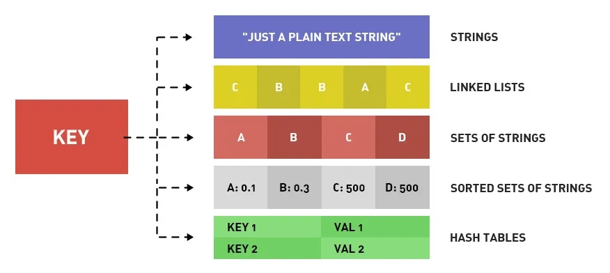

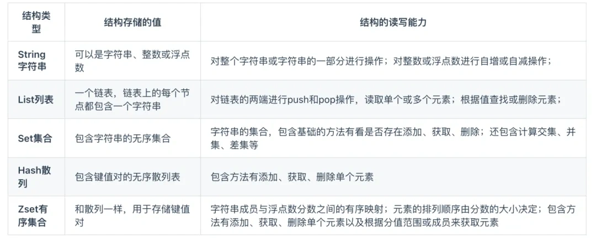

随着 Redis 版本的更新，后面又提供了 **BitMap（2.2 版新增）、HyperLogLog（2.8 版新增）、GEO（3.2 版新增）、Stream（5.0 版新增）**。这里要区分一下，BitMap 和 HyperLogLog 底层基于 String，GEO 底层基于 Zset，Stream 则是独立的数据类型，并不是每一种能力都对应一种新的底层类型。

另外，**数据类型和底层数据结构不是一回事**。String、Hash、List 这些是我们使用 Redis 时看到的数据类型，而 SDS、哈希表、跳表、listpack、quicklist 等才是底层实现。同一种数据类型，还会根据数据大小和版本选择不同的编码。

以 Redis 7.0 为例，可以这样记：

| 数据类型 | 常见底层编码            | 什么时候使用                                                 |
| -------- | ----------------------- | ------------------------------------------------------------ |
| String   | int、embstr、raw        | 可表示为整数时尝试使用 int，短字符串使用 embstr，较长字符串使用 raw |
| Hash     | listpack、哈希表        | 字段数量少、字段和值都较小时使用 listpack，超过配置限制后转换为哈希表 |
| List     | quicklist               | 用双向链表串起多个节点，普通节点内部使用 listpack 保存元素   |
| Set      | intset、哈希表          | 元素都是整数且数量较少时使用 intset，否则使用哈希表          |
| Zset     | listpack、跳表 + 哈希表 | 小型有序集合使用 listpack，超过配置限制后使用跳表 + 哈希表   |

比如 Hash 的 listpack 编码，默认要求字段数量不超过 512，并且每个字段和值都不超过 64 字节；Set 的 intset 编码，默认最多保存 512 个整数。这些限制可以通过配置调整。后续版本也会增加编码，比如 Redis 7.2 的小型 Set 可以使用 listpack，所以面试时最好先说明讨论的是哪个版本。

Redis 五种数据类型的应用场景：

- String 类型的应用场景：缓存对象、常规计数、分布式锁、共享 session 信息等。
- List 类型的应用场景：消息队列（但是有两个问题：1. 生产者需要自行实现全局唯一 ID；2. 不能以消费组形式消费数据）等。
- Hash 类型：缓存对象、购物车等。
- Set 类型：聚合计算（并集、交集、差集）场景，比如点赞、共同关注、抽奖活动等。
- Zset 类型：排序场景，比如排行榜、电话和姓名排序等。

Redis 后续版本又支持四种数据类型，它们的应用场景如下：

- BitMap（2.2 版新增）：二值状态统计的场景，比如签到、判断用户登陆状态、连续签到用户总数等；
- HyperLogLog（2.8 版新增）：海量数据基数统计的场景，比如百万级网页 UV 计数等；
- GEO（3.2 版新增）：存储地理位置信息的场景，比如滴滴叫车；
- Stream（5.0 版新增）：消息队列，相比于基于 List 类型实现的消息队列，可以自动生成同一个 Stream 内唯一且递增的消息 ID，并支持消费组、消息确认和待处理消息追踪。不同 Stream 之间的 ID 不保证全局唯一。

### 2.1.2 ZSet用过吗

用过 zset 实现排行榜的功能。

以博文点赞排名为例，小林发表了五篇博文，分别获得赞为 200、40、100、50、150。

```shell
# arcticle:1 文章获得了200个赞
> ZADD user:xiaolin:ranking 200 arcticle:1
(integer) 1
# arcticle:2 文章获得了40个赞
> ZADD user:xiaolin:ranking 40 arcticle:2
(integer) 1
# arcticle:3 文章获得了100个赞
> ZADD user:xiaolin:ranking 100 arcticle:3
(integer) 1
# arcticle:4 文章获得了50个赞
> ZADD user:xiaolin:ranking 50 arcticle:4
(integer) 1
# arcticle:5 文章获得了150个赞
> ZADD user:xiaolin:ranking 150 arcticle:5
(integer) 1
```

文章 arcticle:4 新增一个赞，可以使用 ZINCRBY 命令（为有序集合key中元素member的分值加上increment）：

```shell
> ZINCRBY user:xiaolin:ranking 1 arcticle:4
"51"
```

查看某篇文章的赞数，可以使用 ZSCORE 命令（返回有序集合中指定成员的分值 score）：

```shell
> ZSCORE user:xiaolin:ranking arcticle:4
"51"
```

获取小林文章赞数最多的 3 篇文章，可以使用 ZREVRANGE 命令（倒序获取有序集合 key 从start下标到stop下标的元素）：

```shell
# WITHSCORES 表示把 score 也显示出来
> ZREVRANGE user:xiaolin:ranking 0 2 WITHSCORES
1) "arcticle:1"
2) "200"
3) "arcticle:5"
4) "150"
5) "arcticle:3"
6) "100"
```

获取小林 100 赞到 200 赞的文章，可以使用 ZRANGEBYSCORE 命令（返回有序集合中指定分数区间内的成员，分数由低到高排序）：

```shell
> ZRANGEBYSCORE user:xiaolin:ranking 100 200 WITHSCORES
1) "arcticle:3"
2) "100"
3) "arcticle:5"
4) "150"
5) "arcticle:1"
6) "200"
```

### 2.1.3 Redis 中 set和zset区别是什么？

Redis 中的 Set 和 ZSet（Sorted Set，有序集合）都是用于存储多个元素的集合类型，但它们的核心区别在于是否对元素进行排序以及排序方式，这直接影响了它们的适用场景。

Set 是**无序、唯一元素**的集合，适合存储不重复且无需排序的数据（如用户 ID 列表、标签集合）。常用命令：

- 添加元素：`SADD set1 "a" "b" "c"`（向 set1 中添加 3 个元素，重复添加会自动去重）
- 查看所有元素：`SMEMBERS set1`（返回结果无序，如 ["b", "a", "c"]）
- 判断元素是否存在：`SISMEMBER set1 "a"`（存在返回 1，否则 0）
- 集合运算：`SINTER set1 set2`（求两个集合的交集）、`SUNION set1 set2`（求并集）

ZSet 是**有序、唯一元素**的集合，每个元素关联一个 “分数（score）”，并按分数从小到大排序（元素唯一，但分数可重复），适合需要排序或排名的场景（如排行榜、带权重的任务）。常用命令：

- 添加元素（带分数）：`ZADD zset1 10 "a" 20 "b" 15 "c"`（向 zset1 中添加元素，分数分别为 10、20、15）
- 按排名范围获取元素（从小到大）：`ZRANGE zset1 0 -1 WITHSCORES`（返回所有元素及分数，结果按分数排序："a" 10, "c" 15, "b" 20）
- 按分数范围获取元素：`ZRANGEBYSCORE zset1 12 25`（返回分数 12-25 之间的元素："c", "b"）
- 增减元素分数：`ZINCRBY zset1 5 "a"`（将 "a" 的分数 +5，变为 15）
- 获取元素排名：`ZRANK zset1 "b"`（返回 "b" 的排名，从 0 开始，此处返回 2）

具体来说，ZSet 相比 Set 多了很多基于分数的操作：比如根据分数范围获取元素（zrangebyscore）、根据排名获取元素（zrange）、计算元素的排名（zrank）、给元素的分数增减（zincrby）等。而 Set 没有分数概念，只能按元素本身进行操作，无法直接获取 “第 N 个元素” 或 “某个范围内的元素”。

简单来说，核心区别总结：

- 有序性：Set 完全无序，ZSet 通过分数维持有序
- 操作特性：ZSet 多了基于分数的排序、范围查询、排名计算等命令，Set 只有集合本身的交并差等操作
- 适用场景：Set 用于去重且无需排序的场景，ZSet 用于需要排序、排名或权重相关的场景

### 2.1.4 Zset 底层是怎么实现的？

以 **Redis 7.0** 为例，Zset 类型有两种底层编码：**listpack**，以及**跳表 + 哈希表（dict）**。

- 小型有序集合使用 **listpack**，成员和分值成对保存在同一个紧凑容器中，不额外维护 dict。默认的元素数量上限是 `128`，单个成员长度上限是 `64` 字节，可通过 `zset-max-listpack-entries` 和 `zset-max-listpack-value` 调整；这两个上限都包含边界值。
- 超过紧凑编码限制后，转换为**跳表 + 哈希表**。跳表按分值组织成员，支持平均 O(log N) 的插入、删除和排名定位，以及 O(log N + M) 的范围查询（M 为返回元素数）；哈希表按成员查找分值，使 `ZSCORE` 这类查询具有平均 O(1) 的复杂度。

这里的「跳表编码」并不是只有一张跳表，而是同时维护跳表和哈希表；listpack 编码按成员查询时则需要遍历，复杂度为 O(N)，用一定的查询开销换取小集合的内存节省。

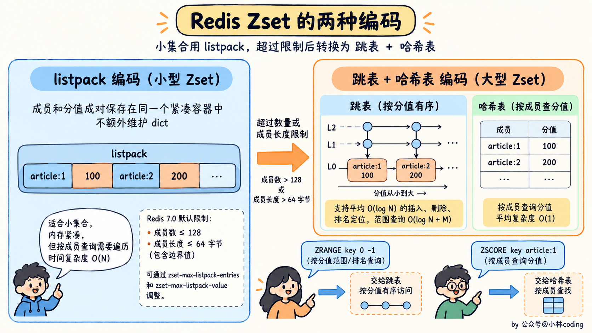

Redis 7.0 之前，小型 Zset 使用的是**压缩列表（ziplist）**，从 Redis 7.0 起替换为 **listpack**。Zset 直接使用 listpack，不需要经过 quicklist。

### 2.1.5 跳表是怎么实现的？

链表在查找元素的时候，因为需要逐一查找，所以查询效率非常低，时间复杂度是 O(N)，于是就出现了跳表。**跳表是在链表基础上改进过来的，实现了一种「多层」的有序链表**，这样的好处是能快速定位数据。

那跳表长什么样呢？我这里举个例子，下图展示了一个层级为 3 的跳表。

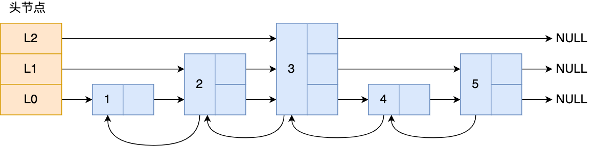

图中头节点有 L0~L2 三个头指针，分别指向了不同层级的节点，然后每个层级的节点都通过指针连接起来：

- L0 层级共有 5 个节点，分别是节点1、2、3、4、5；
- L1 层级共有 3 个节点，分别是节点 2、3、5；
- L2 层级只有 1 个节点，也就是节点 3 。

如果我们要在链表中查找节点 4 这个元素，只能从头开始遍历链表，需要查找 4 次，而使用了跳表后，只需要查找 2 次就能定位到节点 4，因为可以在头节点直接从 L2 层级跳到节点 3，然后再往前遍历找到节点 4。

可以看到，这个查找过程就是在多个层级上跳来跳去，最后定位到元素。跳表的平均查找复杂度是 O(log N)，最坏情况下仍然可能退化为 O(N)，随机层高让这种退化不容易发生。

那跳表节点是怎么实现多层级的呢？这就需要看「跳表节点」的数据结构了，如下：

```c
typedef struct zskiplistNode {
    //Zset 对象的元素值
    sds ele;
    //元素权重值
    double score;
    //后向指针
    struct zskiplistNode *backward;
  
    //节点的level数组，保存每层上的前向指针和跨度
    struct zskiplistLevel {
        struct zskiplistNode *forward;
        unsigned long span;
    } level[];
} zskiplistNode;
```

Zset 对象要同时保存「元素」和「元素的权重」，对应到跳表节点结构里就是 sds 类型的 ele 变量和 double 类型的 score 变量。每个跳表节点都有一个后向指针（struct zskiplistNode *backward），指向前一个节点，目的是为了方便从跳表的尾节点开始访问节点，这样倒序查找时很方便。

跳表是一个带有层级关系的链表，而且每一层级可以包含多个节点，每一个节点通过指针连接起来，实现这一特性就是靠跳表节点结构体中的**zskiplistLevel 结构体类型的 level 数组**。

level 数组中的每一个元素代表跳表的一层，也就是由 zskiplistLevel 结构体表示，比如 level[0] 就表示第一层，level[1] 就表示第二层。zskiplistLevel 结构体里定义了「指向下一个跳表节点的指针」和「跨度」，跨度用来记录沿这个指针前进时，跨过了底层的多少个节点。

比如，下面这张图，展示了各个节点的跨度。

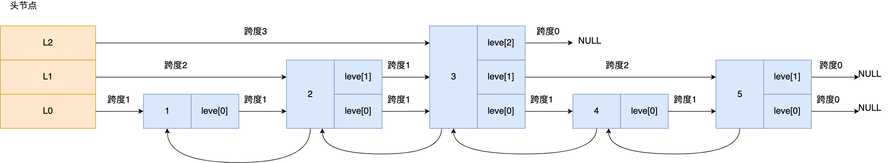

第一眼看到跨度的时候，可能以为它是用来找下一个节点的，其实普通遍历只需要前向指针就可以完成。**跨度主要用于计算排名**：查找成员时，把沿途经过的跨度累加起来，就能知道这个成员排在第几位，所以 ZRANK 不需要从头数到尾。

另外，跳表先按 score 排序，score 相同时再按成员的字节序排序，这样即使多个成员分数相同，也能确定它们在跳表中的位置。

Redis **跳表在创建节点的时候，随机生成每个节点的层数**，并没有严格维持相邻两层的节点数量比例为 2 : 1 的情况。

具体的做法是，**节点从 1 层开始，每轮以 25% 的概率再增加 1 层，直到没有命中这个概率，或者达到最大层数，最终确定该节点的层高**。

这样的做法，层数越高，出现的概率越低。以 Redis 7.0 为例，层高最大限制是 **32**，由 ZSKIPLIST_MAXLEVEL 定义。

虽然我前面讲解跳表的时候，图中的跳表的「头节点」都是 3 层高，但是实际创建头节点时，会一次性分配最大层数的 level 数组。**头节点预留了 32 层，不代表当前跳表已经使用了 32 层**，实际有效层数由已有节点的最大层高决定。

### 2.1.6 跳表是怎么设置层高的？

跳表的层高是随机生成的，不是根据当前元素数量计算出来的。

以 Redis 7.0 为例，每个新节点先有 1 层，每次以 25% 的概率增加一层，最多 32 层。也就是说，节点至少有 2 层的概率是 1/4，至少有 3 层的概率是 1/16，越往上节点越少。

那为什么要随机？因为这样不需要在每次插入、删除之后重新维护严格的层级比例，也能让高层索引保持稀疏，取得平均 O(log N) 的查找效率。

### 2.1.7 Redis为什么使用跳表而不是用B+树?

主要是因为 **Redis 的数据在内存中，跳表又能比较简单地满足 Zset 的有序访问需求**。

可以从三个方面来回答。

> 1、使用场景不同

B+ 树一个节点可以保存很多索引项，树的高度比较低，适合按页读写的磁盘数据库，可以减少查找时的磁盘 I/O。

Redis 的 Zset 主要在内存中操作，不需要通过降低树高来减少磁盘读取。因此，Redis 更关注内存中的增删改查，以及实现和维护的复杂度。

不过，B+ 树在内存中也有缓存局部性等优势，不能说它只能用于磁盘，或者在内存里就一定比跳表慢。

> 2、实现比较简单

跳表通过随机层高维护多层链表，插入、删除时主要调整搜索路径上的指针和跨度，不需要像 B+ 树那样处理节点分裂、合并，也不需要像红黑树那样维护颜色和旋转规则。

对于 Redis 来说，**用比较简单的实现，就能获得平均 O(log N) 的查找和更新效率**，这是很合适的取舍。

> 3、适合范围查询和排名查询

Zset 经常要查询“积分最高的前 10 名”“分数在 100 到 200 之间的成员”。跳表定位到起点之后，可以沿底层链表顺序访问，范围查询的平均复杂度是 O(log N + M)，M 是返回的元素数量。

Redis 还在跳表节点里保存了跨度，用于计算排名；保存了后向指针，用于倒序遍历。这些设计都和排行榜的需求很匹配。

所以，面试时我会说，**跳表能满足 Redis 的范围查询、排名和更新需求，同时实现比较简单**。这里是工程上的选择，并不是说跳表在所有内存场景下都比 B+ 树好。

### 2.1.8 压缩列表是怎么实现的？

压缩列表是 Redis 为了节约内存而开发的，它是**由连续内存块组成的顺序型数据结构**，有点类似于数组。


压缩列表的头部有三个字段，末尾还有一个结束标记：

- **zlbytes**，记录整个压缩列表占用的内存字节数；
- **zltail**，记录压缩列表「尾部」节点距离起始地址有多少字节，也就是列表尾的偏移量；
- **zllen**，记录压缩列表包含的节点数量；
- **zlend**，标记压缩列表的结束点，固定值 0xFF（十进制 255）。

在压缩列表中，第一个元素紧跟在固定长度的头部后面，最后一个元素可以通过 `zltail`（尾偏移量）定位，所以定位首尾元素的复杂度是 O(1)。`zllen` 记录的是元素数量，不是首元素的位置；当它达到 65535 时，还需要遍历才能得到实际数量。而**查找其他元素时，就没有这么高效了，只能逐个查找，此时的复杂度就是 O(N) 了，因此压缩列表不适合保存过多的元素**。

另外，压缩列表节点（entry）的构成如下：

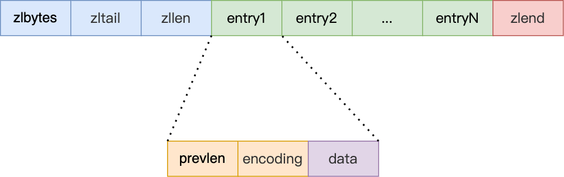

压缩列表节点包含三部分内容：

- **prevlen**，记录了「前一个节点」的长度，目的是为了实现从后向前遍历；
- **encoding**，记录了当前节点实际数据的「类型和长度」，类型主要有两种：字符串和整数。
- **data**，记录了当前节点的实际数据，类型和长度都由 encoding 决定；

当我们往压缩列表中插入数据时，压缩列表就会根据数据类型是字符串还是整数，以及数据的大小，会使用不同空间大小的 prevlen 和 encoding 这两个元素里保存的信息，**这种根据数据大小和类型进行不同的空间大小分配的设计思想，正是 Redis 为了节省内存而采用的**。

压缩列表的缺点是会发生连锁更新的问题，因此**连锁更新一旦发生，就会导致压缩列表占用的内存空间要多次重新分配，这就会直接影响到压缩列表的访问性能**。

所以说，**虽然压缩列表紧凑型的内存布局能节省内存开销，但是如果保存的元素数量增加了，或是元素变大了，会导致内存重新分配，最糟糕的是会有「连锁更新」的问题**。

因此，**压缩列表只会用于保存的节点数量不多的场景**，只要节点数量足够小，即使发生连锁更新，也是能接受的。

虽说如此，Redis 针对压缩列表在设计上的不足，在后来的版本中，新增设计了两种数据结构：quicklist（Redis 3.2 引入） 和 listpack（Redis 5.0 引入）。quicklist 通过拆成多个小容器来减轻大块内存操作和连锁更新的影响，而 listpack 则从节点编码上消除了连锁更新的根源。

### 2.1.9 介绍一下 Redis 中的 listpack

使用压缩列表的旧版 quicklist 虽然通过控制节点内部容器的大小或者元素个数，减少了连锁更新带来的性能影响，但并没有完全解决这个问题。

原因在于旧版 quicklistNode 仍用压缩列表保存元素，而连锁更新来源于压缩列表的结构设计，所以要想彻底解决这个问题，需要设计一个新的数据结构。

于是，Redis 在 5.0 新设计一个数据结构叫 listpack，目的是替代压缩列表，它最大特点是 listpack 中每个节点不再包含前一个节点的长度了，压缩列表每个节点正因为需要保存前一个节点的长度字段，就会有连锁更新的隐患。

从 **Redis 7.0** 起，小型 Hash、Zset 直接使用 listpack 作为紧凑编码，quicklist 的普通 packed 节点内部也由压缩列表改为 listpack。**Redis 7.2 中，小型 List 还可以直接使用一个 listpack**，超过 `list-max-listpack-size` 控制的大小或元素数量限制后再转换成 quicklist。因此，listpack 既是独立的数据结构，也能作为 quicklist 节点内部的容器。

listpack 采用了压缩列表的很多优秀的设计，比如还是用一块连续的内存空间来紧凑地保存数据，并且为了节省内存的开销，listpack 节点会采用不同的编码方式保存不同大小的数据。

我们先看看 listpack 结构：


listpack 头包含两个属性，分别记录了 listpack 总字节数和元素数量，然后 listpack 末尾也有个结尾标识。图中的 listpack entry 就是 listpack 的节点了。

每个 listpack 节点结构如下：

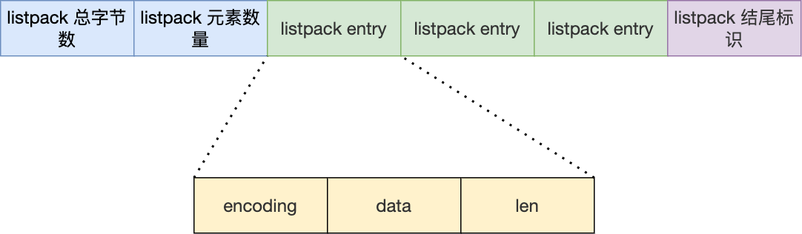

主要包含三个方面内容：

- encoding，定义该元素的编码类型，会对不同长度的整数和字符串进行编码；
- data，实际存放的数据；
- len，encoding+data的总长度；

可以看到，**listpack 没有压缩列表中记录前一个节点长度的字段了，listpack 只记录当前节点的长度，当我们向 listpack 加入一个新元素的时候，不会影响其他节点的长度字段的变化，从而避免了压缩列表的连锁更新问题**。

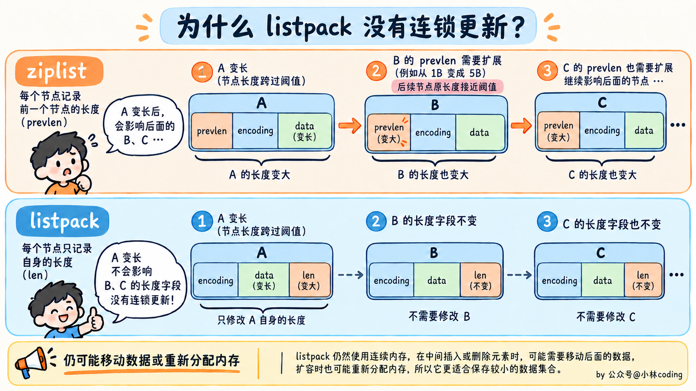

不过，避免连锁更新不代表插入、删除就变成了 O(1)。listpack 仍然使用连续内存，在中间插入或者删除元素时，可能需要移动后面的数据，扩容时也可能重新分配内存，所以它更适合保存较小的数据集合。

### 2.1.10 哈希表是怎么扩容的？

进行 rehash 的时候，需要用上 2 个哈希表了。

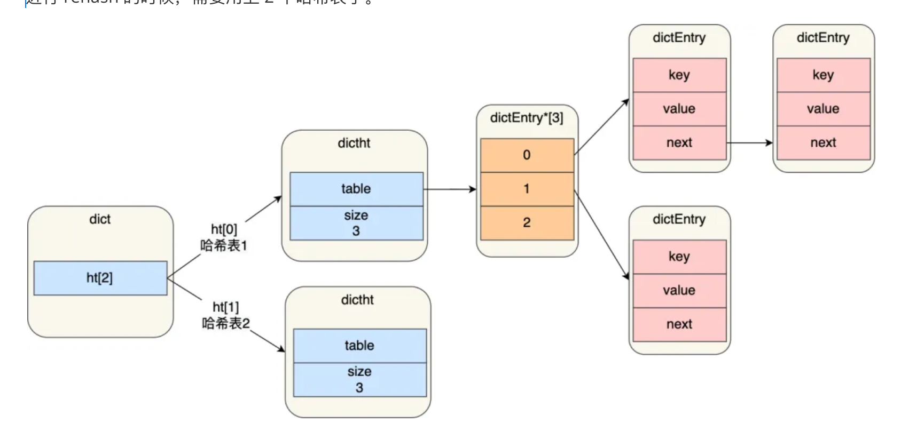

在正常服务请求阶段，插入的数据，都会写入到「哈希表 1」，此时的「哈希表 2 」 并没有被分配空间。

随着数据逐步增多，触发了 rehash 操作，这个过程分为三步：

- 给「哈希表 2」 分配空间，一般会比「哈希表 1」 大 2 倍；
- 将「哈希表 1 」的数据迁移到「哈希表 2」 中；
- 迁移完成后，「哈希表 1 」的空间会被释放，并把「哈希表 2」 设置为「哈希表 1」，然后在「哈希表 2」 新创建一个空白的哈希表，为下次 rehash 做准备。

为了方便你理解，我把 rehash 这三个过程画在了下面这张图：

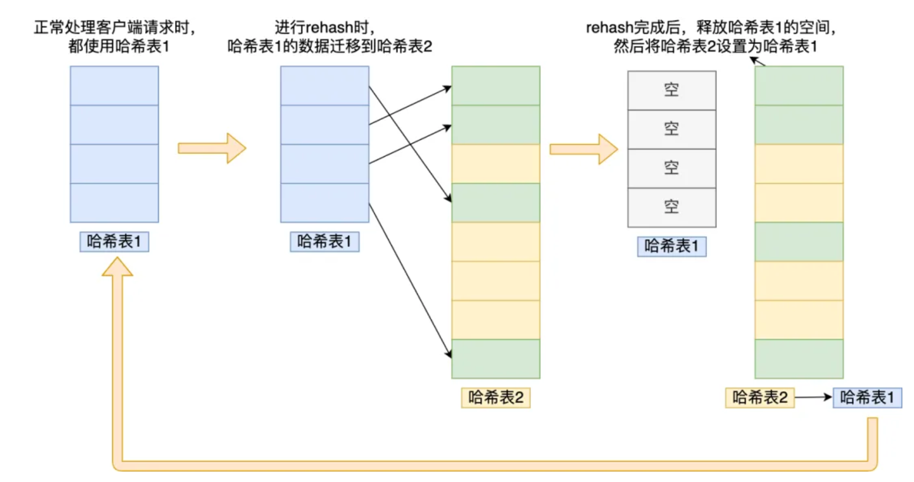

这个过程看起来简单，但是其实第二步很有问题，**如果「哈希表 1 」的数据量非常大，那么在迁移至「哈希表 2 」的时候，因为要重新计算桶位置并迁移大量节点，此时可能会对 Redis 造成阻塞，无法服务其他请求**。

为了避免 rehash 在数据迁移过程中，因集中迁移节点的耗时，影响 Redis 性能的情况，所以 Redis 采用了**渐进式 rehash**，也就是将数据的迁移的工作不再是一次性迁移完成，而是分多次迁移。

渐进式 rehash 步骤如下：

- 给「哈希表 2」 分配空间；
- **在 rehash 进行期间，在处理哈希表的新增、删除、查找或者更新时，Redis 通常会顺便迁移一部分旧表数据，比如把旧表某个桶中的键值对迁移到新表，而不是每次把整张表搬过去**；
- 随着处理客户端发起的哈希表操作请求数量越多，最终在某个时间点会把「哈希表 1 」的所有 key-value 迁移到「哈希表 2」，从而完成 rehash 操作。

这样就巧妙地把一次性大量数据迁移工作的开销，分摊到了多次处理请求的过程中，避免了一次性 rehash 的耗时操作。

另外，Redis 还会在周期性任务中按时间预算推进数据库字典的 rehash，不是只有客户端请求到来时才会迁移。渐进式 rehash 主要分摊的是迁移开销，新表的分配也会消耗时间和内存，不能理解为扩容完全没有成本。

在进行渐进式 rehash 的过程中，会有两个哈希表，所以在渐进式 rehash 进行期间，哈希表元素的删除、查找、更新等操作都会在这两个哈希表进行。比如，查找一个 key 的值的话，先会在「哈希表 1」 里面进行查找，如果没找到，就会继续到哈希表 2 里面进行找到。

另外，在渐进式 rehash 进行期间，新增一个 key-value 时，会被保存到「哈希表 2 」里面，而「哈希表 1」 则不再进行任何添加操作，这样保证了「哈希表 1 」的 key-value 数量只会减少，随着 rehash 操作的完成，最终「哈希表 1 」就会变成空表。

### 2.1.11 哈希表扩容的时候，有读请求怎么查？

查找一个 key 的值的话，先会在「哈希表 1」 里面进行查找，如果没找到，就会继续到哈希表 2 里面进行找到。

### 2.1.12 **String 是使用什么存储的?为什么不用 c 语言中的字符串?**

Redis 的 String 对象有 int、embstr 和 raw 三种编码。其中 **embstr 和 raw 用 SDS 保存字符串，int 编码则直接保存整数值**。所以，如果面试官问字符串为什么不用 C 字符串，主要就是在问 SDS 的优势。

下图就是 Redis 5.0 的 SDS 的数据结构：

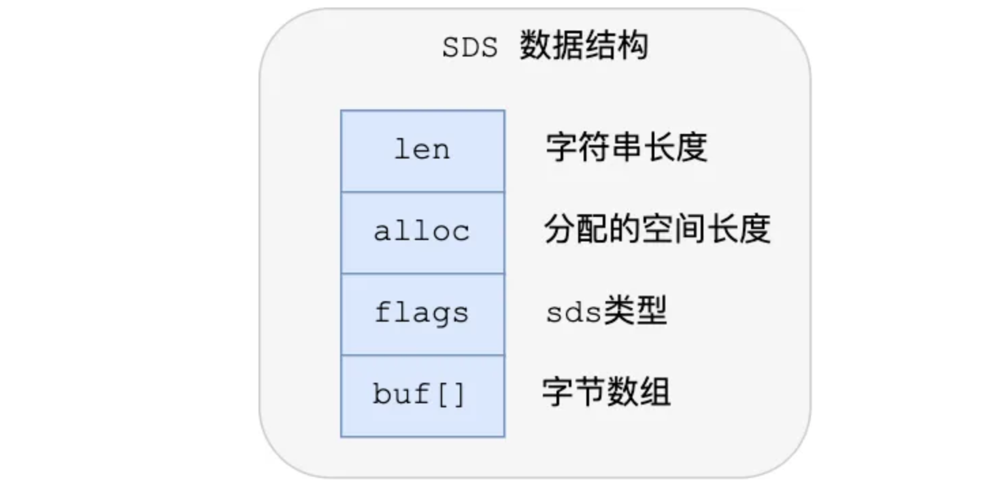

结构中的每个成员变量分别介绍下：

- **len，记录了字符串长度**。这样获取字符串长度的时候，只需要返回这个成员变量值就行，时间复杂度只需要 O（1）。
- **alloc，分配给字符数组的空间长度**。这样在修改字符串的时候，可以通过 `alloc - len` 计算出剩余的空间大小，可以用来判断空间是否满足修改需求，如果不满足的话，就会自动将 SDS 的空间扩展至执行修改所需的大小，然后才执行实际的修改操作，所以使用 SDS 既不需要手动修改 SDS 的空间大小，也不会出现前面所说的缓冲区溢出的问题。
- **flags，用来表示不同类型的 SDS**。一共设计了 5 种类型，分别是 sdshdr5、sdshdr8、sdshdr16、sdshdr32 和 sdshdr64，用不同大小的头部适配不同长度的字符串，减少元数据开销。
- **buf[]，字符数组，用来保存实际数据**。不仅可以保存字符串，也可以保存二进制数据。

总的来说，SDS 在字符数组之外保存长度、容量和类型等信息，用来解决 C 语言字符串的缺陷。上面是常见 SDS 头部的示意；sdshdr5 比较特殊，会把长度编码在 flags 中，不单独保存 len 和 alloc。

> O（1）复杂度获取字符串长度

C 语言的字符串长度获取 strlen 函数，需要通过遍历的方式来统计字符串长度，时间复杂度是 O（N）。

而 Redis 的 SDS 结构因为加入了 len 成员变量，那么**获取字符串长度的时候，直接返回这个成员变量的值就行，所以复杂度只有 O（1）**。

> 二进制安全

因为 SDS 不依赖 “\0” 字符来判断实际数据的结尾，而是**有个专门的 len 成员变量来记录长度，所以可存储包含 “\0” 的数据**。但是 SDS 为了兼容部分 C 语言标准库的函数， SDS 字符串结尾还是会加上 “\0” 字符。

因此， SDS 的 API 都是以处理二进制的方式来处理 SDS 存放在 buf[] 里的数据，程序不会对其中的数据做任何限制，数据写入的时候是什么样的，它被读取时就是什么样的。

通过使用二进制安全的 SDS，而不是 C 字符串，使得 Redis 不仅可以保存文本数据，也可以保存任意格式的二进制数据。

> 不会发生缓冲区溢出

C 语言的字符串标准库提供的字符串操作函数，大多数（比如 strcat 追加字符串函数）都是不安全的，因为这些函数把缓冲区大小是否满足操作需求的工作交由开发者来保证，程序内部并不会判断缓冲区大小是否足够用，当发生了缓冲区溢出就有可能造成程序异常结束。

所以，Redis 的 SDS 结构里引入了 alloc 和 len 成员变量，这样 SDS API 通过 `alloc - len` 计算，可以算出剩余可用的空间大小，这样在对字符串做修改操作的时候，就可以由程序内部判断缓冲区大小是否足够用。

而且，**当判断出缓冲区大小不够用时，Redis 会自动扩大 SDS 的空间大小**，以满足修改所需的大小。

### 2.1.13 String 的 int、embstr 和 raw 编码有什么区别？

String 是数据类型，int、embstr、raw 是它的三种底层编码，客户端使用时看到的仍然都是 String。

- **int**：当字符串可以表示为符合范围的整数时，Redis 会尝试直接保存整数值，减少字符串的内存开销。
- **embstr**：用于较短的字符串，把 Redis 对象头和 SDS 放在同一块内存里，一次分配就能完成，内存比较紧凑。
- **raw**：对象头和 SDS 分开分配，适合较长的字符串，以及需要修改的字符串。

以 Redis 7.0 的常见 64 位环境为例，非整数短字符串的 embstr 长度上限是 **44 字节**，超过这个长度使用 raw。这里说的是字节，不是字符，中文占多少字节取决于编码。

embstr 也不是一直不变。比如对 embstr 字符串执行 APPEND 时，会先转换成 raw，再进行修改，即使修改后的长度仍然很短，也不会因为短就自动转回 embstr。

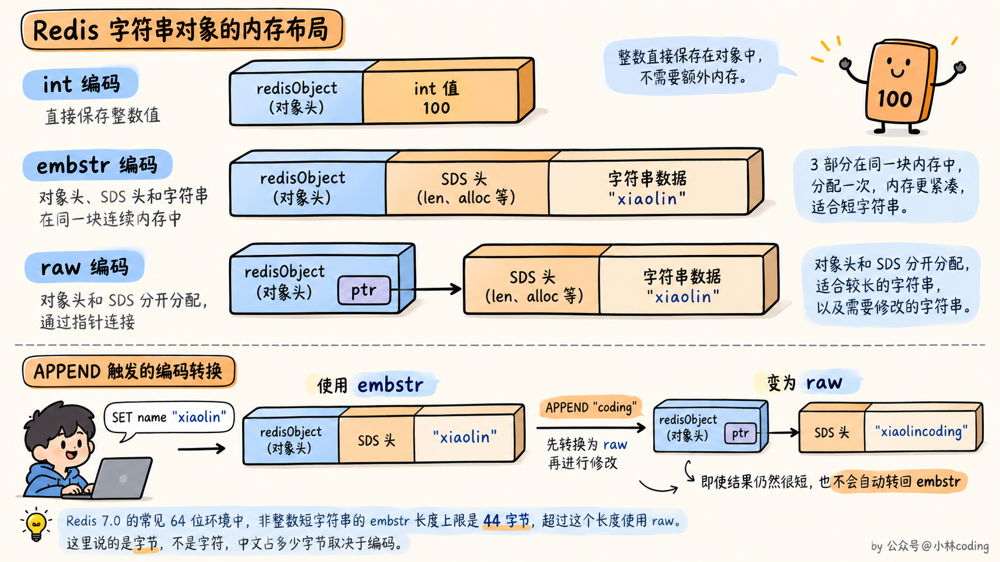

可以使用 OBJECT ENCODING 查看实际编码：

```shell
SET counter 100
OBJECT ENCODING counter
# int
SET name xiaolin
OBJECT ENCODING name
# embstr
APPEND name coding
OBJECT ENCODING name
# raw
```

### 2.1.14 缓存一个对象，用 String 还是 Hash？

两种都可以，主要看**是整体读写，还是经常只操作部分字段**。

如果商品详情总是整体返回，可以把对象序列化成 JSON，用 String 保存。这样一次 GET 就能拿到完整结果，也方便设置整个对象的过期时间。

如果经常只修改或读取几个字段，比如购物车里某个商品的数量，用 Hash 会更方便，可以用 HGET、HMGET、HSET、HINCRBY 操作字段，不需要每次都读取和序列化整个对象。

不过，Hash 不一定总比 String 节省内存。小 Hash 使用 listpack 时通常比较紧凑，但超过限制转成哈希表后，字段和节点本身也会增加开销，最好结合实际数据用 MEMORY USAGE 比较。

另外，以 Redis 7.0 为例，过期时间设置在整个 Hash key 上，不能让每个字段独立过期；Redis 7.4 才开始提供 Hash 字段过期能力。设计时要结合使用的版本，不能把新版本能力默认套到所有环境里。

### 2.1.15 redis的Zset，在项目里具体用法是什么？

Redis 的 Zset（有序集合）在项目里的核心用法是**需要给元素排序、取排名、按分数范围筛选**的场景，因为它既能像 Set 一样保证元素唯一，又能给每个元素关联一个分数，自动按分数排序，查询效率还高。

最常用的场景是**排行榜**，比如游戏里的玩家积分排名、电商的商品销量榜单、社区的用户贡献值排名。比如做游戏积分榜，把玩家 ID 作为元素，积分作为分数，用 ZADD 命令添加或更新玩家积分，想查前 10 名就用 `ZREVRANGE`（降序取前 10），想知道某个玩家的排名就用 `ZREVRANK`，还能通过 ZSCORE 查他的具体积分，这些操作都是实时的，效率很高。

然后是**延迟任务队列**，比如电商订单 30 分钟未支付自动取消、定时发送通知。这里用任务 ID 作为元素，把“任务执行时间戳”作为分数，消费者通过 `ZRANGEBYSCORE` 找出分数小于等于当前时间戳的任务。

这里有个并发问题：如果多个消费者都先查任务，再执行，最后删除，就可能重复执行。可以用 Lua 脚本把“查询到期任务”和“移出待执行集合”放在一起，让领取任务的过程具备原子性。

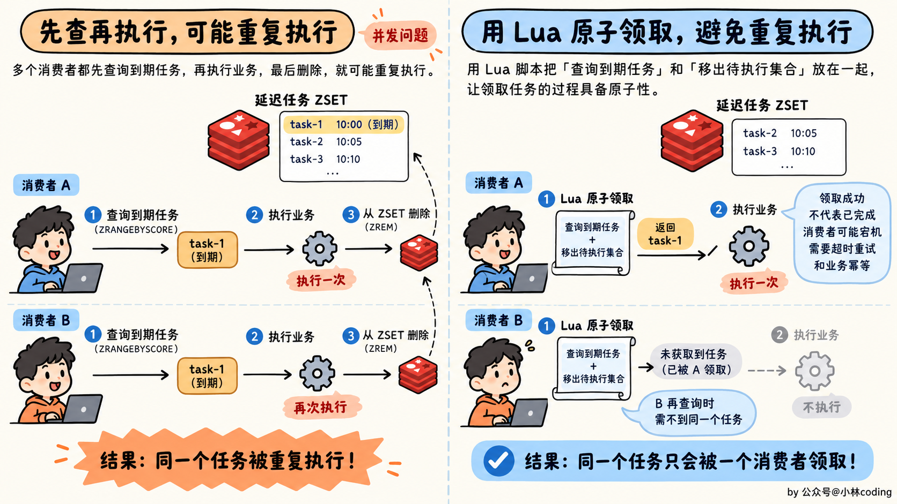

但领取之后消费者也可能宕机，所以重要任务还需要处理中的任务记录、超时重试和业务幂等。像取消订单，还应该在数据库里判断订单是否仍然未支付，不能只根据延迟任务就直接取消。

还有**范围查询场景**，比如查询 “积分在 1000-2000 之间的玩家”“销量前 50 到 100 名的商品”，直接用 `ZRANGEBYSCORE` 或 `ZREVRANGEBYSCORE` 就能快速筛选出来，比在数据库里做排序查询高效得多，尤其是数据量大的时候。

另外，还能用来做**带权重的消息队列**，给重要的消息设置更高的分数，消费者优先处理分数高的消息，保证核心业务的优先级。

## 2.2 线程模型

### 2.2.1 Redis为什么快？

在合适的硬件、简单命令和较小数据的基准测试中，**Redis 的吞吐量可以达到每秒十万级请求**，如下图所示。不过，这不是所有业务场景下都能达到的固定指标，实际性能还要看命令复杂度、数据大小、网络和持久化配置。

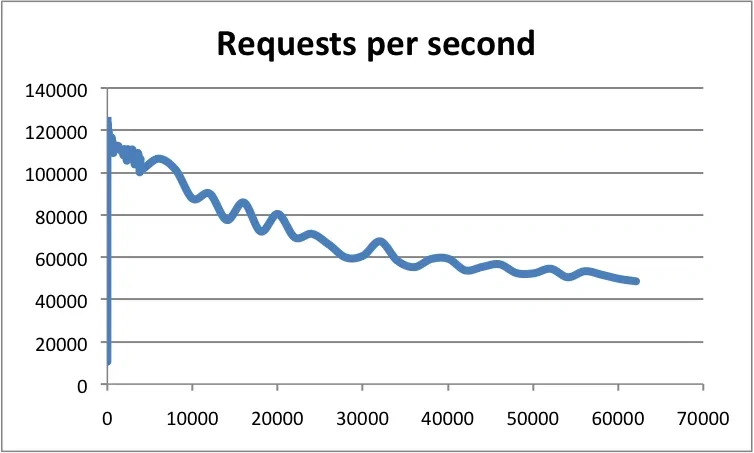

以传统的单线程命令执行模型为例，Redis 快主要有以下几个原因：

- Redis 的大部分操作**都在内存中完成**，并且采用了高效的数据结构，普通键值查询的开销很小。但复杂命令、大 key 和长时间运行的 Lua 脚本，也可能让 CPU 成为瓶颈；
- Redis 采用单线程模型可以**避免了多线程之间的竞争**，省去了多线程切换带来的时间和性能上的开销，而且也不会导致死锁问题。
- Redis 采用了 **I/O 多路复用机制**处理大量的客户端 Socket 请求，IO 多路复用机制是指一个线程处理多个 IO 流，就是我们经常听到的 select/epoll 机制。简单来说，在 Redis 只运行单线程的情况下，该机制允许内核中，同时存在多个监听 Socket 和已连接 Socket。内核会一直监听这些 Socket 上的连接请求或数据请求。一旦有请求到达，就会交给 Redis 线程处理，这就实现了一个 Redis 线程处理多个 IO 流的效果。

### 2.2.2 Redis哪些地方使用了多线程?

**Redis 单线程主要指普通命令由主线程串行执行**。在 Redis 6.0 之前，主要的网络 I/O 和命令执行都由主线程负责；Redis 6.0 引入可选的 I/O 多线程之后，网络读写可以交给 I/O 线程，但普通命令仍然由主线程执行。下面的线程配置以 Redis 6.0 的实现为例。

但是，**Redis 程序并不是单线程的**，Redis 在启动的时候，是会**启动后台线程**（BIO）的：

- **Redis 在 2.6 版本**，会启动 2 个后台线程，分别处理关闭文件、AOF 刷盘这两个任务；
- **Redis 在 4.0 版本之后**，新增了一个新的后台线程，用来异步释放 Redis 内存，也就是 lazyfree 线程。例如执行 unlink key / flushdb async / flushall async 等命令，会把这些删除操作交给后台线程来执行，好处是不会导致 Redis 主线程卡顿。因此，当我们要删除一个大 key 的时候，不要使用 del 命令删除，因为 del 是在主线程处理的，这样会导致 Redis 主线程卡顿，因此我们应该使用 unlink 命令来异步删除大key。

之所以 Redis 为「关闭文件、AOF 刷盘、释放内存」这些任务创建单独的线程来处理，是因为这些任务的操作都是很耗时的，如果把这些任务都放在主线程来处理，那么 Redis 主线程就很容易发生阻塞，这样就无法处理后续的请求了。

后台线程相当于一个消费者，主线程把耗时任务放进队列，BIO 线程被唤醒后取出任务执行；没有任务时会等待，并不是一直空转轮询。

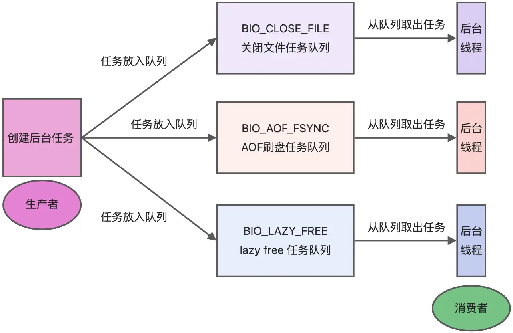

虽然 Redis 的普通命令主要由单线程执行，但是**从 Redis 6.0 开始，也可以启用多个 I/O 线程来处理网络请求**，**这是因为随着网络硬件的性能提升，Redis 的性能瓶颈有时会出现在网络 I/O 的处理上**。

所以为了提高网络 I/O 的并行度，Redis 6.0 对于网络 I/O 采用多线程来处理。**但是对于命令的执行，Redis 仍然使用单线程来处理，所以大家不要误解Redis 有多线程同时执行命令**。

I/O 多线程在网络读写成为瓶颈时，可以提升吞吐量；如果瓶颈是复杂命令的执行，增加 I/O 线程就不一定有效，具体提升幅度要通过压测确认。

需要特别注意的是，**Redis 6.0 的 I/O 多线程特性默认是关闭的**——`io-threads` 配置项默认值为 1，意味着默认情况下仍然只由主线程处理所有的网络 I/O。官方 `redis.conf` 中明确写着 "By default threading is disabled"，需要在配置文件里手动把 `io-threads` 设为大于 1 的值才会启用。

开启后，I/O 多线程默认只针对发送响应数据（write client socket），并不会以多线程的方式处理读请求（read client socket）。如果要让读请求也走 I/O 多线程，就需要把 `redis.conf` 配置文件中的 `io-threads-do-reads` 配置项设为 yes：

```text
# 启用 I/O 多线程，表示启用 N-1 个 I/O 线程（主线程也算一个 I/O 线程）
io-threads 4
# 读请求也使用 I/O 多线程
io-threads-do-reads yes
```

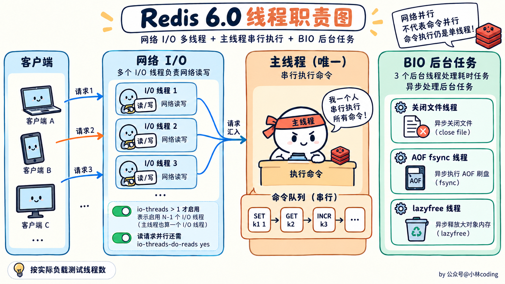

关于线程数的设置，官方的建议是 4 核 CPU 设置为 2 或 3，8 核 CPU 设置为 6，线程数一定要小于机器核数，线程数并不是越大越好。

因此，如果**不手动开启 I/O 多线程**，Redis 6.0 启动时只会比单线程模型额外创建 **3 个后台线程**（即 BIO 线程）：

- Redis-server：Redis 的主线程，负责执行命令和网络 I/O；
- bio_close_file、bio_aof_fsync、bio_lazy_free：三个 BIO 后台线程，分别异步处理关闭文件任务、AOF 刷盘任务、释放内存任务。

如果在配置文件中显式开启了 `io-threads N`（N > 1），则会**在此之上再额外创建 N-1 个 I/O 线程**，例如设置 `io-threads 4` 时，会再启动 io_thd_1、io_thd_2、io_thd_3 三个 I/O 线程，用来分担 Redis 网络 I/O 的压力。

### 2.2.3 Redis怎么实现的io多路复用？

Redis 使用 **I/O 多路复用 + 非阻塞 Socket**，让一个事件循环处理多个客户端连接。

这里“多路”指多个网络连接，“复用”指复用同一个线程来等待和处理这些连接的事件。如果一个线程阻塞在某个客户端的读取操作上，其他客户端就只能跟着等待，所以 Redis 不会对每个连接都做阻塞式等待。

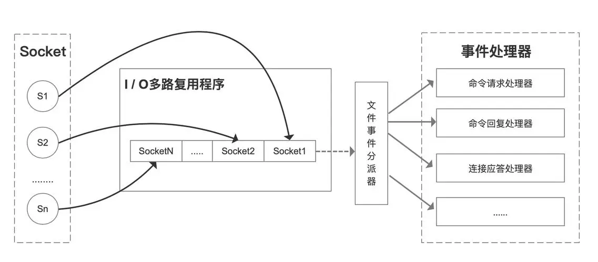

以 Linux 上的 epoll 为例，过程可以分成三步：

1. Redis 把监听 Socket、客户端 Socket 的文件描述符注册到事件循环，关注可读、可写等事件。
2. 调用 epoll 等待就绪事件。内核发现某个连接有数据可读，或者发送缓冲区可以继续写入时，通知 Redis。
3. Redis 调用对应的事件处理函数，读取请求、解析命令、执行命令，再把响应发送给客户端。如果一次没有读完或者写完，就等下一次就绪事件继续处理。

这里要注意，**epoll 通知的是 Socket 的就绪状态，不会替 Redis 解析命令，也不会替 Redis 执行命令**。命令处理仍然是 Redis 自己的工作。

这个模型可以理解为 Reactor 模式。I/O 多路复用解决的是等待多个连接的问题，但不能避免所有阻塞。如果主线程执行了一条很慢的命令，其他客户端仍然需要等待。

### 2.2.4 Redis的网络模型是怎样的？

Redis 6.0 版本之前，是用的是单Reactor单线程的模式

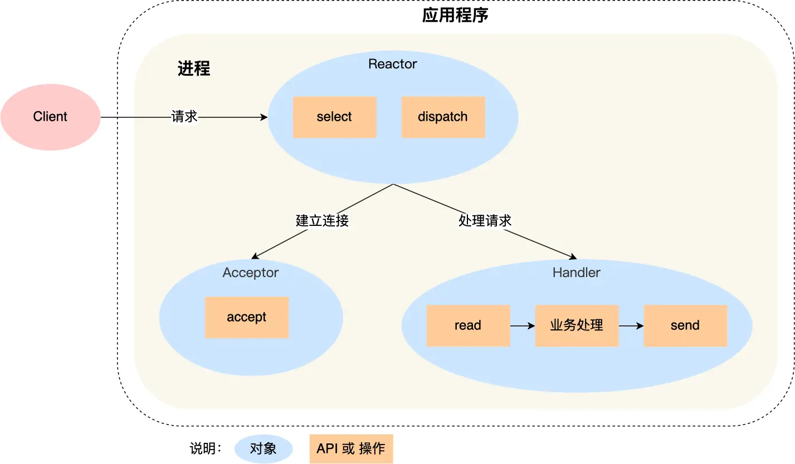

单 Reactor 单进程的方案因为全部工作都在同一个进程内完成，所以实现起来比较简单，不需要考虑进程间通信，也不用担心多进程竞争。

但是，这种方案存在 2 个缺点：

- 第一个缺点，因为只有一个进程，**无法充分利用 多核 CPU 的性能**；
- 第二个缺点，Handler 对象在业务处理时，整个进程是无法处理其他连接的事件的，**如果业务处理耗时比较长，那么就造成响应的延迟**；

所以，单 Reactor 单进程的方案**不适用计算密集型的场景，只适用于业务处理非常快速的场景**。

Redis 是由 C 语言实现的，在 Redis 6.0 版本之前采用的正是「单 Reactor 单进程」的方案，因为 Redis 业务处理主要是在内存中完成，操作的速度是很快的，性能瓶颈不在 CPU 上，所以 Redis 对于命令的处理是单进程的方案。

**从 Redis 6.0 开始，可以通过配置开启网络 I/O 多线程**，**这是因为随着网络硬件的性能提升，Redis 的性能瓶颈有时会出现在网络 I/O 的处理上**。

所以为了提高网络 I/O 的并行度，Redis 6.0 对于网络 I/O 采用多线程来处理。**但是对于命令的执行，Redis 仍然使用单线程来处理，所以大家不要误解** Redis 有多线程同时执行命令。

## 2.2 事务

### 2.2.1 如何实现redis 原子性？

Redis 普通命令由主线程串行执行，所以**单条命令执行时，不会被其他客户端的命令插进来**。比如 INCR，一个命令就能完成读取、加一、写回，多个客户端同时调用，也不会发生“都读到 10，最后都写成 11”的问题。

但如果应用先 GET，再在代码里加一，最后 SET，这就是两个命令了，中间可能被其他客户端修改，不能因为 Redis 是单线程就认为这一组操作也安全。

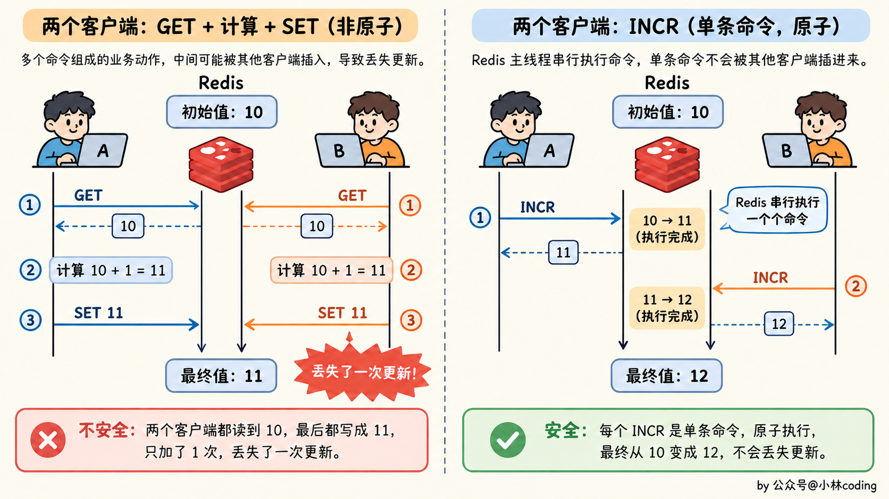

如果要保证多个相关操作不被其他命令打断，可以考虑用 **Lua 脚本**，把判断和修改放在 Redis 服务端一起执行。

比如分布式锁解锁，需要先判断锁是不是自己的，是自己的才能删除锁。用 Lua 可以避免“刚判断完，锁就过期并被别人拿走，接着又删掉别人的锁”的问题。

```lua
-- 释放锁时，先比较 unique_value 是否相等，避免锁的误释放
if redis.call("get", KEYS[1]) == ARGV[1] then
    return redis.call("del", KEYS[1])
else
    return 0
end
```

不过，**Lua 的原子执行不等于出错后自动回滚**。如果脚本先成功修改了一个 key，后面的命令报错，前面的修改不会撤销。因此，脚本应尽量先检查参数、数据类型和业务条件，再执行写操作。

另外，Lua 执行期间会占用主线程，不适合在脚本里做长时间循环或者扫描大量数据。在 Redis Cluster 中，脚本访问的多个 key 也需要位于同一个哈希槽。

### 2.2.2 除了lua有没有什么也能保证redis的原子性？

可以使用 Redis 事务，也就是 **MULTI 和 EXEC**，把多个命令放在一起执行。不过，回答这个问题时，要区分“执行过程不被打断”和“失败时全部回滚”。

MULTI 开启事务后，后面的命令先进入队列，直到收到 EXEC 才按顺序执行。**事务执行期间，其他客户端的命令不会插到事务中间**，但 Redis 不提供数据库事务那样的回滚机制。

发生错误时，要分两种情况：

- **入队时出错**：比如命令不存在、参数数量不正确，Redis 会标记事务有错误，执行 EXEC 时拒绝执行整个事务。
- **执行时出错**：比如对 String 使用 LPOP，只有这条命令失败，其他已入队的命令仍然会执行，已经成功的修改也不会回滚。

举个例子，先把 a:stock 设置为字符串，把 b:stock 设置为 9：

```shell
127.0.0.1:6379> SET a:stock 10
OK
127.0.0.1:6379> SET b:stock 9
OK
127.0.0.1:6379> MULTI
OK
127.0.0.1:6379> LPOP a:stock
QUEUED
127.0.0.1:6379> DECR b:stock
QUEUED
127.0.0.1:6379> EXEC
1) (error) WRONGTYPE Operation against a key holding the wrong kind of value
2) (integer) 8
```

可以看到，LPOP 执行失败了，但 DECR 还是执行成功了。因此，**Redis 事务可以保证命令连续执行，但不保证出错时“要么全成功，要么全失败”**。

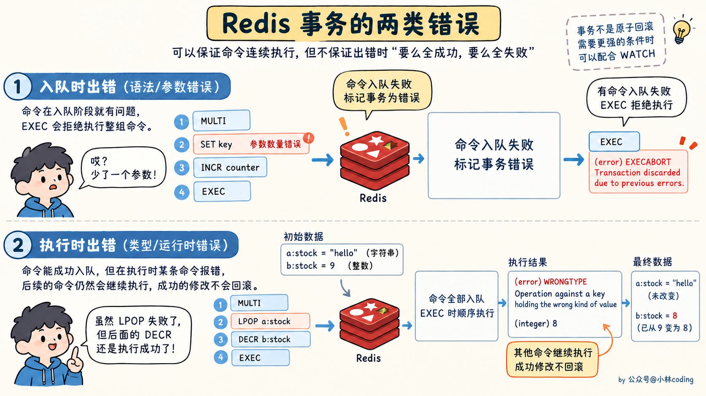

如果业务还需要根据读到的值决定是否更新，可以配合 WATCH 实现乐观锁。

### 2.2.3 WATCH 是怎么实现乐观锁的？

WATCH 会监视指定的 key。如果这些 key 在 WATCH 之后、EXEC 之前发生变化，EXEC 就会放弃执行整个事务，返回空结果，由客户端决定是否重新读取并重试。

比如读取库存后，再根据读到的值扣减库存，可以按下面的顺序处理：

```text
WATCH stock
读取当前库存
如果库存不足，UNWATCH 并返回失败
如果库存足够，计算扣减后的库存
MULTI
SET stock 新库存
EXEC
如果 EXEC 返回空结果，说明期间有变化，限次重试
```

这里的读取和业务判断发生在 MULTI 之前，WATCH 不会锁住这个 key，也不会阻止其他客户端修改它，所以叫**乐观锁**。

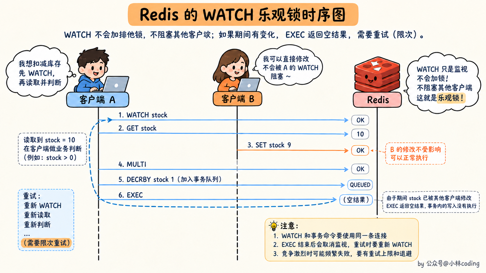

需要注意，**WATCH 和事务命令要使用同一条连接**。EXEC 结束后会取消监视，重试时要重新 WATCH；竞争激烈时可能频繁失败，因此要有重试上限和退避，不能无限重试。

对于简单扣减，如果能用一段 Lua 一次完成判断和修改，通常比客户端 WATCH、读取、再提交更直接。

### 2.2.4 Pipeline 是什么？它能保证原子性吗？

Pipeline，也就是流水线，主要用来**减少网络往返和网络读写的开销**。

如果应用依次执行 100 条命令，每条都发出去等结果，再发下一条，就会产生很多次网络往返。Pipeline 可以先批量发送命令，再批量读取结果，特别适合互相独立的批量查询、写入。

不过，**Pipeline 不是事务，也不是让 Redis 同时并行执行这些命令**。同一连接上的命令仍然按顺序处理，但整批命令不保证不被其他客户端的请求穿插，也不提供失败回滚。

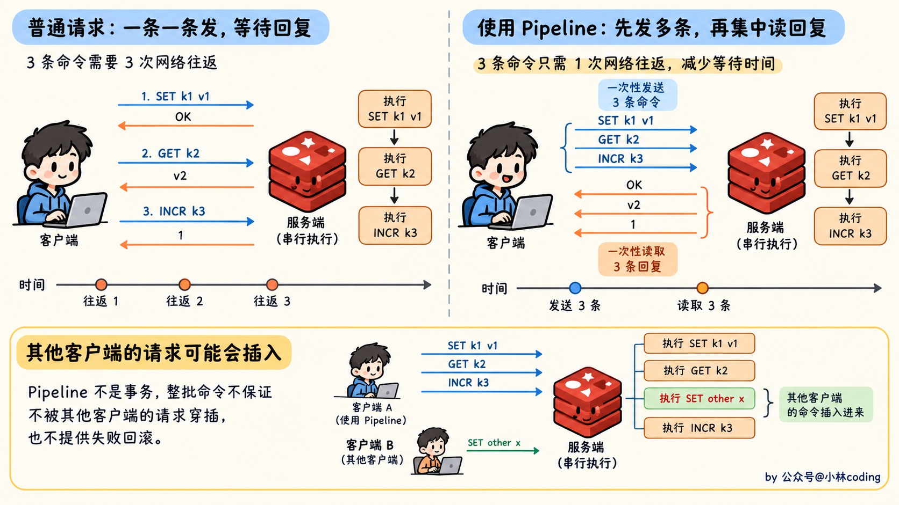

可以这样区分：

| 方式         | 主要解决什么问题                   | 是否允许根据前面的结果做服务端判断                 |
| ------------ | ---------------------------------- | -------------------------------------------------- |
| Pipeline     | 减少网络往返和系统调用开销         | 不能靠普通 Pipeline 在服务端完成这种判断           |
| MULTI / EXEC | 多条命令连续执行，避免其他命令插入 | 命令先排队，不能直接拿前面的结果决定后面的入队命令 |
| Lua          | 把判断和修改放在服务端一起执行     | 可以                                               |

另外，Pipeline 的批次不能无限增大，Redis 需要缓存响应，客户端也要接收和处理结果，批次太大可能增加内存和延迟。请求超时后，还可能无法确认哪些命令已经执行，因此重试时也要考虑幂等。

## 2.3 日志

### 2.3.1 Redis有哪些持久化方式？分别的优缺点是什么？

Redis 的读写操作都是在内存中，所以 Redis 性能才会高，但是当 Redis 重启后，内存中的数据就会丢失，那为了保证内存中的数据不会丢失，Redis 实现了数据持久化的机制，这个机制会把数据存储到磁盘，这样在 Redis 重启就能够从磁盘中恢复原有的数据。Redis 主要有 AOF 和 RDB 两种持久化机制，也可以使用混合持久化：

- **AOF 日志**：每执行一条写操作命令，就把该命令以追加的方式写入到一个文件里；
- **RDB 快照**：将某一时刻的内存数据，以二进制的方式写入磁盘；
- **混合持久化**：Redis 4.0 新增的方式，集成了 AOF 和 RDB 的优点。开启后（通过配置 `aof-use-rdb-preamble yes`），AOF 重写生成的基础数据采用 RDB 格式，后续变化采用 AOF 命令格式。Redis 7.0 之前，它们保存在同一个 AOF 文件中；Redis 7.0 起，基础数据和增量命令分开保存，由 manifest 文件管理。重启恢复时先加载基础数据，再回放增量命令，兼顾恢复速度和数据安全性。

> AOF 日志是如何实现的？

Redis 在执行完一条写操作命令后，就会把该命令以追加的方式写入到一个文件里，然后 Redis 重启时，会读取该文件记录的命令，然后逐一执行命令的方式来进行数据恢复。

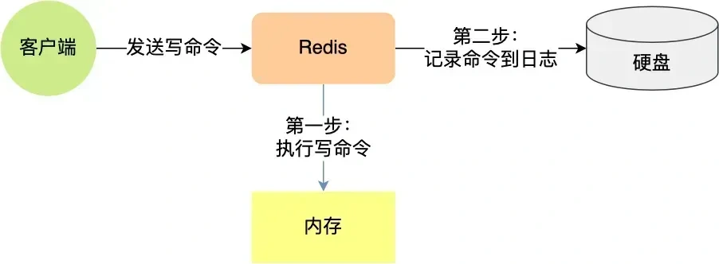

我这里以「*set name xiaolin*」命令作为例子，Redis 执行了这条命令后，记录在 AOF 日志里的内容如下图：

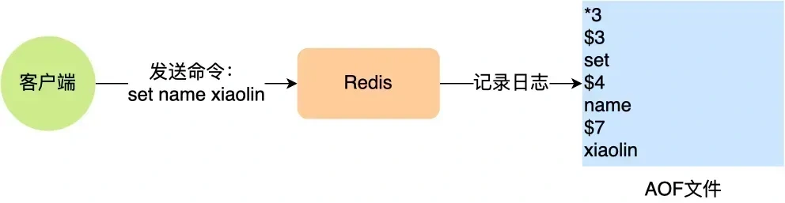

Redis 提供了 3 种写回硬盘的策略， 在 Redis.conf 配置文件中的 appendfsync 配置项可以有以下 3 种参数可填：

准确地说，Redis 执行写命令后，会先把命令追加到用户态的 `aof_buf` 缓冲区，然后在事件循环结束前调用 `write()` 把 `aof_buf` 的内容写入内核 page cache，最后由 `fsync()` 决定何时真正落盘。三种策略的区别就在于 `fsync()` 的时机：

- **Always**，每次把 AOF 缓冲区写入文件后，主线程都会调用 `fsync()`，在确认写入结果前完成同步刷盘。同一批处理的命令可以合并写入和刷盘，数据安全性高，但磁盘同步开销也大；
- **Everysec**，先把命令写入 `aof_buf`，再由主线程调用 `write()` 写到内核 page cache，然后**每隔 1 秒由后台线程调用一次 `fsync()`** 将 page cache 中的内容刷到硬盘，通常把故障时的数据丢失控制在约 1 秒的范围；但如果磁盘卡顿、后台刷盘延迟，就不能把 1 秒当成绝对上限；
- **No**，不主动调用 `fsync()`，只负责 `write()` 到内核 page cache，**由操作系统自行决定何时刷盘**，Redis 不保证具体落盘时间，数据丢失窗口也更难控制。

我也把这 3 个写回策略的优缺点总结成了一张表格：

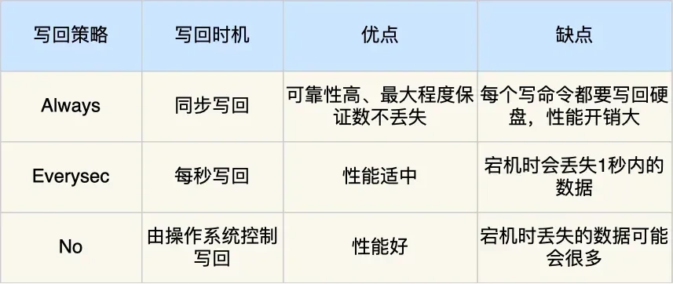

> RDB 快照是如何实现的呢？

纯命令格式的 AOF 记录的是写入操作，恢复时需要重新执行这些命令，日志很多时，恢复就会比较慢。而 **RDB 保存的是某一时刻的数据快照，可以直接加载数据，通常恢复更快**。混合持久化则把两者结合起来，不能把所有 AOF 都理解为只有命令。

所谓的快照，就是记录某一个瞬间东西，比如当我们给风景拍照时，那一个瞬间的画面和信息就记录到了一张照片。所以，RDB 快照就是记录某一个瞬间的内存数据，记录的是实际数据，而 AOF 文件记录的是命令操作的日志，而不是实际的数据。因此在 Redis 恢复数据时， RDB 恢复数据的效率会比 AOF 高些，因为直接将 RDB 文件读入内存就可以，不需要像 AOF 那样还需要额外执行操作命令的步骤才能恢复数据。

Redis 提供了两个命令来生成 RDB 文件，分别是 save 和 bgsave，他们的区别就在于是否在「主线程」里执行：

- 执行了 save 命令，就会在主线程生成 RDB 文件，由于和执行操作命令在同一个线程，所以如果写入 RDB 文件的时间太长，**会阻塞主线程**；
- 执行了 bgsave 命令，会 fork 一个子进程来生成 RDB 文件，快照写入由子进程完成。不过，**fork 本身仍然会短暂阻塞主线程**，数据量大时需要关注这部分延迟；

> AOF和RDB优缺点

**AOF：**

- **优点**：可以通过 always、everysec、no 等刷盘策略，在数据安全性和性能之间进行取舍。相比两次 RDB 快照之间的丢失窗口，everysec 通常能保留更多近期写入；还可以通过后台重写压缩日志体积。
- **缺点**：纯命令格式的 AOF 通常比 RDB 大，恢复时需要重放命令，耗时可能更长。主线程的 write、always 策略下的 fsync，以及重写时的 fork，都可能带来延迟。AOF 损坏时可以使用 redis-check-aof 检查和修复，但修复可能截掉部分数据，并不是无损恢复。

**RDB：**

- **优点**：文件紧凑，适合做备份和传输；恢复时直接加载数据，通常比重放大量 AOF 命令快。使用 BGSAVE 时，写快照的工作主要在子进程里完成。
- **缺点**：故障时可能丢失最近一次成功快照之后的修改。fork 会带来短暂阻塞，生成快照期间如果写入频繁，写时复制还会增加内存占用。

如果 Redis 只是缓存，数据能够从数据库重建，可以根据恢复成本决定是否持久化；如果保存的是不能轻易重建的数据，就要结合允许的数据丢失范围，选择持久化、备份和复制方案，不能只看性能。

### 2.3.2 AOF 重写是怎么实现的？

AOF 一直追加写命令，文件会越来越大，但恢复当前数据并不需要重放所有历史操作，所以 Redis 提供了 **AOF 重写**。

举个例子，先 SET counter 0，再 INCR 100 次，最后内存里的 counter 是 100。重写时，只需要生成能够恢复“counter 等于 100”的数据，不需要保留前面所有自增命令。

所以，**AOF 重写是根据当前内存数据生成新的持久化内容，不是读取旧 AOF 再逐条合并命令**。可以用 BGREWRITEAOF 手动触发，也可以根据文件大小和增长比例自动触发。

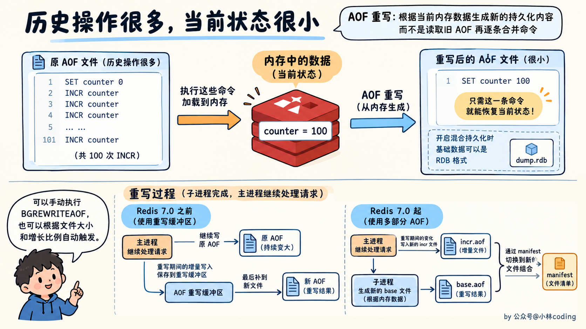

重写由子进程完成，主进程继续处理请求。那重写期间的新写入怎么办？这里要区分版本。

- **Redis 7.0 之前**：主进程继续写原 AOF，同时把重写期间的增量写入保存到 AOF 重写缓冲区，最后补到新文件，再切换到新 AOF。
- **Redis 7.0 起**：使用多部分 AOF。子进程生成新的 base 文件，主进程把重写期间的变化写到新的 incr 文件，完成后通过 manifest 切换到新的文件组合，减少了旧方案重写缓冲区和补写带来的开销。

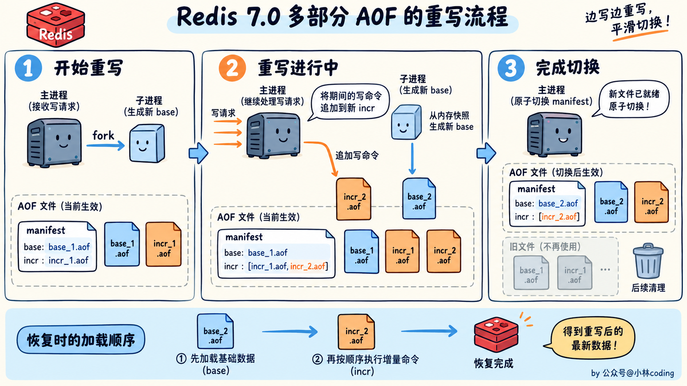

如果开启混合持久化，base 数据采用 RDB 格式；否则采用 AOF 命令格式。无论哪种格式，重写都要关注 fork、写时复制、磁盘空间和子进程 I/O，不能因为在后台执行就认为完全没有性能影响。

### 2.3.3 BGSAVE 时还能修改数据吗？什么是写时复制？

可以。BGSAVE 会 fork 一个子进程生成快照，主进程仍然处理客户端请求。这里用到的是操作系统的 **写时复制（Copy On Write，COW）**。

fork 之后，父子进程最初共享已有的物理内存页，操作系统不会立即把所有数据完整复制一份。主进程要修改某个共享页时，才会复制这个页，让父子进程各自使用不同的物理页。

这样，子进程看到的仍然是 fork 时的数据视图，主进程则可以继续修改自己的数据。写时复制的单位通常是内存页，不是只复制被改动的那个 key。

举个例子，fork 时 name 是 xiaolin，之后主进程把它改成 coding，子进程生成的快照仍然对应之前的 xiaolin，不会一半使用新数据、一半使用旧数据。

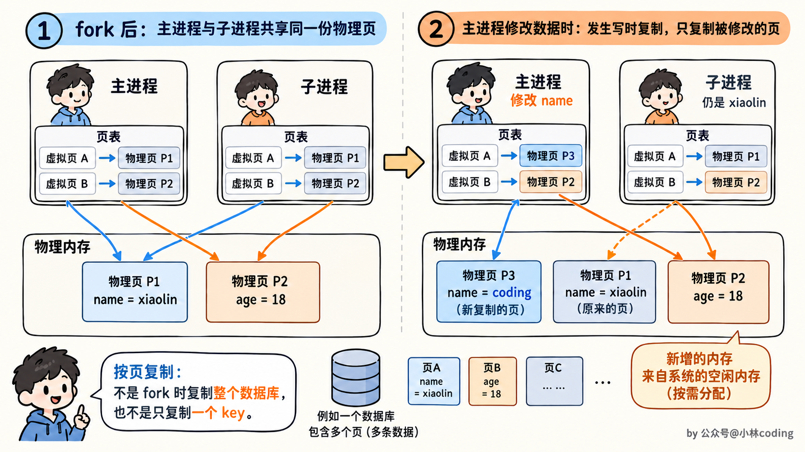

需要注意两点：

- **fork 本身有成本**：需要创建进程、复制页表等，数据量大时会短暂阻塞主线程。
- **写入会增加内存占用**：快照期间修改的共享页越多，COW 产生的额外内存越多。如果内存预留不足，可能导致子进程失败，甚至触发系统 OOM。

AOF 后台重写也会使用类似机制，所以持久化时要同时看主线程延迟和额外内存，不能只看当前 key 占用了多少内存。

### 2.3.4 同时开启 RDB 和 AOF，重启时加载哪个？

正常情况下，**开启 AOF 后，Redis 重启会优先使用 AOF 恢复数据**，因为它通常比独立的 RDB 快照保留更多近期变化，而不是把 dump.rdb 和 AOF 各加载一次。

如果使用混合持久化，AOF 的基础部分本身可能就是 RDB 格式，恢复时先加载这部分，再回放后面的增量命令。Redis 7.0 的多部分 AOF 则按照 manifest 指定的 base 和 incr 文件顺序恢复。

如果 AOF 损坏，也不能直接认为 Redis 一定会自动退回旧的 dump.rdb。需要根据损坏情况、截断加载配置和备份做恢复，避免把不完整的数据恢复当成正常启动。

## 2.4 缓存淘汰和过期删除

### 2.4.1 过期删除策略和内存淘汰策略有什么区别？

区别：

- 内存淘汰策略是在内存使用超过 maxmemory 时，根据策略选择 key 淘汰，腾出空间；如果是 noeviction，或者找不到可淘汰的 key，就拒绝相关写入。
- 过期键删除策略是将已过期的键值对进行删除，Redis 采用的删除策略是惰性删除 + 定期删除。过期删除看的是 key 的有效期，内存淘汰看的是内存压力，即使 key 没过期，也可能被淘汰。

### 2.4.2 介绍一下Redis 内存淘汰策略

Redis 通过 **maxmemory** 控制内存使用上限，通过 **maxmemory-policy** 选择超过上限时的处理方式。

常见的 64 位环境下，maxmemory 默认是 0，表示不设置这个上限；32 位环境默认限制为 3GB。生产环境通常需要显式配置，并给操作系统、复制缓冲区和持久化时的写时复制预留内存，不能把物理内存全部分给 maxmemory。这个限制也不是进程实际占用物理内存的硬上限，部分缓冲区等开销不计入淘汰判断。

以 Redis 7.0 为例，内存淘汰策略共有八种，这八种策略大体分为「不进行数据淘汰」和「进行数据淘汰」两类策略。

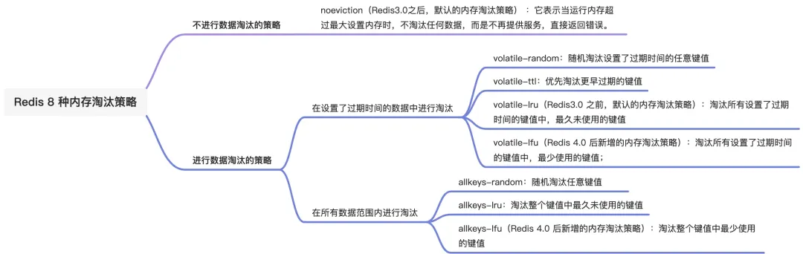

*1、不进行数据淘汰的策略：*

- **noeviction**（Redis3.0之后，默认的内存淘汰策略） ：超过内存上限时，不主动淘汰数据，可能继续增加内存的写命令会返回 OOM 错误，普通查询和删除通常仍可执行。它不等于关闭过期删除，已经过期的 key 仍然会按过期策略处理。

*2、进行数据淘汰的策略：*

针对「进行数据淘汰」这一类策略，又可以细分为「在设置了过期时间的数据中进行淘汰」和「在所有数据范围内进行淘汰」这两类策略。

**在设置了过期时间的数据中进行淘汰：**

- **volatile-random**：随机淘汰设置了过期时间的任意键值；
- **volatile-ttl**：优先淘汰更早过期的键值。
- **volatile-lru**（Redis3.0 之前，默认的内存淘汰策略）：淘汰所有设置了过期时间的键值中，最久未使用的键值；
- **volatile-lfu**（Redis 4.0 后新增的内存淘汰策略）：淘汰所有设置了过期时间的键值中，最少使用的键值；

**在所有数据范围内进行淘汰：**

- **allkeys-random**：随机淘汰任意键值;
- **allkeys-lru**：淘汰整个键值中最久未使用的键值；
- **allkeys-lfu**（Redis 4.0 后新增的内存淘汰策略）：淘汰整个键值中最少使用的键值。

如果选择 volatile 系列策略，但没有可淘汰的过期键，就无法通过淘汰腾出空间，写入仍然可能报 OOM。纯缓存场景可以考虑 allkeys-lru 或 allkeys-lfu；如果 Redis 中还放了锁、库存等不能随意丢掉的数据，就应该考虑拆分实例，避免它们被缓存淘汰影响。

### 2.4.3 LRU 和 LFU 有什么区别？Redis 是怎么实现的？

**LRU 看最近有没有用过，LFU 看一段时间内用得多不多**。

举个例子，一个商品一直被频繁访问，但刚好最近一小段时间没有请求；另一个商品以前没人看，刚刚被访问了一次。LRU 更可能保留后者，LFU 更可能保留前者，因为两者关注的指标不一样。

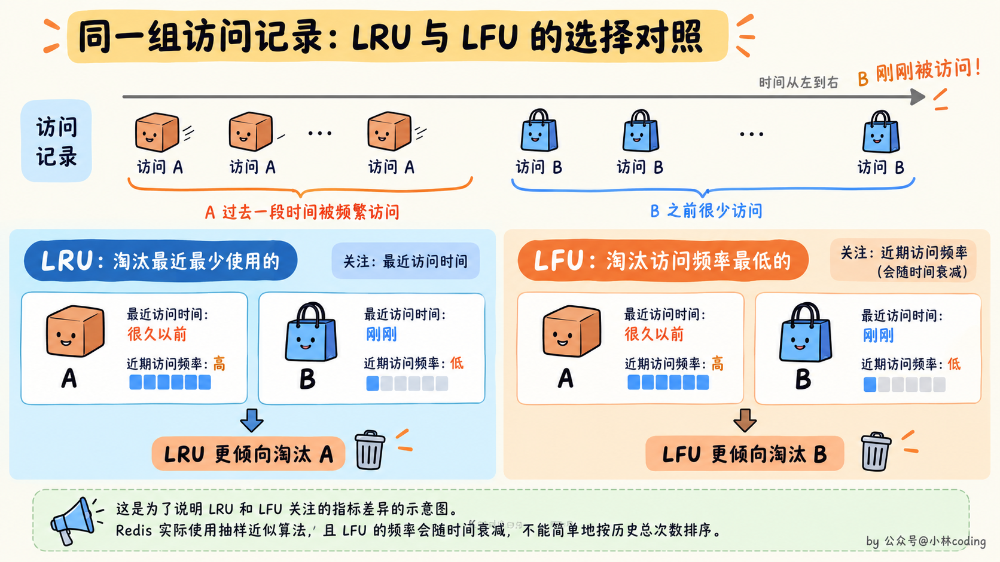

Redis 没有为所有 key 维护一条严格的 LRU 链表，而是使用**近似 LRU**：记录访问时间，淘汰时抽样一些 key，再结合候选池挑选较久没被访问的 key。maxmemory-samples 可以控制采样数量，采样越多通常越接近真实 LRU，但 CPU 开销也会增加。

LFU 同样是近似实现。它使用有限位数的计数器，通过概率递增估算访问频率，并根据时间衰减，避免一个以前的热点长期占着内存。

所以 LFU 不是每访问一次就一直精确加一，也不是永远保留历史访问次数最多的 key。热点比较稳定时可以考虑 LFU，热点变化较快时可以比较 LRU 的表现，最终还是看真实业务的命中率和淘汰情况。

### 2.4.4 介绍一下Redis过期删除策略

**Redis 选择「惰性删除+定期删除」这两种策略配合使用**，以求在合理使用 CPU 时间和避免内存浪费之间取得平衡。

Redis 的**惰性删除策略**会在访问 key 时检查有效期，涉及 expireIfNeeded 等函数。下面用伪代码表示主节点上的基本判断，实际实现还需要处理主从角色和命令类型：

```text
访问 key 时：
    如果没有过期，继续执行命令
    如果已经过期，把它当作不存在
    从数据库中移除过期 key
    根据配置和释放成本，同步或异步回收底层内存
```

Redis 在访问或者修改 key 之前，都会调用 expireIfNeeded 函数对其进行检查，检查 key 是否过期：

- 如果过期，在主节点上删除该 key，底层内存是否异步释放由 lazyfree-lazy-expire 等配置决定；对于 GET 这样的读取命令，会表现为 key 不存在；
- 如果没有过期，继续执行正常的读取或者修改操作；

惰性删除的流程图如下：

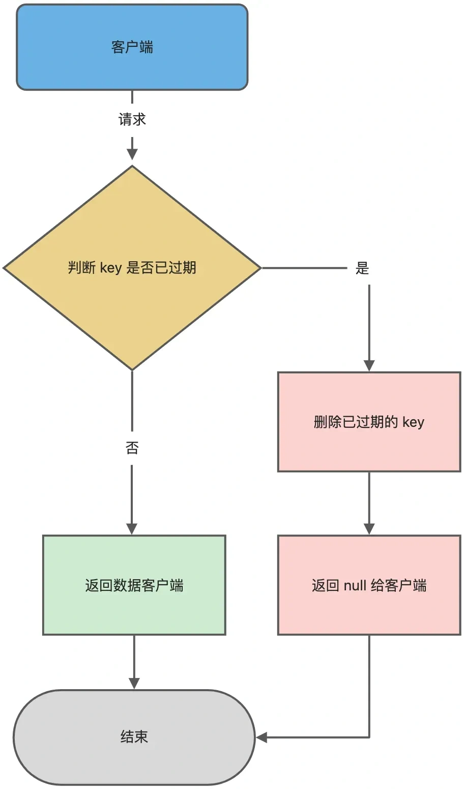

**Redis 的定期删除是每隔一段时间「随机」从数据库中取出一定数量的 key 进行检查，并删除其中的过期key。**

*1、检查的频率是多少？*

Redis 的周期性任务由 hz 控制，默认是 10，可以理解为基础频率约每秒 10 次。但动态 hz、快速过期检查等机制也会影响实际执行频率，不能理解为每个 key 都会每 100ms 被检查一次。

*2、每轮怎么检查？*

Redis 会从设置了过期时间的 key 中抽样，检查并删除过期数据。如果过期数据比例较高，就继续检查；如果比例下降，或者用完本轮的时间预算，就退出，把时间留给客户端请求。

以 Redis 7.0 为例，active-expire-effort 默认值为 1，基础的每轮扫描数量是 20，继续扫描所用的过期比例阈值是 10%。提高 active-expire-effort 会调整扫描量、时间预算和阈值，所以这些值不是所有版本都固定不变的。

默认参数下，慢速检查的时间预算大约是两次周期性任务间隔的 25%；当 hz 为 10 时，约为 25ms。它是按预算控制的过程，也不是每轮一定耗时 25ms。

大致流程可以这样理解：

```text
重复执行：
    从过期字典中取出一批 key
    检查过期时间，删除已经过期的 key
    如果达到时间预算，就退出
    如果过期比例已经足够低，也退出
```

所以，**定期删除是在 CPU 开销和内存回收之间做平衡，不会每次把所有 key 都遍历一遍**。

下面的旧版示意图可以帮助理解抽样检查和时间预算的流程，图中的固定采样值、比例阈值应以所用版本和配置为准：

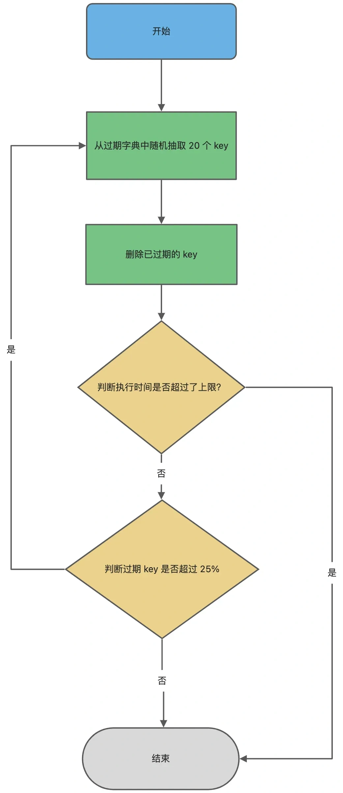

### 2.4.5 Redis的缓存失效会不会立即删除？

不会，Redis 的过期删除策略是选择「**惰性删除+定期删除**」这两种策略配合使用。

- 惰性删除策略的做法是，**不主动删除过期键，每次从数据库访问 key 时，都检测 key 是否过期，如果过期则删除该 key。**
- 定期删除策略的做法是，**每隔一段时间「随机」从数据库中取出一定数量的 key 进行检查，并删除其中的过期key。**

### 2.4.6 那为什么不在过期时立即删除？

在过期 key 比较多的情况下，删除过期 key 可能会占用相当一部分 CPU 时间，在内存不紧张但 CPU 时间紧张的情况下，将 CPU 时间用于删除和当前任务无关的过期键上，无疑会对服务器的响应时间和吞吐量造成影响。所以，定时到期之后立即删除策略对 CPU 不友好。

### 2.4.7 已经过期但还没删除的 key，能读到吗？

对于普通客户端的读取，**逻辑过期和物理删除是两回事**。key 的内存还没回收，不代表客户端还能正常读到这个过期值。

在主节点读取时，Redis 会检查过期时间。发现已经过期，就把它当作不存在处理，并触发删除；如果使用异步释放，底层内存可能稍后才由后台线程回收。

从节点通常依赖主节点传播删除命令来清理复制数据，但对普通客户端读取，也会根据过期时间判断是否应当返回，所以不能认为“主节点还没发 DEL，从节点就一定能读到过期值”。不过，没有过期的新值仍然可能因为复制延迟而读不到，这是另一类问题。

### 2.4.8 修改 key 的值，会不会影响过期时间？

要看使用什么命令，不能统一回答会或者不会。

- **普通 SET 覆盖值**：会清除原来的过期时间。如果需要保留，可以使用 Redis 6.0 起支持的 KEEPTTL；如果需要新有效期，可以在 SET 中带上 EX 或 PX。
- **INCR、HSET、LPUSH 等原地修改**：通常会保留整个 key 已有的过期时间，不会因为修改内容就自动续期。
- **EXPIRE、PEXPIRE**：重新设置 key 的有效期。
- **PERSIST**：移除 key 的过期时间，让它变成没有 TTL 的 key。

比如一个缓存原本只剩 30 秒就过期，应用又执行了普通 SET 更新内容，却没有带 EX，缓存就可能变成长期不过期。所以缓存写入时，应该把值和有效期放到同一条 SET 命令里，避免漏设 TTL。

查看 TTL 时，返回 -1 表示 key 存在但没有过期时间，返回 -2 表示 key 不存在。

## 2.5 集群

### 2.5.1 Redis主从同步中的增量和完全同步怎么实现？

> 完全同步

完全同步，也就是全量同步，主要发生在以下几种情况：

- **首次建立复制关系**：从节点没有可用于续传的复制信息，需要获取主节点的完整数据。
- **复制历史不匹配**：主节点无法根据从节点提供的复制 ID 找到兼容的复制历史。
- **所需数据已经被覆盖**：断连时间较长，从节点缺失的命令不再位于复制积压缓冲区中，只能重新全量同步。

所以，全量还是增量，不是只看主节点有没有变化，而是看复制历史能不能衔接，以及需要的增量数据还在不在。

主从服务器间的第一次同步的过程可分为三个阶段：

- 第一阶段是建立链接、协商同步；
- 第二阶段是主服务器同步数据给从服务器；
- 第三阶段是主服务器发送新写操作命令给从服务器。

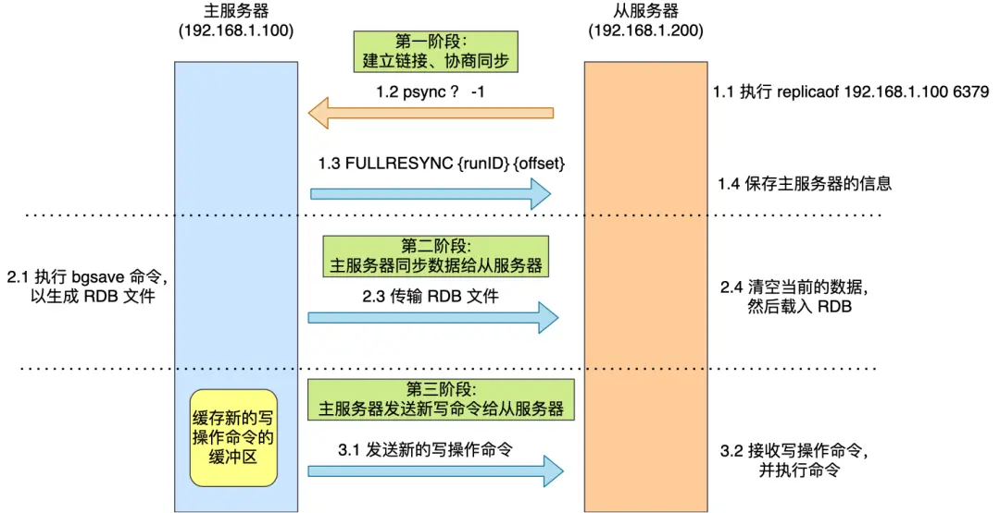

**实现过程**：

1. **从节点发送 PSYNC**：首次同步通常发送 `PSYNC ? -1`，表示没有可用的复制 ID 和偏移量。主节点回复 FULLRESYNC，告诉从节点接下来进行全量同步，并返回复制 ID 和基准偏移量。
2. **主节点生成 RDB**：主节点通过子进程生成当前数据的快照。快照可以先写磁盘再传输，也可以使用无盘复制直接发送给从节点。
3. **记录期间的写命令**：生成和传输快照时，主节点继续处理请求，把快照之后的写命令保存在待发送的复制数据中，避免这段时间的变化丢失。
4. **从节点加载 RDB**：从节点接收完整快照，替换原来的数据集。
5. **补齐增量命令**：主节点继续发送快照之后的写命令，从节点执行后，就进入持续接收命令的阶段。

这里要区分两个概念：**replication buffer 是给从节点发送复制数据用的，repl_backlog_buffer 是保留最近复制历史、支持断线后增量同步用的**。它们的职责不同，不能把全量同步期间待发送的命令只理解为存在 backlog 里。Redis 7.0 对复制缓冲区做了共享实现，但这两个职责仍然需要分清。

> 增量同步

增量同步允许从服务器从断点处继续同步，而不是每次都进行完全同步。它基于`PSYNC`命令，使用复制 ID（replication ID）和复制偏移量（offset）判断能不能接着同步。这里的复制 ID 标识的是复制历史，不要和 Sentinel 选主时用于比较的进程 run ID 混为一谈。

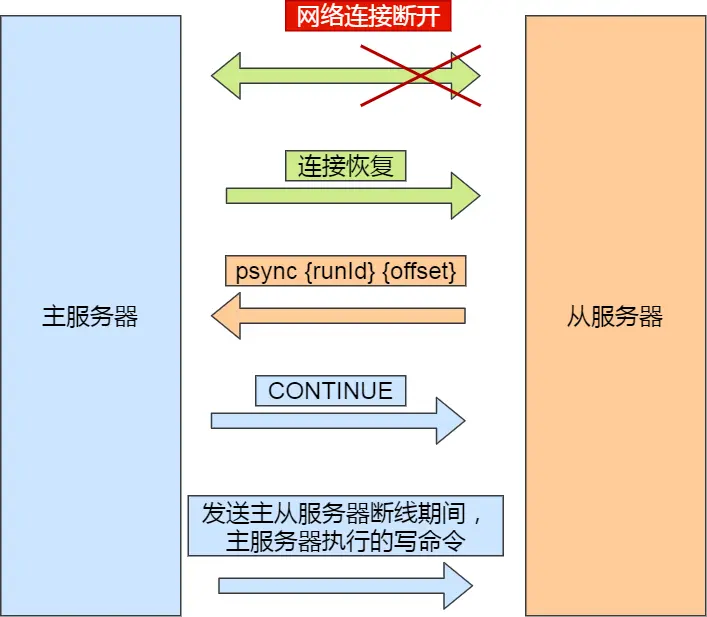

主要有三个步骤：

- 从服务器在恢复网络后，会发送 psync 命令给主服务器，此时的 psync 命令里的 offset 参数不是 -1；
- 主服务器收到该命令后，然后用 CONTINUE 响应命令告诉从服务器接下来采用增量复制的方式同步数据；
- 然后主服务将主从服务器断线期间，所执行的写命令发送给从服务器，然后从服务器执行这些命令。

那么关键的问题来了，**主服务器怎么知道要将哪些增量数据发送给从服务器呢？**

答案藏在这两个东西里：

- **repl_backlog_buffer**，保存最近的复制历史，传统实现是环形缓冲区，用于从节点断连后查找缺失的数据；
- **replication offset**，标记上面那个缓冲区的同步进度，主从服务器都有各自的偏移量，主服务器使用 master_repl_offset 来记录自己「*写*」到的位置，从服务器使用 slave_repl_offset 来记录自己「*读*」到的位置。

那 repl_backlog_buffer 缓冲区是什么时候写入的呢？

在主服务器进行命令传播时，不仅会将写命令发送给从服务器，还会将写命令写入到 repl_backlog_buffer 缓冲区里，因此 这个缓冲区里会保存着最近传播的写命令。

网络断开后，当从服务器重新连上主服务器时，从服务器会通过 psync 命令将自己的复制偏移量 slave_repl_offset 发送给主服务器，主服务器先判断复制 ID 是否兼容，再检查从节点请求的偏移量是否还在 backlog 保存的范围内，决定采用哪种同步操作：

- 如果判断出从服务器要读取的数据还在 repl_backlog_buffer 缓冲区里，那么主服务器将采用**增量同步**的方式；
- 相反，如果判断出从服务器要读取的数据已经不存在 repl_backlog_buffer 缓冲区里，那么主服务器将采用**全量同步**的方式。

当主节点确认需要的历史还在 backlog 中，就从对应偏移量开始把数据发给从节点。旧版本会将历史复制到从节点待发送的缓冲区；Redis 7.0 的共享复制缓冲区可以复用已有的数据块，不需要为每个副本重复保存一份。

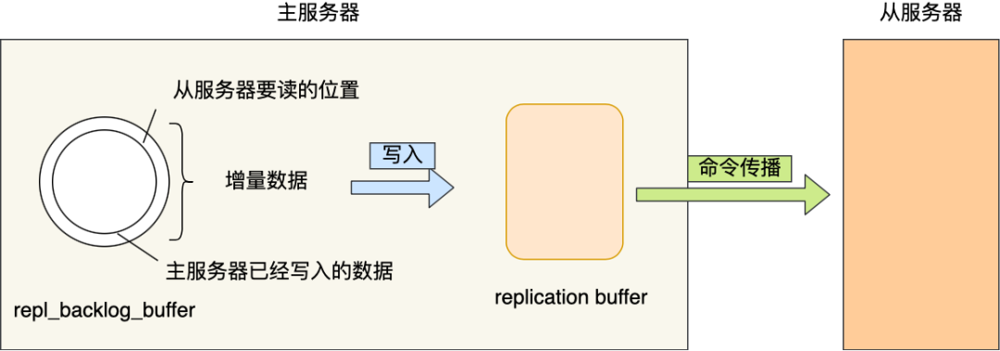

复制积压缓冲区可以理解为一个只保留最近复制历史的有限窗口，默认 repl-backlog-size 是 1MB。传统实现使用环形缓冲区，Redis 7.0 使用共享的复制缓冲块实现这个窗口；无论哪种实现，旧的复制历史都不会无限保留。断连时间越长、复制流量越大，从节点需要的数据越容易超出这个窗口。

那么在网络恢复时，如果从服务器想读的数据已经被覆盖了，主服务器就会采用全量同步，这个方式比增量同步的性能损耗要大很多。

因此，为了减少断线重连时的全量同步，可以根据“每秒复制流量 × 希望容忍的断连时间”，再加上一定余量，设置 repl-backlog-size。比如每秒复制流量约 2MB，希望覆盖 60 秒断连，就至少需要考虑 120MB 的历史窗口，并预留流量波动的空间。**要结合内存预算设置，不是越大越好**。

### 2.5.2 redis主从和集群可以保证数据一致性吗 ？

**不能保证主从强一致，也不能保证故障切换时已经确认的写入一定不丢失**，因为 Redis 的主从复制默认是异步的。

举个例子，客户端往主节点写入一条数据，主节点返回成功，但这条数据还没有复制到从节点。这时主节点宕机，哨兵或者 Cluster 把从节点提升为主节点，新主节点上就没有这条数据了。

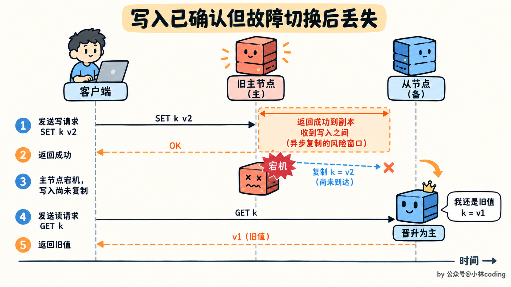

读写分离也有类似问题：刚写完主节点，马上去从节点读取，可能读到旧值。所以，对“写完马上读”的场景，可以优先读主节点；但这也不能消除故障切换造成的数据丢失窗口。

可以通过 WAIT 等机制等待副本确认，或者用 min-replicas-to-write、min-replicas-max-lag 限制副本状态不好时的写入，来降低风险。不过，**这些措施不会把 Redis 变成强一致系统**。

另外，不能简单说“Redis Cluster 属于 AP，所以网络分区时一直可用”。Cluster 在失去多数主节点联系时会停止接受写入；默认要求所有槽都可服务，槽不可用也可能影响整个集群。它的可用性有条件，面试时直接讲清楚异步复制和故障切换的边界更准确。

### 2.5.3 哨兵机制原理是什么？

在 Redis 的主从架构中，由于写请求通常由主节点处理，如果主节点（master）挂了，那么将没有主节点来服务客户端的写操作请求，也没有主节点给从节点（slave）进行数据同步了。

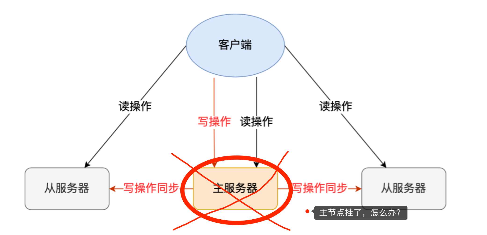

这时如果要恢复服务的话，需要人工介入，选择一个「从节点」切换为「主节点」，然后让其他从节点指向新的主节点，同时还需要通知上游那些连接 Redis 主节点的客户端，将其配置中的主节点 IP 地址更新为「新主节点」的 IP 地址。

这样也不太“智能”了，要是有一个节点能监控「主节点」的状态，当发现主节点挂了，它自动将一个「从节点」切换为「主节点」的话，那么可以节省我们很多事情啊！

Redis 在 2.8 版本以后提供的**哨兵（Sentinel）机制**，它的作用是实现**主从节点故障转移**。它会监测主节点是否存活，如果发现主节点挂了，它就会选举一个从节点切换为主节点，并且把新主节点的相关信息通知给从节点和客户端。

哨兵其实是一个运行在特殊模式下的 Redis 进程，所以它也是一个节点。从“哨兵”这个名字也可以看得出来，它相当于是“观察者节点”，观察的对象是主从节点。

当然，它不仅仅是观察那么简单，在它观察到有异常的状况下，会做出一些“动作”，来修复异常状态。

哨兵节点主要负责三件事情：**监控、选主、通知**。

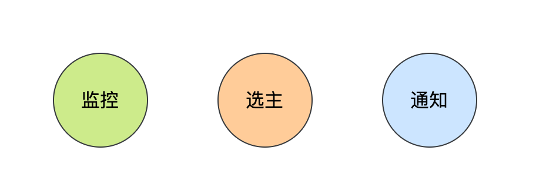

### 2.5.4 哨兵机制的选主节点的算法介绍一下

当 Redis 主从架构中的主节点故障时，Sentinel 会协调故障转移，从可用的从节点中选出新主节点。这里说的是哨兵管理的主从架构，Redis Cluster 有自己的故障检测和选举机制，不依赖 Sentinel。主要有以下步骤：

1. 故障节点主观下线
2. 故障节点客观下线
3. Sentinel集群选举Leader
4. Sentinel Leader决定新主节点

> 1. 故障节点主观下线

Sentinel集群的每一个Sentinel节点会定时对redis集群的所有节点发心跳包检测节点是否正常。如果一个节点在down-after-milliseconds时间内没有回复Sentinel节点的心跳包，则该redis节点被该Sentinel节点主观下线。

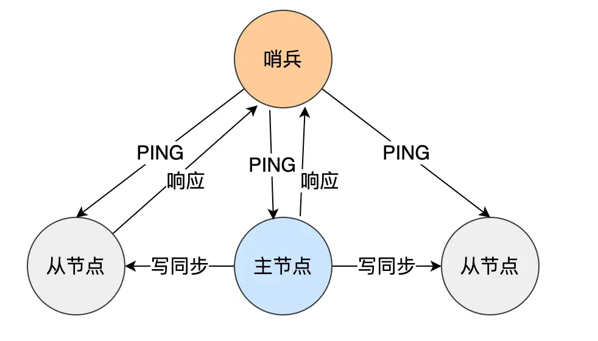

> 1. 故障节点客观下线

当节点被一个Sentinel节点记为主观下线时，并不意味着该节点肯定故障了，还需要Sentinel集群的其他Sentinel节点共同判断为主观下线才行。

该Sentinel节点会询问其他Sentinel节点，如果认为主节点下线的 Sentinel 数量达到配置的 quorum（包括自己），就可以把主节点标记为客观下线。

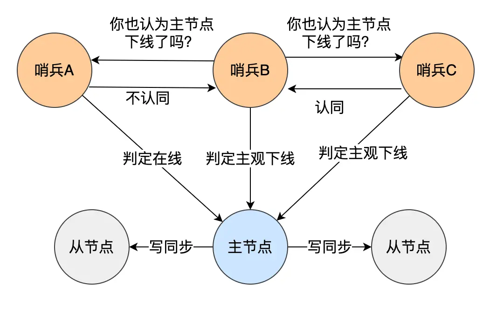

**客观下线判断针对的是主节点**。从节点和其他 Sentinel 可以被标记为主观下线，但不会对它们执行主节点这样的客观下线和故障转移流程。

> 1. Sentinel集群选举Leader

在开始主从故障转移前，需要先选出一个 Sentinel 作为 Leader，由它负责协调切换。

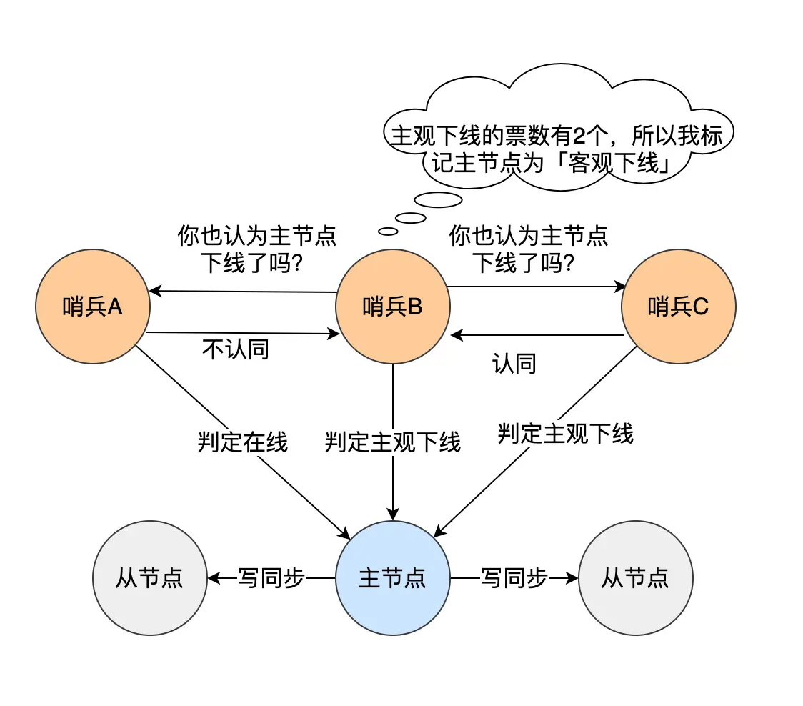

每一个Sentinel节点都可以成为Leader，当一个 Sentinel 节点确认主节点客观下线并准备发起故障转移后，会请求其他Sentinel节点要求将自己选举为Leader。每一轮选举有对应的纪元，一个 Sentinel 在同一个纪元里只会投票给一个候选者。如果还没有投票，就可以同意该请求，否则不会再给另一个候选者投票。

如果一个Sentinel节点获得的选举票数达到Leader最低票数(quorum 和 floor(Sentinel 节点数 / 2) + 1 的最大值)，则该Sentinel节点选举为Leader；否则重新进行选举。

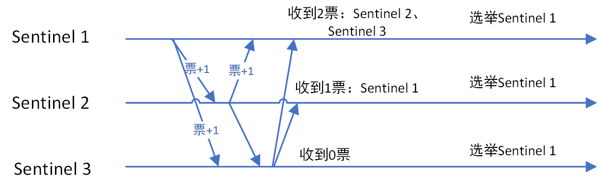

举个例子，假设哨兵节点有 3 个，quorum 设置为 2，那么任何一个想成为 Leader 的哨兵只要拿到 2 张赞成票，就可以选举成功了。如果没有满足条件，就需要重新进行选举。

> 1. Sentinel Leader决定新主节点

当Sentinel集群选举出Sentinel Leader后，由Sentinel Leader从redis从节点中选择一个redis节点作为主节点：

1. **先过滤不合适的节点**：排除不可用、与主节点断连过久，以及 replica-priority 为 0 的从节点。优先级为 0 表示不参与晋升。
2. **比较优先级**：选择 replica-priority 数值更小的节点，数值越小，优先级越高。旧版本配置名叫 slave-priority。
3. **优先级相同，再比较复制偏移量**：选择偏移量更大的节点，说明它通常接收了更多复制数据。
4. **偏移量也相同，再比较 run ID**：选择 run ID 字典序更小的节点，让选择结果是确定的。

注意，这些条件是按顺序比较，不是选不到优先级最大的才去比较偏移量。选出新主节点后，Sentinel 会将它提升为主节点，让其他从节点重新复制它，并通知支持 Sentinel 的客户端发现新主节点。

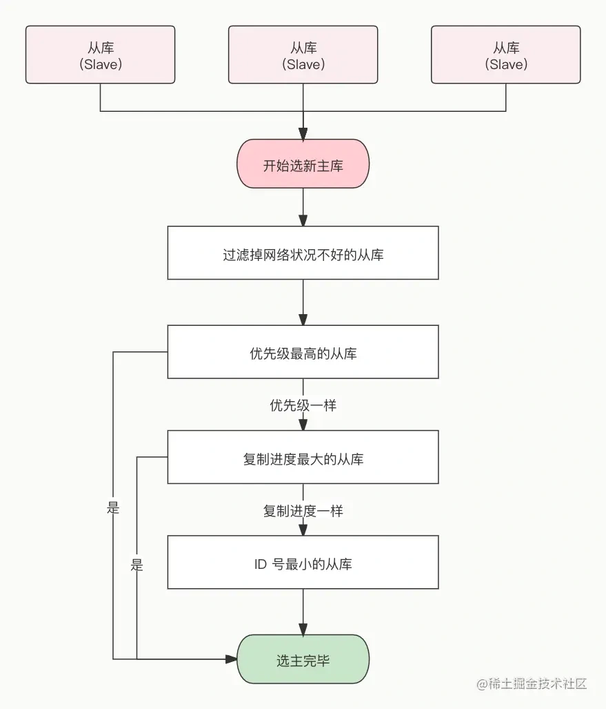

### 2.5.5 Redis 脑裂是什么？怎么降低影响？

在哨兵管理的主从架构中，脑裂通常是指网络分区后，**旧主节点仍然被部分客户端当作主节点使用，而另一边已经完成故障转移，出现了新主节点**。

比如旧主节点和哨兵、从节点之间的网络断了，但某些应用还可以访问旧主节点。哨兵把从节点提升为新主节点，新旧两个主节点都可能收到写请求。网络恢复后，旧主节点被改成从节点，它独有的写入可能被新主节点的数据覆盖。

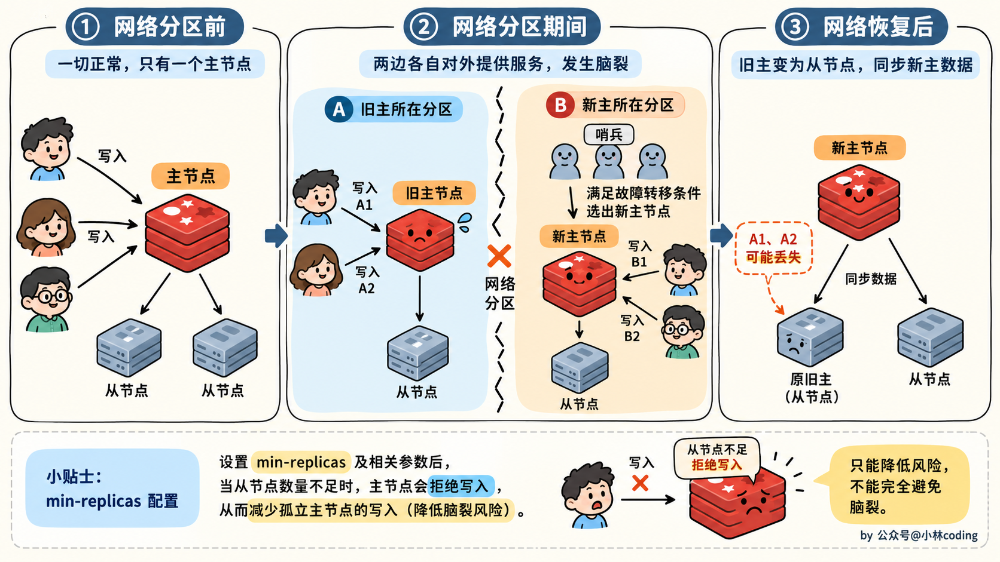

可以从几个方面降低影响：

- **限制孤立主节点的写入**：通过 min-replicas-to-write 和 min-replicas-max-lag，要求主节点有足够数量、延迟在允许范围内的副本，否则拒绝写入。
- **让客户端及时发现新主节点**：使用支持 Sentinel 的客户端，正确处理连接错误和拓扑变化，避免长期连接旧主节点。
- **减少共同故障**：哨兵和主从节点分布在不同故障域，合理设置检测和切换参数。

这些措施能缩短风险窗口，但**不能承诺完全消除数据丢失**。副本状态的判断存在延迟，而且限制写入也会牺牲可用性，所以需要结合业务对一致性和可用性的要求来选择。

### 2.5.6 Redis集群的模式了解吗 优缺点了解吗

当 Redis 缓存数据量大到一台服务器无法缓存时，就需要使用 **Redis 切片集群**（Redis Cluster ）方案，它将数据分布在不同的服务器上，以此来降低系统对单主节点的依赖，从而提高 Redis 服务的读写性能。

Redis Cluster 方案采用哈希槽（Hash Slot），来处理数据和节点之间的映射关系。在 Redis Cluster 方案中，**一个切片集群共有 16384 个哈希槽**，这些哈希槽类似于数据分区，每个键值对都会根据它的 key，被映射到一个哈希槽中，具体执行过程分为两大步：

- 根据键值对的 key，按照 CRC16 算法计算一个 16 bit 的值。
- 再用 16bit 值对 16384 取模，得到 0~16383 范围内的模数，每个模数代表一个相应编号的哈希槽。

接下来的问题就是，这些哈希槽怎么被映射到具体的 Redis 节点上的呢？有两种方案：

- **平均分配：** 在使用 cluster create 命令创建 Redis 集群时，Redis 会自动把所有哈希槽平均分布到集群节点上。比如集群中有 3 个主节点、每个主节点各有 2 个从节点，一共 9 个节点，槽位仍然只分配给 3 个主节点，每个主节点负责约 16384/3 个槽。从节点复制对应主节点的数据，不独立分配新的槽。
- **手动分配：** 可以使用 cluster meet 命令手动建立节点间的连接，组成集群，再使用 cluster addslots 命令，指定每个节点上的哈希槽个数。

为了方便你的理解，我通过一张图来解释数据、哈希槽，以及节点三者的映射分布关系。

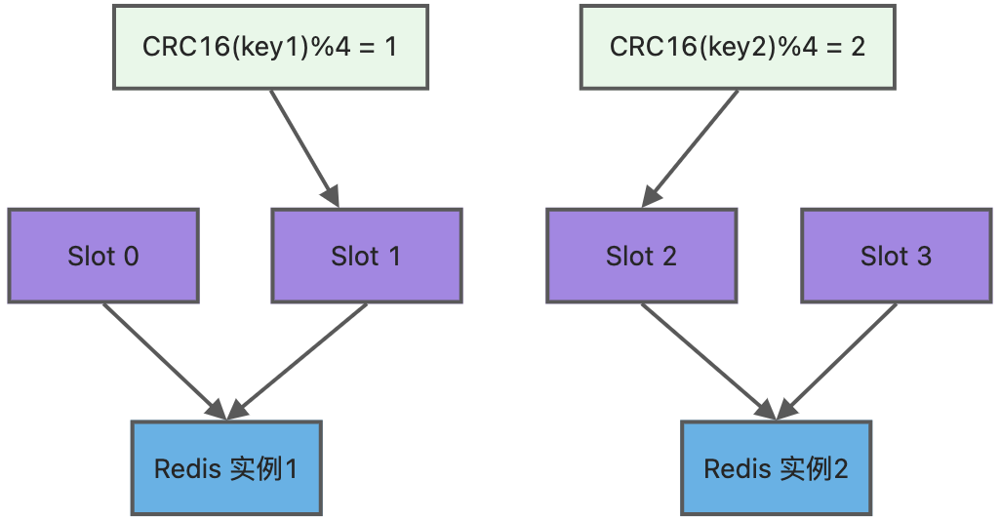

上图中的切片集群一共有 2 个节点，假设有 4 个哈希槽（Slot 0～Slot 3）时，我们就可以通过命令手动分配哈希槽，比如节点 1 保存哈希槽 0 和 1，节点 2 保存哈希槽 2 和 3。

```shell
redis-cli -h 192.168.1.10 -p 6379 CLUSTER ADDSLOTS 0 1
redis-cli -h 192.168.1.11 -p 6379 CLUSTER ADDSLOTS 2 3
```

然后在集群运行的过程中，key1 和 key2 计算完 CRC16 值后，对哈希槽总个数 4 进行取模，再根据各自的模数结果，就可以被映射到哈希槽 1（对应节点1） 和 哈希槽 2（对应节点2）。

上面的 4 个槽只是为了画图方便，真实的 Redis Cluster 固定有 16384 个槽，不能改成 4 个。默认 cluster-require-full-coverage 为 yes，需要全部槽可服务；关闭这个配置可以让可用槽继续服务，但仍然需要满足集群的其他可用性条件。

> Redis集群模式优点/缺点

优点：

- **容量和吞吐量可以扩展**：把不同 key 分散到多个主节点，多个分片可以并行处理各自的请求。
- **支持故障转移**：主节点故障时，可以由合适的从节点接替。但前提是存在可用副本，并满足选举条件，不是任何节点故障都能保证整个集群正常工作。
- **可以在线扩缩容**：通过迁移哈希槽及其数据，调整节点负责的数据范围。

缺点：

- **维护更复杂**：要管理主从关系、槽位、迁移、客户端路由，以及数据和请求分布是否均衡。
- **多 key 操作受限制**：事务、Lua 脚本以及许多多 key 命令，要求相关 key 在同一个哈希槽里；同一个节点上的两个 key，也不一定在同一个槽。
- **不能解决所有热点问题**：一个 key 仍然只属于一个槽、由一个主节点处理，增加分片不能自动把同一个热 key 的写请求拆到多个主节点。
- **存在复制延迟和数据丢失窗口**：主从异步复制，故障切换不能保证强一致；Cluster 也只支持数据库 0，不支持通过 SELECT 切换多个数据库。

另外，原生 Redis Cluster 节点不会充当代理来转发普通请求，而是让客户端根据槽位路由，必要时返回重定向。

### 2.5.7 cluster集群客户端是怎样知道该访问哪个分片的？

首先 Redis Cluster 把所有数据映射到 16384 个哈希槽里，每个集群节点会负责一部分槽位，客户端启动后会先和集群中任意一个节点建立连接，通过 `CLUSTER SLOTS`，或者 Redis 7.0 起提供的 `CLUSTER SHARDS`，获取 “槽位 - 节点” 映射关系（比如哪些槽位归哪个 IP + 端口的节点管），然后把这份映射关系缓存到本地。

当客户端要访问某个 key 时，会先对 key 做 CRC16 哈希计算，再对 16384 取模，算出这个 key 对应的哈希槽位，接着查本地缓存的映射表，找到该槽位对应的节点地址，直接访问这个节点即可。

如果槽位发生迁移，或者故障切换使槽位对应的主节点变化，客户端可能收到 `MOVED` 或 `ASK`，但两者的处理不一样：

- **MOVED**：表示当前槽位应该访问另一个节点。客户端重发请求，并更新这个槽的路由，或者刷新整个槽位映射。
- **ASK**：通常出现在槽位迁移过程中，只要求这一次请求去目标节点。客户端在目标节点的同一连接上先发送 ASKING，再发送原命令，**不能据此永久修改槽位映射**。

如果连接直接断开，也可能先遇到连接错误，再由客户端刷新拓扑或者重试，不一定总能收到重定向。

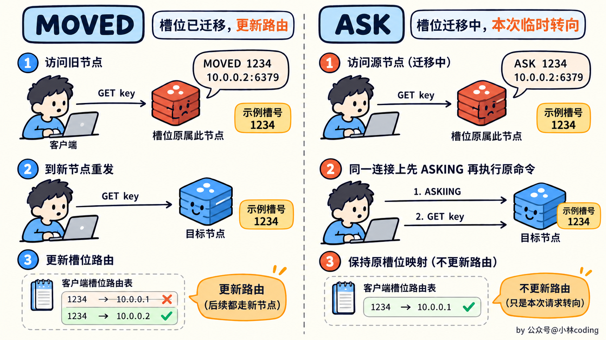

简单说，客户端先拿全量槽位映射表缓存起来，访问 key 时算槽位、查缓存找节点，遇到变动就更新缓存，全程自动完成，不用开发者手动指定分片，这也是 Redis Cluster 能做到透明分片访问的核心。

### 2.5.8 Redis Cluster 为什么会报 CROSSSLOT？hash tag 有什么用？

因为 Redis Cluster 的许多多 key 操作，要求**所有 key 位于同一个哈希槽**。如果 key 分属不同槽，就可能返回 CROSSSLOT。

比如要用 Lua 同时检查商品库存和用户购买记录，可以这样设计 key：

```text
seckill:{activity:1001}:stock
seckill:{activity:1001}:buyers
```

这里花括号内的 activity:1001 就是 hash tag。Redis 计算槽位时，只对这一段内容做哈希，所以这两个 key 会落在同一个槽里，能够在一个节点内执行相关原子操作。

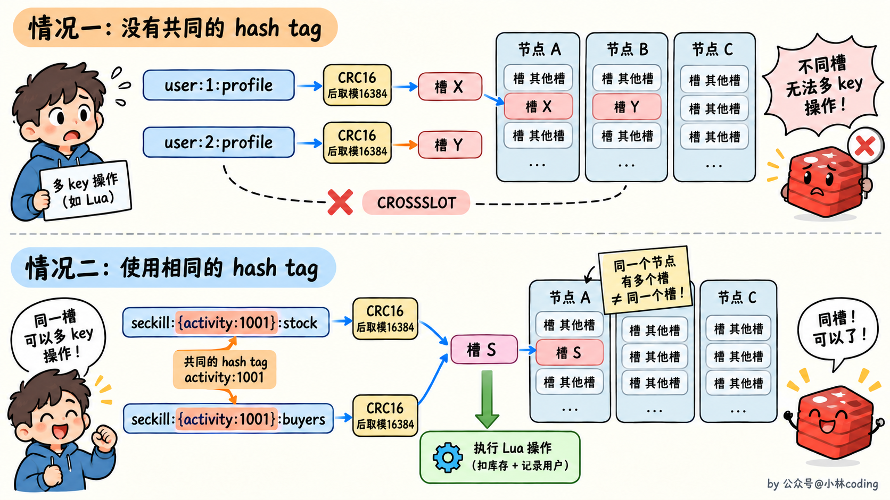

这里有两个容易答错的点：

- **在同一个节点，不等于在同一个槽**。一个节点会负责很多槽，多 key 操作仍然要满足同槽要求。
- **不是所有 key 都应该使用同一个 hash tag**。如果所有商品都用同一个 tag，就会把数据和流量集中到一个槽，失去分片带来的扩展能力。

因此，hash tag 应该按需要原子处理的业务范围来设置，比如一个活动或者一个订单，而不是为了方便，把整个业务的数据都放到同一个槽。

## 2.6 场景

### 2.6.1 为什么使用redis？

主要是因为 **Redis 具备「高性能」和「高并发」两种特性**。

> 1、Redis 具备高性能

假如用户查询商品详情，需要从 MySQL 读取商品信息、关联数据，再组装结果。第一次查询完成后，可以把结果缓存到 Redis，后面的请求直接读取缓存，减少数据库查询和重复计算。

这里要注意，MySQL 也有 Buffer Pool，不能把每次查询都理解为读硬盘。Redis 缓存的优势主要是让常见请求用更简单的键值操作直接拿到结果，减轻数据库的整体工作量。

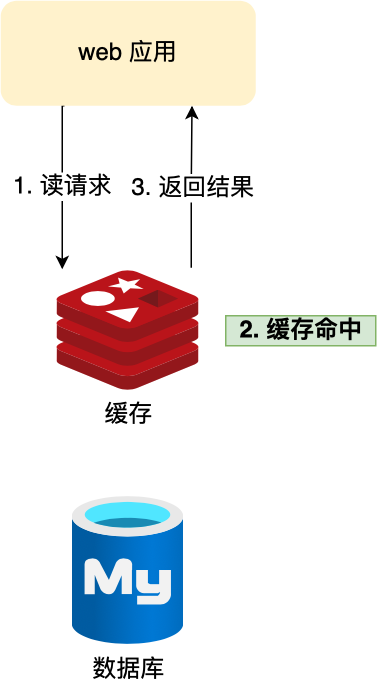

如果 MySQL 中的数据发生变化，还需要让对应缓存失效或刷新，这里就会涉及 Redis 和 MySQL 的一致性问题，后面会展开讲。

> 2、 Redis 具备高并发

Redis 对简单键值操作通常有较高的吞吐量，因此可以承担大量重复读取。QPS 是每秒请求数，不过 Redis 和 MySQL 能达到多少 QPS，取决于硬件、命令或 SQL、数据大小、网络和持久化配置，不能固定认为 Redis 一定是 MySQL 的 10 倍。

因此，可以把重复读取的数据放到缓存，让一部分请求直接命中 Redis，减少数据库的查询量，为真正需要访问数据库的请求留出容量。

### 2.6.2 为什么redis比mysql要快？

在缓存查询这类场景下，Redis 通常更快，主要有三个原因：

- **以内存访问为主**：Redis 的数据主要放在内存中，普通读写不需要等待磁盘读取。MySQL 虽然也通过 Buffer Pool 缓存数据页，但缓存未命中时仍然可能涉及磁盘 I/O。
- **操作路径更简单**：Redis 按 key 获取已经组装好的结果，很多查询可以通过哈希表完成。MySQL 则可能需要解析 SQL、选择执行计划、访问索引、回表、关联和排序，承担的工作更多。
- **命令串行执行，减少并发协调开销**：Redis 普通命令由主线程执行，避免了这些命令之间的锁竞争和线程切换。不过，MySQL 的多线程模型也能利用多核，这里不能说单线程在所有场景下都更快。

比如查询一个包含多个表信息的商品详情，MySQL 需要查询和组装，Redis 直接 GET 缓存好的 JSON，做的事情本来就不一样。因此，面试时我会结合具体场景解释，不能只用 O(1) 和 O(log N) 就推出固定的性能差距。

### 2.6.3 本地缓存和Redis缓存的区别?

最大的区别是，**本地缓存属于当前应用进程，Redis 缓存是多个应用实例可以共享访问的独立服务**。

比如用 Caffeine 缓存商品详情，每个应用实例都有自己的一份；用 Redis 缓存商品详情，多个实例读取的是同一份缓存。

本地缓存的优点：

- **访问快**：不需要网络请求，也不需要通过 Redis 客户端序列化和传输。
- **减轻 Redis 压力**：特别适合少量高频读取的热点数据。
- **不依赖远程访问**：Redis 短暂不可用时，已经存在于本地的数据仍然可以提供服务。

本地缓存的不足：

- **不同实例之间不共享**：A 实例更新了缓存，B 实例可能还保留旧值，需要通过过期时间、变更通知等方式控制不一致窗口。
- **占用应用内存**：数据量太大可能影响应用的内存和 GC；进程重启后缓存也会丢失。

Redis 缓存的优点：

- **便于共享数据**：适合共享会话、全局计数和多个应用实例共同访问的缓存。
- **容量独立于应用进程**：可以单独扩容、监控和运维，还能通过 Cluster 分片扩展。
- **支持丰富的数据结构和原子命令**：可以完成计数、集合运算、排行榜等操作。

Redis 缓存的不足是增加了网络开销和一个需要维护的服务，而且主从复制也不保证强一致，不能因为用了 Redis 就认为所有副本都立即一致。

实际项目里也可以结合使用，先查本地缓存，再查 Redis，最后查数据库。**多级缓存能缓解热点读压力，但也增加了缓存失效和一致性管理的复杂度**，适合能接受短暂旧数据的场景。

### 2.6.4 高并发场景，Redis单节点+MySQL单节点能有多大的并发量？

这个问题不能只根据“4 核 8GB”就给一个固定答案，需要先区分 **QPS、并发请求数和响应时间**。

QPS 是每秒处理的请求数，并发请求数是某一时刻正在处理的请求数量。在系统比较稳定时，可以粗略用“并发请求数 ≈ QPS × 平均响应时间（秒）”估算，所以两者不是一回事。

对于 Redis + MySQL 的系统，缓存命中率特别关键。举个例子，假设总流量是 5 万 QPS，缓存命中率是 99%，每次缓存未命中只查询一次数据库，那么回源流量大约是 500 QPS；如果命中率降到 90%，回源就变成约 5000 QPS，压力一下增大了 10 倍。

实际还要看数据库写入量、每个请求执行多少条命令、SQL 是否有索引、数据大小、连接池、网络带宽以及 Redis 持久化配置。

所以我会先根据访问模型和命中率估算，再使用接近真实业务的数据压测，观察吞吐量、P99 延迟、CPU、带宽和数据库连接数，确认能稳定承受的流量，而不是直接承诺某个硬件配置一定能扛多少。

### 2.6.5 redis应用场景是什么？

Redis 是一种基于内存的数据库，对数据的读写操作都是在内存中完成，因此**读写速度非常快**，常用于**缓存，消息队列、分布式锁等场景**。

- **缓存**: Redis最常见的用途就是作为缓存系统。通过将热门数据存储在内存中，可以极大地提高访问速度，减轻数据库负载，这对于需要快速响应时间的应用程序非常重要。
- **排行榜**: Redis的有序集合结构非常适合用于实现排行榜和排名系统，可以方便地进行数据排序和排名。
- **分布式锁**: Redis的特性可以用来实现分布式锁，协调多个进程或服务对共享资源的访问，但仍然要考虑锁过期和故障切换的边界。
- **计数器** 由于Redis的原子操作和高性能，它非常适合用于实现计数器和统计数据的存储，如网站访问量统计、点赞数统计等。
- **消息队列**：可以用 List 做简单任务队列，用 Stream 实现消费组和消息确认；Pub/Sub 更适合实时通知，离线订阅者无法补收消息。

### 2.6.6 Redis除了缓存，还有哪些应用?

除了缓存，Redis 还经常用于消息队列、分布式锁、计数器、排行榜和限流。

> Redis实现消息队列

- **Pub/Sub**：适合实时广播和通知，多个订阅者可以同时收到消息。但消息不会为离线订阅者保存，也没有消费确认和重试机制。
- **List**：可以使用 LPUSH + BRPOP，或者 RPUSH + BLPOP 实现先进先出的队列。阻塞的是等待消息的客户端，不是 Redis 主线程。不过，直接弹出后消息就离开队列，消费者宕机可能丢失任务；可以用 BLMOVE 将任务原子转移到处理中列表，再自行实现确认和重试。Redis 的普通 TTL 针对整个 key，不是 List 中每条消息独立过期。
- **Stream**：支持消息记录、消费组、ACK 和待处理消息列表，更适合需要追踪消费进度的任务。但可靠性仍然取决于持久化、复制和业务的幂等处理。

> Redis实现分布式锁

最常见的方式是 `SET lock_key unique_value NX PX milliseconds`，用一条命令完成“锁不存在才写入”和“设置过期时间”。解锁时，通过 Lua 判断标识是否仍然属于自己，再删除锁。

unique_value 应该对**每一次加锁请求**都唯一，不能让同一个客户端反复加锁一直使用相同的值。锁超时、续期和主从切换的问题，后面会展开讲。

> Redis实现计数器和排行榜

计数器可以使用 INCR、HINCRBY 等原子命令；排行榜可以使用 Zset 保存成员和分数。限流则可以结合计数器或者 Zset，加上 Lua 把判断和更新放在一起执行。

### 2.6.7 Redis支持并发操作吗？

支持多个客户端并发发送请求，但**并发接收请求和并行执行普通命令，是两回事**。

Redis 可以通过 I/O 多路复用处理多个连接，也可以启用 I/O 线程分担网络读写；普通命令主要由主线程串行执行。因此，多个客户端同时执行 INCR，不会出现应用层 GET + SET 那样的丢失更新。

不过，如果一个业务动作包含多条命令，仍然可能被其他客户端的命令穿插。需要根据场景使用原子命令、Lua 脚本，或者 WATCH + 事务处理，不能只因为 Redis 是单线程就省略并发控制。

事务和 Lua 可以保证连续执行，但都不提供出错后的自动回滚，业务条件和异常处理仍然需要自己设计。

### 2.6.8 Redis分布式锁的实现原理？什么场景下用到分布式锁？

**分布式锁是用于分布式环境下并发控制的一种机制，用于控制某个资源在同一时刻只能被一个应用所使用**。如下图所示：


Redis 本身可以被多个客户端共享访问，正好就是一个共享存储系统，可以用来保存分布式锁，而且 Redis 的读写性能高，可以应对高并发的锁操作场景。Redis 的 SET 命令有个 NX 参数可以实现「key不存在才插入」，所以可以用它来实现分布式锁：

- 如果 key 不存在，则返回 OK 表示设置成功，可以用来表示加锁成功；
- 如果 key 存在，则返回空结果表示没有设置，可以用来表示加锁失败。

基于 Redis 节点实现分布式锁时，对于加锁操作，我们需要满足三个条件。

- 加锁包括了读取锁变量、检查锁变量值和设置锁变量值三个操作，但需要以原子操作的方式完成，所以，我们使用 SET 命令带上 NX 选项来实现加锁；
- 锁变量需要设置过期时间，以免客户端拿到锁后发生异常，导致锁一直无法释放，所以，我们在 SET 命令执行时加上 EX/PX 选项，设置其过期时间；
- 锁变量的值需要能区分来自不同客户端的加锁操作，以免在释放锁时，出现误释放操作，所以，我们使用 SET 命令设置锁变量值时，每次加锁都生成一个唯一值，用于标识这一次锁的持有关系；

满足这三个条件的分布式命令如下：

```bash
SET lock_key unique_value NX PX 10000
```

- lock_key 就是 key 键；
- unique_value 是为本次加锁生成的唯一标识，区分不同的加锁请求；
- NX 代表只在 lock_key 不存在时，才对 lock_key 进行设置操作；
- PX 10000 表示设置 lock_key 的过期时间为 10s，这是为了避免客户端发生异常而无法释放锁。

而解锁的过程就是将 lock_key 键删除（del lock_key），但不能乱删，要保证执行操作的客户端就是加锁的客户端。所以，解锁的时候，我们要先判断锁的 unique_value 是否为加锁客户端，是的话，才将 lock_key 键删除。

可以看到，解锁是有两个操作，这时就需要 Lua 脚本来保证解锁的原子性，因为 Redis 在执行 Lua 脚本时，可以以原子性的方式执行，保证了锁释放操作的原子性。

```lua
-- 释放锁时，先比较 unique_value 是否相等，避免锁的误释放
if redis.call("get",KEYS[1]) == ARGV[1] then
  return redis.call("del",KEYS[1])
else
  return 0
end
```

这样一来，就通过使用 SET 命令和 Lua 脚本在 Redis 单节点上完成了分布式锁的加锁和解锁。

比如定时任务由多个应用实例同时触发，但希望同一时刻只有一个实例执行；或者缓存失效后，希望只有一个请求去重建缓存，都可以考虑分布式锁。加锁失败的请求要有超时、退避或者降级逻辑，不能无限等待；涉及资金、库存等重要数据时，数据库约束和幂等仍然需要兜底。

### 2.6.9 分布式锁过期了，但业务还没执行完，怎么办？

这时可能有另一个客户端拿到锁，导致两个请求同时执行原本希望互斥的业务。**锁过期只会删除 Redis 中的锁，不会自动停止原来那个客户端的代码**。

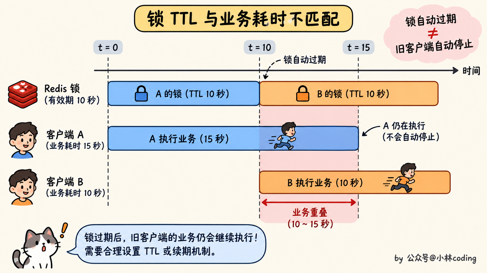

一般可以从两个方向处理。

> 1、合理设置有效期，并按需要续期

如果业务耗时比较稳定，可以根据耗时设置合理 TTL。如果耗时不确定，可以使用续期机制，定期检查锁仍然属于自己，再延长有效期。判断归属和续期也要用 Lua 放在一起：

```lua
-- ARGV[1] 是本次加锁标识，ARGV[2] 是续期毫秒数
if redis.call("get", KEYS[1]) == ARGV[1] then
    return redis.call("pexpire", KEYS[1], ARGV[2])
end
return 0
```

Redisson 的看门狗就是常见的续期方案，在没有指定固定 leaseTime 的常用加锁方式下，按配置自动续期；指定固定 leaseTime 时，则按该有效期释放。具体行为要结合所用版本和 API。

> 2、业务层也要防止旧请求继续写入

续期并不是绝对保证，客户端可能长时间 GC、线程卡顿或者网络中断，错过续期后仍然继续执行。解锁时判断唯一标识，只能避免误删别人的锁，不能阻止旧请求改业务数据。

如果业务必须拒绝过期持有者，可以使用 **fencing token**：每次加锁获得一个递增令牌，下游资源记录已接受的令牌，拒绝更旧的请求。令牌生成本身要可靠，不能依赖一个故障切换时可能倒退的计数器，还需要下游真正校验。

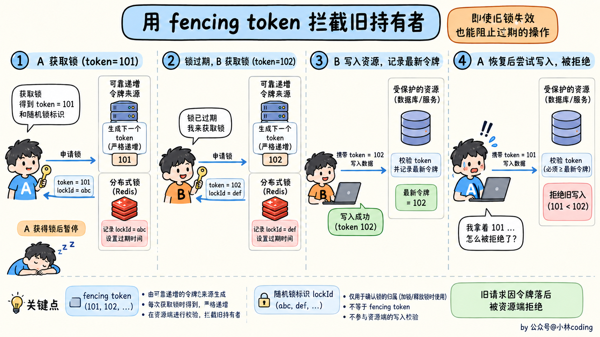

对于订单、库存等业务，也应结合唯一约束、条件更新、版本号和幂等，不能把正确性完全寄托在锁永远不会过期上。

### 2.6.10 Redis 主从切换会让分布式锁失效吗？Redlock 怎么处理？

会有风险。比如客户端 A 在主节点加锁成功，但锁还没有复制到从节点，主节点就宕机了。从节点被提升为新主节点后，锁不存在，客户端 B 又可以加锁成功，而 A 的业务还没结束。

所以，**给锁设置 TTL、用 Lua 解锁，只解决单节点内的加解锁问题，不能消除异步复制带来的锁丢失窗口**。

Redlock 的思路是使用多个相互独立的 Redis 主节点，比如 5 个节点，使用相同的锁 key 和唯一标识分别尝试加锁。判断成功时，不仅要超过半数节点加锁成功，还要满足加锁总耗时小于锁有效期，并扣除耗时和时钟漂移余量，确认还有可用的持锁时间。


如果没有获得多数锁，或者有效时间不足，就要向所有尝试过的节点发起安全解锁，并在随机退避后重试。访问每个实例的超时应该明显短于整个锁的有效期，避免一个不可用节点耗掉全部时间。

不过，Redlock 依赖时钟和时间边界等假设，也不能停止暂停后恢复的旧客户端。重要业务仍然需要资源端校验、幂等或数据库约束，不能只因为采用多数加锁，就认为获得了绝对的业务互斥保证。

### 2.6.11 Redis的大Key问题是什么？

Redis大key问题指的是某个key对应的value值所占的内存空间比较大，导致Redis的性能下降、内存不足、数据不均衡以及主从同步延迟等问题。

到底多大的数据量才算是大key？

没有固定的判别标准，有些团队把字符串 value 超过 1MB，或者集合元素超过 1 万个，作为初步排查阈值，但这不是 Redis 的硬性定义。

Redis大key问题的定义及评判准则并非一成不变，而应根据Redis的实际运用以及业务需求来综合评估。

例如，对高频读取、延迟要求很低的数据，即使只有几十 KB，也可能产生明显的传输和处理开销；而低频访问的数据，即使更大，也未必立即造成瓶颈。因此，在设计与运用Redis时，要依据业务需求与性能指标来确立合理的大key阈值。

### 2.6.12 大Key问题的缺点？

- 内存占用过高。大Key占用过多的内存空间，可能导致可用内存不足，从而触发内存淘汰策略。在极端情况下，可能导致内存耗尽，Redis实例崩溃，影响系统的稳定性。
- 性能下降。大Key会占用大量内存空间，频繁分配、修改和释放大小不一的数据，还可能增加内存碎片。对于大Key的操作，如读取、写入、删除等，都会消耗更多的CPU时间和内存资源，进一步降低系统性能。
- 阻塞其他操作。某些对大Key的操作可能会导致Redis实例阻塞。例如，使用DEL命令删除一个大Key时，可能会导致Redis实例在一段时间内无法响应其他客户端请求，从而影响系统的响应时间和吞吐量。
- 网络拥塞。每次获取大key产生的网络流量较大，可能造成机器或局域网的带宽被打满，同时波及其他服务。例如：一个大key占用空间是1MB，每秒访问1000次，就有1000MB的流量。
- 主从同步延迟。当Redis实例配置了主从同步时，大Key可能导致主从同步延迟。由于大Key占用较多内存，同步过程中需要传输大量数据，这会导致主从之间的网络传输延迟增加，进而影响数据一致性。
- 数据倾斜。在Redis集群模式中，某个数据分片的内存使用率远超其他数据分片，无法使数据分片的内存资源达到均衡。另外也可能造成Redis内存达到maxmemory参数定义的上限导致重要的key被逐出，甚至引发内存溢出。

### 2.6.13 Redis大key如何解决？

- 对大Key进行拆分。例如将含有数万成员的一个HASH Key拆分为多个HASH Key，并确保每个Key的成员数量在合理范围。在Redis集群架构中，拆分大Key能对数据分片间的内存平衡起到显著作用。
- 对大Key进行清理。将不适用Redis能力的数据存至其它存储，并在Redis中删除此类数据。注意，要使用异步删除。
- 监控Redis的内存水位。可以通过监控系统设置合理的Redis内存报警阈值进行提醒，例如Redis内存使用率超过70%、Redis的内存在1小时内增长率超过20%等。
- 对过期数据进行定期清理。堆积大量过期数据会造成大Key的产生，例如在HASH数据类型中以增量的形式不断写入大量数据而忽略了数据的时效性。可以通过定时任务的方式对失效数据进行清理。

### 2.6.14 怎么找出 Redis 里的大 key？

可以先做低开销的扫描，再针对候选 key 看内存和访问情况。

- **使用 redis-cli --bigkeys**：它基于 SCAN 遍历，统计字符串长度、集合元素数量等，适合初步定位。但集合成员最多，不一定代表占用内存最大。
- **使用 SCAN + MEMORY USAGE**：先分批扫描 key，再查看候选 key 的内存占用。对于集合，MEMORY USAGE 默认会抽样估算，想精确遍历全部成员可能增加开销，不能在高峰期对所有大集合都这样做。
- **结合业务和监控**：看哪些 key 的大小、成员数量持续增长，以及是否伴随慢日志、带宽升高和复制延迟。

扫描本身也有开销，要控制批次、速率，尽量放在低峰期。在 Cluster 中还需要覆盖各个主节点，扫描一个节点不等于扫完整个集群。

发现大 key 后，不建议直接 HGETALL、SMEMBERS 或读取完整内容来“确认一下”。可以先查看 HLEN、SCARD、ZCARD、STRLEN 等指标，再按需分批查看；清理大集合时优先考虑 UNLINK，避免同步释放大量对象拖慢主线程。

### 2.6.15 KEYS 和 SCAN 有什么区别？SCAN 会漏数据吗？

KEYS 会在一次命令中遍历数据库并返回所有匹配 key。数据量很大时，这个过程会长时间占用主线程，所以不适合在线上直接使用 `KEYS *`。

SCAN 则通过游标分批遍历，每次只做一部分工作，让 Redis 有机会在两次扫描之间处理其他请求。

```shell
SCAN 0 MATCH user:* COUNT 100
# 使用返回的新游标继续扫描，直到游标重新变成 0
```

不过，SCAN 不是快照，也不是严格分页，要注意几个边界：

- **可能返回重复 key**：客户端需要去重，或者让后续处理具备幂等性。
- **COUNT 是工作量提示**：不保证每次恰好返回这么多 key，甚至可能返回空列表；只有游标返回 0 才表示本轮结束。
- **并发变化时结果不固定**：完整扫描期间一直存在的 key 能被返回；中途新增、删除或者删除后重建的 key，是否被返回不保证。

所以，SCAN 适合在线巡检、增量清理等场景，但不能直接当成某一时刻所有 key 的精确快照。


### 2.6.16 什么是热key？

通常以其接收到的Key被请求频率来判定，例如：

- QPS集中在特定的Key：Redis实例的总QPS（每秒查询率）为10,000，而其中一个Key的每秒访问量达到了7,000。
- 带宽使用率集中在特定的Key：对一个拥有上千个成员且总大小为1 MB的HASH Key每秒发送大量的**HGETALL**操作请求。
- CPU使用时间占比集中在特定的Key：对一个拥有数万个成员的Key（ZSET类型）每秒发送大量的**ZRANGE**操作请求。

### 2.6.17 如何解决热key问题？

先区分是读热点还是写热点，因为处理方法不一样。

> 1、读热点

- **使用本地缓存**：把少量热点数据缓存在应用进程里，让一部分请求不再访问 Redis。需要设置容量和有效期，或者通过变更通知失效，控制旧数据的使用时间。
- **复制成多个缓存 key**：对于允许短暂不一致、更新不频繁的数据，可以复制多份，让请求随机访问不同 key。在 Cluster 中要确保这些 key 实际分布到不同槽和分片上，不能使用同一个 hash tag 把它们又放回同一个槽。更新时也要处理多份缓存的失效问题。
- **读从节点**：可以分散读取压力，但要接受主从延迟。客户端需要支持副本读取和负载分配，不是加了从节点就自动分流。

> 2、写热点

本地缓存和读从节点不能直接解决写热点。可以根据业务把一个全局计数拆成多个分段计数，最后汇总，或者通过队列合并更新。

不过，如果业务要求每次更新都获得一个全局精确值，拆分就会改变语义，要仔细判断是否适合。

另外，**增加 Cluster 节点不能自动拆开一个热 key**。一个 key 仍然由一个主节点负责，所以要从访问方式和数据模型上分散压力，并配合限流防止单个热点拖慢整个实例。


### 2.6.18 如何保证 redis 和 mysql 数据缓存一致性问题？

对于读数据，我会选择**旁路缓存（Cache Aside）策略**：先读缓存，缓存不命中就查询数据库，再把结果写入缓存。对于写数据，我会选择**先更新数据库，事务提交成功后，再删除缓存**。如果数据库还没提交就删缓存，其他请求可能把旧值重新放回去。


这套方案比较常用，但**数据库更新和缓存删除是两个独立操作，并不能天然保证强一致**。比如数据库更新成功了，缓存删除失败，后面的请求仍然可能读到旧缓存。

所以，要先明确业务能接受多长时间的旧数据。如果余额、库存确认等关键判断需要以最新状态为准，就应当以数据库或权威服务的结果为准，不能只依赖缓存。关键在于数据库和缓存的更新无法作为一个普通数据库事务一起提交，需要处理两者之间的失败窗口。

所以使用缓存提升性能，就是会有数据更新的延迟。这需要我们在设计时结合业务仔细思考是否适合用缓存。然后缓存一定要设置过期时间，这个时间太短、或者太长都不好：

- 太短的话请求可能会比较多的落到数据库上，这也意味着失去了缓存的优势。
- 太长的话缓存中的脏数据会使系统长时间处于一个延迟的状态，而且系统中长时间没有人访问的数据一直存在内存中不过期，浪费内存。

通过过期时间、可靠的失效通知和失败重试，可以让缓存逐步回到数据库的最新状态，也就是通常说的**最终一致性**。但还要处理旧值回填等竞态，不能只要引入消息队列就认为所有问题都解决了。

针对删除缓存异常的情况，可以使用 2 个方案降低影响：

- 删除缓存重试策略（消息队列）
- 订阅 binlog，再删除缓存（Canal+消息队列）

> 消息队列方案

我们可以引入**消息队列**，将第二个操作（删除缓存）要操作的数据加入到消息队列，由消费者来操作数据。

- 如果应用**删除缓存失败**，可以从消息队列中重新读取数据，然后再次删除缓存，这个就是**重试机制**。当然，如果重试超过一定次数仍然失败，就要记录失败任务并告警，安排后续补偿，不能直接把任务丢掉。
- 如果**删除缓存成功**，就确认这条消息已经处理完成；没有成功则继续重试，重复删除同一个缓存 key 也应当安全。

举个例子，来说明重试机制的过程。


这里还要注意，数据库提交后，应用可能在“发送重试消息”之前就宕机。如果只是删除失败后临时发送一条 MQ 消息，这个窗口仍然存在。

可以把需要失效的缓存 key 写入数据库的任务表，并和业务更新放在同一个事务里，再由后台任务可靠地投递消息和重试删除；也可以通过订阅 binlog 捕获已提交的变更。这样不会把可靠性完全依赖在一次同步删除或一次发送消息上。

重试删除缓存可以缩短异常导致的不一致时间，但会**对业务代码产生一定侵入**。

> 订阅 MySQL binlog，再操作缓存

「**先更新数据库，再删缓存**」的策略的第一步是更新数据库，那么更新数据库成功，就会产生一条变更日志，记录在 binlog 里。

于是我们就可以通过订阅 binlog 日志，拿到具体要操作的数据，然后再执行缓存删除，阿里巴巴开源的 Canal 中间件就是基于这个实现的。

Canal 模拟 MySQL 主从复制的交互协议，把自己伪装成一个 MySQL 的从节点，向 MySQL 主节点发送 dump 请求，MySQL 收到请求后，就会开始推送 Binlog 给 Canal，Canal 解析 Binlog 字节流之后，转换为便于读取的结构化数据，供下游程序订阅使用。

下图是 Canal 的工作原理：


将 binlog 变更投递到 MQ 后，由消费者根据变更删除对应的缓存，删除成功再 ACK，失败则重试；还需要监控消费积压和重试失败，避免失效事件长期没有被处理。删除操作本身可以幂等执行，但 ACK 只说明消息处理进度，不代表数据库和缓存获得了强一致性。

### 2.6.19 更新数据库后，为什么通常删除缓存，而不是更新缓存？

主要是为了**减少并发更新造成的覆盖问题，也避免每次写入都去重建缓存**。

举个例子，商品价格原来是 100，两个请求先后把数据库更新为 110、120。由于网络和执行速度不同，写入缓存的顺序可能反过来：120 先写入缓存，110 后写入缓存，最后数据库是 120，缓存却是 110。


如果更新数据库后删除缓存，后续读取时再从数据库加载最新值，就不用让每个写请求都把自己读到或者计算出的值写进缓存。对于需要关联多个表、组装成本较高的数据，也能避免更新后没有人读取，却白白重建缓存。

那为什么不先删缓存再更新数据库？因为删完之后，另一个读请求可能在数据库提交前读到旧值，又把旧值填回缓存，而写请求提交后没有再次删除，这个旧值就会继续存在。

因此，**先提交数据库，再删除缓存**通常更合适。但这仍然存在删除失败和旧值回填的窗口，需要可靠重试、有效期和业务上的一致性要求一起配合。

### 2.6.20 先更新数据库再删缓存，还会出现旧值回填吗？

会。虽然这个窗口通常比较短，但不能说不存在。

可以看下面这个执行顺序：

1. 请求 A 查询缓存未命中，去数据库读到旧值 100，随后暂时停顿。
2. 请求 B 把数据库更新成 120，提交成功，并删除缓存。
3. 请求 A 恢复执行，把之前读到的 100 写回缓存。

最终数据库是 120，缓存却又变成了 100。所以，删除缓存成功并不等于后面一定不会再有旧值写入。


如果业务能接受短暂旧数据，可以用较短 TTL 兜底，必要时增加延迟删除，降低旧值回填的影响。但延迟多久很难完全覆盖慢请求、线程暂停和副本延迟，**延迟双删也不能当成强一致保证**。

如果要求更严格，可以把数据库提交后的失效和缓存回填纳入同一套协调机制，例如让更新方提交成功后持有同一个业务锁完成删除，读取方持锁重新查库并回填。这里还要处理锁超时和故障，所有写入路径都要遵守约定；对于关键业务判断，直接查询数据库通常更清楚。

另外，如果缓存未命中后读取的是 MySQL 从库，即使缓存删除成功，也可能把从库尚未更新的旧值填回来。因此，回源读哪个数据库节点，也是缓存一致性设计的一部分。

### 2.6.21缓存雪崩、击穿、穿透是什么？怎么解决？

- 缓存雪崩：当**大量缓存数据在同一时间过期（失效）或者 Redis 故障宕机**时，如果此时有大量的用户请求，都无法在 Redis 中处理，于是全部请求都直接访问数据库，从而导致数据库的压力骤增，严重的会造成数据库宕机，从而形成一系列连锁反应，造成整个系统崩溃，这就是**缓存雪崩**的问题。


- 缓存击穿：如果缓存中的**某个热点数据过期**了，此时大量的请求访问了该热点数据，就无法从缓存中读取，直接访问数据库，数据库很容易就被高并发的请求冲垮，这就是**缓存击穿**的问题。


- 缓存穿透：当用户访问的数据，**既不在缓存中，也不在数据库中**，导致请求在访问缓存时，发现缓存缺失，再去访问数据库时，发现数据库中也没有要访问的数据，没办法构建缓存数据，来服务后续的请求。那么当有大量这样的请求到来时，数据库的压力骤增，这就是**缓存穿透**的问题。


缓存雪崩解决方案：

- 均匀设置过期时间：如果要给缓存数据设置过期时间，应该避免将大量的数据设置成同一个过期时间。我们可以在对缓存数据设置过期时间时，**给这些数据的过期时间加上一个随机数**，这样就保证数据不会在同一时间过期。
- 互斥锁：当业务线程在处理用户请求时，**如果发现访问的数据不在 Redis 里，就加个互斥锁，保证同一时间内只有一个请求来构建缓存**（从数据库读取数据，再将数据更新到 Redis 里），当缓存构建完成后，再释放锁。未能获取互斥锁的请求，要么等待锁释放后重新读取缓存，要么就返回空值或者默认值。实现互斥锁的时候，最好设置**超时时间**，不然第一个请求拿到了锁，然后这个请求发生了某种意外而一直阻塞，一直不释放锁，这时其他请求也一直拿不到锁，整个系统就会出现无响应的现象。
- **预热和后台刷新**：对确定会被大量访问的数据，提前加载，或者在过期前异步刷新。可以结合逻辑过期允许短暂返回旧值，同时设置容量和清理机制，避免数据一直积累。
- **处理 Redis 故障**：过期时间加随机数只解决集中失效，不能解决 Redis 宕机。此时还需要高可用、熔断、限流和降级，限制数据库回源并发，不能把所有流量直接放到数据库上。同一个 key 的互斥重建也不能限制大量不同 key 的总回源流量。

缓存击穿解决方案：

- 互斥锁方案，保证同一时间只有一个业务线程更新缓存，未能获取互斥锁的请求，要么等待锁释放后重新读取缓存，要么就返回空值或者默认值。
- **逻辑过期或者提前刷新**：在缓存里记录业务过期时间，数据到期后由一个请求异步刷新，其他请求暂时使用旧值。这种方式能减少同步等待，但需要业务允许短暂旧数据，并做好刷新失败的重试和物理过期、清理机制。

使用互斥锁时，拿到锁之后还要**再次检查缓存**，可能前一个请求已经重建完成。锁最好按业务 key 设置，并有超时和安全解锁；没有拿到锁的请求应当限次重试、等待后重读或者降级，不能全部继续查数据库。

缓存穿透解决方案：

- 非法请求的限制：当有大量恶意请求访问不存在的数据的时候，也会发生缓存穿透，因此在 API 入口处我们要判断请求参数是否合理，请求参数是否含有非法值、请求字段是否存在，如果判断出是恶意请求就直接返回错误，避免进一步访问缓存和数据库。
- 缓存空值或者默认值：当我们线上业务发现缓存穿透的现象时，可以针对不存在的数据缓存一个可识别的空值标记，设置较短 TTL，让后续请求直接返回未找到，避免继续查数据库。空值标记要和缓存未命中区分；如果这条数据后来被创建，还要主动删除空值缓存，否则新数据要等 TTL 到期才可见。
- 布隆过滤器：我们可以在写入数据库数据时，使用布隆过滤器做个标记，然后在用户请求到来时，业务线程确认缓存失效后，可以通过查询布隆过滤器快速判断数据是否存在，如果不存在，就不用通过查询数据库来判断数据是否存在。即使发生了缓存穿透，大量请求只会查询 Redis 和布隆过滤器，而不会查询数据库，降低无效请求对数据库的压力。Redis 中可以使用 RedisBloom 等能力，也可以用 Bitmap 自行实现，但要确认所用版本和部署是否提供相应命令；普通旧版 Redis 并不是默认就有 BF.ADD、BF.EXISTS。

### 2.6.22 布隆过滤器原理介绍一下

布隆过滤器由「初始值都为 0 的位图数组」和「 N 个哈希函数」两部分组成。当我们在写入数据库数据时，在布隆过滤器里做个标记，这样下次查询数据是否在数据库时，只需要查询布隆过滤器，如果查询到数据没有被标记，说明不在数据库中。

布隆过滤器会通过 3 个操作完成标记：

- 第一步，使用 N 个哈希函数分别对数据做哈希计算，得到 N 个哈希值；
- 第二步，将第一步得到的 N 个哈希值对位图数组的长度取模，得到每个哈希值在位图数组的对应位置。
- 第三步，将每个哈希值在位图数组的对应位置的值设置为 1；

举个例子，假设有一个位图数组长度为 8，哈希函数 3 个的布隆过滤器。


在数据库写入数据 x 后，把数据 x 标记在布隆过滤器时，数据 x 会被 3 个哈希函数分别计算出 3 个哈希值，然后在对这 3 个哈希值对 8 取模，假设取模的结果为 1、4、6，然后把位图数组的第 1、4、6 位置的值设置为 1。**当应用要查询数据 x 是否在数据库中时，通过布隆过滤器只要查到位图数组的第 1、4、6 位置的值是否全为 1，只要有一个为 0，就认为数据 x 不在数据库中**。

布隆过滤器由于是基于哈希函数实现查找的，高效查找的同时**存在哈希冲突的可能性**，比如数据 x 和数据 y 可能都落在第 1、4、6 位置，而事实上，可能数据库中并不存在数据 y，存在误判的情况。

所以，**布隆过滤器判断“存在”，只是可能存在；判断“不存在”，对于已经正确加入过滤器的数据来说，一定不存在**。

这里的前提是过滤器已经覆盖需要判断的数据。如果数据库新增成功，但过滤器还没更新，查询也可能被错误拦截，这是同步延迟造成的，不是布隆过滤器算法本身的误判。

另外，普通布隆过滤器不能直接把删除元素对应的位清零，因为其他元素可能也使用了这些位。删除数据较多时，可以定期重建，或者考虑支持删除的其他过滤器方案。容量和哈希函数数量也要合理设置，写入远超设计容量后，误判率会升高。

### 2.6.23 Redis Stream 怎么保证消息消费？消费者宕机怎么办？

Stream 提供了**消费组、待处理消息列表和 ACK**，可以追踪消息有没有被处理。

比如创建一个订单消费组，再读取新消息：

```shell
# 从已有消息开始消费，如果 Stream 不存在就创建
XGROUP CREATE orders order-group 0 MKSTREAM
# consumer-1 获取这个组还没有投递过的新消息
XREADGROUP GROUP order-group consumer-1 COUNT 10 BLOCK 2000 STREAMS orders >
# 业务处理成功后，确认实际返回的消息 ID
XACK orders order-group 1720000000000-0
```

XREADGROUP 投递消息后，在没有使用 NOACK 的情况下，会把消息登记到消费组的 **PEL（Pending Entries List，待处理消息列表）** 中。消费者处理成功后调用 XACK，把它从 PEL 移除。注意，XACK 不是删除 Stream 中的消息本体。


如果消费者处理过程中宕机，消息仍然留在 PEL。可以通过 XPENDING 查看待处理消息，再用 XCLAIM，或者 Redis 6.2 起的 XAUTOCLAIM，把超过合理空闲时间的消息转给其他消费者处理。

这里还有一个很重要的情况：业务已经成功，但消费者在 ACK 前宕机了，消息就可能被再次处理。所以，**消费确认和业务执行不是一个原子事务，消费者必须做幂等**，比如用消息 ID、订单号和数据库唯一约束去重。


另外，读取新消息时用的 `>` 不会自动把所有待处理消息重新投递给其他消费者，恢复任务需要主动处理 PEL。消息裁剪也要考虑未确认数据，不能把还要重试的消息提前裁掉；底层 Redis 的持久化和故障切换，同样会影响消息是否保留。

### 2.6.24 Redis 怎么实现限流？

常见的有**固定窗口、滑动窗口和令牌桶**，主要看是否允许边界突发，以及想限制的是一段时间内的总量还是平滑速率。

> 1、固定窗口

比如每个用户每分钟最多请求 100 次，可以用“用户 ID + 当前分钟”作为 key，使用 INCR 计数，第一次写入时设置过期时间。

INCR 和第一次设置过期时间要放在同一个 Lua 脚本里，避免执行完 INCR 后客户端宕机，计数 key 却没有 TTL：

```lua
-- KEYS[1] 是当前窗口的计数 key
-- ARGV[1] 是计数 key 的保留时间（秒），ARGV[2] 是限流阈值
local count = redis.call("incr", KEYS[1])
if count == 1 then
    redis.call("expire", KEYS[1], ARGV[1])
end
if count > tonumber(ARGV[2]) then
    return 0
end
return 1
```

这里窗口由 key 中的时间段划分，TTL 主要用于回收旧窗口的计数。固定窗口实现简单，但窗口边界可能出现突发：上一分钟末尾请求 100 次，下一分钟开头又请求 100 次，短时间内就能放过 200 次。


> 2、滑动窗口

可以用 Zset 保存最近一段时间的请求，把时间戳作为 score，把唯一请求 ID 作为 member。每次先删除窗口外的数据，再统计数量，没有超过阈值才记录当前请求。**删除、计数和添加需要放在 Lua 中一起完成**。

这样可以控制“最近 60 秒最多 100 次”，但每条请求都要占用一条记录，流量大时需要考虑内存和脚本执行成本，也可以用分桶计数减少开销。

> 3、令牌桶

按固定速率补充令牌，桶有容量上限，请求先拿令牌，拿不到就拒绝或者等待。它允许容量范围内的短时突发，同时控制长期速率。可以在 Redis 中保存剩余令牌和更新时间，通过 Lua 根据时间差计算补充量，再扣减令牌。


无论哪种方案，都要明确 Redis 不可用时是放行、拒绝还是降级，并统一时间来源，避免不同应用机器的时间差影响窗口判断。

### 2.6.25 Redis 突然变慢了，怎么排查？

我会先区分，**是 Redis 执行命令慢，还是应用到 Redis 的整个调用链路慢**，不能看到客户端超时就直接认为 Redis CPU 不够。

> 1、检查慢命令和热点

先看 SLOWLOG GET，确认是否有 KEYS、大范围 ZRANGE、HGETALL、SMEMBERS，或者执行时间很长的 Lua 脚本，再结合大 key、热 key 排查。

慢日志主要记录命令执行时间，不包括网络传输和客户端连接池等待，所以没有慢日志，也不代表整个请求一定很快。可以结合 INFO commandstats、应用监控和延迟指标判断。


> 2、检查 Redis 的后台任务和内存压力

看 INFO persistence、INFO memory、INFO stats，确认延迟升高时是否发生了 BGSAVE、AOF 重写、磁盘刷盘、大量过期删除或者内存淘汰。

如果已经开启延迟监控，还可以用 LATENCY LATEST、LATENCY DOCTOR 查看 fork、AOF 写入、过期和淘汰等事件。大量 key 同时过期、内存不足导致频繁淘汰，也会占用主线程时间。

> 3、检查机器和网络

看 CPU、磁盘 I/O、内存、swap 和网络带宽。如果数据页被换到 swap，访问时可能触发磁盘读取；如果返回大 value，网络传输也可能成为瓶颈。还要检查客户端是否每次新建连接、连接池是否耗尽，以及超时重试是否进一步放大流量。

如果是 Cluster，还要比较各个分片，确认是不是只有某个热点分片变慢。

排查后再对症处理：慢命令改成分批访问，大集合删除用 UNLINK，热点读引入本地缓存，独立请求用适当大小的 Pipeline，容量或带宽不足再考虑扩容。**增加 I/O 线程主要改善网络读写，不能把一个慢命令拆成多线程执行**。

### 2.6.26 如何设计秒杀场景处理高并发以及超卖现象？

> 在数据库层面解决

1. 在查询商品库存时加排他锁，执行如下语句：

```sql
SELECT * FROM goods WHERE goods_id = ? FOR UPDATE;
```

在事务中，线程 A 通过 `SELECT ... FOR UPDATE` 锁住 goods_id 对应的记录。这里假设 goods_id 使用合适的唯一索引，否则锁范围还可能扩大。那么其他线程此时可以使用select语句读取数据，但是如果也使用select for update语句加锁，或者使用update，delete都会阻塞，直到线程A将事务提交（或者回滚），其他线程中的某个线程排在线程A后的线程才能获取到锁。

1. 更新数据库减库存的时候，进行库存限制条件

```sql
UPDATE goods SET stock = stock - 1 WHERE goods_id = ? AND stock > 0;
```

如果只是做库存扣减，可以直接执行带 stock > 0 条件的 UPDATE，不一定要先 SELECT FOR UPDATE。**受影响行数为 1 才表示扣减成功，为 0 就不能继续按成功处理**。订单创建和库存扣减还应该在同一个数据库事务里完成。

这种方案能在数据库层面防止库存被扣成负数，但同一个商品的写入仍然需要竞争锁，高并发时可能遇到连接池耗尽或者锁等待。

> 利用分布式锁

在锁有效且没有发生失效、切换等异常的前提下，同一个锁 key 同一时间只允许一个持有者进入业务逻辑。加锁失败的请求应该超时、退避或者直接返回繁忙，不能无限等待。

这种方案的缺点是同一个商品在多用户同时下单的情况下，会基于分布式锁串行化处理，导致没法同时处理同一个商品的大量下单的请求。

> 利用分布式锁+分段缓存

把数据分成很多个段，每个段是一个单独的锁，所以多个线程过来并发修改数据的时候，可以并发的修改不同段的数据

假设场景：假如你现在商品有100个库存，在redis存放5个库存key，形如:

```text
goods:01:stock:0 = 20
goods:01:stock:1 = 20
goods:01:stock:2 = 20
goods:01:stock:3 = 20
goods:01:stock:4 = 20
```

用户下单时对用户 ID 取模，选择一个库存分段，每个分段使用独立的锁，减少所有请求争抢同一个锁的情况。但如果这些 key 仍在同一个 Redis 实例上，命令执行依然是串行的；是否能提升整体吞吐量，要看业务临界区和数据库是不是仍有共同瓶颈。

这种方案可以解决同一个商品在多用户同时下单的情况，但有个坑需要解决：当某段锁的库存不足，一定要实现自动释放锁然后换下一个分段库存再次尝试加锁处理，这种方案的复杂度比较高。

> 利用 Redis Lua 原子预扣库存 + 异步队列

更常见的思路是，把流量先挡在 Redis 层，再通过队列让数据库平稳地创建订单。

这里不能只说“DECR 是原子的，所以不会超卖”。如果先 GET 判断库存，再 DECR 扣减，两条命令之间仍然可能被插入其他请求；只执行 DECR，也可能把库存扣成负数。


可以用 Lua 把“判断库存”和“扣减库存”放在一起：

```lua
-- KEYS[1] 是库存 key，返回 1 表示预扣成功，0 表示库存不足
local stock = tonumber(redis.call("get", KEYS[1]))
if not stock or stock <= 0 then
    return 0
end
redis.call("decr", KEYS[1])
return 1
```

完整流程可以这样设计：

1. **提前加载库存**：活动开始前，把可售库存加载到 Redis，并做好入口限流，避免所有请求都进入库存扣减流程。
2. **原子校验和预扣**：用 Lua 判断用户是否重复下单、库存是否足够，再预扣库存并记录请求状态。上面的脚本只演示库存判断，实际还要补充用户去重和请求标识。
3. **可靠地发送下单事件**：预扣成功后进入排队。要处理“扣减成功但消息发送失败”这个窗口，可以记录待投递请求并补偿重试；如果把请求记录放到 Redis Stream，也可以在同一脚本中完成预扣和记录，但要预先校验类型，配置持久化，并在 Cluster 中让相关 key 位于同一个槽。
4. **消费消息并创建订单**：消费者使用唯一请求 ID 或订单号做幂等，在数据库事务里创建订单、执行 `UPDATE goods SET stock = stock - 1 WHERE goods_id = ? AND stock > 0`，检查受影响行数。还可以通过用户与活动的唯一约束防止重复购买。
5. **处理失败和查询结果**：暂时性错误优先重试，明确下单失败再按请求状态补偿库存。补偿也要幂等，避免重复把库存加回去；客户端可以轮询订单状态或者接收结果通知。


这里的 Redis 库存是流量控制和预占，**最终能不能下单，仍然要有数据库条件更新、事务和唯一约束兜底**。还需要考虑消息重复、消费者宕机、支付超时取消、Redis 数据丢失后的库存校准，不能只靠“原子扣减 + MQ”就认为整个链路一定一致。