有几块在面试里特别容易被深挖，建议重点花时间：

- **消息可靠性**：生产者、Broker、消费者三个环节各自怎么保证不丢消息，这是必考题，而且考官很喜欢追问每个环节的细节。
- **重复消费和幂等**：为什么会重复、怎么设计幂等方案，这个和业务结合很紧，答起来容易流于表面。
- **消息积压**：如何快速处理积压，尤其是 RocketMQ 里队列数和消费者数的关系，是很多人的盲区。
- **Kafka 和 RocketMQ 的区别**：存储模型、协调机制、适用场景，这是高频对比题，面试里问得很多。
- **事务消息**：怎么保证本地事务和消息发送的一致性，半消息机制是怎么工作的，这块能和分布式事务挂钩，答好了很加分。

如果你是第一次系统准备这块，建议先搞清楚 MQ 的基本原理（为什么用、怎么用），再去看可靠性和幂等这两个核心问题，然后再对比几个主流 MQ 的差异，这个顺序学下来会比较顺。

------

## [#](https://xiaolincoding.com/interview/mq.html#消息队列场景)消息队列场景

### 什么是消息队列？

你可以把消息队列理解为一个**使用队列来通信**的组件。它的本质，就是个**转发器**，包含**发消息、存消息、消费消息**的过程。最简单的消息队列模型如下：

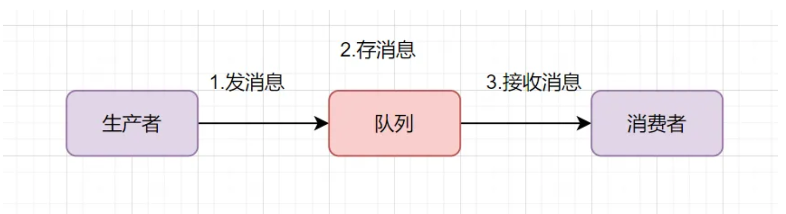

我们通常说的消息队列，简称**MQ（Message Queue）**，它其实就指**消息中间件**，当前业界比较流行的开源消息中间件包括：`RabbitMQ、RocketMQ、Kafka`。

### [#](https://xiaolincoding.com/interview/mq.html#为什么需要消息队列)为什么需要消息队列？

如果用一句话概括为什么我们要大费周章地引入 MQ，核心其实就是为了解决系统架构中的三大痛点：**解耦、异步、削峰**。

我可以结合电商的业务场景，给你拆开讲一下这三点：

**第一点，最核心的作用是为了「解耦」（把绑在一起的系统拆开）。** 在没有 MQ 的时候，假设我们做个电商系统，用户付完款后，系统要干好几件事：触发发货、发优惠券、加积分、还要发短信通知。如果订单系统直接用 RPC 调用去挨个通知这些子系统，那代码就高度耦合在了一起。万一有一天不需要发短信了，或者新加了一个自动发货服务，订单系统的研发就得整天去改代码重新发版；更别提如果哪天「发积分服务」挂了报错，甚至会连累整个订单支付流程跟着失败。 引入 MQ 后，整个逻辑就变了。订单系统付完款，它只需要对着 MQ 丢一句话（发一条消息）：「用户A支付成功了」，后面的非核心流程就可以交给各个消费者处理了。后续不管有几个子系统关心这件事，它们自己去订阅 MQ 就好了，哪怕以后新加再多依赖服务，订单系统通常不需要逐个增加远程调用。不过，事件的字段和含义仍然要与下游约定好，消息发送也要有可靠性保障。这样就降低了系统之间的直接依赖，下游暂时故障也不会马上拖住主流程。

**第二点，顺理成章带来的性能提升叫作「异步」。** 紧接上面的例子，如果要串行调用发短信、加积分等等这么多非核心流程，哪怕每个接口只用 50 毫秒，多个接口加起来，就会拉长用户在页面等待的时间，疯狂转圈圈，体验极差。 有了 MQ，主流程其实只需要把状态改掉，然后往 MQ 里抛一条消息（具体耗时取决于网络和消息确认配置），立刻就可以给前端响应「恭喜你支付成功」了。像发短信、加积分这种「不是非得在这零点几秒内完成」的操作，完全可以让系统在后台顺着 MQ 慢慢执行，这样前台接口的响应时间就大幅缩短了。

**第三点，是高并发场景下的保命神器，叫作「削峰填谷」。** 假设我们通过压测，知道底层数据库每秒能够处理一两千个这类请求。但是一旦搞促销、秒杀，瞬间如果有两万个请求涌进来，如果直接打到数据库上，数据库就可能被压垮，出现响应变慢、超时甚至不可用。 这个时候，MQ 就扮演了一个极其关键的**「蓄水池」或者「排队区」**的作用。这两万个瞬时狂暴请求过来，我们统一先扔进 MQ 里暂存着。然后后端的订单处理程序，根据自己数据库真实的抗压能力，平稳地、以一秒钟一两千个的速度，慢慢从 MQ 里往外拉任务来消化。这就像游乐场门口的蛇形排队通道，把瞬间爆发的流量洪峰（削峰），分散到了后续慢慢处理（填谷）。这样把短时间的流量峰值分散到后续处理。不过，MQ 只能缓冲短时高峰，如果流量长期高于消费能力，消息仍然会持续积压，还需要限流、扩容和容量保护。

**总结一下：** 我们引入 MQ，是为了通过**解耦**降低直接依赖，通过**异步**缩短主流程响应时间，通过**削峰**缓冲突发流量。但它也会让系统变复杂，消息可靠性、重复消费、积压这些问题都得处理。所以要不要用，还是看业务收益是否值得额外的复杂性。

### [#](https://xiaolincoding.com/interview/mq.html#消息队列有什么缺点)消息队列有什么缺点？

关于消息队列（MQ）的优缺点，在软件架构设计里有一句老话叫「没有银弹」。引入 MQ 绝对是一次典型的 Trade-off（技术权衡），它既能拯救系统，又能带来一堆让人头疼的麻烦。

我们可以分两面来看：

**首先是它的优点，总结起来就是「系统架构救命的三板斧」：**

1. **解耦**：把各个原本互相关联的系统拆解开。A 系统只要把消息丢给 MQ 就完事了，B 系统或者日后新加的 C 系统想要数据，自己去 MQ 拿就行。A 系统的代码不用再为了别的系统频繁修改，大家各干各的。
2. **异步**：提升了用户的响应速度。一些非核心、但又很费时间的操作（比如发短信、送积分），全部扔进 MQ 后台慢慢执行。主流程不再等待所有下游操作，用户能更快得到响应。
3. **削峰**：这是大促、秒杀时挡在数据库前面的超级盾牌。把洪水猛兽般瞬间涌入的并发请求，先拦截在 MQ 的队列里，变成了细水长流，让数据库能按照自己的节奏平稳处理，保住系统不崩溃。

**但是，既然它这么好，为什么不每个地方都加呢？这就不得不提它带来的三大缺点或者说是巨大挑战：**

**第一，系统多了一个需要保障可用性的组件。** 在没有 MQ 时，A 系统直接调 B 系统，只要它俩不出问题就行。现在中间横插了一个 MQ 组件，多拉了一个「中间人」。一旦这个机器宕机、网络故障，依赖它的发送和消费流程就可能受影响。所以要设计多副本、故障恢复，以及本地消息表等补偿方案。另一方面，异步隔离也能减轻下游故障对主流程的影响，整体可用性不能只凭多了一个组件来判断。

**第二，系统的开发和排查复杂性会上升。** 原本很简单的一个方法调用，换成发消息之后，开发人员就面临无数个让人掉头发的异常场景。比如：网络抖动导致一条消息发了两次，B 系统怎么保证不把老王的钱扣两次？（这就需要做业务侧的**防重和幂等性设计**）；再比如，MQ 自己重启了，还没处理完的消息怎么保证不丢失？这些都需要我们在写代码时增加非常多的确认机制、补偿机制。

**第三，最头疼的「数据一致性」问题。** A 系统本地业务执行成功了，消息发给 MQ 了，就高高兴兴告诉前端「操作成功」。结果下游的 B 系统拿到这条消息后，由于一条空指针异常没处理好，业务失败了。现在好了，A 以为成功了，B 实际失败了，两边的数据就暂时不一致了。如果 B 只是短暂失败，可以通过重试恢复；如果一直失败，就要通过死信处理、对账和补偿解决。本地事务与发消息之间，还要通过事务消息或本地消息表避免只成功一半。

**总结一下：** MQ 就像是一把威力巨大的重型武器，优点极其耀眼。但它的缺点决定了，我们绝不是逢坑就用。只有当业务场景真的对解耦、异步、抗高并发有强烈需求，且这部分收益远远大过引入这些复杂性带来的麻烦时，我们才会去谨慎地使用它。

### [#](https://xiaolincoding.com/interview/mq.html#消息队列怎么选型)消息队列怎么选型？

选 MQ 的时候，我会先看业务到底需要什么，再看吞吐量和运维成本。不能只背一张「谁能扛十万 QPS」的表，因为消息大小、刷盘方式、副本数、批量参数一变，测试结果就可能差很多。

可以先从下面几个维度来比较：

| **维度** | **RabbitMQ**                                     | **RocketMQ**                                     | **Kafka**                              |
| -------- | ------------------------------------------------ | ------------------------------------------------ | -------------------------------------- |
| 核心模型 | Exchange 把消息路由到 Queue                      | Topic 下划分消息队列，支持多种业务消息           | Topic 下划分 Partition，按日志追加存储 |
| 比较擅长 | 灵活路由、任务分发                               | 订单、支付等业务事件，事务消息、延迟消息         | 日志采集、行为数据、流式处理           |
| 顺序性   | 队列有入队顺序，处理顺序还要控制消费者并发和重投 | 按队列或消息组保证局部顺序，取决于版本和消费方式 | 分区内有序，跨分区不保证               |
| 重试方式 | 通过 nack、重投、死信等机制组合设计              | 提供消费重试和死信机制                           | 通常由应用或消费框架设计重试流程       |
| 消息回溯 | 普通队列确认后消息会被删除；Streams 是另一种模型 | 保留期内可以重置消费进度                         | 保留期内可以按 offset 重新消费         |
| 选型重点 | 路由规则、队列类型、可靠投递                     | 业务特性、客户端版本、部署模式                   | 分区规划、吞吐、保留时间、流处理生态   |

**如果是日志采集、埋点分析，数据量大，还需要让多个系统反复读取历史数据，我会优先评估 Kafka。** 它的分区日志模型和流处理生态比较适合这类场景。

**如果是订单、支付、库存这些业务事件，而且需要事务消息、延迟消息、失败重试，我会优先评估 RocketMQ。** 这些能力可以减少业务侧自己搭一套补偿流程的工作量。

**如果重点是复杂路由、任务分发，比如一条消息要按不同规则投到多个队列，我会评估 RabbitMQ。** 它的交换机和绑定机制很灵活，但也要结合队列类型、消息规模来做压测。

ActiveMQ 也会出现在一些已有的 JMS 系统里，这时候需要先区分 ActiveMQ Classic 和 Artemis，再评估协议兼容和迁移成本，不能把它们当成完全一样的产品。

最后还要看团队会不会运维、故障能不能排查、有没有监控和容灾能力。**选型是选一套能支撑业务的方案，不能把「金融业务」直接等同于某一种 MQ，也不能把 Topic 或队列数量当成固定上限。**

### [#](https://xiaolincoding.com/interview/mq.html#消息队列使用场景有哪些)消息队列使用场景有哪些？

- **解耦**：可以在多个系统之间进行解耦，将原本通过网络之间的调用的方式改为使用MQ进行消息的异步通讯，对于允许异步完成的操作，可以考虑使用 MQ 进行不同系统之间的联系，这样可以降低系统之间的直接依赖。一个下游暂时故障时，消息先积压在 MQ 里，主流程不必等待它；但积压仍然会消耗容量，需要监控和处理。
- **异步**：假如客户创建订单后，还要记录客户轨迹、发通知、更新统计信息，如果主流程挨个调用这些服务，用户就得一直等。像记录轨迹这类允许延后完成的操作，可以交给 MQ 异步处理，加快主流程的响应速度。至于库存和关键订单状态是否也异步，要看业务的一致性要求，不能把所有步骤都一股脑扔到后台。
- **削峰**：一个系统访问流量有高峰时期，也有低峰时期，比如说，中午整点有一个抢购活动等等。比如系统平时流量并不高，一秒钟只有 100 多个并发请求，系统处理没有任何压力，一切风平浪静，到了某个抢购活动时间，系统并发访问剧增，比如达到了每秒 5000 个并发请求，而我们的系统每秒只能处理 2000 个请求，那么由于流量太大，我们的系统、数据库可能就会崩溃。这时如果使用 MQ 进行流量削峰，将用户的大量请求对应的消息直接放到 MQ 里面，然后我们的系统按自己的最大消费能力去消费这些消息，就可以保证系统的稳定，只是可能要根据业务逻辑，给用户返回特定页面或者稍后通过其他方式通知其结果。

### [#](https://xiaolincoding.com/interview/mq.html#消息重复消费怎么解决)消息重复消费怎么解决？

先说结论：**消息重复在实际系统里很常见，通常靠消费者做业务幂等来解决。**

为什么会重复呢？我举两个最常见的情况：

- **生产者重试**：消息已经写到 Broker 了，但返回的确认在网络中丢了。生产者不知道有没有成功，就再发一次，这样可能产生两条内容相同的消息。
- **消费者重投**：消费者已经把积分加上了，结果还没来得及提交消费进度就宕机了。重启后 MQ 会再次投递这条消息，积分就可能被加两次。

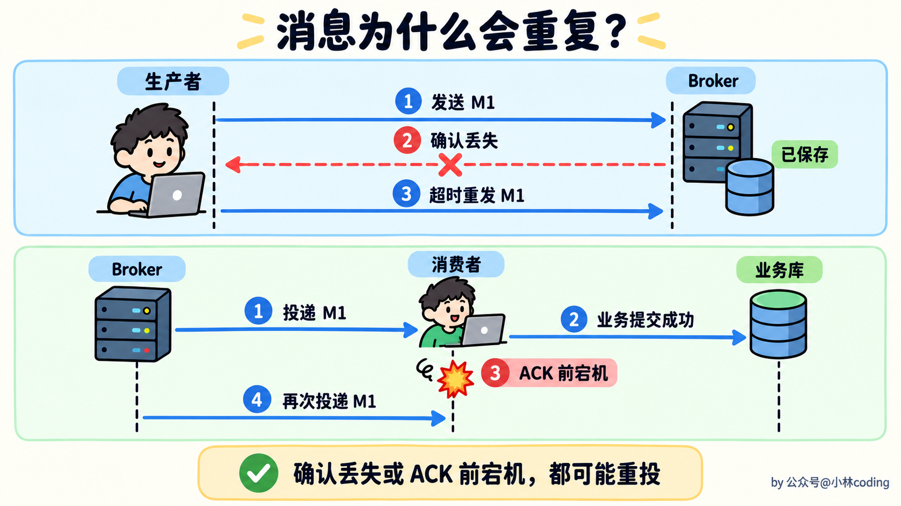

有些 MQ 提供生产者幂等能力，比如 Kafka 的幂等生产者，可以减少发送重试产生的重复。但它不能识别业务代码主动发出的两条相同订单事件，也不能替消费者保证 MySQL 只更新一次。

所以消费端要给操作设计一个**稳定的业务幂等键**，比如「订单号 + 发积分」或者支付流水号。重试时继续用这个键，不能每次重新生成 UUID。

以支付成功后发积分为例，可以在数据库里建一张消费记录表，对「消费方 + 业务幂等键」加唯一索引。消费时，**把插入消费记录和增加积分放在同一个本地事务里**：插入成功才加积分，已经有记录就说明处理过了，直接确认消息。

这里不能只做「先查有没有，再执行业务」，因为两个消费者可能同时查到没有，然后都去加积分。真正挡住并发重复的是唯一约束，而同一个事务保证了去重记录和业务结果一起成功、一起失败。遇到重复键时，要确认对应记录已经提交、确实代表处理成功；数据库异常则应回滚并重试，不能全部当成重复消息忽略。

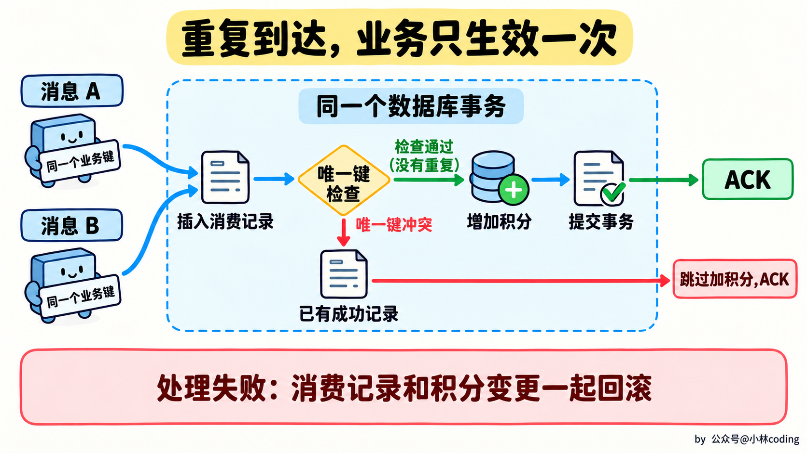

**总结一下：** MQ 负责重投，业务负责幂等。我们要保证的，是同一笔业务只生效一次。

### [#](https://xiaolincoding.com/interview/mq.html#消息丢失怎么解决的)消息丢失怎么解决的？

使用一个消息队列，其实就分为三大块：**生产者、Broker、消费者**。要保证消息不丢，就得沿着这三个环节逐个检查。

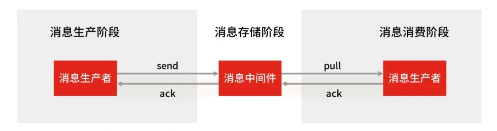

**第一，生产者端要确认消息真的发出去了。** 同步发送要检查结果，异步发送要处理成功和失败回调，不能调用完发送方法就认为一定成功。遇到超时，结果可能是「没发成功」，也可能是「发成功了但确认丢了」，所以重试时要沿用业务幂等键。

还有一个容易漏掉的地方：订单已经写入数据库，但程序在发消息前宕机了。这时候 MQ 再可靠也没用，因为消息根本没到 MQ。需要用事务消息或者本地消息表，把这段发送意图保存下来，后续才能补发。

**第二，Broker 端要配置好持久化和副本。** 收到 ACK 到底代表什么，要看具体产品和配置。比如 Kafka 常见的可靠性配置是多副本、`acks=all`、合理设置 `min.insync.replicas`，并禁止不干净的 Leader 选举。RabbitMQ 则要结合持久化队列、持久化消息、Publisher Confirm，以及需要时使用仲裁队列。不能只说一句「部署了集群，所以不会丢」。

**第三，消费者端要先把业务处理成功，再确认消息。** 比如积分真正入库后再 ACK，或者再提交 offset。处理失败要进入重试流程，超过次数进入死信或异常记录，后续告警、补偿，不能捕获异常后仍然返回消费成功。

另外，消息保留时间、TTL、磁盘清理策略也要检查。消息一直积压，超过保留期被删除，业务一样会感知为丢消息。

**总结一下：** 生产端保证「有记录、可补发」，Broker 保证「持久化、有副本」，消费端保证「成功后再确认」，再配合监控和对账，才能形成完整的可靠投递流程。

### [#](https://xiaolincoding.com/interview/mq.html#使用消息队列还应该注意哪些问题)使用消息队列还应该注意哪些问题？

除了消息可靠性和顺序性，我还会关注这几个问题：

- **重复消费**：重试、宕机恢复都会带来重复，消费者要做幂等。
- **一致性和时效性**：主流程成功不代表下游已经完成，要明确业务能接受多长时间的延迟。
- **积压和过期**：关注最老消息的等待时间、保留期和磁盘空间，不能只盯着消息条数。
- **重试和死信**：暂时性故障可以重试，永久性错误要隔离，死信消息还得有人处理。
- **消息格式兼容**：生产者和消费者不会同时发版，新增字段尽量向后兼容，不能随意改字段含义。
- **排查能力**：消息里带业务 ID、事件 ID、发生时间和 traceId，方便串起发送、接收、处理的完整过程。

这些问题最好在上线前设计好，等线上积压了几百万条消息再补方案，处理起来会很被动。

### [#](https://xiaolincoding.com/interview/mq.html#消息队列的可靠性、顺序性怎么保证)消息队列的可靠性、顺序性怎么保证？

这两个问题要分开看：**可靠性回答的是「消息能不能最终处理到」，顺序性回答的是「处理的先后有没有乱」。**

可靠性前面已经讲过，核心就是生产者确认、Broker 持久化和副本、消费者成功后再确认，再加上重试和补偿。需要注意，RabbitMQ 的队列持久化用 `durable=true`，普通队列里的消息持久化则通过消息属性设置，比如 `delivery_mode=2`，这是两回事。Kafka 提交 offset 也只是更新消费进度，并不会马上删除消息。

顺序性可以拿订单来理解。一个订单先创建、再付款、最后完成，这三条消息必须按这个顺序处理；但订单 A 和订单 B 通常不需要互相排队。

所以一般保证的是**同一个业务键的局部顺序**，而不是整个系统的全局顺序：

1. **生产者有序发送**：同一个订单的事件先后要明确。两个服务同时发消息，不能指望 MQ 根据时间戳自动判断谁应该先到。
2. **发送到同一条有序通道**：比如 Kafka 的同一分区、RocketMQ 的同一队列或同一消息组。
3. **消费者串行处理**：读取顺序正确，不代表扔进线程池后完成顺序也正确。同一业务键的消息要串行，不同业务键可以并行。
4. **失败重试不能越过去**：付款消息失败时，不能让完成消息先更新业务状态。需要阻塞这条有序通道，或者通过业务状态机、版本号处理乱序。

全局顺序通常意味着更少的并行度，吞吐量会受限制。面试里先说清楚「谁和谁之间需要有序」，比直接说「用单线程」更有价值。

### [#](https://xiaolincoding.com/interview/mq.html#如何保证幂等写)如何保证幂等写？

幂等性是指 **同一操作执行多次，对系统状态的影响与执行一次相同**。比如同一笔支付通知来了三次，最终只能给用户加一次积分。

常用方案可以按业务类型来选：

**第一种，插入类业务，用唯一约束。** 比如按订单号创建发货单，对订单号加唯一索引，重复插入会被数据库挡住。如果一次消费要改多张表，就把消费记录和这些业务写入放在同一个事务里。

**第二种，状态流转，用条件更新。** 比如把订单从「待支付」改成「已支付」：

```sql
UPDATE orders
SET status = 'PAID'
WHERE order_id = ? AND status = 'UNPAID';
```

第一次更新成功，后面重复执行影响行数就是 0。附带的后续操作只能由成功改变状态的那次请求触发；如果还要发消息，可以在同一事务里写本地消息表。其他状态导致的 0 行更新，还要按业务区分，不能一律当成成功。

**第三种，累加类业务，用业务流水去重。** `积分 = 积分 + 100` 本身不幂等，单纯加乐观锁也不代表同一笔加积分不会再执行。需要对积分流水的业务幂等键加唯一约束，再和积分更新一起提交。

Redis 的 `SET NX` 可以用来挡并发请求，但要考虑两个窗口：先记录再执行业务，中途宕机会留下「记录存在、业务没做」；先执行业务再记录，中途宕机会导致重试重复执行。数据库业务一般优先依靠数据库事务，Redis 可以作为辅助防重。

分布式锁也一样，它解决的是「同一时刻谁能执行」，锁释放后重复消息仍然能再次执行，所以**锁不能单独代替幂等记录**。如果调用的是外部支付、短信接口，还要把幂等键传给下游，或者通过流水查询、对账来确认结果。

### [#](https://xiaolincoding.com/interview/mq.html#如何处理消息队列的消息积压问题)如何处理消息队列的消息积压问题？

消息积压，本质上就是**生产速度持续超过消费速度**。但处理时不能一上来就加机器，要先确定堵在哪儿。

**第一步，先定位。** 看是所有队列都积压，还是某一个队列积压；生产量有没有突增，消费者有没有掉线；再看单条消息耗时、失败率、数据库慢查询和下游接口超时。如果是错误消息反复重试，扩容只会把错误放大。

**第二步，提升真正的消费能力。** 能优化 SQL、减少远程调用，就先优化；业务允许的话，可以批量处理。消费者扩容则要看消费模型：Kafka 的普通消费者组受分区数限制，RocketMQ 传统客户端的队列分配模式受队列数限制。下游数据库已经满负荷时，还要先限流或扩容下游。

**第三步，再评估是否需要临时转发。** 对没有顺序要求、可以并行处理的消息，可以消费旧 Topic，转发到一个有更多队列或分区的新 Topic，再由更多业务消费者处理。但转发程序必须在新 Topic 发送确认成功后，才确认旧消息，否则就可能丢消息；转发过程中也可能重复，所以业务幂等键必须保留。

这里有个容易答错的地方：**新增分区或队列，不会自动把原来的积压消息拆过去。** 新增资源主要帮助后续消息，旧消息还在旧分区或队列里。而且重分发会增加 Broker 的读写压力，也可能打乱顺序，不能当成万能方案。

恢复时间也可以估一下：假设积压 100 万条，恢复后每秒消费 5000 条，但每秒还在新增 3000 条，那实际每秒只能消掉 2000 条积压，大约需要 500 秒，而不是 200 秒。

最后还要盯住最老消息的时间和消息保留期。对于订单、支付这些关键消息，不能直接跳过 offset；对于业务明确允许丢弃的非关键数据，才可以评估跳过或归档。处理完之后，再针对根因补监控和容量规划。

### [#](https://xiaolincoding.com/interview/mq.html#如何保证数据一致性-事务消息如何实现)如何保证数据一致性，事务消息如何实现？

这个问题主要是在问：**本地数据库更新和发送 MQ 消息，是两个独立操作，怎么避免只成功一半？**

一条普通 MQ 消息，大概会经过下面这些环节：

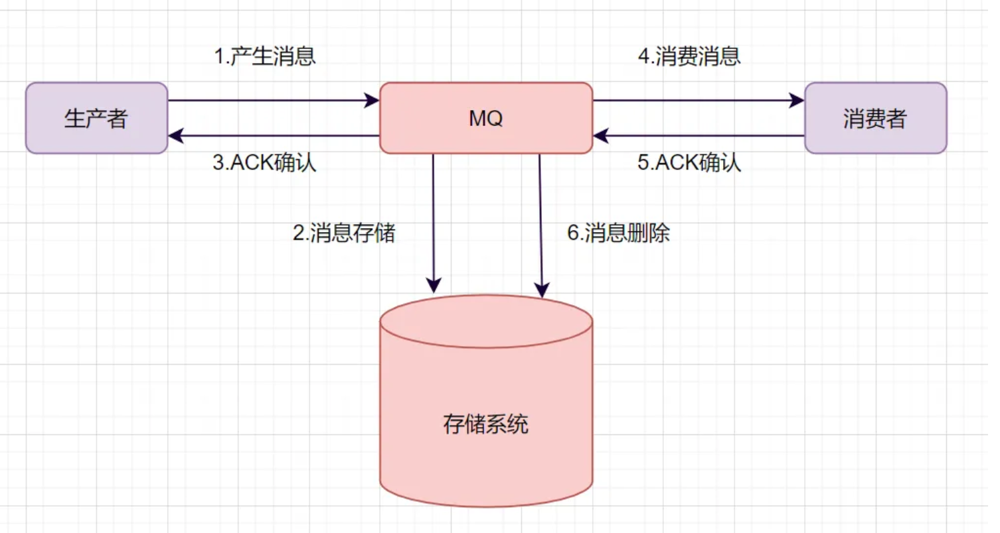

1. 生产者发送消息，Broker 接收并按配置存储。
2. Broker 返回发送结果，消息进入可消费状态。
3. 消费者获取消息，执行自己的业务逻辑。
4. 业务成功后，消费者确认消息或提交消费进度。

注意，Kafka、RocketMQ 通常按保留策略清理消息，消费成功不会立即删除消息；也不是所有 MQ 都由 Broker 主动 push 给消费者。

我们举个**下订单**的例子。订单创建成功了，程序却在发消息前宕机，库存系统就不知道这笔订单。反过来，先发消息再创建订单，消息发成功了但订单回滚，库存系统又会处理一个不存在的订单。

RocketMQ 可以用**事务消息**解决本地事务和消息发送的一致性，下面这张图展示的就是半消息流程：

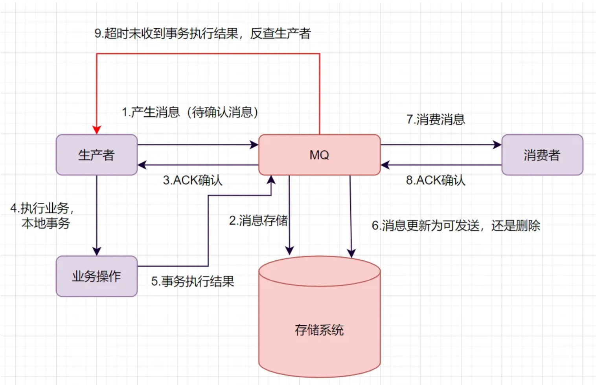

1. 生产者先发送半消息，Broker 保存下来，但暂时不给消费者看。
2. 半消息发送成功后，生产者执行本地数据库事务。
3. 本地事务成功，通知 Broker `Commit`；明确回滚，通知 Broker `Rollback`；结果不确定则保留 `Unknown`。
4. Broker 收到 Commit，才让下游消费；收到 Rollback，则不再投递这条半消息。
5. 如果迟迟没收到确定结果，Broker 会回查生产者，由生产者查询持久化的事务状态，再告诉 Broker 最终结果。

回查不能靠进程内存里的标记，要能在服务重启后查到本地事务结果。比如把事务流水和订单写入放在同一个数据库事务里，回查时按业务 ID 查这张表。

**事务消息的目标是让「本地事务结果」和「消息是否可投递」保持一致，并不保证下游业务一定成功。** 这还依赖事务状态可回查、回查能在限定时间内完成。库存系统仍然需要重试、幂等和补偿，系统才能达到最终一致性。

如果用的 MQ 没有这类事务消息能力，也可以用本地消息表，也就是 Outbox 方案。Kafka 的事务主要解决 Kafka 内部消息和消费进度的原子提交，不能直接把普通 MySQL 事务一起包进去。

### [#](https://xiaolincoding.com/interview/mq.html#本地消息表怎么保证数据库和-mq-的一致性)本地消息表怎么保证数据库和 MQ 的一致性？

本地消息表的思路很直接：**先把「要发消息」这件事和业务数据一起写进数据库，再慢慢投递。**

比如创建订单时，在同一个数据库事务里做两件事：插入订单，插入一条待发送事件。这样事务成功，两条记录一起存在；事务失败，两条记录一起回滚，不会出现订单成功却没有发送记录的情况。

事务提交后，由后台任务扫描待发送记录，发送到 MQ。收到发送成功的确认后，再把记录标记为已发送。也可以通过 CDC 捕获这张表的变更来投递，但核心仍然是同一个本地事务。

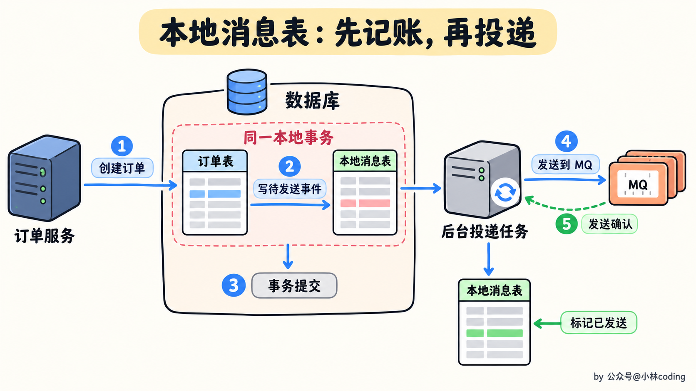

**如果发送成功了，但更新「已发送」状态前宕机了怎么办？** 下次扫描会再发一次。所以这个方案提供的是可重试的投递，消费者仍然要幂等，事件 ID 在重发时也不能变。

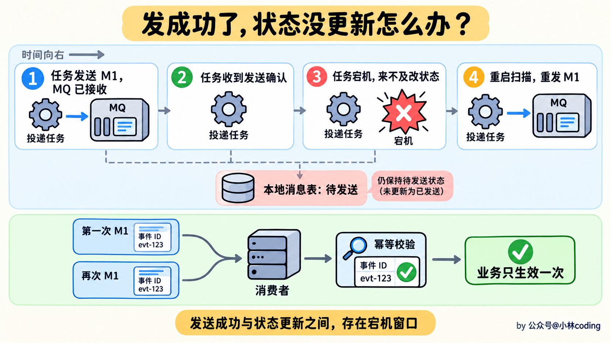

多个发送任务同时扫描时，要通过领取状态、锁或租约避免无序抢任务，并给卡住的任务设置恢复机制。如果还要求同一订单的消息有序，就要按订单和事件序号控制发送顺序。

最后，待发送记录超过一定时间要告警，失败要重试，成功记录要定期归档。**本地消息表把「可能漏发」变成了「有记录可以补发」，最终一致性还需要下游消费和对账配合。**

### [#](https://xiaolincoding.com/interview/mq.html#最多一次、至少一次、恰好一次有什么区别)最多一次、至少一次、恰好一次有什么区别？

这三个词说的是消息投递或处理的语义，我会这样理解：

- **最多一次（At Most Once）**：允许消息没处理到，但不会为了保证处理而重投。比如先提交消费进度再执行业务，中途宕机就可能漏处理。
- **至少一次（At Least Once）**：为了不漏处理，失败会重试，所以可能重复。比如先执行业务再提交进度，中间宕机，业务就可能再执行一次。
- **恰好一次（Exactly Once）**：在明确的范围内，处理结果只生效一次。这里一定要说明范围，不能看到 MQ 支持这个词，就认为外部数据库和支付接口也自动获得了这个保证。

为什么普通 ACK 很难同时做到不丢又不重？因为「业务提交」和「通知 MQ」之间总有一个宕机窗口：先确认可能漏业务，后确认可能重复业务。

所以业务系统里比较常见的做法是**至少一次投递 + 消费幂等**。消息可能重复到达，但同一笔订单、同一笔流水只生效一次。

### [#](https://xiaolincoding.com/interview/mq.html#消费失败怎么重试-死信消息怎么处理)消费失败怎么重试，死信消息怎么处理？

先区分失败原因。数据库短暂超时、下游暂时不可用，这类故障可以重试；消息格式错误、字段缺失、业务规则明确不允许，这类错误一直重试通常也不会成功。

**重试要有间隔、有次数上限。** 比如逐渐拉长等待时间，再加一点随机抖动，避免下游恢复时所有消息同时冲过去。不要在消费线程里无限循环，更不要失败后马上重新入队形成空转。

超过次数或者确认是永久性错误，就转到死信队列或异常表，保留原消息、业务 ID、失败原因和重试次数，同时发出告警。死信只是把问题隔离出来，后面还要修复数据或代码，再有控制地重放。

如果重试 Topic 是自己实现的，要先确认失败消息已经可靠写入重试 Topic，再提交原消费进度；不然原消息确认了，重试消息又没发出去，就会漏处理。

还有个取舍：转到重试队列后继续处理后续消息，可能破坏顺序。需要严格有序的业务，就要阻塞对应的业务键，或者通过状态机校验。不能既说失败随便跳过，又说后面的消息严格有序。

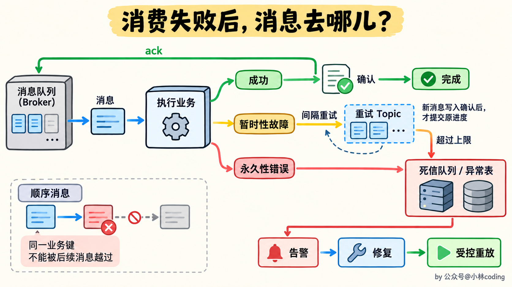

### [#](https://xiaolincoding.com/interview/mq.html#怎么判断消息队列是否健康-需要监控哪些指标)怎么判断消息队列是否健康，需要监控哪些指标？

我会沿着生产者、Broker、消费者三个环节看，而不是只看 MQ 进程有没有启动。

- **生产者**：发送失败率、超时率、重试次数、发送确认耗时，以及本地消息表里待发送记录的数量和年龄。
- **Broker**：磁盘空间、读写延迟、网络、复制延迟、可用副本数，以及 Kafka 的 ISR 是否频繁缩减。
- **消费者**：消费速率、处理耗时、失败率、重试和死信数量、消费者是否频繁掉线或重新分配任务。
- **业务时效**：积压条数、最老未处理消息的等待时间，以及从事件产生到业务完成的总耗时。

比如积压 1 万条，消费速度每秒 10 万条，可能很快就能清完；但一个分区只积压 100 条，最老的消息已经等了半小时，反而可能是某个订单流程卡住了。

所以告警要结合业务时限和积压增长趋势，关键业务再补对账，检查订单事件有没有对应的库存、积分或发货结果。

### [#](https://xiaolincoding.com/interview/mq.html#消息队列是参考哪种设计模式)消息队列是参考哪种设计模式？

消息队列的发布订阅思路和观察者模式都能实现一对多通知，但依赖关系不同，可以举个生活例子：

- 观察者模式：某公司给自己员工发月饼发粽子，是由公司的行政部门发送的，这件事不适合交给第三方，原因是「公司」和「员工」是一个整体
- 发布-订阅模式：某公司要给其他人发各种快递，因为「公司」和「其他人」是独立的，其唯一的桥梁是「快递」，所以这件事适合交给第三方快递公司解决

上述过程中，如果公司自己去管理快递的配送，那公司就会变成一个快递公司，业务繁杂难以管理，影响公司自身的主营业务。对应到代码里，观察者模式通常由主题直接维护观察者，发布订阅模式则增加一个消息中介，让发布者不必直接认识订阅者。是否异步、是否可靠投递，还要看具体实现。

> 观察者模式

观察者模式实际上就是一个一对多的关系，在观察者模式中存在一个主题和多个观察者，主题也是被观察者，当我们主题发布消息时，会通知各个观察者，观察者将会收到最新消息，图解如下：每个观察者首先订阅主题，订阅成功后当主题发送消息时会循环整个观察者列表，逐一发送消息通知。 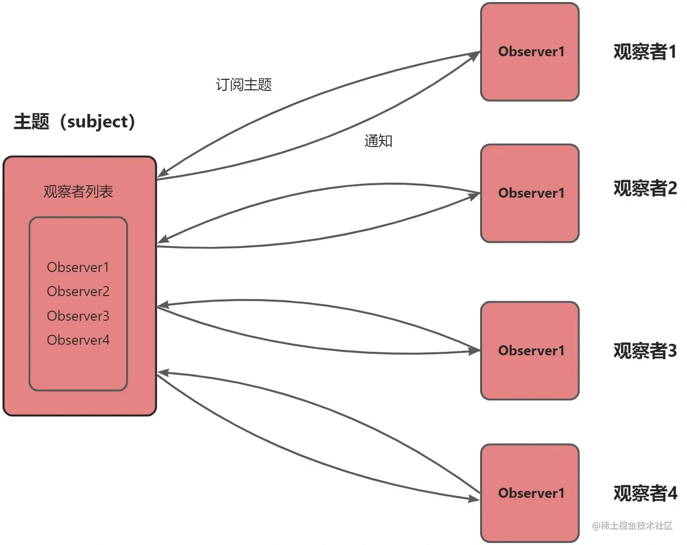

> 发布订阅模式

发布订阅模式通过中间的发布订阅中心通知消息，发布者不直接维护订阅者列表，也不需要知道具体会通知给谁，因此有三个重要角色：发布者 -> 发布订阅中心 -> 订阅者。双方仍然要约定事件格式和含义，解耦的是直接调用关系。

图解如下：当发布者发布消息到发布订阅中心后，发布订阅中心会将消息通知给所有订阅该发布者的订阅者 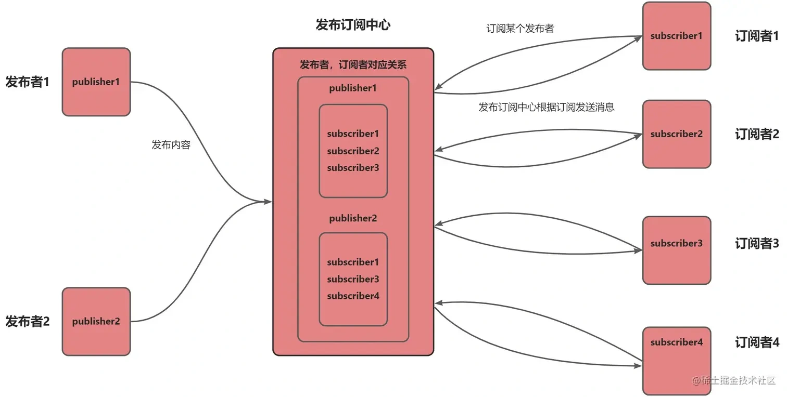

### [#](https://xiaolincoding.com/interview/mq.html#让你写一个消息队列-该如何进行架构设计)让你写一个消息队列，该如何进行架构设计？

这种设计题，我会先明确需求：消息量有多大，允许多长延迟，要不要顺序、回溯、延迟消息，以及能接受什么样的丢失和重复风险。

设计时可以沿着**生产者 -> Broker -> 消费者**这条线往下拆：

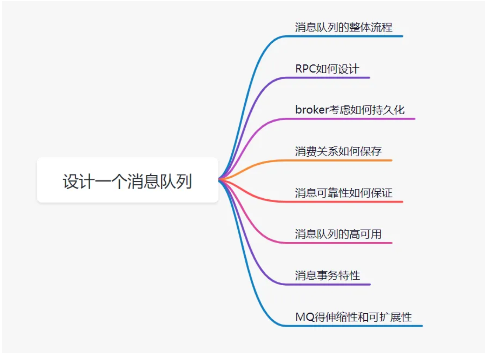

1. **消息模型**：按 Topic 组织消息，再拆成多个分区或队列。生产者选择目标分区，不同消费者组各自维护消费进度，同组消费者分担任务。
2. **通信协议**：定义发送、拉取、确认等接口，考虑长连接、序列化、批量请求、超时、鉴权和限流。客户端还要能发现 Broker，并在故障后刷新路由。
3. **存储模型**：消息顺序追加到日志文件，配合分段文件和索引定位消息。明确刷盘策略、保留时间、容量上限，不能让消息无限增长。
4. **可靠投递**：生产者有发送确认和重试，消费者成功后才确认。确认丢失会带来重复，要明确业务幂等责任；数据库更新和消息发送的一致性，可以配合事务消息或本地消息表。
5. **消费调度**：记录消费者组成员和进度，消费者加入、退出时重新分配任务。消费慢时要有流控，失败时要有重试、死信和告警。
6. **高可用**：消息多副本复制，明确哪些副本确认后才能返回成功，以及故障后哪些副本有资格接管。协调组件本身也要高可用，避免出现两个节点同时接受同一分区的写入。
7. **扩容**：新消息可以分配到新增分区，已有分区的副本可以迁移到新 Broker。这里要区分「增加分区」和「迁移已有分区」，增加分区并不会自动重分布历史消息。
8. **可运维性**：补上消费延迟、磁盘水位、复制状态、死信监控，以及消息查询、重放和限流工具。

面试里不需要上来就把所有高级功能都设计出来。先把收发、存储、确认和故障恢复讲清楚，再解释顺序与并发、可靠性与性能之间的取舍，回答会更完整。

## [#](https://xiaolincoding.com/interview/mq.html#rocketmq)RocketMQ

### [#](https://xiaolincoding.com/interview/mq.html#消息队列为什么选择rocketmq的)消息队列为什么选择RocketMQ的？

如果项目里选择 RocketMQ，我会结合业务需求来回答，主要是下面几个原因：

- **业务特性比较齐全**。像订单超时关闭需要延迟消息，本地事务和消息发送的一致性需要事务消息，消费失败需要重试和死信。这些能力与电商类业务比较贴近。
- **支持局部顺序和消息过滤**。比如同一订单的状态事件要顺序处理，不同类型事件又可以按 Tag 过滤，不必所有消息都交给业务代码判断。
- **Java 技术栈比较容易接手**。团队熟悉 Java，排查客户端和 Broker 的问题、阅读源码会更方便，但这只是团队成本的优势，不代表 Java 开发的 MQ 就一定更可靠。
- **具备分布式部署和扩展能力**。通过多个 Broker、消息队列和副本支撑业务规模，具体吞吐量和可靠性要结合刷盘、复制配置做压测。

面试里最好把选型落到具体需求上，比如「订单流程需要事务消息和延迟消息，团队也熟悉 Java」。只说「大厂用过、吞吐高」，还不足以解释为什么适合自己的项目。

### [#](https://xiaolincoding.com/interview/mq.html#rocketmq和kafka的区别是什么-如何做技术选型)RocketMQ和Kafka的区别是什么？如何做技术选型？

这两个都能做可靠的消息传递，区别主要在于**消息模型、业务特性和生态侧重点**，不能简单理解为「Kafka 快但会丢，RocketMQ 慢但不会丢」。

**先看 Kafka。** 它把 Topic 拆成 Partition，每个分区都是可回溯的追加日志，不同消费者组独立记录 offset。配合批量、压缩、Page Cache 等机制，比较适合日志采集、行为数据和流式处理。

Kafka 支持幂等生产者和事务，但事务主要用于 Kafka 内部的消息生产、消费进度提交。像订单延迟关闭、消费失败后按次数重试这些业务需求，通常还要结合应用或框架实现。

**再看 RocketMQ。** 它围绕业务消息提供事务消息、延迟消息、顺序消息、消费重试和死信等能力。典型的本地存储模型是 CommitLog + ConsumeQueue，Java 技术栈也方便一些团队排查问题。

可靠性上，两者都要看配置。Kafka 要考虑 `acks`、ISR 和最小同步副本数；RocketMQ 要考虑刷盘、复制以及部署模式。消息确认之后到底能抵御什么故障，要把条件说清楚。

那怎么选呢？

- 日志量大，需要流式计算、历史数据反复消费，我会优先评估 Kafka。
- 订单、库存、支付等业务事件，需要事务消息、延迟触发和内置重试，我会优先评估 RocketMQ。
- 两种场景都有，也可以按业务分别使用，不必强行只选一种。

至于谁的性能更好，要在相同消息大小、副本数和可靠性要求下比较。不能只凭一个单机 QPS，或者一个零拷贝技术，就推出所有场景下的结论。

### [#](https://xiaolincoding.com/interview/mq.html#rocketmq-延迟消息的底层原理是什么)RocketMQ 延迟消息的底层原理是什么？

延迟消息的核心是：**消息先存起来，到指定时间后再变成消费者可见的普通消息。** 这里要区分传统的延迟等级机制和 5.x 的定时消息机制。

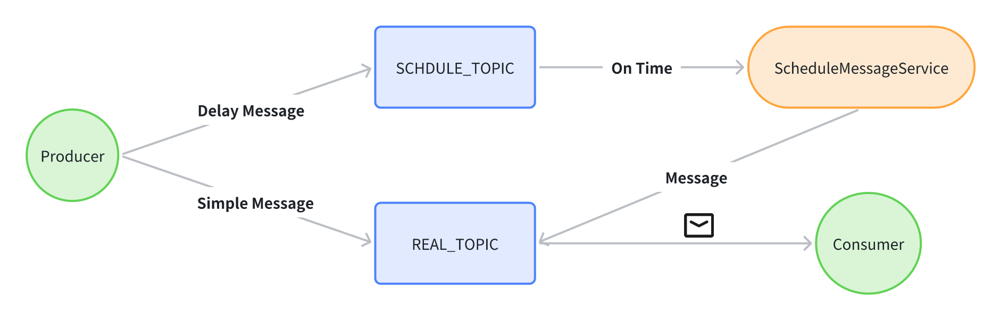

**传统 4.x 的延迟等级机制**，可以结合上图理解：

1. 生产者设置延迟等级，Broker 保存原 Topic 和队列等信息，把消息转存到内部延迟 Topic `SCHEDULE_TOPIC_XXXX`。
2. 不同延迟等级对应不同队列，`ScheduleMessageService` 按消费进度检查队头消息的到期时间。
3. 到时间后，恢复原 Topic 等信息，把消息重新写入正常的投递路径。
4. 原 Topic 的消费者才能获取并处理消息。

这种方式通常是配置好的固定延迟等级，比如几秒、几分钟，并不是任意指定一个时间都能直接对应。

**5.x 的定时消息**可以指定投递时间戳，在支持该能力的 Broker 配置下，底层通过定时存储、时间轮等机制组织待到期消息，到期后再进入正常消费流程。要结合服务端能力、Topic 消息类型和客户端版本使用，不能只升级 SDK 就认为一定支持。

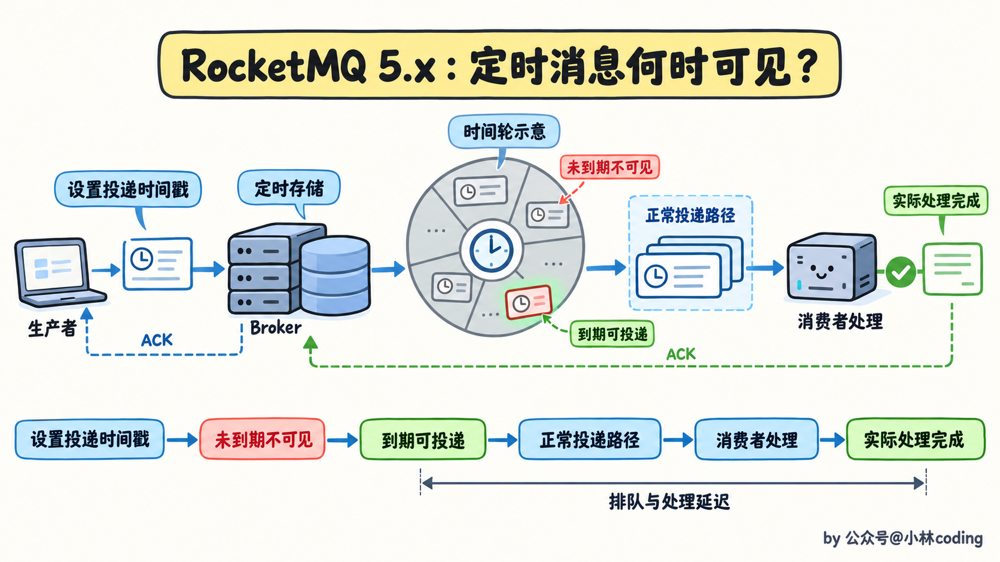

还有一点：**到期代表可以投递，不代表业务必然在那一毫秒完成。** Broker 调度、网络和消费积压都可能带来延迟，所以订单关闭这类业务仍然要检查数据库里的实际状态和截止时间。

### [#](https://xiaolincoding.com/interview/mq.html#用延迟消息关闭订单-怎么避免把已支付订单关掉)用延迟消息关闭订单，怎么避免把已支付订单关掉？

可以在创建订单时发送一条延迟消息，等到支付截止时间后，消费者收到消息，再去尝试关闭订单。

但这条消息表达的是「到时候检查一下」，不能直接代表「订单一定没支付」。用户可能已经付了钱，消息也可能因为积压晚到，所以**最终要以数据库里的订单状态为准**。

关闭时，可以用条件更新把「待支付」改成「已关闭」，同时校验截止时间：

```sql
UPDATE orders
SET status = 'CLOSED'
WHERE order_id = ?
  AND status = 'UNPAID'
  AND expire_time <= CURRENT_TIMESTAMP;
```

支付回调也要通过条件更新推进状态。支付和关单并发时，由数据库的状态条件保证只有符合当前状态的操作才能成功，不能先查状态再无条件更新。

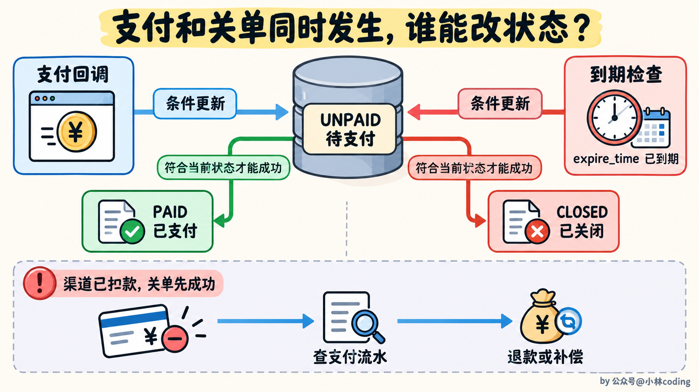

关闭成功后，释放库存的动作也要幂等。如果库存是独立服务，可以在关单事务里记录待发送的释放事件，再可靠投递。

还有个边界：支付渠道可能扣款成功，但回调到达时订单已经关闭。这时候要按业务规则查询支付结果、退款或人工补偿，不能强行把关闭状态覆盖成已支付。

最后保留定时扫描作为兜底，处理延迟消息漏发、投递延后等异常。这样消息负责触发，订单状态机负责正确性，对账和补偿负责收尾。

### [#](https://xiaolincoding.com/interview/mq.html#rocketmq-怎么处理分布式事务)RocketMQ 怎么处理分布式事务？

RocketMQ 的事务消息可以帮助业务实现**最终一致性**，但它不会把多个服务的数据库操作变成一个同时提交、同时回滚的大事务。

假设 A 服务扣款 100 元，B 服务到账 100 元，我们希望的是：A 确认扣款成功后，可靠地通知 B 去入账。

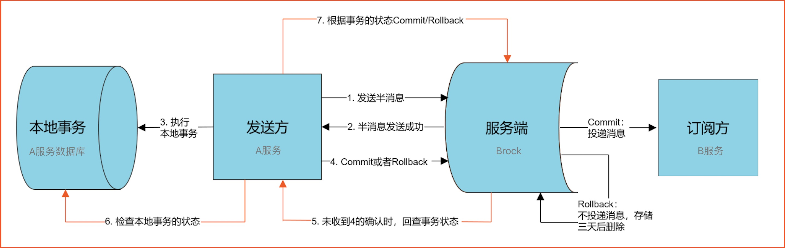

流程可以这样理解：

1. A 先向 Broker 发送半消息，消息里包含转账流水号和 B 要入账的信息。此时 B 还不能消费。
2. 半消息发送成功后，A 执行本地事务，把扣款和转账流水一起提交。
3. 本地事务成功，A 返回 Commit，Broker 让消息对 B 可见；明确回滚，A 返回 Rollback。
4. 如果 A 宕机或者提交结果丢了，Broker 会发起事务回查。回查根据持久化的转账流水判断成功、失败或仍不确定，不能只查内存标记。
5. B 收到消息后，用转账流水号做幂等，完成入账后再确认消费。

**如果 A 扣款成功，但 B 一直入账失败，怎么办？** 这不一定是代码问题，也可能是数据库故障、账户被冻结、业务校验不通过。暂时性故障可以重试，永久性故障则要记录异常、告警，并按业务规则决定修复后重放还是执行退款等补偿。

事务回查、消费重试都有边界，不能认为系统会无期限替我们兜底。因此还要通过转账流水对账，找出「已扣款、未到账」的记录。

**总结一下：** 事务消息解决 A 的本地事务与消息投递的一致性；B 的幂等、重试和补偿解决下游处理问题。两边配合，才能让业务最终收敛到一致状态。

### [#](https://xiaolincoding.com/interview/mq.html#rocketmq消息顺序怎么保证)RocketMQ消息顺序怎么保证？

消息有序，一般指**同一个业务对象的事件按先后顺序处理**。比如同一订单要先创建、再付款、最后完成；不同订单之间可以并行。

传统 RocketMQ 客户端里，可以通过下面几个环节来保证：

- **发送端先有序**：同一订单的消息按业务顺序发送，重试也不能让后一条越过前一条。多个生产者并发发送同一订单事件时，要先在业务侧确定顺序。
- **选同一个队列**：比如根据订单号选择 MessageQueue，让同一订单的消息进入同一队列。队列数量变化时，原来的取模映射可能改变，需要评估迁移方案。
- **使用顺序消费**：传统 Java 客户端使用 `MessageListenerOrderly`。集群消费时，Broker 的队列锁配合客户端的串行控制，避免同一队列被多个消费者同时乱序处理。
- **失败时保住顺序**：顺序消费失败通常要先暂停当前队列并重试，不能随意把失败消息扔到另一个队列，然后继续处理同一订单的后续事件。

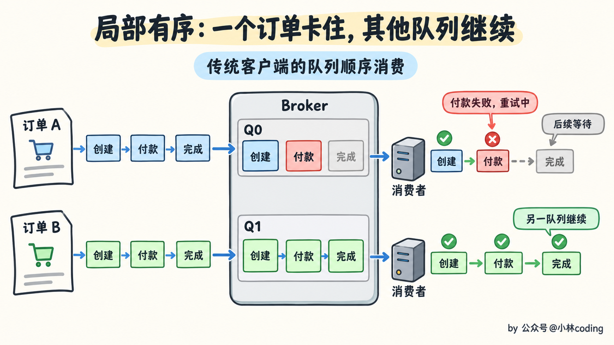

5.x 的顺序消息还引入了**消息组（MessageGroup）**，可以把订单号作为消息组，表达同一组消息的顺序要求。具体发送和消费 API 要与客户端版本匹配，不能把传统队列锁机制套到所有消费方式上。

顺序消息的代价是，某一条处理慢或一直失败，可能阻塞后续消息。所以尽量只对确实需要有序的业务键保证顺序，并用状态机校验作为业务兜底。

### [#](https://xiaolincoding.com/interview/mq.html#rocketmq怎么保证消息不被重复消费)RocketMQ怎么保证消息不被重复消费？

RocketMQ 的消息也可能重复，**不能靠它的消费成功状态替业务保证幂等**。

比如消费者已经把款项入账了，却在返回消费结果之前宕机。Broker 不知道业务已经成功，就会再次投递。同一条业务消息如果被生产者主动重发，也可能有不同的消息 ID。

所以我会用订单号、支付流水号等业务标识做幂等，而不是完全依赖 Broker 生成的 messageId。比如「转账流水号 + 入账」加唯一约束，并把入账流水与余额更新放在同一个数据库事务里。

如果幂等记录已经存在，说明这笔业务已经处理成功，可以返回消费成功；如果数据库事务失败，则返回失败让消息重试。外部接口调用还要结合下游幂等键和结果查询。

核心还是前面那句话：**允许消息重复到达，但同一笔业务只能生效一次。**

### [#](https://xiaolincoding.com/interview/mq.html#rocketmq消息积压了-怎么办)RocketMQ消息积压了，怎么办？

我会先看消费模式，再判断积压原因。不能看到积压就认定「多加几台消费者一定有效」。

**第一步，确认到底堵在哪个环节。** 是生产流量突然增大，还是消费者掉线、下游接口超时、数据库变慢？是所有队列都积压，还是某个订单号形成热点？先看消费耗时、失败率、线程池和下游容量。

**第二步，根据客户端和负载均衡方式扩容。** 在传统客户端的集群消费、队列分配模式下，同一消费组的一条队列同一时刻分配给一个消费者实例。比如总共 4 条队列，已经有 4 个实例，再加实例就可能分不到队列。但一个实例内部仍然可以有多个消费线程，所以不能说「4 个实例就达到所有场景的吞吐上限」。

5.x 的部分消费方式支持消息粒度的负载均衡，同一队列的不同消息可以分配给多个消费者。因此，**队列数与消费者实例数的限制，要结合实际客户端和模式来回答**。顺序消息仍然要遵守消息组的顺序约束。

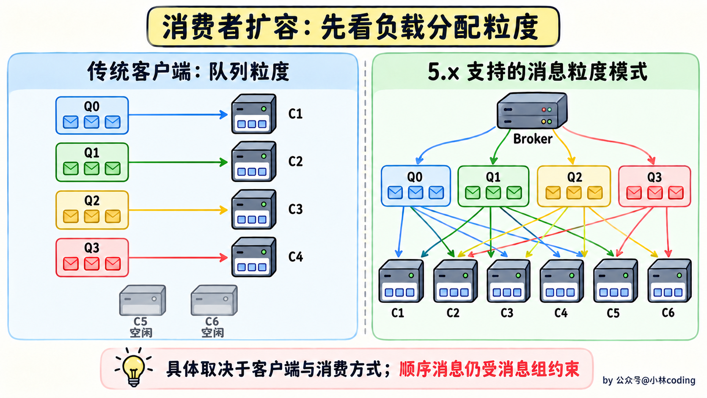

**第三步，优化或隔离耗时业务。** 调整并发、批量处理、优化 SQL 都要结合下游容量。若下游已经被压满，消费者无限加线程只会增加超时和重试。

对于无需顺序、旧队列确实限制处理能力的海量积压，可以评估转发到多队列的临时 Topic。但要保留业务幂等键，确认新 Topic 写入成功后才提交旧进度，同时评估 Broker、数据库的额外压力。新增队列不会自动搬走旧消息，也不能保证扩容十倍就快十倍。

处理期间还要观察最老消息时间、消息保留期和磁盘水位。关键业务不能直接跳过消费进度，恢复后要对账，确认重试队列、死信队列里的消息也得到处理。

### [#](https://xiaolincoding.com/interview/mq.html#rocketmq-的-commitlog、consumequeue-和-indexfile-有什么作用)RocketMQ 的 CommitLog、ConsumeQueue 和 IndexFile 有什么作用？

可以把这三者理解成**正文、目录和查询索引**。

**CommitLog 存正文。** 一个 Broker 上不同 Topic、不同队列的消息，通常一起顺序追加到 CommitLog 的分段文件中，消息体和消息属性都在这里。这样写入路径比较集中。

**ConsumeQueue 存消费目录。** 每个 Topic 的每条队列有自己的逻辑索引，记录消息在 CommitLog 里的位置、大小等信息。消费者按队列的逻辑 offset 找到索引，再去 CommitLog 读取消息。

**IndexFile 用于按 Key 查消息。** 比如按订单号辅助查询相关消息，它不是正常顺序消费必须经过的路径，也不能代替业务数据库的唯一约束。

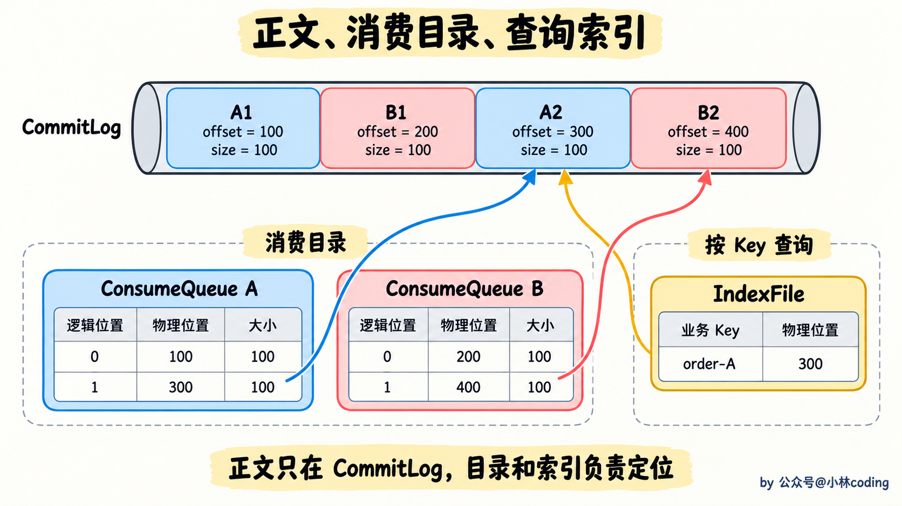

所以，RocketMQ 的队列并不是每条队列各存一份完整消息体。正文集中写，消费目录按队列组织，两者承担不同职责。

不过，集中写入也不代表 Topic 可以无限增加，ConsumeQueue、索引、路由元数据和后台处理一样会消耗资源。具体容量仍然要压测。

### [#](https://xiaolincoding.com/interview/mq.html#rocketmq-的-nameserver-是干什么的-挂了会怎样)RocketMQ 的 NameServer 是干什么的，挂了会怎样？

NameServer 主要负责**路由发现**：某个 Topic 有哪些队列，这些队列在哪些 Broker 上，客户端要到哪里发消息、取消息。

Broker 会定期向 NameServer 注册和发送心跳，客户端从 NameServer 获取路由并缓存。普通 NameServer 的路由服务是无状态的，各节点之间不需要像数据库副本那样复制同一份日志。

如果只挂一个 NameServer，客户端通常还可以从其他节点获取路由。如果全部挂了，已有客户端在缓存路由仍有效、Broker 地址没变的情况下，可能继续收发一段时间；但新客户端、首次访问新 Topic，以及 Broker 故障后的路由刷新会受影响。

还有一点：**普通 NameServer 不是 Broker 自动选主的控制器。** RocketMQ 是否能够自动切主，取决于部署模式，比如 DLedger 或 Controller 模式；Controller 可以单独部署，也可以嵌入 NameServer，但它和路由服务承担的是不同职责。

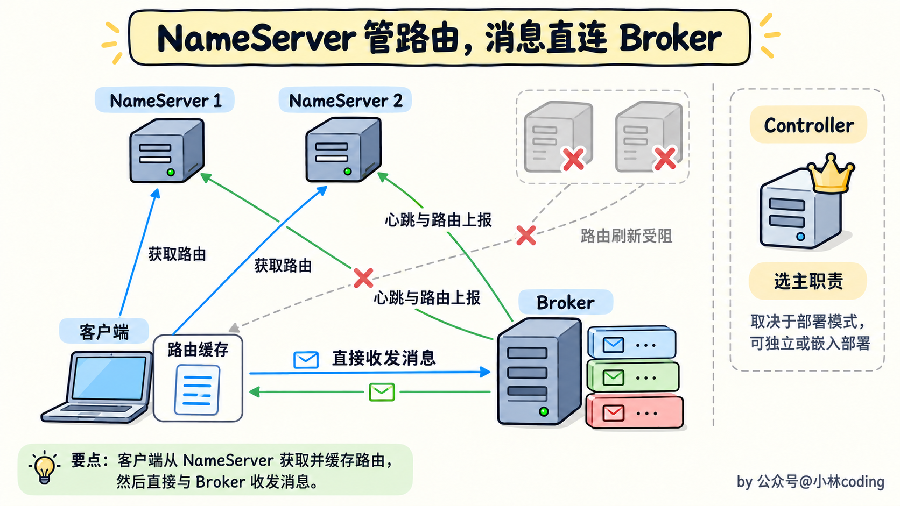

### [#](https://xiaolincoding.com/interview/mq.html#rocketmq-的集群消费和广播消费有什么区别)RocketMQ 的集群消费和广播消费有什么区别？

传统客户端里，这两种模式最大的区别是：**同一条消息，是让组内某个实例处理，还是让每个实例都处理。**

**集群消费**：同一个消费组里的实例分担消息，一条消息通常交给其中一个实例处理，失败时仍可能重复投递。适合订单处理、积分发放，不能让每台机器都给用户加一次积分。

**广播消费**：同一个组里的每个实例都要消费这条消息，适合各实例更新本地缓存这类场景。在传统客户端中，广播消费的消费进度和失败重试方式与集群模式不同，不能默认认为都有 Broker 端的重试和死信兜底。

如果库存和积分两个系统都需要处理订单支付事件，通常应该建立两个不同的消费组，每个组内部用集群消费。这样两个业务都能收到事件，各自还可以通过多个实例分担任务。

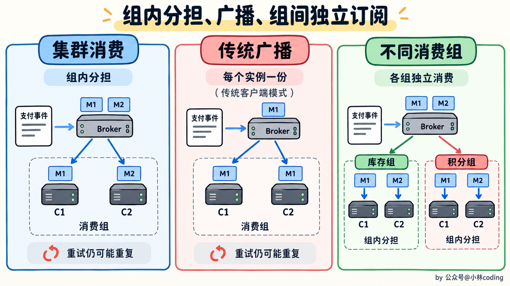

不同版本和客户端支持的模式有差异，尤其使用 5.x 新客户端时，要先确认能力，不能照搬传统广播消费配置。

## [#](https://xiaolincoding.com/interview/mq.html#kafka)Kafka

### [#](https://xiaolincoding.com/interview/mq.html#对kafka有什么了解吗)对Kafka有什么了解吗？

Kafka 可以理解为一个**分布式、可持久化、可回溯的消息日志系统**，常用于日志采集、行为数据和流式处理，也能承载业务事件。

它的几个核心概念可以串起来说：

- **Topic**：消息按主题分类，比如订单事件、用户行为。
- **Partition**：Topic 拆成多个分区，每个分区是一份追加日志，分区内消息有自己的 offset，也是并行消费的基本单位。
- **Broker**：负责存储和收发消息的服务器，一台 Broker 可以承载多个分区的副本。
- **Leader 和 Follower**：分区通过多副本实现容灾，Leader 处理写入，Follower 复制数据；副本能否接管，要看是否满足选举条件。
- **Consumer Group**：组内消费者分担分区，组与组之间各自维护进度，因此同一份数据可以给多个业务独立消费。

Kafka 的特点是吞吐能力强、支持批量和压缩、可以按保留策略保存历史数据，并通过分区和副本扩展容量。

但不能直接说「有 n 个副本就能挂 n-1 台机器」。消息有没有丢、分区还能不能读写，还要看 ISR、最小同步副本数、选举配置，以及 KRaft 控制器是否保有多数派。

### [#](https://xiaolincoding.com/interview/mq.html#kafka-为什么这么快)Kafka 为什么这么快？

Kafka 快，主要是因为它把存储和网络传输里的很多小操作，变成了**顺序、批量、可复用的操作**。

**第一，追加写日志。** 消息按分区顺序追加到日志文件，减少随机寻道和零碎写入，比大量随机更新更容易获得稳定吞吐。SSD 上同样能受益于批量和连续访问。

**第二，利用 Page Cache。** 写入先经过操作系统的页缓存，由操作系统管理刷盘；消费者读取近期消息时，也可能直接命中缓存，减少实际磁盘读取。可靠性还要由副本和确认配置配合，不能把页缓存当成断电后仍然存在的磁盘。

**第三，批量收发。** 生产者通过 `batch.size`、`linger.ms` 等参数组织批次，消费者批量拉取，把网络请求、协议处理和 I/O 的成本分摊到多条消息上。但等待凑批会增加延迟，要按业务目标调整。

**第四，减少数据拷贝。** 在适用的传输路径中，可以通过 `sendfile` 等机制把文件数据传给网络，减少用户态和内核态之间的拷贝。开启 TLS 等情况会影响这条优化路径，不能说任何场景都完全零拷贝。

**第五，批量压缩和分区并行。** 压缩减少网络、存储的数据量，多分区把负载分散到多个 Broker 和消费者。但压缩也消耗 CPU，分区也不是越多越好。

所以，Kafka 的高吞吐是这些机制一起作用的结果。具体能跑多少 QPS，要看消息大小、硬件、批量参数、副本和可靠性配置。

### [#](https://xiaolincoding.com/interview/mq.html#kafka-的模型介绍一下-kafka-是推送还是拉取)Kafka 的模型介绍一下，Kafka 是推送还是拉取？

Kafka 的普通消费者采用**拉取（pull）模型**，由客户端主动向 Broker 请求消息，比较适合消费者自己控制批量和处理节奏。

> 推送模型和拉取模型

Push 是 Broker 主动投递，Pull 是消费者主动请求。Push 可以通过 ACK 和 prefetch 做可靠性和流控，Pull 则便于消费者自己控制拉取节奏，两种模式各有适合的场景。

Kafka 的客户端通过 `poll()` 等 API 获取数据，底层发送 Fetch 请求。如果暂时没有足够数据，Broker 可以等待到指定条件或超时再响应，避免消费者不停发空请求。这个等待由 Fetch 相关配置和客户端调用共同控制，不只是一个 `poll` 超时参数。

> 消费进度

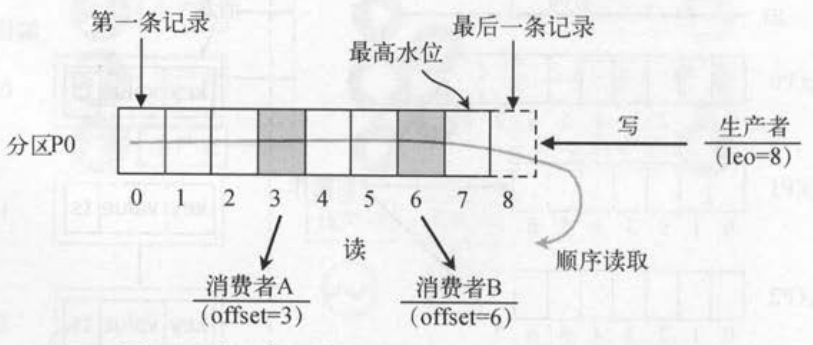

每个消费者组独立维护各分区的已提交 offset，通常保存在 Kafka 的内部主题 `__consumer_offsets` 里，不是只存在消费者自己的内存中。

比如积分组处理到 offset 3，风控组处理到 offset 6，它们互不影响。保留期内还可以通过重置 offset 重新处理历史数据，但要评估业务幂等和重复触发的影响。

普通读取只能看到高水位以内、满足复制提交条件的数据。消费事务消息时，如果设置 `read_committed`，还会受事务提交状态和 LSO（最后稳定偏移量）的限制，不能把所有已写入 Leader 的消息都当成马上可见。

> 消费者组

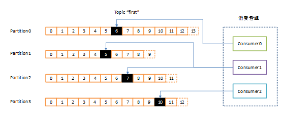

在普通消费者组模型里，同一时刻一个分区分配给组内一个消费者实例，一个实例可以负责多个分区；不同消费组则可以独立消费同一分区。

所以组内体现的是分担任务，组间体现的是同一份消息服务多个业务。消费者加入或退出后，会重新分配分区，让剩余实例接手任务。

### [#](https://xiaolincoding.com/interview/mq.html#kafka-如何保证顺序读取消息)Kafka 如何保证顺序读取消息？

Kafka 保证的是**单个分区内按日志顺序读取**，不保证一个 Topic 所有分区的全局顺序。业务上要有序，还得把发送、分区选择和处理都串起来。

比如同一订单的创建、付款、完成事件，可以把订单号作为 Key，让它们在分区数量和分区策略不变时进入同一个分区。

**发送端**要先确定事件顺序，并考虑重试。关闭幂等且允许多个请求同时在途时，前一批失败重试，后一批先写入，就可能乱序。启用幂等生产者后，还要使用满足要求的 `acks`、`retries` 和 `max.in.flight.requests.per.connection` 配置；不能简单把任何重试配置都说成有序。

**消费端**按分区串行处理最容易保证顺序。把同一分区的消息全部丢进线程池，虽然拉取顺序正确，处理完成顺序却可能乱掉。需要并发时，可以按业务键分配到固定的串行执行通道，同时只提交已经连续处理完成的消费进度。

**扩分区时也要注意。** 相同 Key 的映射可能改变，旧消息留在旧分区，新消息进入新分区，两个分区一起消费就可能打乱同一订单的顺序。

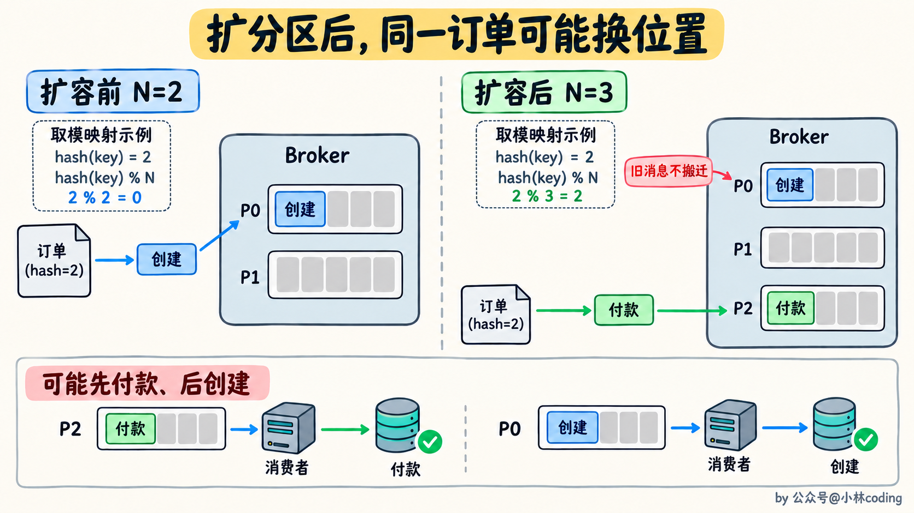

如果确实要全局有序，可以只用一个分区，并在生产端明确总顺序，但并行能力会受到限制。业务自己按序号重排也不是简单排序一下，还要处理缺失消息、等待超时和补偿；仅凭时间戳通常无法保证严格顺序。

### [#](https://xiaolincoding.com/interview/mq.html#kafka-消息积压怎么办)Kafka 消息积压怎么办？

Kafka 积压一般看 **Consumer Lag**，但还要结合处理耗时和消息年龄，确认是生产突然增加，还是消费能力下降。

**如果所有分区都慢**，优先排查消费者掉线、下游超时、慢 SQL、线程池阻塞，以及消费失败后的重试。如果分区还有空余，可以增加同组消费者实例；没有空余时，可以优化处理逻辑、批量写入，或者对不要求顺序的业务合理增加内部并行度。

**如果只有个别分区慢**，可能是某个 Key 流量过大形成热点，或者某条消息一直失败。单纯增加消费者实例，不能把这个已经积压的分区自动拆开。

新增分区主要影响后续消息，**历史消息不会自动搬到新分区**，所以不能把「增加分区数」当成直接清理旧积压的方案。必要时可以评估转发到新 Topic，但要处理发送确认、幂等、顺序以及额外读写压力。

调大拉取批量、优化压缩或增加消费者线程，都要看瓶颈是否真在这里，并保证处理时间与 `max.poll.interval.ms` 等配置匹配，避免因为处理太久又触发重新分配。

最后关注保留期，避免旧消息还没处理就被删除。恢复后检查 Lag 是否持续下降，再对关键业务做对账。

### [#](https://xiaolincoding.com/interview/mq.html#kafka为什么一个分区只能由消费者组的一个消费者消费-这样设计的意义是什么)Kafka为什么一个分区只能由消费者组的一个消费者消费？这样设计的意义是什么？

这里说的是 **Kafka 普通消费者组的分区分配模型**：同一时刻，同一组内，一个分区只分配给一个消费者实例。不同消费组可以同时读这个分区。

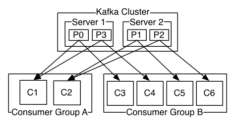

为什么这样设计？主要是让**任务归属、消费进度和顺序控制**都比较清楚。

如果同组两个消费者同时处理同一分区，就得额外协调「谁处理哪些 offset、谁能提交进度、某一条失败后怎么重试」。假设一个处理完 offset 20，另一个还卡在 offset 10，直接提交较大的进度就可能跳过没完成的消息。

以分区为单位分配后，一个实例负责自己的分区，组内无需为每条消息再抢一次任务，按分区顺序处理也更简单。这是用分区粒度换取协调成本和顺序管理上的简化。

不过，这不代表底层不允许多个独立客户端读同一分区，也不代表宕机、重平衡后绝不会重复消费。组内的任务分配和业务幂等，是两件不同的事。

### [#](https://xiaolincoding.com/interview/mq.html#如果有一个消费主题topic-有一个消费组group-topic有10个分区-消费线程数和分区数的关系是怎么样的)如果有一个消费主题topic，有一个消费组group，topic有10个分区，消费线程数和分区数的关系是怎么样的？

这个问题要先区分 **KafkaConsumer 实例数**和**业务处理线程数**，这两个不是一回事。

在普通消费者组里，假设订阅的 Topic 一共有 10 个分区：

- 只有 1 个消费者实例，它可以负责全部 10 个分区。
- 有 5 个实例，合理分配时每个可以负责 2 个分区。
- 有 10 个实例，可以做到每个负责 1 个分区。
- 有 15 个实例，多出的实例会没有分区可分配。

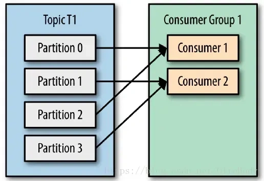

所以，**分区数限制的是同组能分到任务的消费者实例数**。不是说业务线程池也只能开 10 个线程。

一个消费者实例拉取消息后，可以交给业务线程池处理，但同一分区要不要串行、什么时候提交 offset，都得设计好。`KafkaConsumer` 本身也不是线程安全的，不能让多个工作线程随意同时调用它。

至于 10 个实例是不是一定最快，要看消息量、单条处理耗时、Broker 和下游容量。消费者数与分区数相等是一种配置选择，不是吞吐量必然最大的公式。

### [#](https://xiaolincoding.com/interview/mq.html#kafka-的-offset-应该什么时候提交-自动提交有什么问题)Kafka 的 offset 应该什么时候提交？自动提交有什么问题？

普通消费者组提交的 offset，表示**下次恢复消费的位置**。比如 offset 0 到 9 都处理完了，应提交 10，而不是 9。

最关键的原则是：**先完成业务，再提交对应进度。** 如果先提交 10，再去处理消息，中途宕机，重启会从 10 开始，前面没完成的业务就被跳过去了。

但反过来，业务成功后、提交前宕机，重启又会消费一遍。所以手动提交可以控制漏处理风险，仍然需要业务幂等。

自动提交并不知道业务数据库有没有提交。尤其把 `poll()` 到的消息交给异步线程池后，消费线程继续轮询，自动提交可能越过尚未完成的任务，因此不能把「自动提交」等同于「业务成功后提交」。

手动提交时也不能只看最大的已完成 offset。假设 0 到 4 已完成，5 失败，6 到 9 成功，只能推进到 5 这个待处理位置，不能直接提交 10。只有失败消息已经被可靠转存到重试路径，且业务允许后续消息先走时，才可以按设计推进。

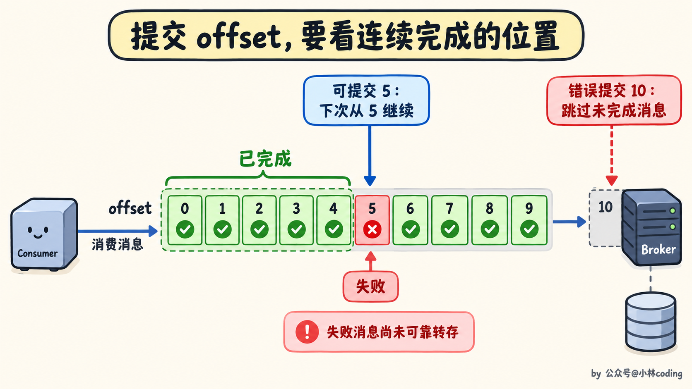

`commitSync` 等待提交结果，`commitAsync` 通过回调处理结果，它们决定的是提交方式，都不会自动检查业务是否完成。

### [#](https://xiaolincoding.com/interview/mq.html#kafka-的-isr-是什么-acks-all-就一定不丢消息吗)Kafka 的 ISR 是什么，acks=all 就一定不丢消息吗？

ISR 是 **In-Sync Replicas，同步副本集合**，包括 Leader 和满足同步条件的 Follower。副本落后到一定程度，会被移出 ISR。

`acks=all` 表示一次写入需要满足 ISR 副本的确认条件，**不是所有配置出来的副本都必须确认，更不是所有副本都已经物理刷盘**。

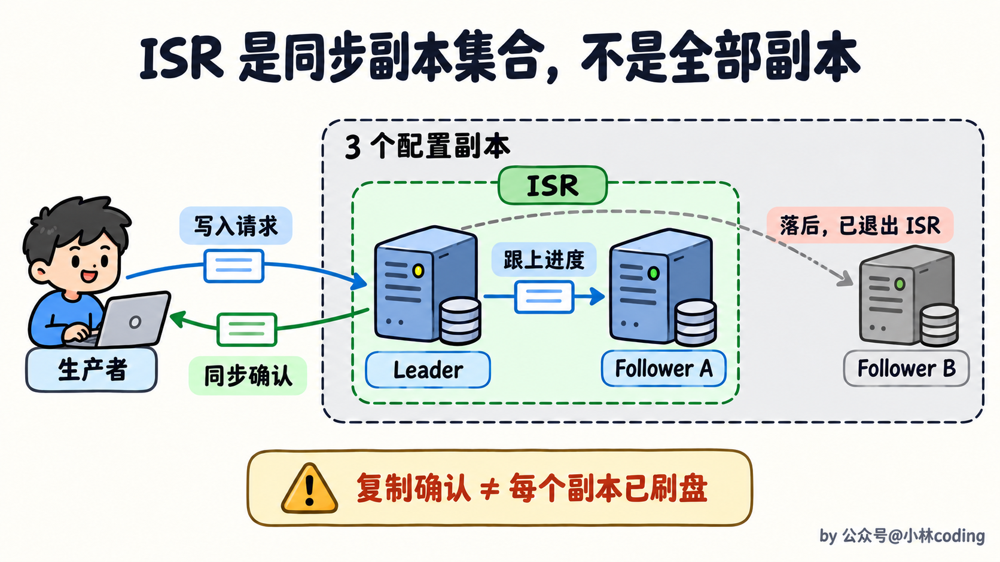

举个例子：配置了 3 个副本，但两个 Follower 都落后，被移出 ISR，ISR 只剩 Leader。如果 `min.insync.replicas=1`，即使设置 `acks=all`，也可能只靠 Leader 就返回成功。此时 Leader 再故障，风险就很大。

关键消息常见的组合是：**3 副本 + `acks=all` + `min.insync.replicas=2` + 禁止不干净的 Leader 选举**。ISR 少于 2 时宁可拒绝写入，也不降低到单副本确认。

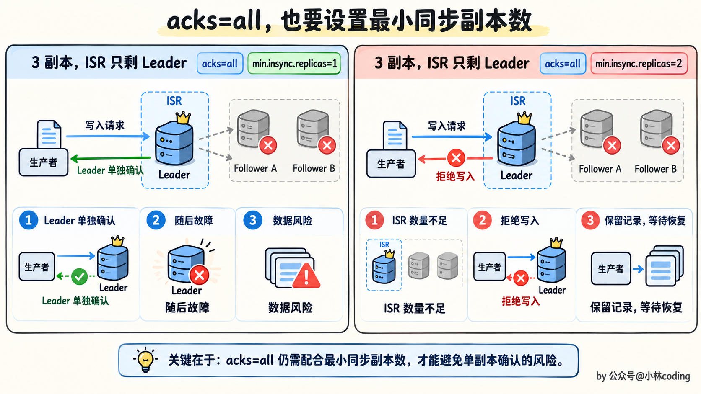

这也体现了可靠性和可用性的取舍：同步副本不够时，拒绝写入会影响可用性；放宽条件可能增加丢失风险。即使配置合理，也不能覆盖所有副本同时损坏、错误删除等所有情况，还要配合监控、容灾和对账。

### [#](https://xiaolincoding.com/interview/mq.html#kafka-的-rebalance-是什么-会带来什么问题)Kafka 的 Rebalance 是什么，会带来什么问题？

Rebalance 就是**重新分配消费者组里各实例负责的分区**。比如新增消费者、原消费者退出或失联、订阅的 Topic 分区发生变化，都可能触发任务重新分配。

它的好处是消费者扩容、故障后，任务能重新交给存活的实例。代价是分区交接可能造成短暂消费停顿，如果之前完成的业务没提交进度，新实例接手后还可能重复处理。

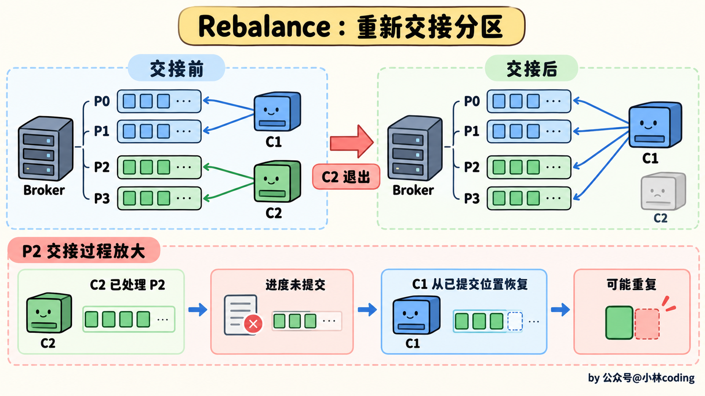

传统 eager 分配方式通常会撤销全部分区再分配；cooperative 等方式可以减少不必要的分区交接。不同协议和版本的停顿范围不同，不能说所有 Rebalance 都一定让整个组完全停止。

如果业务处理太久，迟迟不调用 `poll()`，超过 `max.poll.interval.ms`，即使进程还活着，也可能被认为无法正常消费。频繁扩缩容、网络问题也会引起反复重平衡。

应对时，要控制每批消息数量和处理耗时，合理配置轮询与心跳相关参数，避免频繁扩缩容，并在分区交接时协调未完成任务和已完成进度。幂等依然是兜底，不能只靠提高超时时间掩盖消费卡住的问题。

### [#](https://xiaolincoding.com/interview/mq.html#kafka-的幂等生产者和事务-能保证业务恰好执行一次吗)Kafka 的幂等生产者和事务，能保证业务恰好执行一次吗？

不能直接保证，要看你说的是哪一层。

**幂等生产者**主要处理生产者内部发送重试产生的重复。Broker 通过生产者 ID、分区序列号等信息判断重复批次。但业务代码主动再调用一次发送、重新创建生产者，不能指望它自动识别成同一笔订单事件。

**Kafka 事务**可以把多条 Kafka 消息的写入，以及消费进度提交，放到一个原子提交范围里。比如从 Topic A 读取数据，处理后写到 Topic B，同时用 `sendOffsetsToTransaction` 提交消费进度，配合 `read_committed` 读取已提交结果。

这适合 Kafka 内部的「读 -> 处理 -> 写」链路，但事务中途失败，处理代码仍然可能重新执行。保证的是相应范围内的结果语义，不是函数永远只调用一次。

**如果业务是消费消息后更新 MySQL、调用支付或发短信，Kafka 事务不会自动把这些外部副作用一起提交。** 数据库写入需要业务幂等、唯一约束或把消费进度与结果一起落库的方案；外部接口需要幂等键、结果查询和补偿。

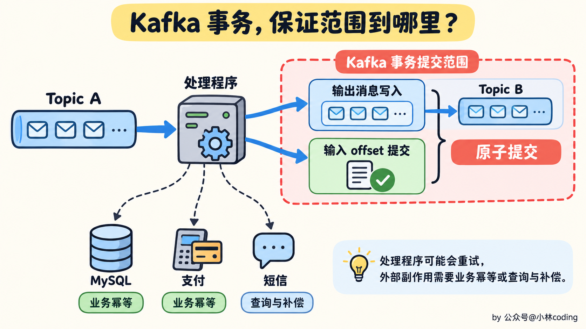

所以面试里不要只说「开了事务就是 Exactly Once」，还要补一句：保证覆盖到哪里，外部系统如何配合。

### [#](https://xiaolincoding.com/interview/mq.html#消息中间件如何做到高可用)消息中间件如何做到高可用？

消息中间件的高可用，我会拆成三件事：**数据有副本、故障后能接管、客户端能找到新的服务节点。**

**第一，多副本。** 单机持久化只能应对一部分进程重启问题，机器或磁盘损坏还需要其他节点保存消息。异步复制通常性能更好，但确认后、复制前的故障窗口可能丢消息；等待足够副本确认，可以提高可靠性，但会增加延迟，副本不足时还可能拒绝写入。

这里要区分「副本收到数据」和「数据已经刷盘」。同步复制并不天然等同于每个副本都同步刷盘，两个条件要分别看。

**第二，故障检测和接管。** 不同产品的实现并不完全一样：

- Kafka 按分区管理 Leader 和副本，由控制器协调故障后的 Leader 切换。4.x 只支持 KRaft，控制器通过多数派维护元数据；分区数据复制本身不能直接当成同一套 Raft 投票机制。
- RocketMQ 的传统主从、DLedger、Controller 等部署模式，切主能力和复制机制有差异。不能说普通 NameServer 会自动选主，也不能说传统 Slave 一定能无缝接管写入。
- RabbitMQ 的仲裁队列通过多数副本保证队列可用性。普通集群里的经典队列不会因为加入了集群，就自动有消息副本。

**第三，客户端恢复。** 服务端切换之后，客户端还要刷新元数据或路由、重新连接并重试。这个过程中可能短暂不可用，也可能发生重复发送、重复消费，所以业务幂等仍然要保留。

部署上还要避免把所有副本放在同一故障域，比如同一台物理机，并监控复制延迟、剩余磁盘和协调节点状态。**高可用的关键是明确能容忍什么故障、故障时怎样恢复，不能只回答「多部署几台机器」。**

### [#](https://xiaolincoding.com/interview/mq.html#kafka-和-rocketmq-消息确认机制有什么不同)Kafka 和 RocketMQ 消息确认机制有什么不同？

我会分成**生产者发送确认**和**消费者处理确认**两部分回答，这样不容易把存储可靠性和业务处理混在一起。

**先看生产者端。**

- **Kafka** 通过 `acks` 控制写入确认：`0` 不等 Broker 确认，`1` 等 Leader 写入确认，`all` 要满足 ISR 的确认条件。再配合副本数和 `min.insync.replicas`，决定副本不足时是否还能写。ACK 不直接代表每个副本都物理刷盘。
- **RocketMQ** 返回发送结果，确认条件取决于刷盘、复制和部署模式。传统主从要区分同步/异步刷盘、同步/异步复制；DLedger、Controller 等模式又有自己的确认条件。比如传统 Java 客户端还要检查刷盘或复制超时等状态，不能只看发送方法没有抛异常。

**再看消费者端。** 可以借用一个比喻：Kafka 更像「提交读书进度」，RocketMQ 的常见业务消费接口更像「报告这批任务的处理结果」。

- **Kafka** 提交的是每个分区的下一条消费位置。如果 offset 99 失败、100 成功，直接提交 101 就可能跳过 99。重试、连续完成进度、失败消息转存等流程通常由应用或框架安排。
- **RocketMQ** 传统并发消费监听器返回 `CONSUME_SUCCESS` 或 `RECONSUME_LATER`，失败后可以进入内置重试流程，超过限制进入死信。顺序消费的失败处理不同，5.x 的 PushConsumer、SimpleConsumer API 也有差异，不能把一个接口当成所有版本通用的 ACK。

还有个共同点：Kafka 和 RocketMQ 通常保留消息正文，确认消费主要推进消费状态，不会马上删除消息。

所以差异主要在确认条件和消费 API：Kafka 以分区进度为核心，RocketMQ 的业务接口集成了较多失败重试能力。两者都可能因为确认丢失而重复消费，最终还是需要业务幂等。

### [#](https://xiaolincoding.com/interview/mq.html#kafka-和-rocketmq-的-broker-架构有什么区别)Kafka 和 RocketMQ 的 Broker 架构有什么区别？

两者最大的区别，可以从**存储模型、元数据管理、故障接管粒度**三个方面来讲。

**第一，存储模型不同。**

- **Kafka** 按 Partition 组织独立的日志，每个分区由多个日志段和索引文件组成。可以理解为每个分区有自己的「小本子」，消息顺序追加，副本也按分区管理。
- **RocketMQ** 典型的本地存储模型是所有队列的消息集中追加到 CommitLog，再按 Topic、Queue 构建 ConsumeQueue 索引。可以理解为正文写进公共的「大本子」，各队列通过自己的目录找消息。

Kafka 的分区数量增多，会增加文件、元数据、复制和调度开销，但不能只凭 Topic 多就断定性能一定暴跌。RocketMQ 集中写正文，也不代表队列和 Topic 的索引开销可以忽略。实际要看活跃分区数、磁盘类型和负载。

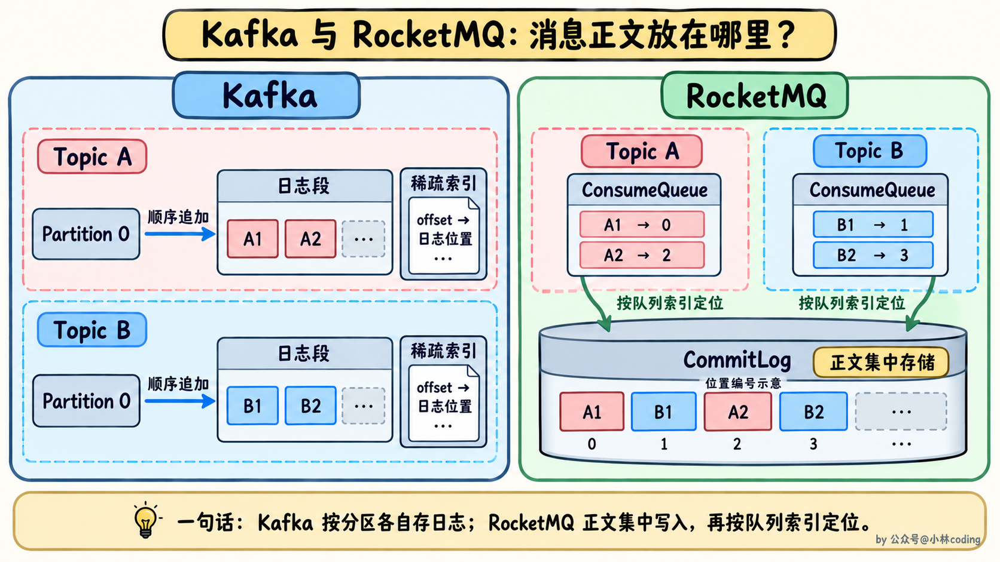

**第二，元数据与协调机制不同。**

- Kafka 的控制器管理 Broker、分区副本、Leader 等元数据。早期用 ZooKeeper，4.x 已经只支持 KRaft；控制器的 Raft 管的是集群元数据，不是让每份消息都经过控制器转发。
- RocketMQ 的普通 NameServer 主要提供路由发现，Broker 上报路由，客户端获取并缓存。普通 NameServer 节点之间不依赖复制日志达成一致；自动切主则要看 DLedger、Controller 等部署模式，不能把选主职责都算到 NameServer 头上。

**第三，故障接管粒度不同。** Kafka 以分区副本为单位切换 Leader，一台 Broker 上可以同时放多个分区的 Leader 和 Follower。RocketMQ 的传统主从以及 Controller 模式，通常围绕 Broker 副本组进行复制和角色切换。传统 Slave 能提供某些读取能力，不代表 Master 宕机后一定自动接管写入。

总结来说，Kafka 以分区日志为核心，RocketMQ 以公共 CommitLog 和队列索引为核心。比较架构时，把读写路径和故障恢复讲清楚，比单纯给它们贴上「大数据」或「电商」标签更有说服力。

## [#](https://xiaolincoding.com/interview/mq.html#rabbitmq)RabbitMQ

### [#](https://xiaolincoding.com/interview/mq.html#rabbitmq-和-amqp-是什么关系)RabbitMQ 和 AMQP 是什么关系？

可以用「协议和实现」来理解：**AMQP 定义通信规则，RabbitMQ 是支持这些规则的消息中间件。**

如果写过 Java，可以类比接口和实现类。AMQP 本身不是安装后就能收发消息的软件，它规定客户端和服务端如何通信；RabbitMQ 把相关协议能力落到服务里。

我们平时讲 RabbitMQ 的 Exchange、Queue、Binding、RoutingKey，以及 Channel、ACK，通常是在讲 **AMQP 0-9-1** 的模型。生产者先把消息发给交换机，交换机再按绑定规则路由到队列。

这里要注意版本：**AMQP 1.0 和 AMQP 0-9-1 是不同的协议，不能把交换机和绑定模型当成所有 AMQP 版本都要求的统一结构。** RabbitMQ 还支持其他协议，不只是 AMQP。

所以面试里可以先说「AMQP 是协议，RabbitMQ 是消息中间件实现」，再补上常用的 AMQP 0-9-1 消息模型，关系就比较清楚了。

### [#](https://xiaolincoding.com/interview/mq.html#rabbitmq-核心组件有哪些)RabbitMQ 核心组件有哪些？

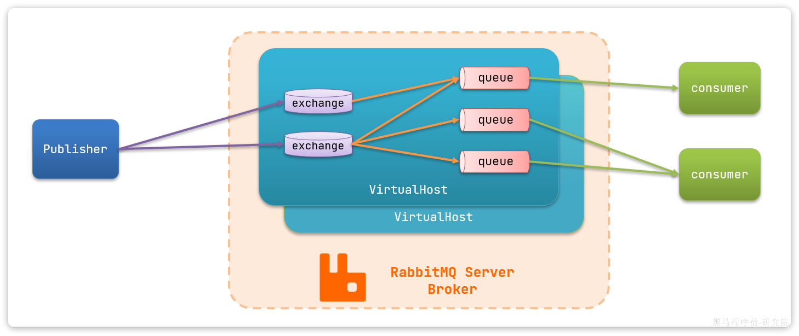

RabbitMQ 的**核心组件**，都是消息从发出到消费必不可少的部分：

- 首先是**生产者（Producer）**，它就是发送消息的一方，比如我们的业务服务，负责把需要异步处理的消息，交给 RabbitMQ，不会直接去找消费者。
- 然后是**消费者（Consumer）**，它是监听并处理消息的一方，一直盯着队列，一旦队列里有新消息，就会取出来执行业务逻辑。
- 接下来是**队列（Queue）**，这是 RabbitMQ 里**真正存储消息**的地方，也是消息投递给消费者的载体。通常按入队顺序投递，但优先级、多个消费者和重投等因素会影响顺序。在手动确认模式下，取走消息不代表处理成功，Broker 还会跟踪未确认状态。
- 然后是**交换机（Exchange）**，生产者不会直接把消息发给队列，而是先发给交换机，它相当于一个**消息分发器**，会按照我们设定的规则，把消息路由到对应的队列里，比如下面会讲到的四种常见交换机类型。
- 还有**路由键（RoutingKey）** 和**绑定（Binding）**，绑定是把交换机和队列关联起来的纽带，路由键则是生产者发消息时带的标识，交换机会根据路由键和绑定的规则，判断消息该投到哪个队列。
- 最后是**连接（Connection）** 和**信道（Channel）**，Connection 是客户端和 RabbitMQ 之间的 TCP 长连接，而 Channel 是建立在连接之上的轻量级信道，因为 TCP 连接创建销毁开销很大，所以用多个信道来传输消息，能大大节省资源。

简单总结就是：**生产者发消息给交换机，交换机通过路由键和绑定，把消息投到队列，最后消费者从队列取消息消费**，整个流程就靠这些核心组件完成。

### [#](https://xiaolincoding.com/interview/mq.html#rabbitmq-有哪几种交换机类型)RabbitMQ 有哪几种交换机类型？

RabbitMQ 里**核心的交换机一共四种**，分别是直连、扇形、主题和头交换机，其中前三种是工作中最常用的，头交换机基本很少用到。

- 第一种是**直连交换机（Direct）**，它是**精准匹配**的模式，消息会根据**路由键完全一致**，才转发到对应的队列。比如路由键设成 `user.login`，就只会发给绑定了这个相同键的队列，适合一对一、精准投递的场景。
- 第二种是**扇形交换机（Fanout）**，它就是**广播模式**，完全不看路由键，只要队列绑定了这个交换机，所有消息都会**无脑发给所有队列**。适合群发通知、多服务同步更新这类场景，效率很高。
- 第三种是**主题交换机（Topic）**，它支持**路由键模糊匹配**，路由键按点号分隔成词段，用 `*` 匹配一个词段、`#` 匹配零个或多个词段。比如 `order.*` 能匹配 `order.pay`，但不能匹配 `order.pay.success`；`order.#` 则可以匹配这两种。适合按业务主题分类、批量路由的场景。
- 第四种是**头交换机（Headers）**，它不看路由键，而是根据**消息头里的键值对**来匹配。比如通过 `x-match=all` 要求所有指定条件都匹配，或者用 `x-match=any` 让任意条件匹配即可。适合基于多个消息属性路由的场景。

### [#](https://xiaolincoding.com/interview/mq.html#rabbitmq-的特性你知道哪些)RabbitMQ 的特性你知道哪些？

RabbitMQ 的特点，我会围绕**路由、可靠投递、流控和高可用队列**来回答。

- **路由灵活**：通过 Direct、Fanout、Topic、Headers 等交换机，以及绑定关系，把消息发送到一个或多个队列。
- **支持持久化**：队列、交换机可以持久化，消息也有持久化属性。但普通队列设置 `durable=true` 只代表队列声明能恢复，不等于所有消息都已经持久化。
- **两端都有确认机制**：Publisher Confirm 用于发送端确认，消费者 ACK 用于确认处理结果，这两种确认互相独立。
- **流控和失败处理**：prefetch 限制未确认消息数量，nack、TTL、死信等能力可以组合成消费失败和重试方案。
- **支持不同队列类型**：经典队列适合一般队列场景，仲裁队列通过副本和多数派提高可靠性，Streams 则提供日志式存储和回溯能力。

比如普通持久化队列的持久化发送，可以这样写：

```python
import pika

connection = pika.BlockingConnection(pika.ConnectionParameters('localhost'))
channel = connection.channel()
channel.queue_declare(queue='durable_queue', durable=True)
channel.confirm_delivery()

# 无法路由或 Broker 拒绝发布时，BlockingChannel 会抛出相应异常
# 实际业务还要记录发送意图、处理异常，并按稳定的幂等键重试
channel.basic_publish(
    exchange='',
    routing_key='durable_queue',
    body=b'order event',
    properties=pika.BasicProperties(delivery_mode=2),
    mandatory=True,
)
connection.close()
```

队列持久化、消息持久化、发送确认，这三个要一起理解。重要消息还要考虑副本，不能只靠单机重启恢复。

另外，经典镜像队列已经在 RabbitMQ 4.0 被移除，讨论新版本高可用时，应该重点讲仲裁队列或 Streams，不能继续把镜像队列当成当前通用方案。

### [#](https://xiaolincoding.com/interview/mq.html#rabbitmq-的底层架构是什么)RabbitMQ 的底层架构是什么？

RabbitMQ 的消息路径可以概括成：**Producer -> Exchange -> Queue -> Consumer**，客户端通过 Connection 和 Channel 与 Broker 通信。

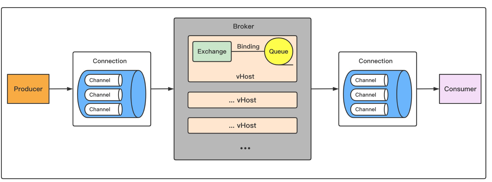

Exchange 负责路由，Queue 负责保存和投递消息。默认交换机虽然可以让我们按队列名发送，但内部仍然走交换机路由，不是绕过交换机直接写队列。

消费者使用 `basic.consume` 时，Broker 主动投递消息；使用 `basic.get` 时，则是主动拉取。消费者确认、prefetch、重投等机制控制消息在处理过程中的状态。

队列的存储和复制要看队列类型：普通经典队列的消息通常放在某一个节点上，仲裁队列则在多个成员之间复制，并通过多数派维护安全的状态。

**集群也要分清共享什么。** 节点之间共享队列、交换机、绑定等元数据信息，并不代表每个节点都保存所有经典队列的消息。消费者连到另一个节点，可能只是由它转发请求到实际承载队列的节点。

所以讲 RabbitMQ 架构时，要把「路由模型」「队列存储」「队列复制」分开，不能只画三台 Broker 就认为消息已经高可用了。

### [#](https://xiaolincoding.com/interview/mq.html#rabbitmq-的可靠性保障怎么做)RabbitMQ 的可靠性保障怎么做？

RabbitMQ 的可靠性，也可以按**生产者、Broker、消费者**三个环节来讲。核心是可靠投递，同时通过业务幂等处理重复。

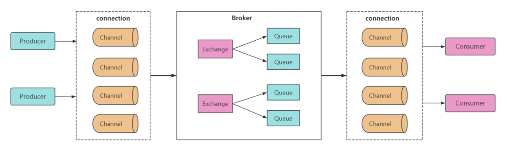

**首先是生产者环节。** 开启 Publisher Confirm，跟踪每条消息或批次的发送结果。还要处理无法路由的情况，比如 `mandatory=true` 配合 Return 回调，或者配置备用交换机。Confirm 和 Return 的含义不同，收到 Confirm 的 ACK 不一定说明消息已经进入业务队列。

发送超时或连接中断时，结果可能不确定，需要依靠发送记录补偿，重发沿用业务幂等键。RabbitMQ 的 AMQP 事务与 Confirm 不是在同一个 Channel 上叠加使用的保障机制，也不能自动把 MySQL 事务和 MQ 发布合并成一个事务。

**然后是 Broker 环节。** 重要拓扑要持久化，普通持久化队列中的消息也要设置持久化属性，并结合发送确认。需要抵御节点故障时，使用适合的副本队列，比如仲裁队列，并保证足够成员可用。普通集群本身不会自动复制每条经典队列的数据。

**最后是消费者环节。** 关闭自动确认，业务事务提交后再手动 ACK。暂时性故障安排有间隔、有上限的重试；无法处理的消息可以拒绝重入队，通过配置好的死信交换机转存。

这里不能把「不 ACK」理解为「马上重入队」。消息会先保持未确认状态，连接或 Channel 关闭等情况才会触发重投；要明确处理失败，就使用 nack/reject 并按策略决定是否重新入队。

消费端还要做业务幂等、控制 prefetch、监控死信和积压。消息 TTL、队列容量和死信转发策略也可能影响可靠性，所以最后仍然需要异常处理和关键业务对账。

### [#](https://xiaolincoding.com/interview/mq.html#讲一下-rabbitmq-的延迟队列和死信机制)讲一下 RabbitMQ 的延迟队列和死信机制

这两个机制经常一起用，但职责不同：**延迟队列管「什么时候处理」，死信机制管「消息为什么退出原队列、接下来送到哪里」。**

**先说延迟队列。** 一个常见场景是订单创建后 30 分钟仍未支付，就尝试关闭订单。RabbitMQ 常见的实现方式有两类：

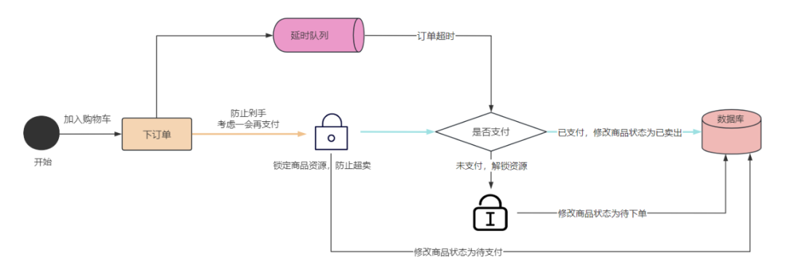

- **TTL + 死信交换机**：把消息放进没有正常消费者的等待队列，设置消息 TTL，并为该队列配置死信交换机。消息过期后转到业务队列，业务消费者再检查订单是否需要关闭。
- **延迟交换机插件**：安装与 RabbitMQ 版本匹配的插件后，可以使用 `x-delayed-message` 交换机和 `x-delay` 消息头，到期后再路由。它不是声明一个普通交换机就自带的能力，还要评估插件维护状态和存储限制。

TTL 方案有一个容易被追问的点：**同一等待队列里混用不同的单条消息 TTL，可能产生队头阻塞。** 前面消息要等 30 分钟，后面消息只等 1 分钟，后者通常要到队头才被实际死信转发。因此不同延迟档位可以使用不同的等待队列，不应认为 TTL 一到就精确调度。

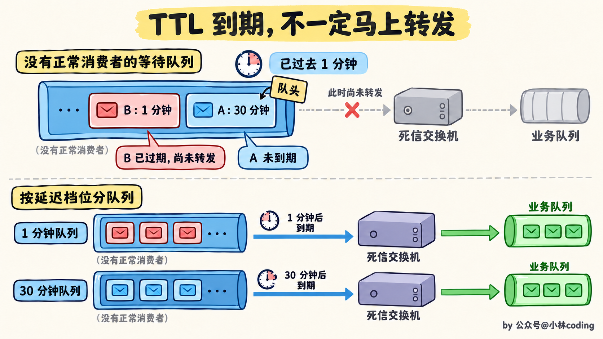

**再说死信机制。** 常见触发条件包括：

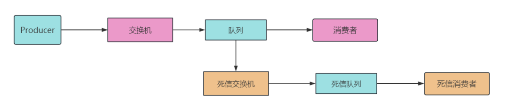

1. 消费者通过 nack/reject 拒绝，且 `requeue=false`。
2. 消息在队列里超过 TTL。
3. 超过队列长度限制，并按相应溢出策略移出消息；不是所有溢出策略都一样。
4. 仲裁队列达到配置的投递次数限制。

队列预先配置 DLX 后，RabbitMQ 会尝试把这些消息重新发布到死信交换机，再路由到死信队列。如果没配置 DLX，不能指望消息自动有个兜底去处。**无法从普通交换机路由到队列**，则要通过 Return 或备用交换机处理，不属于消息从队列里变成死信的场景。

死信转发本身也有可靠性条件。默认转发策略不能理解为绝不丢，重要消息可以评估仲裁队列支持的至少一次死信转发，并监控目标队列是否可用。

最后回到订单例子：延迟消息到达后，消费者查订单状态，仍然待支付且已过期才尝试关单；已经支付就确认并结束，不需要依靠「订单支付后删除那条延迟消息」来保证正确性。

### [#](https://xiaolincoding.com/interview/mq.html#rabbitmq-的-confirm、return-和消费者-ack-有什么区别)RabbitMQ 的 Confirm、Return 和消费者 ACK 有什么区别？

这三个名字都像「确认」，但确认的是三个不同环节。

**Confirm** 是 Broker 告诉生产者：消息发布已经按相关条件处理。对于成功路由的持久化消息、仲裁队列，确认条件还与持久化和副本有关，但它不代表消费者已经完成业务。

**Return** 是告诉生产者：消息无法路由到队列。例如交换机存在，但 RoutingKey 没有匹配的绑定，启用 `mandatory=true` 后，通过 `basic.return` 返回消息，应用再决定告警、修正路由或补发。

**消费者 ACK** 则是消费者告诉 Broker：这次投递对应的业务已经处理成功，可以移除或标记该投递完成。它与生产者 Confirm 相互独立。

举个例子，消息发给一个存在但没有匹配队列的交换机，可能先收到 Return，再收到 Confirm 的 ACK。因此不能只在 Confirm 回调看到 ACK，就把发送记录标记成业务投递成功。

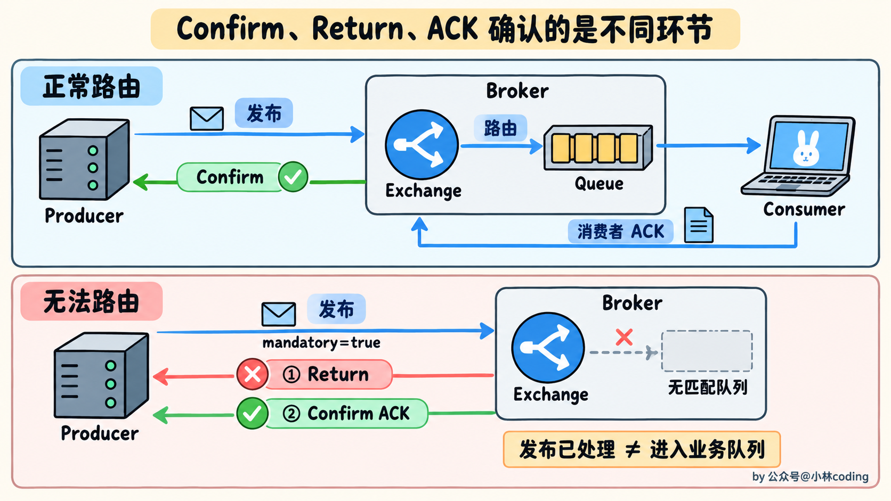

还有，发布到根本不存在的交换机，会产生 Channel 级错误，不能只靠 Return 回调处理。把这些异常区分开，才能正确补偿。

### [#](https://xiaolincoding.com/interview/mq.html#rabbitmq-的-prefetch-是什么-为什么不是越大越好)RabbitMQ 的 prefetch 是什么，为什么不是越大越好？

prefetch 可以理解为消费者手里的**未确认任务额度**。在常见手动确认消费模式下，设置为 10，意味着达到相应作用范围内的 10 条未确认消息后，Broker 暂停继续投递，等有消息 ACK 后再补充。

它不是「拿 10 条，必须全部做完才拿下一批」。RabbitMQ 的投递和 ACK 是异步的，可以边处理、边确认、边补充；限制范围还要看 `basic.qos` 的配置以及是按消费者还是按 Channel 设置。

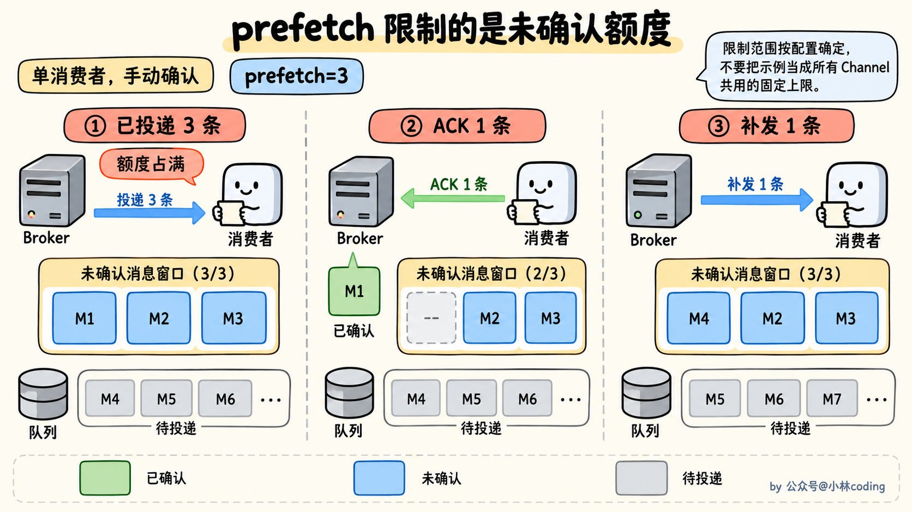

太小，消费者可能一直等待网络投递，吞吐量上不去；太大，慢消费者会囤积大量未确认消息，占内存，也让其他消费者分不到足够任务。实例宕机时，还会有更多消息需要重新投递。

所以要结合处理耗时、并发线程数、消息大小和内存做压测。prefetch 是流控手段，不能凭空提高下游数据库的处理能力，也不能单独保证业务顺序。

### [#](https://xiaolincoding.com/interview/mq.html#rabbitmq-的集群和仲裁队列有什么区别)RabbitMQ 的集群和仲裁队列有什么区别？

**集群说的是多个节点如何共同工作，仲裁队列说的是一条队列如何复制数据。** 这两个概念不能混在一起。

比如三台 RabbitMQ 组成集群，但创建的是普通经典队列，队列消息可能只保存在其中一台上。那台机器故障后，即使另外两台还活着，也不代表这条队列的数据立刻可用。

仲裁队列则通过多个成员复制队列状态，使用 Raft 机制，由多数派参与安全地提交和选举。通常部署 3 个成员，允许其中 1 个不可用时，剩下的多数派继续服务。

如果只剩 1 个成员，虽然它可能保存着消息，也不能简单让它继续接管写入，因为无法形成多数派。这里是用一部分可用性换取数据安全和一致性。

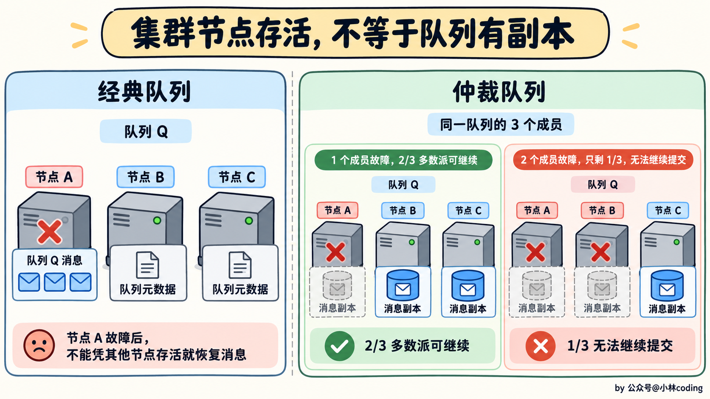

新版本设计高可用时，应明确选用了什么队列类型、副本分布和故障恢复策略，而不是只回答「搭了三节点集群」。

## 分布式理论

### [#](https://xiaolincoding.com/interview/cap.html#什么是分布式系统)什么是分布式系统？

我是这样理解的：

简单来说，**分布式系统就是把多台独立的计算机通过网络连接起来，让它们协同工作，一起去完成同一个任务。** 对于使用这个系统的用户来说，他感觉不到背后有成百上千台机器，他只会觉得自己在用一台超级强大的计算机。

为了方便理解，我们可以打个比方：就像开一家饭店。最开始客人少，店里只有一个大厨（单机系统），洗菜、切菜、炒菜他一个人全包了。但后来生意越来越好，一个大厨根本忙不过来（单机遇到性能瓶颈）。这时候，老板没有去高薪聘请一个世界级的三头六臂神厨（垂直扩容，也就是疯狂升级单台服务器的硬件），而是雇了十个普通厨师，有人专门洗菜，有人专门切菜，有人专门炒菜（水平扩容，也就是分布式）。大家通过大喊或者传纸条来配合（网络通信），共同为大堂里的客人上菜。客人根本不在乎后厨是一个人还是十个人，他只在乎菜上得快不快、好不好吃。

我们在实际开发中之所以要用分布式系统，主要有两个根本原因：

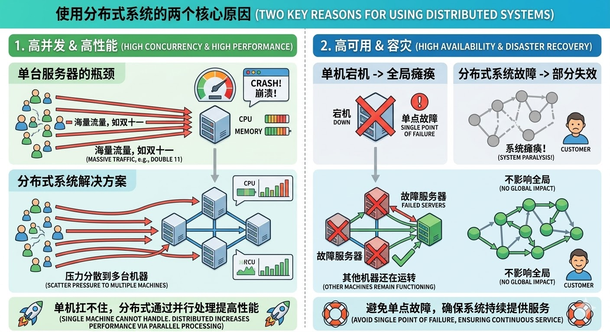

- 第一是为了**高并发和高性能**。单台服务器的CPU、内存再强也是有天花板的，遇到了双十一这种海量流量，单机肯定扛不住，必须要把压力分散到多台机器上去。
- 第二是为了**高可用**。也就是容灾能力。如果只有一台机器，它一旦宕机，整个业务就瘫痪了（单点故障）。而在分布式系统里，我们可以通过多副本、故障切换等设计，让部分机器坏了以后，其他机器仍然能接着提供服务。不过，多放几台机器不等于自动高可用，如果它们都依赖同一个没有备份的数据库，数据库一挂，业务还是会一起停下来。

不过，**引入分布式并不是百利而无一害的，它引入了极大的复杂性**，这也是我们在分布式开发中最头疼的地方。

举个最典型的例子，**数据一致性问题**。

由于机器变多了，它们之间只能通过网络来沟通，但网络是不稳定的。假设用户下了一笔订单，订单节点的机器记录了「已下单」，然后它通过网络告诉库存节点的机器「扣减库存」，结果这个时候网络卡了，库存节点没收到消息。这就麻烦了，订单生成了，但库存没扣，数据就不一致了。

为了解决这个问题，就会涉及到分布式事务、分布式锁、甚至著名的CAP定理等复杂的技术方案。

总而言之，分布式系统本质上就是**用更多的机器和更复杂的软件架构，去换取系统更高的性能、扩展性和可靠性**。

### [#](https://xiaolincoding.com/interview/cap.html#分布式和微服务有什么区别)分布式和微服务有什么区别？

一句话概括它们的核心区别就是：**分布式关注的是「多个节点怎么通过网络协同工作」，主要解决扩展性、性能和可靠性的问题；微服务关注的是「业务怎么拆成能独立开发、部署的服务」，主要解决系统复杂后难以维护和交付的问题。**

为了方便理解，我分开给你稍微解释一下：

**首先看「分布式系统」。** 它关注的是**节点之间的协同**，这里的节点可以部署在不同的物理机、虚拟机或者容器里。当我们的业务流量越来越大，单台服务器的CPU和内存再怎么升级也不起作用时，我们就多买几台机器，把它们连起来一起干活。 打个比方，有1万块砖要搬，一个人搬不动，我们就雇10个人一起搬。只要是多台机器通过网络协同工作来完成一个任务，这就是分布式。它追求的是在这个集群里堆更多的机器，来扛住更高的并发，保证一台机器宕机了别的机器还能顶上（高可用）。

**接着看「微服务」。** 它是从**软件工程和业务逻辑的层面**出发的。早期的开发，很多公司习惯把所有的功能（比如订单、用户、支付、积分）全部写在一个庞大的项目里，打包成一个巨大的系统部署。这在业务简单的初期没问题，但如果业务越来越复杂，几百个程序员改同一份代码，牵一发而动全身，系统就会变得极其臃肿且难以维护。 所谓的微服务，就是把这个巨大的单体应用，按照业务边界拆分成一个个独立的小服务。就像一家原本什么都卖的超级大杂货铺，拆分成了专门卖菜的、专门卖肉的、专门卖衣服的独立店铺（订单服务、支付服务等）。各个店铺只管自己的事，互不干扰，相互之间需要什么就通过明确的接口去沟通。

**那么，这两者到底是怎么联系在一起的，又有什么本质区别呢？** 这里有一个非常核心的例子，也是初学者最容易陷入的误区：**有多个机器在跑，不代表它就是微服务。** 假设我们有一个传统的、什么功能都塞在一起的巨无霸单体项目，我们把它原封不动地复制了10份，部署在10台服务器上，前面架设一个Nginx做负载均衡。这就叫「分布式系统」（集群部署），因为确实是多台机器在协同工作。但是，这**绝对不是微服务**，因为它内部依然是一个揉在一起的庞大单体。

反过来，微服务也不要求「一个服务必须占一台机器」。开发环境里，订单、库存、支付几个服务完全可以跑在同一台机器的不同进程里。只要它们能够独立部署、通过网络接口协作，依然是微服务。生产环境为了容量和容灾，通常会把这些服务的多个实例分散到多台机器上，所以**微服务通常会带来分布式系统的通信和一致性问题，但服务数并不等于机器数**。

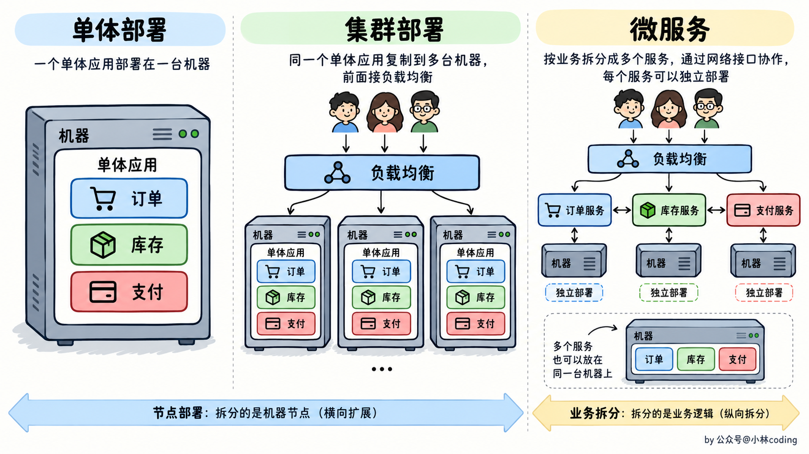

**总结一下：** 分布式的核心是「**节点的拆分和协同**」，微服务的核心是「**业务逻辑和业务边界的拆分**」。微服务其实就是分布式架构发展到一定阶段后，在软件工程领域总结出来的一种非常优秀、非常具体的架构风格。

### [#](https://xiaolincoding.com/interview/cap.html#介绍一下-cap-理论)介绍一下 CAP 理论？

CAP 理论讲的是分布式系统里三个很重要的性质：**一致性（Consistency）、可用性（Availability）、分区容错性（Partition tolerance）**。

面试里经常会听到一句「三者只能选两个」，但我觉得还得补上一个关键前提：**当网络分区发生时，系统无法同时保证强一致性和可用性。** 网络正常的时候，并不是说一致性和可用性就一定不能兼顾。

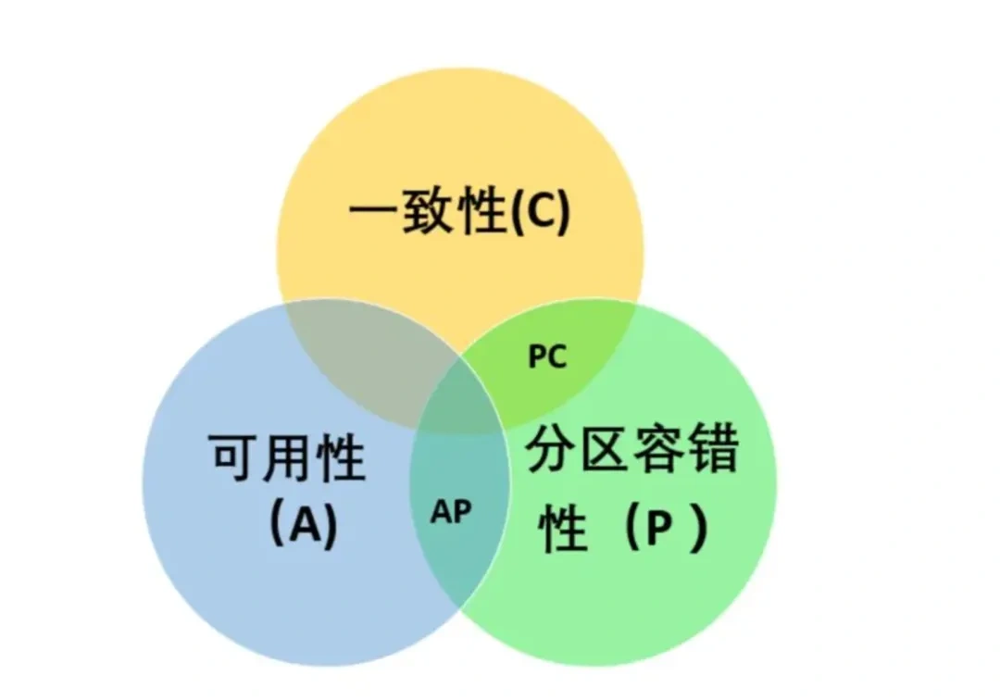

我用一个商品库存的例子来解释这三个概念：

- **一致性（C）**：这里通常指「线性一致性」。比如库存原来是 10，用户扣减后，系统已经返回成功，那么之后再发起的读取，就应该能读到扣减后的值。对外看起来，所有操作像是在同一份数据上按顺序完成的。它不要求所有节点的磁盘在每一瞬间都完全一样，关键是**对外提供的读写结果符合这个顺序**。
- **可用性（A）**：每个到达非故障节点的请求，最终都能得到正常的处理结果。这里不能靠一直返回「系统错误」来满足可用性，也不能只说「集群还有一台机器能响应，所以就是 A」。CAP 的定义关注每个非故障节点上的请求，和我们平时说的服务可用率不是完全一回事。
- **分区容错性（P）**：节点之间可能因为网络故障而无法通信，即使发生这种情况，系统也要按照设计继续运行。注意，**这里的分区是网络被隔开，不是数据库分库分表**。

假设两个节点 A、B 都保存着库存 10，现在它们之间的网络断了，但用户仍然能分别访问它们。如果这时候还允许用户在 A 上把库存扣成 9，并且返回成功，另一个用户再去 B 上查询，B 根本不知道 A 发生了什么。

这时候就得取舍了：

- **选择 CP**：无法确认结果的读写请求要被拒绝或者等待恢复。比如 B 不能确认最新库存，就不能返回旧值；如果写入要求两个副本都确认，那么前面 A 的扣减也不能直接返回成功。这样保住了一致性，但牺牲了这部分请求的可用性。如果集群还能形成多数派，多数派一侧通常仍然可以提供服务。
- **选择 AP**：B 先返回自己知道的库存 10，让请求继续得到处理。这样保住了可用性，但暂时放弃了强一致性。网络恢复后，还需要同步数据、处理冲突，不能以为连上网络数据就自动正确了。

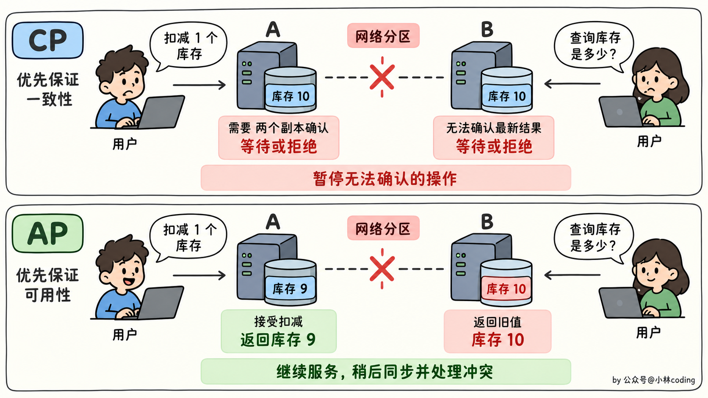

**所以，CAP 的重点不是给系统贴一个「三选二」的标签，而是想清楚：网络断了以后，这个操作是宁可暂停，也不能返回不一致的结果，还是允许暂时看到旧数据，也要继续服务。** 比如库存扣减通常更关注正确性，商品介绍和评论展示往往更能容忍短暂延迟。

### [#](https://xiaolincoding.com/interview/cap.html#cap-里的一致性和数据库事务的一致性是一回事吗)CAP 里的一致性和数据库事务的一致性是一回事吗？

不是，虽然都叫「一致性」，但是它们讨论的问题不一样。

**CAP 的 C 关注的是「多个副本对外提供的读写结果，能不能像一份数据一样」**。比如我刚修改完收货地址，系统已经告诉我成功了，随后去另一个节点读取，应该能看到这个修改。

**ACID 的 C 关注的是「事务执行前后，数据有没有违反业务约束」**。比如转账时，A 扣掉 100 元，B 应该增加 100 元，两边的钱加起来不能凭空多了或者少了。这里要靠业务逻辑、数据库约束，以及事务的原子性和隔离性一起保证。

举个更直接的例子：数据库主库上的转账事务完整提交了，金额也没算错，但从库同步慢了一点，用户去从库查询时看到了旧余额。这个本地事务可以满足 ACID，但这次读写并没有满足 CAP 所说的线性一致性。

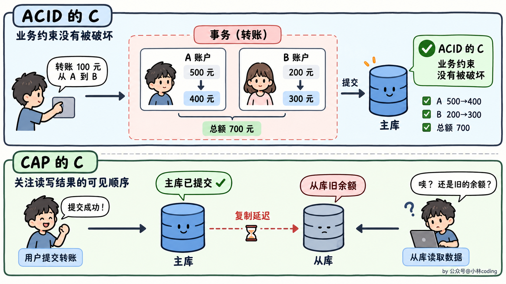

**面试回答时，我会把这两层分开：事务一致性看业务约束，副本一致性看读写的可见顺序。** 跨服务的事务原子性，也不能仅仅靠给存储系统选一个 CP 就自动解决。

### [#](https://xiaolincoding.com/interview/cap.html#强一致性、最终一致性和读写一致性有什么区别)强一致性、最终一致性和读写一致性有什么区别？

我一般会用「用户修改完头像，再去查看」这个例子来区分。

**第一种是强一致性，这里按线性一致性来理解。** 更新已经返回成功，之后任何用户再读取，都应该看到这个更新，或者在此之后发生的更新。系统不能因为读到了另一个落后的副本，就返回更早的头像。

**第二种是最终一致性。** 更新刚完成时，有人可能看到新头像，有人可能看到旧头像，但如果没有新的更新，而且同步最终能够完成，各个副本最后会收敛到一致的状态。它本身不承诺「必须在 1 秒内一致」，业务需要的收敛时间还得额外设计和监控。

**第三种是读写一致性，也叫「读己之写」。** 我自己修改完头像，接下来自己的查询至少能看到这次修改，但其他用户可能暂时还看不到。实际可以在写入后的一段时间内让这个用户读主库，或者让读取携带版本号，等副本追上指定版本再返回。

这三个概念里，读己之写只保证当前用户能看到自己的写入，不能直接当成所有用户都能读到最新数据的强一致性。

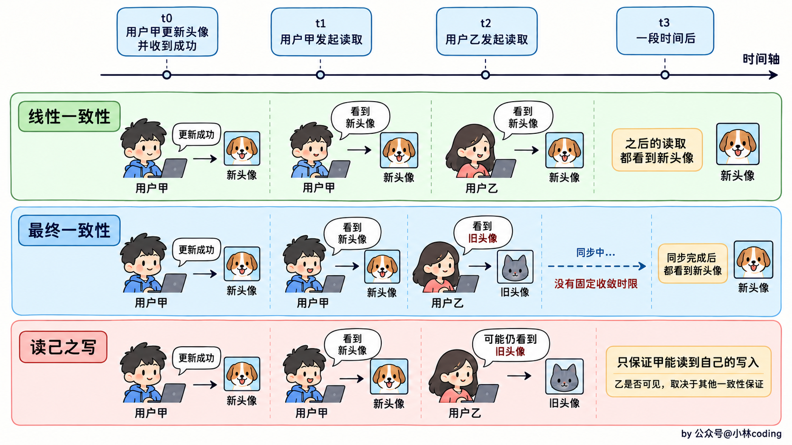

**实际选型时，我会先问业务：哪些人必须马上看到更新，允许延迟多久，出现旧数据会有什么后果。** 像用户资料展示，可以用最终一致性加读己之写；像库存扣减，就得用数据库条件更新、事务等机制守住不能超卖的约束。

### [#](https://xiaolincoding.com/interview/cap.html#怎么理解base理论)怎么理解BASE理论？

BASE理论其实是我们在做分布式系统时，一种**极其务实的架构设计指导思想**。

在解释它之前，不得不稍微提一句大家都很熟悉的CAP定理。我们知道，在发生网络分区时，分布式系统无法同时保证强一致性（C）和可用性（A）。如果一个请求必须确认最新数据，但当前节点联系不上能确认结果的节点，就只能等待或者拒绝请求。在网络正常时，强一致性也通常需要额外的协调，这会增加延迟。

所以，前人们就提出了BASE理论。**它的核心思想就是：既然强一致性太难做到，也会拖垮系统性能，那我们能不能妥协一下？允许数据在短时间内不一致，只要保证最后的结果是对的就好了，以此来换取系统极高的可用性。**

BASE是三个英文短语的缩写，为了方便理解，我结合实际应用场景给你挨个解释一下：

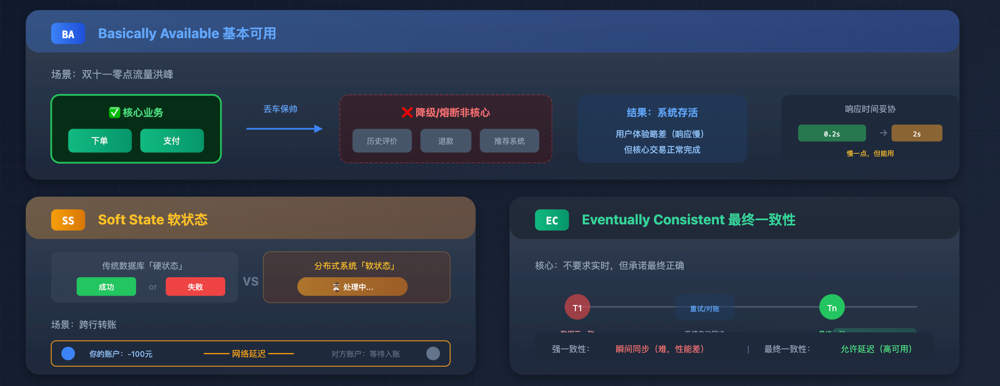

- **第一个是 Basically Available，也就是「基本可用」。** 它的意思是，当系统遇到机器故障或者前所未有的流量洪峰时，我们允许系统损失掉一部分可用性，来保住核心业务正常运转。 这非常像我们生活中的「丢车保帅」。举个例子，双十一零点，大家都集中冲进去买东西，服务器压力极其巨大。这时候，电商平台可能会把「查看商品历史评价」、「申请退款」这类非核心功能暂时停掉（这就叫服务降级）；或者大家觉得页面加载比平时慢了一两秒（响应时间上的妥协）。虽然用户体验打了一点折扣，但大家依然能完成最核心的「下单付款」动作，系统没有直接崩溃，这就是基本可用。
- **第二个是 Soft State，也就是「软状态」。** 它的意思是，系统允许暂时处于没有完全同步的状态，而且即使没有新的用户请求，后台同步、重试等动作也可能让状态继续变化。由于机器之间同步数据需要通过网络，网络是有延迟的，所以中间状态在分布式业务里非常常见。 比如我们在银行APP上跨行转账，钱扣了，但是对方还没收到，这时候其实就处于一个叫「转账处理中」的软状态。
- **第三个是 Eventually Consistent，也就是「最终一致性」，这也是整个理论的灵魂。** 既然我们允许了中间状态（软状态）的存在，那系统总不可能一直错下去吧？最终一致性就是在没有新的更新、故障最终能够恢复的前提下，通过可靠同步、重试和冲突处理，让相关数据最终收敛到一致的状态。它不是「等一等就一定会好」，更不代表错误的业务逻辑也能自动变正确。 就像刚刚那个跨行转账的例子，不用非得要求你点完确定的一瞬间对方立刻收到钱（那叫强一致性），系统先把处理中状态展示清楚，再通过可靠消息、重试和对账推进流程，最后进入「转账成功」或者「转账失败并退回资金」的终态，相关账目对齐，这就体现了业务上的最终一致性。

**最后总结一下：** 如果你问我怎么一句话概括BASE理论，我会说它就是「**对强一致性的一种降级妥协**」。在实际业务开发中，消息队列异步处理、跨服务状态同步等场景经常采用这个思路。但不能简单理解成「涉及钱的一律强一致，其他的一律最终一致」。比如支付系统也可能异步通知订单，关键是账务操作不能重复、业务约束不能被破坏，中间状态可追踪，失败能够重试或补偿。**允许短暂不同步，是为了减少同步等待，不是允许业务结果出错。**

## [#](https://xiaolincoding.com/interview/cap.html#分布式锁)分布式锁

### [#](https://xiaolincoding.com/interview/cap.html#用-redis-怎么实现分布式锁)用 Redis 怎么实现分布式锁？

**分布式锁是用于分布式环境下并发控制的一种机制，用于控制某个资源在同一时刻只能被一个应用所使用**。如下图所示：

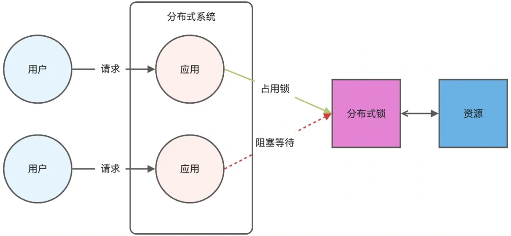

Redis 本身可以被多个客户端共享访问，正好就是一个共享存储系统，可以用来保存分布式锁，而且 Redis 的读写性能高，可以应对高并发的锁操作场景。Redis 的 SET 命令有个 NX 参数可以实现「key不存在才插入」，所以可以用它来实现分布式锁：

- 如果 key 不存在，则显示插入成功，可以用来表示加锁成功；
- 如果 key 存在，则会显示插入失败，可以用来表示加锁失败。

基于 Redis 节点实现分布式锁时，对于加锁操作，我们需要满足三个条件。

- 加锁包括了读取锁变量、检查锁变量值和设置锁变量值三个操作，但需要以原子操作的方式完成，所以，我们使用 SET 命令带上 NX 选项来实现加锁；
- 锁变量需要设置过期时间，以免客户端拿到锁后发生异常，导致锁一直无法释放，所以，我们在 SET 命令执行时加上 EX/PX 选项，设置其过期时间；
- 锁变量的值需要能区分来自不同客户端的加锁操作，以免在释放锁时，出现误释放操作，所以，我们使用 SET 命令设置锁变量值时，每一次成功加锁设置的值都是一个唯一值，用于标识这一次持锁操作，不能只拿固定的机器 IP 当标识；

满足这三个条件的分布式命令如下：

```bash
SET lock_key unique_value NX PX 10000
```

- lock_key 就是 key 键；
- unique_value 是客户端生成的唯一的标识，区分来自不同客户端的锁操作；
- NX 代表只在 lock_key 不存在时，才对 lock_key 进行设置操作；
- PX 10000 表示设置 lock_key 的过期时间为 10s，这是为了避免客户端发生异常而无法释放锁。

而解锁的过程就是将 lock_key 键删除（del lock_key），但不能乱删，要保证执行操作的客户端就是加锁的客户端。所以，解锁的时候，我们要先判断锁的 unique_value 是否为加锁客户端，是的话，才将 lock_key 键删除。

可以看到，解锁是有两个操作，这时就需要 Lua 脚本来保证解锁的原子性，因为 Redis 在执行 Lua 脚本时，可以以原子性的方式执行，保证了锁释放操作的原子性。

```lua
-- 释放锁时，先比较 unique_value 是否相等，避免锁的误释放
if redis.call("get",KEYS[1]) == ARGV[1] then
  return redis.call("del",KEYS[1])
else
  return 0
end
```

这样一来，就通过使用 SET 命令和 Lua 脚本在 Redis 单节点上完成了分布式锁的加锁和解锁。

### [#](https://xiaolincoding.com/interview/cap.html#还有没有其他方法实现分布式锁)还有没有其他方法实现分布式锁？

还可以基于 **ZooKeeper 的临时顺序节点**来实现。和 Redis 里大家竞争同一个 key 不同，它更像是给每个请求发一张排队号码，排在最前面的请求才能拿到锁。

先看两个关键特性：

- **临时节点**：节点跟客户端会话绑定，会话关闭或者过期后，节点会被删除。注意，短暂断网不等于会话立刻过期，所以不能说客户端一断开连接，锁马上就释放了。
- **顺序节点**：创建节点时，ZooKeeper 会在名字后面追加递增序号，用来区分排队顺序。

有了这两个特性，加锁过程就比较好理解了：

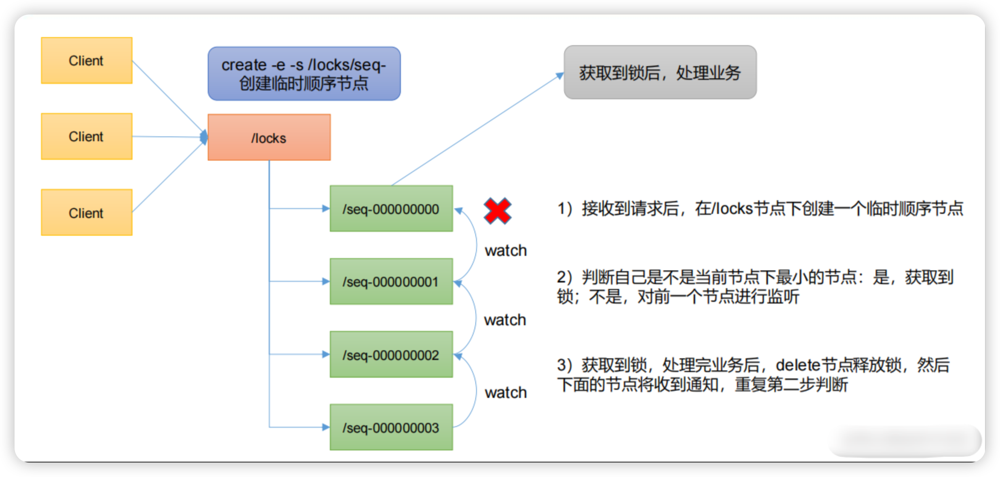

1. 先为要保护的资源准备一个持久节点，比如 `/locks/order_123`，不同资源使用不同的路径。
2. 每个请求在这个路径下创建自己的临时顺序节点，比如 `lock-0000000001`、`lock-0000000002`。
3. 获取子节点列表，如果自己的序号最小，就拿到了锁；否则只监听**排在自己前面的那个节点**，等它被删除后再判断自己是不是最小。
4. 业务执行完，删除自己的节点，后面的请求就有机会拿到锁。如果持锁客户端宕机，会话过期后，临时节点也会被清理。

为什么只监听前一个节点？因为如果所有等待者都监听最小节点，最小节点一删除，大家就会同时被唤醒，形成「惊群」。只监听前一个，相当于排队时前面的人走了再通知你，压力会小很多。

还有个实现细节：**获取列表和注册监听之间，前一个节点可能已经被删了。** 所以注册监听时如果发现节点已经不存在，就要立刻重新检查队列，不能一直傻等一个已经错过的通知。普通的一次性 Watch 触发后，也要按需要重新注册。

ZooKeeper 通过多数派确认来保证锁节点的创建顺序，少数派一侧不能继续成功创建锁节点，所以这类方案通常按 CP 来理解。但它同样有一个边界：**锁节点被删除，不代表原来的业务线程也被强制停止了。** 原持锁者长时间卡顿、会话过期后恢复，仍然可能继续写业务数据，这时候也需要版本校验或者 fencing token 做保护。

除了 ZooKeeper，也可以直接利用数据库的行锁、唯一索引，或者基于 etcd 的租约和事务来做。**选型时我会先看资源在哪、并发有多大、能不能容忍锁失效后的重复执行，再看现有系统已经有什么组件。** 对同一个数据库里的库存更新，条件更新往往比再引入一把外部分布式锁更直接。

### [#](https://xiaolincoding.com/interview/cap.html#redis-锁过期了-但业务还没执行完怎么办)Redis 锁过期了，但业务还没执行完怎么办？

这是分布式锁里一个非常容易踩的坑：**锁过期，只会让 Redis 删除 key，不会让持锁的业务线程自动停下来。**

比如 A 拿到了有效期 10 秒的锁，结果业务执行了 15 秒。到了第 10 秒，锁过期，B 又拿到了同一把锁。这时候 A 和 B 都在执行业务，互斥就被破坏了。

通常会用**自动续期**来减少这个问题。比如持锁期间启动一个定时任务，在锁到期之前检查 key 的值仍然是自己的加锁标识，再延长过期时间。检查和续期也要用 Lua 脚本原子执行，避免给别人的锁续期。Redisson 的看门狗就是类似的思路，具体是否启用要看使用的加锁方式。

但面试里不能回答「加个看门狗就绝对安全了」。如果 A 发生了长时间 GC 暂停，业务线程和续期线程可能一起停住；或者网络断了，续期请求根本发不出去。等 A 恢复时，锁已经在 B 手里了。


对于不能接受旧持锁者继续写入的场景，可以引入 **fencing token，也就是递增的持锁凭证**。比如 A 的凭证是 100，B 的凭证是 101，业务存储在执行写入时原子校验凭证，已经接受 101 后，就拒绝 A 再带着 100 写入。这个凭证需要可靠地递增，业务存储也必须支持并执行校验，不能只在 Redis 里生成一个数就算完成了。


如果资源在数据库里，也可以通过版本号条件更新、库存不小于零的条件更新、唯一约束等手段守住业务规则。

**所以我的回答是：续期用来降低锁提前失效的概率，存储侧的校验用来挡住失效持锁者的写入。** 解锁时的唯一标识只能防止误删别人的锁，解决不了旧线程继续执行业务的问题。

### [#](https://xiaolincoding.com/interview/cap.html#redis-主从切换后-分布式锁还安全吗)Redis 主从切换后，分布式锁还安全吗？

**如果只依赖普通 Redis 主从复制，不能保证故障切换时锁一定安全。** 原因在于主从复制通常是异步的。

我举个例子：A 在主库加锁成功，但这个 key 还没来得及同步到从库，主库就宕机了。随后从库被提升为新主库，B 来加锁时发现 key 不存在，也成功拿到了锁。这样 A、B 就同时认为自己持有锁。


哨兵或者 Redis Cluster 可以帮我们切换主节点、恢复服务，但不能把异步复制自动变成严格的一致性协议。`WAIT` 可以等待副本确认，降低写入丢失的风险，但也不能直接当成强一致性保证。

面试官如果继续问 Redlock，我会说明：它是在多个**相互独立的 Redis 主节点**上，用同一个标识尝试加锁。只有在有效时间内拿到超过半数节点的锁，并扣除加锁耗时等因素后仍有剩余有效期，才认为成功；失败则尝试释放已经拿到的锁。这里不是对一个主库和它的从库分别加锁。


不过，Redlock 仍然依赖锁有效期、时间变化等假设，也不能阻止暂停后恢复的旧持锁者继续写入。所以它不能替代业务侧的版本校验，也不能简单说「节点多了就绝对安全」。

**如果锁只是为了减少缓存重建的重复工作，偶尔重复执行通常还能接受；如果关系到资金、库存等正确性，我会优先用事务、条件更新或唯一约束守住底线，再评估是否需要基于一致性协议的协调服务。**

## [#](https://xiaolincoding.com/interview/cap.html#分布式id)分布式ID

### [#](https://xiaolincoding.com/interview/cap.html#什么情况需要用分布式id)什么情况需要用分布式ID？

首先，分布式ID要解决的核心痛点，就是在「多节点、多数据库环境下，如何生成一个**全局唯一且最好是有序**的标识」。

在业务发展初期，如果数据集中在一个数据库里，我们往往还不需要专门设计分布式ID。比如存个订单，直接依托MySQL单表主键的「自增属性」（从1，2，3这样往上加）就完美搞定了，既不重复，插入性能又好。

但在系统发展到一定体量后，有几种情况就会逼着我们必须引入分布式ID：

**第一种情况，也就是最绝对的刚需，数据库的分库分表。** 假设就拿订单业务来说，当数据量和访问压力已经让单库单表遇到瓶颈，索引优化、归档等手段也无法满足需求时，我们可能把订单表拆成比如10张或者100张表（分散在多个库里）。 一旦拆表，原来「每张表各自从1开始自增」的方案，就不能直接保证全局唯一了。为什么呢？因为各个子表之间是不知道对方状态的，表A自己从1开始递增，刚刚生成了ID为「1」的订单；表B也在运行，也从1开始，生成了ID也是「1」的订单。这时候如果你想查这条订单，系统就彻底懵了。


所以，在分库分表场景下，我们迫切需要剥离出这个生成ID的权力，找一个「凌驾于所有子表之上」的独立系统或算法来充当发号器，保证它发出来的ID绝对不会重复。这就必须要用分布式ID了。

**第二种情况是高并发的微服务多节点环境，并且对数据库写入性能有极高要求。** 这时候你可能会有个疑问：既然多台机器容易生成同样的ID，那我本地自己生成一个UUID不就行了吗？ 确实，UUID也是一种分布式ID方案，正确生成时碰撞概率极低。但在实际工程里，特别是Java搭配MySQL的架构里，选它作为主键时还要考虑版本和存储方式。常见的随机UUID（UUIDv4）没有递增趋势，用字符串存储还会占用较多空间。如果把它作为主键存进MySQL，因为存储是按照主键排序的，这种杂乱无章的ID会导致每一次插入新数据，数据库可能都要在底层的B+树索引中间硬塞进去，增加随机页访问和「页分裂」的概率，影响写入性能；而较宽的主键也会让InnoDB的二级索引占用更多空间。


因此，我们需要一种既能在成百上千台机器并发时绝不碰撞（唯一），又能在进入数据库时不乱插队、大致保持「递增趋势」的ID生成的方案（可以考虑雪花算法、数据库号段等方案）。

**第三种情况是多系统打通合并数据。** 比如咱们公司收购了一个竞品，或者要把原来独立的A系统和B系统的数据汇总到数据仓库里做个报表。如果当初他们各自用的都是自己库里的自增ID，这两套数据一相遇，ID必定有大量重叠冲突，合并起来简直是灾难。这也是为什么多系统协同的核心业务对象，经常会采用全局唯一ID，或者使用「系统标识 + 本地ID」这样的组合来区分数据。


**总结一下：** 当我们遇到**底层数据库必须分库分表**，或者是在微服务高并发环境下**对数据库插入性能与检索性能有较高要求**（希望ID较短且趋势递增）时，各张表独立自增的ID就不能直接满足全局唯一的需求了，需要选择合适的分布式ID方案。

### [#](https://xiaolincoding.com/interview/cap.html#分布式id有什么方案)分布式ID有什么方案？

我一般会从**唯一性、是否有序、生成性能、对外部组件的依赖**这几个方面来比较，常见的方案有四种。

**第一种是 UUID。** 好处是本地就能生成，不需要每次访问一个中心发号器，跨节点使用也方便。它是 128 位，常见的文本形式是 36 个字符，去掉连字符后是 32 个十六进制字符，也可以用 16 字节的二进制形式存储。

这里不能一概说「所有 UUID 都是无序的」。常用的 UUIDv4 是随机的，作为 InnoDB 主键时容易增加随机写入，主键较宽也会增大索引；UUIDv7 则包含时间信息，能改善按时间排序和索引局部性。所以 UUID 能不能做主键，要看版本、存储方式和业务需求，不能只看它叫 UUID 就否定。

**第二种是数据库号段模式。** 这个可以理解成「批发 ID」。比如数据库里维护当前已经分配到的最大值，业务节点一次申请 1000 个 ID，数据库通过事务或原子更新，把最大值从 1000 推进到 2000，节点就获得了 1001～2000 这个号段。其他节点申请到的是下一段，不会重叠。

拿到号段后，节点就在内存里分配，减少数据库访问。还可以提前申请下一段，做双号段切换，避免当前号段用完时才去请求数据库。但如果数据库故障，本地号段用完后仍然无法继续发号；节点重启时没用完的号段一般直接丢弃，允许 ID 有空洞，不能为了连续而重复使用。

**第三种是 Redis 的 `INCR`。** 利用原子递增得到数字 ID，实现很简单，也方便按业务或日期分开计数。但每次发号都有网络开销，而且要考虑持久化和主从切换：如果计数器回退，之前发出的 ID 就可能被再次发出去。**原子递增解决的是当前节点上的并发竞争，不代表跨故障也一定不会重复。**

**第四种是雪花算法（Snowflake）。** 它把时间戳、机器号和序列号拼成一个 64 位整数，正常发号过程可以在本地完成，速度快、ID 较短，而且有递增趋势。

雪花算法的前提是机器号不能冲突，同一毫秒的序列号不能重复，还得处理时钟回拨。它是**趋势递增，不是多台机器之间严格按生成时间递增**：机器时钟可能有偏差，同一毫秒里也会按机器号等位段排序。

**实际选型时，普通业务如果已经有可靠的数据库，号段模式通常比较容易落地；需要本地高吞吐发号，可以考虑成熟的雪花算法实现；需要跨系统方便生成标识，也可以评估 UUID。** 不是公司规模大就一定要选某一种，而是看约束和运维能力。

### [#](https://xiaolincoding.com/interview/cap.html#雪花算法怎么保证唯一-时钟回拨怎么办)雪花算法怎么保证唯一？时钟回拨怎么办？

先看常见的位数划分：**1 位符号位 + 41 位毫秒时间戳 + 10 位机器标识 + 12 位序列号**。不同实现可以调整位数，这只是经典划分。

- **时间戳**通常是当前时间减去一个自定义起始时间，41 位大约可以使用 69 年。
- **机器标识**用来区分不同发号节点，10 位能表示 1024 个标识，也可以拆成数据中心号和机器号。
- **序列号**区分同一台机器在同一毫秒内生成的不同 ID，12 位可以表示 4096 个值。序列用完后，常见实现会等到下一毫秒再生成。

所以它的唯一性来自三个条件：**不同机器的标识不重复，同一机器在同一毫秒内的序列不重复，时间不能回到已经使用过的范围还重用相同序列。** 同一节点的并发发号，也需要同步保护。


比如节点在 10:00:00.100 已经发过一些 ID，系统时间却回到了 10:00:00.095。如果程序直接把序列号重置，再走到 `.100`，就可能重新拼出之前的 ID。


处理办法通常有几种：

- **小幅回拨**：暂停发号，等时间追上上次发号时间。实现简单，但这段时间会增加延迟。
- **大幅回拨**：报警并拒绝发号，或者按设计切换到备用发号方案，不能悄悄继续生成可能重复的 ID。
- **使用逻辑时间**：让内部时间不小于上次使用的时间，在逻辑时间内继续增加序列。这个方案仍然要处理序列耗尽、进程重启，以及时间状态的可靠保存，不能只写一个 `max` 就觉得万事大吉了。

还有一个容易遗漏的点：容器扩缩容、节点重启时，**机器号的分配和回收也要可靠**。旧节点还在运行，新节点就拿到同一个机器号，同样会重复；重启后丢了上次时间和序列，也要防止重新进入已用过的组合。

**我会优先用成熟组件，并检查它怎么管理机器号、怎么处理回拨和重启。雪花算法的位运算并不难，难的是在故障和扩缩容时把这些前提守住。**

## [#](https://xiaolincoding.com/interview/cap.html#分布式事务)分布式事务

### [#](https://xiaolincoding.com/interview/cap.html#什么情况下需要使用分布式事务)什么情况下需要使用分布式事务？

简单地说，当一次业务操作跨越了**多个独立的事务资源**，比如不同数据库，或者数据库和消息队列，而业务又要求这些操作协调成功或失败时，就需要考虑分布式事务或者业务上的一致性方案。关键是本地事务能不能覆盖这些操作，不是方法里调了几个服务、用了几条连接。

在实际开发中，通常有以下两种最典型的场景会逼着我们使用分布式事务：

**第一种情况最常见：微服务架构下的跨服务协同。**


在微服务时代，我们推崇「一个服务专属一个自己的数据库」。我给您举个特别经典的电商下单例子：用户点击支付后，后台其实需要做三件事：订单服务去**更新订单状态**，库存服务去**扣减库存**，账户服务去**扣减余额**。 这三个动作发生在三个独立的系统和三个独立的数据库里。假设前两步都成功了，但在调用账户服务扣钱时，账户所在的服务器宕机了。这时候，传统的本地事务根本无能为力，它只能回滚当前账户库中尚未提交的操作，完全没办法隔空把已经成功提交的「订单」和「库存」撤销掉。这就会导致库存已经扣了，但用户的钱没扣。 为了让这分散在各个地方的三个操作绑在一条战壕里，做到一损俱损、一荣俱荣，我们可以引入像Seata这样的分布式事务组件做全局调度，也可以设计可靠消息、补偿等业务流程来保证最终结果正确。

**第二种情况是底层由于数据量大，做了「分库分表」。**


这可能发生在单体应用里。假如咱们没有做微服务架构，所有的代码都在一起，但是底层由于数据太多，把一个大库拆成了库A和库B。 如果我们在一个方法里，同时往库A里插入账单，又往库B里插入流水。由于它们在物理上已经是两个独立的数据库实例、走的是两条独立的网络连接了，Spring自带的本地事务就无法再确保这两个连接能同时完美提交了，一旦一边成功一边挂掉，也会产生脏数据。这种情况同样也得靠分布式事务来解决。

**不过，站在实际架构面试者的视角，我还想补充非常重要的一点：权衡与妥协。** 虽然分布式事务能解决跨库的数据一致性，但业界有个共识，**能绕开不用，就尽量不用**。 因为传统的两阶段提交通常需要让多个资源保留锁、等待协调结果，会增加延迟和资源占用，故障时还可能阻塞。高并发场景里，这些代价必须评估，不能只看它能统一提交就直接引入。

如果业务要求跨资源的操作整体提交或回滚，而且能接受锁等待和协调成本，可以评估XA、两阶段提交等方案。但不是所有涉及钱的业务都必须让多个系统在同一瞬间更新完，支付成功后异步更新订单就是很常见的例子，关键是资金账务准确、处理状态明确，最终结果能够对齐。

而对于大多数微服务场景，我们通常会退而求其次，利用 **消息队列（MQ）+ 本地消息表**，或者重试机制，来实现业务的「**最终一致性**」。也就是说：允许订单、库存等系统暂时处于不同的处理状态，但不能允许余额凭空变化、库存扣成负数。我们通过可靠记录、幂等、重试和补偿推进到正确终态，减少同步等待带来的性能开销。


**总结一下：** 当一个业务确实要协调**多个独立事务资源**时，才需要评估分布式事务方案；跨服务调用如果只是读取数据，并不因此就需要分布式事务。实际落地时，还要结合原子提交、隔离、补偿需求以及允许的处理延迟选择方案，不能把所有分布式事务框架都当成同一种「强一致性」方案。

### [#](https://xiaolincoding.com/interview/cap.html#分布式事务的解决方案你知道哪些)分布式事务的解决方案你知道哪些？

我一般分成两类来理解：**一类是在资源层协调提交，比如 XA/2PC；另一类是在业务层通过预留、补偿或者可靠消息，让流程最终走到正确状态，比如 TCC、Saga 和本地消息表。**

先用一个表把主要区别说清楚：

| 方案                | 核心做法                             | 主要代价                               | 常见场景                         |
| ------------------- | ------------------------------------ | -------------------------------------- | -------------------------------- |
| XA/2PC              | 多个事务资源先准备，再统一提交或回滚 | 锁持有时间长，故障时可能阻塞           | 跨数据库原子提交                 |
| 3PC                 | 在准备、提交之间增加阶段和超时处理   | 消息更多，依赖故障模型，分区下仍有风险 | 理论讨论较多，业务中相对少见     |
| TCC                 | 先预留业务资源，再确认或取消         | 三套业务逻辑，需处理幂等和异常状态     | 库存预留、余额冻结               |
| Saga                | 每一步先提交本地事务，失败再业务补偿 | 缺少全局隔离，补偿也可能失败           | 订单、机票、酒店等长流程         |
| 可靠消息/本地消息表 | 可靠记录事件，异步通知下游推进业务   | 状态延迟、消息重复，需重试和对账       | 支付后更新订单、订单完成后发积分 |

**第一种是两阶段提交，也就是 2PC。** 可以把协调者理解成一个组织者，参与者是各个数据库。第一阶段问大家「能不能提交」，参与者完成操作，写好准备日志、保留必要的锁，回复准备成功；第二阶段，只有都准备成功，协调者才决定提交，否则决定回滚。

关键是第一阶段的「准备成功」不等于事务已经提交。参与者做了承诺后，不能因为等得不耐烦就随便回滚，否则可能和协调者的提交决定冲突。所以协调者故障或网络异常时，参与者可能长时间等待。可靠实现还需要持久化决定并在恢复后继续处理，**不是发两轮消息，就能忽略所有故障自动得到强一致性**。2PC 主要解决原子提交，全局隔离还要由具体系统保证。


**第二种是三阶段提交，也就是 3PC。** 它在 2PC 的基础上增加了中间阶段，并设计超时后的处理规则，希望减少阻塞。但它的非阻塞效果依赖对网络和故障的假设，遇到网络分区仍可能出现不一致，所以不能把它理解成「2PC 的问题全解决了」。实际业务里并没有因为多了一阶段就普遍改用 3PC。

**第三种是 TCC。** 比如扣库存，Try 先把可用库存转成预留库存，Confirm 真正消耗预留库存，Cancel 把预留库存释放。它不需要在整个业务期间一直占着数据库行锁，但预留的业务资源仍然会被占用。优点是资源怎么预留由业务控制，代价是开发者得把三个阶段和异常处理都写好。

**第四种是 Saga。** 比如订机票、订酒店、租车，每一步都先提交自己的本地事务。如果租车失败，就按业务需要取消酒店和机票。这里的补偿是一个新的业务动作，**不是数据库把历史抹掉**：退款可能有手续费，邮件发出后也不能让对方没看过。补偿失败还需要持续重试、告警，必要时人工处理。

**第五种是可靠消息最终一致性。** 比如支付服务先完成支付，然后可靠地通知订单服务更新状态。这里最容易遗漏的是「写数据库」和「发 MQ」之间的空隙，如果数据库提交了，消息却没发出去，单靠消费者重试也没用。因此要配合本地消息表、事务消息等机制，先保证事件能可靠发出去，再让下游幂等消费。

**我在选型时会先问：是否必须跨资源原子提交，能否先预留，已经完成的动作能不能补偿，允许多长的处理中状态。** 这些答案比单纯背「哪个性能高、哪个性能低」更能决定方案。

### [#](https://xiaolincoding.com/interview/cap.html#阿里的-seata-框架了解过吗)阿里的 Seata 框架了解过吗？

了解，**Seata 是一个分布式事务框架，它把全局事务的管理和各个服务里的分支事务协调起来**。它支持 AT、TCC、Saga、XA 等模式，不同模式的实现方式和业务代价不一样。

先说三个核心角色：

- **TM（事务管理器）**：负责发起全局事务，告诉协调者什么时候提交或回滚。
- **TC（事务协调者）**：维护全局事务和分支事务的状态，协调各个分支提交或回滚。
- **RM（资源管理器）**：管理本地资源，注册分支事务，并执行协调者下发的提交或回滚。

全局事务有一个标识叫 **XID**，跨服务调用时要把它传下去，下游的分支才能加入同一个全局事务。只有入口加了注解，但下游没有正确传递 XID、接入资源管理器，并不能自动覆盖整条链路。

最常被问的是 **AT 模式**。我用「扣库存」举个例子：第一阶段，Seata 通过数据源代理，记录 SQL 执行前后的数据镜像，把库存更新和 `undo_log` 放在同一个本地事务里，并在本地提交前申请全局锁，申请失败则按规则重试或回滚。这样本地数据库锁不用一直等到整个全局事务结束。

如果全局事务成功，第二阶段主要清理回滚日志和释放相关资源；如果失败，就根据 `undo_log` 恢复数据。恢复前会比较当前数据和执行后的镜像，防止直接覆盖别人的修改。**所以 AT 不是简单地「记个旧值，失败就改回去」，它还依赖全局锁、脏写检查等机制。**


其他几个模式可以这样记：

- **TCC**：开发者自己写资源预留、确认和取消逻辑，适合能明确表达预留资源的业务。
- **Saga**：把长流程拆成多个本地事务，失败时执行补偿，适合跨服务的长事务。
- **XA**：借助数据库原生 XA 能力协调分支，准备后通常要继续持有数据库锁，一致性要求和性能代价都要评估。

还有一点，AT 的全局锁并不自动拦住所有普通 SQL。**要保证预期的隔离效果，相关读写也要按要求接入 Seata 的机制**，不能让其他程序随意绕过全局锁修改同一份数据。普通查询也不会因为启用了 AT 就自动变成全局隔离的查询。

**我会根据业务选择模式：关系型数据库、希望减少业务改造，可以评估 AT；业务能够预留资源，可以评估 TCC；流程很长、需要业务补偿，可以评估 Saga。** 引入框架以后，超时、故障恢复、幂等和监控仍然需要设计。

### [#](https://xiaolincoding.com/interview/cap.html#tcc-的幂等、空回滚和悬挂怎么处理)TCC 的幂等、空回滚和悬挂怎么处理？

这三个问题都来自同一件事：**网络调用可能超时、重试，也可能晚到，不能假设 Try、Confirm、Cancel 永远只执行一次，并且严格按顺序到达。**

我拿「冻结 100 元余额」来解释：Try 冻结 100 元，Confirm 把冻结金额真正扣掉，Cancel 解冻。

**第一个是幂等。** Confirm 扣款成功了，但响应丢了，协调者会重试。如果第二次又扣一次，就出问题了。所以要记录这笔分支事务的状态，比如「已预留、已确认、已取消」，同一笔事务重复 Confirm 或 Cancel 时，按已完成状态返回，不能再次改变金额。状态判断和资金操作要在同一个本地事务里完成。

**第二个是空回滚。** Try 请求还没执行，协调者就已经因为超时发来了 Cancel。这时候没有资金被冻结，Cancel 不能凭空给用户加回 100 元。它应该识别到没有预留操作，记录已经取消这个事实，再安全结束。

**第三个是悬挂。** 就接着刚才的情况：Cancel 已经执行完，迟到的 Try 又来了。如果这时再冻结 100 元，后面可能再也没有 Confirm 或 Cancel 来处理它，资金就一直被冻结。所以 Try 发现这笔分支已经取消，就要拒绝执行。

实际可以用事务控制表，以 **全局事务 ID + 分支事务 ID**作为唯一键，配合数据库事务、行锁或条件更新，让状态只按合法方向变化。比如预留后可以确认或取消，但取消后不能再重新预留，确认后也不能再执行释放预留资源的 Cancel。


**所以，TCC 不只是写三个方法，而是要写一套能应对重复、缺失和乱序调用的状态流转。**

### [#](https://xiaolincoding.com/interview/cap.html#本地消息表怎么保证最终一致性)本地消息表怎么保证最终一致性？

本地消息表的关键是：**把「业务已经完成」和「这件事还需要通知下游」放在同一个本地事务里记录下来。** 这样就不会业务成功了，却完全丢掉通知。

比如用户支付成功后要给订单服务发消息，可以分成几步：

1. 支付服务在一个数据库事务里更新支付状态，同时插入一条待发送消息，消息带上唯一 ID、订单号和事件内容。
2. 事务提交后，后台任务扫描消息表，发送到 MQ，也可以通过 CDC 等方式把这些记录投递出去。
3. 按 MQ 的可靠性配置确认消息已经被可靠接收后，更新消息的发送状态；失败就按退避策略重试，不能刚写进客户端发送缓冲区就标记成功。
4. 订单服务收到消息，在自己的本地事务里做去重和订单状态更新，成功后再确认消费。


最容易被追问的是：消息已经发到 MQ 了，但支付服务还没来得及把消息标记为已发送就宕机了，怎么办？

恢复后这条消息还会再发一次，所以**本地消息表保证的是消息不轻易丢失，不是绝对只发送一次**。消费者必须幂等，同一条支付成功消息来两遍，订单只能完成一次有效的状态更新。


另外，标记「已发送」只代表 MQ 接收了，不代表下游业务已经成功。消费失败的重试、死信处理、长期卡住的业务状态都要监控，超过阈值要告警和对账。如果同一个订单的多个事件有顺序要求，还需要按订单有序处理，或者通过版本号、状态条件挡住过期事件。

**总结一下：本地事务保证业务和事件记录一起落库，可靠投递保证事件有机会到下游，幂等消费保证重复消息不会重复改变业务结果，重试和对账负责把异常流程收尾。**

### [#](https://xiaolincoding.com/interview/cap.html#分布式系统里的接口幂等怎么做)分布式系统里的接口幂等怎么做？

幂等说白了就是：**同一个业务请求执行一次，和重复执行多次，对业务产生的效果一样。** 它不是要求每次返回的响应时间都一样，而是不能重复创建订单、重复扣款。

为什么分布式里特别需要它？因为用户会重复点击，客户端会重试，MQ 也可能重复投递。最麻烦的是请求已经成功了，但响应丢了，调用方根本不知道该不该再试。

我通常会从这几种方式里选：

- **业务唯一键**：比如创建订单时传入稳定的请求号，在数据库上加唯一约束。重复请求插不进去，再查询第一次的处理结果。注意同一笔请求重试要沿用同一个号，不能每重试一次就换一个。
- **状态条件更新**：比如支付通知只能把订单从「待支付」改成「已支付」，SQL 带上旧状态条件。第一次更新成功，后面的重复通知就不能再触发同样的业务副作用。
- **去重表**：比如消费消息时，以消息 ID 或业务操作号做唯一键，把「插入去重记录」和「更新业务数据」放在同一个本地事务里提交。

这里有个典型错误：先用 Redis 记下「请求处理过了」，然后再去数据库扣款。如果 Redis 成功、扣款失败，重试却被拦住，业务就丢了；如果先扣款再记 Redis，中间宕机又可能重复扣款。**去重记录和业务动作之间的原子性，才是关键。**


对于需要保存请求状态的接口，还要区分「处理中」「成功」「失败」，重复请求可以返回已有结果，或者明确告诉调用方还在处理中。同一个幂等键带着不同的金额、商品参数再次请求，也应该拒绝，不能直接复用另一个请求的结果。

**我会优先让数据库的唯一约束、事务和条件更新守住业务结果，再根据流量加缓存优化。分布式锁能减少同时执行的请求，但不能代替幂等，因为重复请求还可能在第一次释放锁以后才到达。**

## [#](https://xiaolincoding.com/interview/cap.html#分布式组件)分布式组件

### [#](https://xiaolincoding.com/interview/cap.html#rpc的概念是什么)RPC的概念是什么？

RPC 即远程过程调用，允许程序调用运行在另一台计算机上的程序中的过程或函数，就像调用本地程序中的过程或函数一样，而无需了解底层网络细节。

一个典型的 RPC 调用过程通常包含以下几个步骤：


1. **客户端调用**：客户端程序调用本地的一个 「伪函数」（也称为存根，Stub），并传入所需的参数。这个 「伪函数」 看起来和普通的本地函数一样，但实际上它会负责处理远程调用的相关事宜。
2. **请求发送**：客户端存根将调用信息（包括函数名、参数等）进行序列化，然后通过网络将请求发送到服务器端。
3. **服务器接收与处理**：服务器端接收到请求后，将请求信息进行反序列化，然后找到对应的函数并执行。
4. **结果返回**：服务器端将函数的执行结果进行序列化，通过网络发送回客户端。
5. **客户端接收结果**：客户端接收到服务器返回的结果后，将其反序列化，并将结果返回给调用者。

常见的 RPC 框架：

- **gRPC**：由 Google 开发的高性能、开源的 RPC 框架，支持多种编程语言，使用 Protocol Buffers 作为序列化协议，具有高效、灵活等特点。
- **Thrift**：由 Facebook 开发的跨语言的 RPC 框架，支持多种数据传输协议和序列化格式，具有良好的可扩展性和性能。
- **Dubbo**：阿里巴巴开源的高性能 Java RPC 框架，提供了服务治理、集群容错、负载均衡等功能，广泛应用于国内的互联网企业。

### [#](https://xiaolincoding.com/interview/cap.html#rpc-调用超时了-就代表服务端执行失败了吗)RPC 调用超时了，就代表服务端执行失败了吗？

**不代表。超时只能说明调用方在规定时间内没拿到结果，不能说明服务端一定没执行。**

比如订单服务调用支付服务扣款，支付服务已经把钱扣了，但返回结果时网络断了。订单服务看到超时，如果立刻再发一个全新的扣款请求，就可能扣两次。


所以处理超时，第一步不是无脑重试，而是先判断操作类型：查询类调用通常比较容易重试，扣款、创建订单这种有副作用的操作，必须先有稳定的业务请求号和幂等设计。

对扣款这种操作，我会让所有重试沿用同一个支付请求号，支付服务保存处理状态和结果。调用方超时后，可以按请求号查询结果，不能马上把订单改成「支付失败」，因为它可能只是结果暂时未知。需要取消时，也要有明确的取消协议，不能假设客户端超时就把服务端停了。

重试本身还要有**次数上限、总时间预算、指数退避和随机抖动**，而且尽量统一放在一层做。否则 A 重试 3 次，B 也重试 3 次，到了 C 就可能放大成 9 次，原本就慢的下游会被压得更厉害。

**面试里我会强调：远程调用有「结果未知」这个状态，要靠幂等、查询和补偿去确认最终结果，不能只分成成功和失败。**

### [#](https://xiaolincoding.com/interview/cap.html#zookeeper拿来做什么-核心的原理是什么)zookeeper拿来做什么？核心的原理是什么？

ZooKeeper 是一个**分布式协调服务**，适合管理配置、服务地址、锁节点等小规模协调数据。它通过 ZAB 为写事务建立统一的提交顺序，但**普通读取可以由客户端连接的节点本地响应，可能读到落后的数据**，不能把「写事务有统一顺序」理解成「所有读写都是线性一致的」。以下是其常见的应用场景：

- **配置管理**：在分布式系统中，不同节点往往需要相同的配置信息，如数据库连接参数、服务端口等。ZooKeeper 可以将这些配置信息集中存储，当配置发生变更时，能及时通知到各个节点。例如，一个由多个微服务组成的系统，各个服务实例可以从 ZooKeeper 中获取统一的配置，当配置更新时，ZooKeeper 会通知所有相关服务重新加载配置。
- **服务注册与发现**：服务注册与发现是微服务架构中的关键环节。服务提供者在启动时将自己的服务信息（如服务名称、地址、端口等）注册到 ZooKeeper 中，服务消费者通过 ZooKeeper 查找并获取服务提供者的信息。当服务提供者发生变化（如上线、下线、故障等）时，ZooKeeper 会实时更新服务列表并通知服务消费者。像 Dubbo 框架就可以利用 ZooKeeper 实现服务的注册与发现。
- **分布式锁**：在分布式环境下，多个进程或线程可能会竞争同一资源，为了避免数据不一致等问题，需要实现分布式锁。ZooKeeper 可以通过创建临时顺序节点来实现分布式锁。当一个客户端需要获取锁时，它会在 ZooKeeper 中创建一个临时顺序节点，然后检查自己创建的节点是否是序号最小的节点，如果是，则表示获取到了锁；如果不是，则等待前一个节点释放锁。

ZooKeeper 的数据模型类似于文件系统的树形结构，每个节点称为 Znode。


Znode 可以存储数据，持久节点也可以有子节点，但临时节点不能有子节点。Znode 有不同的类型，包括持久节点（PERSISTENT）、临时节点（EPHEMERAL）和顺序节点（SEQUENTIAL）。

- **持久节点**：一旦创建，除非主动删除，否则会一直存在。
- **临时节点**：与客户端会话绑定，当客户端会话结束时，临时节点会自动被删除。
- **顺序节点**：在创建时，ZooKeeper 会为其名称添加一个单调递增的序号，保证节点创建的顺序性。

ZooKeeper 使用 ZAB协议来保证集群中数据的一致性。ZAB 协议基于主从架构，有一个领导者（Leader）和多个跟随者（Follower）。


- **消息广播**：当客户端发起写请求时，请求会先到达领导者。领导者将写操作封装成一个事务提案，并广播给所有跟随者。跟随者收到提案后，将其写入本地日志，并向领导者发送确认消息。当提案获得超过半数投票节点的确认后，领导者会发送提交消息，跟随者收到后按顺序应用到本地状态机。这个多数派包含领导者自己，不是要求超过半数的跟随者回复；Observer 不计入投票节点。
- **崩溃恢复**：当领导者出现故障时，ZooKeeper 会进入崩溃恢复阶段。在这个阶段，集群会选举出新的领导者，并确保在新领导者产生之前，不会处理新的写请求。选举过程基于节点的事务 ID 和节点 ID 等信息，保证新选举出的领导者包含了所有已提交的事务。

### [#](https://xiaolincoding.com/interview/cap.html#服务注册与发现是怎么实现的-注册中心挂了怎么办)服务注册与发现是怎么实现的？注册中心挂了怎么办？

可以把注册中心理解成一份动态的「服务通讯录」。比如订单服务有 10 个实例，地址会随着扩容、缩容变化，调用方不能把这 10 个 IP 永远写死在代码里。

整体过程一般分成三步：

1. **注册**：服务实例启动后，把服务名、地址、端口等信息写到注册中心。
2. **健康检查**：通过心跳、租约或者主动探测判断实例是否还可用，失效后从服务列表移除。
3. **发现**：调用方查询或订阅服务列表，把地址缓存在本地，再从中选择一个实例发起调用。列表发生变化时，通过推送或者定期拉取更新。

ZooKeeper 可以用临时节点跟踪会话，etcd 可以用租约管理注册信息，其他注册中心也会有各自的心跳和健康检查机制。但故障检测都不是瞬间完成的，**通讯录里还有地址，不代表这台实例此刻一定健康**。调用方仍然要处理连接失败和调用超时。

如果注册中心挂了，已有调用方通常还能使用本地缓存的地址继续调用，所以不一定会导致整条业务立刻停止。但新实例可能无法注册，新启动的调用方可能拿不到地址，旧列表也无法及时更新。随着实例上下线，缓存会越来越不准确。


所以我会从两层做保护：注册中心本身做合理的集群和容灾；客户端保留可用的地址缓存，配合失败实例的暂时剔除、合理重试和监控。是否允许继续使用旧列表，还要看业务能否接受它过期。

**注册中心负责告诉我们「去哪里找服务」，负载均衡负责「这次选谁」，超时和熔断负责「选中的实例出问题后怎么办」。这几个环节得配合起来。**

## [#](https://xiaolincoding.com/interview/cap.html#分布式场景)分布式场景

### [#](https://xiaolincoding.com/interview/cap.html#常见的限流算法你知道哪些)常见的限流算法你知道哪些？

- **固定窗口限流算法**按固定时间段计数，实现简单，但窗口交界处容易放过突发流量。
- **滑动窗口限流算法**统计最近一段时间的请求量，缓解固定窗口的边界突刺，精度取决于具体实现。
- 漏桶限流算法能够对流量起到整流的作用，让随机不稳定的流量以固定的速率流出，但是不能解决**流量突发**的问题。
- **令牌桶算法**通过控制令牌生成速率和桶容量，限制长期平均流量，同时允许一定程度的流量突发。

> 固定窗口限流算法

固定窗口限流算法就是对一段固定时间窗口内的请求进行计数，如果计数已经达到阈值，就拒绝新请求；如果没有达到阈值，则接受请求，并把计数加1。当时间窗口结束时，重置计数器为0。


固定窗口限流优点是实现简单，但是会有「流量突刺」的问题，假设窗口大小为1s，限流大小为100，然后恰好在某个窗口的第999ms来了100个请求，窗口前期没有请求，所以这100个请求都会通过。再恰好，下一个窗口的第1ms又来了100个请求，也全部通过了，那也就是在2ms之内通过了200个请求，而我们设定的阈值是100，通过的请求达到了阈值的两倍，这样可能会给系统造成巨大的负载压力。


> 滑动窗口限流算法

改进固定窗口缺陷的方法是采用滑动窗口限流算法，滑动窗口就是将限流窗口内部切分成一些更小的时间片，然后在时间轴上滑动，每次滑动，滑过一个小时间片，就形成一个新的限流窗口，即滑动窗口。然后在这个滑动窗口内执行固定窗口算法即可。

这里要分清两种实现：**滑动日志**保存窗口内每个请求的时间戳，可以精确统计任意滚动时间范围，但占用空间较多；**按小时间片计数的滑动窗口**实现成本较低，可以缓解固定窗口的边界突刺，但时间片边界上仍然可能存在统计误差，粒度越细通常越准确。

另外，滑动窗口限制的是一段时间内的总量，不等于把请求均匀摊开。比如过去1秒没有请求，现在瞬间来了100个，在阈值是100的情况下仍然可能全部通过。如果下游连这种突发也不能承受，还需要排队整流或者更严格的并发限制。


> 漏桶限流算法

漏桶限流算法是模拟水流过一个有漏洞的桶进而限流的思路，如图。


水龙头的水先流入漏桶，再通过漏桶底部的孔流出。如果流入的水量太大，底部的孔来不及流出，就会导致水桶太满溢出去。

从系统的角度来看，我们不知道什么时候会有请求来，也不知道请求会以多大的速率来，这就给系统的安全性埋下了隐患。但是如果加了一层漏斗算法限流之后，就能够保证请求以恒定的速率流出。在系统看来，请求永远是以平滑的传输速率过来，从而起到了保护系统的作用。

使用漏桶限流算法，缺点有两个：

- 即使系统资源很空闲，多个请求同时到达时，漏桶也是慢慢地一个接一个地去处理请求，这其实并不符合人们的期望，因为这样就是在浪费计算资源。
- 不能解决流量突发的问题，假设漏斗速率是2个/秒，然后突然来了10个请求，受限于漏斗的容量，只有5个请求被接受，另外5个被拒绝。你可能会说，漏斗速率是2个/秒，然后瞬间接受了5个请求，这不就解决了流量突发的问题吗？不，这5个请求只是被接受了，但是没有马上被处理，处理的速度仍然是我们设定的2个/秒，所以没有解决流量突发的问题

> 令牌桶限流算法

令牌桶是另一种桶限流算法，模拟一个特定大小的桶，然后向桶中以特定的速度放入令牌（token），请求到达后，必须从桶中取出一个令牌才能继续处理。如果桶中已经没有令牌了，那么当前请求就被限流。如果桶中的令牌放满了，令牌桶也会溢出。

放令牌的动作是持续不断进行的，如果桶中令牌数达到上限，则丢弃令牌，因此桶中可能一直持有大量的可用令牌。此时请求进来可以直接拿到令牌执行。比如令牌生成速率为每秒100个、桶容量也是100，且初始为空，那么1秒后没有请求消耗的话，桶里就有100个令牌。此时突然来了100个请求，都可以拿到令牌。实际允许多大的突发由桶容量决定，不能只看令牌生成速率。由此可见，桶中没有令牌时，可以直接拒绝，也可以在允许的超时范围内等待，这取决于限流器的实现。它控制的是长期平均速率，并不保证短时间内请求严格匀速。令牌桶的示意图如下：


令牌桶限流算法综合效果比较好，能在最大程度利用系统资源处理请求的基础上，实现限流的目标，建议通常场景中优先使用该算法。

### [#](https://xiaolincoding.com/interview/cap.html#多台机器部署时-怎么做全局限流)多台机器部署时，怎么做全局限流？

**单机限流限制的是一台机器的流量，全局限流限制的是整个服务或者某个用户在所有机器上的总流量。** 这两个不能混用。

比如接口整体只能承受每秒 1000 个请求，现在部署了 10 个实例。如果每个实例都配置 1000，整体就可能放进来 10000。简单地给每台配置 100，也会遇到流量不均、实例数量变化的问题。

需要较准确的全局限制时，可以在网关统一限流，或者把限流状态放在 Redis 等共享存储里。比如每个用户维护一个令牌桶，用 Lua 脚本把「补充令牌、判断数量、扣减令牌」原子执行，所有实例都用同一份状态。时间计算也要统一，避免不同机器时钟偏差影响额度。


代价是每次判断都可能增加一次网络访问，共享限流组件也会成为依赖。流量很大时，可以批量分配额度到各实例，在本地消耗，或者把全局限制和本地保护组合起来，但额度预分配会带来利用率和精度上的取舍。

还有个问题必须提前想好：限流组件挂了怎么办？如果选择放行，要靠本地限流、并发隔离等机制保护下游；如果选择拒绝，可以保住额度约束，但业务可用性会下降。选择取决于限流是在保护系统容量，还是在执行必须严格遵守的业务配额。

**所以全局限流不只是把计数器搬到 Redis，还要考虑原子性、热点 key、延迟、故障策略，以及共享状态能提供多严格的保证。**

### [#](https://xiaolincoding.com/interview/cap.html#限流、熔断和降级有什么区别)限流、熔断和降级有什么区别？

我一般用三个问题来区分：**请求太多了怎么办？下游持续出问题怎么办？部分功能暂时做不了怎么办？**

**限流解决的是请求太多。** 比如接口每秒只允许 1000 个请求，超过的就拒绝或者进入有界队列，避免系统被流量压垮。它可以在系统还没出故障时就生效。

**熔断解决的是下游持续变慢或失败。** 比如订单服务调用积分服务，发现一段时间内超时比例很高，就暂时停止调用，快速返回，避免线程和连接全部卡在积分服务上。熔断器通常有关闭、打开、半开三个状态：正常调用是关闭；触发阈值后打开；等待一段时间再半开，放少量请求探测，成功则恢复，失败则再次打开。

**降级解决的是功能无法正常完成时，提供什么替代结果。** 比如推荐服务不可用，就显示默认商品列表；积分服务暂时不可用，就记录待处理事件，告诉用户积分稍后到账。

三者经常一起使用：先限流控制总量，下游异常时熔断，熔断后按业务规则返回降级结果。但降级不能乱做，**扣款失败不能返回支付成功，库存查询失败也不能当成库存无限**。


还要配合超时和资源隔离。比如推荐服务慢了，不能让它占满下单服务的全部线程；重试也要受总时间和次数限制，否则熔断还没生效，系统已经被重复请求压垮了。

### [#](https://xiaolincoding.com/interview/cap.html#常见的负载均衡策略有哪些-怎么选)常见的负载均衡策略有哪些？怎么选？

负载均衡要解决的是：**同一个服务有多个实例，这次请求该发给哪一个？** 常见策略有这么几种：

- **轮询和加权轮询**：按顺序分配，机器配置不同可以设置不同权重。实现简单，适合处理能力和请求耗时相对稳定的场景。
- **随机和加权随机**：随机选择实例，大量请求下通常能比较均匀，权重也可以体现不同实例的容量。
- **最少连接或最少在途请求**：优先选当前负担较小的实例。但连接数不一定等于请求数，比如一个 HTTP/2 连接可以同时承载多个请求，需要看具体协议和统计指标。
- **一致性哈希**：按用户 ID、缓存 key 等把请求映射到固定实例，实例变化时只重新映射一部分 key，适合需要提高缓存命中率、保持同一类请求落点的场景。

一致性哈希也不是天然均匀，通常要用虚拟节点等方法改善分布，遇到热点 key 仍然可能让一个实例压力特别大。而且固定落到同一台机器，不代表数据自动有备份，节点宕机后的数据恢复还得单独设计。

**实际我会先看实例是否无状态、机器容量是否一致、请求耗时是否差别很大，再选择策略。** 无论用哪一种，都要配合健康检查和失败处理，把已经不可用的实例从候选列表里排除。

## [#](https://xiaolincoding.com/interview/cap.html#分布式一致性算法)分布式一致性算法

### [#](https://xiaolincoding.com/interview/cap.html#说下-raft-算法)说下 Raft 算法？

Raft 是一种**分布式共识算法**，主要解决多个节点如何对一串操作的顺序达成一致，再按同样的顺序执行，让复制出来的状态机保持一致。它把问题拆成了三个部分：**选主、日志复制、安全性**。

先看节点角色：**Leader（领导者）、Follower（跟随者）、Candidate（候选人）**。正常情况下由 Leader 接收写请求，Follower 复制日志；Follower 等不到有效心跳时，就会变成 Candidate 发起选举。


**选主的时候，有一个很重要的概念叫任期（Term）**，可以理解成第几轮领导周期。候选人发起选举时会增加任期，先投自己一票，再请求其他节点投票。每个投票节点在同一个任期里最多投一票，候选人获得超过半数的票才当选。随机的选举超时可以减少大家同时参选、一直分票的情况。

不过，不是先来拉票就一定能拿到票。投票节点还要检查候选人的日志是否至少和自己一样新：先比较最后一条日志的任期，再比较日志索引。这个限制是为了不让缺少已提交日志的节点当选。

**接着是日志复制。** 比如客户端要求把库存减 1，Leader 先把这条命令写入自己的日志，再通过 AppendEntries 消息复制给 Follower。Follower 会校验前一条日志的索引和任期，前缀对不上就不能直接追加，需要由 Leader 找到一致的位置再修复未提交的冲突日志。


当**当前任期的日志**已经被超过半数投票节点持久化后，Leader 可以推进提交位置，把已提交日志应用到状态机，再把提交位置通知 Follower。这里的多数派包含 Leader 自己，比如 3 个投票节点，Leader 加 1 个 Follower 就够了，不用等全部节点。

「当前任期」这个条件不能漏掉。Leader 不能仅仅因为某条旧任期日志已经复制到多数派，就直接用这个条件提交它；通常要先提交一条当前任期的日志，再间接提交它前面的日志。


**最后是安全性。** 在协议假设和持久化正确的前提下，已经提交的日志不会在后续选主时被覆盖，同一个日志位置也不会让不同节点执行不同的命令。落后的节点可以稍后追上，**不代表所有节点必须在同一瞬间完成更新**。

所以我会把 Raft 概括成：**用任期和投票规则选出合适的 Leader，由它复制有序日志，再通过多数派确认和日志匹配规则保护已经提交的结果。** etcd 等组件用它来实现复制状态机，但业务请求的幂等、读取方式等，还需要在协议之外正确实现。

### [#](https://xiaolincoding.com/interview/cap.html#说一下-paxos-协议)说一下 Paxos 协议？

Paxos 是一个经典的共识协议。先按 **Basic Paxos** 来讲，它要解决的是：**多个节点对一个值达成共识，一旦这个值被选定，后面就不能再选出另一个不同的值。** 要连续处理一串操作，通常需要 Multi-Paxos 这类扩展。

它有三个核心角色：

- **Proposer（提议者）**：提出自己希望大家采用的值。
- **Acceptor（接受者）**：记录承诺和已经接受的提案，参与多数派确认。
- **Learner（学习者）**：获知最终被选定的值。

这三个是逻辑角色，同一台机器可以同时承担多个角色。Acceptor 本身就参与投票，不是它后面还有一个独立的「Voter」再投一轮。


核心分成 **Prepare（准备）和 Accept（接受）两个阶段**。虽然也是两阶段，但它不是分布式事务的 2PC：Paxos 要选定一个值，2PC 要协调多个事务资源是否共同提交，目标和故障处理都不一样。

**第一阶段，提议者发 Prepare。** 提案带一个全局唯一、可比较的编号 n，可以用递增计数加节点标识等方式生成。接受者如果没有承诺过更大的编号，就承诺不再接受小于 n 的提案，并返回自己之前接受过的最高编号提案和值。已经承诺了更大编号，就拒绝这次请求，提议者可以换更大的编号重试。

**第二阶段，提议者发 Accept。** 收到多数派的准备响应后，不能马上随便提出自己喜欢的值，而是先检查响应：

- 如果有人已经接受过提案，必须从这些响应中选出**编号最高的已接受提案的值**，作为这一轮要提议的值。
- 如果大家都没有接受过提案，才可以使用自己的值。

然后发送 `(n, value)`。接受者只要没有承诺过比 n 更大的编号，就可以接受并持久化这个提案。当同一个提案被多数派接受，这个值就被选定了，学习者再获知结果。

为什么「沿用最高编号的已接受值」这么关键？假设 3 个接受者里，A、B 已经接受了同一个提案 `(n, X)`，X 就已经被选定。后来新的提议者联系任何 2 个接受者，都至少会遇到 A 或 B 中的一个，再配合承诺和选值规则，就不能另选一个与 X 冲突的值。**多数派相交加上这些规则，才一起守住结果，不是只要超过半数就够了。**


还有个边界：多个提议者不断拿更大的编号抢占，可能一直没人完成，所以实际通常会选一个稳定的 Leader，减少竞争。协议能保证安全性，不代表在任意网络故障下都能一直顺利推进。

**我会这样记：先用 Prepare 了解已有承诺，再按规则决定值，用 Accept 获得多数派接受；一旦选定，就不允许后续提案推翻这个值。**

### [#](https://xiaolincoding.com/interview/cap.html#raft-和-paxos-有什么区别)Raft 和 Paxos 有什么区别？

它们都在解决共识问题，但比较时要先说清楚：**Basic Paxos 是对单个值达成共识，Raft 是一套复制日志的协议；和 Raft 更接近的比较对象是 Multi-Paxos。**

Basic Paxos 每次通过 Prepare 和 Accept 选定一个值。Multi-Paxos 则把很多这样的决定串成日志，并在 Leader 稳定时复用准备阶段的结果，让后续操作主要走接受阶段，减少消息往返。因此不能说「Paxos 完全没有 Leader，而 Raft 才有 Leader」，实际的 Multi-Paxos 经常也由稳定的 Leader 推进。

Raft 的特点是把规则拆得比较清楚：通过任期和日志新旧条件选主，日志主要由 Leader 向 Follower 复制，发生冲突时按日志匹配规则修复。选出的 Leader 必须包含所有已提交日志，这样恢复流程比较容易理解。

Multi-Paxos 对 Leader 的恢复、日志槽位等实现选择相对更灵活，但工程落地时也需要把这些细节补齐。不能因为 Basic Paxos 的核心规则篇幅短，就认为实现一个完整、可靠的系统很简单。

**两者都需要多数派来保证安全，也都不能在失去多数派时继续随意提交新结果。** 它们能应对的是协议模型下的宕机、丢包、延迟等故障，不能直接拿来解决恶意节点伪造消息这种拜占庭问题。

如果面试官问怎么选，我会回答：先看已有组件和团队经验，通常直接使用成熟的 etcd、ZooKeeper 等协调服务，或者成熟的协议库；理解协议是为了正确使用和排查问题，不是业务一上分布式就要自己写一套共识算法。

### [#](https://xiaolincoding.com/interview/cap.html#raft-为什么通常部署-3-个或-5-个节点-网络分区会出现两个-leader-吗)Raft 为什么通常部署 3 个或 5 个节点？网络分区会出现两个 Leader 吗？

**这里说的是投票节点。核心不是奇数本身，而是提交和选主需要超过半数。** 3 个节点需要 2 个，能容忍 1 个不可用；5 个节点需要 3 个，能容忍 2 个不可用，前提是剩下的节点能形成通信正常的多数派。

4 个节点需要 3 个，仍然只能容忍 1 个不可用；和 3 个节点相比，多了一个投票节点，却没有提高可容忍的故障数，所以通常更常用 3 个或 5 个。节点越多，复制和协调的成本也可能越高，不是越多越好。

假设 5 个节点发生网络分区，被分成 3 个和 2 个。3 个节点这一侧可以形成多数派，必要时选出新 Leader；2 个节点的一侧无法形成多数派，不能提交新的写入。

如果旧 Leader 正好留在这 2 个节点里，它可能还没意识到自己已经失去领导权；另一侧已经选出更高任期的新 Leader。于是**短时间内可以有两个节点各自认为自己是 Leader，但它们处于不同任期，旧 Leader 无法得到多数派来提交新日志**。遇到更高任期后，旧 Leader 会退回 Follower。


所以不能简单回答「永远不可能有两个 Leader」。Raft 保证的是同一任期最多有一个 Leader，以及不会提交互相冲突的日志，而不是每台机器在网络隔离时都立刻知道全局发生了什么。

### [#](https://xiaolincoding.com/interview/cap.html#使用-raft-的系统-读取一定是强一致的吗)使用 Raft 的系统，读取一定是强一致的吗？

**不一定。Raft 保证提交日志的安全，不代表从任何节点随便读一次，都能读到最新的已提交状态。**

比如 Leader 已经提交了一次库存更新，但某个 Follower 还没有把日志应用到状态机，你直接从这个 Follower 读，就可能拿到旧库存。

甚至直接读 Leader 也不能省掉所有检查。网络分区后，旧 Leader 可能还不知道多数派已经选出了新 Leader，这时候它把自己的旧状态返回给客户端，也可能破坏线性一致性。

一种常见做法是 **ReadIndex**：Leader 先确保当前任期至少有一条日志已经提交，再通过与多数派通信确认当前领导权，确定一个安全的读取位置，再等待状态机应用到这个位置，最后返回结果。Follower 如果要做这样的读取，也需要获取安全读取位置并等自己的状态机追上。


另一种是租约读取，在有效租约内减少每次确认的开销，但需要正确实现租约，并依赖相应的时钟和时间假设，不能因为「最近刚发过心跳」就随意认为读取安全。

**所以使用组件时，我会看它提供的读模式：允许落后数据的本地读可以更快，需要线性一致性的查询则必须走相应的读取协议。共识日志、一致性读取和业务事务，是相关但不同的几件事。**

### [#](https://xiaolincoding.com/interview/cap.html#有什么框架或技术用了-raft-协议)有什么框架或技术用了 Raft 协议？

常见的有 **etcd 和 Consul**。

- **etcd**：用 Raft 复制键值数据和相关状态。Kubernetes 会把集群状态存到 etcd，所以经常会说 Kubernetes 底层依赖 Raft，但更准确地说，是它依赖的 etcd 使用了 Raft，不是每个 Kubernetes 组件都自己跑一套 Raft。
- **Consul**：Server 节点通过 Raft 维护服务目录、配置等需要共识的集群状态。Client Agent 并不会都成为 Raft 投票节点，Consul 还使用 Gossip 等机制处理成员信息，不能把它的所有通信都归到 Raft 上。

**这些组件采用 Raft，是因为相关状态需要可靠地复制和恢复；使用它们时，仍然要关注投票节点数、部署故障域、磁盘延迟，以及提供给业务的读写语义。**

### [#](https://xiaolincoding.com/interview/cap.html#描述一下-zab-协议)描述一下 ZAB 协议？

ZAB 是 ZooKeeper 使用的**原子广播协议**。简单来说，它让集群对写事务的顺序达成一致，并且在 Leader 故障后恢复出安全的事务历史。它主要分成两种模式：**正常工作的广播模式，以及故障后的恢复模式**。

先看三个角色：**Leader、Follower、Observer**。Leader 负责组织写事务；Follower 复制事务并参与投票；Observer 也同步数据、可以服务客户端，但不参与选举和提交所需的多数派确认。


**广播模式可以理解成「先把操作按顺序记下来，再决定哪些可以提交」。** 客户端的写请求即使先到 Follower 或 Observer，也会转交给 Leader。Leader 为事务分配 zxid，然后发送提案；Follower 把提案持久化到事务日志，返回 ACK。提案得到超过半数投票节点的确认后，Leader 再广播提交，节点按顺序应用事务。

这个多数派**包含 Leader 自己，不包含 Observer**。比如 3 个投票节点，Leader 自己加 1 个 Follower 的确认就能形成多数派，不是需要 2 个 Follower 都回复。

zxid 是 64 位事务 ID，通常高 32 位表示 Leader 周期的 epoch，低 32 位表示这个周期内的事务计数。这样既能区分不同 Leader 周期，也能给事务建立顺序。

**恢复模式解决的是 Leader 挂了以后怎么办。** 集群先选出新的 Leader，再通过恢复和同步流程建立新的周期，让足够的投票节点确认并同步安全的事务历史，然后恢复对外写服务。已经提交的事务必须保留，冲突的历史需要按协议修复。

这里不需要等所有节点都上线并同步完，能形成满足协议要求的多数派就可以继续推进，落后的节点之后再追上。否则只坏一台机器就永远不能恢复，集群容错也就没意义了。

最后有一个很容易说错的点：**ZAB 让写事务按统一顺序提交，但 ZooKeeper 的普通读通常直接读本地状态，可能落后于其他节点。** 所以不能说「采用 ZAB，任何节点的任意读取都能拿到最新值」，也不能把统一提交顺序理解成所有副本在同一时刻完成应用。

**我会把它概括成：Leader 组织有序写入，多数派确认提交，恢复流程保护事务历史。它是 ZooKeeper 协调能力的基础，但客户端还需要正确处理会话失效、通知和读取语义。**

##  如何设计一个秒杀场景？

秒杀场景的核心特点是**高并发、低库存、短时间爆发式访问** 。因此，设计时需要解决以下几个问题：

1. **高并发处理** ：如何应对大量用户同时访问？
2. **库存一致性** ：如何保证库存不会超卖或少卖？
3. **用户体验** ：如何减少用户等待时间，避免页面崩溃？
4. **防刷机制** ：如何防止恶意用户利用脚本抢购商品？

面对上面这些问题，可以针对每一层做一些设计：


1、前端层：

- **静态资源分离** ：将秒杀页面的静态资源（如HTML、CSS、JS）部署到CDN（内容分发网络），减轻服务器压力。
- **请求拦截**：活动未开始时，前端按钮置灰；通过验证码、点击频率限制减少无效请求。不过前端逻辑可以被绕过，活动时间、购买资格这些校验必须在服务端再做一次。

2、网关层：

- **流量拦截** ：使用API网关对请求进行初步过滤，例如IP限流、黑名单拦截等。
- **身份验证** ：通过Token或签名验证用户身份，防止未登录用户直接访问秒杀接口。

3、缓存层：

- **Redis缓存库存** ：将商品库存信息存储在Redis中，利用其高性能特性处理库存扣减操作。
- **预热数据** ：在秒杀活动开始前，将商品信息和库存数据加载到Redis中，减少数据库压力。

4、消息队列：

- **削峰填谷** ：使用消息队列（如Kafka）将用户的秒杀请求异步化，避免直接冲击后端服务。
- **订单处理** ：将成功的秒杀请求放入队列，由后台服务异步生成订单，提高系统吞吐量。

5、数据库层

- **条件扣减**：通过 `UPDATE ... SET stock = stock - 1 WHERE sku_id = ? AND stock > 0` 扣减库存，检查影响行数；同时把创建订单和扣减库存放在一个本地事务里。
- **读写分离** ：商品介绍等允许短暂延迟的数据可以读从库；库存扣减和订单状态判断走主库，避免读到复制延迟下的旧数据。

关键的核心业务逻辑实现，**库存防超卖方案采用：Redis原子操作 + 异步扣减数据库**。


具体流程如下：

- **秒杀请求到达**：用户发起秒杀请求，系统先校验身份、活动时间和购买资格，并为这次业务请求分配固定的请求 ID，后续重试沿用这个 ID。
- **Redis库存预扣**：通过 Lua 脚本把「是否重复抢购、库存是否充足、扣减库存、记录预占资格」放在一起执行。不能先 `GET` 再 `DECR`，因为单条命令原子，不代表这两条命令合起来也原子。如果使用 Redis Cluster，脚本涉及的 Key 要落在同一个槽里。
- **异步更新数据库**：预扣成功后，可靠地记录待下单事件，再交给消息队列异步处理。此时返回的是「已拿到资格，订单处理中」，最终是否下单成功，要以订单落库结果为准。
- **后台服务消费消息**：后台服务从消息队列中消费秒杀成功的消息，执行以下操作：
  - 1、以请求 ID 做消费幂等，并通过「活动 ID + 用户 ID + 商品 ID」唯一约束兜底一人一单，重试时不能重新生成时间戳作为幂等键；
  - 2、在同一个数据库事务中进行库存条件扣减和订单创建，库存不足就回滚事务；
  - 3、事务提交后才确认消息，失败则重试；如果已经处理过，就返回已有订单，不能再扣一次库存。
- **最终一致性校验**：在Redis库存扣减和数据库库存更新之间，可能会存在短暂的不一致状态。为了保证最终一致性，可以采取以下措施：
  - 1、记录每个预占资格的处理状态，对长时间没有生成订单的请求进行核查和补偿。
  - 2、对账时区分「正在排队的预占」「已生成的订单」和「已取消的订单」，不能直接拿数据库库存覆盖 Redis，否则可能把正在排队的库存重新卖出去。
  - 3、只有确认订单没有成功、资格已经进入取消状态，才幂等地归还库存；超时但结果未知时，先查状态，不能直接回补。

> 回答参考

关于秒杀系统的设计，其实业界有一个非常经典的共识，那就是「**层层漏斗**」原则。

秒杀场景最大的特点就是「瞬时并发极高、读多写少、且绝对不能超卖」。比如 10 万个人抢 10 台手机，如果让这 10 万个请求直接打到 MySQL 数据库里，肯定瞬间就宕机了。所以我的大体设计思路是：**在请求到达最终的数据库之前，设置多道防线，层层拦截，尽量把流量挡在上游。**

具体落地的话，我会从以下三个关卡来汇报我的设计过程。不过在设计之前，我会先确认活动有多少商品、峰值有多高、是否限制一人一单，以及用户能不能接受排队。10 万个人抢同一个商品，和 10 万个人分散抢几千个商品，热点压力是不一样的。

**第一关：前端与网关层的拦截（动静分离与防刷）** 在这个阶段我们的目的是尽可能拦住「无效请求」和「机器脚本」。 首先，秒杀页面的所有图片、CSS等静态资源全部要上 CDN，做「**动静分离**」，商品状态查询和点击「抢购」等业务请求才走动态接口，状态查询也要控制轮询频率。 其次，网关层必须做**限流和防刷**。比如按用户、设备和 IP 综合限制请求频率，在高风险请求上加「滑块验证码」或「答题」。验证码可以提高脚本成本，也能让集中点击稍微打散，但不能单靠它防住所有黄牛；只按 IP 限流也可能误伤共用出口的正常用户，阈值要结合业务和压测调整。


**第二关：真正的秒杀核心，Redis 预扣库存（抗压与防超卖）** 经过第一关，假设还有 1 万个有效请求进来了，这时候不能让每个请求都去查 MySQL，活动库存要提前预热进 **Redis**。这里的重点是**如何防止超卖**。很多人以为查一下 Redis 还有库存，然后再减去 1 就可以了。但在高并发下，这「一查一减」之间，别人可能插队进来了，导致 10 件商品发出了 11 个资格。为了解决这个问题，我会用 **Redis 组合 Lua 脚本**，把「查库存、校验一人一单、扣库存、记录资格」捆绑在一起执行。库存为 0 后，后面的请求直接返回「当前库存已被抢完」。这能解决正常运行时的并发争抢，但 Redis 故障切换仍可能丢失部分已确认写入，所以最终还要靠数据库的库存条件扣减和唯一约束兜底。


**第三关：消息队列的异步下单（保护数据库兜底）** 好了，现在 Redis 里刚刚成功预扣了 10 个库存。如果活动只有这一个商品，数据库处理这 10 笔订单本身并不难；但如果同时有很多商品参加活动，或者下单还要调用多个服务，我会引入 **消息队列（MQ）**做异步削峰。资格受理后，前端收到的是「已抢到资格，订单处理中」，再通过带退避的轮询查询结果。在这背后，订单服务根据数据库能承受的速度消费消息，在 MySQL 里完成库存扣减和订单创建。这就是「**异步削峰填谷**」。不过队列也不能无限排，要监控积压量和排队时间，处理不过来时及时限制新请求。


**这里还有一个很容易被追问的细节：Redis 扣成功了，但 MQ 没发出去怎么办？** 这两个操作分属不同系统，不能靠「先扣再发」就认为它们一起成功了。我会给预占资格配套一个可恢复的待处理事件记录。例如，在同一个 Lua 脚本里记录资格并写入同槽的 Redis Stream，再由后台转发到 MQ，转发失败就重试，下单消费靠请求 ID 去重。这里仍然要考虑 Redis 持久化和故障切换的数据丢失风险，不能把 Stream 当成绝对不丢的保证；对资格可靠性要求更高时，可以在入口过滤后使用数据库预占记录和事务消息表作为可靠依据。


另外，Lua 的原子执行指的是执行期间不会插入其他命令，**不代表脚本报错后会自动回滚前面的写入**。所以脚本要先检查参数和数据类型，再执行写操作，并为异常状态保留核查、补偿的路径。

**总结一下我的整体链路：** 用**动静分离、限流和防刷**挡住大部分流量；用 **Redis + Lua** 原子预占资格；用**可靠事件记录和 MQ**异步下单；最后让 **MySQL 条件扣减、事务和唯一约束**兜底，再配上幂等补偿和订单超时释放。既要讲正常流程，也要讲失败以后怎么收场。

## [#](https://xiaolincoding.com/interview/systemdesign.html#让你设计一个-rpc-框架-怎么设计)让你设计一个 RPC 框架，怎么设计？

其实这就相当于要我们亲手去造一个类似 Dubbo 或者 gRPC 的轮子。

我是这样来思考和设计的，设计的核心目标只有一个：**让业务开发人员调用远端服务时，就像调用本地方法一样傻瓜、简单，完全不需要去关心底层网络的那些脏活累活。**

顺着一条请求从发出到接收的完整路程，我会把这个框架拆分成以下几个核心的模块来逐步设计：

**第一步是要解决「无感调用」的问题，这里需要引入：动态代理模式。** 在代码里，客户端明明只是调了一个接口 `userService.getUser(id)`，它怎么就跑到另一台机器上去了呢？这就需要RPC框架在底层用动态代理（比如 JDK 自带的，或者 CGLIB）偷偷生成一个代理对象。这个代理会把用户的调用给「拦截」下来，把我要调哪个类、哪个方法、传了什么参数这些信息统统收集起来。这就是整个RPC真正的入口。


**第二步是数据打包，这里需要设计：序列化与通信协议模块。** 收集到参数后，网络线上是不能传输Java对象的，只能传二进制的0101字节流。所以我们需要引入**序列化框架**（比如 Protobuf、Hessian 或者 JSON），把对象编码成字节数组。序列化和压缩是两件事，是否压缩要根据消息大小和 CPU 开销单独决定。 但光有字节数据还不够，由于底层TCP传输是像水流一样的，如果我们连续发两个请求，接收端很容易黏在一起分不清谁是谁（这就是著名的TCP粘包/半包问题）。为了解决这个问题，我还要设计一个**自定义协议头**。在这个协议头里，我会明确写上「消息体有多长」，接收端凑齐一帧以后再解码。除此之外，还会放上魔数、协议版本、序列化类型、消息类型和请求 ID，并限制最大帧长度，避免异常报文占用过多内存。


**第三步是负责数据的高效搬运，也就是：网络通信底座。** 数据准备好了，怎么发出去？如果是 Java 技术栈、需要处理大量连接，我会引入 **Netty** 来作为底层通信框架，用 NIO 模型管理连接，并复用长连接，避免每次调用都重新握手。不过业务方法不能直接在 Netty 的 IO 线程里执行，要交给有界的业务线程池；线程池满了就快速拒绝，不能让慢业务把收发消息的线程一起拖住。


**第四步是解决找路的问题，需要设计：服务注册与发现模块。** 数据再好，不知道往哪台服务器发也是白搭。所以框架里必须对接一个**注册中心**（比如 Zookeeper、Nacos 或者 Redis）。 服务端一旦启动，就把自己的 IP 和端口挂载到注册中心；客户端启动时，就从注册中心拉取一份可用服务器的地址列表，缓存在本地内存里，再通过订阅通知或定期刷新更新它。服务端通过心跳或租约维持注册，宕机后要及时摘除。注册中心暂时不可用时，客户端可以继续使用已缓存且可达的节点，同时结合调用失败剔除失效地址。


**第五步是保障系统的稳定性，加入：负载均衡与容错机制。** 客户端拿到了一大把服务端的 IP，总不能每次都选第一个吧？这时候就需要设计**负载均衡模块**，用比如「轮询」、「随机」或者「一致性哈希」的算法挑一台机器出来。 如果挑的这台机器刚好网络闪断、调用失败了怎么办？所以最后还要包装一层**容错策略**，比如对幂等查询配置有限次数的故障重试（Failover），对不适合重试的调用快速失败（Failfast）。这里一定要注意，超时只代表客户端没有按时拿到响应，服务端可能已经执行成功了。所以扣款、创建订单这类操作，只有业务提供了幂等保证才可以重试，而且重试要受同一个总超时预算限制，不能每换一台机器就重新获得完整的等待时间。


**第六步是把调用真正闭环：响应关联和服务端执行。** 一条长连接上可能同时跑着很多请求，响应回来也未必按发送顺序排列。所以客户端会维护一个 `requestId -> Future` 的映射，收到响应后按请求 ID 唤醒对应的等待者。超时就移除映射并释放资源，晚到的响应不能再把已经超时的调用当成成功。服务端则负责解码、反序列化、查找具体的服务和方法，在业务线程池里执行后，再把结果或业务异常按原请求 ID 返回。


最后，框架还要能看得见问题。我会让请求携带 TraceID，记录调用耗时、超时率、重试次数和线程池排队情况，再配上连接检测、鉴权和优雅停机。否则接口确实能调通，但一到线上出了问题，很难判断到底是网络慢、排队慢，还是业务本身慢。

**最后我想补充一点进阶的设计思路：扩展性。** 一个好的RPC框架是不能把代码写死的，所以在设计底层结构时，我会大量运用 **SPI 机制（服务提供者接口）**，把它做成「插件化」的。比如未来业务想把序列化方式从 JSON 换成 Protobuf，或者想增加新的负载均衡算法，业务人员只需要写个实现类，加个配置文件就行了，一点都不需要修改我 RPC 框架的核心源码。


**总结一下：** 用**动态代理**收集调用信息，经**序列化和协议编码**，通过 **Netty** 发往从**注册中心**发现、经过**负载均衡**选择的服务端；服务端执行后返回结果，客户端按**请求 ID**找到对应调用，再配上超时、幂等重试和监控。既要把请求送过去，也要把结果正确送回来。

## [#](https://xiaolincoding.com/interview/systemdesign.html#让你设计一个短链系统-怎么设计)让你设计一个短链系统，怎么设计？

关于短链系统的设计，这个系统在微博、营销短信里非常常见。它的核心需求其实就两件事：**一是把长长的网址变成短短的字符串，二是当用户点击短网址时，能精准地跳回原来的长链接。**

如果让我来从头设计这个系统，我会沿着整个请求的生命周期，按下面这几个核心模块去展开：

**第一步是从业务上先解决「是怎么跳转的？」这个核心原理。** 很多人可能觉得这是个啥黑科技，其实不管长链短链，它利用的纯粹就是 HTTP 协议里的**重定向机制**。当用户浏览器访问短链时，我们的服务器去查到对应的长链，然后给浏览器返回一个特定的状态码和一个 `Location` 响应头，浏览器就会自动跳往真实地址。


这里有个特别经典的考点：**如果需要统计每次访问，或者允许修改跳转目标，我一般选择 302，并明确控制缓存。** 301 是「永久重定向」，浏览器或代理可能缓存跳转结果，后续访问就绕过短链服务了。302 是「临时重定向」，更适合这种业务，但它也不是天然完全不缓存，所以我还会配上 `Cache-Control: no-store`，并检查 CDN 的缓存规则。如果链接永久不变，也不要求每次请求都回源统计，301 同样可以用，关键是按业务需求选择。

**第二步也是最硬核的环节：怎么生成这个短链？** 短链一般就是类似于像 `t.cn/XyA1b2` 这种后缀大概包含 6 位随机字符（数字+大小写字母）的短串。 很多人第一时间想到用 MD5 等哈希算法对长链接做哈希处理。这种方案需要处理**哈希冲突**。哈希值截断成 6 位以后，不能再保证唯一。它并不是不能用，只是必须用数据库唯一索引检测冲突，冲突后重新生成或加盐重试，不能发现短码已存在就把别人的长链覆盖掉。


如果没有随机短码的要求，我更倾向于「**分布式 ID 发号器 + Base62 转换**」方案，唯一性更容易解释清楚：

1. 先利用咱们常说的分布式 ID 生成机制（比如 MySQL号段模式 或者 Redis自增），给每一个新发来的长链接，分配一个**全局唯一的数字 ID**（比如 10086）。发号记录不能在重启或故障切换后回退；如果使用 Redis 自增，要特别考虑持久化和异步复制丢失计数的问题，不能只凭 `INCR` 是原子命令就承诺全局永不重复。
2. 把这个十进制的数字ID，用类似数学里「十进制转二进制」的除法取余逻辑，转换成 **62进制**。为什么是62？因为 0-9、a-z、A-Z 加起来刚好62个字符。 您可别小看这62进制，哪怕只生成 **6位长度**的短链，62 的 6 次方大约是 568 亿种组合。不过这只是编码空间，实际够用多久要根据每天新增多少条链接来估算。Base62 本身不会把不同 ID 编成相同短码，但短码长度由 ID 大小决定：超过 6 位的范围就要扩展长度，不能硬截断。像常见的 64 位雪花 ID，直接转换后通常就不止 6 位了。

**第三步是系统落地：怎么做存储和抗并发？** 短链系统是个典型的「**读多写少**」的系统。写操作就是生成短链，存在 MySQL 里就行，基本映射是一列存短码、一列存原始长链，并给短码加唯一索引，业务元数据再按需求补充。 但是「读操作」的并发往往极其恐怖，比如一条热点营销短信发出去，瞬间几百万点击进来查短链。所以绝对不能让请求直接打到 MySQL 上。 我们必须引入 **Redis做缓存**。用户拿短链来访问，先去 Redis 查映射关系，查到了直接拼装 302 响应返回。查不到，再去 MySQL 捞一把，捞到了立刻写进 Redis 备用。这样系统的吞吐量就能上得去。


**最后，考虑一下系统的健壮性和兜底（高级防范）。** 如果是对外的公众短链服务，一定会遇到黑客恶意攻击，比如一直瞎传不存在的短链过来，试图绕过 Redis 直接把咱们的 MySQL 查穿（这就是典型的「缓存穿透」）。为了防范这一点，我会引入 **布隆过滤器（Bloom Filter）** 把所有生成过的短链存起来，或者在 Redis 里对查不到的废弃短链存一个极短时间的「空值」，直接在缓存层就把恶意请求挡回去。同时在网关层按用户和 IP 限流。过滤器也要随新链接发布同步更新；如果过滤器还没加载完成或者增量同步落后，不能直接用「过滤器里没有」拒绝所有请求，否则正常的新短链也会被误拦截。


**再补充几个业务上很容易被忽略的细节。** 第一个是「同一个长链接，要不要返回同一个短链？」我会先确认需求。同一个地址可能属于不同用户、不同营销活动，还可能设置不同的有效期，所以不能只按长链全局去重。如果需要去重，可以按租户、活动和长链建立业务去重规则，生成接口的重试则使用固定的请求 ID，避免一次操作创建多条记录。

第二个是「链接失效了怎么办？」映射表不能只有两列，还要有创建时间、过期时间和启用状态。缓存有效期不能超过业务有效期，访问时也要校验业务到期时间；禁用或修改目标后要让缓存及时失效。短码一般不重新分配给其他链接，否则一条很多年前的短信，可能突然跳到完全不相关的网站。

第三个是「点击统计怎么做？」跳转链路要尽量短，访问事件异步写入 MQ，再做 PV、UV 和来源统计。PV 和 UV 的口径要说清楚，爬虫和短信预览也可能请求短链，不能把所有请求都算成真实用户点击。热点链接可以加本地缓存和请求合并，统计链路慢了也不能把跳转接口一起拖慢。

最后，递增 ID 转成的短码可以被枚举，**短码不能代替访问权限校验**。如果业务要求难以猜测，可以采用足够长的安全随机短码，再用唯一索引处理碰撞；生成接口还要校验目标地址的协议，限制为允许的 HTTP/HTTPS 地址，并配上恶意链接审核和下架能力。

**总结一下我的设计思路：** 整个流转过程就是：用户请求转换长链 -> 通过**分布式ID发号器**拿一个唯一数字 -> 借用 **Base62** 转成短码 -> 先持久化到 **MySQL**，再按需缓存到 **Redis** -> 用户点击短链 -> 命中 Redis 缓存 -> 返回 **HTTP 302 状态码**完成重定向跳转。再根据业务补上过期控制、缓存保护和异步统计，整个设计才算闭环。

## [#](https://xiaolincoding.com/interview/systemdesign.html#如何设计一个点赞系统)如何设计一个点赞系统？

点赞这个功能看似特别简单，就点一下亮了，再点一下灭了。但在稍微大一点的互联网平台，它其实是一个**典型的「高频读写」场景**。一篇文章发布后，很多人会同时点赞、取消点赞，而每个进来刷文章的用户，系统还得告诉他「这篇文章有多少赞」以及「你有没有点过赞」。

所以我会先把需求分开：**点赞状态要正确，重复点不能重复计数；总赞数通常可以接受短暂延迟；操作记录要能持久化和恢复。** 流量不大时，MySQL 明细表加唯一索引、Redis 缓存就够用了。如果面试官给的是高并发场景，我会再展开下面这几个步骤。

**第一步是核心：在 Redis 里怎么存点赞状态？** 对于某篇文章，可以用 **Set（集合）**记录已经点赞的用户。比如文章 ID 是 10086，就建一个 `article:likes:10086` 的 Set。


- 用户 A 点赞，用 `SADD` 把他的 UserID 放进去；已经存在就不会重复添加。
- 用户 A 取消点赞，用 `SREM` 把他的 UserID 移出来；本来就不存在也不会重复扣减。
- 页面要判断按钮是否高亮，用 `SISMEMBER` 查询这个用户是否在集合里。
- 如果集合保存了完整的点赞用户，`SCARD` 就是总赞数。如果 Redis 只保存部分热点状态，集合大小就不能当成全站准确计数。

如果把总数单独放在 String 里，我会用 Lua 把「修改状态」和「修改计数」一起执行。只有 `SADD` 确实新增了成员才加 1，只有 `SREM` 确实删掉了成员才减 1，不能用户发一次请求就无条件 `INCR` 或 `DECR`。在 Redis Cluster 里，这些需要一起操作的 Key 要放在同一个槽中。

这里还有个接口设计的小细节：我会让客户端明确发送「设置为已点赞」或「设置为未点赞」，而不是发送「切换一次」。因为网络重试很常见，同一个「切换」请求执行两次，用户本来想点赞，结果就变成取消点赞了。

**第二步是持久化：数据怎么回到 MySQL 里兜底？** 高并发下，可以用 Redis 承接实时状态和计数，再通过 **MQ 异步落库**。数据库里按「内容 ID + 用户 ID」建立唯一约束，保存当前状态和版本号，总数则作为可以从明细重建的汇总数据。


不过不能只写一句「Redis 更新成功后发条消息」就结束。万一进程在这两个动作中间崩溃，用户已经看到点赞成功，数据库却永远收不到消息。我会为状态变更保留可恢复的事件记录，比如在 Lua 中一起写入同槽的 Redis Stream，再由后台可靠转发到 MQ，并处理转发重试和消费幂等。这个方案仍然受 Redis 持久化、复制和故障切换的可靠性限制。

如果业务要求确认成功的点赞不能因为 Redis 故障而丢失，我更倾向于**先在 MySQL 本地事务里更新点赞明细并写入事务消息表，再异步更新 Redis 和汇总计数**。是否采用 Redis 优先的异步方案，要看流量和允许丢失数据的范围，不能把所有业务都套成一个答案。

**第三步是最容易被追问的地方：重复消息和乱序怎么处理？** 比如用户刚点赞，马上又取消，结果「取消」消息先落库，「点赞」消息后落库。如果只按到达顺序更新，最后数据库反而变成了已点赞。

所以事件里要有固定的事件 ID，以及同一「用户 + 内容」下递增的状态版本。这个版本在状态真正变更时由服务端生成，不能只拿客户端时间戳来代替。消费者只接受比当前版本更新的状态；重复消息、旧消息直接忽略。明细状态和相关的计数变更要在事务里处理，只有状态确实发生变化才调整计数。重建缓存时也要恢复版本基线，不能版本归零后让旧消息重新生效。


**第四步是热点防范：大 V 发帖，单个 Key 被打爆怎么办？** 查询总数的流量，可以用短时间的 **本地缓存**挡在 Redis 前面，允许页面显示的总数晚一两秒更新。用户自己的点赞状态仍然按状态存储查询，不能拿一份公共缓存替所有用户判断。


如果写请求也集中在一个特别大的 Set 上，我会按 `userId` 哈希把它拆成多个桶，每个桶维护自己的状态和计数，读取总数时再汇总，并缓存汇总结果。桶可以分散到不同 Redis 节点，但每个桶内需要原子更新的 Key 仍然要同槽。数据库汇总也可以按桶更新，避免所有消费事务争抢同一条计数记录。不能只是把点赞增量攒在 JVM 内存里几秒再写，因为进程一崩，这些还没持久化的操作就丢了。


**总结一下我的设计逻辑：** 点赞状态靠 **Set 或明细表**去重，状态和计数一起变更；高并发时用 **Redis 和 MQ**承接、削峰，但必须补上可靠事件记录、消费幂等和版本控制；热点总数用本地缓存，热点写入按用户拆桶。最终计数可以延迟，但用户状态和已确认操作的可靠性要按业务要求兜住。

## [#](https://xiaolincoding.com/interview/systemdesign.html#让你设计一个分布式-id-发号器-怎么设计)让你设计一个分布式 ID 发号器，怎么设计？

我们在设计这个东西的时候，必须先明确它要达成什么目标：首先肯定得是**全局唯一**的；其次，生成的 ID 最好是「**趋势递增**」的（一般是全数字的 long 类型），因为这些 ID 最终大多数是要作为数据库主键的，如果乱序插入，会引发 MySQL 底层 B+ 树索引页的频繁分裂，导致性能剧烈下降。（随机 UUID 作为聚簇索引主键时，确实会增加存储和随机写入成本；不过有序 UUID 也是一种选择，不能把所有 UUID 一概排除。）

围绕着「全局唯一、趋势递增、高性能」这三点，如果让我来设计，我会提供两种业内最成熟的架构方案来应对不同的场景：

**第一种方案，追求极致性能与去中心化：雪花算法（Snowflake）。** 这其实是把计算逻辑全放在服务器本地的一种设计。我会把一个 64 位的数字像「切蛋糕」一样划分出不同的职能区间：

1. **最高位** 1 位空着不用。
2. 接着 **41 位用来存时间戳**（相对于自定义起始时间的毫秒差），41 位大约能覆盖 69 年，这也让 ID 整体上随着时间趋势递增。
3. 接着 **10 位用来存机器的专属 WorkerID**，这样哪怕多台机器同一毫秒在并发，也能保证生成的范围互不干扰。
4. 最后 **12 位留给流水号**，万一这台机器在同一毫秒内来了好几个请求，就靠这 12 位做本地的原子递增（最多一毫秒能生成 4096 个）。

这种设计的最大优势是**纯本地内存计算**，没有任何网络 IO，发号速度快得惊人。 但它有个著名的隐患叫「**时钟回拨**」，因为它极度依赖服务器本地时间。如果系统校时让时间倒退，系统就可能回到已经用过的时间区间，生成重复 ID。我会记录上次发号的时间：回拨很小就有界等待，回拨太大就暂停发号并告警，或者使用经过设计的逻辑时钟方案，不能一直自旋耗 CPU。如果切换备用发号器，必须保证它和原方案的 ID 空间不重叠，不能随便换个算法就继续发。


**雪花算法还有两个工程细节。** 一个是 WorkerID 不能重复，不能简单拿容器 IP 的最后几位来凑。可以通过协调服务分配，并明确实例退出、租约失效和编号重新使用的规则，防止旧实例还在发号，新实例就用了同一个编号。实例重启或编号重新分配时，也要避免在已用过的时间区间里从序列号 0 重新开始，可以结合持久化时间水位或安全的等待规则处理。另一个是同一毫秒的 4096 个序列号用完后，要等到下一个可用毫秒，不能把序列号归零后接着发。


另外，「趋势递增」不等于「所有机器严格按请求顺序递增」。不同机器的时钟有差异，同一毫秒内还有 WorkerID 的影响。如果业务需要的是严格全局顺序，比如某个流水序列，就要单独设计协调和串行发号，不能只靠雪花算法。

**第二种方案，降低数据库访问频率、减少时钟依赖：数据库号段模式（类似美团 Leaf 的核心思想）。** 如果业务对「时钟回拨」零容忍，我就会设计一个中心化的发号服务。 一说到用数据库发号，大家直觉就是「每次来要一个 ID 就去查一次数据库，并发一高数据库就挂了」。所以「号段模式」对它进行了极其巧妙的改良，核心思想改成了「**批发**」。


简单来说：

1. 当业务服务器来请求 ID 时，发号器不给 1 个，而是直接给一个「号段」的范围，比如 `1 ~ 1000`。
2. 业务机器拿到这 1000 个号码后，就把它们**缓存在本地内存里**。接下来 1000 次用户请求，全部从应用内存里通过原子加（`AtomicLong`）悄悄分发掉，根本不需要经过网络。
3. **那快用完了怎么办？** 这里我会设计一个「**双 Buffer 机制**」。当第一批号码剩余量降到预设阈值时，异步开启一个后台线程，提前去发号库把下一批号段（比如 `1001 ~ 2000`）预先加载到内存里备用。

号段分配本身也要保证原子性，比如在事务里锁定对应业务的发号记录，把 `max_id` 增加一个步长，再把这段范围交给实例。多个实例领到的范围不能重叠，双 Buffer 的切换也要做好线程安全。

这种设计可以在数据库短暂不可用时继续使用已经领取的号码，但**能撑多久取决于剩余号段和发号速度**，不是数据库宕机多久都没关系。号段耗尽就只能等待恢复或明确失败。另外，实例崩溃后没用完的号码通常直接作废，不再回收；不同实例领取不同号段，也不保证全局严格递增，所以号段模式同样会有空洞和乱序。

**总结一下我的思路：** 如果追求本地生成、低延迟，我会选择处理好时钟回拨和 WorkerID 分配的**雪花算法**；如果已有可靠数据库，希望方便运营、尽量减少对机器时钟的依赖，我会选择带双 Buffer 的**数据库号段模式**。两种方案都要监控重复风险、发号延迟和可用容量，而且都不能直接承诺「全局严格递增、连续无空洞」。这些要求如果业务确实需要，就要另外设计。

## [#](https://xiaolincoding.com/interview/systemdesign.html#订单到了半个小时-半个小时未支付就取消怎么实现)订单到了半个小时，半个小时未支付就取消怎么实现？

有多种实现订单超时自动取消的技术方案，包括定时轮询、JDK的延迟队列、时间轮算法、Redis实现以及MQ消息队列中的延迟队列和死信队列。

- 定时轮询：基于SpringBoot的Scheduled实现，通过定时任务扫描数据库中的订单。优点是实现简单直接，但缺点是会给数据库带来持续压力，处理效率受任务执行间隔影响较大，且在高并发场景下可能引发并发问题和资源浪费。
- JDK的延迟队列（DelayQueue）：基于优先级队列实现，减少数据库访问，提供高效的任务处理。优点是内部数据结构高效，线程安全。缺点是所有待处理订单需保留在内存中，可能导致内存消耗大，且无持久化机制，系统崩溃时可能丢失数据。
- 时间轮算法：通过时间轮结构调度大量定时任务，执行效率高，但触发精度受时间轮刻度和调度延迟影响，并不是绝对准时。优点是实现简单，执行效率高，且有成熟实现库。缺点同样是内存占用和崩溃时数据丢失的问题。


- Redis实现：

  - 有序集合（Sorted Set）：以订单截止时间作为 score，后台分批查找已经到期的订单。多个执行器需要原子领取任务，并保留处理中状态或租约，失败后可以重新领取；不能取出后直接删除，执行器一崩就把任务丢了。它能减少数据库扫描，但仍要处理 Redis 的可靠性、任务补偿和订单状态一致性。
  - Key过期监听：利用 Redis 键过期事件触发检查，实现比较方便，但**不能单独作为可靠关单方案**。通知是在 Key 实际被删除时产生，不保证 TTL 一到就立刻触发；而且底层是 Pub/Sub，消费者断线期间的事件不会补发。它可以作为辅助触发，不能替代持久化任务和兜底扫描。

  

- MQ消息队列：

  - 延迟消息：使用所选 MQ 支持的延迟投递能力，在指定时间附近把消息交给消费者。它便于异步处理和扩展，但要确认支持的最长延迟、时间精度、持久化和故障恢复语义；消息到期也可能因为消费者积压而晚处理，所以仍需兜底扫描。
  - TTL + 死信队列：订单创建后，向不配置普通消费者的等待队列发送消息，设置消息 TTL，并配置死信交换机，消息过期后转入关单队列，由消费者处理。这里是**消息过期**，不是队列自身过期。同一个队列混放不同 TTL 的消息时，短延迟消息可能被队头的长延迟消息挡住，所以固定 30 分钟的业务可以统一 TTL，不同超时时长则要分开设计。

  

不同方案各有优劣，实际应用中应根据系统的具体需求、资源状况以及技术栈等因素综合评估，选择最适合的方案。在许多现代大型系统中，通常会选择消息队列的延迟队列或死信队列方案，以充分利用其异步处理、资源优化和扩展性方面的优势。

> 回答参考

这个问题我会先抓住两个重点：**怎么在到期后触发检查，以及怎么保证只取消真正未支付的订单。** 延迟消息只是个闹钟，决定订单能不能关掉的，还是数据库里的状态和支付结果。

**第一步，创建订单时就把截止时间保存下来。** 比如 `expire_time = 创建时间 + 30 分钟`，同时在本地事务里写入一条待发送的关单事件，再由后台把它投递到支持延迟投递的 MQ。消息里带上订单 ID 和截止时间，发送失败可以重试。如果事件晚了几分钟才发出去，就按距离截止时间的剩余时长设置延迟，不能又重新等完整的 30 分钟。已经到期就立即触发检查。

**第二步，消息到期后，先判断再关单。** 消费者查主库，订单已经支付或取消，就直接幂等返回；还没到截止时间，就重新安排检查。到期且符合关闭条件，才尝试把状态从「待支付」改成「已取消」，比如：

```sql
UPDATE orders
SET status = 'CANCELLED'
WHERE id = ?
  AND status = 'UNPAID'
  AND expire_time <= CURRENT_TIMESTAMP;
```

我会检查影响行数，只有成功改了这一次状态，才在同一事务里记录库存释放事件。支付回调也只能按允许的状态转换更新订单，这样不会出现关单线程查到「未支付」、支付线程刚写入成功，关单线程又把已支付状态覆盖掉的情况。

**第三步，处理支付平台和订单库之间的时间差。** 本地显示待支付，不一定代表用户没付钱，可能只是支付回调还没到。所以有关联支付单时，要按支付渠道的规则查询或关闭支付单，确认可以关闭再取消本地订单。如果查询超时、结果未知，我会保留待确认状态并重试，不会直接释放库存。支付和关单真正撞在一起、出现已扣款但订单不能履约的情况，要有对账和幂等退款流程收尾。


**第四步，释放库存和兜底补偿。** 库存服务消费释放事件时，以订单 ID 做幂等，不能同一条关单消息来两次就归还两次库存。如果库存和订单就在同一个数据库，也可以在关单事务里一起处理。除此之外，我会配一个低频扫描任务，按 `status + expire_time` 索引分批扫描超时订单，补上消息投递失败、消费积压等情况，并监控关单延迟和异常订单量。

如果项目没有 MQ、订单量也不大，直接用带索引和分批处理的数据库扫描也很实用。**我的选择通常是：已有 MQ 就用延迟消息及时触发，数据库扫描兜底；最终靠状态条件更新防并发，靠支付对账和库存幂等完成闭环。**

## [#](https://xiaolincoding.com/interview/systemdesign.html#如果你的系统的qps突然提升10倍你会怎么设计)如果你的系统的QPS突然提升10倍你会怎么设计?

如果真的遇到这种情况，我会从「**紧急止血（保命）**」和「**架构全面演进（治本）**」两个阶段来设计和应对。

不过我不会一听到「涨了 10 倍」就马上决定分库分表。我会先确认是哪个接口涨了、流量持续多久、读写比例有没有变化，是正常活动还是异常重试。同时看 P95/P99 响应时间、错误率、CPU、线程池和连接池排队、Redis 延迟、数据库慢查询、MQ 积压，找到真正卡住的地方。应用 CPU 很空但数据库连接池已经满了，再扩应用实例反而可能把数据库压得更狠。

**首先是第一阶段：紧急应对，核心原则是「弃车保帅，保证系统不挂」。** 如果是突发流量，系统可能瞬间被打死，所以第一时间一定是**限流和降级**。 我们可以利用像 Sentinel 这样的工具，在网关层按压测容量设置请求限流阈值，超过系统承载能力的请求直接快速失败，返回「系统繁忙」的提示。即使损失了一部分用户的体验，也绝对比整个系统崩溃、所有人都不能用要强。 另外就是**业务降级**，比如在电商场景下，我会立刻关掉像「猜你喜欢」、评论显示、积分发放这些非核心业务，把所有的服务器 CPU 和内存资源全让给「下单」和「支付」这两个最核心的动作。如果公司的基建完善，我会对瓶颈所在的无状态服务进行**弹性扩容**。不过容器调度、缓存预热都需要时间，还要控制新实例带来的数据库连接总量；数据库或下游已经饱和时，不能只靠加应用实例。


**接下来是第二阶段：如果这 10 倍 QPS 变成了常态，就要围绕实际瓶颈做长期容量改造。** 这就需要把系统内部拆开来看，把读流量和写流量分开治理。

- **第一，针对读请求，优先考虑「减少重复查询和多级缓存」。** 如果瓶颈来自大量重复读取，继续把所有请求交给 MySQL 就不合适，Redis 也可能遇到热点或带宽瓶颈。这时我会考虑「**本地缓存（比如 Caffeine 或 Guava） + Redis 分布式系统缓存**」的双层架构。 把那些极少变化的热点数据，直接加载到应用服务器自己的 JVM 内存里。这样大量的读请求连网络请求都不用发，在服务器本地就直接拿到数据返回了，系统的响应时间会被压到极致，也能极大地保护后端的 Redis 和 MySQL。


- **第二，针对允许异步处理的写请求，核心思路是「排队削峰」。** 比如下单资格已经预占，或者点赞总数允许延迟汇总，我会引入 **消息队列（MQ）**。请求可靠受理后，前端拿到请求 ID 和「处理中」状态，再查询最终结果。后台根据数据库能承受的速度消费。对于必须同步确认结果的扣款、余额修改，不能把消息入队直接当成业务成功，要另行优化事务、锁竞争和分片。这就像游乐场门口的蛇形排队通道一样，把瞬间爆发的流量洪峰，变成了平平稳稳的细水长流。

  

这里还要强调一点：**MQ 能削掉短时洪峰，不能凭空增加数据库的长期处理能力。** 假设每秒进来 1 万条消息，数据库每秒只能处理 2000 条，队列每秒就净增 8000 条。流量如果一直这么高，排队时间只会越来越长。所以要给积压和等待时间设上限，配上入口反压；确认消费端或存储是长期瓶颈以后，再优化批量写入、增加有效的消费并行度或扩展存储。


- **第三，数据库底层的终极改造。** 如果数据库仍然是瓶颈，我会先看索引、SQL、事务长度、锁等待和连接池配置，确认不是慢查询或长事务造成的。如果优化后单库容量或吞吐仍然不够，再考虑「**读写分离**」和「**分库分表**」。用主库抗写压力，多台从库抗读压力；把原来的一张上亿级的大表，按规律拆分成 100 张小表，分散到不同的机器上，增加处理能力。不过要先选好分片键，考虑热点、跨分片查询、事务和后续扩容，不能认为拆成 100 张表就一定获得 100 倍吞吐。


**总结一下我的完整思路就是：** 先根据监控确定瓶颈，用**限流、降级和针对性扩容**稳住系统；重复读用**缓存和查询优化**，允许异步的写用 **MQ 削峰**，持续超出容量时再扩展消费和存储。最后用接近真实流量分布的压测验证吞吐、P99 延迟和失败率，把容量水位、告警和扩容预案一起补齐，不能只凭「用了哪些组件」判断设计成功。

## [#](https://xiaolincoding.com/interview/systemdesign.html#如果做一个大流量的网站-单redis无法承压了如何解决)如果做一个大流量的网站，单Redis无法承压了如何解决？

这个问题我会先判断：**到底是数据太多放不下，所有 Key 的请求都很多，还是只有某一个热点 Key 被打爆了？** 这三种问题看起来都是「Redis 扛不住」，但解决方法不一样，不能一上来就说加从节点或者上 Cluster。

**第一步，先确认有没有可以直接消掉的开销。** 我会看 Redis 的 CPU、内存、网络带宽、慢命令和客户端连接情况。如果在请求链路里用了 `KEYS`、读了一个特别大的集合，或者 Lua 脚本执行很久，先解决这些问题。大集合分页读取、清理大 Key 时考虑异步释放；连续多个独立命令可以按需用 Pipeline 减少往返，但 Pipeline 本身不保证原子性，还要限制批次大小。

**第二步，如果主要是读流量高，可以用缓存和读副本分担。** 对变化不频繁的热点配置、商品介绍，在应用里加 Caffeine 这类本地缓存，大量请求就不必再经过 Redis。如果业务允许读到短暂的旧数据，也可以把一部分读请求分配给从节点。


不过这里要区分清楚，**主从复制不会把主节点的写压力分散掉，Sentinel 主要解决故障切换，也不等于数据分片**。而且复制有延迟，库存校验、分布式锁和刚修改就必须立即读到的状态，不能随便交给从节点。客户端也要明确配置读路由，不是部署了副本就自动分担所有读取。

**第三步，如果数据量和整体读写都超过单节点容量，可以上 Redis Cluster。** Cluster 把 Key 映射到 16384 个槽，再把槽分配给不同的主节点，多个主节点各自处理一部分数据和请求。普通 Key 的槽位可以理解为 `CRC16(key) % 16384`；Key 使用 Hash Tag 时，则按花括号内的内容计算槽位。


这样能横向扩展总容量和吞吐，但**一个 Key 仍然属于一个槽、由一个主节点负责**。所以一个商品库存 Key 被 10 万个人抢，单纯增加 Cluster 节点，不会自动把这一个 Key 的写请求分散出去。另外，多个 Key 的事务或 Lua 原子操作通常要求同槽，Hash Tag 要按原子操作范围设计，不能为了方便把所有业务都塞进一个槽，反而制造新的热点。


**第四步，如果真正的问题是热点 Key，就单独治理热点。** 热点读可以用本地缓存、短 TTL 和请求合并；热点写则要看业务能不能拆，比如点赞可以按用户拆桶，再汇总计数。库存拆成多个桶时，每个桶只能发放自己分配到的额度，总额度不能超过真实库存，并且要考虑桶内卖完、其他桶还有余量时怎么调配。不能把同一份库存复制到多个节点，让每个节点都认为自己有 10 件，那样一定会超卖。

最后还要有保护措施。Redis 出现故障时，不能把所有请求毫无限制地回源到 MySQL；可以限流回源、返回允许范围内的旧数据，或降级非核心功能。扩容后也要监控迁槽、复制、命中率和延迟，避免迁移过程又把节点压满。

**总结一下：** 先排除慢命令和大 Key；读压力用**本地缓存和允许延迟的副本读取**分担；总体容量和写吞吐用 **Cluster 分片**扩展；单个热点则用**请求合并或业务拆分**处理。先找瓶颈，再选方案，主从、Sentinel 和 Cluster 解决的不是同一个问题。

## [#](https://xiaolincoding.com/interview/systemdesign.html#如何设计一个可重入的分布式锁-用什么结构设计)如何设计一个可重入的分布式锁，用什么结构设计？

可重入锁的意思很简单：**同一个持有者已经拿到了锁，再次进来还可以拿，不会把自己卡住；但每拿一次，就要对应释放一次。** 比如外层方法拿了订单锁，里面又调用一个同样要拿订单锁的方法，这就是典型的重入场景。

如果用 Redis 来设计，我会用 **Hash 保存持有者和重入次数，再用 Key 自身的 TTL 控制租约**。这里有三个关键点：持有者是谁、重入了几次，以及什么时候自动失效。

**第一步，设计数据结构和持有者标识。** 比如资源是订单 10086，可以这样表示：

```text
Key: lock:order:10086
Type: Hash
Fields:
  owner = 应用实例唯一ID + 线程ID + 本次持锁唯一标识
  count = 3
TTL: 30000 毫秒
```

不能只用线程 ID 或进程 ID，不同机器可能有相同的编号，进程重启后也可能重复。本次持锁标识用来区分同一线程先后两次独立的持锁过程；内层重入时必须复用外层的标识。这里的过期时间要通过 Redis 的 `PEXPIRE` 设置，**只往 Hash 里放一个 `expires_at` 字段，Redis 不会自动把锁删掉**。


**第二步，加锁必须是一个原子操作。** 我会用 Lua 把判断和修改放在一起：

1. Key 不存在，就设置当前 `owner`、`count = 1`，同时设置 TTL，表示第一次加锁成功。
2. Key 存在，且 `owner` 与当前持有者相同，就把 `count` 加 1，并按租约策略续期，表示重入成功。
3. Key 存在，但属于其他持有者，就返回加锁失败，或者返回剩余 TTL 给客户端作为等待参考。

不能先查 owner，再单独增加 count，因为这两步之间锁可能已经到期，被别人重新拿走了。等待锁也要有超时时间和退避，不能不停地死循环请求 Redis。需要更及时的唤醒时可以加订阅通知，但通知只负责提醒，醒来后仍然要重新竞争锁。

**第三步，解锁也必须用 Lua 校验持有者。** 只有 owner 完全匹配，才允许把 count 减 1。减完仍大于 0，说明外层还在使用锁，就继续保留；减到 0，才删除 Key 并通知等待者。Owner 不匹配时要明确返回未持有锁，不能直接 `DEL`。业务代码要在 `finally` 中释放，而且只释放确实拿到的那次锁。


**第四步，处理业务执行超过 TTL 的情况。** 可以用看门狗定期检查，只有 owner 仍匹配才续期，比如 30 秒租约每 10 秒尝试续一次。业务结束后停止续期，进程崩溃后锁就会自然过期。如果配置的是固定最大持锁时间，则要按这个语义执行，不能一边说最多持有 30 秒，一边无限自动续期。

这里有个特别关键的边界：**锁到期，不代表旧线程已经停止运行。** 假设线程 A 长时间 GC，锁过期后线程 B 拿到锁，随后 A 恢复，两个线程仍然可能同时修改业务数据。看门狗也不能完全消除这个问题。

对于不能接受旧持有者继续写入的场景，我会让资源端校验单调递增的 **fencing token（栅栏令牌）**，拒绝已经落后的持有者写入。这个令牌要由能保证单调性的协调机制生成，并由实际存储端执行校验，不是把一个随机 owner 传过去就行。如果操作的是数据库记录，也可以结合版本号、状态条件更新和唯一约束来防止过期持有者覆盖新状态。


另外，普通 Redis 主从复制是异步的，主节点刚授予锁、还没复制就故障，新主节点可能再次授予同一把锁。所以对于强互斥要求很高的场景，我会考虑基于 ZooKeeper、etcd 这类协调组件的方案，同时保留资源端校验。在项目里也会优先用成熟客户端，不把几段 Lua 当成已经解决所有故障情况的完整锁框架。

**总结一下：** 可重入锁用 **Hash 的 owner + count**记录身份和次数，用 **TTL**防止崩溃后一直占锁，用 **Lua**保证加锁、重入、解锁、续期的原子性；再根据业务要求，通过**资源端状态校验或栅栏令牌**处理锁过期后的旧线程。锁机制和数据正确性要一起考虑。

## [#](https://xiaolincoding.com/interview/systemdesign.html#你有看过一些负载均衡的一些方案吗)你有看过一些负载均衡的一些方案吗？

有了解。如果面试官问负载均衡，我会从两个角度回答：**流量在哪一层分配，以及按什么算法分配。** 因为 Nginx、DNS、RPC 客户端都能分配流量，但它们看到的信息和能解决的问题不一样。

**先说部署位置。** 用户访问网站时，可以先通过 DNS 或全局流量调度选择地域，再经过四层或七层负载均衡把请求分给具体实例；服务之间的调用，也可以在 RPC 客户端拿到服务列表后自己选择目标节点。

- **四层负载均衡**：主要根据 IP、端口和连接信息转发，比如 LVS，适合处理大量 TCP/UDP 流量，不需要理解具体的 HTTP 路径。
- **七层负载均衡**：可以理解 HTTP 请求，按域名、路径、请求头等规则路由，比如 Nginx、HAProxy。它能把 `/orders` 和 `/users` 分到不同服务，也方便做 TLS 终止、鉴权和限流，但会增加协议处理开销。
- **硬件或云负载均衡**：比如 F5 或云厂商提供的负载均衡服务，可以承担统一入口。硬件和软件方案并不是简单的「哪个一定更快」，要看性能指标、功能、成本和运维条件。
- **DNS 负载均衡**：返回不同地址，把用户分配到不同入口，实现简单，但受 DNS 缓存和 TTL 影响，故障切换及流量比例控制不够精细。可以结合健康检查调整解析结果，但不能保证所有客户端立即停止访问故障地址。
- **CDN**：把可缓存内容放到离用户近的边缘节点，减少回源和延迟；动态业务仍然要设计源站的负载均衡和容量保护。


**再说常见算法，我会按场景选择。**

- **轮询、加权轮询**：请求依次分配，机器能力不一样就配不同权重。实现简单，但如果请求耗时差异很大，请求数平均不代表实际负载平均。
- **随机、加权随机**：大量请求下能获得较均匀的分布，客户端比较容易实现，也不需要共享轮询计数。
- **最少连接或最少在途请求**：优先选择当前负担较轻的节点，适合处理时间差异较大的请求。不过长连接、HTTP/2 多路复用等场景里，连接数不一定能代表真实业务压力。
- **一致性哈希**：同一个用户或业务 Key 尽量落到同一节点，适合需要缓存亲和性的场景。增减节点时只迁移部分映射，但要通过虚拟节点改善分布，也要防单个热门用户或 Key 压垮一个节点。

**最后是可用性，算法之外还要做健康检查。** 节点不可用要及时摘除，恢复后逐步放量，避免刚启动、缓存还没热就被打满；入口本身也要高可用，不能只有一台负载均衡机器。扩缩容时还要有优雅下线，让已有请求结束后再退出。

还有两个容易忽略的细节。第一个是会话，登录状态尽量放在共享存储里，避免所有请求都必须粘在同一台机器上。第二个是重试，如果某个节点执行了下单但响应丢了，负载均衡转发到另一台重试就可能重复下单，所以自动重试要受幂等性和总超时预算约束。

**总结一下：** 我会先用业务需求确定四层、七层和客户端负载均衡的分工，再按机器能力、请求耗时和缓存亲和性选算法，最后补上**健康检查、入口高可用、优雅上下线和重试约束**。把请求分出去只是第一步，避免把流量送到已经扛不住的节点同样重要。

## [#](https://xiaolincoding.com/interview/systemdesign.html#_10w顾客抢购一个只有10个库存的商品如何设计)10w顾客抢购一个只有10个库存的商品如何设计？

这个问题其实就是典型的「秒杀」场景。核心目标其实就两个：

- 第一，系统别被 10 万并发直接打崩；
- 第二，库存绝对不能超卖，用户体验也别太差。

我的整体思路是分三层：**先在入口把流量「削平」，再在中间用一个足够快的组件做原子扣减，最后把下单这种重活异步化落库**。


首先入口层我一定会做限流和隔离。像 Nginx / 网关层做全局限流、按 IP/用户限流，防刷和机器人校验也要上，比如验证码、滑块、设备指纹之类的。然后接口本身要做到极简，只干一件事：拿资格。因为如果每个请求都直接打到数据库去查库存，10 万并发数据库必死。

然后真正防超卖的关键我会放在 Redis 或者类似的原子计数里做。最常见的做法是把库存预热到 Redis，用 Lua 脚本做「检查库存>0并扣减」的原子操作，同时做一人一单的校验，以「活动 ID + 商品 ID + 用户 ID」记录资格，在同一个 Lua 脚本里完成判断和扣减。不能先独立 `SETNX` 再去扣库存，否则中间失败可能出现用户没拿到商品，却被标成已经抢过。这样正常并发下最多发出 10 个资格；最终仍由数据库条件扣减兜底，不能只把 Redis 原子性等同于跨系统的可靠性。

拿到资格之后我不会立刻同步走创建订单、扣数据库库存这种重流程，而是把它写进消息队列，比如 Kafka/RocketMQ。这样前端能很快收到「你已抢到资格，订单处理中」的结果，系统后面慢慢消费消息去真正创建订单、落库、扣真实库存。

数据库层我会用库存条件扣减兜底：`UPDATE ... SET stock = stock - 1 WHERE id = ? AND stock > 0`，只有影响行数为 1 才继续创建订单，并放在同一个本地事务里。这个语句是条件更新；如果说使用版本号乐观锁，还要加上 `version = ?` 条件并更新版本。即使 Redis 故障后多发了资格，数据库也不能生成超过真实库存数量的有效订单。

再往后，我会补两个关键的工程细节。

- 一个是「订单有效期」，因为抢到资格的人不一定付款，所以要给订单一个超时时间，比如 15 分钟不支付就自动取消，成功取消后再通过幂等释放事件归还库存，避免和支付回调并发、重复消息造成多次回补，这块也通常靠延迟消息和兜底扫描来做。
- 另一个是「重复请求和幂等」，因为用户会狂点、网络会重试，所以资格发放和下单消费都要有幂等键，比如以「活动 ID + 用户 ID + skuId」作为业务唯一约束，并给同一次请求固定的请求 ID，保证重试和重复消费不会重复创建订单。

这里还要补上「资格拿到了，消息却没发出去」的异常路径。预占资格要带有可恢复的待下单事件，发送失败重试，结果未知先查状态，确认失败后才能回补，不能看到 MQ 超时就立即把库存加回来。

如果面试官追问：只有 10 件库存，真的必须上 MQ 吗？我的回答是，**只有一个商品、下单逻辑又短时，同步处理这 10 笔订单也可以**。真正要挡住的是前面 10 万个抢资格的请求，MQ 主要用于多商品活动或较长下单链路的解耦，不能为了凑组件强行引入。售罄后还可以短暂缓存售罄标记，减少重复请求；若取消订单重新释放库存，则要及时撤掉这个标记。

总结一下就是：入口限流，Redis 原子预占资格，可靠事件和 MQ 异步下单，数据库条件扣减与唯一约束兜底，再加上订单状态查询、超时释放和幂等补偿。10 个资格进入重流程，剩余请求尽早返回，才能把 10 万抢 10 个的场景稳住。

## [#](https://xiaolincoding.com/interview/systemdesign.html#微服务架构有了解吗-你认为什么是微服务架构)微服务架构有了解吗？你认为什么是微服务架构？

简单说微服务就是把原来一个大的单体应用拆分成多个小的独立服务，每个服务负责一块具体的业务功能，可以独立开发、独立部署、独立扩展。


微服务最大的好处就是灵活。比如电商系统，我们可以按用户、订单、商品、支付这些业务领域划分服务。如果订单处理的应用层成为瓶颈，就可以只扩订单服务，不必整个系统一起扩容；但数据库或库存服务已经满了，单独加订单实例也不能解决问题。不同团队能围绕自己的业务独立开发和部署，不过前提是接口契约稳定、服务边界清晰，否则一次发布还是要拉着所有服务一起改。


但微服务也不是银弹，它带来的复杂度其实挺高的。首先服务之间要互相调用，这就需要服务注册发现，我们一般用Nacos或者Eureka这种注册中心，让服务启动时把自己注册上去，调用方从注册中心拉取服务列表。然后调用方式上可以用HTTP的RESTful或者RPC框架像Dubbo、gRPC，这些都要考虑负载均衡、超时重试、熔断降级这些容错机制。


链路追踪也很重要，一个请求可能要经过五六个服务才完成，出了问题不好排查，所以我们会用Skywalking或者Zipkin把整个调用链路串起来，每个请求都带一个TraceID，方便追溯。配置管理也是个问题，微服务多了之后配置文件一大堆，我们用配置中心统一管理，可以集中下发配置。支持动态刷新的配置可以不重启服务，但数据库连接、线程池等配置是否能安全热更新，要看具体实现，不能认为所有配置改完都会立刻生效。

网关是微服务的入口，像Spring Cloud Gateway或者Nginx，负责路由转发、鉴权限流这些统一处理的逻辑。服务间通信如果都是同步调用，一个服务慢了会拖累整条链路，所以有些场景我们会用消息队列做异步解耦，比如订单已确认后，发消息触发通知、积分等后续操作。库存这种决定订单能否成立的核心条件，通常要先预占，或者让订单处于「处理中」等待库存确认，不能还没扣到库存就向用户宣布下单成功。

数据管理也比较头疼，微服务一般提倡每个服务有自己的数据库，不能直接访问别人的表，这样能做到服务自治。但这也带来分布式事务的问题，一个业务操作涉及多个服务的数据修改，要按业务拆开考虑。比如订单创建和库存预占可以用 TCC 的 Try/Confirm/Cancel 协调，TCC 需要业务实现资源预留、确认和取消，并处理幂等、空回滚和悬挂；长流程可以用 Saga，失败后逐步执行补偿，但补偿并不等于数据库自动回滚，也可能需要重试和人工处理。通知、积分这类允许延迟的操作，则适合本地事务消息表加 MQ 的最终一致性。Seata 等框架可以辅助实现某些模式，但不会替我们定义业务边界和补偿规则。

另外，我不会按数据库表来机械拆服务，更不会每个 CRUD 都拆成一次远程调用。服务要围绕相对完整的业务能力划分，高内聚、低耦合，并尽量由明确的团队负责。微服务可以共用物理数据库实例，但数据所有权要清楚，其他服务通过接口访问，避免跨服务直接改表，否则部署看起来独立，数据依赖却还是绑在一起。

稳定性上，我会给服务调用设置总超时预算和有界线程池，对故障依赖做熔断、对资源竞争做隔离，再通过日志、指标和 TraceID 联合定位问题。不要在调用链每一层都默认重试三次，否则一个下游故障会被层层放大。

我觉得微服务适合业务复杂、团队规模大、需要快速迭代的场景。如果就是个小项目，团队就三五个人，其实单体应用更合适，不要为了微服务而微服务。架构选型一定要结合实际情况，微服务能解决很多问题，但也会引入新的复杂度，这个要权衡好。

## [#](https://xiaolincoding.com/interview/systemdesign.html#对于你的项目-单体-怎么拆分成微服务架构呢)对于你的项目（单体），怎么拆分成微服务架构呢？

拆分微服务我觉得不能一上来就全拆，得循序渐进。首先我会梳理现有系统的业务模块和依赖关系，画个模块依赖图，看哪些模块相对独立、哪些耦合比较重。

然后按照业务领域来划分服务边界，遵循领域驱动设计的思想。比如电商系统，用户、商品、订单、支付、库存这些是不同的业务领域，职责比较清晰。我会优先拆那些业务独立、变更频繁或者需要单独扩展的模块，比如通知、商品查询这类依赖相对少的模块，可以先试点；支付模块虽然有独立部署的价值，但一致性和故障成本也高，不一定适合作为第一次拆分的练手对象。


拆的时候我会用绞杀者模式，新功能用微服务开发，老功能逐步迁移。先拆一个相对简单的模块试水，把注册中心、配置中心、网关、监控这些基础设施搭起来，等第一个服务跑稳了再陆续拆其他模块，这样风险可控。

数据库拆分是个难点。我会先做逻辑拆分，明确不同服务负责哪些 schema 或表，物理上可以暂时仍在一个库，但不再允许跨服务直接读写对方的表。等服务边界稳定了再做物理拆分，把数据迁到各自的数据库。原来用事务能解决的一致性问题，拆开后可能要用分布式事务或者最终一致性方案，有些强一致的场景我会考虑暂时不拆。


真正迁数据时，我会明确**任一阶段哪个系统是写入的唯一入口**。常见做法是先做全量复制，再用 CDC 或可靠事件追上增量，核对数量、关键字段和版本，确认新库追平后再切换读写路由。如果一边读新服务，一边还允许老系统绕过它直接改原表，数据很快就会不一致。

我不会靠应用层「写旧库，再写新库」来保证同步，因为其中一次失败就会分叉。确实需要两边同步时，要有可靠日志、幂等和对账机制。灰度可以按租户或用户稳定分流，但同一笔订单要有明确归属，不能随意在新旧写路径之间跳来跳去。回滚也要考虑新系统已经产生的数据怎么带回去，不能只把网关路由切回旧系统就宣布恢复。


服务间调用方面，原来直接方法调用，拆开后要走网络，我会用Dubbo或Feign做远程调用，加上超时控制、熔断降级。如果调用链路长，还可以用消息队列做异步解耦。

公共代码我会只抽稳定的技术能力，比如日志、鉴权客户端和基础工具。业务实体和流程不要全部塞进一个共享 SDK，否则每次改业务都要所有服务升级，反而失去了独立发布的意义。公共能力是否做成服务，也要看数据所有权和调用成本，不是所有复用代码都值得变成远程调用。监控和日志也要升级，用ELK做日志收集，加上链路追踪方便排查问题。

整个过程我会保持小步快跑，每拆一个服务都验证接口兼容性、数据对账、故障恢复和端到端流程，再做灰度发布。上线后用响应时间、错误率、数据差异和独立发布效果来判断是否真的改善，并准备包含数据处理的回滚预案。我觉得拆分核心是业务驱动，真正能解决单体应用的扩展性和开发效率问题，而不是为了拆而拆。

## [#](https://xiaolincoding.com/interview/systemdesign.html#对外提供一个api服务-客户说请求接口超时了-怎么排查)对外提供一个api服务，客户说请求接口超时了，怎么排查？

我第一步会先问清楚基本情况：是偶发还是持续超时？哪个接口、哪个时间段？能不能提供请求 ID、客户端超时配置和完整错误信息？是所有客户还是个别客户？这里先要弄清楚，客户说的「超时」到底是连接超时、等响应超时，还是已经收到网关的 504。这些信息能帮我判断问题发生在哪一段，不能上来就认定是服务器执行慢。


然后我会立刻看监控大盘，重点看接口的 P95/P99 响应时间、QPS、错误率和超时比例，而不是只看平均耗时。平均 100 毫秒，也可能有一小部分请求等了 10 秒。同时看 CPU、内存、网络、线程池队列和连接池等待有没有异常。确认是整体都慢、只有某个接口慢，还是只有某个客户所在地域慢。

接下来我会用请求 ID 串起客户、入口网关、应用和下游日志。如果请求压根没到网关，就查 DNS、TCP/TLS 建连、代理和网络；如果到了网关但没进入应用，就看路由、连接等待和上游连接限制；如果进了应用，就通过链路追踪拆分耗时，看是等线程、等数据库连接、执行 SQL，还是调用下游服务。

这里要区分「真正执行慢」和「排队慢」。比如 SQL 执行只花 20 毫秒，但获取数据库连接等了 3 秒，慢查询日志可能看不出问题；下游业务只花 100 毫秒，但客户端连接池一直满，也会表现成接口超时。如果用了 Skywalking 这类工具，也要把连接池等待、线程池排队这些阶段纳入指标，不能只看业务方法的 Span。


数据库这块我会重点关注，结合慢查询、执行计划和锁等待，看有没有 SQL 索引不合适、事务持锁过久，以及连接池等待时间和活跃连接数异常。如果用了Redis缓存，还要看缓存命中率有没有下降，缓存失效可能导致大量请求打到数据库。

下游依赖也是重灾区，我会确认调用的其他服务有没有故障或者变更。网络层面也要排查，看有没有丢包、DNS解析慢、或者跨地域网络抖动这些问题。


如果最近有过发布，我会特别注意是不是新代码引入的问题，比如加了耗时操作或者配置改错了。还要看 JVM 有没有长时间 GC 暂停、线程阻塞或死锁，以及容器是否因 CPU 配额被节流、内存是否接近上限。CPU 不高也可能只是线程都在等锁，所以必要时结合线程栈和性能采样来判断。

还有一个必须核对的地方是**整条链路的超时预算**。比如客户只等 2 秒，网关却允许应用执行 10 秒，那客户放弃以后，后端可能还在持续占用资源。应用调用下游的等待时间、重试次数和排队时间都要计入剩余预算，尽量让内部调用先返回明确结果，给外层留出网络和响应开销。不能只是把所有超时参数都调大。

如果超时的是下单、扣款这类写接口，我还会先查业务状态。**没收到响应不代表执行失败**，客户重试要沿用原幂等键，必要时通过结果查询接口确认，避免修好了性能却多扣了一次钱。

找到原因后我会针对性处理：近期发布引入的问题先回滚，依赖故障就熔断降级，资源耗尽就限流或扩容，数据库问题再优化 SQL、索引和事务。恢复后，用同样的请求条件验证客户端实际成功率和 P99 延迟，并观察错误率、资源水位和队列是否回落。最后补告警、容量预案和复盘，不能看到应用日志不报错就认为客户问题已经解决。

我觉得排查超时的核心是从全局到局部，先看监控定范围，再查日志找细节，同时要关注数据库、下游依赖、网络、代码变更这几个高频问题点，这样能更快定位问题。

## [#](https://xiaolincoding.com/interview/systemdesign.html#如何设计一个幂等接口-避免重复下单或重复扣款)如何设计一个幂等接口，避免重复下单或重复扣款？

幂等其实就一句话：**同一笔业务请求，不管执行一次还是重试多次，最终只产生一次业务效果。** 用户连续点击、客户端超时重试、MQ 重复投递，都会把这个问题带出来。所以不能只靠前端按钮置灰，后端一定要兜底。

**第一步，先定义「什么算同一笔请求」。** 比如创建订单，客户端第一次操作时生成一个请求 ID，后续重试沿用它；服务端把它和用户、接口等作用域一起作为幂等键。如果是支付回调，就使用支付渠道和渠道交易号来去重。不能只用用户 ID，因为同一个用户可以下很多笔订单；也不能每次重试都重新生成请求 ID，那样每次都会被当成新业务。

我还会保存请求参数摘要。同一个幂等键再次传来，参数却变了，比如第一次扣 100 元，第二次扣 200 元，就要拒绝，不能直接当成同一笔交易返回成功。

**第二步，让「防重复」和「业务执行」在同一个可靠边界里。** 如果订单就在 MySQL，我会给幂等键建唯一索引，在本地事务里插入请求记录、创建订单、保存处理结果。两个相同请求同时到达，只有一个能成功占用这个键；另一个等待事务结果后，查已有记录并返回对应订单。

幂等记录可以有「处理中、成功、明确失败」等状态。已经成功就返回保存的结果，正在处理就告诉客户端继续查询，结果未知就核查业务状态。不能只在成功以后才记一个去重标记，因为两个请求可能在标记写入前都执行了扣款。


**第三步，状态更新要带条件。** 比如支付成功只允许把订单从「待支付」改为「已支付」，并检查影响行数。只有这次转换确实成功，才记录积分、通知等后续事件；重复回调发现已经支付，就幂等返回。状态转换和事件记录放在同一个事务里，可以避免状态改了两次、后续通知也发两遍。

**第四步，跨系统调用要继续传递幂等键。** 本地接口做了去重，不代表第三方支付自动去重。我会给下游传固定的业务单号，使用它提供的幂等能力；调用超时后先按单号查询结果，确认未执行才决定是否重试。如果下游既不支持幂等也不能查结果，就不能承诺靠本地一个 Redis 锁解决重复扣款，需要协调业务协议或增加人工核查路径。


Redis 的 `SET NX` 可以拦掉短时间内的大量重复请求，但它更适合入口优化。Key 过期、Redis 故障、业务执行时间超过锁租约，都可能让重复请求再次进入，**最终仍要靠数据库唯一约束、状态机和下游幂等保证业务效果**。

**总结一下：** 固定的业务幂等键识别同一笔请求，唯一索引和事务控制并发，状态条件更新避免重复推进，保存结果让重试返回原结果；跨系统操作则继续使用相同业务单号，并补上结果查询和对账。去重记录保存多久，也要覆盖客户端重试、消息重放和业务对账的周期。

## [#](https://xiaolincoding.com/interview/systemdesign.html#如何保证消息队列中的消息不丢失、不重复处理)如何保证消息队列中的消息不丢失、不重复处理？

这个问题我会沿着消息走过的三个位置回答：**生产者发出去、Broker 存下来、消费者处理完。** 每一段都可能失败，不能只说「开了持久化」就认为整条链路可靠了。

**第一段，生产者要知道消息到底有没有发成功。** 发完以后要等 Broker 的确认，根据所用 MQ 配置相应的确认机制。明确失败就重试，确认超时则表示结果未知：Broker 可能已经收到了，只是确认没回来。所以重试时要沿用原来的事件 ID，不能每次重试都生成一条全新的业务事件。

这里还有个更常见的问题：数据库事务已经提交，应用却在发 MQ 前崩溃了怎么办？我会用**本地事务消息表，也叫 Outbox**。比如创建订单时，在同一个数据库事务里写订单和待发送事件；后台扫描待发送事件或通过 CDC 投递 MQ，得到确认后再标记发送完成。如果发送成功、标记前进程崩溃，事件会再次发送，所以消费者依然必须幂等。事务消息表解决的是「业务提交了，事件却永远没发出去」的断点。


**第二段，Broker 要根据可靠性要求配置存储和复制。** 我会检查消息持久化、复制副本、确认条件、保留时间和故障切换策略，并关注磁盘水位与副本健康。不同 MQ 的确认语义不一样，要弄清楚确认到底代表收到、写盘，还是达到要求的副本条件，不能只看客户端方法没有抛异常。

**第三段，消费者必须处理成功以后再确认。** 消费者拿到消息后，在本地事务里插入事件去重记录并修改业务数据，提交成功后才 ACK 或提交消费位点。事务失败就不确认，按策略重试。如果事务成功，但消费者在确认前崩溃，消息会再次投递；这时通过事件 ID 的唯一约束发现已经处理过，直接确认即可，不能重新扣库存。


如果消息处理还要发短信或调用另一个系统，本地事务不能直接包住这些外部效果。我会继续使用事务消息表发送后续事件，或者向下游传幂等键，让每个边界都有自己的可靠处理规则。

**重复能解决了，乱序怎么办？** 对顺序有要求的事件，比如同一个订单的创建、支付和取消，要按订单 ID 路由到同一有序分区或队列，并保证对应的消费处理顺序；有些场景也可以用业务版本号和状态机拒绝旧事件。不同订单通常没必要全局串行，否则一个慢订单就会阻塞所有订单。

最后，重试不能无限原地循环。临时故障用带退避的有限重试；超过次数就进入死信或异常处理队列，告警后核查，再受控重放。还要监控消息积压、最老消息等待时间、重试率和消息表滞留量，避免消息没丢，但排了几个小时也没人处理。

**总结一下：** 生产端用**确认和事务消息表**保证事件可恢复，Broker 按要求做好**持久化与复制**，消费端用**事务、幂等和处理后确认**保证效果。工程上通常按「至少一次投递、业务效果幂等」设计，不轻易承诺一个配置就能让所有外部业务恰好执行一次。

## [#](https://xiaolincoding.com/interview/systemdesign.html#如何保证-redis-缓存和-mysql-的数据一致性)如何保证 Redis 缓存和 MySQL 的数据一致性？

我会先确认业务允许多大的延迟。商品介绍晚一两秒更新，和支付余额读错，是两种完全不同的要求。**缓存是用来减少重复读取的，不能因为加了缓存，就把所有业务都当成允许最终一致。**

对于常见的读多写少业务，我会采用 **Cache Aside，也就是旁路缓存**：读取时先查 Redis，未命中再查 MySQL 并回填；修改时先提交数据库事务，再删除对应缓存，让下次读取重新加载。

**为什么是删缓存，而不是每次都更新缓存？** 假设两个写请求先后修改数据库，但更新缓存时顺序反了，旧值可能覆盖新值。删除缓存可以减少这种写入顺序问题，而且有些缓存是多张表组合出来的，直接更新并不简单。不过这只是比较实用的默认方案，不代表它没有并发窗口。

**第一个窗口，是数据库成功了，缓存删除失败。** 我会在数据库事务里记录失效事件，再通过后台任务或 MQ 重试删除，也可以订阅数据库变更来驱动失效。同时设置合理 TTL，避免一次删除失败让旧值长期存在。删除操作天然适合重试，但事件积压、失效失败仍要监控。

**第二个窗口，是旧值晚回填。** 比如线程 A 读缓存未命中，从数据库读到了旧值；线程 B 更新数据库并删除缓存；随后 A 才把手里的旧值写回 Redis。这时虽然 B 已经删过一次，缓存还是变旧了。


如果业务允许短暂旧值，可以用 TTL、请求合并和后续失效补偿缩短影响时间。「延迟双删」也能降低某些竞争窗口的概率，但睡多久没有绝对答案，慢查询、网络抖动都可能超过这个时间，所以不能说双删就保证强一致。读取从库时还要考虑复制延迟，否则缓存刚删掉，又可能从从库回填一个旧版本。

**如果一致性要求更高，我会收紧读写路径。** 比如关键的订单状态和余额直接读主库；有版本控制的缓存，在需要时校验当前业务版本。也可以让同一业务 Key 的更新、失效和重建通过受控的串行机制执行，但读写双方都要遵守协议，并处理锁租约和故障，不能仅在缓存未命中时加一把锁，就认为所有并发写都被解决了。

另外，缓存穿透、击穿、雪崩要配套处理：不存在的数据用短 TTL 空值缓存或布隆过滤器挡住；热点失效用请求合并减少同时回源；大量缓存到期用 TTL 随机偏移分散，再配上限流回源和降级。缓存不可用时，也不能把所有流量直接倒给 MySQL。

**总结一下：** 普通业务采用**先提交数据库、再删缓存**，用可靠失效事件、重试和 TTL 收敛差异；更高一致性要求则通过主库读取或严格的版本、读写协议保证。面试里要讲清楚能接受什么窗口，以及窗口出现后怎么恢复，不能只背一句「延迟双删」。

## [#](https://xiaolincoding.com/interview/systemdesign.html#如何设计一个限流系统-常见限流算法怎么选)如何设计一个限流系统，常见限流算法怎么选？

限流的目标不是把请求全部挡住，而是**让进入系统的流量控制在它能处理的范围内，优先保护核心业务。** 我会先确定限流维度和容量：是整个服务、某个接口、某个用户、某个租户，还是某个热点商品？一个全局阈值通常不够，因为一个大客户或热点接口就可能把其他请求挤出去。

**第一步，选择算法。** 常见方案我会这样比较：

- **固定窗口**：比如每秒最多 100 个请求，计数达到阈值就拒绝。实现简单，但上一秒末尾 100 个、下一秒开头又来 100 个，短时间内仍可能冲进 200 个请求。
- **滑动窗口**：统计最近一段时间的请求，可以用请求时间记录，也可以分成多个小时间桶。比固定窗口更平滑，但精确记录每次请求会消耗更多内存，小桶计数则是近似统计。
- **令牌桶**：按固定速率放入令牌，桶有容量上限，请求拿到令牌才放行。平时积攒的令牌可以吸收短时突发，适合希望允许小洪峰、限制长期平均速率的场景。
- **漏桶**：把进入的请求按相对固定的速率放出，适合下游需要平滑流量的场景。如果用排队实现，就要限制队列长度和等待时间，不能流量过大以后让用户无限等待。


我一般会用令牌桶做接口速率限制，再根据资源情况加**并发数限制**。因为每秒 100 个请求如果各执行 10 秒，系统可能有大约 1000 个请求同时占着资源；QPS 没超标，不代表线程池和连接池就安全。

**第二步，区分单机保护和全局配额。** 每个实例的本地限流响应快、不依赖网络，适合保护自己的线程和连接。但如果 10 个实例各限 100 QPS，总体上限就是大约 1000 QPS，扩容以后总体配额还会变化。业务要求租户在整个集群只能每秒调用 100 次时，就需要共享计数或协调配额。

可以用 Redis + Lua 原子地判断和扣减配额，小规模下比较直接；但所有请求都访问一个全局 Key，也可能制造热点。规模更大时，可以把配额分配给网关实例，本地快速扣减，定期领取新额度。这里要说清楚是严格配额还是允许少量偏差，已经分出去的额度不能因为实例暂时失联就无条件重复发放。


**第三步，定义超限和故障时的行为。** 超限返回明确的 HTTP 429 或业务错误，客户端按退避策略重试，必要时提供 `Retry-After`。不能让所有客户端马上重试，否则限流后又产生新一轮流量。限流存储故障时，普通查询可以回退到保守的本地限流，资金和严格配额业务则可能需要拒绝，不能统一选择全部放行。

最后，阈值要根据压测和线上水位来定，结合核心业务优先级、超时、熔断和资源隔离调整。限流是控制进入多少，熔断是暂时停止调用故障依赖，两者可以配合，但不是同一个机制。

**总结一下：** 先定**维度和容量**，再选算法；令牌桶允许有限突发，漏桶平滑输出，滑动窗口控制近期速率；同时做好**单机并发保护、全局配额协调和超限退避**，才是一套能用的限流设计。

## [#](https://xiaolincoding.com/interview/systemdesign.html#如何设计分库分表-分片键怎么选-后续怎么扩容)如何设计分库分表，分片键怎么选，后续怎么扩容？

我会先确认为什么要拆：是存储容量太大、单库写吞吐不够，还是查询本身没有优化好？如果只是少了索引、深分页或事务太长，分库分表可能只是把同一个问题复制到更多数据库。**先把单库瓶颈确认清楚，再决定怎么拆。**

**第一步，围绕主要访问路径选择分片键。** 比如订单系统最常见的是用户查看自己的订单，就可以按 `user_id` 分片，让一个用户的订单尽量在同一分片里。查询知道分片键，就能直接找到对应库表；不知道分片键，只拿订单号来查，就需要让订单号携带路由信息，或者维护订单号到分片的映射，不能每次都扫描所有库。

分片键还要尽量稳定、分布均匀，并让经常一起做事务的数据落在一起。租户 ID 虽然很符合业务边界，但一个特别大的租户可能独占热点；按用户分片也可能遇到大用户，需要结合实际分布设计隔离或进一步拆分。

**第二步，选择分片方式。** 哈希分片分布通常更均匀，但范围查询要跨分片；按时间、ID 范围分片方便归档和范围查询，但新数据可能集中写进最新的分片。两者没有固定的最优答案，核心是匹配查询模式和热点分布。

我会尽量用「业务 Key -> 逻辑分片 -> 物理库」的路由层，把逻辑分片数和物理机器数分开。简单地 `user_id % 数据库数量`，数据库从 4 个变 5 个时，大量数据都会换位置；固定逻辑桶以后，可以通过迁移部分桶扩容，而不是让所有数据都重新取模。


**第三步，提前处理拆分后的限制。** 数据库自增 ID 在不同分片间可能重复，所以要设计全局 ID；全局唯一约束也不再由单个分片索引自动保证，要让同一唯一业务键落在同一约束范围，或使用可靠的统一约束服务。跨分片事务、Join、排序分页和聚合查询都会变复杂，不能假装只是换了表名。后台统计通常可以通过 CDC 或 MQ 汇总到专门的查询、分析存储里。

**第四步，扩容要有完整的数据迁移流程。** 我会先创建目标分片、做全量迁移，再可靠地同步增量，校验数量、关键字段和数据版本。切换前要明确写入的归属和路由版本，必要时对迁移桶短暂暂停写入，确认目标追平后再切换，避免两个库同时接收同一份数据的写入。

迁移过程中不能先改路由再慢慢搬历史数据，否则用户会查不到自己的订单。旧数据也不能切换完成就立即删除，要留出核查时间；回滚时要考虑目标库已经接收的新写入怎么同步回旧库，不能只把路由拨回去。迁移速率也要受控，避免复制流量把线上数据库的 IO 和复制链路压满。

**总结一下：** 分库分表的关键不只是「拆多少张表」，而是**分片键能不能覆盖主要查询、热点会不会倾斜、事务边界怎么变化，以及扩容能不能安全迁移**。我会把路由、全局 ID、跨分片查询和数据对账一起设计，最后通过真实数据分布的压测验证效果。