# 1 计算机网络面试题

有几块内容是面试里的高频重点，值得多花时间：

- **TCP 三次握手和四次挥手**：不只要知道过程，还要能解释为什么是三次而不是两次、每次丢包会发生什么、TIME_WAIT 状态是怎么来的，这些追问几乎每次都会出现。
- **HTTP 和 HTTPS**：两者的区别、TLS 握手的四个步骤、为什么 HTTPS 能防中间人攻击，这是应用层最高频的考点。
- **TCP 可靠传输和拥塞控制**：慢启动、拥塞避免、快重传、快恢复这四个阶段，要能说清楚流程和状态转变。
- **网络排查场景**：比如"页面加载慢怎么排查""ping 不通但 HTTP 能访问是什么原因"，这类实际场景题越来越常见，考的是你对网络协议的整体理解。

如果你是第一次系统复习网络，建议先把 TCP 这块啃透，它在面试里的比重最大，也是最容易拉开差距的地方。

## 1.1 网络模型

### 1.1.1 网络OSI模型和TCP/IP模型分别介绍一下

#### OSI七层模型

为了使得多种设备能通过网络**相互通信**，和为了解决各种不同设备在网络互联中的**兼容性**问题，国际标准化组织制定了开放式系统互联通信参考模型，也就是 OSI 网络模型

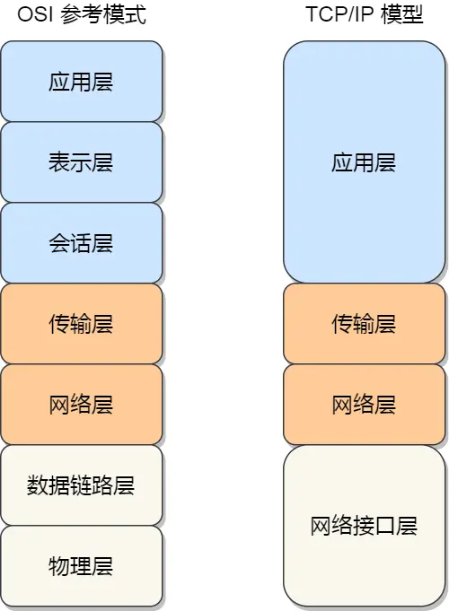

- 应用层，负责给应用程序提供统一的接口；
- 表示层，负责把数据转换成兼容另一个系统能识别的格式；
- 会话层，负责建立、管理和终止表示层实体之间的通信会话；
- 传输层，负责端到端的数据传输；
- 网络层，负责数据的路由、转发、分片；
- 数据链路层，负责数据的封帧和差错检测，以及 MAC 寻址；
- 物理层，负责在物理介质上传输比特流。

由于 OSI 模型实在太复杂，提出的也只是概念理论上的分层，并没有提供具体的实现方案。比较常见 TCP/IP 网络模型，Linux 系统正是按照这套网络模型来实现网络协议栈的。

#### TCP/IP模型

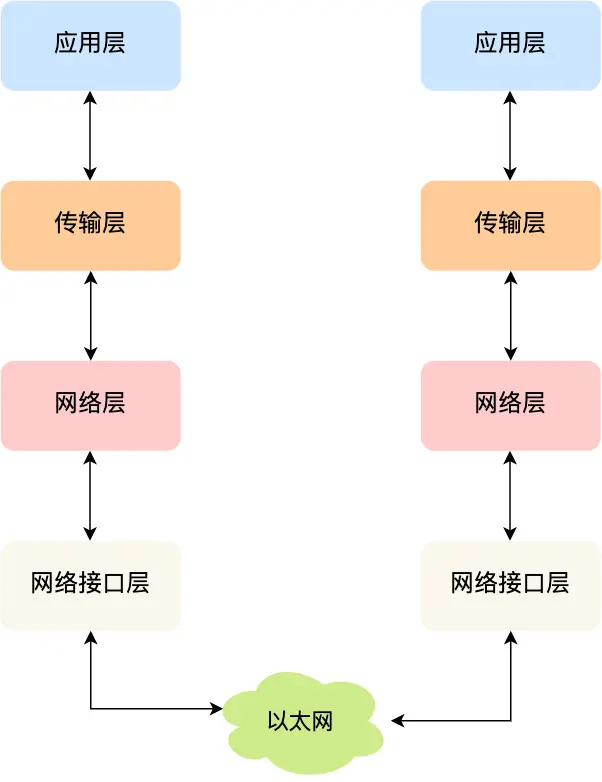

- 应用层 支持 HTTP、SMTP 等最终用户进程
- 传输层 通过端口号提供进程到进程的通信（TCP、UDP）
- 网络层 寻址和路由数据包（IP 协议），实际通信时，网络接口层可以使用以太网、Wi-Fi 等技术。
- 网络接口层 负责在相邻节点之间传输数据，包括封帧、MAC 寻址和物理传输等

### 1.1.2 tcp、ip分别位于哪一层？

- tcp 在传输层
- ip 在网络层

## 1.2 应用层

### 1.2.1 应用层有哪些协议？

 **HTTP、DNS、FTP、SMTP、SSH、WebSocket** 等，HTTPS 是在 HTTP 通信中加入 TLS 安全保护。

**CDN 是内容分发网络，是一种加速服务的架构，不是一种协议**，它通常结合 DNS 调度、HTTP 缓存和边缘节点来提供服务。

### 1.2.2 HTTP报文有哪些部分？

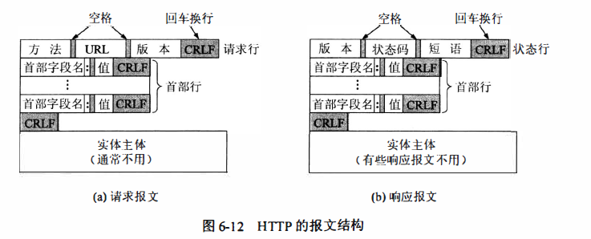

这里以 **HTTP/1.1** 为例，分请求报文和响应报文来说明。HTTP/2 和 HTTP/3 使用帧来传递报文，不能直接套用下面的文本格式。

**请求报文：**

- 请求行：包含请求方法、请求目标（URL或URI）和HTTP协议版本。
- 请求头部：包含关于请求的附加信息，如Host、User-Agent、Content-Type等。
- 空行：请求头部和请求体之间用空行分隔。
- 请求体：可选，包含请求的数据，通常用于POST请求等需要传输数据的情况。

**响应报文：**

- 状态行：包含HTTP协议版本、状态码和状态信息。
- 响应头部：包含关于响应的附加信息，如Content-Type、Content-Length等。
- 空行：响应头部和响应体之间用空行分隔。
- 响应体：包含响应的数据，通常是服务器返回的HTML、JSON等内容。

### 1.2.3 HTTP常用的状态码？

- **1xx**：提示信息，表示请求还在处理中，比如 100 Continue。
- **2xx**：成功处理请求，比如 200 OK。
- **3xx**：需要进一步操作，比如重定向，或者使用已经缓存的资源。注意，304 并不是跳转到另一个 URL。
- **4xx**：请求存在问题，比如参数错误、身份认证失败或者资源不存在。
- **5xx**：服务器处理请求时发生错误，也包括网关访问上游服务失败。

其中常见的具体状态码有：

- **200 OK**：请求成功；**201 Created**：成功创建资源；**204 No Content**：请求成功，但是没有响应体。**206 Partial Content**：成功返回部分资源，常用于断点续传。
- **301 / 302**：永久重定向 / 临时重定向；**304 Not Modified**：协商缓存命中，客户端使用本地缓存的响应体。
- **400 Bad Request**：请求格式等有问题；**401 Unauthorized**：缺少有效的身份凭证；**403 Forbidden**：服务器拒绝访问，常见于权限不足。**404 Not Found**：资源不存在；**405 Method Not Allowed**：资源不支持该请求方法；**429 Too Many Requests**：请求过于频繁，被限流了。
- **500 Internal Server Error**：服务器内部错误；**502 Bad Gateway**：网关访问上游失败或收到无效响应；**503 Service Unavailable**：服务暂时不可用；**504 Gateway Timeout**：网关等待上游响应超时。

### 1.2.4 HTTP返回状态301 302分别是什么？

301 和 302 都是重定向状态码，通常通过响应头里的 **Location** 告诉客户端新的地址。

- **301 Moved Permanently**：永久重定向，表示资源以后应该使用新的 URL 访问，比如网站更换了域名。
- **302 Found**：临时重定向，表示这次先去另一个 URL，但以后仍然可以使用原来的地址，比如用户未登录时跳转到登录页。

面试里还可能追问：如果原来是 POST 请求，跳转后还是 POST 吗？

**对于 301 和 302，浏览器可能把 POST 改成 GET。**如果希望重定向后保留原来的请求方法和请求体，可以使用 **307 临时重定向**或者 **308 永久重定向**。

### 1.2.5 http 502和 504 的区别？

- 502 Bad Gateway：作为网关或者代理工作的服务器尝试执行请求时，从上游服务器接收到**无效的响应**。
- 504 Gateway Time-out：作为网关或者代理工作的服务器尝试执行请求时，**未能及时从上游服务器收到响应**。

举一个例子，假设 nginx 是代理服务器，收到客户端的请求后，将请求转发到后端服务器（tomcat 等）。

- 当nginx收到了无效的响应时，就返回502。
- 当 nginx 超过自己配置的等待时间，还没有收到上游的响应时，就返回 504 错误。

### 1.2.6 HTTP层请求的类型有哪些？

- GET：用于请求获取指定资源，通常用于获取数据。
- POST：用于向服务器提交数据，通常用于提交表单数据或进行资源的创建。
- PUT：用于向服务器更新指定资源，通常用于更新已存在的资源。
- DELETE：用于请求服务器删除指定资源。
- HEAD：语义与 GET 类似，但响应没有响应体，用于获取资源的元数据。
- PATCH：用于对资源进行局部修改。
- OPTIONS：用于查询资源支持的通信选项，浏览器的 CORS 预检请求也会用到它。

### 1.2.7 GET和POST的使用场景，有哪些区别？

**GET 的语义是从服务器获取指定的资源**，可以是静态的文本、页面、图片视频等。GET 请求的参数一般写在 URL 的查询字符串中，中文等字符可以经过百分号编码后传输，并不是只能传 ASCII 内容。HTTP 没有统一规定 URL 的最大长度，但浏览器、代理和服务器通常都有各自的限制。

比如，你打开我的文章，浏览器就会发送 GET 请求给服务器，服务器就会返回文章的所有文字及资源。

**POST 的语义是根据请求负荷（报文body）对指定的资源做出处理**，具体的处理方式视资源类型而不同。POST 请求携带数据的位置一般是写在报文 body 中，body 中的数据可以是任意格式的数据，只要客户端与服务端协商好即可，HTTP 同样没有统一规定 body 的最大大小，但客户端、网关和服务端可以配置大小限制，比如上传文件过大时可能收到 413。

比如，你在我文章底部，敲入了留言后点击「提交」，浏览器就会执行一次 POST 请求，把你的留言文字放进了报文 body 里，然后拼接好 POST 请求头，通过 TCP 协议发送给服务器。

如果从 RFC 规范定义的语义来看：

- **GET 方法就是安全且幂等的**，这里的「安全」表示请求的语义不要求修改服务器资源，**「幂等」表示执行一次和执行多次，对服务器产生的预期效果相同，**并不是每次返回的内容都必须相同。比如查询商品价格，价格变了，GET 返回的结果也会变，但它仍然可以是幂等的。所以，**可以对 GET 请求的数据做缓存，这个缓存可以做到浏览器本身上（彻底避免浏览器发请求），也可以做到代理上（如nginx），而且在浏览器中 GET 请求可以保存为书签**。
- **POST 方法的语义不保证安全和幂等**。比如创建订单，重复提交可能创建多笔订单，所以不能默认随便重试。POST 响应并不是绝对不能缓存，在满足明确的缓存条件时也可以缓存，只是常见实现对它的支持比较有限。

但是实际过程中，开发者不一定会按照 RFC 规范定义的语义来实现 GET 和 POST 方法。比如：

- 可以用 GET 方法实现新增或删除数据的请求，这样实现的 GET 方法自然就不是安全和幂等。
- 可以用 POST 方法实现没有副作用的查询，也可以通过业务请求号把创建接口设计成幂等，但这些都需要业务自己保证。

另外，**POST 不会因为参数放在 body 里就自动变得安全**。GET、POST 走明文 HTTP 时都可能被窃听，传输保密要靠 HTTPS；只是 URL 参数还容易出现在浏览历史、日志等位置，不适合随便放密码和令牌。

### 1.2.8 HTTP的长连接是什么？

HTTP 协议采用的是「请求-应答」的模式，也就是客户端发起了请求，服务端才会返回响应，一来一回。

由于 HTTP 是基于 TCP 传输协议实现的，客户端与服务端要进行 HTTP 通信前，需要先建立 TCP 连接，然后客户端发送 HTTP 请求，服务端收到后就返回响应，至此「请求-应答」的模式就完成了，随后就会释放 TCP 连接。

如果每次请求都要经历这样的过程：建立 TCP -> 请求资源 -> 响应资源 -> 释放连接，那么此方式就是 **HTTP 短连接**，如下图：

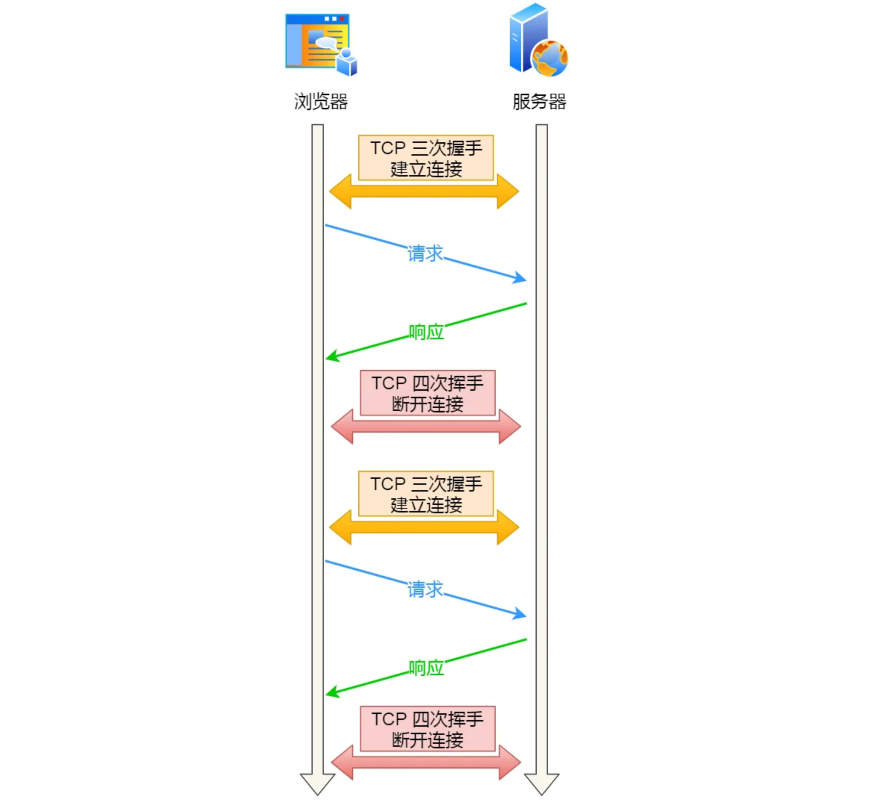

这样一次连接只能请求一次资源，能不能在第一个 HTTP 请求完后，先不断开 TCP 连接，让后续的 HTTP 请求继续使用此连接？

当然可以，HTTP 的 Keep-Alive 就是实现了这个功能，可以使用同一个 TCP 连接来发送和接收多个 HTTP 请求/应答，避免了连接建立和释放的开销，这个方法称为 **HTTP 长连接**。

HTTP 长连接允许在一次请求结束后继续复用连接，但客户端、服务端或者中间代理都可能因为空闲超时、请求数量限制等原因关闭连接。

### 1.2.9 HTTP Keep-Alive 和 TCP Keepalive 有什么区别？

- **HTTP Keep-Alive**：解决**连接复用**的问题，让多个 HTTP 请求使用同一个连接，减少反复建立和关闭连接的开销。HTTP/1.1 默认使用持久连接。
- **TCP Keepalive**：解决**空闲连接的存活探测**问题。如果连接长时间没有数据交互，内核可以发送探测报文，判断对端是否还能响应，需要通过 `SO_KEEPALIVE` 等选项开启。

举个例子，一个 HTTP 长连接完全可以没有开启 TCP Keepalive；反过来，一个数据库的 TCP 连接也可以开启 TCP Keepalive，它和 HTTP 没有关系。

**TCP 探测能收到回复，只能说明对端的 TCP 协议栈还能响应，不代表业务线程还能正常处理请求**。如果要检测业务是否正常，通常还需要应用层心跳和请求超时。

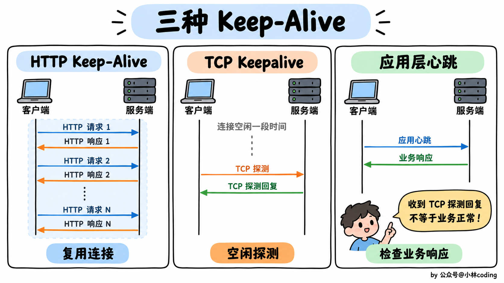

### 1.2.10 HTTP默认的端口是什么？

http 是 80，https 默认是 443。

### 1.2.11 HTTP1.1怎么对请求做拆包，具体来说怎么拆的？

HTTP/1.1 通常跑在 TCP 上，而 **TCP 是字节流，不会帮应用程序保留消息边界**。所以一次 read 不一定能读到一个完整请求，也可能同时读到多个请求的一部分。

那 HTTP 怎么知道一个请求在哪里结束呢？

首先，用 `\r\n\r\n` 找到请求头的结束位置，再根据头部字段判断请求体的边界：

- **Content-Length**：声明请求体的字节数。比如值为 100，就继续读取 100 个字节，才算读完请求体。
- **Transfer-Encoding: chunked**：请求体分成多个块，每块先写十六进制的长度，再写数据。读到大小为 0 的最后一个块，并处理完可选的尾部字段，才算结束。
- 如果请求既没有 Transfer-Encoding，也没有 Content-Length，那么按 HTTP/1.1 的规则，这个请求没有请求体。

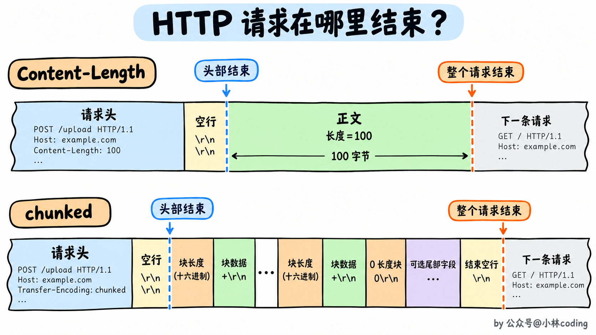

响应还要结合状态码和请求方法来判断，比如 HEAD 的响应、204 和 304 都没有响应体。有些响应也可以靠关闭连接表示结束，但这样就不能继续复用这条连接了。

**Content-Length 解决的是报文边界问题，不负责保证网络可靠传输。**如果连接中断，实际收到的正文不足声明长度，应用仍然要把报文当作不完整来处理。

### 1.2.12 http 断点重传是什么？

断点续传就是下载中断之后，**接着上次的位置下载，不用把整个文件重新下载一遍**。HTTP 可以通过 Range 请求来实现。

举个例子，一个文件大小为 1048576 字节，也就是 1 MiB，客户端下载了前 524288 字节之后断网了。

网络恢复后，客户端可以发送：

```http
Range: bytes=524288-
```

如果服务端支持范围请求，就返回 **206 Partial Content**，响应头里可以带上：

```http
Content-Range: bytes 524288-1048575/1048576
Content-Length: 524288
```

注意，**字节位置从 0 开始，结束位置是包含在范围里的**，所以剩余长度是 `1048575 - 524288 + 1`。

几个相关字段的作用是：

- **Range**：客户端指定要下载的字节范围。
- **Content-Range**：服务端说明这次返回的范围和资源总大小。
- **Accept-Ranges: bytes**：服务端表示支持按字节请求，不过客户端也可以在没看到这个字段时尝试发送 Range。
- **Content-Length**：说明本次响应体的长度，并不是整个文件的长度。具体报文也可能使用其他方式确定响应体边界。

如果请求范围无法满足，服务端可以返回 **416**；如果服务端忽略 Range，返回了 **200** 和完整文件，客户端就不能直接把它追加到已下载内容后面。

还要考虑一个问题：下载期间文件变了怎么办？可以用 **If-Range** 携带上次的强 ETag，或者符合要求的 Last-Modified 时间。资源没变就继续返回部分内容，变了就返回完整资源，避免把两个版本的文件拼到一起。

### 1.2.13 HTTP为什么不安全？

HTTP 由于是明文传输，所以安全上存在以下三个风险：

- **窃听风险**，通信链路上可以获取通信内容，用户号容易没。
- **篡改风险**，强制植入垃圾广告，视觉污染，用户眼容易瞎。
- **冒充风险**，冒充淘宝网站，用户钱容易没。

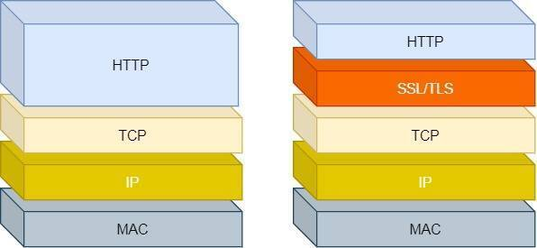

HTTP**S** 在 HTTP 与 TCP 层之间加入了 SSL/TLS 协议，可以很好的解决了上述的风险：

- **信息加密**：交互信息无法被窃取，但你的号会因为「自身忘记」账号而没。
- **校验机制**：无法篡改通信内容，篡改了就不能正常显示，但百度「竞价排名」依然可以搜索垃圾广告。
- **身份证书**：证明淘宝是真的淘宝网，但你的钱还是会因为「剁手」而没。

### 1.2.14 HTTP和HTTPS 的区别？

| 对比项   | HTTP                                            | HTTPS                                                        |
| -------- | ----------------------------------------------- | ------------------------------------------------------------ |
| 全称     | 超文本传输协议                                  | 超文本传输安全协议（HTTP + TLS/SSL）                         |
| 传输方式 | 明文传输                                        | TLS 加密传输，报文密文                                       |
| 底层依赖 | TCP（HTTP/1.1、HTTP/2）；HTTP/3 基于 QUIC (UDP) | HTTP/1.1、HTTP/2：TCP + TLS 握手；HTTP/3：QUIC 内置 TLS1.3   |
| 默认端口 | 80                                              | 443                                                          |
| 身份校验 | 无身份验证，容易被劫持、篡改                    | 依靠 CA 证书校验服务端身份；自签名证书可加密但不受客户端默认信任 |
| 安全性   | 明文，可窃听、篡改、中间人攻击                  | 加密、防篡改、身份认证                                       |
| 握手流程 | TCP 三次握手后直接 HTTP 请求                    | TCP 握手后额外 TLS 握手（协商加密套件、密钥、校验证书）      |

### 1.2.15 HTTPS握手过程说一下

HTTPS 握手要完成三件事：**协商通信参数、验证服务器身份、生成双方使用的会话密钥**。不过具体过程要看 TLS 版本和密钥交换方式，不能把所有 HTTPS 都说成「四次握手」。

先结合下面的抓包图，说明 **TLS 1.2 使用 RSA 密钥交换**的过程，再补充 ECDHE 和 TLS 1.3 的区别。

在这个例子里，服务端证书包含公钥、域名、有效期和 CA 的签名等信息，握手时会发给客户端。**证书不是只有一把公钥**，它还要帮助客户端确认这把公钥属于谁。对应的私钥留在服务端，不会通过网络发送。

在 RSA 密钥协商算法中，客户端会生成随机密钥，并使用服务端的公钥加密后再传给服务端。根据非对称加密算法，公钥加密的消息仅能通过私钥解密，这样服务端解密后，双方就得到了相同的预主密钥，再结合客户端和服务端的随机数派生出后续使用的会话密钥。

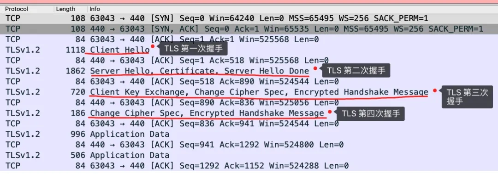

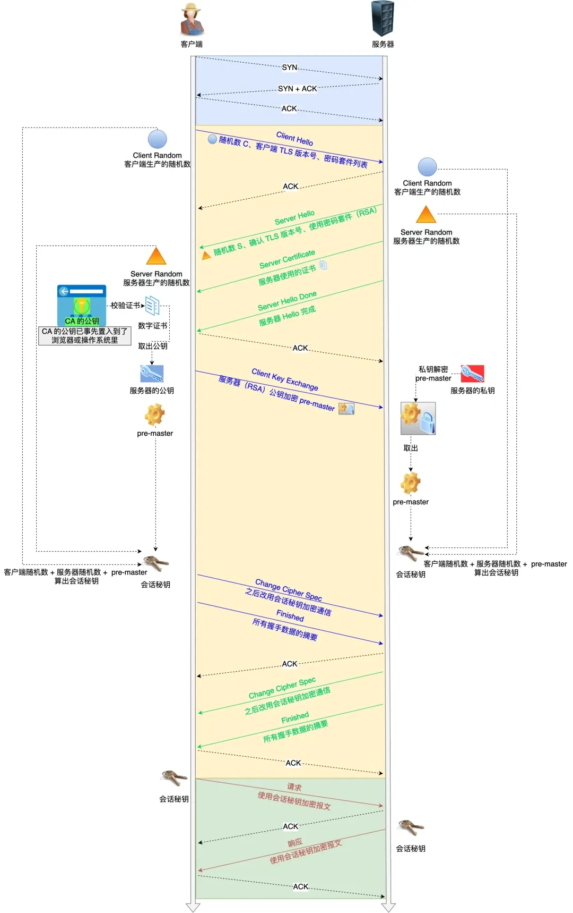

#### TLS 第一次握手

首先，由**客户端向服务器**发起加密通信请求。客户端主要发送：

- 客户端支持的 **TLS 协议版本**，如 TLS 1.2 版本。
- 客户端生成的**随机数**（Client Random），后面用于生成「**会话密钥**」的条件之一。
- 客户端支持的**密码套件列表**，如 RSA 加密算法。

#### TLS 第二次握手

服务器收到客户端请求后，发送 ServerHello、Certificate 等一组握手消息，主要回应以下内容：

- 确认 **TLS 协议版本**，如果浏览器不支持，则关闭加密通信。
- 服务器生成的**随机数**（Server Random），也是后面用于生成「会话密钥」的条件之一。
- 选定的**密码套件**，它规定密钥交换、认证和数据加密等使用的算法。
- **服务器的数字证书**。

#### TLS 第三次握手

客户端收到服务器的回应之后，**先验证证书链是否能追溯到受信任的 CA**，还要检查证书有效期和证书中的域名是否与访问的域名匹配。

如果证书没有问题，客户端会**从数字证书中取出服务器的公钥**，然后使用它加密报文，向服务器发送如下信息：

- 一个**随机数**（Pre-Master Secret）。该随机数会被服务器公钥加密。
- **加密通信算法改变通知**，表示随后的信息都将用「会话密钥」加密通信。
- **客户端握手结束通知**，表示客户端的握手阶段已经结束。这一项使用协商出的密钥和此前的握手记录计算校验数据，供服务端验证握手内容没有被修改。

**服务器和客户端有了这三个随机数（Client Random、Server Random、Pre-Master Secret），接着就用双方协商的加密算法，各自计算出本次通信的「会话密钥」**。

#### TLS 第四次握手

服务器收到客户端的第三个随机数（Pre-Master Secret）后，通过协商的加密算法，计算出本次通信的「会话密钥」。向客户端发送：

- **加密通信算法改变通知**，表示随后的信息都将用「会话密钥」加密通信。
- **服务器握手结束通知**，表示服务器的握手阶段已经结束。这一项同样使用密钥和握手记录计算校验数据，供客户端验证。

至此，这个 RSA 密钥交换的 TLS 1.2 握手就结束了，接下来的 HTTP 数据由会话密钥加密保护。

#### ECDHE 和 TLS 1.3 有什么不同？

**ECDHE 不会把会话密钥用证书公钥加密后发过去**。双方交换临时公钥，各自结合自己的临时私钥算出相同的共享秘密，再派生出会话密钥。证书对应的私钥主要用于签名，证明握手的一方确实持有该私钥。

这种方式支持**前向安全**：即使将来服务器的证书私钥泄露，只要之前的临时私钥已经销毁，攻击者也不能仅凭录下来的流量还原过去的会话密钥。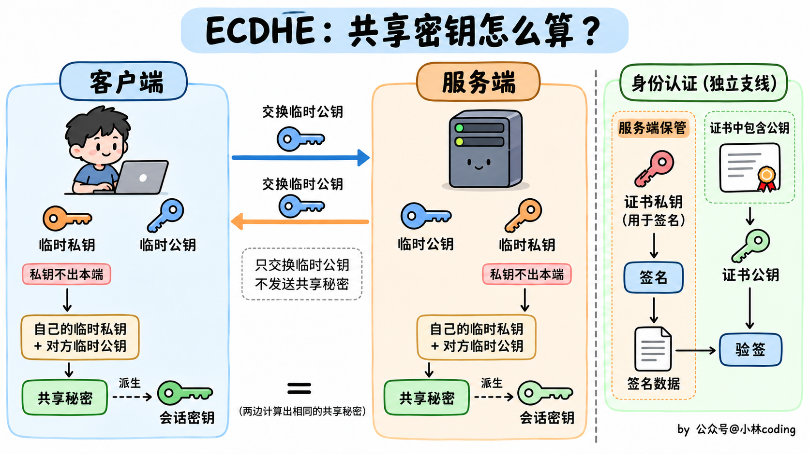

TLS 1.3 移除了 RSA 密钥交换。以常见的、基于证书和 ECDHE 的完整握手为例：

1. 客户端发送 ClientHello，带上支持的版本、密码套件和临时公钥，也就是 key share。
2. 服务端返回 ServerHello 和自己的 key share，双方由此计算握手密钥。服务端随后发送加密保护的证书、证书签名和 Finished 消息。
3. 客户端验证证书、签名和 Finished，再发送自己的 Finished，完成握手。

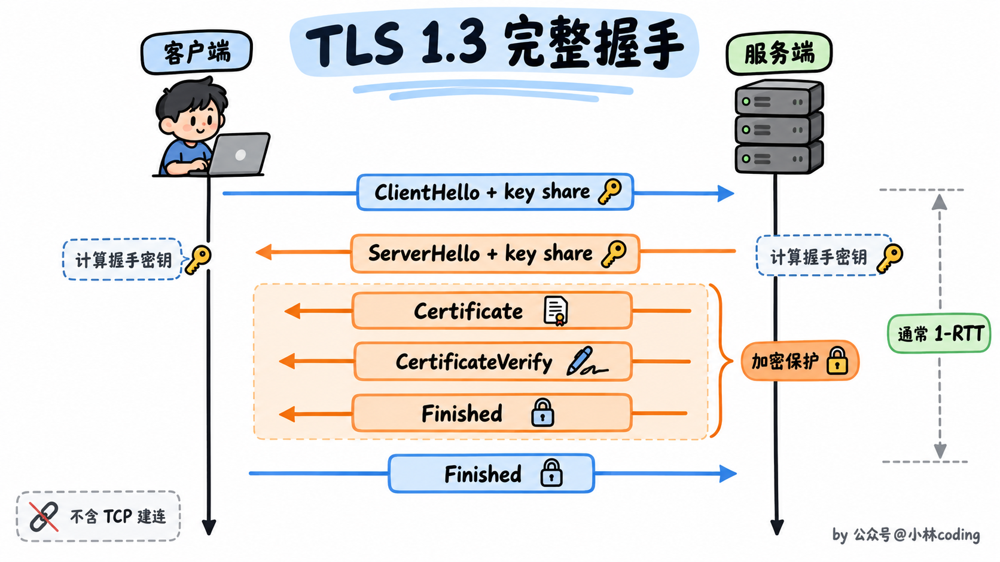

**在不需要额外协商往返的情况下，TLS 1.3 完整握手是 1-RTT**，比典型的 TLS 1.2 完整握手少一次往返。会话恢复还可以使用 PSK，符合条件时支持 0-RTT 早期数据，不过这些数据有重放风险，不能把它理解成所有业务都可以安全地零延迟发送。

### 1.2.16 HTTPS是如何防范中间人的攻击？

- **证书校验**：客户端验证证书链、有效期和域名，确认公钥绑定的是要访问的服务器，而不是攻击者的服务器。
- **证明私钥的持有**：在 ECDHE 等握手中，服务端使用证书对应的私钥对握手内容签名，客户端用公钥验证。攻击者即使拿到了公开的证书，没有私钥也不能完成相应的身份认证。
- **握手完整性校验**：通过 Finished 消息验证握手记录，防止协商参数等内容被中途修改。
- **数据加密和完整性保护**：后续用协商出的对称密钥保护 HTTP 数据，攻击者难以读出内容，篡改的数据也无法通过校验。

这里有个前提：**客户端要正确验证证书**。如果用户忽略证书错误，或者客户端关闭了证书校验，那么这些身份保证就可能失效。

### 1.2.17 Http1.1和2.0的区别是什么？

HTTP/2 保留了 HTTP 的方法、状态码等语义，主要改进的是报文传输方式：

- **头部压缩**：使用 HPACK，结合静态表、动态表和编码来减少重复头字段的传输。比如多个请求都带着相同的头部，就不必每次都完整传一遍。
- **二进制分帧**：把头部和数据拆成不同类型的帧，每个帧都有明确的长度和类型，方便解析和复用。HTTP/1.1 本身在网络上也是字节，区别不在于「计算机是否认识文本」，而在于报文组织方式不同。
- **多路复用**：每个请求和响应属于一个 Stream，帧携带 Stream ID，因此多个请求可以在同一条 TCP 连接上交错传输，不必等待前一个响应完整发完。
- **流量控制**：可以在连接和 Stream 两个层面限制数据发送，避免接收方来不及处理。

**HTTP/2 解决了 HTTP/1.1 在一条连接上按序返回响应的队头阻塞，但没有解决 TCP 层的队头阻塞。**底层 TCP 丢了一个数据段，即使后面的字节已经到达，也要先补齐缺口，连接上的多个 Stream 都可能被拖住。

### 1.2.18 HTTP/3 相比 HTTP/2 有什么改进？

HTTP/2 使用 TCP，HTTP/3 使用**基于 UDP 的 QUIC**。主要改进有以下几点：

- **减少跨流的队头阻塞**：QUIC 为不同 Stream 分别维护数据顺序。某个流丢包时，其他不依赖它的流可以继续交付数据。不过丢包的那个流本身仍然要等待重传，共享的拥塞控制也可能影响整个连接。
- **连接建立更快**：QUIC 集成 TLS 1.3，完整握手通常需要 1-RTT；满足条件的恢复连接可以发送 0-RTT 早期数据。
- **支持连接迁移**：QUIC 使用 Connection ID 标识连接，在满足路径验证等条件时，客户端从 Wi-Fi 切到移动网络，即使 IP 和端口变化，也可以继续使用原来的连接。
- **使用 QPACK 压缩头部**：它考虑了多个流之间独立传输的特点，减少头部压缩带来的阻塞。

注意，**HTTP/3 并不是放弃可靠性，把 HTTP 数据直接丢给 UDP**。可靠传输、拥塞控制和加密等工作由 QUIC 完成。

### 1.2.19 HTTP 强制缓存和协商缓存有什么区别？

**强制缓存决定「能不能直接用缓存」，协商缓存决定「缓存还能不能继续用」**。

#### 强制缓存

浏览器收到响应后，根据 `Cache-Control: max-age=...` 等字段判断缓存的新鲜度。缓存还新鲜时，可以直接使用，不用向服务器发送这次资源请求。Expires 也可以指定过期时间，不过通常优先使用 Cache-Control。

#### 协商缓存

缓存需要重新验证时，浏览器向服务端发条件请求，常见的两组字段是：

- 服务端返回 **ETag**，浏览器下次发送 **If-None-Match**。
- 服务端返回 **Last-Modified**，浏览器下次发送 **If-Modified-Since**。

资源没变，服务端返回 **304**，不再发送响应体，浏览器继续使用本地缓存；资源变了，就返回 **200** 和新的内容。如果两组条件同时出现，If-None-Match 优先。

举个例子，第一次下载一张图片，服务端告诉浏览器可以缓存 10 分钟，并返回一个 ETag。10 分钟内可以直接用缓存，需要重新验证时就带上这个 ETag 去问服务端：「这张图还是原来那个版本吗？」

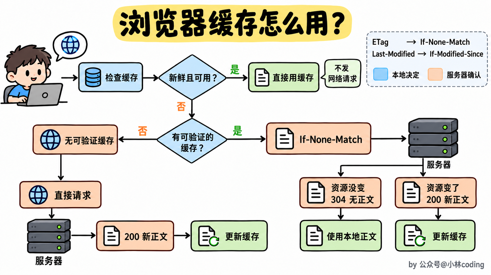

### 1.2.20 Cache-Control 里的 no-cache 和 no-store 有什么区别？

**no-cache ：使用缓存前必须向服务器重新验证；no-store ：不允许存储这次请求或响应。**

比如一个页面设置了 no-cache，浏览器仍然可以保存内容，下次发起协商请求，资源没变就使用缓存。对于不希望被缓存保存的敏感响应，则可以设置 no-store。

另外，**private** 表示响应只允许浏览器等私有缓存保存，不允许 CDN、代理这类共享缓存保存。不能把某个用户的个人页面当作公共内容缓存起来，再发给另一个用户。

### 1.2.21 HTTP进行TCP连接之后，在什么情况下会中断

- **正常关闭**：客户端或服务端不再使用连接，关闭最后一个 socket 引用，或调用 shutdown 关闭发送方向，通常通过 FIN 进行关闭。
- **连接被重置**：收到有效的 RST 报文，连接被立即终止，应用可能看到 Connection reset。
- **重传超时**：发送数据之后长期收不到确认，达到系统或应用设置的超时条件，内核会报告连接失败。
- **HTTP 连接管理**：使用 Connection: close，或者达到服务端的空闲超时、最大请求次数等限制，由应用决定关闭连接。

**网线被拔掉或者对端突然断电，不一定会立刻让本地连接消失**。如果连接没有数据交互，也没有开启保活或应用层超时，本地可能仍然显示 ESTABLISHED。

### 1.2.22 HTTP、SOCKET和TCP的区别

- HTTP是一种用于传输超文本数据的**应用层**协议，用于在客户端和服务器之间传输和显示Web页面。
- Socket是计算机网络中的一种抽象，用于描述通信链路的一端，提供了底层的**通信接口**，可实现不同计算机之间的数据交换。
- TCP是一种面向连接的、可靠的**传输层**协议，负责在通信的两端之间建立可靠的数据传输连接。

### 1.2.23 DNS的全称了解么？

DNS的全称是Domain Name System（域名系统），它是用于**将域名转换为对应IP地址**的分布式数据库系统。

DNS 中的域名都是用**句点**来分隔的，比如 www.server.com.，这里的句点代表了不同层次之间的**界限**。在域名中，**越靠右**的位置表示其层级**越高**。实际上域名最后还有一个点，这个最后的一个点代表根域名。

也就是，. 根域是在最顶层，它的下一层就是 .com 顶级域，再下面是 server.com。

所以域名的层级关系类似一个树状结构：

- 根 DNS 服务器（.）
- 顶级域 DNS 服务器（.com）
- 权威 DNS 服务器（server.com）

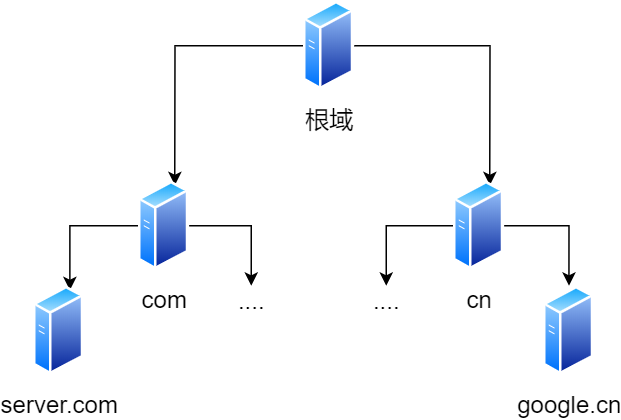

根域的 DNS 服务器信息保存在互联网中所有的 DNS 服务器中。

这样一来，任何 DNS 服务器就都可以找到并访问根域 DNS 服务器了。

因此，客户端只要能够找到任意一台 DNS 服务器，就可以通过它找到根域 DNS 服务器，然后再一路顺藤摸瓜找到位于下层的某台目标 DNS 服务器。

### 1.2.24 DNS 域名解析的工作流程？

在真正发出 DNS 请求前，**客户端**通常会**先检查**浏览器、操作系统的解析**缓存**，以及 hosts 等**本地配置**。如果已经找到了可用结果，就不必走完下面的查询。这里以没有命中缓存的情况为例：

1. 客户端首先会发出一个 DNS 请求，问 www.server.com 的 IP 是啥，并发给本地 DNS 服务器（也就是客户端的 TCP/IP 设置中填写的 DNS 服务器地址）。
2. 本地域名服务器收到客户端的请求后，如果缓存里的表格能找到 www.server.com，则它直接返回 IP 地址。如果没有，本地 DNS 会去问它的根域名服务器： www.server.com 的 IP 地址吗。 根域名服务器是最高层次的，它不直接用于域名解析，但能指明一条道路
3. 根 DNS 收到来自本地 DNS 的请求后，发现后置是 .com，返回 .com 顶级域名服务器地址
4. 本地 DNS 收到顶级域名服务器的地址后，发起请求问：  www.server.com 的 IP 地址
5. 顶级域名服务器： www.server.com 区域的权威 DNS 服务器的地址
6. 本地 DNS 于是转向权威 DNS 服务器：www.server.com对应的IP。 server.com 的权威 DNS 服务器，它是域名解析结果的原出处。为啥叫权威呢？就是我的域名我做主。
7. 权威 DNS 服务器查询后将对应的 IP 地址 X.X.X.X 告诉本地 DNS。
8. 本地 DNS 再将 IP 地址返回客户端，客户端和目标建立连接。

客户端请本地 DNS 帮忙查出最终结果，通常属于**递归查询**；本地 DNS 再向根、顶级域和权威 DNS 一层一层询问，通常属于**迭代查询**。查询结果会按 TTL 缓存，因此不是每次访问都要从根服务器查起。

至此，我们完成了 DNS 的解析过程。现在总结一下，整个过程我画成了一个图。

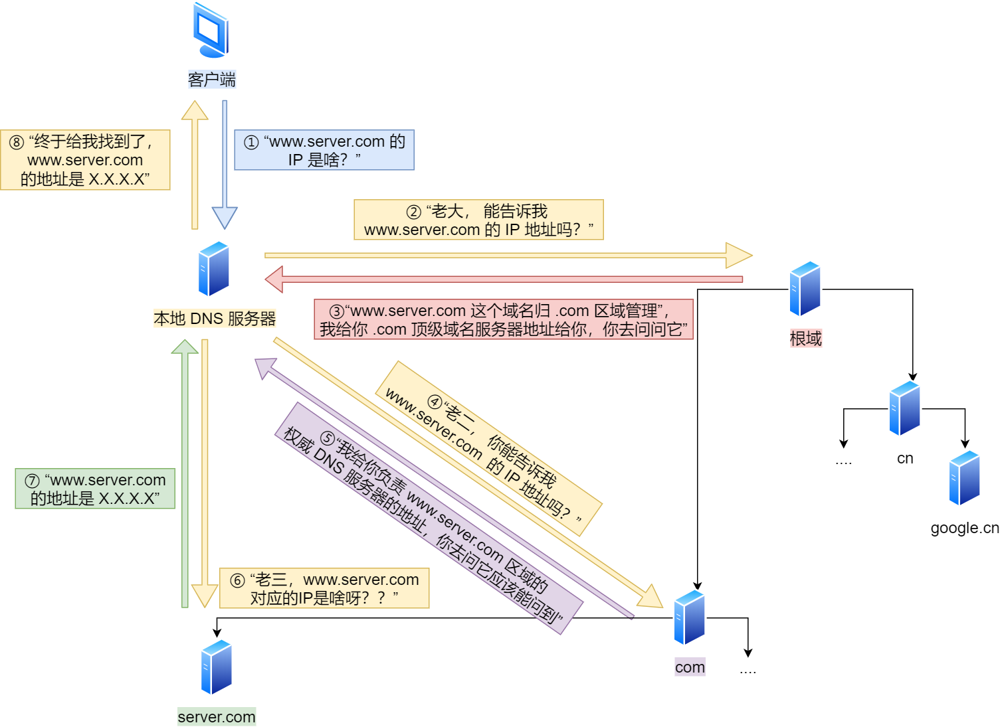

### 1.2.25 DNS的端口是多少？

默认端口号是53。

### 1.2.26 改过host文件吗？

host 文件的核心作用是**把域名和 IP 地址绑在一起**。比如你想让电脑访问 “[www.xxx.com (opens new window)](https://www.xxx.com/)” 时直接指向某个特定 IP，不用走公共 DNS 解析，改 host 文件就行。

举个实际场景，程序员测试网站时，还没上线的项目只有服务器 IP，就在 host 里写 “192.168.1.100 [www.test.com (opens new window)](https://www.test.com/)”，这样输入域名就能直接访问测试服，不用记一串难背的 IP。

### 1.2.27 DNS的底层使用TCP还是UDP？

**DNS 同时支持 UDP 和 TCP，传统 DNS 服务的端口号都是 53。**

普通查询通常先使用 UDP，因为请求和响应一般比较小，不需要先建立连接。如果 UDP 响应被截断，响应中的 **TC 标志位**会置为 1，客户端通常会改用 TCP 重新查询。

传统 DNS 的 UDP 消息大小限制为 512 字节，**EDNS(0)** 可以让客户端通告能够接收的 UDP 消息大小，但不是所有查询都固定使用 4096 字节。消息越大，也越容易遇到 IP 分片和丢包，所以 TCP 仍然有必要。

另外，完整区域传送 **AXFR 使用 TCP**；增量区域传送 **IXFR 可以使用 UDP 或 TCP**，不能把所有区域传送都说成只能用 TCP。

如果面试官追问加密 DNS，可以再补充：DoT 通常使用 TLS over TCP，DoH 通过 HTTPS 传输，DoQ 使用基于 UDP 的 QUIC。**QUIC 底层仍然是 UDP，只是可靠性和加密等能力由 QUIC 提供。**

### 1.2.28 HTTP到底是不是无状态的？

**HTTP 是无状态的，指协议不要求服务器记住前一次请求，才能理解后一次请求。**每个请求应该提供理解它所需的信息。

这并不是说服务器不能保存用户数据，也不是说 TCP 连接没有状态。比如服务端当然可以保存购物车，TCP 也会维护序列号和连接状态，只是它们不等于 HTTP 协议本身的会话状态。

**实际业务需要记住用户的登录状态时，可以在 HTTP 之上使用 Cookie、Session 或 Token 来实现。**

### 1.2.29 携带Cookie的HTTP请求是有状态还是无状态的？Cookie是HTTP协议簇的一部分，那为什么还说HTTP是无状态的？

**HTTP 仍然是无状态协议，不过应用可以借助 Cookie 实现有状态的会话。**

举个例子，第一次登录成功后，服务端把 Session ID 写进 Cookie。后续每次请求，浏览器都按 Cookie 的规则带上这个 ID，服务端拿它去找对应的登录信息，就知道「还是刚才那个用户」。

这里并不是 HTTP 自动记住了上一个请求，而是**当前请求又带来了用于识别用户的信息**，应用再用这个信息查找会话。所以，协议无状态和业务有登录状态并不矛盾。

### 1.2.30 cookie和session有什么区别？

Cookie和Session都是Web开发中用于**跟踪用户状态**的技术，但它们在存储位置、数据容量、安全性以及生命周期等方面存在显著差异：

| 对比项   | Cookie                                                    | Session                                                      |
| -------- | --------------------------------------------------------- | ------------------------------------------------------------ |
| 存储位置 | 客户端（浏览器）                                          | 服务端                                                       |
| 传递方式 | 请求头自动携带 Cookie 数据                                | 客户端只携带 SessionId（一般放在 Cookie/URL 重写），服务端根据 ID 找数据 |
| 容量限制 | 单条约 4KB，域名下 Cookie 条数有限制                      | 理论无硬性上限，受服务器内存 / 存储限制                      |
| 安全性   | 存在 XSS 风险；配置 HttpOnly 禁止 JS 读取；仍有 CSRF 风险 | 敏感数据存在服务端，相对安全；需要防范 Session 劫持、会话固定攻击 |
| 生命周期 | 可设置 expire/max-age 持久化；会话 Cookie 浏览器关闭删除  | 由服务端控制过期；关闭浏览器不会主动删除服务端 Session       |
| 性能影响 | 每次请求都带上数据，Cookie 大时增加请求体积               | 每次请求服务端要查询 Session，高并发下增加服务端压力         |

### 1.2.31 token，session，cookie的区别？

- **Cookie**：**浏览器存储和发送小段数据的机制**。满足域名、路径、Secure、SameSite 等规则时，浏览器会自动携带 Cookie。
- **Session**：**服务端保存会话状态的方式**。客户端通常只持有 Session ID，服务端根据这个 ID 查找登录信息。Session ID 经常放在 Cookie 中，但也可以通过其他方式传递。
- **Token**：客**户端用来证明身份或权限的凭证**。它可以是一个随机字符串，由服务端查表验证，也可以是 JWT 这样的自包含令牌。可以放在 Authorization 请求头中，也可以放进 Cookie。

所以，**Token 不一定无状态，JWT 也不一定加密，Session 也不是必须依赖 Cookie**。比如把 JWT 放进 Cookie，并不会让 Cookie 和 JWT 变成同一个概念。

### 1.2.32 如果客户端禁用了cookie，session还能用吗？

**默认情况下禁用 Cookie 后，Session 是无法正常使用的**，因为大多数 Web 服务器都是依赖于 Cookie 来传递 Session 的会话 ID 的。

客户端浏览器禁用 Cookie 时，服务器将无法把会话 ID 发送给客户端，客户端也无法在后续请求中携带会话 ID 返回给服务器，从而导致服务器无法识别用户会话。

但是，有几种方法可以绕过这个问题，尽管它们可能会引入额外的复杂性和/或降低用户体验：

1. **URL重写**：每当服务器响应需要保持状态的请求时，将Session ID附加到URL中作为参数。例如，原本的链接http://example.com/page变为http://example.com/page;jsessionid=XXXXXX，服务器端需要相应地解析 URL 来获取 Session ID，并维护用户的会话状态。这种方式的缺点是URL变得不那么整洁，且如果用户通过电子邮件或其他方式分享了这样的链接，可能导致Session ID泄露。
2. **隐藏表单字段**：在每个需要Session信息的HTML表单中包含一个隐藏字段，用来存储Session ID。当表单提交时，Session ID随表单数据一起发送回服务器，服务器通过解析表单数据中的 Session ID 来获取用户的会话状态。这种方法仅适用于通过表单提交的交互模式，不适合链接点击或Ajax请求。

### 1.2.33 如果我把数据存储到 localStorage，和Cookie有什么区别？

| 对比项   | Cookie                                                       | localStorage                                               |
| -------- | ------------------------------------------------------------ | ---------------------------------------------------------- |
| 容量     | 单条约 4KB，每个域名数量有限制                               | 一般 5MB 左右，浏览器实现有差异                            |
| 请求发送 | 满足域名 / 路径规则，**自动随 HTTP 请求携带**                | 不会自动上传，需要 JS 读取后手动放到请求里                 |
| 作用范围 | 按域名、Path、Domain 匹配；**不区分端口**；同源策略限制跨域  | 严格同源：协议、域名、端口三者全部一致                     |
| 生命周期 | 可配置 Max-Age / Expires；会话 Cookie 浏览器关闭清除         | 无原生过期机制，持久化存储；只能代码手动删或用户清缓存     |
| 安全性   | 可设置 HttpOnly，禁止 JS 读取，抵御 XSS；但自动携带，存在 CSRF 风险 | 同源 JS 均可读写，XSS 攻击容易盗取里面数据；没有 CSRF 问题 |

**不能因为 localStorage 不自动发送，就说它一定比 Cookie 安全。**要看保存什么数据，以及如何防范 XSS、CSRF 和凭证泄露。

### 1.2.34 什么数据应该存在到cookie，什么数据存放到 Localstorage

Cookie 适合保存**需要随请求发送的小型数据**，比如 Session ID。身份 Cookie 通常要配合 **HttpOnly、Secure 和合适的 SameSite** 属性，并在服务端做好会话验证。

localStorage 适合保存**只在浏览器端使用的偏好和非敏感缓存**，比如主题、列表展示方式。它没有内置过期机制，需要过期时可以由业务代码保存时间戳并主动清理。

无论放在哪，**客户端的数据都不能直接当成权限依据**。比如 localStorage 里写着「管理员」，不代表服务端就应该给这个用户管理员权限。

### 1.2.35 Cookie 的 HttpOnly、Secure 和 SameSite 分别有什么作用？

- **HttpOnly**：不允许 JavaScript 通过 document.cookie 读取 Cookie，减少身份凭证被 XSS 脚本直接窃取的风险。但浏览器仍然会发送它，恶意脚本也可能借用户的身份发请求。
- **Secure**：要求 Cookie 通过安全连接发送，通常就是 HTTPS。它不负责限制 JavaScript 读取。
- **SameSite**：控制跨站请求是否携带 Cookie，用来减少 CSRF 风险。Strict 比较严格；Lax 允许部分场景，比如从其他网站点击普通 GET 链接；None 允许跨站发送，通常必须同时设置 Secure。

注意，**跨站和跨域不是完全相同的概念**。比如两个同协议、同主域下的子域名可能属于同站，但仍然不同源。SameSite 也不能替代所有 CSRF 防护，服务端还要根据业务使用 CSRF Token、来源校验等措施。

### 1.2.36 JWT 令牌和传统方式有什么区别？

这里通常是把 JWT 和「服务端保存 Session、客户端保存 Session ID」的登录方式进行比较。

- **Session 方式**：客户端持有一个标识，服务端通过它查询会话数据。集群通常需要共享 Session，或者做会话保持。服务端删除会话后，可以立即让对应登录失效。
- **JWT 方式**：把必要的身份声明放进令牌，并对它签名。服务端验证签名和声明后，可以直接得到身份信息，不必为每个请求查询 Session。

JWT 的好处是方便多个服务独立验证，但代价是**撤销和更新权限比较麻烦**。如果引入黑名单或令牌版本校验，服务端仍然需要维护状态。

还要注意，**常见的签名 JWT 只是防篡改，不是加密**，任何拿到令牌的人通常都能解码 Header 和 Payload，里面不要放密码等敏感信息。跨域能否访问也由浏览器的 CORS 等规则决定，并不是用了 JWT 就自动允许跨域。

### 1.2.37 JWT 令牌都有哪些字段？

- **Header**：描述令牌类型和签名算法，比如 typ、alg，也可以用 kid 标识密钥。
- **Payload**：保存声明，常见的有 iss（签发者）、sub（主题，常用于用户标识）、aud（接收方）、exp（过期时间）、nbf（生效时间）、iat（签发时间）、jti（令牌标识）。哪些字段需要携带，要看业务约定。
- **Signature**：对编码后的 Header 和 Payload 进行签名或计算消息认证码，防止内容被篡改。

这里使用的是 **Base64URL 编码，不是加密**。如果使用 HMAC，签发和验证使用共享密钥；如果使用 RSA、ECDSA 等签名算法，则用私钥签名、公钥验证。

服务端不能只解码 Payload 就信任里面的数据，还要**限制允许的算法，验证签名，并检查过期时间、签发者和接收方等业务需要的声明**。

### 1.2.38 JWT 令牌为什么能解决集群部署，什么是集群部署？

集群部署就是把同一个服务部署到多台服务器，通过负载均衡把请求分发到不同实例。一台机器故障时，其他实例还可以继续提供服务。

在传统的基于会话和Cookie的身份验证方式中，会话信息通常存储在服务器的内存或数据库中。但**在集群部署中，不同服务器之间没有共享的会话信息，这会导致用户在不同服务器之间切换时需要重新登录，或者需要引入额外的共享机制（如Redis）**，增加了复杂性和性能开销。

而JWT令牌通过**在令牌中包含所有必要的身份验证和会话信息**，使得服务器无需存储会话信息，从而解决了集群部署中的身份验证和会话管理问题。当用户进行登录认证后，服务器将生成一个JWT令牌并返回给客户端。客户端在后续的请求中携带该令牌，服务器可以通过对令牌进行验证和解析来获取用户身份和权限信息，而无需访问共享的会话存储。

集群中的实例需要有一致的验证规则，并持有对应的共享密钥或验证公钥，才能独立验证同一个 JWT。**JWT 解决的是会话验证的一部分问题，并不会自动解决所有集群问题**。权限更新、令牌撤销和密钥轮换仍然需要设计，Session 配合 Redis 共享也同样可以用于集群。

### 1.2.39 jwt的缺点是什么？

- **只靠签名和过期时间验证的 JWT，签发后很难立即撤销。**比如用户退出登录时，前端删除令牌，并不能让别人已经复制走的令牌失效。

- **权限更新不及时**：令牌里保存的角色和权限可能已经过时，如果不额外查询，服务端要等旧令牌过期才看到变化。
- **体积较大**：相比一个随机 Session ID，JWT 通常更长，每次请求携带会增加开销。
- **内容可能泄露**：签名不等于加密，Payload 通常可以直接解码。
- **实现容易出错**：只解码不验签、不检查 exp 或接受不允许的算法，都可能造成安全问题。

常见做法是设置较短的访问令牌有效期，配合刷新令牌。如果需要立即撤销，可以用 Redis 保存 jti 黑名单或者用户的令牌版本，但这样就要承担状态存储和查询的成本。

### 1.2.40 JWT 令牌如果泄露了，怎么解决，JWT是怎么做的？

先说结论：**重新签发一个 JWT，不会自动让旧 JWT 失效。**攻击者持有的旧令牌，如果仍能通过签名、有效期和业务校验，就还可以继续使用。

可以按下面的方式处理：

- **撤销泄露的令牌**：把令牌的 jti 或令牌摘要加入服务端黑名单，并让各个实例在验证时检查。黑名单可以在原令牌过期后清理。
- **撤销相关登录会话**：如果业务维护了用户的令牌版本或会话状态，可以更新版本、撤销该会话，要求相关用户重新登录。
- **处理刷新令牌**：如果刷新令牌也泄露了，要一起撤销，否则攻击者仍然可以继续换取新的访问令牌。
- **限制损失窗口**：访问令牌使用较短的有效期，使用 HTTPS，并避免把令牌放进 URL、日志等容易泄露的位置。

还要区分「令牌泄露」和「签名密钥泄露」。**如果签名密钥泄露，攻击者可能自行伪造令牌**，需要轮换密钥，并在验证端停止接受受影响的旧密钥，不能只拉黑某一个 JWT。

### 1.2.41 前端是如何存储JWT的？

#### Cookie

服务端可以通过 Set-Cookie 写入令牌，配合 **HttpOnly、Secure、SameSite**。HttpOnly 可以避免 JavaScript 直接读取令牌，但自动携带 Cookie 的认证方式要防范 CSRF。

#### localStorage

刷新页面、重新打开浏览器后通常还能保留，方便保持登录。但它可以被 JavaScript 读取，发生 XSS 时可能被窃取，因此不适合无条件地保存长期有效的敏感凭证。

#### sessionStorage

通常按来源和标签页隔离，**刷新当前页面不会清空**，标签页会话结束后通常被清除。它同样可以被 JavaScript 读取，所以也有 XSS 风险。

#### 内存

可以把短期访问令牌保存在 JavaScript 内存中，主动放入 Authorization 请求头。刷新页面后通常会丢失，需要通过刷新令牌等机制恢复。内存保存也不能让应用免受 XSS，恶意脚本仍然可能调用业务接口。

一种常见设计是**短期访问令牌放内存，刷新令牌放 HttpOnly Cookie**。但刷新接口仍要考虑 CSRF，并不是换个存储位置就能解决所有安全问题。

### 1.2.42 为什么有HTTP协议了?还要用RPC?

**HTTP 是协议，RPC 是远程调用的方式，它们并不互斥。**RPC 希望让程序员像调用本地方法一样调用远端服务，底层完全可以使用 HTTP，比如 gRPC 通常基于 HTTP/2。

在服务之间调用时，除了把数据发过去，还需要处理很多事情：

- **接口契约**：用 IDL 定义接口和数据类型，生成客户端、服务端代码，减少手工拼请求和解析结果。
- **序列化**：使用 Protobuf 等格式编码数据，具体开销要结合数据结构来判断。
- **服务治理**：结合相关框架处理服务发现、负载均衡、超时、重试、调用链追踪等。
- **流式调用**：一些框架支持客户端流、服务端流和双向流，适合持续传输数据的场景。

所以，选择 RPC 框架更多是为了接口约束和配套能力，**不能笼统地说「RPC 一定比 HTTP 快」**。性能要看底层协议、序列化方式、连接复用和实际业务。

### 1.2.43 HTTP长连接与WebSocket有什么区别？

**HTTP 长连接解决连接复用，WebSocket 解决持续的双向消息通信。**

HTTP/1.1 长连接让多个请求和响应复用同一个 TCP 连接，但通信仍然围绕请求和响应展开。长连接本身不会让服务端可以随时向客户端发送一条新的独立业务消息。

WebSocket 常见的建连方式是先通过 HTTP/1.1 发起 Upgrade 握手，服务端返回 **101 Switching Protocols** 后，双方在连接上传输 WebSocket 帧。连接建立后，**客户端和服务端都可以主动发送消息**，适合聊天室、实时协作等场景。

这里不要简单地说 HTTP「只能半双工」。底层 TCP 本来就是全双工的，HTTP 也能通过流式响应等方式持续发送数据，区别主要在应用层的通信方式。

如果只是服务端持续推送，比如消息通知或 AI 输出，也可以使用 **SSE**：通过 HTTP 的 text/event-stream 响应发送事件，浏览器原生 EventSource 支持重连。需要频繁的双向交互时，WebSocket 通常更合适。

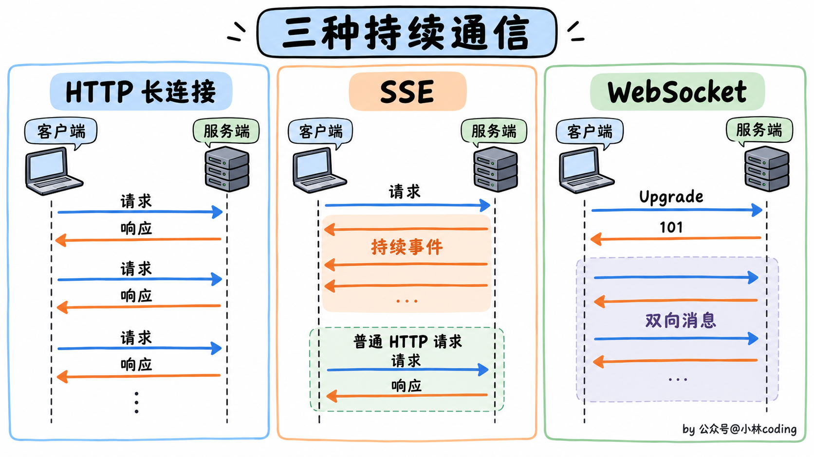

### 1.2.44 什么是跨域？CORS 是怎么解决跨域问题的？

浏览器用**同源策略**限制不同来源之间访问数据，协议、主机或端口任意一个不同，就属于不同源。比如 `https://api.example.com` 和 `https://www.example.com` 不同源。

CORS 的思路是：**服务端通过响应头告诉浏览器，哪些来源可以读取这个响应**。

- 满足条件的简单请求可以直接发送，浏览器再检查响应中的 Access-Control-Allow-Origin 等字段。
- 使用 PUT、Authorization 或 application/json 等不满足简单请求条件的请求，浏览器通常先发 **OPTIONS 预检**，询问服务端是否允许对应来源、方法和请求头，允许后再发实际请求。
- 如果要携带 Cookie 等凭证，客户端和服务端都要做相应配置，服务端允许的来源不能写成通配符 `*`，需要返回允许的具体来源，并设置 Access-Control-Allow-Credentials。

特别容易答错的一点是：**出现跨域错误，不代表请求一定没发到服务器。**简单请求可能已经执行了，只是浏览器不让页面读取响应，所以 CORS 不能当作通用的 CSRF 防护，也不能代替服务端鉴权。

### 1.2.45 正向代理和反向代理有什么区别？

**正向代理主要替客户端访问服务器，反向代理主要替服务器接收客户端请求。**

比如公司员工通过统一代理访问外部网站，这是正向代理。客户端把请求交给代理，再由代理访问目标服务器。

网站前面放一层 Nginx，把请求分配给后端多个服务实例，这是反向代理。用户访问的是网站的统一入口，不需要知道后面具体是哪台机器处理。

反向代理通常还能做 TLS 终止、负载均衡、缓存和限流。实际排查时，要把「客户端到代理」和「代理到后端」当作两段连接来看，前一段正常不代表后一段也正常。

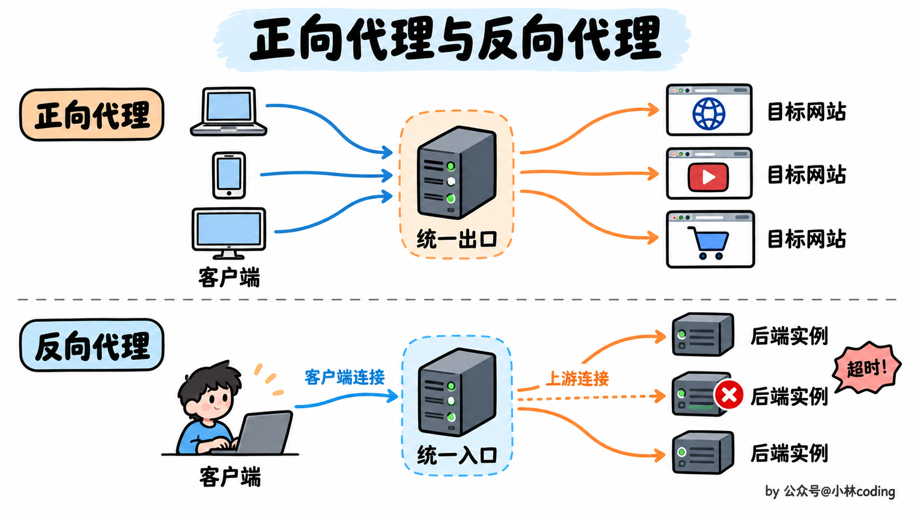

### 1.2.46 CDN 是怎么加速访问的？

CDN 的核心是**把内容缓存到靠近用户的边缘节点，减少到源站的传输距离和重复请求**。

一个典型过程是：

1. 用户访问网站，DNS 或其他调度机制把请求引导到合适的 CDN 节点。
2. 节点命中有效缓存，就直接返回资源。
3. 没有命中，或者缓存需要更新，就向源站请求内容，这个过程叫**回源**，然后按缓存规则保存和返回。

比如一张图片被全国各地的用户反复访问，没有 CDN 时都要跑到源站下载；有了 CDN，就可以在多个地区的边缘节点复用缓存。

CDN 是否有效还要看缓存命中率、回源耗时和资源类型。**用户登录信息、个人订单等内容不能随便放进共享缓存**，缓存 key 和缓存规则配错了，可能把一个用户的数据返回给另一个用户。

### 1.2.47 Nginx有哪些负载均衡算法？

- **轮询**：默认方式，依次把请求分配给后端服务器，也可以通过 weight 配置权重，让处理能力强的节点承担更多请求。
- **最少连接 least_conn**：优先选择活跃连接较少的后端，适合不同请求耗时差异较大的场景。不过连接少不一定代表 CPU 负载低。
- **IP 哈希 ip_hash**：根据客户端 IP 选择后端，可以做一定程度的会话保持。但多个用户经过同一个 NAT 出口时，可能集中到同一个节点。
- **通用哈希 hash**：根据指定的 key 选择后端，比如使用请求 URI。加上 consistent 可以使用一致性哈希，减少节点变化时的映射调整。
- **最短时间 least_time**：结合响应时间和连接情况选择后端，这是 NGINX Plus 的能力，不能当作所有开源 Nginx 都默认具备的功能。

面试里最好把算法和场景对应起来，比如静态资源缓存可以考虑按 URI 做哈希，耗时不均的请求可以考虑 least_conn。**会话保持不是 Session 共享的替代品**，节点故障时仍然要考虑会话能不能在其他节点继续使用。

### 1.2.48 Nginx位于七层网络结构中的哪一层？

要看使用哪个模块。

- 使用 **HTTP 模块**做反向代理时，会解析请求的域名、路径、头部等信息，通常说它是**七层负载均衡**。
- 使用 **stream 模块**代理 TCP、UDP 时，主要按连接或数据流转发，通常说它是**四层负载均衡**。

所以不能直接说「Nginx 只能工作在应用层」。同一个 Nginx 可以按配置提供不同层面的代理能力。

## 1.3 传输层

### 1.3.1 一条 TCP 连接是由什么唯一确定的？

通常由**源 IP、源端口、目的 IP、目的端口**这四个字段确定，也就是四元组。

比如一个服务监听 443 端口，可以同时接受很多客户端连接。虽然它们的服务端 IP 和端口相同，但客户端的 IP 或端口不同，内核就能区分不同连接。

因此，**不能因为端口号只有 16 位，就说一台服务器最多只能建立约 6 万条 TCP 连接**。连接数还取决于四元组组合、文件描述符、内存和应用处理能力；客户端向固定目标主动建连时，可用源端口则可能成为限制。

如果连接经过 NAT，转换设备还需要维护对应的映射，NAT 的端口和状态表也可能限制连接数量。

### 1.3.2 说一下tcp的头部

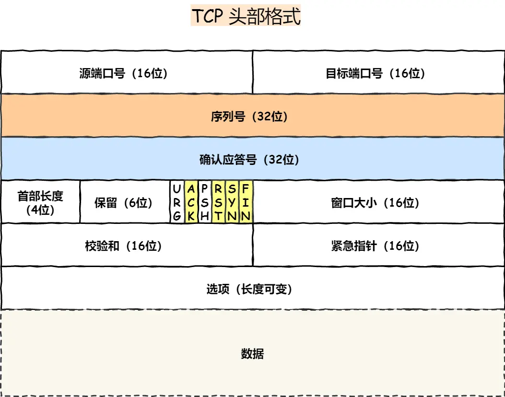

TCP 首部最少是 **20 字节**，带选项时最多是 **60 字节**。常见字段除了图里的源端口、目的端口，还有序列号、确认号、窗口大小、校验和及控制位。

**窗口大小**：接收方通告还能接收多少数据，用于流量控制。

**校验和**：检测报文在传输中是否发生损坏，它不是用于抵抗攻击的密码学校验。

下面重点说序列号、确认号和控制位。

**序列号**：在建立连接时由计算机生成的随机数作为其初始值，通过 SYN 包传给接收端主机，每发送一次数据，就「累加」一次该「数据字节数」的大小。**用来解决网络包乱序问题。**

**确认应答号**：指下一次「期望」收到的数据的序列号，发送端收到这个确认应答以后可以认为在这个序号以前的数据都已经被正常接收。**用来解决丢包的问题。**

**控制位：**

- *ACK*：该位为 1 时，「确认应答」的字段变为有效，连接建立后的数据报文通常会带 ACK，但不能说所有其他报文都必须带 ACK，比如某些 RST 报文就可以不带。
- *RST*：该位为 1 时，表示 TCP 连接中出现异常必须强制断开连接。
- *SYN*：该位为 1 时，表示希望建立连接，并在其「序列号」的字段进行序列号初始值的设定。
- *FIN*：该位为 1 时，表示今后不会再有数据发送，希望断开连接。当通信结束希望断开连接时，通信双方的主机之间就可以相互交换 FIN 位为 1 的 TCP 段。

### 1.3.3 TCP三次握手过程说一下？

TCP 是面向连接的协议，所以使用 TCP 前必须先建立连接，而**建立连接是通过三次握手来进行的**。三次握手的过程如下图：

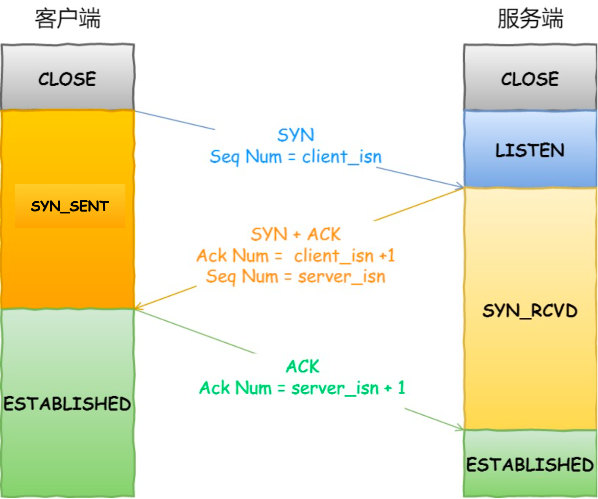

- 一开始，客户端和服务端都处于 CLOSED 状态。先是服务端主动监听某个端口，处于 LISTEN 状态

- 客户端会随机初始化序号（client_isn），将此序号置于 TCP 首部的「序号」字段中，同时把 SYN 标志位置为 1，表示 SYN 报文。接着把第一个 SYN 报文发送给服务端，表示向服务端发起连接，该报文不包含应用层数据，之后客户端处于 SYN-SENT 状态。

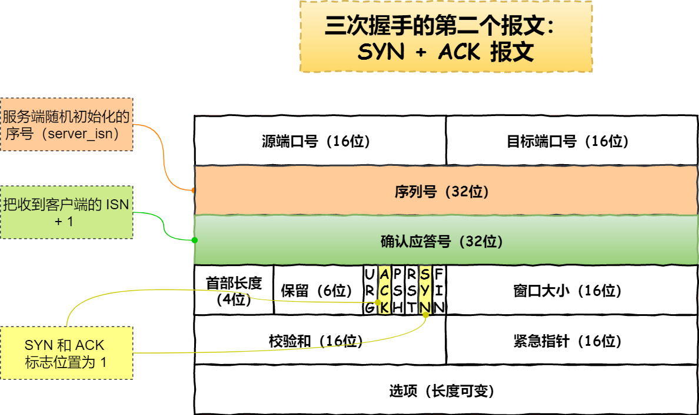

- 服务端收到客户端的 SYN 报文后，首先服务端也随机初始化自己的序号（server_isn），将此序号填入 TCP 首部的「序号」字段中，其次把 TCP 首部的「确认应答号」字段填入 client_isn + 1, 接着把 SYN 和 ACK 标志位置为 1。最后把该报文发给客户端，该报文也不包含应用层数据，之后服务端处于 SYN-RCVD 状态。

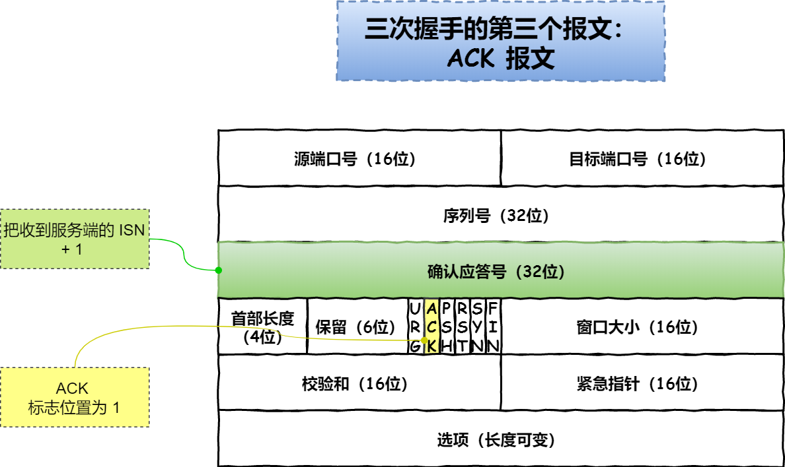

- 客户端收到服务端报文后，还要向服务端回应最后一个应答报文，首先该应答报文 TCP 首部 ACK 标志位置为 1 ，其次「确认应答号」字段填入 server_isn + 1 ，最后把报文发送给服务端，这次报文可以携带客户到服务端的数据，之后客户端处于 ESTABLISHED 状态。
- 服务端收到客户端的应答报文后，也进入 ESTABLISHED 状态。

普通 TCP 三次握手通常不在前两个报文里携带应用数据，**第三次握手可以携带数据**。不过这不是绝对限制，比如 TCP Fast Open 就允许在满足条件时让 SYN 携带数据。

SYN 会消耗一个序列号，所以确认号是初始序列号加 1；单纯的 ACK 不消耗序列号。

一旦完成三次握手，双方都处于 ESTABLISHED 状态，此时连接就已建立完成，客户端和服务端就可以相互发送数据了。

### 1.3.4 tcp为什么需要三次握手建立连接？

三次握手的原因：

- 阻止重复历史连接的初始化（主要原因）
- 同步双方的初始序列号
- 避免资源浪费

**原因一：避免历史连接**

我们考虑一个场景，客户端先发送了 SYN（seq = 90）报文，然后客户端宕机了，而且这个 SYN 报文还被网络阻塞了，服务并没有收到，接着客户端重启后，又重新向服务端建立连接，发送了 SYN（seq = 100）报文（**注意！不是重传 SYN，重传的 SYN 的序列号是一样的**）。

看看三次握手是如何阻止历史连接的：

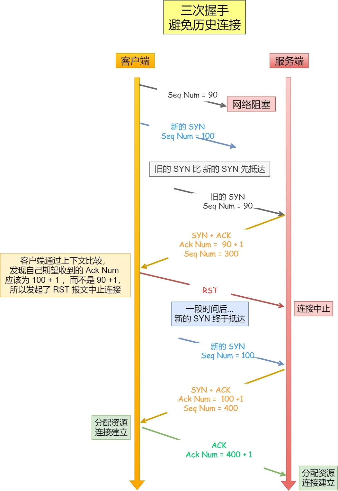

客户端连续发送多次 SYN（都是同一个四元组）建立连接的报文，在**网络拥堵**情况下：

- 一个「旧 SYN 报文」比「最新的 SYN」 报文早到达了服务端，那么此时服务端就会回一个 SYN + ACK 报文给客户端，此报文中的确认号是 91（90+1）。
- 客户端收到后，发现自己期望收到的确认号应该是 100 + 1，而不是 90 + 1，于是就会回 RST 报文。
- 服务端收到 RST 报文后，就会释放连接。
- 后续最新的 SYN 抵达了服务端后，客户端与服务端就可以正常的完成三次握手了。

上述中的「旧 SYN 报文」称为历史连接，TCP 使用三次握手建立连接的**最主要原因就是防止「历史连接」初始化了连接**。

**如果是两次握手连接，就无法阻止历史连接**，那为什么 TCP 两次握手为什么无法阻止历史连接呢？

主要是因为**在两次握手的情况下，服务端没有中间状态给客户端来阻止历史连接，导致服务端可能建立一个历史连接，造成资源浪费**。

在两次握手的情况下，服务端在收到 SYN 报文后，就进入 ESTABLISHED 状态，意味着这时可以给对方发送数据，但是客户端此时还没有进入 ESTABLISHED 状态，假设这次是历史连接，客户端判断到此次连接为历史连接，那么就会回 RST 报文来断开连接，而在假设的两次握手机制里，服务端发出 SYN + ACK 后就进入 ESTABLISHED 状态，所以它可以发送数据的，但是它并不知道这个是历史连接，它只有在收到 RST 报文后，才会断开连接。

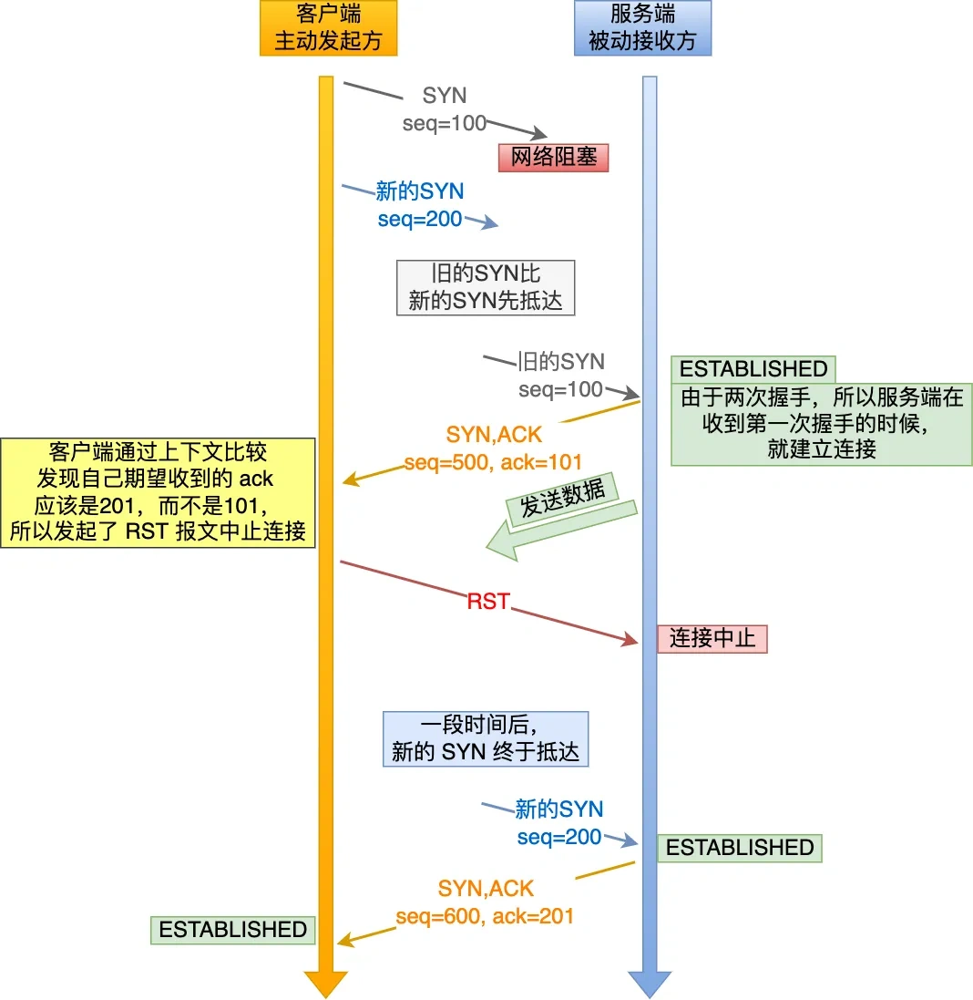

可以看到，如果采用两次握手建立 TCP 连接的场景下，服务端在向客户端发送数据前，并没有阻止掉历史连接，导致服务端建立了一个历史连接，又白白发送了数据，浪费了服务端的资源。

因此，**要解决这种现象，最好就是在服务端发送数据前，也就是建立连接之前，要阻止掉历史连接，这样就不会造成资源浪费，而要实现这个功能，就需要三次握手**。

所以，**TCP 使用三次握手建立连接的最主要原因是防止「历史连接」初始化了连接。**

**原因二：同步双方初始序列号**

TCP 协议的通信双方， 都必须维护一个「序列号」， 序列号是可靠传输的一个关键因素，它的作用：

- 接收方可以去除重复的数据；
- 接收方可以根据数据包的序列号按序接收；
- 可以标识发送出去的数据包中， 哪些是已经被对方收到的（通过 ACK 报文中的确认号知道）；

可见，序列号在 TCP 连接中占据着非常重要的作用，所以当客户端发送携带「初始序列号」的 SYN 报文的时候，需要服务端回一个 ACK 应答报文，表示客户端的 SYN 报文已被服务端成功接收，那当服务端发送「初始序列号」给客户端的时候，依然也要得到客户端的应答回应，**这样一来一回，才能确保双方的初始序列号能被可靠的同步。**

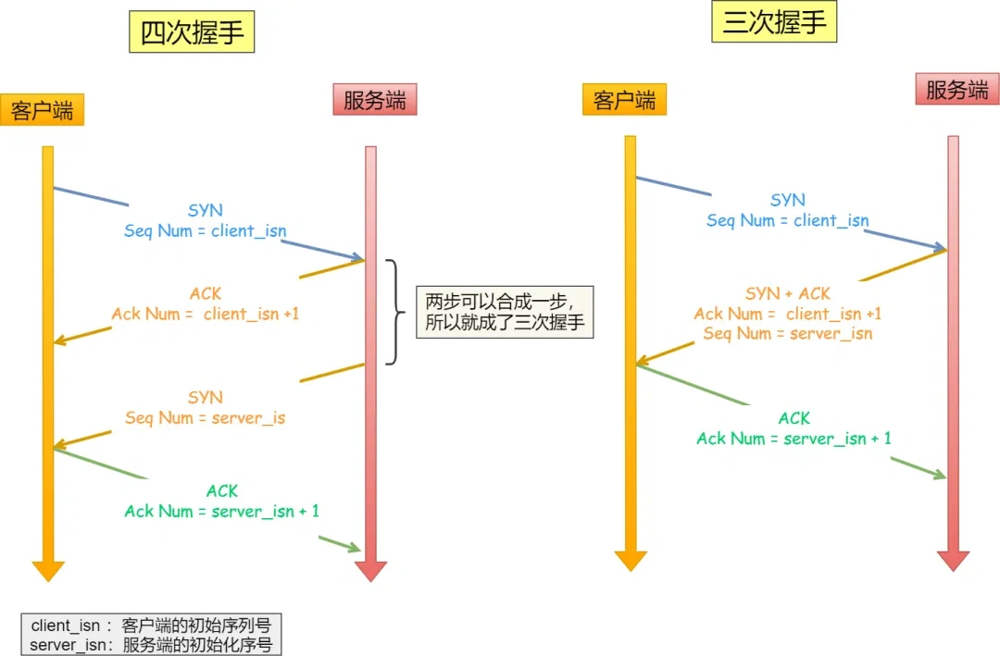

四次握手与三次握手

四次握手其实也能够可靠的同步双方的初始化序号，但由于**第二步和第三步可以优化成一步**，所以就成了「三次握手」。

而两次握手只保证了一方的初始序列号能被对方成功接收，没办法保证双方的初始序列号都能被确认接收。

**原因三：避免资源浪费**

如果只有两次握手，服务端发出 SYN + ACK 后就认为连接已经建立，但它并不知道客户端是否收到并接受了这个响应。

比如一个旧 SYN 在网络里绕了很久，才到达服务端。客户端已经不再需要这条连接，如果服务端直接建立完整连接并发送业务数据，就会白白占用资源。

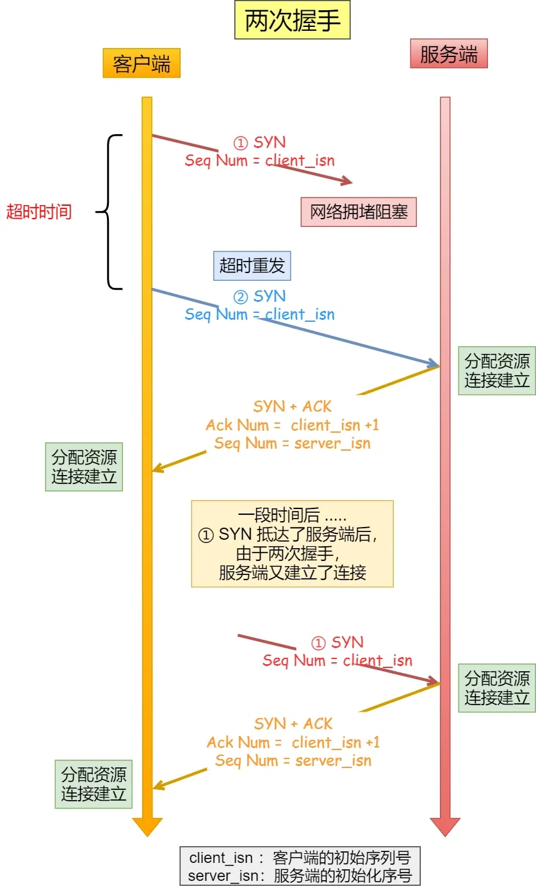

三次握手让服务端在得到客户端的确认之后，再建立正常的完整连接。不过，**第三次握手到达前，服务端通常仍然要占用半连接资源**，所以三次握手不能直接消除 SYN Flood 的风险。

还要注意，同一连接的 SYN 重传具有相同的序列号，服务端一般会识别为重传，不能简单说「每收到一个重复 SYN，就创建一条新连接」。

### 1.3.5 TCP 三次握手，客户端第三次发送的确认包丢失了发生什么？

客户端收到服务端的 SYN-ACK 报文后，就会给服务端回一个 ACK 报文，也就是第三次握手，此时客户端状态进入到 ESTABLISHED 状态。

因为这个第三次握手的 ACK 是对第二次握手的 SYN 的确认报文，所以当第三次握手丢失了，如果**服务端那一方迟迟收不到这个确认报文，就会触发超时重传机制，重传 SYN-ACK 报文，直到收到第三次握手，或者达到最大重传次数**。

注意，**纯 ACK 不会像数据或 SYN 那样启动自己的超时重传定时器**。服务端重传 SYN-ACK 后，客户端会再次回复 ACK。如果第三次握手携带了数据，那么数据仍然受重传机制保护。

还有一种情况：客户端已经进入 ESTABLISHED 并发送了数据，数据报文也会携带有效 ACK。如果服务端收到的报文满足握手完成条件，也可以据此完成握手，不一定非要等最开始的那个纯 ACK。

举个例子，假设 tcp_synack_retries 参数值为 2，那么当第三次握手一直丢失时，发生的过程如下图：

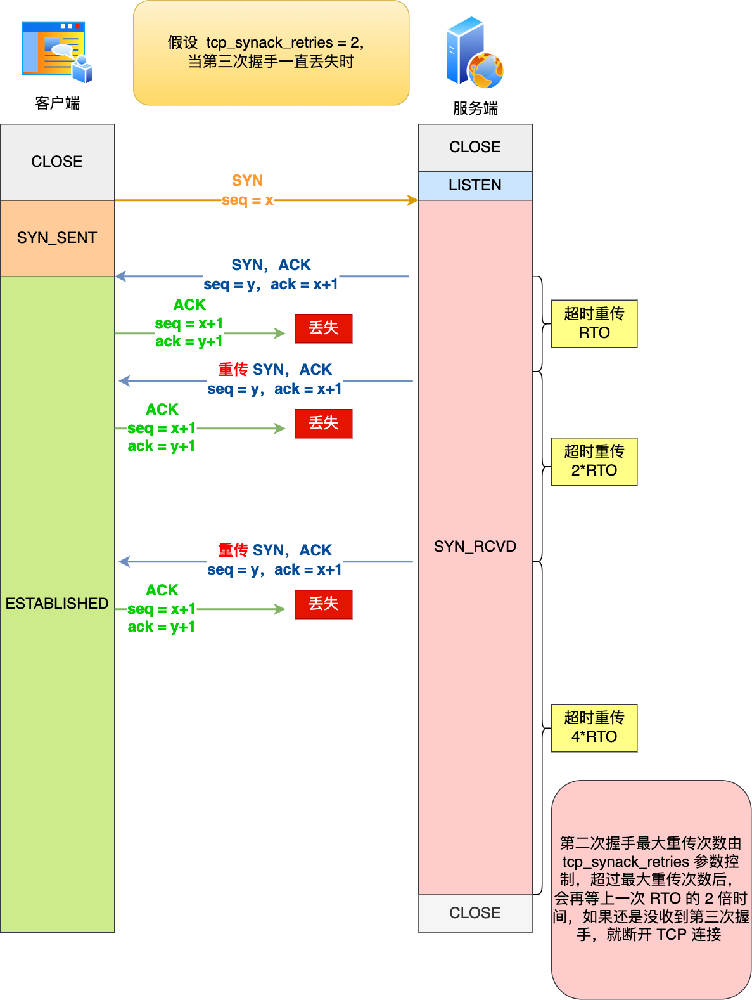

具体过程：

- 当服务端超时重传 2 次 SYN-ACK 报文后，由于 tcp_synack_retries 为 2，已达到最大重传次数，于是再等待一段时间（时间为上一次超时时间的 2 倍），如果还是没能收到客户端的第三次握手（ACK 报文），那么服务端就会断开连接。

### 1.3.6 服务端发送第二个报文后连接的状态进入什么状态

进入 **SYN_RCVD**，表示已经收到了客户端的 SYN，并发出了自己的 SYN + ACK，正在等待客户端确认。

客户端此时可能还在 SYN_SENT，也可能已经收到 SYN + ACK 并进入 ESTABLISHED，不能认为两端状态总是同步变化。

### 1.3.7 三次握手和 accept 是什么关系？ accept 做了哪些事情？

**三次握手由内核完成，accept 负责取出已经建立的连接，不负责发起或完成握手。**

服务端调用 listen 后，内核开始处理连接请求。正常完成三次握手的连接会进入全连接队列，也叫 accept 队列，等待应用程序取走。

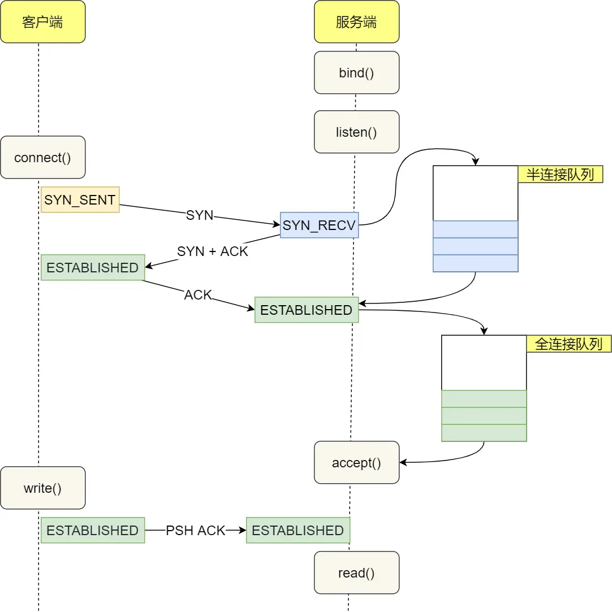

应用调用 accept 时，会从队列中取出连接，返回一个**新的已连接 socket 文件描述符**，后续用这个描述符收发数据。原来的监听 socket 继续接收其他连接。

队列为空时，阻塞 accept 会等待；非阻塞 accept 会返回 EAGAIN 或 EWOULDBLOCK。**即使应用暂时没有调用 accept，内核也可能已经完成握手并接收数据**，只是如果应用长期不取连接，全连接队列可能被占满。

### 1.3.8 客户端发送的第一个 SYN 报文，服务器没有收到怎么办？

客户端发送 SYN 后进入 **SYN_SENT**。如果一直没有收到服务端的 SYN + ACK，就会超时重传 SYN，**同一次连接的 SYN 重传使用相同的初始序列号**。

在 Linux 中，可以通过下面的参数查看主动建连的 SYN 重试配置：

```shell
cat /proc/sys/net/ipv4/tcp_syn_retries
```

具体重试次数和间隔要看内核版本、系统配置及 socket 选项，不能把「默认一定重传 5 次、一定等 63 秒」当成所有系统的规则。

如果按初始超时 1 秒、指数退避、最多重传 5 次的简化模型举例，重传前的等待时间依次是 1、2、4、8、16 秒，最后再等 32 秒，总共 63 秒。**这些是每一轮的等待时长，不是从第一次发包起算的重传时刻**。

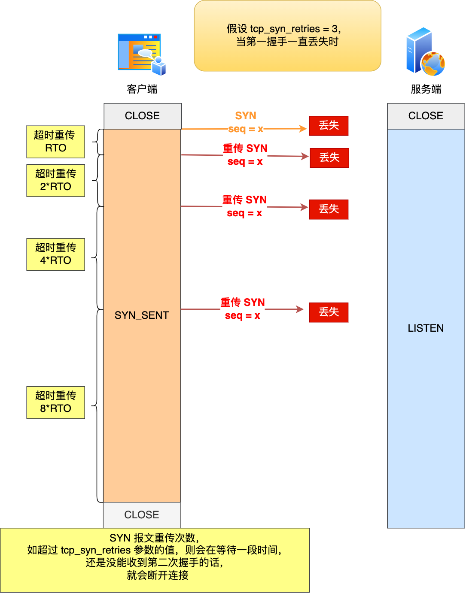

部分较新的 Linux 内核还支持 tcp_syn_linear_timeouts，可能先使用若干次相同间隔，再进入指数退避。实际排查应该以本机配置和抓包时间为准。最终超过重试或超时限制，connect 会失败；应用也可以设置更短的建连超时。

### 1.3.9 服务器收到第一个 SYN 报文，回复的 SYN + ACK 报文丢失了怎么办？

当服务端收到客户端的第一次握手后，就会回 SYN-ACK 报文给客户端，这个就是第二次握手，此时服务端会进入 SYN_RCVD 状态。

第二次握手的 SYN-ACK 报文其实有两个目的 ：

- 第二次握手里的 ACK， 是对第一次握手的确认报文；
- 第二次握手里的 SYN，是服务端发起建立 TCP 连接的报文；

所以，如果第二次握手丢了，就会发生比较有意思的事情，具体会怎么样呢？

因为第二次握手报文里是包含对客户端的第一次握手的 ACK 确认报文，所以，如果客户端迟迟没有收到第二次握手，那么客户端就觉得可能自己的 SYN 报文（第一次握手）丢失了，于是**客户端就会触发超时重传机制，重传 SYN 报文**。

然后，因为第二次握手中包含服务端的 SYN 报文，所以当客户端收到后，需要给服务端发送 ACK 确认报文（第三次握手），服务端才会认为该 SYN 报文被客户端收到了。

那么，如果第二次握手丢失了，服务端就收不到第三次握手，于是**服务端这边会触发超时重传机制，重传 SYN-ACK 报文**。

在 Linux 下，SYN-ACK 报文的最大重传次数由 tcp_synack_retries内核参数决定，默认值是 5。

```shell
# cat /proc/sys/net/ipv4/tcp_synack_retries
5
```

因此，当第二次握手丢失了，客户端和服务端都会重传：

- 客户端会重传 SYN 报文，也就是第一次握手，最大重传次数由 tcp_syn_retries内核参数决定；
- 服务端会重传 SYN-ACK 报文，也就是第二次握手，最大重传次数由 tcp_synack_retries 内核参数决定。

举个例子，假设 tcp_syn_retries 参数值为 1，tcp_synack_retries 参数值为 2，那么当第二次握手一直丢失时，发生的过程如下图：

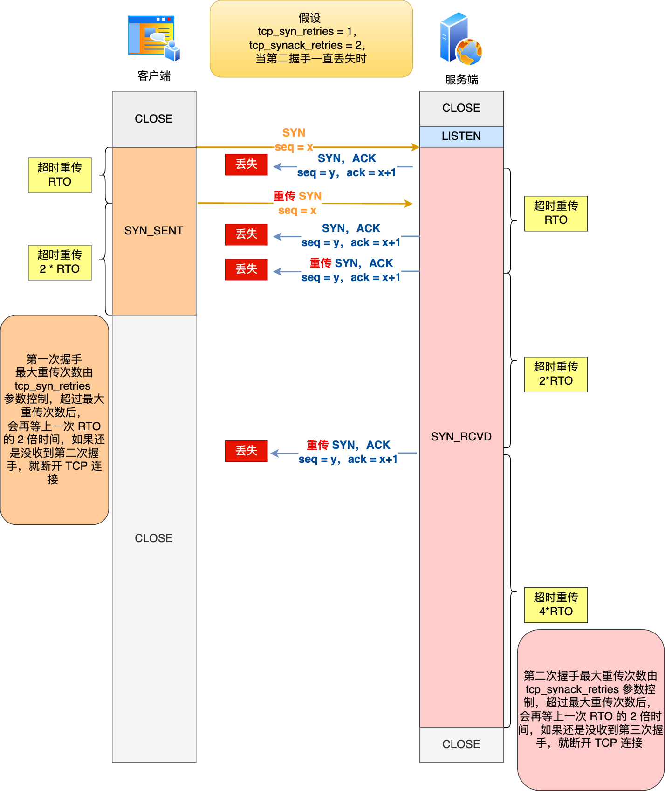

具体过程：

- 当客户端超时重传 1 次 SYN 报文后，由于 tcp_syn_retries 为 1，已达到最大重传次数，于是再等待一段时间（时间为上一次超时时间的 2 倍），如果还是没能收到服务端的第二次握手（SYN-ACK 报文），那么客户端就会断开连接。
- 当服务端超时重传 2 次 SYN-ACK 报文后，由于 tcp_synack_retries 为 2，已达到最大重传次数，于是再等待一段时间（时间为上一次超时时间的 2 倍），如果还是没能收到客户端的第三次握手（ACK 报文），那么服务端就会断开连接。

### 1.3.10 假设客户端重传了 SYN 报文，服务端这边又收到重复的 SYN 报文怎么办？

如果服务端仍然处于 SYN_RCVD，并且收到的是同一个连接、相同初始序列号的 SYN 重传，通常会继续回复 SYN + ACK，等待第三次握手。

**这不是再创建一条完整连接**。如果连接已经建立，或者新 SYN 的序列号不同，就要根据当前状态和序列号等规则处理，不能把所有 SYN 都当成相同的重传。

### 1.3.11 第一次握手，服务端收到 SYN 并回复 SYN + ACK 时，内部做了哪些工作？

服务端收到客户端发起的 SYN 请求后，**内核会把该连接存储到半连接队列**，并向客户端响应 SYN+ACK，接着客户端会返回 ACK，服务端收到第三次握手的 ACK 后，**内核会把连接从半连接队列移除，然后创建新的完全的连接，并将其添加到 accept 队列，等待进程调用 accept 函数时把连接取出来。**


半连接队列保存握手尚未完成的请求，全连接队列保存已经建立、等待 accept 的连接，它们都有容量限制。

半连接队列满时，可能丢弃 SYN，也可能在开启 SYN Cookies 后使用 Cookie 响应。全连接队列满时，Linux 的处理还取决于 tcp_abort_on_overflow 等配置，可能暂时忽略握手确认，也可能返回 RST，不能把两种队列的行为混为一谈。

### 1.3.12 大量SYN包发送给服务端服务端会发生什么事情？

如果大量 SYN 请求没有完成第三次握手，就可能把 **TCP 半连接队列占满**，正常用户的请求也就难以建立连接，这就是 SYN Flood 的典型影响。

还要区分另一种情况：如果握手都完成了，但应用来不及 accept，压力主要在**全连接队列和应用处理能力**，不是同一个问题。

常见应对方式有以下几种：

#### 开启 SYN Cookies

Linux 可以在半连接队列压力较大时，把必要信息编码进 SYN + ACK 的初始序列号，不为这次请求保存常规半连接状态。收到第三次握手后，再验证 Cookie 并尝试建立连接。

net.ipv4.tcp_syncookies 常见取值为：

- **0**：关闭。
- **1**：半连接队列溢出时启用。
- **2**：无条件使用，具体支持情况要看内核版本。

**SYN Cookies 只是缓解半连接资源耗尽，不保证任何攻击下都能正常建连**。如果带宽、CPU 或全连接队列也被打满，仍然会影响服务。

#### 调整队列和处理能力

tcp_max_syn_backlog 与半连接容量相关；listen 的 backlog 和 somaxconn 主要限制全连接队列。可以结合丢包和队列指标调整，但扩大队列并不能替代提升 accept 和业务处理速度。

netdev_max_backlog 管的是部分接收路径上来不及处理的数据包队列，**不是 TCP 半连接队列**，不能把它作为 SYN Flood 的通用解法。

#### 控制异常流量

可以结合接入层限速、SYN 代理、上游流量清洗等手段过滤攻击。如果带宽已经在服务器之前被耗尽，只调服务器参数解决不了问题。

适当减少 SYN + ACK 重试可以更快释放半连接资源，但也会降低高延迟、丢包环境下正常用户的建连成功率，要结合实际情况调整。

### 1.3.13 TCP 四次挥手过程说一下？

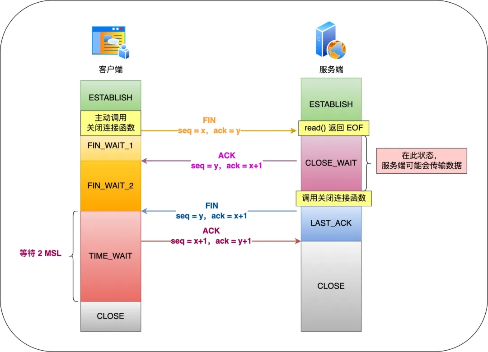

具体过程：

- 客户端主动调用关闭连接的函数，于是就会发送 FIN 报文，这个 FIN 报文代表客户端不会再发送数据了，进入 FIN_WAIT_1 状态；
- 服务端收到 FIN 后回复 ACK，进入 CLOSE_WAIT；客户端收到这个 ACK 后，进入 FIN_WAIT_2。FIN 表示对端的发送方向结束，并不是在缓冲区里放入一个普通的 EOF 字符。服务端应用先读完 FIN 之前的所有数据，之后 read 才会返回 0，表示这个方向不会再有数据；
- 接着，当服务端在 read 数据的时候，最后自然就会读到 EOF，接着 **read() 就会返回 0，这时服务端应用程序如果有数据要发送的话，就发完数据后才调用关闭连接的函数，如果服务端应用程序没有数据要发送的话，可以直接调用关闭连接的函数**，这时服务端就会发一个 FIN 包，这个 FIN 报文代表服务端不会再发送数据了，之后处于 LAST_ACK 状态；
- 客户端接收到服务端的 FIN 包，并发送 ACK 确认包给服务端，此时客户端将进入 TIME_WAIT 状态；
- 服务端收到 ACK 确认包后，就进入了最后的 CLOSED 状态；
- 客户端经过 2MSL 时间之后，也进入 CLOSED 状态；

### 1.3.14 为什么 TCP 关闭连接通常需要四次挥手？

服务器收到客户端的 FIN 报文时，内核会马上回一个 ACK 应答报文，**但是服务端应用程序可能还有数据要发送，所以并不能马上发送 FIN 报文，而是将发送 FIN 报文的控制权交给服务端应用程序**：

- 有数据要发送的话，就发完数据后，才调用关闭连接的函数；
- 没有数据要发送的话，可以直接调用关闭连接的函数，

从上面过程可知，是否要发送第三次挥手的控制权不在内核，而是在被动关闭方（上图的服务端）的应用程序，因为应用程序可能还有数据要发送，由应用程序决定什么时候调用关闭连接的函数，当调用了关闭连接的函数，内核就会发送 FIN 报文了，所以服务端的 ACK 和 FIN 一般都会分开发送。

### 1.3.15 第二次和第三次挥手能合并嘛

**可以合并，四次挥手不是固定必须发四个独立报文。**

服务端收到 FIN 后，如果已经没有数据要发送，应用也及时关闭了发送方向，内核就有机会把对客户端 FIN 的确认和自己的 FIN 放在同一个报文中，发送 FIN + ACK。

能不能合并，要看关闭时机和具体实现。延迟确认可能给合并提供机会，但不是协议规定必须满足的开关条件。关键是**发送这个 ACK 的时候，自己的发送方向是否也已经可以结束**。

### 1.3.16 第三次挥手一直没发，会发生什么？

主动关闭方收到自己 FIN 的确认后进入 **FIN_WAIT_2**，等待对方的 FIN；被动关闭方可能还在 CLOSE_WAIT，继续处理剩余数据。

要分两种情况：

- **应用只调用 shutdown(SHUT_WR)**：本端不能继续发送数据，但还保留接收能力，可以**继续读取对端发来的内容**。如果没有其他超时，等待可能持续很久。
- **应用关闭了最后一个 socket 引用，成为孤儿连接**：内核不能一直为它保留资源。Linux 的 tcp_fin_timeout 会影响这类 FIN_WAIT_2 连接的等待时长，常见默认值为 60 秒，socket 的 TCP_LINGER2 等设置也可能影响实际行为。

所以，不能把「对端不发 FIN，就一定一直等待」或者「所有 FIN_WAIT_2 都在 60 秒后关闭」当成通用结论。还要回头检查被动关闭方的应用为什么没有完成关闭。

### 1.3.17 第二次和第三次挥手之间，主动断开的那端能干什么

如果主动断开的一方，是**调用了 shutdown 函数来关闭连接**，并且只选择了关闭发送能力且**没有关闭接收能力的话**，那么主动断开的一方在第二次和第三次挥手之间**还可以接收数据**。

### 1.3.18 断开连接时客户端 FIN 包丢失，服务端的状态是什么？

如果第一次挥手的 FIN 一直没有到达服务端，**服务端通常仍然处于 ESTABLISHED**，因为它还不知道客户端已经决定关闭发送方向。

客户端发送 FIN 后进入 FIN_WAIT_1，迟迟收不到确认就会重传 FIN。只要某次重传到达，服务端就能回复 ACK，并进入 CLOSE_WAIT。

如果一直无法得到确认，客户端最终可能因为重传超时而释放连接。对于 Linux 中已经没有应用持有的孤儿连接，tcp_orphan_retries 等配置会影响处理，但不能把它当成所有 FIN 重传场景的统一次数限制。

**客户端超时，不代表服务端同时关闭**。服务端可能要到后续发送数据、收到 RST，或者自己的超时机制触发时，才能感知这条连接已经失效。

### 1.3.19 为什么四次挥手之后要等2MSL?

MSL 是 Maximum Segment Lifetime，也就是**报文最大生存时间**。等待 2MSL 主要有两个目的：

- **让被动关闭方有机会收到最后的 ACK**。如果 ACK 丢失，服务端会重传 FIN。客户端保留 TIME_WAIT 状态，就还能识别这个 FIN，再次回复 ACK。否则服务端可能无法正常结束关闭过程。
- **让旧连接的报文在网络里消失**。如果立即用相同的四元组建立新连接，旧报文可能混入新连接。等待一段时间，可以降低这种干扰。

收到重传 FIN 并再次回复 ACK 后，TIME_WAIT 计时通常会重新开始。

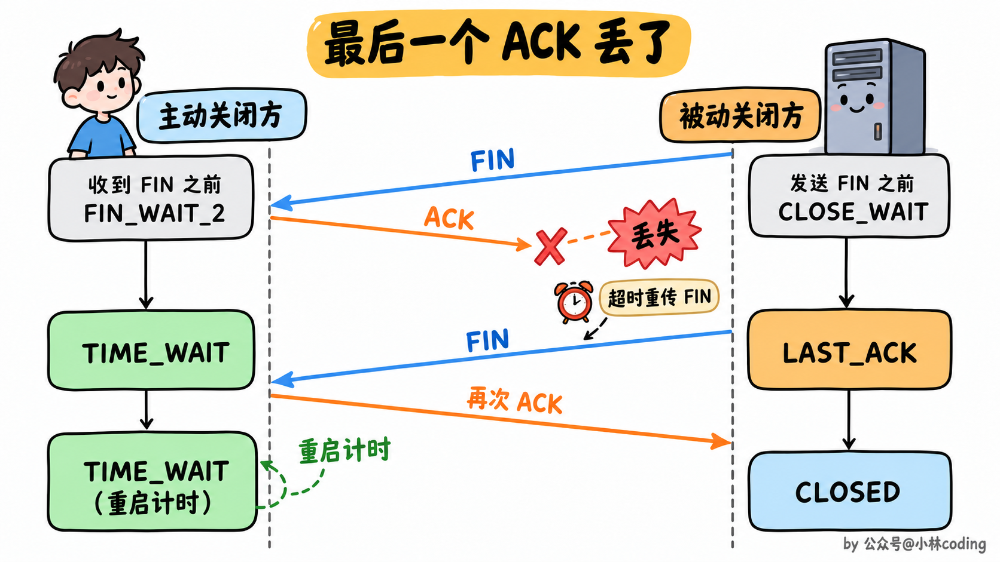

**MSL 是时间概念，IP 的 TTL 主要限制跳数，两者不能直接换算**，不能说「TTL 为 64，所以 30 秒内一定消失」。Linux 中常见的 TIME_WAIT 等待时长是 60 秒，但这是实现选择，不是所有系统都统一的值。

还有个常见追问：tcp_fin_timeout 能不能缩短 TIME_WAIT？**不能直接这样理解，它主要影响孤儿连接在 FIN_WAIT_2 的等待时间，不是 TIME_WAIT 的计时参数。**

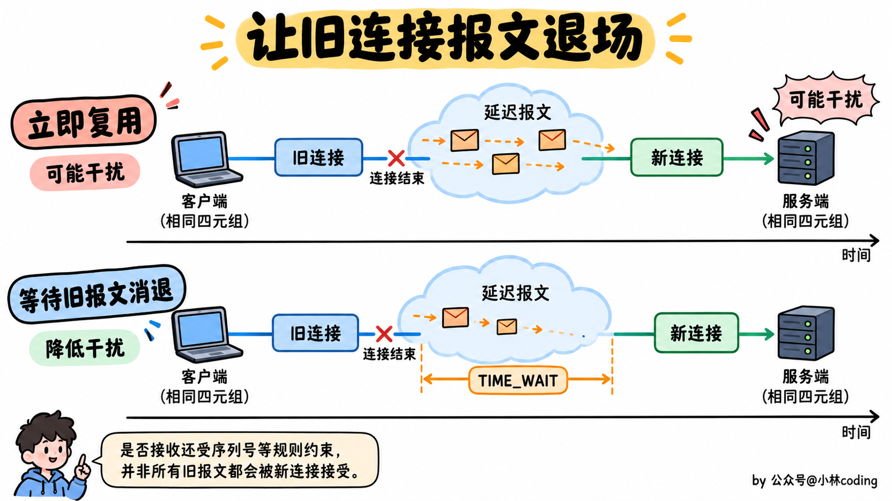

### 1.3.20 服务端出现大量的timewait有哪些原因?

**什么场景下服务端会主动断开连接呢？**

- HTTP 没有使用长连接
- HTTP 长连接超时
- HTTP 长连接的请求数量达到上限

#### 第一个场景：HTTP 没有使用长连接

我们先来看看 HTTP 长连接（Keep-Alive）机制是怎么开启的。

在 HTTP/1.0 中默认是关闭的，如果浏览器要开启 Keep-Alive，它必须在请求的 header 中添加：

```plain
Connection: Keep-Alive
```

然后当服务器收到请求，作出回应的时候，它也被添加到响应中 header 里：

```plain
Connection: Keep-Alive
```

这样做，TCP 连接就不会中断，而是保持连接。当客户端发送另一个请求时，它会使用同一个 TCP 连接。这一直继续到客户端或服务器端提出断开连接。

**HTTP/1.1 默认使用持久连接**，不需要每次显式发送 Connection: Keep-Alive。这里讨论的是 HTTP/1.x，HTTP/2、HTTP/3 的连接管理不能直接套用这个头字段。

如果要关闭 HTTP Keep-Alive，需要在 HTTP 请求或者响应的 header 里添加 Connection:close 信息，也就是说，**只要客户端和服务端任意一方的 HTTP header 中有** **Connection:close** **信息，那么就无法使用 HTTP 长连接的机制**。

关闭 HTTP 长连接机制后，每次请求都要经历这样的过程：建立 TCP -> 请求资源 -> 响应资源 -> 释放连接，那么此方式就是 **HTTP 短连接**

在前面我们知道，只要任意一方的 HTTP header 中有 Connection:close 信息，就无法使用 HTTP 长连接机制，这样在完成一次 HTTP 请求/处理后，就会关闭连接。

问题来了，**这时候是客户端还是服务端主动关闭连接呢？**

在 RFC 文档中，并没有明确由谁来关闭连接，**请求和响应的双方都可以主动关闭 TCP 连接。**

不过，**根据大多数 Web 服务的实现，不管哪一方禁用了 HTTP Keep-Alive，都是由服务端主动关闭连接**，那么此时服务端上就会出现 TIME_WAIT 状态的连接。

#### 第二个场景：HTTP 长连接超时

HTTP 长连接允许在一次请求结束后继续复用连接，但客户端、服务端或者中间代理都可能因为空闲超时、请求数量限制等原因关闭连接。

HTTP 长连接可以在同一个 TCP 连接上接收和发送多个 HTTP 请求/应答，避免了连接建立和释放的开销。

可能有的同学会问，如果使用了 HTTP 长连接，如果客户端完成一个 HTTP 请求后，就不再发起新的请求，此时这个 TCP 连接一直占用着不是挺浪费资源的吗？

对没错，所以为了避免资源浪费的情况，web 服务软件一般都会提供一个参数，用来指定 HTTP 长连接的超时时间，比如 nginx 提供的 keepalive_timeout 参数。

假设设置了 HTTP 长连接的超时时间是 60 秒，nginx 就会启动一个「定时器」，**如果客户端在完后一个 HTTP 请求后，在 60 秒内都没有再发起新的请求，定时器的时间一到，nginx 就会触发回调函数来关闭该连接，那么此时服务端上就会出现 TIME_WAIT 状态的连接**。

当服务端出现大量 TIME_WAIT 状态的连接时，如果现象是有大量的客户端建立完 TCP 连接后，很长一段时间没有发送数据，那么大概率就是因为 HTTP 长连接超时，导致服务端主动关闭连接，产生大量处于 TIME_WAIT 状态的连接。

可以往网络问题的方向排查，比如是否是因为网络问题，导致客户端发送的数据一直没有被服务端接收到，以至于 HTTP 长连接超时。

#### 第三个场景：HTTP 长连接的请求数量达到上限

Web 服务端通常会有个参数，来定义一条 HTTP 长连接上最大能处理的请求数量，当超过最大限制时，就会主动关闭连接。

比如 nginx 的 keepalive_requests 这个参数，这个参数是指一个 HTTP 长连接建立之后，nginx 就会为这个连接设置一个计数器，记录这个 HTTP 长连接上已经接收并处理的客户端请求的数量。**如果达到这个参数设置的最大值时，则 nginx 会主动关闭这个长连接**，那么此时服务端上就会出现 TIME_WAIT 状态的连接。

keepalive_requests 的默认值与版本有关，Nginx 1.19.10 之前是 100，之后改为 1000。实际排查时要看运行版本和生效配置，不能只记一个固定默认值。

但是，**对于一些 QPS 比较高的场景，比如超过 10000 QPS，甚至达到 30000 , 50000 甚至更高，如果 keepalive_requests 参数值是 100，这时候就 nginx 就会很频繁地关闭连接，那么此时服务端上就会出大量的 TIME_WAIT 状态**。

如果确认连接因为请求次数限制频繁关闭，可以适当调大 keepalive_requests。不过它不是越大越好，连接周期性关闭也有释放相关内存的作用，还要结合连接数量和内存占用判断。

另外，**TIME_WAIT 多不等于一定有故障**。要看是否造成端口、内存等资源压力，再从减少短连接、改善连接复用和调整连接生命周期入手。服务端作为监听方时，也不能简单把 TIME_WAIT 数量等同于临时端口被耗尽。

### 1.3.21 服务端出现大量 CLOSE_WAIT 是什么原因？

**CLOSE_WAIT 表示对端已经关闭发送方向，本端也已经确认，但本端应用还没有关闭自己的发送方向。**

比如客户端发送 FIN，服务端内核回复 ACK 后进入 CLOSE_WAIT。服务端把剩余数据发送完，并关闭对应 socket 后，才会继续发送 FIN，进入 LAST_ACK。

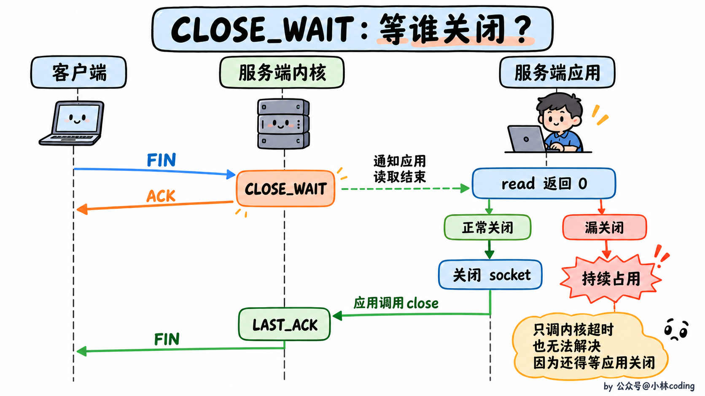

短暂的 CLOSE_WAIT 很正常，但如果大量连接长期停在这里，常见原因是：

- 程序发现 read 返回 0 后，没有关闭连接。
- 异常分支漏掉了连接释放，比如超时、解析失败时直接返回。
- 业务线程卡住了，一直没有执行到关闭逻辑。
- 连接池、流对象或 socket 的引用没有正确释放。

排查时可以用 `ss -tanp` 找到对应进程，再结合文件描述符、线程栈和业务日志检查。**这类问题通常要修复应用的资源释放逻辑，调小 tcp_fin_timeout 不能直接清掉 CLOSE_WAIT。**

### 1.3.22 TCP和UDP区别是什么？

| 对比项          | TCP                                                          | UDP                                                          |
| --------------- | ------------------------------------------------------------ | ------------------------------------------------------------ |
| 连接特性        | 面向连接，三次握手建立连接，四次挥手断开；connect 用于建立真实连接 | 无连接；调用 connect 仅绑定默认对端，没有握手流程，不建立连接 |
| 可靠性          | 可靠传输：ACK 确认、超时重传、去重、有序交付；极端情况连接失败会向上抛错 | 不可靠：无确认、无重传、不保证有序、不保证送达               |
| 消息边界        | 字节流，**无消息边界**，存在粘包拆包问题                     | 数据报，保留报文边界，一次收发对应一个报文                   |
| 流控 & 拥塞控制 | 内置流量控制、拥塞控制                                       | 协议本身没有；上层可自行实现（如 QUIC）                      |
| 首部开销        | 20～60 字节                                                  | 固定 8 字节                                                  |
| 通信模式        | 一对一通信                                                   | 支持一对一、组播、广播                                       |

选择时不能简单说「要快就用 UDP，要可靠就用 TCP」。DNS 查询、实时媒体等场景经常使用 UDP，但还要考虑重试、实时性、拥塞控制等需求。**使用 UDP 不等于应用就不能可靠传输，只是这些能力要由上层负责。**

### 1.3.23 TCP为什么可靠传输

- **序列号**：对字节编号，接收方据此重组乱序数据、识别重复数据，保证交给应用的字节按顺序排列。
- **确认应答**：ACK 里的确认号表示下一次期望收到的字节序号。比如 ACK=1001，表示序号 1001 之前的字节已经连续收到，这叫累计确认。
- **重传**：发送方在超时或者判断某段数据丢失后重发。如果 ACK 丢失，后续累计 ACK 也可能确认前面的数据，不一定每丢一个 ACK 就重传一次。
- **校验和**：检测传输损坏，出错的报文会被丢弃，再由重传补上。
- **流量控制**：接收方通告窗口，防止发送方把接收缓冲区撑满。
- **拥塞控制**：根据网络反馈调整发送量，避免不断重传让网络更加拥堵。

还要注意可靠性的边界：**收到 TCP ACK，说明数据到了对端的 TCP 接收端，不代表对端应用已经处理成功，更不代表数据已经写入数据库。**比如下单接口收到数据后宕机，订单是否创建成功，还要靠业务响应、查询和幂等机制判断。

### 1.3.24 怎么用UDP实现http？

HTTP/3 的做法是：**在 UDP 上实现 QUIC，再在 QUIC 上传输 HTTP**，而不是直接把原来的 HTTP/1.1 报文换成 UDP 发送。

- **可靠传输**：利用包编号、ACK、丢包检测和重传等机制保证流数据交付。丢失的是包，但重传的是仍然需要发送的帧信息，新包使用新的包编号。
- **有序交付**：每个 Stream 有自己的偏移量和顺序，不同 Stream 之间可以独立处理。
- **流量控制和拥塞控制**：限制单个流及连接的数据量，并根据网络状况调整发送。
- **安全通信**：集成 TLS 1.3，为数据提供加密和完整性保护。
- **连接迁移**：使用 Connection ID 等机制，在符合条件的网络切换中继续使用原连接。

**标准 QUIC 并不依赖前向纠错来保证可靠性**。面试里把确认、丢包检测和重传讲清楚就可以，不要把早期实验方案当成必备功能。

### 1.3.25 TCP粘包怎么解决？

TCP 是字节流，**一次 send 不对应一次 read**。两次发送的内容可能被一次读到，一条消息也可能分多次才能读完，这就是应用里常说的粘包和拆包。

它不是 TCP 传错了数据，而是应用没有正确处理消息边界。所以解决办法是在应用层定义消息格式，并持续解析接收到的字节。

一般有三种方式分包的方式：

- 固定长度的消息；
- 特殊字符作为边界；
- 自定义消息结构。

#### 固定长度的消息

比如规定一个消息的长度是 64 个字节，当接收方接满 64 个字节，就认为这个内容是一个完整且有效的消息。

但是这种方式灵活性不高，实际中很少用。

#### 特殊字符作为边界

我们可以在两个用户消息之间插入一个特殊的字符串，这样接收方在接收数据时，读到了这个特殊字符，就把认为已经读完一个完整的消息。

HTTP 是一个非常好的例子。

HTTP/1.1 的头字段用回车换行分隔，头部以 `\r\n\r\n` 结束，但这不等于整个报文都结束了。正文还要结合 Content-Length 或 chunked 等规则读取，不能在正文里看到回车换行就当作消息结束。

有一点要注意，这个作为边界点的特殊字符，如果刚好消息内容里有这个特殊字符，我们要对这个字符转义，避免被接收方当作消息的边界点而解析到无效的数据。

#### 自定义消息结构

我们可以自定义一个消息结构，由包头和数据组成，其中包头包是固定大小的，而且包头里有一个字段来说明紧随其后的数据有多大。

比如这个消息结构体，首先 4 个字节大小的变量来表示数据长度，真正的数据则在后面。

```text
struct { 
    u_int32_t message_length; 
    char message_data[]; 
} message;
```

当接收方接收到包头的大小（比如 4 个字节）后，就解析包头的内容，于是就可以知道数据的长度，然后接下来就继续读取数据，直到读满数据的长度，就可以组装成一个完整的用户消息来处理了。

实际写代码时，还要处理包头只读到一部分、一次读到多条消息等情况，并校验长度字段，限制最大消息大小。**关闭 Nagle 或改成一次 send，只会影响发送行为，不能替代应用层分包。**

### 1.3.26 TCP 流量控制和拥塞控制有什么区别？

**流量控制管「接收方来不来得及收」，拥塞控制管「网络承不承受得住」。**

- **流量控制**：由接收方通过接收窗口 rwnd 通告自己还能接收多少数据，避免发送方把接收缓冲区写满。
- **拥塞控制**：发送方维护拥塞窗口 cwnd，根据 ACK、丢包、ECN 等反馈判断网络情况，控制在网络里的数据量。

发送方在途、尚未确认的数据量，通常要同时受两者约束，可以近似理解为：

```text
允许的在途数据上限 = min(rwnd, cwnd)
```

如果上限是 10 KB，但已经有 6 KB 尚未确认，就不能再直接发 10 KB，而是还剩大约 4 KB 的空间。

举个例子，接收方处理很快，但网络链路已经拥堵，这时主要受 cwnd 限制；网络很空闲，但接收方业务线程不读数据，这时主要受 rwnd 限制。

### 1.3.27 TCP 接收窗口变成 0，会发生什么？

接收方来不及读取数据，缓冲区没有空间时，可以通告**零窗口**。发送方收到后，会暂停发送新的普通数据，但连接不会因此立即断开。

等接收方腾出空间，会发送窗口更新。问题是，如果这个更新报文丢了，发送方一直等窗口打开，接收方一直等新数据，就可能互相等下去。

所以 TCP 有**持续计时器和零窗口探测**，发送方隔一段时间发出探测，让接收方回复当前窗口，避免因为窗口更新丢失而一直卡住。

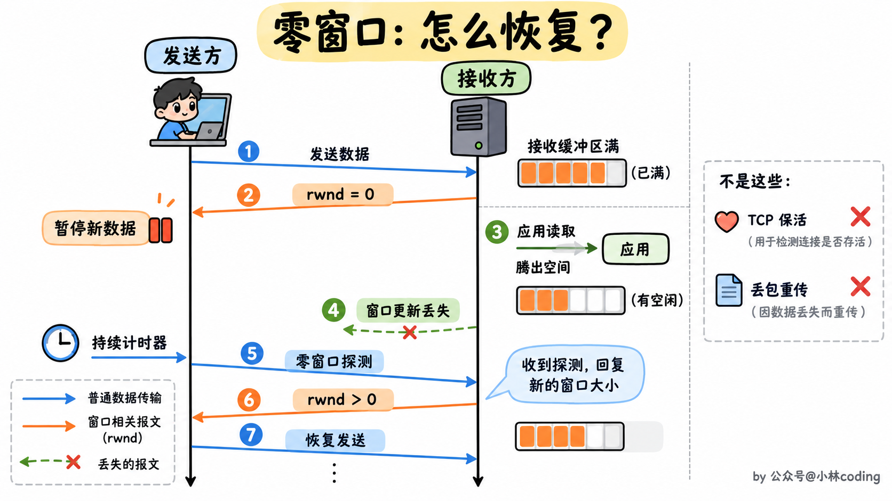

排障时，如果抓包经常出现 Zero Window，要先看接收端是不是没及时读数据、业务线程卡住了，或者处理能力不足，不能一看到传输慢就判断网络拥堵。

### 1.3.28 TCP 超时重传、快速重传和 SACK 有什么区别？

它们主要区别在于**什么时候判断丢包，以及怎么知道需要补哪些数据**。

- **超时重传**：发出数据之后，超过 RTO 仍未收到对应确认，就重传。RTO 根据往返时间 RTT 及其波动估算，不是固定不变的值，连续超时通常还会退避。
- **快速重传**：经典机制里，发送方收到 3 个重复 ACK，就认为可能有数据丢失，不等 RTO 到期便重传缺失的数据。
- **SACK，选择性确认**：接收方在 ACK 选项中告诉发送方，除了连续收到的部分，还收到了哪些不连续的数据块，让发送方更准确地补缺口。

比如第 2 段丢了，第 3、4、5 段都到了，接收方仍然累计确认第 2 段之前的内容，但可以通过 SACK 告诉发送方后面哪些区间已经收到，减少重复发送。

不过，**重复 ACK 也可能由乱序等情况造成，不一定是报文真的丢了**。实际协议栈还可能使用更丰富的丢包检测机制，面试时先把经典机制讲清楚。

### 1.3.29 TCP 的 MSS 和 MTU 有什么区别？

**MTU 限制一层能装下多大的包，MSS 限制一个 TCP 段能携带多大的 TCP 数据。**

以常见以太网为例，MTU 为 1500 字节，表示 IP 包通常不能超过 1500 字节。假设 IPv4 首部是 20 字节、TCP 首部是 20 字节，那么 TCP 数据通常最多是：

```text
1500 - 20 - 20 = 1460 字节
```

这个 1460 就是常见的 MSS 值。不过 IPv6、TCP 选项、隧道封装和实际路径都可能影响有效载荷大小，不能把 MSS 永远记成 1460。

握手时，双方可以分别通告自己愿意接收的 MSS；发送方还需要考虑路径 MTU。**减少 IP 分片通常有利于传输，不能认为 TCP 数据越大越好。**

### 1.3.30 TCP的拥塞控制介绍一下？

一般来说，计算机网络都处在一个共享的环境。因此也有可能会因为其他主机之间的通信使得网络拥堵。

**在网络出现拥堵时，如果继续发送大量数据包，可能会导致数据包时延、丢失等，这时 TCP 就会重传数据，但是一重传就会导致网络的负担更重，于是会导致更大的延迟以及更多的丢包，这个情况就会进入恶性循环被不断地放大....**

所以，TCP 不能忽略网络上发生的事，它被设计成一个无私的协议，当网络发生拥塞时，TCP 会自我牺牲，降低发送的数据量。

于是，就有了**拥塞控制**，控制的目的就是**避免「发送方」的数据填满整个网络。**

为了在「发送方」调节所要发送数据的量，定义了一个叫做「**拥塞窗口**」的概念。

**拥塞窗口 cwnd** 是发送方维护的状态变量，会根据网络反馈动态变化。发送窗口可以近似理解为 `swnd = min(cwnd, rwnd)`，也就是拥塞窗口和接收窗口中的较小值。已经发送但尚未确认的数据，会占用这部分窗口。

拥塞窗口 cwnd 变化的规则：

- 只要网络中没有出现拥塞，cwnd 就会增大；
- 但网络中出现了拥塞，cwnd 就减少；

那么怎么知道当前网络是否出现了拥塞呢？其实只要「发送方」没有在规定时间内接收到 ACK 应答报文，也就是**发生了超时重传，就会认为网络出现了拥塞。**

拥塞控制有哪些控制算法？

面试里通常先讲经典 Reno 的四个机制：

- 慢启动
- 拥塞避免
- 快速重传
- 快速恢复

下面以这个模型解释。实际系统也可能使用 CUBIC、BBR 等算法，增长和退让规则并不完全相同。

#### 慢启动

TCP 在刚建立连接完成后，首先是有个慢启动的过程，这个慢启动的意思就是一点一点的提高发送数据包的数量，如果一上来就发大量的数据，这不是给网络添堵吗？

在下面的简化例子里，以 MSS 为单位，并假设每个新 ACK 都确认一个完整数据段：**慢启动时，每收到这样的 ACK，cwnd 增加 1 个 MSS，整体上约每个 RTT 翻倍。**

这里假定拥塞窗口 cwnd 和发送窗口 swnd 相等，下面举个栗子：

- 为了方便说明，假设初始 cwnd = 1，表示可以传一个 MSS 大小的数据。实际初始窗口不一定只有 1 个 MSS。
- 当收到一个 ACK 确认应答后，cwnd 增加 1，于是一次能够发送 2 个
- 当收到 2 个的 ACK 确认应答后， cwnd 增加 2，于是就可以比之前多发2 个，所以这一次能够发送 4 个
- 当这 4 个的 ACK 确认到来的时候，每个确认 cwnd 增加 1， 4 个确认 cwnd 增加 4，于是就可以比之前多发 4 个，所以这一次能够发送 8 个。

慢启动算法的变化过程如下图：

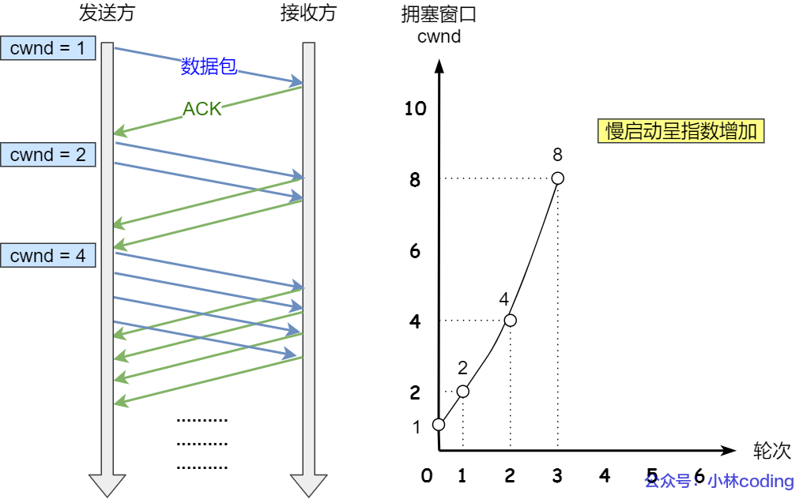

可以看出慢启动算法，发包的个数是**指数性的增长**。

**那慢启动涨到什么时候是个头呢？**

有一个叫慢启动门限 ssthresh （slow start threshold）状态变量。

- 当 cwnd < ssthresh 时，使用慢启动算法。
- 当 cwnd >= ssthresh 时，就会使用「拥塞避免算法」。

#### 拥塞避免算法

前面说道，当拥塞窗口 cwnd 「超过」慢启动门限 ssthresh 就会进入拥塞避免算法。

ssthresh 是发送方维护的慢启动门限，并不是固定的 65535 字节，也不是 TCP 首部里的接收窗口字段。它会受到实现和拥塞反馈等因素影响。

那么进入拥塞避免算法后，它的规则是：**每当收到一个 ACK 时，cwnd 增加 1/cwnd。**

接上前面的慢启动的栗子，现假定 ssthresh 为 8：

- 当 8 个 ACK 应答确认到来时，每个确认增加 1/8，8 个 ACK 确认 cwnd 一共增加 1，于是这一次能够发送 9 个 MSS 大小的数据，变成了**线性增长。**

拥塞避免算法的变化过程如下图：

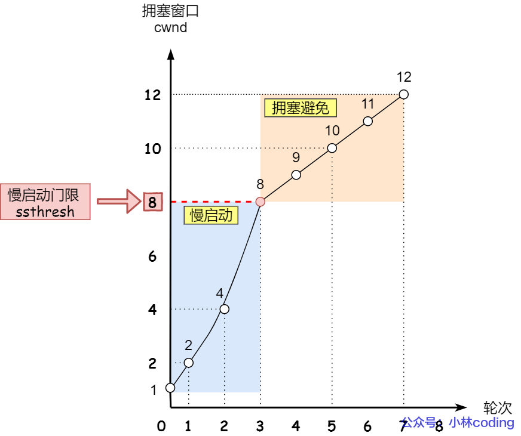

所以，我们可以发现，拥塞避免算法就是将原本慢启动算法的指数增长变成了线性增长，还是增长阶段，但是增长速度缓慢了一些。

就这么一直增长着后，网络就会慢慢进入了拥塞的状况了，于是就会出现丢包现象，这时就需要对丢失的数据包进行重传。

当触发了重传机制，也就进入了「拥塞发生算法」。

#### 拥塞发生

经典 Reno 会根据丢包反馈收缩拥塞窗口，不过丢包也可能来自链路错误或乱序，不能把丢包和拥塞完全画等号。这里主要区分两种情况：

- 超时重传
- 快速重传

这两种情况使用的拥塞处理方式不同，接下来分别来说说。

**发生超时重传的拥塞发生算法**

当发生了「超时重传」，则就会使用拥塞发生算法。

这个时候，ssthresh 和 cwnd 的值会发生变化。下面把在途数据量近似看作 cwnd，并以 MSS 为单位说明减半；实际 ssthresh 通常按在途数据量计算，并有最小值限制：

- ssthresh 设为 cwnd/2，
- cwnd 重置为 1 （是恢复为 cwnd 初始化值，我这里假定 cwnd 初始化值 1）

拥塞发生算法的变化如下图：

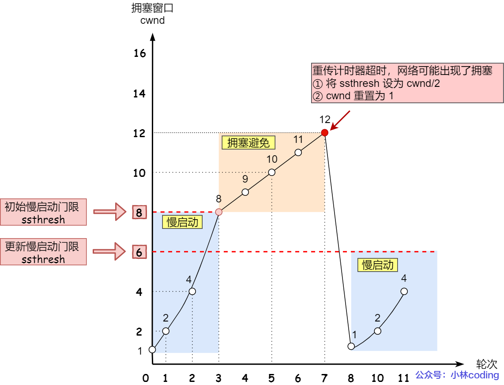

接着，就重新开始慢启动，慢启动是会突然减少数据流的。这真是一旦「超时重传」，马上回到解放前。但是这种方式太激进了，反应也很强烈，会造成网络卡顿。

就好像本来在秋名山高速漂移着，突然来个紧急刹车，轮胎受得了吗。。。

**发生快速重传的拥塞发生算法**

还有更好的方式，前面我们讲过「快速重传算法」。如果接收方连续收到缺口之后的数据，会重复发送指向缺口的累计 ACK。发送方收到 3 个重复 ACK 后，就可以触发快速重传，不必等到超时。

TCP 认为这种情况不严重，因为大部分没丢，只丢了一小部分，则 ssthresh 和 cwnd 变化如下：

- cwnd = cwnd/2 ，也就是设置为原来的一半;
- ssthresh = cwnd;
- 进入快速恢复算法

#### 快速恢复

快速重传和快速恢复算法一般同时使用，快速恢复算法是认为，你还能收到 3 个重复 ACK 说明网络也不那么糟糕，所以没有必要像 RTO 超时那么强烈。

正如前面所说，进入快速恢复之前，cwnd 和 ssthresh 已被更新了：

- cwnd = cwnd/2 ，也就是设置为原来的一半;
- ssthresh = cwnd;

然后，进入快速恢复算法如下：

- 拥塞窗口 cwnd = ssthresh + 3 （ 3 的意思是确认有 3 个数据包被收到了）；
- 重传丢失的数据包；
- 如果再收到重复的 ACK，那么 cwnd 增加 1；
- 在这个经典 Reno 的简化模型里，收到确认新数据的 ACK 后，把 cwnd 收缩到 ssthresh，退出快速恢复，进入拥塞避免。一次丢多个数据段时，NewReno、SACK 等机制还会采用更细致的恢复处理；

快速恢复算法的变化过程如下图：

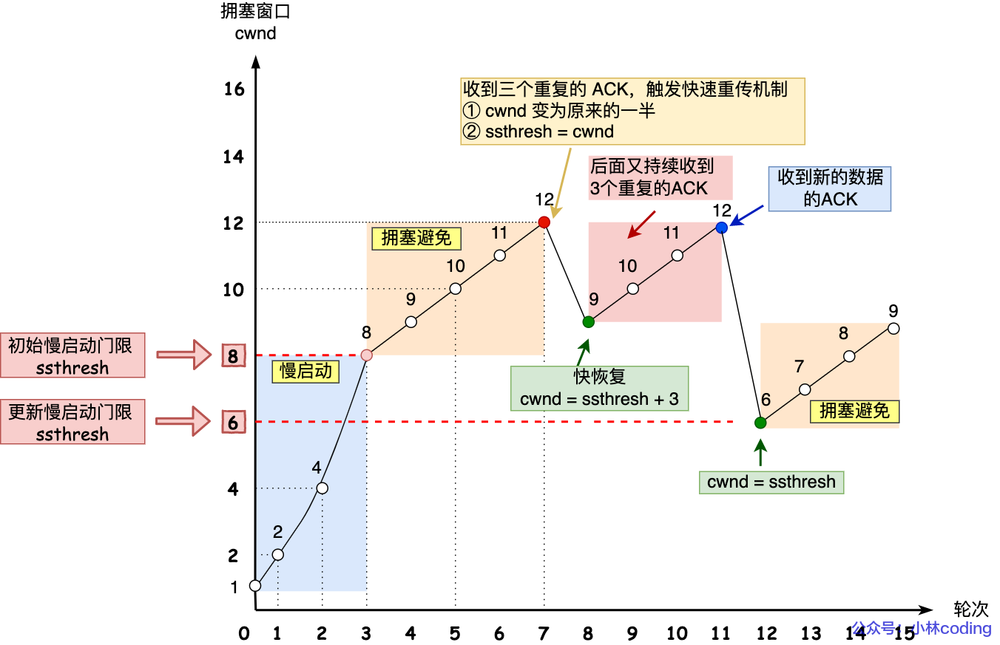

也就是没有像「超时重传」一夜回到解放前，而是还在比较高的值，后续呈线性增长。

## 1.4 网络层和链路层

### 1.4.1 IP 地址和 MAC 地址有什么区别？

**IP 地址主要负责跨网络的寻址和路由，MAC 地址主要用于当前链路上的帧传输。**

比如你访问一个外网服务器，IP 包的目标地址写的是服务器 IP，但从电脑发出的以太网帧，目标 MAC 通常写的是网关 MAC，不是远端服务器的 MAC。

路由器收到帧，取出 IP 包，根据路由表选择下一跳，再为下一段链路重新封装帧。因此，**MAC 地址会随着经过的链路变化；没有 NAT 等地址转换时，源和目的 IP 通常保持不变**，TTL 则逐跳减少。

MAC 也不是绝对不能修改，更不能拿它作为跨互联网识别用户身份的可靠依据。

### 1.4.2 ARP 是什么？访问外网时查询谁的 MAC 地址？

ARP 用于在 IPv4 的本地链路上，**根据 IP 地址查询对应的 MAC 地址**。如果 ARP 缓存里没有记录，主机会广播询问「谁拥有这个 IP」，对应主机再回复自己的 MAC 地址。

访问同一子网的主机时，通常查询目标主机的 MAC；访问外网时，要先看路由表，通常把数据交给默认网关，查询的是**网关的 MAC**。

ARP 广播不会被普通路由器转发到整个互联网，所以你的电脑不会通过 ARP 直接查出百度服务器的 MAC。IPv6 则使用邻居发现机制，不使用 ARP。

### 1.4.3 ICMP 是什么？ping 和 traceroute 的原理是什么？

ICMP 用于传递网络错误和控制信息，不使用 TCP、UDP 那样的端口。

- **ping**：通常发送 ICMP Echo Request，收到 Echo Reply 后估算往返时间和丢包情况。
- **traceroute**：从较小的 TTL 开始探测，逐步增加 TTL。路由器发现 TTL 耗尽，通常返回 ICMP Time Exceeded，借此观察经过哪些跳。不同实现可能用 UDP、ICMP 或 TCP 发送探测。

不过，路由器可能限制或不回应探测，所以 traceroute 出现星号不一定表示业务流量在那一跳被丢弃；ping 不通也不等于 TCP 服务一定不可用。

### 1.4.4 NAT 是什么？为什么内网多个设备能共用一个公网 IP？

NAT 就是网络地址转换，家用路由器常见的是同时转换地址和端口，也叫 **NAPT/PAT**。

比如两台内网电脑都访问同一个网站，路由器可以把它们的源地址和端口改成同一个公网 IP 下的两个不同端口，并保存映射关系。服务器回包后，路由器再根据映射，把响应转回对应的内网电脑。

所以，多个设备可以共用一个公网 IP，靠的不只是替换 IP，还要通过端口等信息区分会话。

这也解释了为什么**外部通常不能直接主动连接内网服务**：如果没有已有映射、端口转发或其他连通机制，路由器不知道该把请求交给哪台内网设备。

## 1.5 网络场景

### 1.5.1 描述一下打开百度首页后发生的网络过程

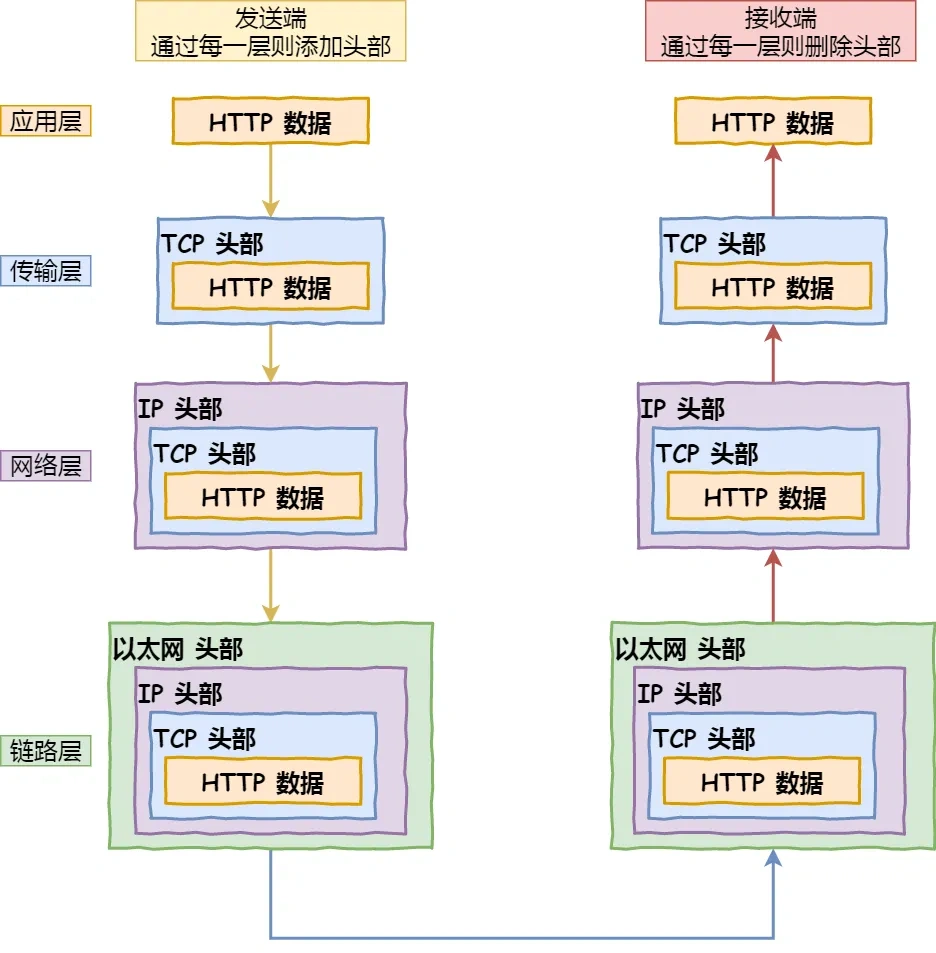

这里以访问一个 HTTPS 页面、使用 HTTP/1.1 或 HTTP/2 为例：

1. **解析 URL 和检查缓存**：浏览器确定协议、主机、端口和资源路径，再根据缓存规则判断是否需要请求网络。如果能直接使用有效缓存，就可以省掉对应的网络请求。
2. **DNS 解析**：需要连接时，浏览器根据自己的配置、解析缓存、系统解析机制和 hosts 等获取 IP。如果没有可用结果，就向 DNS 解析服务查询。具体路径会受浏览器加密 DNS、代理等配置影响，不是固定经过「路由器缓存、ISP 缓存」。
3. **确定下一跳**：操作系统根据路由表决定从哪个网卡、向哪个下一跳发送。以 IPv4 以太网为例，同一子网时通过 ARP 查目标 MAC；访问外网时通常查网关 MAC。
4. **建立 TCP 连接**：客户端和服务端完成三次握手。这里可能连接到 CDN 或反向代理，而不是最终的业务服务器。
5. **TLS 握手**：协商版本和密钥，验证服务端证书，再建立加密通信。具体往返次数取决于 TLS 版本和是否恢复会话，不能统一说成四次握手。
6. **发送 HTTP 请求**：浏览器发送请求，可能携带 Cookie、缓存验证字段等。
7. **服务端返回响应**：缓存节点直接返回内容，或者后端处理请求后返回状态码、响应头和响应体。
8. **解析和渲染页面**：浏览器解析 HTML，构建 DOM，加载 CSS、JavaScript、图片等资源，再进行样式计算、布局和绘制。页面里的资源请求也可能复用现有连接。

面试时要补一句：**这些步骤不是每次都完整重走**。连接可以复用，DNS 和资源可以缓存；使用 HTTP/3 时，则通过 QUIC 建立安全连接，不再先做 TCP 三次握手。

### 1.5.2 网页非常慢转圈圈的时候，要定位问题需要从哪些角度？

可以先打开浏览器开发者工具的 Network，看请求的 Timing 和瀑布图：

- **DNS 慢**：检查解析服务器、缓存和网络情况，确认解析到的 IP 是否正确，不是解析失败就一定代表域名写错。
- **连接或 TLS 握手慢**：检查往返时延、丢包、代理、防火墙和证书相关问题，必要时抓包看 SYN、重传和 TLS 消息。
- **等待首字节 TTFB 很长**：请求可能已经到了服务器，要结合网关日志、调用链、数据库和下游接口排查。TTFB 也包含网络等待，不能直接等同于后端代码执行时间。
- **内容下载慢**：看资源大小、带宽、压缩、CDN 命中率和重传情况，尤其注意大图片、大脚本等资源。
- **请求结束但页面仍然卡**：看 Performance、控制台报错、长任务、脚本执行和布局开销。返回 200 只说明请求成功，不代表页面已经正常渲染。

同时比较「所有网站都慢，还是只有这个网站慢」「所有用户都慢，还是某个地区或网络慢」，可以帮助缩小范围。

如果浏览器信息不够，再用 curl 看分段耗时，或用 tcpdump、Wireshark 抓包，并把客户端时间和服务端日志对起来。**先定位阶段，再找原因**，比只看一个状态码更有效。

### 1.5.3 server a和server b，如何判断两个服务器正常连接？出错怎么办？

在一条 TCP 连接建立之后，如果双方长时间都没有数据交互，那么它们是没办法主动感知到对端是否依然存活的。举个例子：如果客户端突然发生机器宕机或者网络断开，而此时服务端如果一直不会发送数据给客户端，那么服务端是永远无法感知到客户端宕机这个事件的，也就是服务端的 TCP 连接将一直处于 ESTABLISHED 状态，占用着系统资源。

为了避免这种情况，TCP 搞了个**保活机制**。这个机制的原理是这样的：定义一个时间段，在这个时间段内，如果没有任何连接相关的活动，TCP 保活机制会开始作用，每隔一个时间间隔，发送一个探测报文，该探测报文包含的数据非常少，如果连续几个探测报文都没有得到响应，则认为当前的 TCP 连接已经死亡，系统内核将错误信息通知给上层应用程序。

在 Linux 内核可以有对应的参数可以设置保活时间、保活探测的次数、保活探测的时间间隔，以下都为默认值：

```shell
net.ipv4.tcp_keepalive_time=7200
net.ipv4.tcp_keepalive_intvl=75  
net.ipv4.tcp_keepalive_probes=9
```

- tcp_keepalive_time=7200：表示保活时间是 7200 秒（2小时），也就 2 小时内如果没有任何连接相关的活动，则会启动保活机制
- tcp_keepalive_intvl=75：表示每次检测间隔 75 秒；
- tcp_keepalive_probes=9：表示检测 9 次无响应，认为对方是不可达的，从而中断本次的连接。

按这组常见默认参数估算，要经过大约 2 小时再加上数分钟，才可能判断连接失效。实际耗时取决于运行系统、socket 配置和探测结果，不能把这个等待时间当成业务请求超时。

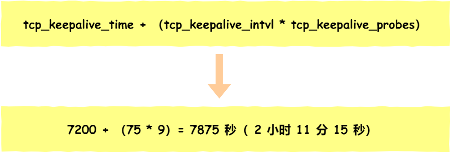

注意，应用程序若想使用 TCP 保活机制需要通过 socket 接口设置 SO_KEEPALIVE 选项才能够生效，如果没有设置，那么就无法使用 TCP 保活机制。

如果开启了 TCP 保活，需要考虑以下几种情况：

- 对端程序是正常工作的。当 TCP 保活的探测报文发送给对端, 对端会正常响应，这样 **TCP 保活时间会被重置**，等待下一个 TCP 保活时间的到来。
- 对端主机宕机并重启。当 TCP 保活的探测报文发送给对端后，对端是可以响应的，但由于没有该连接的有效信息，**会产生一个 RST 报文**，这样很快就会发现 TCP 连接已经被重置。
- 对端主机宕机（*不是进程崩溃，进程崩溃后，操作系统会回收 socket，通常能够发起关闭，但也可能因未读数据等情况发送 RST，而主机宕机则是无法感知的，所以需要 TCP 保活机制来探测对方是不是发生了主机宕机*），或对端由于其他原因导致报文不可达。当 TCP 保活的探测报文发送给对端后，石沉大海，没有响应，连续几次，达到保活探测次数后，**TCP 会报告该 TCP 连接已经死亡**。

TCP 保活主要判断对端的协议栈能不能响应，检测间隔也可能比较长。**如果要判断业务服务是否正常，还需要应用层心跳和请求超时。**

比如定期发送一个心跳请求，要求对端在约定时间内回复。持续没有回复，就把连接或服务实例判为不可用。不过心跳超时也可能由网络抖动、进程暂停等造成，要结合连续失败次数，避免频繁误判。

还要区分 HTTP 服务里的 keepalive_timeout，它主要用于**回收空闲长连接，不是在检测业务心跳**。比如设置为 60 秒，完成请求后 60 秒都没有新请求，就可以关闭连接。

另外，发现连接不可用后要按业务决定重连、摘除节点或报错。**不能把失败请求全部无条件重试**，尤其是支付、下单这类请求，要考虑操作是否已经执行以及是否支持幂等。

### 1.5.4 服务端正常启动了，但是客户端请求不到有哪些原因?如何排查?

**进程启动成功，不代表端口已经监听，更不代表客户端到服务端的整条链路都正常。**可以分几层检查：

1. **地址和监听**：确认域名、IP、端口、协议和路径，用 `ss -lntp` 查看服务是否监听。只监听 127.0.0.1 时，远程客户端无法直接访问；容器内监听还要确认端口映射。
2. **DNS 和路由**：确认客户端解析到的是正确环境的地址，检查客户端是否有到目标的路由。ping 只能作参考，不能替代端口和应用探测。
3. **TCP 连通性**：用 `nc -vz 目标IP 端口` 等工具探测。Connection refused 常见于没有监听或主动拒绝；一直超时则可能是丢包、策略丢弃或链路问题。
4. **访问策略**：检查云安全组、防火墙、网关和白名单是否允许对应来源、协议和端口，按需放行，而不是直接关闭防火墙。
5. **代理和 TLS**：检查客户端代理、反向代理到上游的连通性，以及 HTTPS 的证书、域名和协议配置。
6. **应用处理**：用 curl 发起真实请求，再结合接入日志、应用日志和调用链确认请求到了哪一层。浏览器还要检查是否因 CORS 拒绝读取响应。

如果已经收到 HTTP 响应，就根据状态码和日志继续排查：

- **400**：检查请求格式、参数和 Content-Type。
- **401 / 403**：检查身份凭证和访问权限，也要看是否被网关规则拦截。
- **404**：检查 URL、路由和部署版本，不一定只是客户端拼错地址。
- **500**：查看服务端异常日志。
- **502 / 503 / 504**：分别检查上游连接和响应、服务可用性以及超时。既可能是配置问题，也可能是资源耗尽，不能只凭状态码就认定后端挂了。

必要时两端同时抓包：客户端是否发出 SYN，服务端是否收到并回复，HTTP 请求和响应分别走到了哪里，就能把问题范围进一步缩小。

### 1.5.5 接口超时了，可以直接重试吗？

**超时只代表客户端没有及时得到结果，不代表服务端一定没有执行。**

比如客户端发起扣款，服务端已经扣款成功，但响应在网络上丢了，客户端就会看到超时。如果立刻重新发起一次普通扣款，用户可能被扣两次。

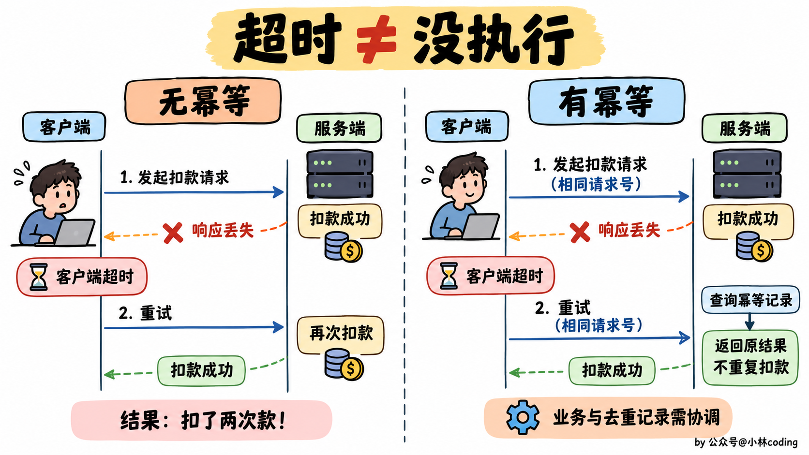

所以是否重试，要结合业务语义：

- 查询等符合幂等语义的操作，通常可以在合理范围内重试。
- 创建订单、支付等操作，需要使用业务唯一请求号、幂等键、去重记录等机制，让重复请求对应同一次业务操作。
- 不确定结果时，可以先查询原请求状态，再决定后续动作。

重试本身也会增加负载，应该限制次数和总时间，结合退避和随机抖动，避免大量客户端同时重试，把短暂故障放大。即使用 POST，只要业务实现了幂等，也可以设计成安全重试。

### 1.5.6 TCP 连接里，send 成功是不是说明对方收到数据了？

**不是，send 成功通常只说明数据已经被本地协议栈接受。**对端是否收到、是否被应用读取、是否处理成功，是后面的事情。

还要注意，send 的返回值可能小于要发送的长度，应用需要继续发送剩余部分。非阻塞发送还可能因为缓冲区暂时没有空间而返回 EAGAIN 或 EWOULDBLOCK。

即使后面收到了 TCP ACK，也只能说明对端 TCP 层确认收到了相关字节。要知道业务成功，比如订单已创建，仍然需要业务响应和对应的持久化、幂等设计。

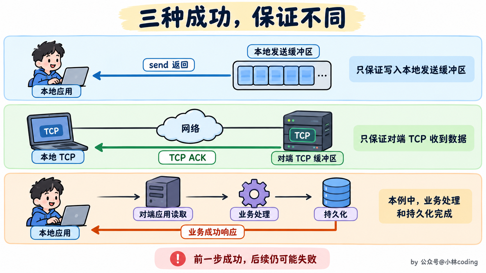

### 1.5.7 服务器ping不通但是http能请求成功，会出现这种情况吗?什么原因造成的?

**会，ping 不通和 HTTP 能不能访问不是同一件事。**

ping 通常使用 ICMP Echo，HTTP/1.1、HTTP/2 通常使用 TCP。服务器或网络设备可能禁止、限速 ICMP，但允许 TCP 的 80、443 端口，所以 HTTP 仍然可以成功。HTTP/3 则使用 QUIC/UDP，同样不依赖 ping 成功。

另外，域名可能解析出多个地址，ping 和浏览器访问的不一定是同一个地址；浏览器还可能通过代理访问，所以排查时要确认实际目标和路径。

反过来也一样：**ping 通只能说明对应的 ICMP 探测有回应，不代表业务端口有监听，更不代表接口能正常返回。**

## 1.6 网络攻击

### 1.6.1 什么是ddos攻击？怎么防范？

分布式拒绝服务（DDoS）攻击是通过大规模互联网流量淹没目标服务器或其周边基础设施，以破坏目标服务器、服务或网络正常流量的恶意行为。

DDoS 攻击是通过连接互联网的计算机网络进行的。这些网络由计算机和其他设备（例如 IoT 设备）组成，它们感染了恶意软件，从而被攻击者远程控制。这些个体设备称为机器人（或僵尸），一组机器人则称为僵尸网络。

一旦建立了僵尸网络，攻击者就可通过向每个机器人发送远程指令来发动攻击。当僵尸网络将受害者的服务器或网络作为目标时，每个机器人会将请求发送到目标的 IP 地址，这可能导致服务器或网络不堪重负，从而造成对正常流量的拒绝服务。由于每个机器人都是合法的互联网设备，因而可能很难区分攻击流量与正常流量。

常见的DDoS攻击包括以下几类：

- **网络层攻击**：UDP反射攻击，例如：NTP Flood攻击，这类攻击主要利用大流量拥塞被攻击者的网络带宽，导致被攻击者的业务无法正常响应客户访问。
- **传输层攻击**：SYN Flood攻击、连接数攻击等，这类攻击通过占用服务器的连接池资源从而达到拒绝服务的目的。
- **会话层攻击**：SSL连接攻击，这类攻击占用服务器的SSL会话资源从而达到拒绝服务的目的。
- **应用层攻击**：DNS flood攻击、HTTP flood攻击、游戏假人攻击等，这类攻击占用服务器的应用处理资源极大的消耗服务器处理性能从而达到拒绝服务的目的。

为了防范DDoS攻击，可以采取以下措施：

- 增强网络基础设施：提升网络带宽、增加服务器的处理能力和承载能力，通过增强基础设施的能力来抵御攻击。
- 使用防火墙和入侵检测系统：配置防火墙规则，限制不必要的网络流量，阻止来自可疑IP地址的流量。入侵检测系统可以帮助及时发现并响应DDoS攻击。
- 流量清洗和负载均衡：使用专业的DDoS防护服务提供商，通过流量清洗技术过滤掉恶意流量，将合法流量转发给目标服务器。负载均衡可以将流量均匀地分发到多台服务器上，减轻单一服务器的压力。
- 配置访问控制策略：限制特定 IP 地址或 IP 段的访问，结合账号、接口和行为设置访问频率限制，避免只按 IP 限制时误伤共享出口的正常用户。

要先区分攻击打满的是**带宽、连接资源，还是业务处理能力**。带宽在上游就被打满时，服务器本地限流通常来不及，需要运营商或专业防护服务在上游清洗；应用层请求耗尽资源时，则要结合缓存、限流、超时、熔断等措施。单纯扩容或增加后端节点，不一定能解决所有类型的 DDoS。

### 1.6.2 SQL注入问题是什么？

SQL 注入就是**把用户输入当成 SQL 语法的一部分执行了**。最典型的原因是拼接 SQL。

比如登录查询原本按用户名和密码过滤，如果直接把输入拼进去，攻击者就可能构造特殊内容改变 WHERE 条件，绕过校验，甚至读取或修改本来无权访问的数据。

防范的重点是：

- **参数化查询**：把 SQL 结构和参数值分开处理，让用户输入只作为数据，而不是 SQL 语法。使用 ORM 时，也要避免自己拼接原始 SQL。
- **动态结构使用白名单**：表名、列名、排序方向等通常不能直接作为普通值参数绑定，需要映射到业务允许的固定选项。
- **最小权限**：应用的数据库账号只授予需要的权限，降低出现漏洞后的影响。
- **输入校验**：检查类型、长度和业务范围，作为补充措施。

**不能只靠过滤引号、屏蔽几个关键词防 SQL 注入**。核心是让不可信输入不能改变查询结构。

### 1.6.3 CSRF攻击是什么？

CSRF 是跨站请求伪造，核心是**利用浏览器会自动携带身份凭证，让服务端把攻击者诱导的请求当成用户自己的操作**。

举个例子，你已经登录了一个网站，浏览器保存着登录 Cookie。随后打开攻击者的页面，这个页面诱导浏览器向原网站发起修改资料的请求。如果浏览器按规则带上了身份 Cookie，而服务端只检查「已经登录」，就可能执行这次操作。

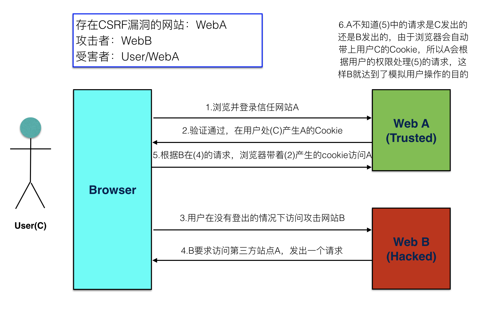

攻击者通常不需要知道你的 Cookie 内容，**让浏览器替他带上 Cookie 就够了**。所以「验证用户已经登录」本身不能防住 CSRF。

常见防范方式有：

- **CSRF Token**：由服务端生成难以猜测的令牌，通过表单或自定义请求头传回，并进行验证。跨站攻击页面不能随意读取受同源策略保护的令牌。
- **校验来源**：根据业务校验 Origin 或 Referer，确认请求来自允许的来源，对缺失等情况制定明确策略。
- **SameSite Cookie**：限制跨站请求携带 Cookie，降低攻击机会，但仍要结合具体请求和部署方式判断。
- **遵守请求语义**：GET 不用于转账、修改密码等有副作用的操作；重要操作还可以要求二次确认或重新认证。

如果认证令牌由页面代码主动放在 Authorization 请求头里，浏览器不会替任意跨站页面自动添加这个令牌，传统的 Cookie 型 CSRF 风险会减少。**但把 JWT 放进自动发送的 Cookie 后，仍然要防 CSRF。**

CSP 主要是辅助防范脚本注入等问题，不是 CSRF Token 的替代品。

### 1.6.4 XSS攻击是什么？

XSS是跨站脚本攻击，攻击者通过在Web页面中插入恶意脚本代码，然后诱使用户访问该页面，从而使得恶意脚本在用户浏览器中执行，从而盗取用户信息、会话信息等敏感数据，甚至控制用户账户。

- 存储型 XSS ：注入型脚本永久存储在目标服务器上。当浏览器请求数据时，脚本从服务器上传回并执行。
- 反射型 XSS：当用户点击一个恶意链接，或者提交一个表单，或者进入一个恶意网站时，注入脚本进入被攻击者的网站。Web 服务器将注入脚本，比如一个错误信息，搜索结果等 返回到用户的浏览器上。由于浏览器认为这个响应来自"可信任"的服务器，所以会执行这段脚本。
- 基于 DOM 的 XSS ：通过修改原始的客户端代码，受害者浏览器的 DOM 环境改变，导致有效载荷的执行。也就是说，页面本身并没有变化，但由于 DOM 环境被恶意修改，有客户端代码被包含进了页面，并且意外执行。

预防XSS攻击的方法主要包括以下几点：

- 输入验证：校验数据类型、长度和业务范围，作为补充措施。富文本需要使用可靠的 HTML 净化方案，不能只过滤几个标签或关键词。
- 输出编码：根据数据所在的上下文进行编码，HTML 文本、属性、URL、JavaScript 的处理方式不同。普通文本尽量通过 textContent 等安全接口插入，避免把不可信内容直接交给 innerHTML。
- Content Security Policy（CSP）：通过设置CSP策略，限制网页中可执行的脚本源，有效防范XSS攻击。
- 使用 HttpOnly：避免脚本直接读取身份 Cookie，减少凭证泄露，但它不能阻止 XSS 脚本执行，也不能阻止恶意脚本以用户身份发送请求。

和 CSRF 相比，**XSS 是让恶意脚本在受信任的网站页面中执行；CSRF 是让用户浏览器带着身份去发送攻击者构造的请求**。两者需要分别防范，发生 XSS 后，部分 CSRF 防护也可能被绕过。

### 1.6.5 了解过DNS劫持吗？

DNS 劫持可能通过篡改 hosts、路由器的 DNS 配置、DNS 记录或者解析响应，把正常域名指向错误地址。一个典型场景是攻击者在用户查询 DNS 服务器时篡改响应，将用户请求的域名映射到攻击者控制的虚假IP地址上，使用户误以为访问的是正常网站，实际上被重定向到攻击者操控的恶意网站。这种劫持可以通过植入恶意的 DNS 记录或劫持用户的 DNS 流量来实现。

防范时可以检查本地 hosts 和 DNS 配置，保护路由器、域名管理账号及权威 DNS，并按需要使用加密 DNS。DoH、DoT 主要保护客户端到所选解析器这一段传输，并不保证解析器本身一定可信；DNSSEC 则提供 DNS 数据来源认证和完整性校验，不负责加密。

**DNS 被改到错误 IP，也不代表攻击者就能伪造正确的 HTTPS 身份**。正确的证书校验仍然可以发现域名与证书等不匹配的问题，所以不能因为页面提示证书错误就直接忽略。

# 2 操作系统面试题

有几块内容在面试里出现频率最高，建议重点花时间：

- **进程与线程**：两者的区别、协程是什么、进程间通信的几种方式（管道/共享内存/信号量/socket），还有进程调度算法，这块问得非常频繁。
- **锁与死锁**：死锁的四个必要条件、如何避免死锁、自旋锁和互斥锁的区别，以及银行家算法，这些都是经典考点。
- **内存管理**：虚拟内存和物理内存的关系、页表的工作原理、缺页中断、写时复制（Copy On Write），还有 malloc 底层的 brk 和 mmap 机制。
- **文件系统**：文件描述符和 inode 的区别、硬链接与软链接、Page Cache，以及为什么 write 成功不代表数据已经落盘。
- **IO 模型**：select/poll/epoll 的区别、边缘触发和水平触发，以及零拷贝的原理，这是理解高性能服务器（Redis、Nginx、Netty）的基础。

如果你是第一次系统复习操作系统，建议先把进程线程和内存管理这两块搞透，它们是整个操作系统知识体系的核心，其他内容理解起来也会顺很多。

## 2.1 用户态和内核态

### 2.1.1 用户态和内核态的区别？

内核态和用户态是 CPU 的两种运行模式，**核心区别是执行权限不同**。

| 对比项           | 用户态                                               | 内核态                                                   |
| ---------------- | ---------------------------------------------------- | -------------------------------------------------------- |
| CPU 权限级别     | Ring 3（x86）                                        | Ring 0（x86）                                            |
| 权限             | 不能执行特权指令；无法直接访问内核空间、其他进程内存 | 可执行特权指令；管理页表、中断、硬件设备、内存等底层资源 |
| 运行内容         | 普通应用程序（Java 进程、浏览器等）                  | 操作系统内核代码                                         |
| 访问内核资源方式 | 必须通过系统调用、中断、异常陷入内核                 | 直接访问硬件与内核数据                                   |

内核态的底层操作主要包括：内存管理、进程管理、设备驱动程序控制、系统调用等。这些操作涉及到操作系统的核心功能，需要较高的权限来执行。

分为内核态和用户态的原因主要有以下几点：

- 安全性：通过对权限的划分，用户程序无法直接访问硬件资源，从而避免了恶意程序对系统资源的破坏。
- 稳定性：用户态程序的普通错误通常被限制在进程内，减少了直接破坏内核、导致整个系统崩溃的风险。
- 隔离性：内核态和用户态的划分使得操作系统内核与用户程序之间有了明确的边界，有利于系统的模块化和维护。

内核态和用户态的划分有助于保证操作系统的安全性、稳定性和易维护性。

这里还要注意，**root 用户运行的普通程序也处于用户态**。root 是操作系统管理的用户权限，内核态是 CPU 的执行权限，两者不是一回事。

### 2.1.2 用户态和内核态在什么情况下会发生切换？

用户态进入内核态，主要有三种情况：

- **系统调用**：程序主动请求内核服务，比如调用 read 读取文件、调用 socket 创建网络连接。
- **异常**：CPU 执行当前指令时遇到需要内核处理的情况，比如访问尚未建立物理映射的页面，触发缺页异常。
- **外部中断**：网卡、磁盘、时钟等硬件发出中断，CPU 转去执行内核里的中断处理程序。

处理完成后，如果继续执行原来的用户程序，就会恢复现场，回到用户态。

**用户态和内核态切换，不一定会发生线程切换。**比如一次 read 调用命中了文件缓存，内核复制完数据就直接返回，前后执行的仍然是同一个线程。只有线程阻塞、时间片用完等情况，才可能进一步触发调度。

### 2.1.3 系统调用和普通函数调用有什么区别？

**普通函数调用是在当前执行环境里调用一段代码，系统调用则是请求内核提供服务。**

比如调用一个计算两数之和的函数，只需要传递参数、跳转到函数入口，执行完再返回，整个过程可以一直在用户态完成。

而 read、write 这样的系统调用，需要通过专门的指令进入内核。内核检查参数和权限，完成操作，再把结果返回给用户程序。以 x86-64 Linux 为例，通常通过 `syscall` 指令进入内核。

所以，系统调用除了函数本身的工作，还会有**特权级切换、现场保存恢复、参数检查**等开销，有些操作还涉及用户空间和内核空间之间的数据拷贝。

不过，**库函数不等于系统调用**。比如 malloc 通常先从分配器管理的空闲内存中分配，空间不够时才向内核申请；printf 也可能先把数据放进用户态缓冲区，等刷新时才调用 write。

## 2.2 进程管理

### 2.2.1 线程和进程的区别是什么？

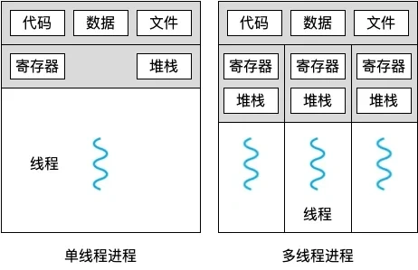

| 对比项   | 进程                                         | 线程                                                         |
| -------- | -------------------------------------------- | ------------------------------------------------------------ |
| 本质     | 操作系统**资源分配**的基本单位               | CPU**任务调度执行**的基本单位                                |
| 地址空间 | 拥有独立虚拟地址空间                         | 共享所属进程的地址空间（代码、堆、全局变量）；独有：栈、寄存器、PC |
| 切换开销 | 大，需要切换页表、刷新 TLB 等                | 同进程内线程切换开销小，不用切换地址空间                     |
| 稳定性   | 进程相互隔离，一个进程崩溃一般不影响其他进程 | 共享地址空间，一个线程异常（非法访问内存）容易导致整个进程崩溃 |
| 内存占用 | 独立完整地址空间，资源开销大                 | 仅线程栈、内核栈、线程元数据，资源开销更小                   |
| 包含关系 | 一个进程至少包含 1 个线程（主线程）          | 线程依附进程存在，不能独立运行                               |

这里的“线程有自己的栈”，指的是各自使用不同的栈区域，**不代表这些栈在地址空间上相互隔离**。同一进程里的线程如果拿到了另一个线程栈上变量的地址，仍然可能访问它，这也是多线程需要注意内存安全的原因。

### 2.2.2 进程，线程，协程的区别是什么？

- **进程**。进程是**资源分配**的基本单位，拥有独立的虚拟地址空间。不同进程默认不能直接访问对方的内存，需要通过管道、共享内存、Socket 等机制通信。进程隔离性比较好，但创建和切换的开销通常也比较大。
- **线程**。线程是**进程内的执行单元**，也是操作系统调度的基本单位。同一进程内的线程共享堆、全局变量和打开的文件等资源，但各自有独立的栈和寄存器上下文。共享数据很方便，同时也需要解决数据竞争的问题。
- **协程**。协程是**由语言运行时或协程库在用户态调度的执行单元**。协程切换通常不需要进入内核，所以开销比较小。有栈协程会保存自己的栈和寄存器上下文，无栈协程则通常把暂停位置和局部状态保存在状态机里，不能一概说所有协程都有独立的栈。

举个例子，一个线程里可以运行很多协程。当某个协程等待网络数据时，运行时可以先去执行其他协程，等数据就绪后再恢复它。

不过，**协程要依托线程执行，并不会凭空增加 CPU 的并行能力**。只有一个工作线程时，即使创建很多协程，也只能在一个时刻执行其中一个；想利用多核，还需要多个线程配合。

另外，如果协程直接调用了没有被运行时接管的阻塞系统调用，可能把所在的线程一起阻塞。所以协程通常要配合非阻塞 I/O、事件循环，或者由运行时把阻塞任务交给其他线程处理。

### 2.2.3 **为什么进程崩溃不会对其他进程产生很大影响**

- **进程隔离性**：每个进程都有自己独立的内存空间，当一个进程崩溃时，其内存空间会被操作系统回收，不会影响其他进程的内存空间。这种进程间的隔离性保证了一个进程崩溃不会直接影响其他进程的执行。
- **资源分别管理**：内核会分别管理各个进程持有的资源。一个进程退出时，通常只会释放它自己的资源引用，不会直接销毁其他进程仍在使用的资源。

但是，**进程隔离不代表业务上完全没有影响**。两个进程可能使用共享内存、访问同一个文件，也可能通过网络互相依赖。如果一个进程写坏了共享数据，或者它提供的服务突然不可用，其他进程仍然可能受到影响。

### 2.2.4 你说到进程是分配资源的基本单位，那么这个资源指的是什么？

主要指的是**虚拟地址空间、打开的文件描述符、网络连接，以及权限和资源限制等运行环境**。

比如一个进程打开了文件，同一进程里的线程通常都能使用这个文件描述符；进程申请了一块堆内存，其他线程拿到地址后也可以访问。

线程则主要拥有自己的执行状态，比如寄存器、程序计数器、栈和线程局部存储。所以我们说，**进程负责组织资源，线程负责执行代码**。

### 2.2.5 讲下为什么进程之下还要设计线程？

我们举个例子，假设你要编写一个视频播放器软件，那么该软件功能的核心模块有三个：

- 从视频文件当中读取数据；
- 对读取的数据进行解压缩；
- 把解压缩后的视频数据播放出来；

如果采用单进程、单线程的顺序执行方式，流程可能是这样：

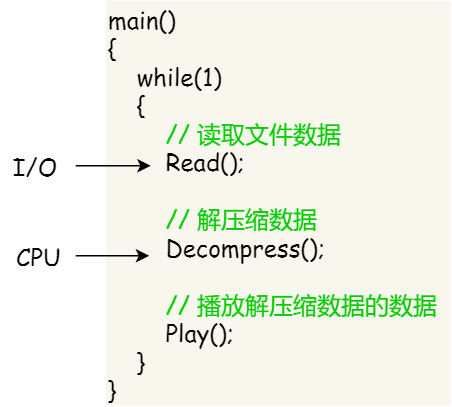

对于这种顺序执行方式，存在以下问题：

- 播放出来的画面和声音会不连贯，因为当 CPU 能力不够强的时候，Read 的时候可能进程就等在这了，这样就会导致等半天才进行数据解压和播放；
- 各个函数之间不是并发执行，影响资源的使用效率；

那改进成多进程的方式：

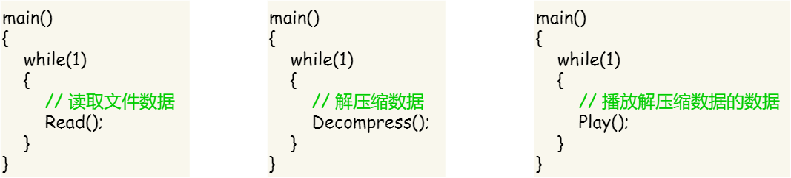

对于多进程的这种方式，依然会存在问题：

- 进程之间如何通信，共享数据？
- 维护进程的系统开销较大，如创建进程时，分配资源、建立 PCB；终止进程时，回收资源、撤销 PCB；进程切换时，保存当前进程的状态信息；

那到底如何解决呢？需要有一种新的实体，满足以下特性：

- 实体之间可以并发运行；
- 实体之间共享相同的地址空间；

这个新的实体，就是**线程（Thread）**，线程之间可以并发运行且共享相同的地址空间。

### 2.2.6 多线程比单线程的优势，劣势？

- **优势**：可以让多个任务并发推进，利用等待 I/O 的时间执行其他工作；对于能拆分的计算任务，也可以通过多核并行提高执行效率。
- **劣势**：存在多线程数据竞争访问的问题，需要通过锁机制来保证线程安全，增加了加锁的开销，并且还会有死锁的风险。多线程会消耗更多系统资源，如CPU和内存，因为每个线程都需要占用一定的内存和处理时间。

### 2.2.7 多线程是不是越多越好，太多会有什么问题？

过多的线程可能会导致一些问题。

- **切换开销增加**：可运行线程远多于 CPU 核数时，CPU 需要频繁切换线程，保存和恢复上下文，还可能影响缓存命中率。
- **内存占用增加**：每个线程都需要栈和管理结构，线程数量太多会占用大量地址空间和内存，甚至触发线程数量或资源限制。
- **锁竞争增加**：如果线程都在争抢同一把锁，线程越多不一定处理得越快，反而可能花更多时间等待和唤醒。

线程数要结合任务类型来确定：**CPU 密集型任务通常从接近可用 CPU 核数开始调优，I/O 密集型任务因为存在等待，可以适当增加线程数**。还要考虑数据库连接池、下游服务容量等限制，最后通过压测看吞吐量和响应时间。

### 2.2.8 并发和并行有什么区别？

- **并发**：多个任务在同一段时间内交替推进，不要求在同一个时刻执行。
- **并行**：多个任务在同一个时刻同时执行，通常需要多个 CPU 核心。

比如只有一个厨师时，他可以炒菜炒到一半，趁等待的时间去准备另一道菜，这就是并发。如果有两个厨师同时做两道菜，就是并行。

所以，**单核 CPU 也可以通过任务切换实现并发，多核 CPU 才能让多个计算任务真正并行执行**。多线程既可能并发，也可能并行，要看硬件和调度情况。

### 2.2.9 进程切换和线程切换的区别？

1. **不同进程之间的切换**：除了保存和恢复寄存器、程序计数器、栈指针等执行状态，还需要切换虚拟地址空间，比如切换页表根指针，这可能影响 TLB 和 CPU 缓存的命中率。
2. **同一进程内的线程切换**：同样需要保存和恢复执行状态、切换栈，但地址空间相同，通常不用切换页表，因此开销更小。

需要注意，**切换地址空间不等于把整个内存复制一遍**，全局变量、堆数据和文件描述符表也不会在每次切换时被复制。内核主要是在切换执行上下文，以及当前任务使用的地址空间等信息。

如果两个线程属于不同进程，那么线程切换也要切换地址空间，不能把所有线程切换都理解成低开销。

### 2.2.10 线程切换为什么比进程切换快，节省了什么资源？

**同一进程内的线程切换，主要节省的是地址空间切换的开销**，而不是完全不保存上下文。

线程之间共享同一套内存映射，所以不用切换页表根指针，也能减少地址转换缓存受到的影响。但寄存器、程序计数器、栈指针等仍然要保存和恢复，调度本身也有成本。

### 2.2.11 线程切换详细过程是怎么样的？上下文保存在哪里？

线程切换的详细过程可以分为以下几个步骤：

- 上下文保存：当操作系统决定切换到另一个线程时，它首先会保存当前线程的上下文信息。上下文信息包括寄存器状态、程序计数器、堆栈指针等，用于保存线程的执行状态。
- 切换到调度器：操作系统将执行权切换到调度器（Scheduler）。调度器负责选择下一个要执行的线程，并根据调度算法做出决策。
- 上下文恢复：调度器选择了下一个要执行的线程后，它会从该线程保存的上下文信息中恢复线程的执行状态。
- 切换到新线程：调度器将执行权切换到新线程，使其开始执行。

上下文信息的保存通常由操作系统负责管理，具体保存在哪里取决于操作系统的实现方式。一般情况下，上下文信息会保存在线程的控制块（Thread Control Block，TCB）中。

TCB是操作系统用于管理线程的数据结构，包含了线程的状态、寄存器的值、堆栈信息等。当发生线程切换时，操作系统会通过这些信息保存和恢复执行现场。

在 Linux 中，每个线程都有自己的 `task_struct` 和内核栈，上下文信息会按架构和切换路径保存在相关结构及内核栈中，不是简单地把所有寄存器都塞进一个 TCB。

### 2.2.12 进程的状态（五种状态），如何切换？

一个完整的进程状态的变迁如下图：

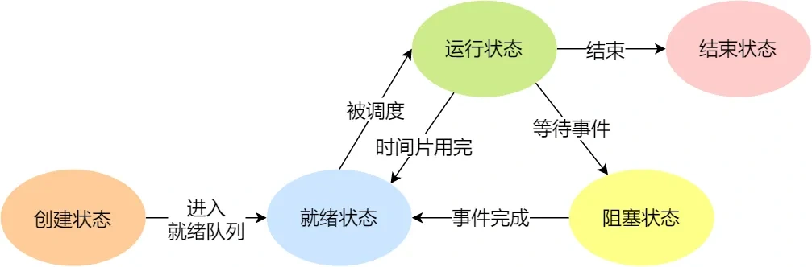

- *NULL -> 创建状态*：一个新进程被创建时的第一个状态；
- *创建状态 -> 就绪状态*：当进程被创建完成并初始化后，一切就绪准备运行时，变为就绪状态，这个过程是很快的；
- *就绪态 -> 运行状态*：处于就绪状态的进程被操作系统的进程调度器选中后，就分配给 CPU 正式运行该进程；
- *运行状态 -> 结束状态*：当进程已经运行完成或出错时，会被操作系统作结束状态处理；
- *运行状态 -> 就绪状态*：处于运行状态的进程在运行过程中，由于分配给它的运行时间片用完，操作系统会把该进程变为就绪态，接着从就绪态选中另外一个进程运行；
- *运行状态 -> 阻塞状态*：当进程请求某个事件且必须等待时，例如请求 I/O 事件；
- *阻塞状态 -> 就绪状态*：当进程要等待的事件完成时，它从阻塞状态变到就绪状态；

这里最容易混淆的是**就绪和阻塞**：就绪状态是“只差 CPU，拿到就能运行”，阻塞状态是“还在等数据、锁或其他事件，给它 CPU 也没法继续”。所以阻塞进程被唤醒后，通常先进入就绪状态，等调度器选中后才开始运行。

### 2.2.13 僵尸进程和孤儿进程有什么区别？

**僵尸进程是子进程已经退出，但父进程还没有回收它的退出信息；孤儿进程是父进程先退出，子进程还在运行。**

- **僵尸进程**：子进程退出后，大部分资源已经释放，但内核还会保留 PID、退出状态等信息，等父进程调用 wait 或 waitpid 获取。这个等待回收的状态就是僵尸状态，在 ps 里通常显示为 `Z`。
- **孤儿进程**：父进程先退出后，子进程会由 init 或合适的子进程收割者（subreaper）接管，它仍然可以继续运行，退出后再由新的父进程负责回收。

僵尸进程不会继续执行代码，也不会占用大量用户内存，但大量僵尸进程会占用进程表项和 PID 等资源。

怎么处理呢？**根本办法是让父进程正确调用 wait/waitpid**，比如在收到 SIGCHLD 后循环回收已退出的子进程。对已经退出的僵尸进程再发 kill 信号没有用，因为它已经没有可执行的代码了。

### 2.2.14 多线程进程调用 fork，有什么需要注意的？

**子进程只会保留调用 fork 的那个线程，其他线程不会一起出现在子进程里。**

但是父进程的地址空间会被继承，其中也包含互斥锁等同步对象的状态。这就可能出现一个问题：fork 时某把锁由另一个线程持有，子进程继承了“已加锁”的状态，却没有那个负责解锁的线程。

这样子进程再去获取这把锁，就可能一直等下去。即使代码里没有直接加锁，调用 malloc、printf 等库函数，也可能碰到库内部的锁。

因此，多线程程序 fork 后，**子进程在 exec 前应只调用异步信号安全的函数**，常见做法是尽快 exec 执行新程序，失败时通过 `_exit` 退出。需要协调特定锁的状态时，可以使用 `pthread_atfork` 注册处理函数，但仍然要遵守 fork 后的调用限制。

### 2.2.15 进程上下文有哪些？

各个进程之间是共享 CPU 资源的，在不同的时候进程之间需要切换，让不同的进程可以在 CPU 执行，那么这个**一个进程切换到另一个进程运行，称为进程的上下文切换**。

####  CPU 上下文切换

大多数操作系统都是多任务，通常支持超过 CPU 核数的任务并发运行。每个 CPU 核心在某个时刻执行一条任务执行流，通过短时间内不断切换任务实现并发；多个核心之间则可以并行执行不同任务。

任务是交给 CPU 运行的，那么在每个任务运行前，CPU 需要知道任务从哪里加载，又从哪里开始运行。

所以，操作系统需要事先帮 CPU 设置好 **CPU 寄存器和程序计数器**。

CPU 寄存器是 CPU 内部容量很小、访问很快的存储单元，用来保存运算数据和执行状态，它与 CPU Cache 不是同一种东西。我举个例子，寄存器像是你的口袋，内存像你的书包，硬盘则是你家里的柜子，如果你的东西存放到口袋，那肯定是比你从书包或家里柜子取出来要快得多。

再来，程序计数器则是用来存储 CPU 正在执行的指令位置、或者即将执行的下一条指令位置。

所以说，CPU 寄存器和程序计数是 CPU 在运行任何任务前，所必须依赖的环境，这些环境就叫做 **CPU 上下文**。

CPU 上下文切换就是先把前一个任务的 CPU 上下文（CPU 寄存器和程序计数器）保存起来，然后加载新任务的上下文到这些寄存器和程序计数器，最后再跳转到程序计数器所指的新位置，运行新任务。

系统内核会存储保持下来的上下文信息，当此任务再次被分配给 CPU 运行时，CPU 会重新加载这些上下文，这样就能保证任务原来的状态不受影响，让任务看起来还是连续运行.

上面说到所谓的「任务」，主要包含进程、线程和中断。所以，可以根据任务的不同，把 CPU 上下文切换分成：**进程上下文切换、线程上下文切换和中断上下文切换**。

#### 进程的上下文切换到底是切换什么呢？

进程是由内核管理和调度的，所以进程的切换只能发生在内核态。

所以，**进程的上下文切换既要保存和恢复 CPU 的执行状态、切换内核栈，也要切换进程使用的虚拟地址空间。**用户栈、堆和全局变量仍然保留在原来的地址空间里，不会因为一次调度就被整体搬走。

通常，会把交换的信息保存在进程的 PCB，当要运行另外一个进程的时候，我们需要从这个进程的 PCB 取出上下文，然后恢复到 CPU 中，这使得这个进程可以继续执行，如下图所示：

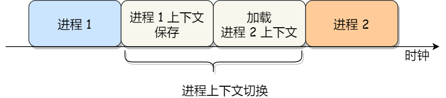

大家需要注意，进程的上下文开销是很关键的，我们希望它的开销越小越好，这样可以使得进程可以把更多时间花费在执行程序上，而不是耗费在上下文切换。

### 2.2.16 进程间通讯有哪些方式？

Linux 内核提供了不少进程间通信的方式：

- 管道
- 消息队列
- 共享内存
- 信号
- 信号量
- socket

管道，管道分为「匿名管道」和「命名管道」。

**匿名管道**顾名思义，它没有文件系统中的路径名，通常通过 pipe 创建，shell 命令中的「|」竖线就是匿名管道。通信的数据是**没有消息边界的字节流，内核缓冲区的容量有限**，通信方向是**单向**的，如果要双向通信，需要创建两个管道。匿名管道通常用于父子进程或兄弟进程之间，因为它们可以通过 fork 继承管道的文件描述符；本质上，通信双方需要持有同一个管道的读写端。所有引用它的文件描述符都关闭后，管道才会被释放。

**命名管道**突破了匿名管道只能在亲缘关系进程间的通信限制，因为使用命名管道的前提，需要在文件系统创建一个类型为 p 的设备文件，那么毫无关系的进程就可以通过这个设备文件进行通信。另外，不管是匿名管道还是命名管道，进程写入的数据都是**缓存在内核**中，另一个进程读取数据时候自然也是从内核中获取，同时通信数据都遵循**先进先出**原则，不支持 lseek 之类的文件定位操作。

**消息队列**克服了管道通信的数据是无格式的字节流的问题，消息队列实际上是保存在内核的「消息链表」，消息队列的消息体是可以用户自定义的数据类型，发送数据时，会被分成一个一个独立的消息体，当然接收数据时，也要与发送方发送的消息体的数据类型保持一致，这样才能保证读取的数据是正确的。消息队列通信的速度不是最及时的，毕竟**每次数据的写入和读取都需要经过用户态与内核态之间的拷贝过程。**

**共享内存**可以减少进程间传递数据时的拷贝开销，**它让多个进程的虚拟地址映射到同一块物理内存**。创建和建立映射时需要内核参与，但映射建立后，普通的读写就像访问自己的内存一样，不需要每次通过系统调用传递数据。不过，**共享内存只解决了数据共享，没有自动解决同步问题**，多个进程同时修改同一份数据，仍然可能造成数据错乱。

那么，就需要**信号量**来保护共享资源，以确保任何时刻只能有一个进程访问共享资源，这种方式就是互斥访问。**信号量不仅可以实现访问的互斥性，还可以实现进程间的同步**，信号量其实是一个计数器，表示的是资源个数，其值可以通过两个原子操作来控制，分别是 **P 操作和 V 操作**。

与信号量名字很相似的叫**信号**，它俩名字虽然相似，但功能一点儿都不一样。信号用于通知进程发生了某个事件，比如终端处理 Ctrl+C 时会向前台进程组发送 SIGINT，kill 命令可以请求发送指定信号，非法内存访问也可能由内核转成 SIGSEGV。**信号不是前面说的硬件中断，而是内核提供给进程的通知机制**。进程通常可以选择执行默认操作、捕捉信号或忽略信号，但 SIGKILL 和 SIGSTOP 不能捕捉、忽略或阻塞。

前面说到的通信机制，都是工作于同一台主机，如果**要与不同主机的进程间通信，那么就需要 Socket 通信了**。Socket 实际上不仅用于不同的主机进程间通信，还可以用于本地主机进程间通信，可根据创建 Socket 的类型不同，分为三种常见的通信方式，一个是基于 TCP 协议的通信方式，一个是基于 UDP 协议的通信方式，一个是本地进程间通信方式。

### 2.2.17 管道有几种方式？

管道在Linux中有两种方式：匿名管道和命名管道。

- 匿名管道：通常通过 pipe 系统调用创建，父子进程或兄弟进程可以通过继承文件描述符来使用。本质要求是通信双方持有同一个管道的读写端，亲缘关系是最常见的获取方式。
- 命名管道：是一种允许无关的进程间进行通信的机制，基于文件系统，可以在不相关的进程之间进行通信。

### 2.2.18 信号和信号量有什么区别？

- 信号：一种处理异步事件的方式。信号是比较复杂的通信方式，用于通知接收进程有某种事件发生，除了用于进程外，还可以发送信号给进程本身。
- 信号量：用于进程或线程之间的同步与互斥，可以理解为一个资源计数器。比如连接池里只有 10 个连接，就可以用初值为 10 的信号量限制同时使用连接的任务数量。

一个是**通知发生了什么事件**，一个是**协调谁可以使用资源**，用途不同。

### 2.2.19 共享内存怎么实现的？

**共享内存的机制，就是让不同进程的一段虚拟地址空间，映射到相同的物理内存中**。这样双方可以直接访问同一份数据，不必每次通过内核来回复制，减少了进程间传递数据的开销。但读写顺序和数据可见性，仍然要通过合适的同步方式来保证。

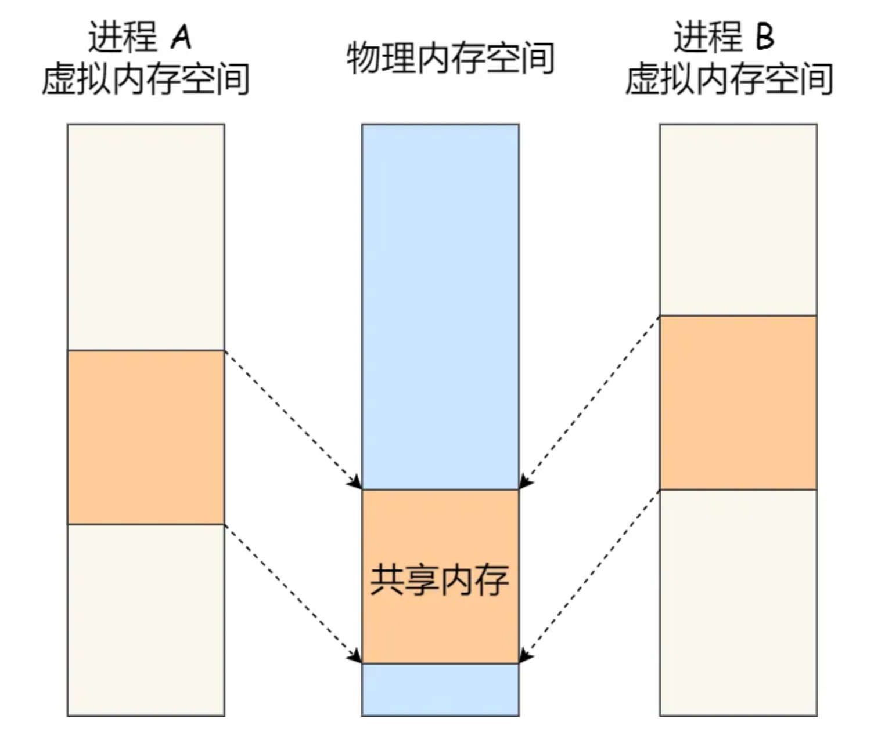

在 Linux 中，可以通过 `shmget/shmat` 建立共享内存，也可以通过 `shm_open` 配合 mmap，或者对同一个文件建立 `MAP_SHARED` 映射。

**相同的是背后的物理内存，不要求两个进程映射到相同的虚拟地址。**因此共享内存里通常保存相对偏移，不能随便把某个进程里的指针交给另一个进程使用。

另外，看到同一份内存不代表数据已经按正确的顺序发布。比如生产者先写数据再修改“已就绪”标记，消费者要通过进程间共享的锁、信号量，或正确的原子操作和内存序来协调，才能安全地读取完整数据。

### 2.2.20 线程间通讯有什么方式？

线程在同一进程内共享地址空间，所以可以直接通过共享变量、队列等传递数据，不像进程那样通常需要额外建立通信通道。**通信方便，但必须处理好同步。**

常见的同步机制有：**互斥锁、读写锁、条件变量、自旋锁和信号量**。其中互斥锁、读写锁和自旋锁主要解决互斥问题，条件变量和信号量也常用于等待与通知。

- **互斥锁（Mutex）**：访问共享数据前加锁，访问完成后解锁，保证同一时刻只有一个线程进入对应的临界区。竞争时可能先进行短暂自旋，再进入阻塞等待，具体取决于实现。释放锁时通常唤醒一个或适量的等待者，并不是一定唤醒所有线程，也不保证先等待的线程一定先拿到锁。
- **条件变量（Condition Variables）**：条件变量(cond)是在多线程程序中用来实现"等待-->唤醒"逻辑常用的方法。条件变量利用线程间共享的全局变量进行同步的一种机制，主要包括两个动作：一个线程等待"条件变量的条件成立"而挂起；另一个线程使“条件成立”。为了防止竞争，条件变量的使用总是和一个互斥锁结合在一起。线程在改变条件状态前必须首先锁住互斥量，函数pthread_cond_wait把自己放到等待条件的线程列表上，然后对互斥锁解锁(这两个操作是原子操作)。在函数返回时，互斥量再次被锁住。
- **自旋锁（Spinlock）**：通过 CAS、原子交换等原子指令竞争锁，加锁失败的线程循环检查锁状态，也就是“忙等待”。它不会因为等待锁而主动睡眠，适合多核环境下持锁时间很短的临界区，但长时间自旋会消耗 CPU。
- **信号量（Semaphores）**：通常表示可用资源的数量。P 操作申请资源，有资源就减少计数并继续，没有资源就等待；V 操作归还资源，并在需要时唤醒等待者。它既可以用于线程之间，也可以用于进程之间；无名信号量放在共享内存中并按进程共享方式初始化后，同样可以供多个进程使用。
- **读写锁（Read-Write Locks）**：读写锁从字面意思我们也可以知道，它由「读锁」和「写锁」两部分构成，如果只读取共享资源用「读锁」加锁，如果要修改共享资源则用「写锁」加锁。所以，**读写锁适用于能明确区分读操作和写操作的场景**。读写锁的工作原理是：当「写锁」没有被线程持有时，多个线程能够并发地持有读锁，这大大提高了共享资源的访问效率，因为「读锁」是用于读取共享资源的场景，所以多个线程同时持有读锁也不会破坏共享资源的数据。但是，一旦「写锁」被线程持有后，读线程的获取读锁的操作会被阻塞，而且其他写线程的获取写锁的操作也会被阻塞。所以说，写锁是独占锁，因为任何时刻只能有一个线程持有写锁，类似互斥锁和自旋锁，而读锁是共享锁，因为读锁可以被多个线程同时持有。知道了读写锁的工作原理后，我们可以发现，**读写锁在读多写少的场景，能发挥出优势**。

### 2.2.21 除了互斥锁你还知道什么锁？分别应用于什么场景？

1. 读写锁：读写锁允许多个线程同时读取共享资源，但只允许一个线程进行写操作。适用于读操作频繁、写操作较少的场景，可以提高并发性能。
2. 自旋锁：自旋锁是一种忙等待锁，线程在获取锁时不会进入阻塞状态，而是循环忙等待直到获取到锁。适用于临界区很小且锁的持有时间很短的场景，避免线程频繁切换带来的开销。
3. 条件变量：条件变量用于线程间的同步和通信。它通常与互斥锁一起使用，线程可以通过条件变量等待某个条件满足，当条件满足时，其他线程可以通过条件变量发送信号通知等待线程。
4. 信号量：信号量是一种计数器，用于控制对共享资源的访问。它可以用来限制同时访问资源的线程数量，或者用于线程间的同步。

### 2.2.22 条件变量为什么要配合互斥锁，还要用 while 判断条件？

**条件变量负责等待和唤醒，互斥锁负责保护真正的共享条件。**

举个例子，消费者要等队列里有数据，真正的条件是“队列不为空”，不是“收到了一次通知”。常见写法如下：

```c
pthread_mutex_lock(&mutex);
while (queue_empty()) {
    pthread_cond_wait(&cond, &mutex);
}
consume_one(); // 持锁取出一条数据
pthread_mutex_unlock(&mutex);
```

`pthread_cond_wait` 会把**释放互斥锁和进入等待**作为一个原子过程，避免消费者刚检查完队列，生产者就放入数据并发出通知，而消费者随后才睡下去，错过这次通知。被唤醒后，wait 会先重新获取互斥锁，再返回。

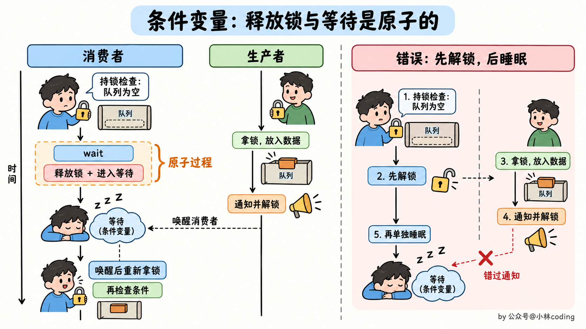

为什么用 while，而不是 if 呢？

- **可能出现虚假唤醒**：即使没有对应的通知，wait 也可能返回。
- **条件可能又变了**：多个消费者被唤醒后，其他线程可能先一步取走数据，轮到当前线程拿到锁时，队列又空了。

所以，**唤醒只代表可以重新检查条件，不代表条件一定成立**。生产者也要在同一把锁保护下修改队列，并发送通知。

### 2.2.23 互斥锁和信号量有什么区别？

- **互斥锁保护临界区**：同一时刻只允许一个线程进入，通常由加锁的线程负责解锁，强调所有权。
- **信号量控制资源数量或执行顺序**：初值为 N 时，可以允许 N 个任务同时申请资源，申请和释放也可以由不同线程完成。

比如保护一个共享链表，可以使用互斥锁；限制最多 10 个任务同时访问某个服务，可以使用初值为 10 的信号量；让线程 A 完成后通知线程 B，可以使用初值为 0 的信号量。

初值为 1 的信号量也能实现互斥，但它的所有权和误用检查等语义与互斥锁不同，不能认为两者完全一样。

### 2.2.24 进程调度算法有哪些？

#### 先来先服务调度算法

 顾名思义，先来后到，**每次从就绪队列选择最先进入队列的进程，然后一直运行，直到进程退出或被阻塞，才会继续从队列中选择第一个进程接着运行。**

这似乎很公平，但是当一个长作业先运行了，那么后面的短作业等待的时间就会很长，不利于短作业。 FCFS 对长作业有利，适用于 CPU 繁忙型作业的系统，而不适用于 I/O 繁忙型作业的系统。

#### 最短作业优先调度算法

**优先选择运行时间最短的进程来运行**，这有助于提高系统的吞吐量。

这显然对长作业不利，很容易造成一种极端现象。

比如，一个长作业在就绪队列等待运行，而这个就绪队列有非常多的短作业，那么就会使得长作业不断的往后推，周转时间变长，致使长作业长期不会被运行。

#### 高响应比优先调度算法

**高响应比优先 （Highest Response Ratio Next, HRRN）调度算法**主要是权衡了短作业和长作业。

**每次进行进程调度时，先计算「响应比优先级」，然后把「响应比优先级」最高的进程投入运行**，「响应比优先级」的计算公式：

$$
优先权 = \frac{等待时间 + 要求服务时间}{要求服务时间}
$$
从上面的公式，可以发现：

- 如果两个进程的「等待时间」相同时，「要求的服务时间」越短，「响应比」就越高，这样短作业的进程容易被选中运行；
- 如果两个进程「要求的服务时间」相同时，「等待时间」越长，「响应比」就越高，这就兼顾到了长作业进程，因为进程的响应比可以随时间等待的增加而提高，当其等待时间足够长时，其响应比便可以升到很高，从而获得运行的机会；

#### 时间片轮转调度算法

 **每个进程被分配一个时间段，称为时间片（\*Quantum\*)，即允许该进程在该时间段中运行。**

- 如果时间片用完，进程还在运行，那么将会把此进程从 CPU 释放出来，并把 CPU 分配另外一个进程；
- 如果该进程在时间片结束前阻塞或结束，则 CPU 立即进行切换；

另外，时间片的长度就是一个很关键的点：

- 如果时间片设得太短会导致过多的进程上下文切换，降低了 CPU 效率；
- 如果设得太长又可能引起对短作业进程的响应时间变长，极端情况下就接近先来先服务；

时间片没有适用于所有系统的固定值，要结合上下文切换成本和响应时间要求来选择。

#### 最高优先级调度算法

前面的「时间片轮转算法」做了个假设，即让所有的进程同等重要，也不偏袒谁，大家的运行时间都一样。

但是，对于多用户计算机系统就有不同的看法了，它们希望调度是有优先级的，即希望调度程序能**从就绪队列中选择最高优先级的进程进行运行，这称为最高优先级（\*Highest Priority First，HPF\*）调度算法**。 进程的优先级可以分为，静态优先级或动态优先级：

- 静态优先级：创建进程时候，就已经确定了优先级了，然后整个运行时间优先级都不会变化；
- 动态优先级：根据进程的动态变化调整优先级，比如如果进程运行时间增加，则降低其优先级，如果进程等待时间（就绪队列的等待时间）增加，则升高其优先级，也就是**随着时间的推移增加等待进程的优先级**。

该算法也有两种处理优先级高的方法，非抢占式和抢占式：

- 非抢占式：就绪队列出现更高优先级的进程时，仍等当前进程结束、阻塞或主动让出 CPU，再进行选择。
- 抢占式：就绪队列出现更高优先级的进程时，可以让当前进程回到就绪状态，优先调度更高优先级的进程。

但是依然有缺点，可能会导致低优先级的进程永远不会运行。

#### 多级反馈队列调度算法

「时间片轮转算法」和「最高优先级算法」的综合和发展。

- 「多级」表示有多个队列，每个队列优先级从高到低，同时优先级越高时间片越短。
- 「反馈」表示根据进程的运行表现调整它所在的队列，比如持续用完时间片的进程会逐渐降到低优先级队列，而经常等待 I/O 的交互任务通常能保留较高的优先级；

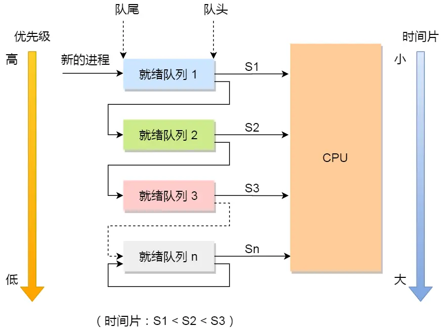 来看看，它是如何工作的：

- 设置了多个队列，赋予每个队列不同的优先级，每个**队列优先级从高到低**，同时**优先级越高时间片越短**；
- 新的进程会被放入到第一级队列的末尾，按先来先服务的原则排队等待被调度，如果在第一级队列规定的时间片没运行完成，则将其转入到第二级队列的末尾，以此类推，直至完成；
- 当较高优先级的队列为空，才调度较低优先级的队列中的进程运行。如果进程运行时，有新进程进入较高优先级的队列，则停止当前运行的进程并将其移入到原队列末尾，接着让较高优先级的进程运行；

可以发现，对于短作业可能可以在第一级队列很快被处理完。

对于长作业，如果在第一级队列处理不完，可以移入下一级队列，获得更长的时间片，减少频繁切换的开销。这种方式希望**兼顾长短作业，并让交互任务有较好的响应时间**。

为了避免低优先级任务长期得不到运行，还可以定期提升等待任务的优先级，或者把任务统一提升到高优先级队列。这些是调度算法的基本思想，具体操作系统的实现不一定照搬这一套队列规则。

## 2.3 锁

### 2.3.1 为什么并发执行线程要加锁？

并发执行线程需要加锁主要是为了保护共享数据，防止出现"竞态条件"。

"竞态条件"是指当多个线程同时访问和操作同一块数据时，最终结果依赖于线程的执行顺序，这可能导致数据的不一致性。

比如两个线程同时执行 `count++`，这个操作通常包含读取、加 1、写回三个步骤。如果两个线程都读到了 10，最后都写回 11，就丢失了一次更新。

通过互斥锁保护这段操作，可以确保同一时刻只有一个线程进入临界区。**前提是所有访问这份共享数据的线程都遵守同一套同步规则**，只在写入的一处加锁，而其他地方随意读写，仍然可能出问题。

不过，并发不意味着所有地方都要加锁。如果数据是只读的，或者每个线程操作各自的数据，就不需要为了“有多线程”而加锁。

### 2.3.2 自旋锁是什么？应用在哪些场景？

**自旋锁**加锁失败后，线程会**忙等待**，直到它拿到锁。

自旋锁可以通过 CPU 提供的 `CAS`（*Compare And Swap*）或原子交换等指令实现。**它既可以用在用户态，也可以用在内核态**，关键特征是竞争失败后忙等待，而不是进入睡眠。

一般加锁的过程，包含两个步骤：

- 第一步，查看锁的状态，如果锁是空闲的，则执行第二步；
- 第二步，将锁设置为当前线程持有；

CAS 函数就把这两个步骤合并成一条硬件级指令，形成**原子指令**，这样就保证了这两个步骤是不可分割的，要么一次性执行完两个步骤，要么两个步骤都不执行。

比如，设 lock 为原子变量，0 表示空闲，1 表示已加锁，通过 CAS 尝试把 0 改成 1，成功的线程获得锁。解锁时通常通过带有 release 语义的原子写把它设回 0，加锁成功则需要相应的 acquire 语义，保证临界区内数据的可见性。

使用自旋锁的时候，当发生多线程竞争锁的情况，加锁失败的线程会「忙等待」，直到它拿到锁。这里的「忙等待」可以用 `while` 循环等待实现，不过最好是使用 CPU 提供的 `PAUSE` 指令来实现「忙等待」，因为可以减少循环等待时的耗电量。

自旋适合**多核环境、持锁时间很短，而且持锁线程能继续运行**的情况。如果只有一个核心，或者持锁线程已经被调度出去，等待线程一直自旋，就可能浪费大量 CPU 时间。

如果多个协程运行在同一个线程上，一个协程一直自旋还可能挡住持锁协程的执行，所以不能把自旋锁理解成天然适合协程。内核自旋锁还有抢占、中断等上下文约束，普通内核自旋锁保护的临界区不能随意睡眠。

自旋锁与互斥锁使用层面比较相似，但实现层面上完全不同：**当加锁失败时，互斥锁用「线程切换」来应对，自旋锁则用「忙等待」来应对**。

**短临界区可以考虑自旋锁，持锁时间较长或可能阻塞时通常更适合互斥锁**。但最终还要看核心数量、竞争程度和具体实现，不能只凭代码行数决定哪一种更快。

### 2.3.3 死锁发生条件是什么？

- 互斥条件：**多个线程不能同时使用同一个资源**。
- 持有并等待条件：当线程 A 已经持有了资源 1，又想申请资源 2，而资源 2 已经被线程 C 持有了，所以线程 A 就会处于等待状态，但是**线程 A 在等待资源 2 的同时并不会释放自己已经持有的资源 1**。
- 不可剥夺条件：当线程已经持有了资源 ，**在自己使用完之前不能被其他线程获取**，线程 B 如果也想使用此资源，则只能在线程 A 使用完并释放后才能获取。
- 环路等待条件：存在一个等待环，比如线程 A 等待 B 持有的资源，B 等待 C 持有的资源，C 又等待 A 持有的资源，**环里可以有两个或更多线程**。

这四个是**必要条件**。对于每类资源可能有多个实例的情况，存在等待环也不一定已经死锁，还要看剩余资源能否让某个任务继续推进。

### 2.3.4 如何避免死锁？

**使用资源有序分配法，破坏环路等待条件**。

线程 A 和 线程 B 获取资源的顺序要一样，当线程 A 是先尝试获取资源 A，然后尝试获取资源 B 的时候，线程 B 同样也是先尝试获取资源 A，然后尝试获取资源 B。也就是说，线程 A 和 线程 B 总是以相同的顺序申请自己想要的资源。

还可以一次性申请需要的全部资源，申请不到就先不持有任何资源，破坏“持有并等待”；或者使用 trylock，获取失败时释放已经拿到的锁，再重试。

不过，**超时和重试只有配合释放资源，才可能解除等待**。如果一直持有原来的锁重试，问题仍然存在；大家同时释放、同时重试，还可能出现活锁，需要退避等策略。

严格区分的话，破坏必要条件属于“死锁预防”；银行家算法这种每次分配前检查系统是否安全的做法，才属于“死锁避免”。已经发生死锁，则要通过检测和恢复处理，比如终止某个任务或回滚事务。

### 2.3.5 死锁、活锁和饥饿有什么区别？

- **死锁**：几个任务相互等待对方持有的资源，谁也无法继续。
- **活锁**：任务没有阻塞，一直在重试或调整，但始终没有实际进展。比如两个人迎面走来，同时往左让、又同时往右让，一直过不去。
- **饥饿**：系统整体还在运行，但某个任务长期拿不到 CPU 或锁。比如高优先级任务不断到来，低优先级任务一直得不到执行。

对应的处理思路也不同：死锁可以通过统一加锁顺序来预防，活锁可以通过随机退避减少同步重试，饥饿可以通过公平队列或提高等待任务的优先级来缓解。

### 2.3.6 讲一下银行家算法

银行家算法会在分配资源前检查，**分配后是否仍然存在一个让所有进程都能顺利完成的安全序列**。如果找不到，就暂缓这次分配。

**银行家算法是最有代表性的避免死锁的算法**。

为什么叫银行家算法呢？就是这个算法的逻辑**很像银行放贷的逻辑，也就是尽可能避免坏账的出现**。

银行家算法的业务逻辑如下。

- **总量约束**：一个进程的最大需求量不能超过系统拥有的总资源数，否则不会被接纳执行。
- **可分期请求**：一个进程可以分期请求资源，但已持有的数量加上本次请求，不能超过事先声明的最大需求量。
- **推迟分配**：如果资源不足，或者试分配后会进入不安全状态，就让进程等待，不能只看当前剩余资源够不够。

判断时主要使用三个量：`Available` 表示剩余可用资源，`Allocation` 表示已经分配给进程的资源，`Need = Max - Allocation` 表示进程还可能需要的资源。

检查新请求时，先判断请求有没有超过 Need，以及当前 Available 能否满足，再在副本上试分配并进行安全性检查。**安全性检查是在模拟，不是真的要求进程按安全序列逐个执行。**

假如系统中有三类互斥资源 R1、R2、R3，**总资源数**分别是 9、8、5，在指定时刻有 P1、P2、P3、P4 和 P5 这五个进程，它们的最大需求量和已分配资源数如下表所示，那么能否找到安全序列？

| 进程 | 最大需求量（分别为R1 R2 R3） | 已分配资源数（分别为R1 R2 R3） |
| ---- | ---------------------------- | ------------------------------ |
| P1   | 6 5 2                        | 1 2 1                          |
| P2   | 2 2 1                        | 2 1 1                          |
| P3   | 8 1 1                        | 2 1 0                          |
| P4   | 1 2 1                        | 1 2 0                          |
| P5   | 3 4 4                        | 1 1 3                          |

第一步：分析

先计算剩余需求，**系统剩余可用资源数分别是 2、1、0**，各进程还需要的资源数如下表所示。

资源 R1 的剩余可用资源数 = 9 - 1 - 2 - 2 - 1 - 1 = 2。

资源 R2 的剩余可用资源数 = 8 - 2 - 1 - 1 - 2 - 1 = 1。

资源 R3 的剩余可用资源数 = 5 - 1 - 1 - 0 - 0 - 3 = 0。

| 进程 | 最大需求量 | 已分配资源数 | 剩余需要的资源数 |
| ---- | ---------- | ------------ | ---------------- |
| P1   | 6 5 2      | 1 2 1        | 5 3 1            |
| P2   | 2 2 1      | 2 1 1        | 0 1 0            |
| P3   | 8 1 1      | 2 1 0        | 6 0 1            |
| P4   | 1 2 1      | 1 2 0        | 0 0 1            |
| P5   | 3 4 4      | 1 1 3        | 2 3 1            |

此时 `Available = (2, 1, 0)`，只有 P2 的剩余需求 `(0, 1, 0)` 不超过 Available，所以可以先在安全性检查中模拟 P2 完成。

第二步：执行 P2

模拟 P2 获得剩余所需的 `(0, 1, 0)` 并执行完后，会释放全部持有的资源。因此可用资源的净增加量，正好是它原本持有的 `(2, 1, 1)`。

资源 R1 的剩余可用资源数 = 原资源数 - 执行 P2 消耗数 + P2 执行完释放的资源数 = 2 - 0 +（2 + 0） = 4。

资源 R2 的剩余可用资源数 = 原资源数 - 执行 P2 消耗数 + P2 执行完释放的资源数 = 1 - 1 + （1 + 1） = 2。

资源 R3 的剩余可用资源数 = 原资源数 - 执行 P2 消耗数 + P2 执行完释放的资源数 = 0 - 0 +（0 + 1） = 1。

**执行完成 P2 后，操作系统剩余可用资源数为 4 2 1**。

| 进程 | 最大需求量 | 已分配资源数 | 剩余需要的资源数 |
| ---- | ---------- | ------------ | ---------------- |
| P1   | 6 5 2      | 1 2 1        | 5 3 1            |
| P2   | 完成       | 完成         | 完成             |
| P3   | 8 1 1      | 2 1 0        | 6 0 1            |
| P4   | 1 2 1      | 1 2 0        | 0 0 1            |
| P5   | 3 4 4      | 1 1 3        | 2 3 1            |

第三步：执行 P4

此时操作系统剩余可用资源数为 4 2 1，只能执行进程 P4，因为其他进程资源不够。

模拟 P4 获得 `(0, 0, 1)` 并执行完后，可用资源的净增加量是它原本持有的 `(1, 2, 0)`。

资源 R1 的剩余可用资源数 = 原资源数 - 执行 P4 消耗数 + P4 执行完释放的资源数 = 4 - 0 +（1 + 0） = 5。

资源 R2 的剩余可用资源数 = 原资源数 - 执行 P4 消耗数 + P4 执行完释放的资源数 = 2 - 0 + （2 + 0） = 4。

资源 R3 的剩余可用资源数 = 原资源数 - 执行 P4 消耗数 + P4 执行完释放的资源数 = 1 - 1 +（0 + 1） = 1。

**执行完成 P4 后，操作系统剩余可用资源数为 5 4 1**。

| 进程 | 最大需求量 | 已分配资源数 | 剩余需要的资源数 |
| ---- | ---------- | ------------ | ---------------- |
| P1   | 6 5 2      | 1 2 1        | 5 3 1            |
| P2   | 完成       | 完成         | 完成             |
| P3   | 8 1 1      | 2 1 0        | 6 0 1            |
| P4   | 完成       | 完成         | 完成             |
| P5   | 3 4 4      | 1 1 3        | 2 3 1            |

第四步：执行 P5

此时剩余可用资源数为 `(5, 4, 1)`，**P1 和 P5 的剩余需求都能满足**。这里选择 P5 继续推演，选择 P1 也可以找到安全序列。

P5 执行之后，释放了刚刚放入的 2 3 1 资源，而且可以释放已分配的 1 1 3 资源，所以此时的资源剩余量。

资源 R1 的剩余可用资源数 = 原资源数 - 执行 P5 消耗数 + P5 执行完释放的资源数 = 5 - 2 +（1 + 2） = 6。

资源 R2 的剩余可用资源数 = 原资源数 - 执行 P5 消耗数 + P5 执行完释放的资源数 = 4 - 3 + （1 + 3） = 5。

资源 R3 的剩余可用资源数 = 原资源数 - 执行 P5 消耗数 + P5 执行完释放的资源数 = 1 - 1 +（3 + 1） = 4。

**执行完成 P5 后，操作系统剩余可用资源数为 6 5 4**。

| 进程 | 最大需求量 | 已分配资源数 | 剩余需要的资源数 |
| ---- | ---------- | ------------ | ---------------- |
| P1   | 6 5 2      | 1 2 1        | 5 3 1            |
| P2   | 完成       | 完成         | 完成             |
| P3   | 8 1 1      | 2 1 0        | 6 0 1            |
| P4   | 完成       | 完成         | 完成             |
| P5   | 完成       | 完成         | 完成             |

第五步：执行 P1 或者 P3

此时操作系统剩余可用资源数为 6 5 4，可以执行 P1 或 P3。

所以可以找到安全序列 **P2 => P4 => P5 => P1 => P3** 或 **P2 => P4 => P5 => P3 => P1**，这些是可行的例子，不代表安全序列只有这两种。

#### 银行家算法总结

核心思想，就是在**分配资源前，判断试分配后的整个系统是否仍然安全**。即使当前资源足够满足某个请求，如果分配后找不到安全序列，也不能直接批准。

**安全性检查时，用 Work 记录模拟的可用资源，初值为 Available。反复寻找 Need 不超过 Work 的进程，假设它完成，然后把它原本持有的 Allocation 加回 Work，看最终能否让所有进程都完成**。找不到这样的进程而又有进程未完成，就说明这个状态不安全。

需要注意：**安全状态存在避免死锁的完成顺序，不安全状态也不一定已经死锁**，只是不再能保证所有进程按最大需求申请资源时都能顺利完成。

银行家算法需要提前知道各个进程的最大资源需求，而且每次申请都要进行检查，所以理解它的安全性思想很有价值，但实际系统不一定直接采用它。

### 2.3.7 乐观锁和悲观锁有什么区别？

乐观锁：

- 基本思想：假设冲突比较少，先读取数据并计算新值，再通过版本号或 CAS 等方式检查数据有没有被其他任务修改。**检查和更新必须是一个原子过程**，不能先检查通过，再单独执行一次无保护的写入。
- 使用场景：适合冲突较少、失败后可以重试的场景。比如更新数据库记录时，把旧版本号放进更新条件，成功后同时增加版本号，更新失败就重新读取或报告冲突。

悲观锁：

- 基本思想：认为访问共享数据时需要先获得锁，再执行受保护的操作，完成后释放。它不要求所有普通读取都加锁，而是对需要保证互斥或一致性的访问加锁。
- 使用场景：适合竞争较强，或者重试成本较高的场景。比如使用互斥锁保护共享结构，或者在事务中用行锁保护需要连续修改的数据。

关键要看**冲突概率和失败后的重试成本**。乐观方式在高冲突下可能不断重试，浪费 CPU；悲观方式则可能有阻塞、唤醒和死锁等开销，不能只凭读写数量决定用哪一种。

## 2.4 内存管理

### 2.4.1 介绍一下操作系统内存管理

操作系统设计了虚拟内存，每个进程都有自己的独立虚拟地址空间，我们所写的程序通常不会直接与物理内存打交道。


有了虚拟内存之后，它带来了这些好处：

- **进程可以使用比物理内存更大的虚拟地址空间**，不必把所有页面同时放进物理内存。程序运行符合局部性原理，可以只保留当前常用的页面，文件页按需重新读取，不常用的匿名页在启用 Swap 时可以换出。不过，这不代表实际可用内存没有限制，频繁换入换出还会明显拖慢程序。
- 由于每个进程都有自己的页表，所以**每个进程的虚拟内存空间就是相互独立的**。进程也没有办法访问其他进程的页表，所以这些页表是私有的，这就解决了多进程之间地址冲突的问题。
- 页表里的页表项中除了物理地址之外，还有一些**标记属性**的比特，比如控制一个页的读写权限，标记该页是否存在等。在内存访问方面，**操作系统提供了更好的安全性**。

Linux 主要通过分页来管理内存，**分页是把虚拟和物理内存空间划分成固定大小的页和页框**。常见 x86 Linux 的普通页大小是 4KB，但具体大小与架构和配置有关，也可以使用更大的页。

虚拟地址与物理地址之间通过**页表**来映射，如下图：


页表是存储在内存里的，**内存管理单元** （*MMU*）就做将虚拟内存地址转换成物理地址的工作。

当进程访问的页面尚未驻留，或者访问违反页表记录的权限时，CPU 会产生**缺页异常**。内核会判断这次访问是否合法：合法的按需分配、换入或写时复制可以处理后重试；非法地址或真正的权限错误，则可能向进程发送 SIGSEGV。

### 2.4.2 什么是虚拟内存和物理内存？

- 虚拟内存：是**操作系统提供给进程的地址空间抽象**，程序通常使用虚拟地址访问数据。通过页表等机制，一部分虚拟地址映射到物理内存，其他区域可以尚未分配，或者对应文件、Swap 等后备存储。它让进程获得独立的地址空间，并支持按需加载和访问保护，不能把它简单理解成“内存加硬盘”。
- 物理内存：物理内存是**计算机实际存在的内存**，是计算机中的实际硬件部件。

### 2.4.3 讲一下页表？

**页表记录了虚拟页到物理页框的映射，以及读写权限、是否驻留等属性**。常见 x86 Linux 的普通页大小是 4KB，也支持大页，不能认为所有 Linux 系统的页大小都固定为 4KB。

虚拟地址与物理地址之间通过**页表**来映射，如下图：


页表是存储在内存里的，**内存管理单元** （*MMU*）就做将虚拟内存地址转换成物理地址的工作。

如果页表项表明页面没有驻留，或者当前操作不满足访问权限，就会触发**缺页异常**，由内核判断是否可以通过分配页面、加载文件或写时复制等方式解决。并不是每次缺页都要读磁盘，也不是每次都能恢复执行。

基本分页按固定大小的页框分配，**连续的虚拟页可以映射到不连续的物理页框**，不需要为了一个连续的虚拟地址区间找到一整块连续物理内存，因此避免了分段连续分配带来的外部碎片问题。不过，内核申请大块连续物理内存时，仍然可能受到物理内存碎片的影响。

但是，因为内存分页机制分配内存的最小单位是一页，即使程序不足一页大小，我们最少只能分配一个页，所以页内会出现内存浪费，所以针对**内存分页机制会有内部内存碎片**的现象。

在分页机制下，虚拟地址分为两部分，**页号**和**页内偏移**。页号作为页表的索引，**页表**包含物理页每页所在**物理内存的基地址**，这个基地址与页内偏移的组合就形成了物理内存地址，见下图。


总结一下，对于一个内存地址转换，其实就是这样三个步骤：

- 把虚拟内存地址，切分成页号和偏移量；
- 根据页号，从页表里面，查询对应的物理页号；
- 用物理页号乘以页大小，得到物理页框的基地址，再加上页内偏移量，就得到了物理地址。

下面举个例子，虚拟内存中的页通过页表映射为了物理内存中的页，如下图：


### 2.4.4 讲一下段表？

分段机制会按照代码、数据、栈等逻辑区域划分地址空间，**段的数量不是固定为 4 个**。虚拟地址由段号和段内偏移组成，每个段在段表中有一个表项，记录段基地址、段长度和权限等信息。

先根据段号查段表，检查偏移是否越界、权限是否满足，再把段基地址加上段内偏移，就得到物理地址。下面这张图是一个分段的例子：


如果要访问段 3 中偏移量 500 的虚拟地址，我们可以计算出物理地址为，段 3 基地址 7000 + 偏移量 500 = 7500。

分段按逻辑划分，段长可变，方便表达保护和共享关系，但要求段内连续，容易产生外部碎片；分页按固定大小划分，主要解决内存分配和按需加载的问题。

### 2.4.5 虚拟地址是怎么转化到物理地址的？

通过内存管理单元（Memory Management Unit，MMU）。MMU是计算机系统中的硬件组件，负责虚拟地址和物理地址之间的转换。

在虚拟地址转换的过程中，通常会使用页表（Page Table）来进行映射。页表是一种数据结构，它将虚拟地址空间划分为固定大小的页（Page），对应于物理内存中的页框（Page Frame）。每个页表项（Page Table Entry）记录了虚拟页和物理页的对应关系。

当程序访问一个虚拟地址时，MMU会将虚拟地址分解为页号和页内偏移量。然后，MMU会查找页表，根据页号找到对应的页表项。页表项中包含了物理页的地址或页框号。最后，MMU将物理页的地址与页内偏移量组合，得到对应的物理地址。

虚拟地址转化为物理地址的过程中，还可能涉及到多级页表、TLB（Translation Lookaside Buffer）缓存等机制，以提高地址转换的效率。

### 2.4.6 为什么要用多级页表？

主要是为了**减少稀疏地址空间下页表占用的内存**。

举个例子，32 位虚拟地址空间有 4GB，如果页大小是 4KB，那么就有 `2^20` 个虚拟页。假设每个页表项占 4 字节，单级页表就要占用 4MB，即使进程只用了很小一部分地址空间，也要为整张表留出位置。

多级页表把这张大表拆开，**只为实际使用的地址范围分配下一级页表**。没有使用的一大片地址空间，就不需要建立对应的下级页表。


代价是地址转换时，可能需要沿着多级页表查询，增加访存次数。为了解决这个问题，CPU 会用 TLB 缓存近期使用的地址映射。

### 2.4.7 TLB 是什么？TLB 未命中一定会发生缺页异常吗？

TLB 可以理解成**地址转换的高速缓存**，缓存最近使用过的虚拟页到物理页框的映射及权限等信息。

访问内存时，CPU 通常先查 TLB，命中后就不用再逐级查询页表；未命中时，再查页表，并把有效映射填入 TLB。

**TLB 未命中不等于缺页。**

- TLB 未命中：只是这条映射没有缓存在 TLB 里，页表中的映射可能完全有效。
- 缺页异常：页表检查发现页面未驻留，或者操作不符合权限，需要内核介入处理。

以常见 x86 系统为例，TLB 未命中后的页表遍历可以由硬件完成，不一定进入内核。进程切换时，地址空间标识等机制也能减少 TLB 失效的成本，不能简单说每次切换都会清空全部 TLB。

### 2.4.8 缺页异常是怎么处理的？一定会访问磁盘吗？

**缺页异常不一定是程序出错，也不一定需要读取磁盘。**它可以是按需分配内存、加载文件或写时复制的正常过程。

处理过程大致是：

1. CPU 保存现场并进入内核，内核根据出错地址和访问类型检查对应的虚拟内存区域。
2. 如果地址合法、权限允许，就按情况分配新页面、从文件或 Swap 读取页面，或者处理写时复制。
3. 更新页表和相关地址转换缓存，恢复现场，重新执行触发异常的指令。
4. 如果地址没有合法映射，或者确实不允许这次访问，通常向进程发送 SIGSEGV；某些文件映射错误可能产生 SIGBUS。

比如第一次写入新申请的匿名内存，可能只需要分配一个清零的物理页；文件页已经在 Page Cache 中时，也可以直接建立映射。这些通常属于**次缺页（minor fault）**，不需要从磁盘加载页面。

如果所需页面必须从文件或 Swap 等后备存储读取，就属于**主缺页（major fault）**，通常开销大得多。

### 2.4.9 程序的内存布局是怎么样的？


通过这张图你可以看到，用户空间内存，从**低到高**分别是 6 种不同的内存段：

- 代码段，包括二进制可执行代码；
- 数据段，通常包括已初始化且非零的全局变量和静态变量，只读常量通常放在只读数据区域；
- BSS 段，通常包括未显式初始化或初始化为零的全局变量和静态变量；
- 堆段，包括动态分配的内存，从低地址开始向上增长；
- 文件映射段，包括动态库、共享内存等；
- 栈段，包括函数调用的上下文和需要放在栈上的局部变量等。栈有大小限制，部分 Linux 环境下主线程的默认限制是 `8 MB`，但不是所有线程、所有系统都固定为这个值；

代码段下面还有一段内存空间的（灰色部分），这一块区域是「保留区」，之所以要有保留区这是因为在大多数的系统里，我们认为比较小数值的地址不是一个合法地址，例如，我们通常在 C 的代码里会将无效的指针赋值为 NULL。因此，这里会出现一段不可访问的内存保留区，防止程序因为出现 bug，导致读或写了一些小内存地址的数据，而使得程序跑飞。

这张图是典型布局，实际地址还会受架构、加载方式和 ASLR（地址空间布局随机化）等影响。malloc 返回的内存可能来自堆，也可能来自匿名 mmap 映射，不能仅凭调用 malloc 就认定它一定在图里的堆段。

### 2.4.10 堆和栈的区别？

| 对比项       | 栈（Stack）                                      | 堆（Heap）                                            |
| ------------ | ------------------------------------------------ | ----------------------------------------------------- |
| 分配方式     | 函数调用时自动分配，移动栈指针；自动伸缩         | 手动动态申请：malloc /new，运行时分配                 |
| 回收方式     | 函数执行完毕自动出栈回收                         | C/C++ 手动 free/delete，Java 等带 GC 语言由运行时回收 |
| 空间大小     | 容量有限（可 - Xss 调整）                        | 空间大，受操作系统可用内存限制                        |
| 分配速度     | 很快，只修改栈指针                               | 较慢，需要查找空闲块、内存碎片管理                    |
| 内存管理主体 | 编译器 / 操作系统自动管理                        | 程序员、智能指针、GC 负责管理                         |
| 重点风险     | 函数返回后，局部变量指针变成野指针，不能继续使用 | 容易内存泄漏、产生内存碎片                            |

### 2.4.11 fork()会复制哪些东西？

fork 会创建一个新的子进程，**继承父进程的大部分运行环境，但不是把所有资源都完整复制一遍**。

- **进程管理信息**：创建子进程的内核管理结构，分配新的 PID，继承工作目录、权限等属性。
- **虚拟地址空间**：建立子进程的地址空间和页表。普通私有可写页通常通过写时复制共享物理页，等父进程或子进程实际修改时再按需分离。
- **文件描述符**：子进程继承文件描述符表中的引用，但对应的内核打开文件描述通常与父进程共享，所以文件偏移等状态也可能共享。
- **执行状态**：子进程从 fork 返回的位置继续执行，父进程得到子进程 PID，子进程得到 0；如果父进程有多个线程，子进程只保留调用 fork 的线程。

因此，fork 本身仍然有建立管理结构和复制页表等成本。父进程地址空间很大时，即使没有立即复制全部物理内存，fork 也可能带来延迟。

### 2.4.12 介绍copy on write(写时复制)

父进程执行 fork 的时候，操作系统会为子进程建立独立的地址空间，复制相关「**页表**」信息。对于普通私有页面，父子进程可以先通过各自的页表指向同一个物理页，而不立即复制页面里的数据。

这样一来，父子进程暂时共享物理页，能够**节约物理内存资源**。对于原本可写的私有页，父子进程对应的页表项都会被写保护，内核同时保留这块虚拟区域允许写入的信息。

当父进程或子进程尝试写入这些页面时，CPU 会触发**写保护导致的缺页异常**。内核发现这是合法的写时复制访问后，通常会分配新物理页，复制原页的数据，再把**发生写入的那个进程**的页表项改为指向新页，并恢复它的写权限，最后重新执行写操作。

另一方仍然指向原来的物理页，不能理解成一次写入就把父子进程的所有页都改成可写。若原物理页已经没有其他共享者，内核也可能直接恢复写权限，不必再复制。

写时复制顾名思义，**在发生写操作的时候，操作系统才会去复制物理内存**，这样是为了防止 fork 创建子进程时，由于物理内存数据的复制时间过长而导致父进程长时间阻塞的问题。

这里讨论的是普通私有映射。显式建立的 `MAP_SHARED` 共享映射，会保持共享语义，不会因为 fork 后写入就自动变成两份独立数据。

### 2.4.13 copy on write节省了什么资源？

主要节省了**物理内存，以及立即复制大量数据的 CPU 时间**。父子进程暂时共享普通私有页面的物理内存，不必在 fork 时就把全部数据复制一份，但仍然需要创建子进程结构和建立页表。

之后发生写入时，才按需分离涉及的页面。如果子进程很快就调用 exec 执行新程序，旧地址空间里大量没有修改过的页面，可能从头到尾都不需要复制。

### 2.4.14 malloc 1KB和1MB 有什么区别？

首先，**malloc 会优先考虑分配器已经管理的空闲内存，不是每调用一次就执行一次系统调用**。

以 glibc 的常见分配策略为例，需要向内核申请新空间时：

- **1KB 这样的小块内存**：通常从已有的缓存或 arena 中分配，主 arena 空间不足时可能通过 brk 扩展堆。
- **1MB 这样的大块内存**：在常见的初始阈值下，可能直接使用匿名 mmap 建立独立映射，释放时也更容易单独归还给操作系统。

经常提到的 `128KB` 是 glibc mmap 阈值的常见初始值，但阈值可能动态调整，也能通过配置修改，还会受空闲块和 arena 等因素影响。**不能只看申请大小，就断言 1KB 一定走 brk、1MB 一定走 mmap**。

### 2.4.15 介绍一下brk，mmap

实际上，malloc() 并不是系统调用，而是 C 库里的函数，用于动态分配内存。

以 glibc 为例，分配器需要新地址空间时，常见的方式有两种。

方式一：通过 brk() 函数将「堆顶」指针向高地址移动，获得新的内存空间。

方式二：通过 mmap() 系统调用中「私有匿名映射」的方式，在文件映射区分配一块内存，也就是从文件映射区“偷”了一块内存。


两者的区别是：brk 调整连续堆区域的边界，mmap 可以建立独立的映射区域，并通过 munmap 解除映射。mmap 还可以映射文件，不只是 malloc 申请匿名内存的工具。

### 2.4.16 malloc 申请成功，就一定分配了物理内存吗？

**不一定。malloc 返回成功，首先说明得到了一块可使用的虚拟地址范围。**

如果这块内存来自分配器已经使用过的空间，对应物理页可能早已存在；如果来自新扩展的匿名区域，Linux 通常采用按需分配，在程序真正访问时，通过缺页异常建立物理页映射。

比如申请一大块内存后只写其中一页，通常只需要为访问到的页面提供物理内存，并不一定立即为整块区域分配全部物理页。首次读取匿名页还可能先映射到共享的只读零页，写入时再分配独立页面。

Linux 的 overcommit 策略还会影响申请是否被接受。所以，**malloc 成功不保证后续访问所有页面时都不会遇到内存不足**，它也可能在申请阶段就返回 NULL。

### 2.4.17 free 之后，内存一定会还给操作系统吗？

**不一定，free 首先是把这块内存交还给分配器，让后续 malloc 可以复用。**

- 小块内存通常会留在分配器的缓存或空闲链表里，并不会每次都向内核归还。
- brk 管理的堆区域要缩小边界，通常要求堆顶部有可释放的连续空闲空间，堆中间的一小块不能直接通过降低堆顶来归还。
- 对于单独通过 mmap 分配的大块内存，释放时通常可以通过 munmap 解除映射，归还资源。


所以看到 free 后进程的 RSS 没有马上下降，不能直接认定有内存泄漏，还要看分配器是否保留了可复用空间。反过来，**free 后原指针就不能再使用**，不管内存有没有归还内核，继续访问都属于错误用法。

### 2.4.18 内存泄漏和内存溢出有什么区别？

- **内存泄漏**：已经不再需要的内存没有被正确释放，或者仍然被无用的引用保留，导致无法回收。
- **内存溢出**：在这里指 OOM，也就是申请或使用内存时，超过了当前可提供的内存或资源限制。

比如每次处理请求都申请一块内存，却忘记释放，运行越久占用越大，这是泄漏；一次加载一个特别大的文件，直接超过进程可用内存，即使没有泄漏，也可能 OOM。

所以，**泄漏可能积累成 OOM，但 OOM 不一定由泄漏导致**。还要区分数组越界、缓冲区溢出这类内存安全问题，它们与“内存不够用”不是同一种问题。

### 2.4.19 操作系统内存不足的时候会发生什么？

应用程序通过 malloc 申请的是可用的虚拟地址范围。对于新申请且尚未建立物理映射的匿名页面，物理内存通常在实际访问时按需提供；如果复用了已有页面，则不一定再走分配流程。

当应用程序访问尚未建立物理映射的合法页面时，CPU 会产生**缺页异常**（也常被称为缺页中断），进入内核的 Page Fault Handler 处理。对于需要新物理页的情况，内核会尝试分配页面。

如果有合适的空闲物理页，就可以分配并建立映射，再恢复程序执行。

如果没有空闲的物理内存，那么内核就会开始进行**回收内存**的工作，回收的方式主要是两种：

- **后台内存回收**（kswapd）：在空闲内存低于一定水位时，唤醒 kswapd 内核线程回收内存。回收不由申请内存的线程同步完成，但仍会消耗 CPU 和 I/O 资源，也可能间接影响应用延迟。
- **直接内存回收**（direct reclaim）：如果后台异步回收跟不上进程内存申请的速度，就会开始直接回收，这个回收内存的过程是**同步**的，会阻塞进程的执行。

如果直接内存回收后，空闲的物理内存仍然无法满足此次物理内存的申请，那么内核就会放最后的大招了 ——**触发 OOM （Out of Memory）机制**。

OOM Killer 会在允许选择的任务范围里，根据内存占用、`oom_score_adj` 等因素选择进程终止，以释放资源，**不一定直接杀死占用内存最多的进程**。有些分配也可能直接失败，具体取决于分配方式和系统配置。

容器还可能因为达到 cgroup 的内存限制触发 OOM，即使宿主机仍有剩余内存，也不代表容器可以继续申请。

申请物理内存的过程如下图：


系统内存紧张的时候，就会进行回收内存的工作，那具体哪些内存是可以被回收的呢？

主要有两类内存可以被回收，而且它们的回收方式也不同。

- **文件页**（File-backed Page）：内核缓存的磁盘数据（Buffer）和内核缓存的文件数据（Cache）都叫作文件页。大部分文件页，都可以直接释放内存，以后有需要时，再从磁盘重新读取就可以了。而那些被应用程序修改过，并且暂时还没写入磁盘的数据（也就是脏页），就得先写入磁盘，然后才能进行内存释放。所以，**回收干净页的方式是直接释放内存，回收脏页的方式是先写回磁盘后再释放内存**。
- **匿名页**（Anonymous Page）：这部分内存没有实际载体，不像文件缓存有硬盘文件这样一个载体，比如堆、栈数据等。这部分内存很可能还要再次被访问，所以不能直接释放内存，它们**回收的方式是通过 Linux 的 Swap 机制**，Swap 会把不常访问的内存先写到磁盘中，然后释放这些内存，给其他更需要的进程使用。再次访问这些内存时，重新从磁盘读入内存就可以了。

Linux 回收内存时，会参考页面的访问活跃程度，优先考虑较冷的页面。**传统实现采用近似 LRU 思路**，并不是每次访问内存都精确维护一次全局排序。可以用 active 和 inactive 两类链表来理解，其中：

- **active_list** 活跃内存页链表，这里存放的是最近被访问过（活跃）的内存页；
- **inactive_list** 不活跃内存页链表，这里存放的是很少被访问（非活跃）的内存页；

回收时通常先扫描不活跃的页面，再结合访问标记等信息判断是否回收。较新的内核也支持多代 LRU（MGLRU），按访问的新旧程度组织页面，具体使用哪种实现取决于内核版本和配置。

另外，Swap 没有启用或空间不足时，普通匿名页不能靠换出释放物理内存，内存压力会更难缓解。

### 2.4.20 页面置换有哪些算法？

页面置换算法的功能是，**需要新页面但可用物理内存不足时，选择可以回收或换出的页面**。并不是每次淘汰都要写磁盘，比如干净的文件缓存页就可以直接丢弃。

那其算法目标则是，尽可能减少页面的换入换出的次数，常见的页面置换算法有如下几种：

#### 最佳页面置换算法

**置换在「未来」最长时间不访问的页面**。

所以，该算法实现需要计算内存中每个逻辑页面的「下一次」访问时间，然后比较，选择未来最长时间不访问的页面。

我们举个例子，假设一开始有 3 个空闲的物理页，然后有请求的页面序列，那它的置换过程如下图：


在这个请求的页面序列中，缺页共发生了 `7` 次（空闲页换入 3 次 + 最优页面置换 4 次），页面置换共发生了 `4` 次。

这很理想，但是实际系统中无法实现，因为程序访问页面时是动态的，我们是无法预知每个页面在「下一次」访问前的等待时间。

所以，最佳页面置换算法作用是为了衡量你的算法的效率，**你的算法效率越接近该算法的效率，那么说明你的算法是高效的。**

#### 先进先出置换算法

既然我们无法预知页面下一次会在什么时候被访问，那可以**选择最早进入内存的页面进行置换**，这个就是「先进先出置换」算法的思想。

还是以前面的请求的页面序列作为例子，假设使用先进先出置换算法，则过程如下图：


在这个请求的页面序列中，缺页共发生了 `10` 次，页面置换共发生了 `7` 次，跟最佳页面置换算法比较起来，性能明显差了很多。

#### 最近最久未使用的置换算法

基本思路是，发生缺页时，**选择最长时间没有被访问的页面进行置换**，也就是说，该算法假设已经很久没有使用的页面很有可能在未来较长的一段时间内仍然不会被使用。

这种算法近似最优置换算法，最优置换算法是通过「未来」的使用情况来推测要淘汰的页面，而 LRU 则是通过「历史」的使用情况来推测要淘汰的页面。

还是以前面的请求的页面序列作为例子，假设使用最近最久未使用的置换算法，则过程如下图：


在这个请求的页面序列中，缺页共发生了 `9` 次，页面置换共发生了 `6` 次，跟先进先出置换算法比较起来，性能提高了一些。

虽然 LRU 在理论上是可以实现的，但代价很高。为了完全实现 LRU，需要在内存中维护一个所有页面的链表，最近最多使用的页面在表头，最近最少使用的页面在表尾。

困难的是，严格 LRU 需要跟踪每一次内存访问并更新页面顺序。即使移动一个已知链表节点可以做到 O(1)，在每次内存访问时维护这些额外信息，成本仍然很高。

所以，LRU 虽然看上去不错，但是由于开销比较大，实际应用中比较少使用。

#### 时钟页面置换算法

那有没有一种既能减少置换次数，也方便实现的算法呢？

时钟页面置换算法就可以两者兼得，它跟 LRU 近似，又是对 FIFO 的一种改进。

该算法的思路是，把候选页面组织成一个类似钟面的环，一个表针指向下一个要检查的页面。它不是严格按“最老”排序，而是通过访问位给近期访问过的页面一次机会。

当发生缺页中断时，算法首先检查表针指向的页面：

- 如果它的访问位是 0 就淘汰该页面，并把新的页面插入这个位置，然后把表针前移一个位置；
- 如果访问位是 1 就清除访问位，并把表针前移一个位置，重复这个过程直到找到了一个访问位为 0 的页面为止；


了解了这个算法的工作方式，就明白为什么它被称为时钟（*Clock*）算法了。

#### 最不常用算法

**当发生缺页中断时，选择「访问次数」最少的那个页面，并将其淘汰**。

它的实现方式是，对每个页面设置一个「访问计数器」，每当一个页面被访问时，该页面的访问计数器就累加 1。在发生缺页中断时，淘汰计数器值最小的那个页面。

看起来很简单，每个页面加一个计数器就可以实现了，但是在操作系统中实现的时候，我们需要考虑效率和硬件成本的。

要增加一个计数器来实现，这个硬件成本是比较高的，另外如果要对这个计数器查找哪个页面访问次数最小，查找链表本身，如果链表长度很大，是非常耗时的，效率不高。

但还有个问题，LFU 算法只考虑了频率问题，没考虑时间的问题，比如有些页面在过去时间里访问的频率很高，但是现在已经没有访问了，而当前频繁访问的页面由于没有这些页面访问的次数高，在发生缺页中断时，就会可能会误伤当前刚开始频繁访问，但访问次数还不高的页面。

这个问题可以通过定期衰减访问计数来缓解，比如周期性地把历史计数除以 2。也就是说，随着时间推移，过去的高访问频率会逐渐失去优势，避免长期保留已经不常用的页面。

## 2.5 文件系统

### 2.5.1 文件描述符和 inode 有什么区别？

**文件描述符是进程访问已打开文件的入口，inode 则记录文件本身的元数据。**

- **文件描述符（fd）**：是一个非负整数，用来索引进程的文件描述符表。通常 0、1、2 分别表示标准输入、标准输出和标准错误。不同进程里的同一个 fd 数字，不一定指向同一个文件。
- **打开文件描述**：是内核管理的一次打开状态，记录文件偏移、打开状态标志等。文件描述符通过引用指向它，dup 或 fork 得到的描述符可能共享同一个打开文件描述。
- **inode**：记录文件类型、权限、大小、链接数，以及数据块的定位信息等。**文件名通常保存在目录项里，不在 inode 里**。

可以理解成：**fd 找到打开状态，打开状态再关联到文件的 inode**。


比如同一个进程对同一文件调用两次 open，通常会得到两个独立的打开文件描述，读写偏移分别维护；而用 dup 复制 fd，两个 fd 共享偏移，操作其中一个就可能影响另一个。

### 2.5.2 硬链接和软链接有什么区别？

- **硬链接**：给同一个 inode 增加一个目录项，也就是一个文件可以有多个名字。这几个名字地位相同，不存在某个必然是“原文件”。删掉其中一个，只是减少链接数，其他名字仍然可以访问数据。
- **软链接**：创建一个独立的文件，内容是目标路径。访问软链接时，系统再根据这个路径找目标，目标被删除或路径改变后，软链接就可能失效。

硬链接通常不能跨文件系统，也通常不允许给目录创建硬链接；软链接可以指向其他文件系统里的路径，也可以指向目录，甚至可以在目标还不存在时创建。

举个例子，文件 A 和 B 是硬链接，那么修改 A，通过 B 也能看到，因为它们指向同一份数据；如果 B 是指向 A 的软链接，删除 A 后，B 就成了无法找到目标的链接。


### 2.5.3 文件已经删除了，为什么磁盘空间还没有释放？

因为**删除文件名，不一定意味着文件数据马上被释放**。

Linux 中的 unlink 主要是删除目录项，并减少 inode 的硬链接数。只有没有其他硬链接，也没有进程等继续引用这个文件时，相应数据空间才能被回收。

举个例子，服务进程一直打开某个日志文件，你用 rm 删除它，文件路径虽然消失了，但进程仍然可以通过已有 fd 继续写入，磁盘空间也就还占着。

这时可以用 `lsof +L1` 排查已经删除但仍被进程打开的文件，再让服务按自身的日志轮转机制关闭旧 fd、重新打开日志文件。

另外，如果还有其他硬链接、文件映射或文件系统快照等引用，也可能让空间不能马上释放。所以排查时要看是谁还在引用数据，不能只看目录里有没有文件名。

### 2.5.4 Page Cache 是什么？有什么作用？

Page Cache 是**内核用来缓存文件数据的内存**，可以减少重复访问磁盘的开销。

普通文件的缓冲读取，通常先查 Page Cache。命中就把缓存里的数据复制到用户缓冲区；没有命中，再从存储设备读取文件内容，放进 Page Cache 后供程序使用。

缓冲写入则通常先修改 Page Cache，把对应页面标记成脏页，后续由内核回写，或者由程序主动同步。

用处：

- **读缓存**：重复读取相同内容时，不必每次访问磁盘。
- **写缓冲**：可以合并、批量提交写入，提高吞吐量，但也意味着要考虑持久化时机。

内存紧张时，干净的缓存页通常可以回收，需要时再读回来；脏页一般要先写回。看到 Linux 的 free 内存很少，不能马上认定内存不够，还要结合可回收缓存和 available 内存来看。

### 2.5.5 write 返回成功，就代表数据已经落盘了吗？

**不一定。普通缓冲 I/O 下，write 成功通常表示内核接受了对应数量的数据，数据可能还在 Page Cache 里。**

如果这时突然断电，还没同步到持久存储的数据可能丢失。需要持久化保证时，要使用合适的同步接口，并检查返回结果：

- **fsync**：同步文件数据和相关元数据。
- **fdatasync**：同步文件数据，以及读取这些数据所必需的元数据，减少部分不必要的元数据同步。
- **O_SYNC/O_DSYNC**：在打开文件时指定相应的同步写语义。

还有两个容易漏掉的点：write 可能只写入部分数据，需要按返回的字节数继续写；如果是新建文件或 rename 后需要保证目录项也能在掉电后保留，通常还需要同步对应目录。

printf、fwrite 等库函数还可能先写用户态缓冲区，fflush 只是把这层缓冲提交给内核，**不能代替 fsync 的持久化作用**。同步保证也依赖文件系统和存储设备正确执行请求。

### 2.5.6 mmap 读文件和 read 读文件有什么区别？

**read 把文件数据读到程序提供的缓冲区，mmap 则把文件映射到进程的虚拟地址空间，让程序像访问内存一样访问文件。**

普通缓冲 read 通常需要把 Page Cache 中的数据复制到用户缓冲区；文件 mmap 则可以让进程的虚拟页直接映射到对应的文件缓存页，避免这一次复制。


不过，mmap 并不是建立映射时就读完全部文件。首次访问尚未映射的页面时，可能触发缺页异常，由内核建立映射或加载内容；它也有缺页处理、页表和映射管理的开销，所以不能认为一定比 read 快。

写入行为还要看映射方式：

- **MAP_SHARED**：修改可以反映到文件并被其他共享映射观察到，但可见性不等于已经落盘，仍要根据需要使用 msync 等接口同步。
- **MAP_PRIVATE**：修改采用写时复制，不会通过这份映射写回原文件。

因此，mmap 适合某些随机访问、重复访问或共享数据场景，read 则有更直接的显式读写和错误处理方式，具体性能要结合访问模式判断。

## 2.6 中断

### 2.6.1 什么是中断？

**中断可以理解成 CPU 收到一个事件通知，暂时放下当前任务，先去处理这个事件。**处理完成后，通常可以恢复原来的执行过程。

比如网卡收到数据包后通知 CPU，CPU 就进入内核处理接收事件；时钟中断则可以让内核统计运行时间，并在需要时触发调度。

- **外部中断**：来自 CPU 外部的设备或中断控制器，与当前正在执行的指令通常没有直接关系，是异步事件。
- **异常**：由当前指令的执行触发，是同步事件，比如除零、缺页或非法指令。

按 x86 的处理方式，异常还可以分为故障（fault）、陷阱（trap）和终止（abort）：故障修复后通常重试当前指令，陷阱处理后通常从下一条指令继续，终止则通常无法可靠恢复。

不过，**进入内核不一定都是通过中断指令**。比如 x86-64 Linux 的系统调用通常走 syscall，它有专门的进入和返回机制。

### 2.6.2 讲讲中断的流程

以设备发出的外部中断为例，处理流程大致是：

1. **设备发出请求**：设备通过中断控制器等机制通知 CPU，CPU 在允许响应时处理中断，通常先完成当前指令，而不是把指令执行到一半随意丢下。
2. **保存现场并找到入口**：硬件保存必要的返回信息，根据中断向量找到处理入口；内核入口代码再保存需要的其他寄存器。若中断发生在用户态，就进入内核态。
3. **执行中断处理程序**：确认事件来源，完成必要的设备操作。耗时较长的工作可以交给后续的软中断或工作队列处理，避免长时间占用中断处理路径。
4. **结束处理并返回**：完成相应的确认和收尾，恢复现场。如果需要且当前上下文允许调度，可能先切换到其他任务；否则返回被打断的任务。

所以，**中断处理并不等于一定切换到另一个进程**。很多中断只是暂时打断当前线程，处理完后仍然继续执行它。

### 2.6.3 中断的类型有哪些？

按事件来源，可以分为外部中断和异常；外部中断又常分为可屏蔽中断和不可屏蔽中断。

- **可屏蔽中断**：CPU 可以在某些临界阶段暂时屏蔽响应，常见于网卡、磁盘、时钟等事件。可屏蔽不代表“不重要”或“可以一直不处理”，长期不响应同样会影响系统运行。
- **不可屏蔽中断（NMI）**：不受普通中断屏蔽标志控制，常用于硬件错误报告、看门狗等场景。它不代表每次发生都必然导致系统崩溃，能否恢复要看具体事件。
- **异常**：与当前执行的指令有关，比如缺页、除零、调试断点。缺页可以是正常的按需加载，也可能是非法访问，不能把所有异常都当成不可修复的错误。

传统 x86 可以用 INTR、NMI 信号来理解中断输入，现代系统还会通过 APIC、消息信号中断等机制传递请求，并不是所有设备都只靠两根引脚通知 CPU。

另外，软件执行 int 指令产生的中断，与 Linux 内核里的 **softirq（软中断）是两个概念**，不要因为名字相似就混在一起。

### 2.6.4 中断的作用是什么？

中断让 CPU 不必一直轮询设备，而是在事件发生时及时处理，提高了 CPU 的利用率和系统的响应能力。

比如磁盘正在读取数据时，CPU 可以先执行其他任务，等设备完成后再通过中断通知内核；时钟中断也为时间统计和抢占式调度提供了基础。

不过，**中断也有保存现场、进入处理程序等开销**。事件非常密集时，频繁中断可能占用大量 CPU，所以高性能网络处理还会结合中断合并、批量处理或轮询等方式。

### 2.6.5 硬中断、软中断和工作队列有什么区别？

**硬中断先处理紧急且必要的工作，软中断和工作队列再承担可以推后的工作。**

- **硬中断**：响应设备事件，处理时间应尽量短，不能调用可能睡眠的操作。
- **软中断（softirq）**：内核的一种延后处理机制，常用于网络收发等高频工作。可以在中断返回路径等位置处理，工作较多时也可能由 ksoftirqd 内核线程承接，但处理函数仍然不能随意睡眠。
- **工作队列（workqueue）**：把任务交给工作线程，在进程上下文执行，允许使用可以睡眠的操作，适合需要等待或执行较重工作的场景。

举个例子，网卡中断先确认设备事件，后续网络数据处理再交给软中断等机制完成。这样能减少硬中断处理时间，让 CPU 更快恢复其他工作。

## 2.7 网络 i/o

### 2.7.1 你了解过哪些io模型？

理解网络 I/O 模型，可以先把一次接收操作分成两个阶段：**等待数据就绪，以及把数据从内核交给用户程序**。

- **阻塞 I/O**：调用 recv 后，如果没有数据，线程会等待；有数据后，内核把数据复制到用户缓冲区，再返回。
- **非阻塞 I/O**：没有数据时立即返回 EAGAIN 或 EWOULDBLOCK，程序可以先做其他事情。但当有数据可读时，仍然需要通过 recv 等操作获取数据，非阻塞不代表数据已经由后台自动读好了。
- **I/O 多路复用**：通过 select、poll、epoll 等接口，同时等待多个 fd 的就绪事件，得到通知后再调用 read/recv 处理。等待就绪的调用本身可以阻塞，只是一个线程能够同时等多个连接。
- **信号驱动 I/O**：注册信号通知，数据就绪时内核发出信号，程序随后再调用读取接口。**通知的是就绪，通常不是数据已经复制完成**。
- **异步 I/O**：程序提交请求后继续做其他事情，内核或对应的 I/O 执行机制完成读取并把数据放到指定缓冲区后，再通知程序获取结果。

前四种通常归为同步 I/O，因为实际的数据读取仍由程序主动发起。**多路复用解决的是“同时等哪些连接”，异步 I/O 解决的是“把整个操作提交后，等完成结果”**。


### 2.7.2 阻塞、非阻塞和同步、异步有什么区别？

- **阻塞和非阻塞**：关注调用时，如果暂时不能完成，线程是等在那里，还是先返回。
- **同步和异步**：在前面介绍的 I/O 模型里，关注实际的数据传输由程序主动调用并等待结果，还是提交请求后由系统完成，再通知结果。

比如非阻塞 recv 没数据时马上返回 EAGAIN，但有数据时，程序仍然要调用 recv 把数据读进用户缓冲区，所以它属于同步 I/O。

而 epoll_wait 虽然可以阻塞等待事件，但一个线程可以同时等待很多连接。等到“可读”通知后仍要自己读取数据，所以 **epoll 是 I/O 多路复用接口，不是异步读写接口**。

异步这个词在不同语言或框架里还有自己的含义。看到 async/await，也不能直接断定底层一定使用了内核异步 I/O，它可能封装的是非阻塞 I/O 加事件循环。

### 2.7.3 服务器处理并发请求有哪几种方式？

- **单线程串行处理**：一次处理一个请求，遇到慢请求就会拖住后面的请求，实现简单，但并发能力有限。
- **多进程或多线程处理**：让多个执行单元分别处理连接或请求，也可以用池复用执行单元。容易理解，但线程或进程过多时，内存和调度开销会增加。
- **单线程事件循环配合 I/O 多路复用**：一个线程监听多个连接，只处理就绪事件，避免为每个连接创建线程。不过，一旦执行耗时业务，其他连接的处理也会被延迟。
- **多个事件循环，或事件循环配合工作线程池**：用多个进程或线程承担网络事件，利用多核；较重的计算或阻塞操作可以交给工作线程，再把结果交回事件循环发送。

**连接数、请求数和线程数不是一一对应的。**一个连接可以发送多个请求，一个事件循环也可以管理很多连接。设计时要结合任务耗时、是否阻塞、CPU 核数和下游容量来选择。

### 2.7.4 讲一下io多路复用

**让一个线程通过一个接口，同时等待多个文件描述符的就绪事件**，比如哪些连接有数据可读、哪些连接可以继续写入。

如果不用多路复用，一个线程阻塞在某个连接的 recv 上，就顾不上其他连接；或者只能为每个连接创建一个线程，连接多时开销很大。

有了多路复用，线程可以先等一批连接中的任意一个就绪，拿到结果后逐个处理，处理完再继续等待。因此可以用较少的线程管理大量连接，特别适合连接很多、但同一时刻只有少量连接活跃的场景。

不过，**多路复用并没有代替 read/write，也不会自动执行所有业务代码**。事件循环里的读写和业务处理仍然需要合理控制耗时，否则一个慢操作就可能拖住很多连接。

### 2.7.5 select、poll、epoll 的区别是什么？

select/poll/epoll 内核提供给用户态的多路复用系统调用，**进程可以通过一个系统调用函数从内核中获取多个事件**。

select/poll/epoll 都是先告诉内核关心哪些文件描述符及事件，再等待就绪结果，最后在用户态处理。区别是 select/poll 每次等待都要传入关注的集合，epoll 则把注册和等待拆开，在内核中持续维护关注列表。

#### select/poll

select 实现多路复用的方式是，将已连接的 Socket 都放到一个**文件描述符集合**，然后调用 select 函数将文件描述符集合**拷贝**到内核里，让内核来检查是否有网络事件产生，检查的方式很粗暴，就是通过**遍历**文件描述符集合的方式，当检查到有事件产生后，将此 Socket 标记为可读或可写， 接着再把整个文件描述符集合**拷贝**回用户态里，然后用户态还需要再通过**遍历**的方法找到可读或可写的 Socket，然后再对其处理。

所以，对于 select 这种方式，需要进行 **2 次「遍历」文件描述符集合**，一次是在内核态里，一个次是在用户态里 ，而且还会发生 **2 次「拷贝」文件描述符集合**，先从用户空间传入内核空间，由内核修改后，再传出到用户空间中。

select 常见的用户态 fd_set 是固定大小的位图。Linux 上 glibc 的 FD_SETSIZE 通常是 1024，因此这套接口只能安全表示 0～1023 的 fd，**限制的是 fd 的数值范围，不只是监听的连接数量**。另外，select 返回时会修改这些集合，下次调用前需要重新准备。

poll 使用 pollfd 数组描述关注的 fd 和事件，没有 fd_set 的固定数值范围限制，但仍受到进程和系统资源限制。返回后，程序检查数组中每项的 revents，找到发生的事件。

但是 poll 和 select 的基本思路相近，**每次调用都要处理整个关注集合，查找就绪事件通常需要线性扫描，也有用户态和内核态之间传递集合的开销**。连接很多而活跃连接很少时，扫描成本会比较明显，但不能说复杂度呈指数级增长。

#### epoll

先复习下 epoll 的用法。下面是流程示意：先用 epoll_create1 创建 epoll 实例，再通过 epoll_ctl 添加需要监听的 Socket，最后调用 epoll_wait 等待就绪事件。

```c
int epfd = epoll_create1(0);
epoll_ctl(epfd, EPOLL_CTL_ADD, fd, &event); // 注册关注的 fd 和事件

while (1) {
    int n = epoll_wait(epfd, events, MAX_EVENTS, -1);
    for (int i = 0; i < n; i++) {
        // 根据 events[i] 处理就绪事件，实际程序还需处理错误等情况
    }
}
```

epoll 通过两个方面，很好解决了 select/poll 的问题。

- epoll 在内核里持续保存**关注列表**，Linux 的典型实现使用红黑树管理注册项，查找和维护的成本通常是 O(log n)。通过 epoll_ctl 增删改监听项后，不需要在每次 epoll_wait 时重新传入全部 fd。它减少的是重复传递整个关注集合的开销，不代表整个机制完全没有数据拷贝。
- epoll 使用**事件驱动**的机制，通过回调把就绪的监听项加入就绪列表。epoll_wait 不需要每次扫描全部连接，而是处理就绪项，**把就绪事件记录复制到用户提供的 events 数组中，并返回记录数量**。

从下图你可以看到 epoll 相关的接口作用：


epoll 特别适合**连接很多、但活跃连接相对较少**的场景，因此被称为解决 C10K 问题的利器。它没有 select 那样的 fd_set 限制，但监听数量仍受文件描述符、内核内存和监听项限制等影响。

另外，epoll_wait 仍要处理和复制实际返回的事件，事件越多，工作量也越大，**不能把整个 epoll 的开销理解成恒定 O(1)**。当连接很少，或几乎所有连接都持续活跃时，它也不保证一定比 poll 更快。

### 2.7.6 epoll 的 边缘触发和水平触发有什么区别？

epoll 支持两种事件触发模式，分别是**水平触发（level-triggered，LT）和边缘触发（edge-triggered，ET）**，默认是 LT。

- **水平触发**：只要 fd 仍然满足就绪条件，再调用 epoll_wait 时就仍可能返回这个事件。比如接收缓冲区里还有数据，就可以继续收到可读通知。
- **边缘触发**：侧重通知新的就绪变化。**不能指望尚未处理完的旧数据，会像 LT 一样反复提醒你**，但也不能理解成一个连接一生只通知一次，后续新事件仍然可能产生通知。

举个例子，你的快递被放到了快递箱里，水平触发像是“你没取完，我就继续提醒”；边缘触发像是“有新快递到达时提醒你，你收到提醒后要把目前能取的都取出来”。

假设接收缓冲区有 2KB 数据，你只读了 1KB：LT 下，下一次等待还可以得到可读通知；ET 下，如果没有新事件，剩余的 1KB 可能一直留在那里。

所以，**ET 通常要配合非阻塞 I/O，循环读到 EAGAIN/EWOULDBLOCK，表示当前已经没有数据可读**。如果 read 返回 0，通常表示对端已经有序关闭发送方向；返回其他错误时也要按错误类型处理，不能一律继续重试。


写入也是一样，要处理部分写入，保存尚未发送的数据，等可写时继续发送。LT 下，如果没有数据要发，却一直监听通常处于可写状态的 Socket，就可能让 epoll_wait 反复返回，造成空转。

ET 可以减少重复通知，但实现要求更高，**并不是所有场景都一定比 LT 快**。如果一次处理过多数据，还可能让其他连接长时间得不到处理，需要兼顾公平性。

### 2.7.7 epoll 返回可读后，read 就一定能读到数据吗？

**不一定，事件通知和实际读取之间，状态仍然可能变化。**

比如多个线程操作同一个 Socket，其他线程先把数据读走了，当前线程再读就可能得到 EAGAIN；对端关闭发送方向时，也可能出现可读事件，此时读完已有数据后，read 返回 0。

所以，事件就绪可以理解成“现在值得尝试这个操作”，不能把它当成一定有业务数据的保证。服务器通常配合非阻塞 Socket，并分别处理：

- 返回正数：实际读到了对应数量的字节。
- 返回 0：对于这里讨论的流式 Socket，通常表示对端已关闭发送方向。
- 返回 -1：检查 errno，EAGAIN/EWOULDBLOCK 表示暂时没有数据，EINTR 等其他情况则按对应规则处理。

另外，TCP 提供的是字节流，**一次可读通知或一次 read 不等于一个完整请求**。程序还需要缓冲、拆包和协议解析，不能根据事件次数判断消息边界。

### 2.7.8 Reactor 和 Proactor 有什么区别？

**Reactor 处理就绪事件，Proactor 处理完成事件。**

Reactor 的流程是：注册关注的事件，等内核通知某个连接可读或可写，再由事件处理程序调用 read/write。前面介绍的 epoll 配合事件循环，就是典型的 Reactor 思路。

Proactor 的流程是：先提交异步读写请求，等系统完成数据传输后，再调用处理程序消费结果。比如读请求完成时，数据已经放到了指定的用户缓冲区，处理程序可以直接进行业务解析。

两者都可以通过事件分发组织程序，但 **Reactor 的通知表示“可以尝试 I/O”，Proactor 的通知表示“这次 I/O 已完成”**。不能因为某个框架用了回调，就判断它一定是 Proactor，还要看底层通知的含义。


### 2.7.9 redis，nginx，netty 是依赖什么做的这么高性能？

它们都可以用**事件循环和 Reactor 模式**来理解网络处理：通过 I/O 多路复用监听事件，事件就绪后，再执行对应的接收、读写和业务逻辑。

Reactor 翻译过来是“反应堆”，可以理解为**来了一个事件，就调用对应的处理程序**。事件监听和业务处理可以放在同一个执行单元里，也可以拆成多个事件循环、工作线程或工作进程。

#### Redis

理解 Redis 传统的网络和命令处理路径，可以从“单 Reactor、主线程处理命令”的模型入手：通过事件循环管理很多连接，命令主要在内存中执行，减少多个命令执行线程之间的锁竞争。


这里的单线程主要描述命令执行路径，**不代表整个 Redis 进程只有一个线程**。它还有后台任务，Redis 6.0 起也引入了可配置的多线程 I/O，具体分工要结合版本和配置来看。

单个命令执行线程也可能成为 CPU 瓶颈，复杂命令、长时间脚本或大数据操作会拖慢其他请求，所以不能因为数据在内存里，就认定 CPU 一定不是瓶颈。

#### Netty

Netty 服务端常见的是多 Reactor、多线程的组织方式：boss EventLoopGroup 接收新连接，worker EventLoopGroup 处理已建立连接的 I/O 和相关事件。


一个 EventLoop 可以管理多个连接，普通 I/O 事件和绑定其上的处理逻辑通常按顺序执行。**阻塞数据库调用、长时间计算等任务不适合直接放在 EventLoop 中**，可以通过单独的执行器或线程池处理，避免拖住同一 EventLoop 管理的其他连接。

#### nginx

Nginx 常见的是 master 配合多个 worker 的进程模型。master 负责管理工作进程、配置和生命周期等，worker 各自运行事件循环，接收连接并处理请求。


worker 通常自行 accept 连接，再放到自己的事件循环里处理。减少惊群的方式与版本、平台和配置有关，可以使用 accept_mutex、EPOLLEXCLUSIVE 或 SO_REUSEPORT 等机制，**不能认为所有 Nginx 都必然通过同一把锁串行 accept**。

这几个系统的共同点是：**用较少的执行单元管理大量连接，并尽量避免在事件循环里做长时间阻塞的工作**。实际性能还取决于数据结构、业务复杂度、内存管理和系统配置，Reactor 只是其中的重要一环。

### 2.7.10 零拷贝是什么？

**零拷贝的核心，是在传输数据时，减少 CPU 参与的数据复制，尤其是避免让数据在内核空间和用户空间之间来回搬运。**它不意味着数据在整个过程中完全没有移动。

以文件发送到网络为例，传统 read 加 write 的路径，可以简化成四次数据搬运：

1. 存储设备把数据读到内核的文件缓存，通常由 DMA 搬运。
2. CPU 把文件缓存的数据复制到用户缓冲区。
3. CPU 把用户缓冲区的数据复制到内核 Socket 缓冲区。
4. 网卡从内核缓冲区取走数据，通常由 DMA 搬运。


两次系统调用，还会带来四次用户态与内核态之间的切换。这里统计的是简化路径里的**特权级切换**，不代表一定发生四次线程调度。

sendfile 可以直接在内核里完成文件到 Socket 的传输，避免数据先进入用户缓冲区、再被写回内核，并减少系统调用次数。


如果内核和网卡支持相应的 scatter-gather 路径，还可以通过引用文件缓存页等方式，避免文件缓存到 Socket 缓冲区的完整数据复制。**两次 DMA 搬运、没有完整 CPU 数据拷贝，是满足条件时的典型模型，不是所有 sendfile 调用的固定结果**，缓存是否命中也会影响实际路径。

另外，mmap 加 write 通常能避免文件缓存复制到用户缓冲区的那一次，但 write 仍可能把映射页的数据复制到 Socket 缓冲区，不能直接认为它也消除了所有 CPU 拷贝。

零拷贝适合程序不需要修改内容的文件传输，比如静态文件服务。如果还要在用户态压缩、加密或转换数据，能否采用零拷贝要看具体实现。**它能减少开销，但性能提升幅度要看数据大小、硬件和实际瓶颈，不能保证固定翻倍**。

# 3 数据结构与算法面试题

## 3.1 数据结构

### 3.1.1 了解哪些数据结构？

| 数据结构     | 存储特点                                | 核心特性                                 | 时间复杂度（理想情况）                    | 适用场景                            |
| ------------ | --------------------------------------- | ---------------------------------------- | ----------------------------------------- | ----------------------------------- |
| 数组         | 内存连续                                | 支持下标随机访问；中间增删需要挪动元素   | 随机访问 O (1)，插入 / 删除 O (n)         | 索引访问、批量遍历                  |
| 链表         | 节点分散，不连续；节点存数据 + 后继指针 | 不能随机访问；找到位置后增删只改指针     | 随机访问 O (n)，已知位置插入 / 删除 O (1) | 频繁头尾 / 指定位置增删，不常随机查 |
| 栈           | 逻辑结构，底层可用数组 / 链表实现       | 后进先出 LIFO，仅栈顶操作                | 入栈、出栈 O (1)                          | 函数调用栈、表达式求值、括号匹配    |
| 队列         | 逻辑结构，底层可用数组 / 链表实现       | 先进先出 FIFO，队尾入、队首出            | 入队、出队 O (1)                          | 消息排队、任务调度、广度优先 BFS    |
| 树           | 非线性，一对多层次关系                  | 一个根节点，节点可携带多个子节点         | 依具体树而定（BST 平衡后查找 O (logn)）   | 文件目录、组织架构、层级数据        |
| 哈希表       | 哈希函数映射 key 到桶                   | key 哈希定位，负载因子合适时效率极高     | 查找 / 插入 / 删除平均 O (1)              | 去重、频次统计、键值快速查询        |
| 堆（二叉堆） | 完全二叉树，一般数组存储                | 堆顶是最大值 / 最小值（大顶堆 / 小顶堆） | 建堆 O (n)，取堆顶 O (1)，调整 O (logn)   | 优先队列、TopK、排序                |
| 图           | 顶点 + 边，多对多关系                   | 分为有向 / 无向、带权 / 不带权           | 遍历复杂度 O (V+E)                        | 社交网络、最短路径、任务依赖        |

### 3.1.2 数组和链表区别是什么？

| 对比项                             | 数组                                                         | 链表                                                  |
| ---------------------------------- | ------------------------------------------------------------ | ----------------------------------------------------- |
| 随机访问                           | 支持下标直接访问，O (1)                                      | 不支持，需要从头遍历，O (n)                           |
| 插入删除（已找到目标位置）         | 中间增删需要移动后续元素，O (n)                              | 只修改指针，O (1)；单链表需要前驱节点，双向链表更方便 |
| 插入删除（按值 / 位置查找 + 操作） | O(n)                                                         | O (n)，开销主要在遍历定位节点                         |
| 内存布局                           | 连续内存                                                     | 节点分散存储，每个节点包含数据 + 指针                 |
| CPU 缓存                           | 连续空间，预读友好，缓存命中率高                             | 分散存储，容易缓存失效，性能差                        |
| 容量                               | 固定数组长度固定；动态数组（ArrayList）支持扩容，扩容有拷贝开销 | 天然动态，按需分配节点，无扩容拷贝                    |
| 适用场景                           | 频繁随机访问、顺序遍历                                       | 定位节点后高频增删，不常随机访问                      |

### 3.1.3 为什么数组查询的复杂度为O(1)？

这里的「查询」指的是**根据下标访问元素**，不是根据值查找元素。无序数组按值查找，通常还需要遍历，时间复杂度是 O(n)。

数组在内存中占据一块**连续**的空间，并且每个元素占用的存储单元大小相同。对象数组连续存储的通常是对象引用，对象本身不一定连续。

比如我们创建一个长度为 10，数据类型为整型的数组，在内存中的地址是从 1000 开始，那么它在内存中的存储格式如下。


由于每个整型数据占据 4 个字节的内存空间，因此整个数组的内存空间地址是 1000～1039，根据这个，我们就可以轻易算出数组中每个数据的内存下标地址。

利用这个特性，我们只要知道了数组下标，也就是数据在数组中的位置，比如下标 2，就可以计算得到这个数据在内存中的位置 1008，从而对这个位置的数据 241 进行快速读写访问，时间复杂度为 O(1)。

地址计算公式是：`元素地址 = 数组首地址 + 下标 × 每个元素占用的字节数`。计算次数不会随着数组长度增长，所以按下标访问的时间复杂度是 O(1)。

### 3.1.4 动态数组怎么扩容？为什么尾部插入的均摊时间复杂度是 O(1)？

动态数组底层仍然是连续的数组，只是把**实际元素个数 size** 和**底层数组容量 capacity** 分开管理。

- 容量还有空位时，尾部插入只需要写入元素并更新 size，时间复杂度是 O(1)。
- 容量不足时，申请一个更大的数组，把原数组的元素复制过去，再插入新元素。这次操作的时间复杂度是 O(n)。

比如每次容量翻倍，容量会从 `1 → 2 → 4 → 8……` 增长。连续插入 n 个元素时，扩容复制的元素总数大致为：

```plain
1 + 2 + 4 + … < 2n
```

加上 n 次写入，总成本是 O(n)，分摊到每次尾部插入就是 O(1)。这里说的是**均摊复杂度**，某一次触发扩容的插入仍然可能是 O(n)。实际实现也可以按其他固定比例扩容，不一定翻倍。


如果每次只增加一个固定数量的容量，就会频繁复制已有元素，连续插入 n 个元素的总成本可能达到 O(n²)。在中间位置插入、删除还要移动后续元素，即使不用扩容，通常也是 O(n)。

### 3.1.5 说一下队列和栈的区别

| 对比项   | 栈（Stack）                            | 队列（Queue）                        |
| -------- | -------------------------------------- | ------------------------------------ |
| 规则     | LIFO 后进先出                          | FIFO 先进先出                        |
| 插入位置 | 栈顶                                   | 队尾                                 |
| 删除位置 | 栈顶                                   | 队首                                 |
| 访问顺序 | 后放入的先取出                         | 先放入的先取出                       |
| 典型场景 | 函数调用栈、表达式求值、括号匹配、回溯 | 任务排队、消息队列、BFS 广度优先搜索 |


### 3.1.6 **介绍一下数据结构中的栈？怎么用 java 实现？**

栈（stack）是一种特殊的线性数据结构，只能够在一端（即栈顶）进行插入和删除操作，采用后进先出原则（LIFO，Last In First Out），基本操作有加入数据（push）和输出数据（pop）两种。

- **数组实现**：固定容量的数组需要处理栈满的情况，也可以通过扩容实现动态栈。
- **链表实现**：可以动态增加节点，但需要额外的指针空间，也受到可用内存的限制。
- **内置 Stack 类**：继承自 `Vector`，主要操作带有同步开销。单个方法的同步，并不意味着多个方法组合起来的操作也具备原子性。
- **Deque 接口配合 ArrayDeque**：日常开发中实现栈的常用选择，支持 `push`、`pop`、`peek`，但不允许存入 `null`，也不是线程安全的。

#### 1、使用数组实现栈

```java
class ArrayStack {
    private int maxSize;
    private int[] stackArray;
    private int top;

    public ArrayStack(int size) {
        maxSize = size;
        stackArray = new int[maxSize];
        top = -1; // 栈顶指针，初始化为-1表示栈空
    }

    public void push(int value) {
        if (top == maxSize - 1) {
            throw new RuntimeException("Stack is full");
        }
        stackArray[++top] = value;
    }

    public int pop() {
        if (isEmpty()) {
            throw new RuntimeException("Stack is empty");
        }
        return stackArray[top--];
    }

    public int peek() {
        if (isEmpty()) {
            throw new RuntimeException("Stack is empty");
        }
        return stackArray[top];
    }

    public boolean isEmpty() {
        return (top == -1);
    }

    public int size() {
        return top + 1; // 返回栈中当前元素的数量
    }
}
```

#### 2、使用链表实现栈

```java
class Node {
    int data;
    Node next;

    public Node(int data) {
        this.data = data;
    }
}

class LinkedListStack {
    private Node top;

    public void push(int value) {
        Node newNode = new Node(value);
        newNode.next = top;
        top = newNode;
    }

    public int pop() {
        if (isEmpty()) {
            throw new RuntimeException("Stack is empty");
        }
        int value = top.data;
        top = top.next;
        return value;
    }

    public int peek() {
        if (isEmpty()) {
            throw new RuntimeException("Stack is empty");
        }
        return top.data;
    }

    public boolean isEmpty() {
        return (top == null);
    }
}
```

#### 3、使用 Java 内置的 Stack 类

```java
import java.util.Stack;

public class Main {
    public static void main(String[] args) {
        Stack<Integer> stack = new Stack<>();

        stack.push(1);
        stack.push(2);
        stack.push(3);

        System.out.println("Top element: " + stack.peek()); // 输出 3
        System.out.println("Popped element: " + stack.pop()); // 输出 3
        System.out.println("Is stack empty? " + stack.isEmpty()); // 输出 false
    }
}
```

#### 4、使用 Deque 实现栈

```java
Deque<Integer> stack = new ArrayDeque<>();
stack.push(1);
stack.push(2);
System.out.println(stack.peek()); // 输出 2，不删除
System.out.println(stack.pop());  // 输出 2，删除栈顶
```

这里需要导入 `java.util.Deque` 和 `java.util.ArrayDeque`。`pop()` 在栈为空时会抛出异常，`peek()` 则返回 `null`，使用前要注意判空。

### 3.1.7 如何使用两个栈实现队列？

1. 准备两个栈，分别称为`stackPush`和`stackPop`。
2. 当需要入队时，将元素压入`stackPush`栈。
3. 当需要出队时，先判断`stackPop`是否为空，如果不为空，则直接弹出栈顶元素；如果为空，则将`stackPush`中的所有元素依次弹出并压入`stackPop`中，然后再从`stackPop`中弹出栈顶元素作为出队元素。
4. 当需要查询队首元素时，也只有在 `stackPop` 为空时才转移元素，然后查看 `stackPop` 的栈顶元素。**不能在 `stackPop` 非空时继续转移**，否则新入队的元素会跑到原有队首前面，破坏先进先出的顺序。
5. 通过上述方法，可以实现用两个栈来模拟队列的先进先出（FIFO）特性。


入队的时间复杂度是 O(1)，出队和查询队首元素的**均摊时间复杂度是 O(1)，单次最坏是 O(n)**。因为每个元素只会进入 `stackPush` 一次、转移到 `stackPop` 一次，再从 `stackPop` 弹出一次，把一系列操作合起来看，每个元素只经过常数次栈操作。

如果两个栈都为空，下面代码中的 `pop()` 和 `peek()` 会抛出异常，需要根据业务要求处理空队列。

```java
import java.util.Stack;

class MyQueue {
    private Stack<Integer> stackPush;
    private Stack<Integer> stackPop;

    public MyQueue() {
        stackPush = new Stack<>();
        stackPop = new Stack<>();
    }

    public void push(int x) {
        stackPush.push(x);
    }

    public int pop() {
        if (stackPop.isEmpty()) {
            while (!stackPush.isEmpty()) {
                stackPop.push(stackPush.pop());
            }
        }
        return stackPop.pop();
    }

    public int peek() {
        if (stackPop.isEmpty()) {
            while (!stackPush.isEmpty()) {
                stackPop.push(stackPush.pop());
            }
        }
        return stackPop.peek();
    }

    public boolean empty() {
        return stackPush.isEmpty() && stackPop.isEmpty();
    }
}

// 测试代码
public class Main {
    public static void main(String[] args) {
        MyQueue queue = new MyQueue();
        queue.push(1);
        queue.push(2);
        System.out.println(queue.peek());  // 输出 1
        System.out.println(queue.pop());   // 输出 1
        System.out.println(queue.empty()); // 输出 false
    }
}
```

### 3.1.8 常见的队列有哪些及应用场景？

- **顺序队列**是利用一组连续的存储单元依次存放从队头到队尾的元素，同时设置两个指针，一个指向队头元素的位置，称为队头指针；另一个指向队尾元素的下一个位置，称为队尾指针。实现简单，空间利用率低，当队尾指针到达数组末尾时，即使前面有空闲空间，也可能无法继续插入元素，造成假溢出。一些简单的、对队列操作不太频繁且数据量相对较小的场景，如学校食堂打饭排队系统，可简单模拟学生排队打饭的过程，新学生在队尾加入，打到饭的学生从队头离开。


- **链式队列**是通过链表来实现的队列，每个节点包含数据域和指针域，指针域指向下一个节点。队头指针指向链表的头节点，队尾指针指向链表的尾节点。插入和删除操作在链表的两端进行，不需要移动元素，操作效率高，可动态分配内存，不会因为固定数组容量而发生假溢出，但仍然受到可用内存的限制，也需要额外的指针空间来存储节点之间的链接关系。常用于处理数据量不确定、需要频繁进行插入和删除操作的场景，如操作系统中的进程调度，新进程可以随时在队尾加入等待队列，就绪的进程从队头取出执行。


- **循环队列**是把顺序队列的存储空间想象成一个首尾相接的圆环，当队尾指针到达数组末尾时，若数组头部还有空闲空间，则将队尾指针重新指向数组头部，继续插入元素。充分利用了数组的空间，避免了顺序队列中的假溢出问题，提高了空间利用率，但实现相对复杂一些，需要处理队头和队尾指针在循环时的特殊情况。常用于数据缓冲区的管理，如音频、视频数据的缓冲，数据以循环的方式存入缓冲区，消费端从队头取出数据进行处理，保证数据的连续和稳定。


- **双端队列**是一种特殊的队列，它允许在队列的两端进行插入和删除操作，既有队头指针又有队尾指针，两端都可以作为队头或队尾进行操作。具有很高的灵活性，可在两端快速插入和删除元素，支持多种操作模式，但实现相对复杂，需要更多的代码来维护两端的操作逻辑。在一些需要频繁在两端进行数据操作的场景中非常有用，如在浏览器的页面浏览历史记录中，用户可以向前和向后浏览页面，新访问的页面可以从队头或队尾插入，浏览过的页面可以从两端删除。


- **优先级队列**中的每个元素都有一个优先级，在插入和删除元素时，会根据元素的优先级来进行操作，优先级高的元素先出队。通常使用堆等数据结构来实现，以保证高效的插入和删除操作。能够快速获取优先级最高（或最低）的元素并进行处理，插入和删除操作的时间复杂度通常为 O (log n)，其中 n 是队列中的元素个数。在任务调度系统中，不同任务可能具有不同的优先级，优先级高的任务需要优先执行，如操作系统中的进程调度，实时性要求高的进程具有较高的优先级，会优先被调度执行。


### 3.1.9 循环队列怎么判断队空和队满？

循环队列通常使用数组，`head` 指向队首元素，`tail` 指向下一次入队的位置。指针前进时通过取模回到数组开头：

```plain
head = (head + 1) % capacity
tail = (tail + 1) % capacity
```

问题在于，如果只用 `head == tail`，既可能表示队列为空，也可能表示队列已经绕了一圈装满了，所以需要额外区分。

常用的做法有两种：

- **预留一个空位**：队空是 `head == tail`，队满是 `(tail + 1) % capacity == head`。数组容量为 capacity 时，最多只能放 capacity - 1 个元素。
- **维护元素数量 size**：队空是 `size == 0`，队满是 `size == capacity`，每次入队、出队都更新 size，可以使用整个数组容量。

比如长度为 5 的数组，采用预留空位的方式时只能保存 4 个元素。出队后，head 前进，腾出的空间可以等 tail 绕回数组开头后继续使用，不需要移动其他元素。


固定容量循环队列的入队、出队时间复杂度都是 O(1)，空间复杂度是 O(capacity)。实现时还要先检查队空、队满，并保证数组容量大于 0。

### 3.1.10 平衡二叉树结构是怎么样的？

使用二叉搜索树的目的之一是缩短插入、删除、修改和查找（插入、删除、修改都包括查找操作）节点的时间。

关于查找效率，如果一棵树的高度为h，在最坏的情况，查找一个关键字需要对比 h 次，查找时间复杂度不超过 O(h)。一棵理想的二叉搜索树所有操作的时间可以缩短到 O(logn)（n 是节点总数)。

O(h) 描述的是一般情况下的查找上界，只有当树高 h 为 O(log n) 时，才能保证查找是 O(log n)。在最坏情况下，搜索树有可能退化为链表。想象一棵每个结点只有右孩子的二叉搜索树，那么它的性质就和链表一样，所有操作（增删改查）的时间是O(n)。

可以发现操作的复杂度与树的高度 h 有关。由此引出了平衡树，通过一定操作维持树的高度（平衡性）来降低操作的复杂度。

所谓的平衡树是指一种改进的二叉查找树，顾名思义平衡树就是将二叉查找树平衡均匀地分布，这样的好处就是可以减少二叉查找树的深度。

一般情况下二叉查找树的查询复杂度取决于目标节点到树根的距离（即深度），当节点的深度普遍较大时，查询的平均复杂度就会上升，因此为了实现更高效的查询就有了平衡树。

这里介绍的是 **AVL 树**，它是严格平衡的二叉搜索树。红黑树也是自平衡二叉搜索树，但不要求每个节点的左右子树高度差都不超过 1。

AVL 树平衡的特性：

- 左右两个子树的高度差（平衡因子）的绝对值不超过1
- 左右两个子树都是一棵平衡二叉树

非平衡二叉树(左)和平衡二叉树(右)如下图所示：


通过平衡的特性，可以有效的减少二叉树的深度，从而提高了查询的效率。

再来看看下图：


分析：

- 图一是一个平衡二叉树，它满足平衡二叉树的定义。
- 图二不是平衡二叉树，其原因并不是不满足平衡因子的条件，而是因为它不满足二叉搜索树的构成条件，这提醒我们平衡二叉树首先要是一棵二叉搜索树。
- 图三满足平衡二叉树的构成条件。
- 图 4 中的节点 (8) 平衡因子为 3，不满足平衡二叉树的要求。

### 3.1.11 红黑树说一下，跳表说一下？

是一种自平衡的二叉搜索树，它在插入和删除操作后能够通过旋转和重新着色来保持树的平衡。红黑树的特点如下：

1. 每个节点都有一个颜色，红色或黑色。
2. 根节点是黑色的。
3. 每个叶子节点（NIL节点）都是黑色的。
4. 如果一个节点是红色的，则它的两个子节点都是黑色的。
5. 从任一节点到它的各个后代 NIL 节点的路径上，黑色节点的数量都相同。

红黑树通过这些特性来保持树的平衡，确保最长路径不超过最短路径的两倍，从而保证了在最坏情况下的搜索、插入和删除操作的时间复杂度都为O(logN)。


跳表（Skip List）是一种基于链表的数据结构，它通过添加多层索引来加速搜索操作。


跳表的特点如下：

1. 跳表中的数据是有序的。
2. 上层索引可以跳过底层的多个节点，节点的层数通常通过随机方式确定。实现时可以用向右、向下的指针，也可以在一个节点中保存多层前进指针。

跳表通过多层索引的方式来加速搜索操作。最底层是一个普通的有序链表，而上面的每一层都是前一层的子集，每个节点在上一层都有一个指针指向它在下一层的对应节点。这样，在搜索时可以通过跳过一些节点，直接进入目标区域，从而减少搜索的时间复杂度。

随机跳表的搜索、插入和删除操作的**期望时间复杂度是 O(log n)**，最坏情况下仍可能退化到 O(n)。合理设置随机晋升概率后，总的期望空间复杂度是 O(n)，但需要额外的索引指针。与红黑树相比，跳表不需要旋转，查找过程也更直观，常用于有序集合和范围查询。

### 3.1.12 你知道什么地方用了红黑树和跳表吗？

- epoll 使用红黑树管理注册的监听项，事件就绪后再放入就绪链表，获取就绪事件时不需要遍历整棵红黑树。
- Java 的 `TreeMap`、`TreeSet` 使用红黑树，支持有序遍历和范围查询。
- Redis 的 zset 在使用跳表编码时，通过跳表维护成员的顺序，同时配合哈希表按成员查询分数。小规模 zset 也可以使用紧凑编码，并不是所有 zset 都使用跳表。

### 3.1.13 跳表时间复杂度？

- **搜索、插入、删除**：对于采用随机层高的跳表，期望时间复杂度都是 O(log n)。查找时从高层开始，向右跳过一段数据，不能继续向右时再下降一层；插入和删除也要先通过这个过程找到位置。
- **最坏情况**：如果索引层数和分布很不理想，跳表可能退化成普通链表，时间复杂度变成 O(n)。所以不能把期望 O(log n) 说成最坏 O(log n)。
- **空间复杂度**：期望为 O(n)。比如每个节点以 1/2 的概率晋升到上一层，各层节点数大致为 `n、n/2、n/4……`，加起来仍然是 O(n)。
- **范围查询**：先定位范围起点，再沿底层链表遍历。如果需要返回 m 个元素，期望时间复杂度是 O(log n + m)。

### 3.1.14 红黑树的数据结构介绍一下？

红黑树是一种自平衡的二叉查找树，


具有以下特点：

1. 每个节点要么是红色，要么是黑色。
2. 根节点是黑色。
3. 每个叶子节点（NIL节点）是黑色。
4. 如果一个节点是红色，则其子节点必须是黑色。
5. 从任一节点到其每个叶子节点的所有路径都包含相同数目的黑色节点。

红黑树的自平衡性质可以保证在进行插入、删除等操作后，树的高度保持在O(log n)内，从而保持了较高的查找、插入和删除效率。

### 3.1.15 红黑树和AVL树相比查询性能好还是插入性能好一些？

**AVL 树更偏向查询，红黑树更偏向兼顾查询和更新**，不过两者的查找、插入、删除在最坏情况下都是 O(log n)，不能简单认为某一种树在所有场景下都更快。

| **对比项**   | **AVL 树**                                    | **红黑树**                                                |
| ------------ | --------------------------------------------- | --------------------------------------------------------- |
| **平衡要求** | 每个节点左右子树高度差不超过 1                | 通过颜色规则维持平衡，要求更宽松                          |
| **查询**     | 树高通常更低，比较次数可能更少                | 树高上限更宽松，但仍为 O(log n)                           |
| **插入调整** | 最多一次单旋或双旋，还要维护高度              | 可能向上重新着色，经典实现最多两次旋转                    |
| **删除调整** | 可能沿祖先路径多次调整，旋转次数最坏 O(log n) | 经典实现旋转次数有常数上界，重新着色和查找仍可能 O(log n) |

1、查询性能的对比：

AVL 树的平衡要求更严格，所以通常能把树高控制得更低。红黑树的高度上限为 `2log₂(n + 1)`，也是对数级别，但可能比 AVL 树多比较几次。因此，查询为主的场景可以考虑 AVL 树，实际差距还和数据分布、内存布局、实现方式有关。

2、插入和删除性能的对比：

**AVL 插入并不会因为树高而不断旋转**。找到最低的失衡节点后，一次单旋或双旋就能恢复平衡，也就是最多两次基本旋转。不过，沿插入路径检查平衡、维护高度仍然需要 O(log n) 的时间。

两者在删除上的差别更明显。AVL 删除后，子树高度可能继续降低，导致更高层的祖先也需要调整；红黑树的约束更宽松，更新时通常能减少结构调整。所以频繁增删的场景，常会选择红黑树。

比如 Java 的 `TreeMap` 和 `TreeSet` 使用红黑树，就是为了兼顾有序查询、插入和删除的性能。

### 3.1.16 二叉搜索树查找最坏的时间复杂度是多少，为什么会这样？用什么结构解决？

**当每次插入的元素都是二叉查找树中最大的元素，二叉查找树就会退化成了一条链表，查找数据的时间复杂度变成了 O(n)**，如下动图演示：


二叉查找树由于存在退化成链表的可能性，会使得查询操作的时间复杂度从 O(logn) 升为 O(n)。

为了解决二叉查找树会在极端情况下退化成链表的问题，后面就有人提出**平衡二叉查找树（AVL 树）**。

主要是在二叉查找树的基础上增加了一些条件约束：**每个节点的左子树和右子树的高度差不能超过 1**。也就是说节点的左子树和右子树仍然为平衡二叉树，这样查询操作的时间复杂度就会一直维持在 O(logn) 。

下图是每次插入的元素都是平衡二叉查找树中最大的元素，可以看到，它会维持自平衡：


除了平衡二叉查找树，还有很多自平衡的二叉树，比如红黑树，它也是通过一些约束条件来达到自平衡，不过红黑树的约束条件比较复杂。下面是红黑树插入节点的过程，这左旋右旋的操作，就是为了自平衡。


### 3.1.17 B+树的特点是什么？

- 一种自平衡的多路查找树，所有叶节点都位于同一层，保证了树的平衡，使得搜索、插入和删除操作的时间复杂度为对数级别。
- 非叶节点存储用于导航的关键字和子节点指针，不存储完整的数据记录。每个子节点负责一个关键字区间，因此一次可以排除大量不相关的数据。具体的键数和子指针数关系取决于实现，重点是理解多路分支如何降低树高。
- 所有数据记录都存储在叶节点中，且叶节点中的数据是按关键字排序的。叶节点包含实际的数据和关键字，是数据存储和检索的实体单元。叶节点之间通过指针相互链接（通常是双向链表），便于范围查询和顺序遍历。

### 3.1.18 B+树和B树有什么不一样，B+树的叶子节点和非叶子节点有什么不一样，非叶子节点会不会存数据？

| 对比项         | B 树                                       | B + 树                                                       |
| -------------- | ------------------------------------------ | ------------------------------------------------------------ |
| 检索终止位置   | 可在非叶子节点命中数据，查找路径长度不固定 | 全部数据只存叶子节点，查找**必须走到叶子节点**，路径高度稳定 |
| 非叶子节点存储 | 索引关键字 + 完整数据记录                  | 仅导航关键字 + 子节点指针，不存完整数据                      |
| 叶子节点关系   | 叶子节点相互独立，无链表连接               | 叶子节点有序双向链表串联                                     |
| 范围查询       | 支持范围查询，需要来回树内遍历，效率一般   | 找到起始点后顺着链表连续扫描，范围查询非常高效               |
| 树高度         | 相同页大小下，分支少，树更高               | 一页能放下更多索引，分支多，树更矮，磁盘 IO 更少             |


以 InnoDB 为例，聚簇索引的叶子节点保存完整行记录，二级索引的叶子节点保存索引列和主键值。如果查询的列不能由二级索引覆盖，还需要根据主键回表查询，不能把所有 B+ 树的叶子节点都理解成完整的一行数据。


### 3.1.19 红黑树，b树，b+树有什么区别？

| 对比项       | 红黑树                                 | B 树                     | B + 树                                            |
| ------------ | -------------------------------------- | ------------------------ | ------------------------------------------------- |
| 节点容量     | 每个节点 1 个键值对                    | 每个节点多个键值对       | 非叶节点存多个键，仅叶节点存值                    |
| 分支形式     | 二叉（二分叉）                         | 多路（多分叉）           | 多分叉，叶节点额外链表连接                        |
| 数据存储位置 | 全部节点都存放数据                     | 全部节点都存放数据       | 仅叶子节点存放数据                                |
| 平衡维护手段 | 颜色标记与旋转                         | 节点分裂/合并            | 节点分裂/合并                                     |
| 查找终止     | 命中即返回                             | 查到即返回               | **必须走到叶子节点**                              |
| 树高特点     | O (log n)，二叉结构，树更高            | 相同数据量下比红黑树矮   | 同等页大小下分支最多、树最矮，磁盘 IO 更少        |
| 范围查询     | 可以实现，需要中序遍历，局部性差       | 可以实现，需要树内遍历   | 找到起点后顺着叶子链表连续扫描，范围查询最优      |
| 适用场景     | 内存结构、高频增删（TreeMap、TreeSet） | 部分文件系统、数据库索引 | 磁盘存储、数据库索引（InnoDB），等值 + 范围查询多 |

### 3.1.20 堆是什么？

堆是一棵完全二叉树，这样实现的堆也被称为**二叉堆**。堆中节点的值都大于等于（或小于等于）其子节点的值，堆中如果节点的值都大于等于其子节点的值，我们把它称为**大顶堆**，如果都小于等于其子节点的值，我们将其称为**小顶堆**。

下图中，1，2 是大顶堆，3 是小顶堆， 4 不是堆（不是完全二叉树）


### 3.1.21 堆的常见操作复杂度是多少？为什么建堆是 O(n)？

以小顶堆为例，父节点的值不大于子节点，所以最小值一定在堆顶，但**堆并不是整体有序的**，左右子树之间也没有固定大小关系。

常见操作的时间复杂度如下：

- **查看堆顶**：直接读取根节点，O(1)。
- **插入元素**：先放到数组末尾，再向上调整，最坏 O(log n)。如果底层动态数组触发扩容，这一次还可能需要 O(n) 的复制时间。
- **删除堆顶**：把末尾元素移到堆顶，缩小有效范围，再向下调整，最坏 O(log n)。
- **查找任意值**：不能像二叉搜索树那样确定只走哪一边，最坏需要 O(n)。

建堆有两种方式，要注意区分：

1. **逐个插入**：每次最多向上调整 O(log n)，总时间复杂度为 O(n log n)。
2. **自底向上建堆**：从最后一个非叶子节点开始向下调整，总时间复杂度为 O(n)。

为什么第二种不是 O(n log n)？因为大部分节点都靠近叶子，只能向下移动很少的层数。大致有 n/2 个节点是叶子，不需要调整；n/4 个节点最多调整 1 层；n/8 个节点最多调整 2 层，以此类推。

总工作量可以估算为：

```plain
n/4 × 1 + n/8 × 2 + n/16 × 3 + … = O(n)
```

不能把每个节点都按树高 log n 来计算，那样忽略了不同节点实际能调整的层数。


### 3.1.22 前缀树是什么？有什么应用？

前缀树（Trie Tree），也称为字典树、单词查找树或键树，是一种树形数据结构。它的核心思想是利用字符串的公共前缀来减少查询时间，最大限度地减少无谓的字符串比较，从而提高查询效率。

前缀树的特点是：

- **根节点不包含字符**：除根节点外的每一个节点都包含一个字符。
- **从根节点到某一节点**：路径上经过的字符连接起来，即为该节点对应的字符串。
- **每个节点的所有子节点包含的字符都不相同**。

假设我们有字符串集合 `{"apple", "apricot", "banana", "cherry"}`，构建的前缀树结构大致如下：

```plain
root
├── a
│   └── p
│       ├── p → l → e（结束）
│       └── r → i → c → o → t（结束）
├── b → a → n → a → n → a（结束）
└── c → h → e → r → r → y（结束）
```

**每个节点还需要记录是否是单词的结束位置**。比如同时存储 `app` 和 `apple` 时，第三个字符 `p` 和最后的 `e` 都要标记为结束。否则只能判断前缀是否存在，无法区分 `app` 是一个完整单词，还是 `apple` 的前缀。

如果字符串长度为 L，且查找子节点的操作是 O(1)，插入、查找一个单词的时间复杂度都是 O(L)。查询前缀也是 O(L)，但返回所有匹配词还需要遍历相应子树。前缀树的代价是空间占用可能较大，尤其是每个节点都预分配整个字符集大小的子节点数组时。

前缀树的应用场景：

- **字符串检索：**比如在搜索引擎的搜索框中，当用户输入部分关键词时，搜索引擎可以利用前缀树快速找到以该关键词为前缀的所有相关词条，实现自动补全功能。又比如将所有正确的单词存储在前缀树中，当用户输入一个单词时，通过在前缀树中查找该单词是否存在，来判断其拼写是否正确。
- **路由表匹配**：在网络路由中，路由器需要根据 IP 地址的前缀来选择合适的路由。前缀树可以高效地实现 IP 地址的最长前缀匹配，从而快速确定数据包的转发路径。
- **词频统计：**可以将文本中的所有单词插入到前缀树中，同时在节点中记录每个单词的出现次数。通过遍历前缀树，可以统计出文本中每个单词的词频。

### 3.1.23 LRU是什么？如何实现？

LRU 是一种缓存淘汰算法，当缓存空间已满时，优先淘汰最长时间未被访问的数据。

实现的方式是哈希表+双向链表结合。


具体实现步骤如下：

- 使用哈希表存储数据的键值对，键为缓存的键，值为对应的节点。
- 使用双向链表存储数据节点，链表头部为最近访问的节点，链表尾部为最久未访问的节点。
- **查询 get**：命中时，把节点移动到链表头部；未命中时返回未找到。是否加载数据并写入缓存，是业务层的逻辑，LRU 本身不要求查询未命中就自动插入。
- **写入 put**：如果 key 已存在，更新值并移到头部；如果不存在，创建节点并插到头部，同时加入哈希表。
- **淘汰**：插入新节点后，如果容量超限，移除链表尾部的节点，并删除哈希表中的对应 key。更新已有 key 时，元素数量没增加，不需要淘汰其他节点。


这里选择双向链表，是因为哈希表能直接找到节点，通过节点的前驱和后继就能在 O(1) 时间内摘除它；如果使用单链表，找到前驱还可能需要遍历。实现时也常用虚拟头尾节点，减少处理边界的分支。

在哈希表操作平均为 O(1) 的前提下，这种实现的 get、put 平均时间复杂度都是 O(1)，容量为 C 时空间复杂度是 O(C)。每次访问数据时，都会将对应的节点移动到链表头部，保证链表头部的节点是最近访问的数据，而链表尾部的节点是最久未访问的数据。当缓存空间不足时，淘汰链表尾部的节点即可。

Java 中也可以借助 `LinkedHashMap` 实现简单的 LRU，关键是启用**访问顺序**：

```java
import java.util.LinkedHashMap;
import java.util.Map;

class LRUCache<K, V> extends LinkedHashMap<K, V> {
    private final int capacity;

    public LRUCache(int capacity) {
        super(16, 0.75f, true); // true 表示按访问顺序维护链表
        if (capacity < 0) throw new IllegalArgumentException("Invalid capacity");
        this.capacity = capacity;
    }

    @Override
    protected boolean removeEldestEntry(Map.Entry<K, V> eldest) {
        return size() > capacity;
    }
}
```

成功的 `get` 和 `put` 会更新访问顺序，超过容量时淘汰最久未访问的条目。如果使用默认的插入顺序，就不能达到相同的 LRU 效果。这个示例不是线程安全的，多线程使用时还需要保证整个缓存操作的同步。

### 3.1.24 **布隆过滤器怎么设计？时间复杂度？**

在开发过程中，经常要判断一个元素是否在一个集合中。假设你现在要给项目添加IP黑名单功能，此时你手上有大约 1亿个恶意IP的数据集，有一个IP发起请求，你如何判断这个IP在不在你的黑名单中？

如果直接用 Java 的 HashSet 或 HashMap 保存这些 IP，就要存储元素本身以及相关的对象、桶和指针，内存开销可能很大。如果只是想先快速过滤「肯定不存在」的元素，可以考虑更节省空间的方案。

「**布隆过滤器**」可以用来解决类似的问题，具有运行快速，内存占用小的特点，它使用一个很长的二进制位数组，同时结合多个 Hash 函数实现。高效插入和查询的代价是可能误判：**返回不存在，说明元素肯定没有加入；返回存在，只能说明可能存在，因为没有加入的元素也可能被误判为存在**。

这种把未加入元素判断为存在的错误，称为「**假阳性**」，对应的概率叫 **False Positive Probability**，简称 fpp。设计时通常先确定预计元素数量和目标误判率，例如 1%，再计算位数组长度和哈希函数数量。这里的 1% 指查询未加入元素时，误判为存在的概率，不是已加入元素有 1% 的概率丢失。

下图表示向布隆过滤器中添加元素 `www.123.com` 和 `www.456.com` 的过程，它使用了 func1 和 func2 两个简单的哈希函数。


其基本原理如下：

1. **初始化**：当我们创建一个布隆过滤器时，我们首先创建一个全由0组成的位数组（bit array)。同时，我们还需选择几个独立的哈希函数，每个函数都可以将集合中的元素映射到这个位数组的某个位置。
2. **添加元素**：在布隆过滤器中添加一个元素时，我们会将此元素通过所有的哈希函数进行映射，得到在位数组中的几个位置，然后将这些位置标记为1。
3. **查询元素**：如果我们要检查一个元素是否在集合中，我们同样使用这些哈希函数将元素映射到位数组中的几个位置，**如果所有的位置都被标记为1，那么我们就可以说该元素可能在集合中。如果有任何一个位置不为1，那么该元素肯定不在集合中**。

通过其原理可以知道，在元素数量相同的情况下，增加位数组长度通常可以降低误判率，但**哈希函数并不是越多越好**。函数太多会把更多位设成 1，超过合适的数量后反而可能增加误判率，同时增加计算开销。因此，布隆过滤器的使用需要在误判率和性能之间进行权衡。布隆过滤器有以下两个特点：

- **只要返回数据不存在，则肯定不存在。**
- **返回数据存在，不一定存在**。


布隆过滤器的误判率主要来源于「**哈希碰撞**」。因为位数组的大小有限，不同的元素可能会被哈希到相同的位置，导致即使某个元素并未真正被加入过滤器，也可能因为其他已经存在的元素而让所有哈希函数映射的位都变为了1，从而误判为存在。这就是布隆过滤器的“假阳性”错误。在有限的数组长度中存放大量的数据，即便是再完美的 Hash 算法也会有冲突，所以有可能两个完全不同的 A、B 两个数据最后定位到的位置是一模一样的。这时拿 B 进行查询时那自然就是误报了。

**布隆过滤器的时间复杂度和空间复杂度：**对于一个 m（比特位个数）和 k（哈希函数个数）值确定的布隆过滤器，添加和判断操作的时间复杂度都是 O(k)，这意味着每次你想要插入一个元素或者查询一个元素是否在集合中，只需要使用 k 个哈希函数对该元素求值，然后将对应的比特位标记或者检查对应的比特位即可。k 为固定常数时，可以视为 O(1)；这里假设一次哈希计算的成本固定，长字符串的哈希还要考虑字符串长度。空间复杂度是 O(m) 比特。

如果预计插入 n 个元素，目标误判率为 p，在哈希分布均匀等假设下，常用的参数估算公式是：

- 位数组长度：`m ≈ -n × ln(p) / (ln 2)²`。
- 哈希函数数量：`k ≈ (m / n) × ln 2`，实际使用时取合适的整数。

比如预计存储 100 万个元素，目标误判率为 1%，大约需要 959 万个比特，也就是约 1.2 MB，哈希函数数量约为 7。实际插入数量如果远超预估，误判率也会升高。

**普通布隆过滤器不能直接删除元素**，因为多个元素可能共用同一个比特位。删除时直接把位清零，可能让其他已加入的元素被判断为不存在。如果需要删除，可以考虑计数布隆过滤器，用计数器代替比特位，但也会增加空间开销。


「返回不存在就一定不存在」的前提是元素已正确加入，且过滤器没有被错误删除或丢失更新。实际使用中，布隆过滤器返回「可能存在」后，通常还要查询真实集合确认。比如 IP 黑名单不能只凭布隆过滤器的阳性结果就拦截，否则会误伤正常 IP。

## 3.2 排序算法

### 3.2.1 说几个你懂的排序算法，并说明其时间空间复杂度

| 类别         | 排序方法           | 平均时间复杂度 | 最好时间复杂度 | 最坏时间复杂度 | 辅助空间    | 稳定性 |
| ------------ | ------------------ | -------------- | -------------- | -------------- | ----------- | ------ |
| **插入排序** | 直接插入           | O(n2)          | O(n)           | O(n2)          | O(1)        | 稳定   |
|              | Shell 排序（希尔） | O(n1.3)        | O(n)           | O(n2)          | O(1)        | 不稳定 |
| **选择排序** | 直接选择           | O(n2)          | O(n2)          | O(n2)          | O(1)        | 不稳定 |
|              | 堆排序             | O(nlog~2~n)    | O(nlog~2~n)    | O(nlog~2~n)    | O(1)        | 不稳定 |
| **交换排序** | 冒泡排序           | O(n2)          | O(n)           | O(n2)          | O(1)        | 稳定   |
|              | 快速排序           | O(nlog~2~n)    | O(nlog~2~n)    | O(n2)          | O(nlog~2~n) | 不稳定 |
| —            | 归并排序           | O(nlog~2~n)    | O(nlog~2~n)    | O(nlog~2~n)    | O(n)        | 稳定   |
| —            | 基数排序           | O(d(r+n))      | O(d(n+rd))     | O(d(r+n))      | O(rd+n)     | 稳定   |

| 排序算法 | 核心原理                                                     | 最好时间复杂度 | 最坏时间复杂度 | 平均时间复杂度 | 空间复杂度             | 稳定性 |
| -------- | ------------------------------------------------------------ | -------------- | -------------- | -------------- | ---------------------- | ------ |
| 冒泡排序 | 相邻元素两两比较交换，每轮把最值冒泡到末尾；可增加有序标记提前终止 | O(n)           | O(n^2^)        | O(n^2^)        | O(1)                   | 稳定   |
| 插入排序 | 依次把未排序元素插入前面已经有序序列的合适位置               | O(n)           | O(n2)          | O(n2)          | O(1)                   | 稳定   |
| 选择排序 | 在未排序区间选出最值，放到有序区间尾部                       | O(n^2^)        | O(n^2^)        | O(n^2^)        | O(1)                   | 不稳定 |
| 快速排序 | 选基准 pivot，分区：左小右大，递归处理左右子区间             | O(nlogn)       | O(n^2^)        | O(nlogn)       | O(logn)∼O(n)（递归栈） | 不稳定 |
| 归并排序 | 分治法：先拆分，再有序合并两个有序子数组                     | O(nlogn)       | O(nlogn)       | O(nlogn)       | O(n)                   | 稳定   |
| 堆排序   | 构建大 / 小顶堆；交换堆顶与末尾元素，再堆化调整；建堆O(n)    | O(nlogn)       | O(nlogn)       | O(nlogn)       | O(1)（迭代堆化）       | 不稳定 |

### 3.2.3 讲一下冒泡排序算法

冒泡排序：通过相邻元素的比较和交换，每次将最大（或最小）的元素逐步“冒泡”到最后（或最前）

- 对于下面的升序排序，已经有序是指前一个元素小于等于后一个元素。**只有增加「一轮没有交换就提前结束」的判断，最好时间复杂度才是 O(n)**；如果仍然固定执行所有轮次，即使数组有序也需要 O(n²) 次比较。
- 冒泡排序的时间复杂度为O(n^2^)。因为在排序过程中，需要进行多次遍历和元素交换，而每次遍历都需要比较相邻的元素并决定是否进行交换，这种操作需要花费O(n)的时间。因此，冒泡排序的时间复杂度通常为O(n^2^)。

```java
public class BubbleSort {
    // 冒泡排序算法
    public void bubbleSort(int[] arr) {
        int n = arr.length;

        // 外层循环控制比较轮数
        for (int i = 0; i < n - 1; i++) {
            boolean swapped = false;
            // 内层循环进行两两比较并交换
            for (int j = 0; j < n - i - 1; j++) {
                if (arr[j] > arr[j + 1]) {
                    // 交换两个元素
                    int temp = arr[j];
                    arr[j] = arr[j + 1];
                    arr[j + 1] = temp;
                    swapped = true;
                }
            }
            if (!swapped) break; // 本轮没有交换，说明已经有序
        }
    }

    public static void main(String[] args) {
        int[] arr = {64, 34, 25, 12, 22, 11, 90};
        BubbleSort bubbleSort = new BubbleSort();
        bubbleSort.bubbleSort(arr);
        System.out.println("Sorted array:");
        for (int value : arr) {
            System.out.print(value + " ");
        }
    }
}
```

### 3.2.4 讲一下快排原理

快排使用了分治策略的思想，所谓分治，顾名思义，就是分而治之，将一个复杂的问题，分成两个或多个相似的子问题，在把子问题分成更小的子问题，直到更小的子问题可以简单求解，求解子问题，则原问题的解则为子问题解的合并。

快排的过程简单的说只有三步：

- 首先从序列中选取一个数作为基准数
- 通过一次划分（`partition`），把较小的元素放到左边、较大的元素放到右边，等于基准的元素如何处理取决于具体划分方式
- 然后分别对基准的左右两边重复以上的操作，直到数组完全排序

常见的划分方式有双指针划分和单向扫描划分。下面代码使用的是**单向扫描（Lomuto 划分）**，过程如下：

1. 选择最后一个元素作为基准 `pivot`。
2. 用 `i` 表示「小于基准的区域」的最后一个位置，初始为 `low - 1`。
3. 用 `j` 从左到右扫描，不包含最后的基准元素。遇到小于基准的元素，就让 `i` 前进，并把该元素交换到小于基准的区域。
4. 扫描结束后，将基准和 `arr[i + 1]` 交换，此时基准就到了最终位置。
5. 递归排序基准两侧的区间，不再把基准本身包含进去。

注意这里的基准该如何选择？最简单的一种做法是每次都是选择最左边的元素作为基准，但这对几乎已经有序的序列来说，并不是最好的选择，它可能导致每次划分都极不均衡，从而退化到 O(n²)。还有一种做法，就是选择中间的数或通过 `Math.random()` 来随机选取一个数作为基准。

下面保留固定选择末尾元素的基础实现，方便理解划分过程。它在有序数组或大量重复元素上可能退化；实际优化时可以随机选择基准，重复值较多时采用三路划分，把等于基准的一段直接排除在递归之外。


代码实现：

```java
public class QuickSort {
    // 快速排序算法
    public void quickSort(int[] arr, int low, int high) {
        if (low < high) {
            int pi = partition(arr, low, high);

            // 递归排序左半部分
            quickSort(arr, low, pi - 1);
            // 递归排序右半部分
            quickSort(arr, pi + 1, high);
        }
    }

    // 划分函数，用于找到基准元素的正确位置
    int partition(int[] arr, int low, int high) {
        int pivot = arr[high]; // 选择最后一个元素作为基准
        int i = low - 1; // 初始化较小元素的索引

        for (int j = low; j < high; j++) {
            if (arr[j] < pivot) {
                i++;
                // 交换元素
                int temp = arr[i];
                arr[i] = arr[j];
                arr[j] = temp;
            }
        }

        // 将基准元素放到正确的位置
        int temp = arr[i + 1];
        arr[i + 1] = arr[high];
        arr[high] = temp;

        return i + 1; // 返回基准元素的位置
    }

    public static void main(String[] args) {
        int[] arr = {10, 7, 8, 9, 1, 5};
        QuickSort quickSort = new QuickSort();
        quickSort.quickSort(arr, 0, arr.length - 1);
        System.out.println("Sorted array:");
        for (int value : arr) {
            System.out.print(value + " ");
        }
    }
}
```

### 3.2.5 堆排序算法原理，稳定吗？

如果每个节点大于等于子树中的每个节点，我们称之为大顶堆，小于等于子树中的每个节点，我们则称之为小顶堆。


堆的要求：

- 必须是完全二叉树
- 堆中的每一个节点，都必须大于等于（或小于等于）其子树中每个节点的值。

堆通常是使用一维数组进行保存，节省空间，不需要存左右子节点的指针，通过下标就可定位左右节点和父节点。在起始位置为0的数组中：

- 父节点 i 的左子节点在(2i+1)的位置
- 父节点 i 的右子节点在(2i+2)的位置
- 子节点 i 的父节点在(i-1)/2向下取整的位置（i > 0，根节点没有父节点）


我们可以把堆排序的过程大致分为两大步骤，分别是建堆和排序。

- 建堆：建堆操作就是将一个无序的数组转化为最大堆的操作，首先将数组原地建一个堆。“原地”的含义就是不借助另一个数组，就在原数组上操作。从最后一个非叶子节点 `n / 2 - 1` 开始，依次向前处理，每个节点都通过向下调整恢复堆性质。叶子节点本来就满足堆性质，不需要调整。
- 排序：建堆结束后，数组中的数据已经按照大顶堆的特性进行组织了，数组中的第一个元素就是堆顶，也就是最大的元素。我们把它和最后一个元素交换，最大的元素就放到了下标为 `n - 1` 的位置。然后把堆的有效范围缩小一位，只对新的堆顶向下调整，继续重复这些步骤，直至数组升序排列。已排序的尾部不再参与堆调整。

假设我们有一个数组 [4, 10, 3, 5, 1]，堆排序的过程如下：

1. 构建最大堆：[10, 5, 3, 4, 1]
2. 交换堆顶元素与最后一个元素：[1, 5, 3, 4, 10]
3. 调整剩余元素为堆：[5, 4, 3, 1]
4. 再次交换堆顶元素与最后一个元素：[1, 4, 3, 5]
5. 调整剩余元素为堆：[4, 3, 1]
6. 继续上述过程直到排序完成：[1, 3, 4, 5, 10]

算法实现：

```java
public class HeapSort {
    // 堆排序方法
    public static void heapSort(int[] arr) {
        int n = arr.length;

        // 构建堆（重新排列数组）
        for (int i = n / 2 - 1; i >= 0; i--) {
            heapify(arr, n, i);
        }

        // 依次从堆中提取元素
        for (int i = n - 1; i > 0; i--) {
            // 将当前根节点移动到末尾
            int temp = arr[0];
            arr[0] = arr[i];
            arr[i] = temp;

            // 在堆中调整
            heapify(arr, i, 0);
        }
    }

    // 迭代向下调整，避免递归栈带来的额外空间
    private static void heapify(int[] arr, int n, int i) {
        while (i < n / 2) { // 只有非叶子节点才需要调整
            int largest = i;
            int left = 2 * i + 1;
            int right = left + 1;
            if (arr[left] > arr[largest]) largest = left;
            if (right < n && arr[right] > arr[largest]) largest = right;
            if (largest == i) break;

            int temp = arr[i];
            arr[i] = arr[largest];
            arr[largest] = temp;
            i = largest; // 继续调整受影响的子树
        }
    }

    public static void main(String[] args) {
        int[] arr = {4, 10, 3, 5, 1};
        heapSort(arr);
        
        System.out.println("排序后的数组:");
        for (int i : arr) {
            System.out.print(i + " ");
        }
    }
}
```

现在我们来分析一下堆排序的时间复杂度、空间复杂度以及稳定性。

- 上面的向下调整采用迭代实现，只需要常数个临时变量，**额外空间复杂度是 O(1)，属于原地排序**。如果把向下调整写成递归，还要计入最坏 O(log n) 的调用栈空间。
- 堆排序包括建堆和排序两个操作，建堆的时间复杂度是O(n)，排序过程时间复杂度是O(nlogN)。所以，**堆排序的整个时间复杂度是O(nlogN)**。
- 因为在排序的过程中，存在将堆的最后一个节点跟堆顶互换的操作，所以有可能会改变值相同数据的原始相对顺序，所以**堆排序不是稳定的排序算法**。例如，假设我们有两个相同的元素A和B，且A在B前面。在构建和调整堆的过程中，B可能被移动到A的前面，从而破坏了它们原来的相对顺序。

### 3.2.6 **归并排序和快速排序的使用场景**

| 算法     | 适用场景                                                     | 优点                                       | 缺点                                            | 优化方案                                         |
| -------- | ------------------------------------------------------------ | ------------------------------------------ | ----------------------------------------------- | ------------------------------------------------ |
| 归并排序 | 要求稳定排序、必须保证最坏 O (nlogn)；链表排序；外部排序（大文件排序） | 稳定；时间复杂度稳定，不受原始数据顺序影响 | 数组版本需要 O (n) 额外空间；数组缓存局部性一般 | 链表归并可做到 O (1) 额外空间（仅改指针）        |
| 快速排序 | 内存内数组排序，绝大多数通用排序场景                         | 平均速度快，缓存局部性好，常数开销小       | 不稳定；有序 / 极端数据下会退化到 O (n²)        | 随机基准、三数取中、三路快排（处理大量重复元素） |

实际选择还要看数据规模、重复值比例、是否要求稳定、可用内存等条件，不能直接说快排在所有场景中都是最快的。

### 3.2.7 什么是排序稳定性？

排序算法的稳定性是指在排序过程中，当有多个具有相同关键字的元素时，这些元素在排序后的序列中保持它们原有的相对顺序。

换句话说，如果两个元素有相同的键值，那么在排序前，如果第一个元素在第二个元素之前，排序后第一个元素也应该在第二个元素之前。

具体来说，对于一个序列中的两个元素A和B，如果A和B的键值相同，且在排序前A在B之前，那么在排序后A仍然应该在B之前，算法才能被称为是稳定的。

例如，考虑一个包含姓名和年龄的列表：

```plain
[("Alice", 25), ("Bob", 25), ("Charlie", 20)]
```

如果排序算法是稳定的，那么在按年龄排序后，"Alice"和"Bob"的相对顺序不会改变：

```plain
[("Charlie", 20), ("Alice", 25), ("Bob", 25)]
```

但如果排序算法不稳定，"Alice"和"Bob"的相对顺序可能会在排序后改变：

```plain
[("Charlie", 20), ("Bob", 25), ("Alice", 25)]
```

在这种情况下，排序算法就被认为是不稳定的。

### 3.2.8 **稳定和不稳定排序算法有什么特点？**

稳定排序算法的特点：

- 相同元素的相对位置不会改变，排序后仍然保持原始顺序。
- 适用于需要保持元素间相对顺序关系的场景，例如先按姓名排序，再稳定地按年龄排序，就能得到「年龄优先，同龄时按姓名」的结果。

不稳定排序算法的特点：

- 相同元素的相对位置可能会改变，排序后不保证原始顺序。
- 不保证相同关键字元素的原始顺序；如果业务需要保留这个顺序，通常应选稳定排序。稳定性本身并不能决定快慢，仍要比较具体算法和实现。

### 3.2.9 说说快排流程，时间复杂度

快速排序的流程如下：

- 从数组中选择一个基准元素（通常是数组中间位置的元素）。
- 将数组分成两部分，小于基准元素的放在左边，大于基准元素的放在右边。
- 递归地对左右两部分进行快速排序。

快速排序的时间复杂度为O(n log n)，其中n为数组的长度。最坏情况下时间复杂度为O(n^2)，发生在每次选择的基准元素都是最大或最小值时。平均情况下时间复杂度为O(n log n)，效率较高。

### 3.2.10 快排为什么时间复杂度最差是O（n^2^）

主要是因为在每次划分时选择的基准元素不合适导致的。当每次选择的基准元素都是当前子数组中的最大或最小元素时，就会导致每次划分只能减少一个元素，而不是均匀地分成两部分，从而造成时间复杂度达到O(n^2)。

比如固定选择首尾元素作为基准时，已经有序的数组就容易出现这种情况；使用前面的单向扫描划分时，大量重复元素也可能导致退化。各轮划分的工作量为 `(n - 1) + (n - 2) + … + 1`，所以总时间复杂度是 O(n²)，递归栈也会达到 O(n)。


随机选择基准、三数取中可以降低不均衡划分的风险，但不能保证消除 O(n²) 的最坏情况。大量重复值适合三路划分；如果要求最坏 O(n log n)，可以选择堆排序、归并排序，或者在递归过深时切换到堆排序的混合方案。

### 3.2.11 快排这么强，那冒泡排序还有必要吗？

冒泡排序在一些特定场景下仍然有其优势，比如：

- **实现简单**：适合讲解排序和处理很小的数据量。加上提前结束判断后，对已经有序的数据只需扫描一轮，时间复杂度是 O(n)。但「基本有序」不代表一定很快，比如最小值在数组末尾时，普通冒泡仍可能需要很多轮，不能笼统认为比快排快。
- 冒泡排序是**稳定**排序算法，相对于快速排序的不稳定性，在要求稳定性的场景（比如按多关键字排序时保留原有顺序）更合适。
- 空间复杂度更低：快速排序虽然也是原地排序，但递归调用需要 O(log n)（最坏 O(n)）的栈空间；而冒泡排序只需要 O(1) 额外空间。不过插入排序也能做到稳定、O(1) 额外空间，且对小规模或接近有序的数据通常更实用，不能只凭空间复杂度就优先选冒泡排序。

### 3.2.12 如果要对一个很大的数据集，进行排序，而没办法一次性在内存排序，这时候怎么办？

可以使用外部排序来解决，基本思路分为两个阶段。

> 部分排序阶段。

我们根据内存大小，将待排序的文件拆成多个部分，使得每个部分都是足以存入内存中的。然后选择合适的内排序算法，将多个文件部分排序，并输出到容量可以更大的外存临时文件中，每个临时文件都是有序排列的，我们将其称之为一个“顺段”。

在第一个阶段部分排序中，由于内存可以装下每个顺段的所有元素，可以使用**快速排序**，时间复杂度是O(nlogn)。

> 归并阶段

我们对前面的多个“顺段”进行合并，思想和归并排序其实是一样的。以 2 路归并为例，每次都将两个连续的顺段合并成一个更大的顺段。

因为内存限制，每次可能只能读入两个顺段的部分内容，所以我们需要一部分一部分读入，在内存里将可以确定顺序的部分排列，并输出到外存里的文件中，不断重复这个过程，直至两个顺段被完整遍历。这样经过多层的归并之后，最终会得到一个完整的顺序文件。


归并阶段有个非常大的时间消耗就是 IO，也就是输入输出。可以通过增加归并路数 k 来减少归并轮数，但要为每一路输入以及输出预留缓冲区。选出 k 路当前元素中的最小值，可以使用最小堆或者**败者树**。败者树负责高效选择下一项，减少归并轮数的是增加路数，两者不要混淆。

败者树和胜者树是一对概念：胜者树的非终端结点存储的是每次比较中**胜利**的一方（左右孩子相比较，谁最小即为胜者），而**败者树的非终端结点存储的是比较中失败的一方**，真正的"胜者"会被传到上一层继续参加比较。比较过程中都是拿上一轮的胜者去参加下一轮比较，这样当某一路的数据发生变化时，只需要沿着从叶子到根的一条路径重新比较即可，每次更新只需要 O(log k) 次比较。胜者树和最小堆也能做到 O(log k)，败者树的优势主要在比较过程的常数开销，而不是复杂度等级不同。


现在有了败者树的加持，多路归并排序就可以比较高效地解决外部排序的问题了。

大致思路就是：

- 先用内排序算法（比如快速排序），尽可能多的加载源文件，将其变成 n 个有序顺段。
- 在内存有限的前提下每 k 个文件为一组，每次流式地从各个文件中读取一个单词，借助败者树选出字典序最低的一个，输出到文件中，这样就可以将 k 个顺段合并到一个顺段中了；反复执行这样的操作，直至所有顺段被归并到同一个顺段。

### 3.2.13 数组长度为N，找出最大的前K个值，怎么设计这个算法？时间复杂度是多少

常见的解决方案有几种：

先明确边界：K 必须在 `[0, N]` 内，K 为 0 时返回空数组；这里允许重复值占据多个名额，比如 `[5, 5, 3]` 的前两个最大值是 `[5, 5]`，如果要求不同的值，需要额外去重。还要区分「找出最大的 K 个值」和「把这 K 个值排好序」，后者会增加排序成本。下面的排序法和快速选择会修改原数组，最小堆方法不会；如果需要保留原数组，可以先复制，但还要计入复制时间和空间。

1. **排序法**：对整个数组进行升序排序，然后取最后 K 个元素。比如使用快速排序，时间复杂度是O(N log N)。不过如果K远小于N，这种方法可能效率不高，因为排序整个数组没有必要。代码实现如下：

```java
import java.util.Arrays;

public class TopKBySorting {
    public static int[] topK(int[] arr, int k) {
        if (arr == null || k < 0 || k > arr.length) {
            throw new IllegalArgumentException("Invalid array or k");
        }
        if (k == 0) return new int[0];
        Arrays.sort(arr);
        int n = arr.length;
        int[] result = new int[k];
        for (int i = 0; i < k; i++) {
            result[i] = arr[n - k + i];
        }
        return result;
    }

    public static void main(String[] args) {
        int[] arr = {3, 1, 4, 1, 5, 9, 2, 6, 5, 3, 5};
        int k = 3;
        int[] topK = topK(arr, k);
        for (int num : topK) {
            System.out.print(num + " ");
        }
    }
}
```

2. **堆（优先队列）**：使用一个最小堆，维护K个最大的元素。遍历数组，当堆的大小小于K时直接加入，否则比较当前元素和堆顶，如果更大就替换堆顶，并调整堆。扫描并维护堆的时间复杂度是 O(N log K)，K 为 1 时是 O(N)，额外空间是 O(K)。下面代码最后连续出堆，得到降序结果，这一步需要 O(K log K)。这种方法适合处理大数据流的情况，因为不需要一次性加载所有数据到内存。代码实现如下：


```java
import java.util.PriorityQueue;

public class TopKByMinHeap {
    public static int[] topK(int[] arr, int k) {
        if (arr == null || k < 0 || k > arr.length) {
            throw new IllegalArgumentException("Invalid array or k");
        }
        if (k == 0) return new int[0];
        PriorityQueue<Integer> minHeap = new PriorityQueue<>(k);
        for (int num : arr) {
            if (minHeap.size() < k) {
                minHeap.offer(num);
            } else if (num > minHeap.peek()) {
                minHeap.poll();
                minHeap.offer(num);
            }
        }
        int[] result = new int[k];
        for (int i = k - 1; i >= 0; i--) {
            result[i] = minHeap.poll();
        }
        return result;
    }

    public static void main(String[] args) {
        int[] arr = {3, 1, 4, 1, 5, 9, 2, 6, 5, 3, 5};
        int k = 3;
        int[] topK = topK(arr, k);
        for (int num : topK) {
            System.out.print(num + " ");
        }
    }
}
```

3. **快速选择算法**：基于快排的划分思想，找到升序情况下下标为 `N - K` 的位置，右侧的 K 个元素就是所需结果，但它们内部不保证有序。随机选基准时，选择过程的期望时间复杂度是 O(N)，最坏仍是 O(N²)。下面使用三路划分处理重复值，选择过程采用迭代，只需 O(1) 额外空间；复制结果需要 O(K) 空间。如果像下面代码一样继续把结果排序，总时间复杂度就是期望 O(N + K log K)，不能只写 O(N)。代码实现如下：


```java
import java.util.Arrays;
import java.util.concurrent.ThreadLocalRandom;

public class TopKByQuickSelect {
    public static int[] topK(int[] arr, int k) {
        if (arr == null || k < 0 || k > arr.length) {
            throw new IllegalArgumentException("Invalid array or k");
        }
        if (k == 0) return new int[0];
        quickSelect(arr, 0, arr.length - 1, k);
        int[] result = Arrays.copyOfRange(arr, arr.length - k, arr.length);
        Arrays.sort(result);
        return result;
    }

    private static void quickSelect(int[] arr, int left, int right, int k) {
        int target = arr.length - k;
        while (left < right) {
            int pivot = arr[ThreadLocalRandom.current().nextInt(left, right + 1)];
            int lt = left, i = left, gt = right;
            // [left, lt) 小于 pivot，[lt, i) 等于 pivot，(gt, right] 大于 pivot
            while (i <= gt) {
                if (arr[i] < pivot) {
                    swap(arr, lt++, i++);
                } else if (arr[i] > pivot) {
                    swap(arr, i, gt--); // 换来的元素还没有判断，i 不前进
                } else {
                    i++;
                }
            }
            if (target < lt) right = lt - 1;
            else if (target > gt) left = gt + 1;
            else return; // target 落在等于 pivot 的区域
        }
    }

    private static void swap(int[] arr, int i, int j) {
        int temp = arr[i];
        arr[i] = arr[j];
        arr[j] = temp;
    }

    public static void main(String[] args) {
        int[] arr = {3, 1, 4, 1, 5, 9, 2, 6, 5, 3, 5};
        int k = 3;
        int[] topK = topK(arr, k);
        for (int num : topK) {
            System.out.print(num + " ");
        }
    }
}
```

具体怎么选，可以根据具体需求选择合适的方法：

- 如果 *K* 很小，推荐使用 **最小堆** 方法，其时间复杂度为 O(NlogK)。
- 如果数据能放入内存、允许修改原数组，并且只需要无序的 K 个最大值，可以使用 **快速选择**，期望时间复杂度为 O(N)。如果还要有序输出，则需要再考虑 O(K log K) 的排序时间。
- 如果对实现复杂度要求较低且 *K* 接近 *N*，可以直接使用 **排序法** ，时间复杂度为 O(NlogN)。

## 3.3 经典算法与思想

### 3.3.1 哈希表的原理是什么？哈希冲突怎么解决？

哈希表（Hash Table）是一种通过**哈希函数**把键（key）映射到数组下标，从而在平均 O(1) 时间内完成查找、插入、删除的数据结构。

**核心原理**：

1. 准备一个数组作为「桶数组」，后续可以按需要扩容
2. 用哈希函数 `hash(key)` 把键映射成一个整数
3. 用这个整数对数组长度取模（或位运算）得到桶下标
4. 把键值对放到这个桶里

**哈希冲突**：不同的 key 经过哈希函数后可能映射到同一个下标，这就是哈希冲突，无法完全避免。主要有两大类解决方案：

- **链地址法（拉链法）**：每个桶里挂一个链表（或红黑树），冲突的元素都挂在对应桶的链表上。**Java HashMap 和 Redis 的 dict 都用这种方式**。JDK 8 的 HashMap 在桶内链表较长时会尝试树化，常说的阈值是 8；桶数组长度不足 64 时优先扩容，达到要求时才转换为红黑树，具体触发还取决于插入路径。
- **开放寻址法**：冲突时按一定规则在数组里寻找下一个空位。常见的探测方式有**线性探测**（`i, i+1, i+2...`）、**二次探测**（`i, i+1², i+2²...`）、**双重哈希**（用第二个哈希函数算步长）。**Java 的 `ThreadLocalMap` 就是用线性探测**。


**当前负载**可以用 `元素数量 / 桶数量` 表示，装入的元素越多，通常越容易冲突。Java HashMap 默认的负载因子阈值是 0.75，一般在元素数量超过 `容量 × 负载因子` 时扩容。扩容需要重新分配桶，并把原有元素放到新的位置，单次成本可能是 O(n)，所以平均 O(1) 不代表每次插入都是 O(1)。

对于普通链地址哈希表，如果所有元素都冲突到同一个链表，查找最坏会退化为 O(n)。开放寻址法删除元素时也要小心，不能随便把槽位清空，否则可能截断后续元素的探测路径，通常需要删除标记或重新整理探测区间。

### 3.3.2 归并排序的原理是什么？怎么实现？

归并排序（Merge Sort）是一种典型的**分治**算法，思想非常清晰，就是"**分、治、合**"三步：

1. **分**：把数组从中间一分为二
2. **治**：递归地对两半分别排序
3. **合**：把两个已排序的子数组合并成一个有序数组


**复杂度**：

- 时间复杂度：最好、最坏、平均都是 **O(n log n)**（共 log n 层递归，每层合并总共处理 n 个元素）
- 空间复杂度：**O(n)**（需要额外的临时数组存放合并结果）
- 稳定性：**稳定排序**，合并时相同元素按原始顺序放入

Java 实现：

```java
public class MergeSort {
    public static void mergeSort(int[] arr, int left, int right) {
        if (left >= right) return;
        int mid = left + (right - left) / 2;
        mergeSort(arr, left, mid);        // 递归排序左半
        mergeSort(arr, mid + 1, right);   // 递归排序右半
        merge(arr, left, mid, right);     // 合并两个有序子数组
    }

    private static void merge(int[] arr, int left, int mid, int right) {
        int[] temp = new int[right - left + 1];
        int i = left, j = mid + 1, k = 0;
        while (i <= mid && j <= right) {
            if (arr[i] <= arr[j]) temp[k++] = arr[i++];
            else                   temp[k++] = arr[j++];
        }
        while (i <= mid)   temp[k++] = arr[i++];
        while (j <= right) temp[k++] = arr[j++];
        System.arraycopy(temp, 0, arr, left, temp.length);
    }
}
```

相比快排的优势：**稳定**、最坏情况也是 O(n log n)（快排最坏是 O(n²)）。 相比快排的劣势：需要 O(n) 额外空间，不是原地排序。

归并排序的典型应用场景：**外部排序**（内存放不下的海量数据）、**链表排序**（使用自底向上的迭代归并、不计已有节点时，额外空间可以做到 O(1)；递归版本仍需要 O(log n) 的调用栈）、**需要稳定性**的业务场景。

### 3.3.3 二分查找怎么实现？写代码时容易出哪些坑？

二分查找（Binary Search）是对**有序数组**进行查找的经典算法，时间复杂度 O(log n)。

**核心思想**：每次比较中间元素，根据大小关系把查找范围缩小一半。

标准实现：

```java
public int binarySearch(int[] arr, int target) {
    int left = 0, right = arr.length - 1;
    while (left <= right) {
        int mid = left + (right - left) / 2;  // 避免整数溢出
        if (arr[mid] == target) return mid;
        else if (arr[mid] < target) left = mid + 1;
        else right = mid - 1;
    }
    return -1;  // 未找到
}
```

**容易踩的坑**：

1. **整数溢出**：不要写 `(left + right) / 2`，当 `left` 和 `right` 都接近 `Integer.MAX_VALUE` 时会溢出，必须写成 `left + (right - left) / 2`
2. **边界区间的写法要统一**：
   - 闭区间 `[left, right]`：循环条件 `left <= right`，更新时 `left = mid + 1` / `right = mid - 1`
   - 左闭右开 `[left, right)`：循环条件 `left < right`，更新时 `left = mid + 1` / `right = mid`（**不减 1**）
   - 两种写法不能混用，否则要么死循环要么漏解
3. **死循环**：如果循环里某个分支忘记让 `left` 或 `right` 变化，会导致死循环
4. **变体题**：查找"第一个等于 target"、"最后一个等于 target"、"第一个大于等于 target"等变体，需要小心 `<` 和 `<=` 的取舍，是面试里的高频进阶问法

### 3.3.4 有重复元素时，怎么二分查找第一个大于等于目标值的位置？

普通二分查找遇到等于目标值的元素就返回，只能找到某个匹配位置。如果要求第一个大于等于 target 的位置，就要在满足条件后**继续往左收缩**。

下面采用左闭右开的区间 `[left, right)`：

```java
public int lowerBound(int[] arr, int target) {
    int left = 0, right = arr.length;
    while (left < right) {
        int mid = left + (right - left) / 2;
        if (arr[mid] < target) {
            left = mid + 1; // mid 及左侧都不满足条件
        } else {
            right = mid;   // mid 可能是答案，继续向左找
        }
    }
    return left;
}
```

比如数组 `[1, 2, 2, 4]`：

- target 为 2，返回下标 1，也就是第一个 2。
- target 为 3，返回下标 3，也就是 4 所在的位置。
- target 为 5，返回数组长度 4，表示没有符合条件的元素。

如果需要查找第一个等于 target 的元素，要先判断 `index < arr.length`，再判断 `arr[index] == target`。查找第一个大于 target 的位置时，把代码中的 `< target` 改为 `<= target`，就是 upper bound。

lower bound 和 upper bound 的差值，就是 target 在有序数组中出现的次数。两次查找的时间复杂度仍然是 O(log n)，额外空间是 O(1)。


### 3.3.5 DFS 和 BFS 有什么区别？分别在什么场景用？

DFS（深度优先搜索）和 BFS（广度优先搜索）都是图/树的遍历算法，区别在于遍历方向：

- **DFS（深度优先）**：一条路走到黑，走不通再回溯。通常用**递归**或**栈**实现。
- **BFS（广度优先）**：一层一层向外扩展。通常用**队列**实现。

| 维度           | DFS                                              | BFS                                                |
| -------------- | ------------------------------------------------ | -------------------------------------------------- |
| 实现           | 递归 / 栈                                        | 队列                                               |
| 树上的辅助空间 | O(h)，h 是树高，指递归或按路径维护的栈，不计结果 | O(w)，w 是树的最大宽度，不计结果                   |
| 能否求最短路径 | 不能直接求                                       | **可以**（边权相等的图，BFS 第一次到达即最短路径） |
| 典型应用       | 全排列、子集、拓扑排序、检测环、连通分量、回溯   | 层序遍历、求最短路径、"最少几步"类问题             |


**经典题举例**：

- 二叉树前/中/后序遍历 → DFS
- 二叉树层序遍历 → BFS
- LeetCode 200 岛屿数量 → DFS/BFS 都行
- LeetCode 994 腐烂的橘子（求最短感染时间）→ BFS
- 回溯类题目（全排列、N 皇后、子集、组合）→ DFS

遍历含 V 个顶点、E 条边的图时，如果使用邻接表，两者的时间复杂度都是 O(V + E)，辅助空间最坏都是 O(V)，包括 visited 和栈或队列。使用邻接矩阵时，扫描所有邻居的时间可能达到 O(V²)。

图可能有环，要通过 visited 避免重复访问。BFS 通常在**入队时就标记已访问**，否则同一个顶点可能被不同邻居重复加入队列；如果图不连通，还要从没有访问过的顶点继续遍历。

需要找无权图或等权图的最短路径、最少步数时，可以用 BFS；要穷举方案或沿一条路径深入时，可以用 DFS。边权不同时，就不能直接套普通 BFS 的最短路结论。

### 3.3.6 图一般怎么存储？邻接矩阵和邻接表有什么区别？

常见的图存储方式有**邻接矩阵**和**邻接表**。假设图有 V 个顶点、E 条边：

| 对比项             | 邻接矩阵                                 | 邻接表                               |
| ------------------ | ---------------------------------------- | ------------------------------------ |
| 存储方式           | 用二维数组记录两个顶点之间是否有边或边权 | 每个顶点保存它的邻居列表             |
| 空间复杂度         | O(V²)                                    | O(V + E)                             |
| 判断两点是否相连   | O(1)                                     | 普通列表最坏需要遍历该顶点的所有邻居 |
| 遍历某个顶点的邻居 | O(V)                                     | O(该顶点的度数)                      |
| 适用场景           | 稠密图、频繁判断任意两点是否有边         | 稀疏图、经常遍历邻居                 |

比如有 1 万个顶点，但只有 2 万条边，用邻接矩阵仍然要保存 1 亿个位置，大部分位置没有边；邻接表只保存实际存在的邻接关系，通常更节省空间。

有向图的一条边 `u → v` 只需要加入 u 的邻接表；无向图的一条边通常要同时加入 u 和 v 的邻接表，所以会存储两次，但空间复杂度仍然是 O(V + E)。加权图还需要在边上保存权重。


### 3.3.7 如何反转一个链表？

链表手撕题里最经典的一道，要会两种解法。下面示例中的 `ListNode` 表示包含 `int val` 和 `ListNode next` 的单链表节点，后续链表题也使用这个定义。

**解法一：迭代（推荐，O(1) 空间）**

用三个指针 `prev`、`curr`、`next` 依次调转每个节点的指向：


```java
public ListNode reverseList(ListNode head) {
    ListNode prev = null;
    ListNode curr = head;
    while (curr != null) {
        ListNode next = curr.next;  // 暂存下一个节点
        curr.next = prev;            // 反转当前节点的指针
        prev = curr;                 // prev 前进
        curr = next;                 // curr 前进
    }
    return prev;  // 最后 prev 就是新的头节点
}
```

时间复杂度 O(n)，空间复杂度 O(1)。

**解法二：递归**

```java
public ListNode reverseList(ListNode head) {
    if (head == null || head.next == null) return head;
    ListNode newHead = reverseList(head.next);
    head.next.next = head;  // 让下一个节点的 next 指向当前节点
    head.next = null;       // 当前节点的 next 设为 null，避免成环
    return newHead;
}
```

时间复杂度 O(n)，但递归栈占用 O(n) 空间。

面试时一定要考虑**空链表**（`head == null`）和**只有一个节点**的边界情况，上面两种写法都已经处理了。

### 3.3.8 如何判断一个链表是否有环？如何找到环的入口节点？

这是**快慢指针（Floyd 判圈算法）** 的经典应用题，两问都有标准答案。

**第一问：判断有没有环**

用两个指针 `slow` 和 `fast`，`slow` 每次走 1 步，`fast` 每次走 2 步：

- 如果 `fast` 走到了 `null`，说明没有环
- 如果 `fast` 追上了 `slow`（相遇），说明有环


```java
public boolean hasCycle(ListNode head) {
    ListNode slow = head, fast = head;
    while (fast != null && fast.next != null) {
        slow = slow.next;
        fast = fast.next.next;
        if (slow == fast) return true;
    }
    return false;
}
```

**第二问：找环的入口节点**

关键结论（Floyd 算法的数学推导）：**在 slow 和 fast 相遇后，让其中一个指针回到链表头，两个指针都每次走一步，再次相遇的地方就是环的入口**。

```java
public ListNode detectCycle(ListNode head) {
    ListNode slow = head, fast = head;
    while (fast != null && fast.next != null) {
        slow = slow.next;
        fast = fast.next.next;
        if (slow == fast) {
            // 相遇，开始找入口
            ListNode p = head;
            while (p != slow) {
                p = p.next;
                slow = slow.next;
            }
            return p;
        }
    }
    return null;
}
```

两种方法的时间复杂度都是 O(n)，额外空间复杂度都是 O(1)。注意比较的是**节点引用是否相同**，不是节点的值，相同值的两个节点不代表有环。

**数学原理**：设头到入口距离为 `a`，入口到相遇点为 `b`，相遇点到入口（沿环走）为 `c`。相遇时 `slow = a + b`，`fast = a + b + k(b + c)`（多跑了 k 圈）。由 `fast = 2·slow` 推出 `a = (k - 1)(b + c) + c`，含义就是：**从头走 a 步，等价于从相遇点走 c 步再走若干整圈**，两者一定会同时到达入口。


### 3.3.9 二叉树有几种遍历方式？分别怎么实现？

二叉树常见的遍历分两大类：**DFS 三种** 和 **BFS 一种**，一共**四种**。下面的 `TreeNode` 表示包含 `int val`、`TreeNode left`、`TreeNode right` 的二叉树节点，集合类型需要导入 `java.util` 中的对应类。

**DFS 三种**（根据根节点被访问的顺序区分）：

- **前序遍历**：根 → 左 → 右
- **中序遍历**：左 → 根 → 右（**二叉搜索树的中序遍历结果是升序的**，这是经典考点）
- **后序遍历**：左 → 右 → 根（常用于"先处理子树再处理当前节点"的场景，比如释放整棵树的内存）

递归实现（以中序为例）：

```java
public void inorder(TreeNode root, List<Integer> result) {
    if (root == null) return;
    inorder(root.left, result);
    result.add(root.val);
    inorder(root.right, result);
}
```

迭代实现需要显式用栈，面试中常考中序遍历的迭代写法：

```java
public List<Integer> inorderTraversal(TreeNode root) {
    List<Integer> result = new ArrayList<>();
    Deque<TreeNode> stack = new ArrayDeque<>();
    TreeNode curr = root;
    while (curr != null || !stack.isEmpty()) {
        while (curr != null) {
            stack.push(curr);
            curr = curr.left;
        }
        curr = stack.pop();
        result.add(curr.val);
        curr = curr.right;
    }
    return result;
}
```

**BFS 一种：层序遍历（Level Order）**

用队列实现，一层一层访问：

```java
public List<List<Integer>> levelOrder(TreeNode root) {
    List<List<Integer>> result = new ArrayList<>();
    if (root == null) return result;
    Queue<TreeNode> queue = new LinkedList<>();
    queue.offer(root);
    while (!queue.isEmpty()) {
        int size = queue.size();
        List<Integer> level = new ArrayList<>();
        for (int i = 0; i < size; i++) {
            TreeNode node = queue.poll();
            level.add(node.val);
            if (node.left != null)  queue.offer(node.left);
            if (node.right != null) queue.offer(node.right);
        }
        result.add(level);
    }
    return result;
}
```

四种遍历都会访问所有节点，时间复杂度是 O(n)。前面 DFS 写法的栈空间是 O(h)，层序遍历的队列空间是 O(w)；如果把保存遍历结果的列表也计入，总空间通常是 O(n)。

### 3.3.10 滑动窗口是什么？为什么有些嵌套循环仍然是 O(n)？

滑动窗口适合处理数组、字符串中的**连续区间**。通过左右两个指针维护一个区间，右指针扩大窗口，左指针在条件不满足时缩小窗口，避免每次都从头统计。

比如求字符串中最长的无重复子串，可以用哈希表记录每个字符最后一次出现的位置：

```java
public int lengthOfLongestSubstring(String s) {
    Map<Character, Integer> lastIndex = new HashMap<>();
    int left = 0, maxLength = 0;
    for (int right = 0; right < s.length(); right++) {
        char c = s.charAt(right);
        Integer prev = lastIndex.put(c, right);
        if (prev != null) {
            left = Math.max(left, prev + 1); // left 不能往回走
        }
        maxLength = Math.max(maxLength, right - left + 1);
    }
    return maxLength;
}
```

比如字符串 `abba`，扫描到最后的 `a` 时，它之前出现在下标 0，但窗口左边界已经移动到 2，不能重新退回 1，否则窗口又会包含重复的 `b`。


在哈希表操作平均为 O(1) 的前提下，时间复杂度是 O(n)，空间复杂度是 O(min(n, 字符集大小))。这里按 Java 的 `char` 处理字符；如果题目要求按 Unicode 码点处理，需要调整字符遍历方式。

另一类写法会在外层循环中用 while 不断移动左指针，看起来有两层循环，但**每个指针在整个过程中最多前进 n 次**，所以总时间仍然是 O(n)。

滑动窗口不能套到所有连续区间问题上。例如求和至少为 target 的最短子数组，元素都是正数时，可以根据窗口和扩大、缩小窗口；如果包含负数，加入元素不一定使和增大，删除元素也不一定使和减小，就不能直接使用同一套判断逻辑。

### 3.3.11 单调栈是什么？适合解决什么问题？

单调栈是在普通栈的基础上，要求栈内元素按某种规则保持单调。常用来求**某个元素左边或右边第一个更大、更小的元素**，例如每日温度、下一个更大元素、柱状图中的最大矩形。

以「找数组中每个元素右边第一个更大元素的下标」为例，从左到右遍历，栈中保存还没有找到答案的元素下标，对应的值从栈底到栈顶保持非递增。

```java
public int[] nextGreaterIndex(int[] nums) {
    int[] result = new int[nums.length];
    Arrays.fill(result, -1);
    Deque<Integer> stack = new ArrayDeque<>();
    for (int i = 0; i < nums.length; i++) {
        while (!stack.isEmpty() && nums[i] > nums[stack.peek()]) {
            result[stack.pop()] = i;
        }
        stack.push(i);
    }
    return result;
}
```

比如 `[2, 1, 3]`，遍历到 3 时，栈顶的 1 和后面的 2 都找到了右边第一个更大元素，因此依次弹出并记录下标 2，最终结果是 `[2, 2, -1]`。


这里保存下标，既能比较元素值，也能计算距离。如果题目问还要等几天才升温，就用答案下标减去当前下标。

虽然循环里有 while，但每个元素只会入栈一次、出栈一次，所以时间复杂度是 O(n)，辅助空间复杂度是 O(n)。还要注意严格大于和大于等于的区别，相等元素是否弹出，会影响答案。

### 3.3.12 拓扑排序是什么？怎么判断任务依赖中是否有环？

拓扑排序是对**有向无环图（DAG）** 的顶点进行排序，使得对每条边 `u → v`，u 都出现在 v 前面。比如「先编译依赖模块，再编译当前模块」就可以用拓扑排序确定顺序。

常用的 Kahn 算法依靠入度和队列实现：

1. 统计每个顶点的入度，也就是指向它的边数。
2. 把所有入度为 0 的顶点加入队列，它们没有尚未完成的前置依赖。
3. 取出一个顶点加入结果，对它的每个后继顶点，把入度减 1。
4. 如果某个后继的入度变成 0，就把它加入队列。
5. 队列为空后，如果结果包含所有顶点，说明得到了一种拓扑顺序；否则说明图中有环。

为什么能判断有环？环中的每个顶点都依赖环内的另一个顶点，无法通过移除入度为 0 的顶点，把环里的依赖全部解除，因此这些顶点无法被完整处理。未处理的顶点可能还包括依赖这个环的后续顶点，并不一定全部都在环上。


使用邻接表时，时间复杂度是 O(V + E)，辅助空间是 O(V)，不计图本身的存储。拓扑顺序不一定唯一，如果同时有多个入度为 0 的顶点，选择它们的先后顺序可能不同。

### 3.3.13 并查集是什么？路径压缩和按大小合并有什么作用？

并查集用来维护元素所属的集合，主要支持两个操作：

- **find**：找到某个元素所在集合的代表，也就是根节点。
- **union**：把两个元素所在的集合合并。

判断两个元素是否连通，只需要比较它们的根节点是否相同。常用于无向图的连通性判断、连通分量统计，以及 Kruskal 最小生成树算法。

如果随意把一棵树挂到另一棵树下面，可能形成很长的链，find 就会变慢，所以常用两种优化：

- **路径压缩**：查找根节点时，把路径上的节点直接指向根，后续查询就能跳过中间节点。
- **按大小合并**：把节点数较少的树挂到较大的树下面，避免树高增长过快。也可以按秩合并，秩用于控制树高增长。


Java 实现如下，元素编号为 `[0, n)`：

```java
class UnionFind {
    private final int[] parent;
    private final int[] size;

    public UnionFind(int n) {
        parent = new int[n];
        size = new int[n];
        for (int i = 0; i < n; i++) {
            parent[i] = i;
            size[i] = 1;
        }
    }

    public int find(int x) {
        int root = x;
        while (root != parent[root]) root = parent[root];
        while (x != root) {
            int next = parent[x];
            parent[x] = root;
            x = next;
        }
        return root;
    }

    public boolean union(int a, int b) {
        int rootA = find(a), rootB = find(b);
        if (rootA == rootB) return false; // 已经在同一集合
        if (size[rootA] < size[rootB]) {
            int temp = rootA;
            rootA = rootB;
            rootB = temp;
        }
        parent[rootB] = rootA;
        size[rootA] += size[rootB];
        return true;
    }
}
```

同时使用路径压缩和按大小合并时，find、union 的均摊时间复杂度是 O(α(n))，α 是反阿克曼函数，增长极慢，实际中可以近似看作常数，但不是每一次操作都严格为 O(1)。初始化时间和空间复杂度都是 O(n)。


对无向图，逐条加入边时，如果一条边的两个端点已经属于同一集合，说明加入这条边会形成环；但**有向图不能直接用这个规则判断有向环**。普通并查集也不适合直接处理删除边后的连通性，因为它擅长合并集合，不能直接拆分集合。

### 3.3.14 什么是动态规划？典型的动态规划问题有哪些？

**动态规划（Dynamic Programming，DP）** 是一种把大问题拆解为**重叠子问题**、通过记录子问题的解来避免重复计算的算法思想。

求最优解的问题使用 DP，通常要关注以下特征。DP 也可以用于计数、判断可行性，不局限于求最优解：

1. **最优子结构**：原问题的最优解可以由子问题的最优解组合而来
2. **重叠子问题**：递归求解时会反复计算相同的子问题，通过保存结果避免重复计算。
3. **状态能够描述后续决策需要的信息**：给定状态后，不需要再关心到达该状态的完整历史，也就是常说的「无后效性」。如果历史会影响后续选择，就需要把必要的历史信息加入状态。

**DP 的核心是写出"状态转移方程"**，解题套路：

- **定义状态**：`dp[i]` 或 `dp[i][j]` 表示什么
- **状态转移方程**：`dp[i]` 如何从之前的状态推导出来
- **初始化**：边界状态如何给值
- **遍历顺序**：从前往后 / 从后往前 / 按某种维度

**典型题目**：

- **斐波那契 / 爬楼梯**：`dp[i] = dp[i-1] + dp[i-2]`，最入门的 DP
- **0-1 背包**：`dp[i][j]` = 前 i 个物品装进容量 j 的背包能得到的最大价值
- **完全背包**：物品可以重复选，经典的"零钱兑换"就是完全背包
- **最长公共子序列（LCS）**：两个字符串的最长公共子序列
- **最长递增子序列（LIS）**：一个数组里最长的递增子序列
- **最长回文子串**：`dp[i][j]` 表示 `s[i..j]` 是否是回文
- **编辑距离**：把字符串 s1 改成 s2 最少需要多少步（增删改）
- **打家劫舍**：每间房偷/不偷的选择题
- **零钱兑换**：凑出目标金额的最少硬币数

**进阶技巧**：先想暴力递归 → 发现重叠子问题 → 用数组/哈希表做**记忆化搜索** → 改写成自底向上的迭代 DP → 最后用**滚动数组**优化空间。关键还是先把状态含义和转移条件定义清楚，滚动数组也只有在依赖关系允许时才能使用。

### 3.3.15 0-1 背包和完全背包有什么区别？为什么一维 DP 的遍历方向不同？

两者的区别是物品能使用多少次：

- **0-1 背包**：每个物品最多使用一次。
- **完全背包**：每个物品可以使用多次。

以最大化总价值、总重量不超过容量为例，定义 `dp[j]` 表示容量为 j 时能获得的最大价值，初始都为 0。物品重量 w 必须为正数，价值为 v。

依次遍历每个物品，对于当前物品的重量 w、价值 v，0-1 背包按容量**从大到小**更新：

```java
for (int j = capacity; j >= w; j--) {
    dp[j] = Math.max(dp[j], dp[j - w] + v);
}
```

这样 `dp[j - w]` 还是没有加入当前物品时的结果，当前物品不会被重复使用。如果反过来从小到大遍历，`dp[j - w]` 可能已经用了当前物品，再加一次就变成重复选取。


完全背包允许重复选，所以容量**从小到大**更新：

```java
for (int j = w; j <= capacity; j++) {
    dp[j] = Math.max(dp[j], dp[j - w] + v);
}
```

比如只有一件重量为 2、价值为 3 的物品，背包容量为 4：

- 0-1 背包只能选一次，最大价值为 3。
- 完全背包可以选两次，最大价值为 6。


物品数为 n、容量为 C 时，这两种写法的时间复杂度都是 O(n × C)，空间复杂度都是 O(C)。这里讨论的是「重量不超过容量」；如果要求恰好装满，除 `dp[0]` 外，其余状态需要初始化为不可达，再从可达状态转移，不能仍然全设为 0。

### 3.3.16 时间复杂度和空间复杂度怎么分析？

**时间复杂度** 描述的是**算法运行时间随输入规模增长的趋势**；**空间复杂度** 描述的是**算法占用的额外空间随输入规模增长的趋势**。通常用**大 O 记法（Big O）** 描述渐进上界，忽略常数和低阶项。大 O 并不只用于最坏情况，也可以描述最好、平均、期望或均摊复杂度，回答时要说明分析的是哪一种。这里空间复杂度主要讨论不计输入存储的辅助空间；是否计入输出空间，也要说明口径。

**常见复杂度等级**（从快到慢）：

```text
O(1) < O(log n) < O(n) < O(n log n) < O(n²) < O(n³) < O(2ⁿ) < O(n!)
```

**分析时间复杂度的几条基本规则**：

1. **只关注最高阶项**：`3n² + 2n + 5 = O(n²)`
2. **忽略常数系数**：`5n = O(n)`
3. **加法原则**：顺序执行的两段代码取较大的：`O(n) + O(n²) = O(n²)`
4. **嵌套循环要看总执行次数**：如果外层执行 n 次，每次内层也执行 n 次，则是 O(n²)。但如果两个指针在整个过程中各自最多移动 n 次，即使代码里有嵌套循环，也可能只有 O(n)，不能只看循环层数。

**常见代码模式对应的复杂度**：

- 单层循环遍历 n 个元素：O(n)
- 两层循环分别完整遍历 n 个元素：O(n²)
- 每次规模减半（如二分查找）：O(log n)
- 归并排序：每次递归产生两个规模减半的子问题，各层合并总工作量为 O(n)，一共 O(log n) 层，所以总时间为 O(n log n)
- 暴力斐波那契递归：每次递归求 `f(n-1)` 和 `f(n-2)`，会大量重复计算，常用 O(2ⁿ) 表示其指数级上界；带记忆化后只需计算 O(n) 个状态

**空间复杂度分析**关注两部分：

- **额外开辟的数据结构大小**：比如归并排序的临时数组是 O(n)
- **递归调用栈深度**：比如对 n 个元素快速排序的平均递归栈深度是 O(log n)，最坏 O(n)

典型对照：

- 冒泡排序：时间 O(n²)，空间 O(1)
- 快速排序：时间平均 O(n log n)、最坏 O(n²)，递归栈空间平均 O(log n)、最坏 O(n)
- 归并排序：时间 O(n log n)，空间 O(n)
- 堆排序：时间 O(n log n)，空间 O(1)

### 3.3.17 贪心算法和动态规划有什么区别？

两者都可以用于求最优解，但决策方式不同：**贪心每一步按某个规则直接选择，通常不再重新考虑已经做出的选择；动态规划保存不同状态的结果，通过状态转移比较候选方案**。

| 维度           | 贪心算法                                        | 动态规划                                 |
| -------------- | ----------------------------------------------- | ---------------------------------------- |
| **决策方式**   | 选择当前符合贪心规则的方案                      | 比较到达某个状态的不同方案，保存所需结果 |
| **正确性条件** | 需要证明贪心选择可以导向全局最优                | 状态要完整，转移、边界和计算顺序要正确   |
| **时间复杂度** | 取决于具体算法，比如活动选择排序后为 O(n log n) | 通常看状态数量 × 每个状态的转移成本      |
| **空间复杂度** | 取决于需要维护的数据结构                        | 取决于状态存储和能否压缩空间             |

**贪心并不是「当前选择不影响未来」**。当前选择通常会影响后续可选方案，只是能证明按这个规则选择，不会损失得到最优解的机会。也不能笼统说动态规划一定比贪心慢，或者只要用了 DP 就一定正确。

比如面值为 `[1, 3, 4]` 的硬币，凑出 6：

- 贪心如果每次选最大的面值，得到 `4 + 1 + 1`，需要 3 枚。
- 最优解是 `3 + 3`，只需要 2 枚。

这说明「优先选最大面值」对这组面值不成立。如果硬币可以无限使用，可以定义 `dp[x]` 为凑出金额 x 的最少硬币数，枚举最后选的一枚硬币：

```plain
dp[0] = 0
dp[x] = min(dp[x - coin] + 1)，要求 x >= coin，且 dp[x - coin] 可达
```

不可达的状态先初始化为无穷大。如果 `dp[6]` 可达，它就是最少硬币数；否则说明无法凑出目标金额。金额为 A、硬币种类数为 C 时，这种做法的时间复杂度是 O(A × C)，空间复杂度是 O(A)。

常见的贪心场景：

- **活动选择**：在最大化不重叠活动数量时，按结束时间排序，优先选最早结束且不冲突的活动。若活动带有不同收益，要最大化总收益，就不能直接套这个规则。
- **霍夫曼编码**：每次合并频率最小的两个节点，用最小堆维护候选项。
- **跳跃游戏的可达性判断**：扫描当前位置能到达的范围，持续更新最远可达位置。不是每次实际跳到最远的下标，因为那个位置的下一步跳跃能力可能很差。

常见的动态规划场景有背包问题、最长公共子序列、编辑距离、打家劫舍、零钱兑换等。

面试时，如果采用贪心，需要说明为什么当前选择不会破坏全局最优，常用交换论证来证明；如果采用动态规划，则要讲清楚状态含义、转移方程、初始化和遍历顺序。